# Chapter 1 — Complete Study Notes: Data Analysis and Visualization (DAV)

> **Course Code:** 3CS103ME24  
> **Course Title:** Data Analysis and Visualization (DAV)  
> **Academic Year / Semester:** Batch 2026–27 | 5th Semester  
> **Degree Programmes:** B.Tech (Computer Science & Engineering), Integrated B.Tech (CSE)-MBA, B.Tech (Interdisciplinary Minor in Data Science)  
> **Department & Institute:** Department of Computer Science and Engineering, Institute of Technology, Nirma University  
> **Faculty Team:** Dr. Vrajesh Chawra (Course Coordinator), Dr. Jaiprakash Verma, Dr. Preeti Kathiria, Dr. Shivani Pandya, Dr. Jigna Patel  
> **Teaching Scheme:** L-3, T-0, P-2 | Total Credits: 4  
> **Examination & Evaluation Scheme:** Continuous Evaluation (CE): 0.30 weightage; Semester End Examination (SEE, 3 Hours): 0.40 weightage; Laboratory Project Work (LPW, Continuous Evaluation + 2-Hour Semester End LPW Exam): 0.30 weightage  
> **Primary Sources Integrated:**  
> 1. `1.Introduction to DAV.pdf` (44 slides) — Course syllabus, laboratory phases, foundational DAV definitions, data lifecycle, analytics spectrum, tooling ecosystem, industry case studies, open data repositories.  
> 2. `2.Types of Data.pdf` (25 slides) — Digital data classification by structure (structured, semi-structured, unstructured), sources, operational characteristics, comprehensive airport and shopping mall scenarios.  
> 3. `3.Dataset and Attributes.pdf` (44 slides) — Data objects, attribute scales (nominal, binary, ordinal, numeric: interval & ratio), discrete vs. continuous variables, dataset structural types (record, data matrix, sparse document-term matrix, graph/network data, ordered data), core data characteristics (dimensionality, sparsity, resolution).  
> 4. `4.Statistical Descriptions of Data_new.pdf` (101 slides) — Central tendency (mean, weighted mean, trimmed mean, median, mode, midrange, empirical relation), dispersion (range, quantiles, percentiles, quartiles, IQR, five-number summary, boxplot analysis, Tukey fences, variance, standard deviation, mean absolute deviation), graphical displays (histograms, bar graphs, quantile plots, Q-Q plots, scatter plots), normal distribution theory, and visualization categorization.  
> 5. `5. data_preprocessing.pdf` (57 slides) — Data quality challenges, 4 major preprocessing tasks (cleaning, integration, reduction, transformation/discretization), missing data imputation strategies, noise smoothing techniques (binning, regression, clustering), data integration redundancy (Chi-square test of independence for categorical redundancy, Pearson correlation coefficient, covariance), normalization (min-max, z-score, decimal scaling).  
> 6. `5.1_Similarity and Dissimilarity.pdf` (18 slides) — Proximity fundamentals, metric axioms, nominal proximity, symmetric vs. asymmetric binary proximity (simple matching vs. Jaccard coefficient), ordinal transformation, Minkowski distance ($L_1$ Manhattan, $L_2$ Euclidean, $L_\infty$ Chebyshev / Supremum), mixed-type attribute aggregation (Gower's formula), cosine similarity for high-dimensional sparse text vectors.  

---

## Comprehensive Topic-to-Source Mapping

| Syllabus Topic / Subtopic | Primary Slide Source | Specific Slide Range | Key Laboratory / Pedagogical Connection |
| :--- | :--- | :--- | :--- |
| **DAV Fundamentals & Course Outcomes** | `1.Introduction to DAV.pdf` | Slides 1–13 | Course outcomes BL2–BL6, Examination scheme |
| **Data Definition & Data Lifecycle** | `1.Introduction to DAV.pdf` | Slides 14–15 | 6-stage lifecycle (Creating to Re-using) |
| **Data Analysis Process & Spectrum** | `1.Introduction to DAV.pdf` | Slides 18–23 | Descriptive, Diagnostic, Predictive, Prescriptive analytics |
| **Visualization Rationale & Insights Cycle** | `1.Introduction to DAV.pdf` | Slides 24–29 | Cleveland definition, Gregor Aisch insights loop |
| **Tools & Open Data Ecosystem** | `1.Introduction to DAV.pdf` | Slides 30–43 | Python, R, Tableau, Refine, Open Data registries |
| **Data by Structure (Structured, Semi, Unstructured)** | `2.Types of Data.pdf` | Slides 1–12 | Sources, characteristics, KDD pipeline |
| **Structural Case Studies (Airport & Mall)** | `2.Types of Data.pdf` | Slides 13–25 | Practical classification of real-world multi-modal data |
| **Attributes & Scales of Measurement** | `3.Dataset and Attributes.pdf` | Slides 1–11 | Stevens' taxonomy: Nominal, Binary, Ordinal, Interval, Ratio |
| **Dataset Taxonomy & Representations** | `3.Dataset and Attributes.pdf` | Slides 12–30 | Record, Data Matrix, Sparse Matrix, Graphs, Ordered data |
| **Dimensionality, Sparsity & Resolution** | `3.Dataset and Attributes.pdf` | Slides 41–44 | Curse of dimensionality, matrix sparsity, spatial/temporal resolution |
| **Measures of Central Tendency** | `4.Statistical Descriptions of Data_new.pdf` | Slides 1–28 | Mean, weighted mean, median, mode, grouped data interpolation |
| **Measures of Dispersion & Spread** | `4.Statistical Descriptions of Data_new.pdf` | Slides 29–48 | Range, quartiles, IQR, variance, standard deviation, MAD |
| **Distribution Shape & Skewness** | `4.Statistical Descriptions of Data_new.pdf` | Slides 50–53 | Skewness diagnosis via mean vs. median vs. mode |
| **Boxplot Analysis & Outlier Detection** | `4.Statistical Descriptions of Data_new.pdf` | Slides 54–64 | Five-number summary, Tukey inner/outer fences, 3D boxplots |
| **Histograms & Bar Graphs** | `4.Statistical Descriptions of Data_new.pdf` | Slides 65–72 | Tabulated frequencies, area vs. height, distribution modes |
| **Bivariate Scatter Plots & Correlation** | `4.Statistical Descriptions of Data_new.pdf` | Slides 73–75 | Coordinate pairs, cluster identification, dependency trends |
| **Normal Distribution & Theoretical Z-Scores** | `4.Statistical Descriptions of Data_new.pdf` | Slides 76–84 | Gaussian PDF, empirical rule, standard normal table |
| **Quantile & Quantile-Quantile (Q-Q) Plots** | `4.Statistical Descriptions of Data_new.pdf` | Slides 85–97 | Normality testing, sample vs. theoretical quantiles |
| **Visualization Methodology Taxonomy** | `4.Statistical Descriptions of Data_new.pdf` | Slides 98–101 | Decision matrix ("When to use what"), pixel, geometric, icon, hierarchical |
| **Data Quality & Preprocessing Overview** | `5. data_preprocessing.pdf` | Slides 1–9 | Dirty data mechanisms, 4 preprocessing tasks |
| **Missing Data Handling Strategies** | `5. data_preprocessing.pdf` | Slides 10–17 | Tuple omission, central imputation, model inference, unique category |
| **Noise Smoothing & Discretization Binning** | `5. data_preprocessing.pdf` | Slides 18–25 | Equal-width, equal-depth, bin means/medians/boundaries |
| **Data Integration & Schema Reconciliation** | `5. data_preprocessing.pdf` | Slides 26–28 | Entity identification, value conflicts, redundancy detection |
| **Categorical Redundancy: Chi-Square ($\chi^2$)** | `5. data_preprocessing.pdf` | Slides 30–39 | $2 \times 2$ contingency table, expected counts, degrees of freedom, p-value |
| **Numerical Redundancy: Pearson $r$ & Covariance** | `5. data_preprocessing.pdf` | Slides 40–48 | Covariance, correlation coefficient, scatter geometry |
| **Data Normalization Techniques** | `5. data_preprocessing.pdf` | Slides 49–57 | Min-max, z-score, decimal scaling normalization |
| **Proximity Fundamentals & Distance Metrics** | `5.1_Similarity and Dissimilarity.pdf` | Slides 1–5 | Similarity vs. dissimilarity, metric axioms |
| **Proximity for Nominal & Binary Data** | `5.1_Similarity and Dissimilarity.pdf` | Slides 6–8 | Simple matching, symmetric vs. asymmetric binary, Jaccard coefficient |
| **Minkowski Distance & Numeric Spaces** | `5.1_Similarity and Dissimilarity.pdf` | Slides 9–13 | $L_1$ Manhattan, $L_2$ Euclidean, $L_\infty$ Chebyshev / Supremum |
| **Mixed-Type Attribute Proximity** | `5.1_Similarity and Dissimilarity.pdf` | Slides 14–15 | Rank transformation of ordinals, Gower's general coefficient |
| **Cosine Similarity for Sparse Text Vectors** | `5.1_Similarity and Dissimilarity.pdf` | Slides 16–18 | High-dimensional document vectors, dot products, vector lengths |

---
## 1. Unit Overview & Pedagogical Engineering Pipeline

The primary objective of Unit 1 in Data Analysis and Visualization (DAV) is to establish a rigorous mathematical, statistical, and architectural bridge between raw, multi-modal enterprise data and actionable visual intelligence. In industrial data science pipelines, raw observations rarely arrive in clean, analysis-ready formats. Instead, data exists across heterogeneous modalities—ranging from highly structured relational database records to semi-structured log streams and completely unstructured visual or textual artifacts. 

To transform these chaotic inputs into reliable analytical models and insightful graphical representations, data engineers and visualization scientists must execute a disciplined pipeline: taxonomy classification, measurement scale assignment, robust central tendency and dispersion characterization, multi-faceted preprocessing (cleaning, integration, reduction, and transformation), and mathematical proximity modeling.

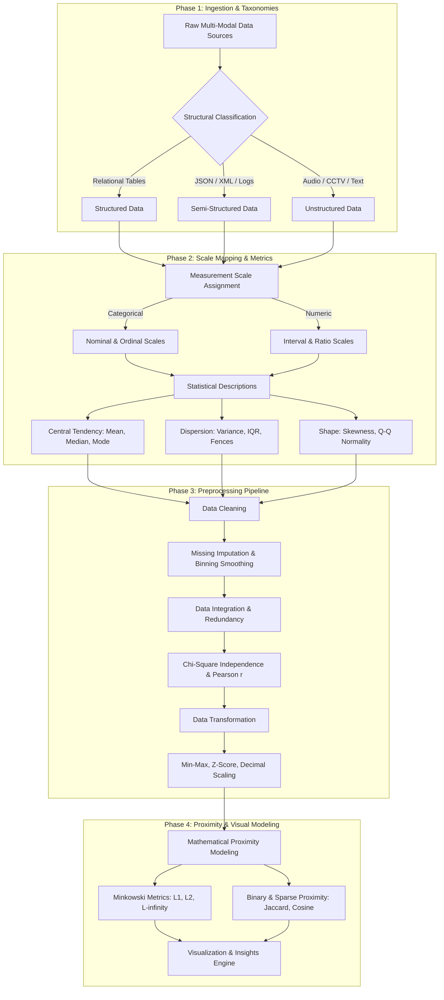

---

## 2. Foundational Concepts in Data Analysis and Visualization

Every analytical workflow is anchored by the fundamental transformation of raw, uninterpreted physical symbols into structured information, contextual knowledge, and operational wisdom.

### 2.1 The Data-Information-Knowledge Hierarchy

| Construct | Formal Definition | Operational Characteristics | Real-World Enterprise Example |
| :--- | :--- | :--- | :--- |
| **Data** | Unorganized, unprocessed raw facts, figures, symbols, or observations lacking inherent context or meaning. | High volume, low signal-to-noise ratio, unvalidated, syntactically raw. | `[104.5, "2026-11-04T05:22:00Z", "SN-9821"]` |
| **Information** | Data that has been processed, structured, contextualized, or aggregated to answer relational questions (*Who? What? Where? When?*). | Contextualized, filtered, categorized, organized into relational schemas. | "Sensor SN-9821 in Boiler 3 recorded an operating temperature of 104.5 °C at 05:22 UTC." |
| **Knowledge** | Information synthesized with domain expertise, historical baselines, and contextual understanding to enable decision-making (*How?*). | Actionable, cognitive, integrated, validated against historical distributions. | "An operating temperature of 104.5 °C in Boiler 3 exceeds the 99th percentile safety threshold by 12 °C, indicating coolant failure." |

### 2.2 The Comprehensive Data Lifecycle

The data lifecycle spans six distinct chronological stages:

1. **Creating / Capturing:** Data generation at edge devices, user interaction points, or automated logging pipelines.
2. **Processing:** Cleansing, format normalization, entity resolution, and ingestion into storage repositories.
3. **Analysing:** Exploratory descriptive statistics, hypothesis testing, machine learning modeling, and pattern mining.
4. **Preserving / Storing:** Archival into fault-tolerant distributed stores (data lakes, cold storage) ensuring compliance.
5. **Accessing / Sharing:** Role-based delivery of datasets and visualization dashboards to operational stakeholders.
6. **Re-using:** Repurposing historical datasets for longitudinal studies, generative model training, or benchmarking.

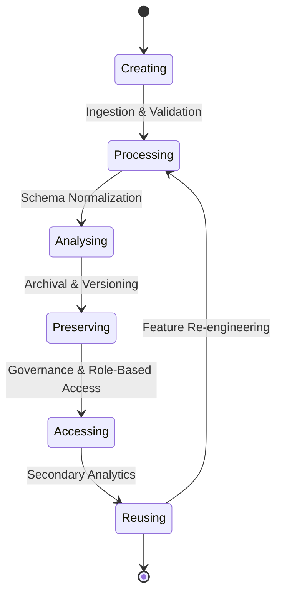

### 2.3 The Analytical Spectrum: Four Tiers of Analytics

Modern business intelligence pipelines partition analytical activities into four maturity stages:

1. **Descriptive Analytics ("What happened?"):** Synthesizes historical transactions into summarized metrics, aggregations, and distribution charts.
2. **Diagnostic Analytics ("Why did it happen?"):** Drills down into historical variances, isolates anomalous sub-populations, and performs correlation analysis to uncover root causes.
3. **Predictive Analytics ("What will happen?"):** Uses historical features to forecast future event probabilities via supervised machine learning and statistical time-series models.
4. **Prescriptive Analytics ("How can we make it happen?"):** Employs mathematical optimization, simulation, and decision theory to recommend automated corrective business actions.

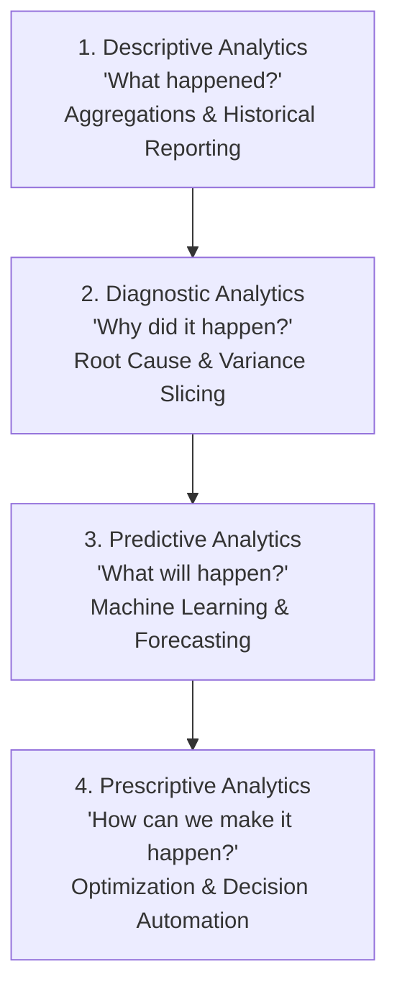

### 2.4 Visualization Rationale & Cleveland's Perceptual Hierarchy

Data visualization is not merely an aesthetic presentation tool; it is a cognitive amplifier. William S. Cleveland defined data visualization as:

> *"Data visualization is the graphical presentation of quantitative and qualitative information to encode complex geometric structures into visual channels, maximizing human perceptual decoding accuracy while minimizing cognitive load."*

Cleveland and McGill established the formal **Perceptual Hierarchy of Elementary Visual Channels**, ranked by human decoding accuracy:
1. **Position along a common scale** (Highest accuracy: scatter plots, bar charts)
2. **Position along identical, non-aligned scales** (Small multiples)
3. **Length** (Bar charts, boxplot whiskers)
4. **Direction / Angle / Slope** (Pie charts, line chart trends)
5. **Area** (Bubble charts, treemaps)
6. **Volume / Curvature** (3D charts)
7. **Color saturation & Hue** (Lowest quantitative accuracy: heatmaps, choropleths)

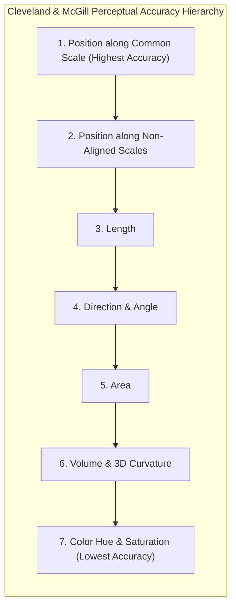

### 2.5 The Gregor Aisch Insights Loop

Visual data discovery follows the cyclical Gregor Aisch Insights Engine:

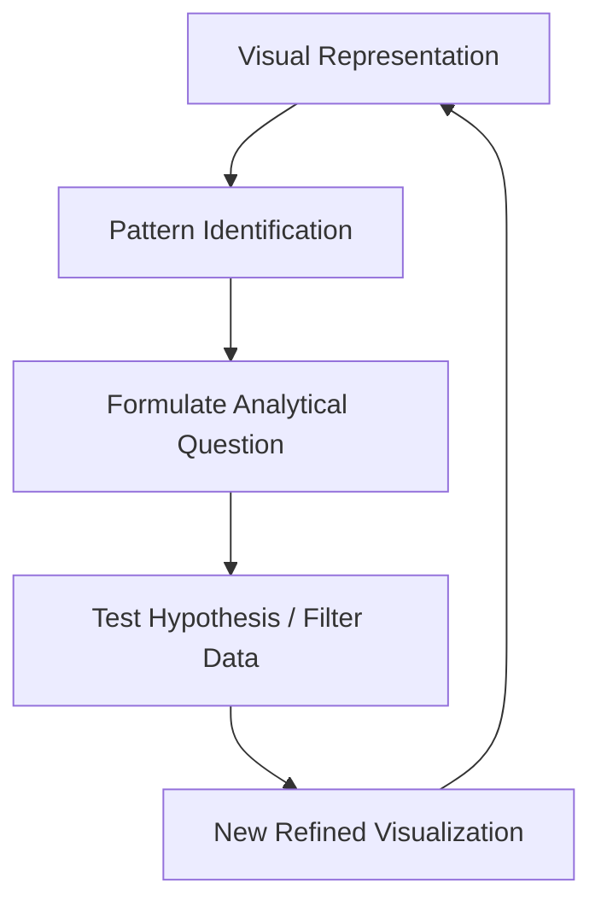

*[Source: 1.Introduction to DAV.pdf, Slides 14–29]*

---

## 3. Data Taxonomies and Dataset Structures

A rigorous understanding of digital data formats and mathematical structures is essential for architecting scalable storage and analytical pipelines.

### 3.1 Digital Data by Structural Organization

Digital data is classified into three structural paradigms:
1. **Structured Data:** Conforms strictly to a predefined schema-on-write tabular structure ($m \times n$ matrix). Supported by declarative SQL engines, relational databases (RDBMS), and columnar formats (Parquet, ORC).
2. **Semi-Structured Data:** Lacks a rigid tabular schema but contains self-describing structural tags, markers, or hierarchical key-value trees. Governed by schema-on-read architectures (JSON, XML, YAML, NoSQL document stores).
3. **Unstructured Data:** Has no predefined schema or data model. Represents raw, unformatted binary or character streams (free-form text, audio, video, CCTV feeds, sensor bitstreams).

### 3.2 Industrial Case Studies: Multi-Modal Data Ecosystems

#### Scenario A: International Airport Hub Infrastructure

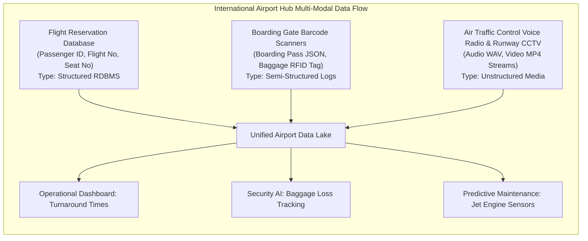

#### Scenario B: Modern Urban Smart Shopping Mall

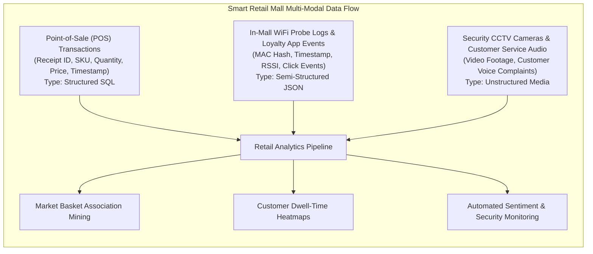

### 3.3 Dataset Topologies & Representations

1. **Record Data:** Collections of independent records with fixed attributes. Subtypes include:
   - *Relational Tables:* Tuples matching a defined relational schema.
   - *Data Matrix:* An $m \times p$ matrix where all rows are objects and columns are continuous numeric features.
   - *Transaction / Market Basket Data:* Sets of items purchased together ($T_i = \{I_1, I_4, I_7\}$).
2. **Sparse Document-Term Matrix:** High-dimensional vector space representation of text documents over a vocabulary dictionary $V$.
3. **Graph and Network Data:** Objects represented as nodes ($V$) and their relational ties as edges ($E$), represented via Adjacency Matrices.
4. **Ordered Data:** Datasets governed by explicit sequence constraints:
   - *Temporal / Time-Series Data:* Sequence of measurements indexed by uniform timestamps.
   - *Sequential Transaction Data:* Web clickstreams or user event logs.
   - *Spatial & Spatio-Temporal Data:* Sensor measurements bound to geographic coordinates $(x, y, z, t)$.

*[Source: 2.Types of Data.pdf, Slides 1–25; 3.Dataset and Attributes.pdf, Slides 12–30]*

---

## 4. Attributes and Measurement Scales

An attribute (feature, dimension, or variable) represents a measurable property or characteristic of a data object.

### 4.1 Stevens' Taxonomy of Measurement Scales

Stanley Smith Stevens (1946) established the foundational taxonomy classifying measurement scales into four distinct levels: Nominal, Ordinal, Interval, and Ratio.

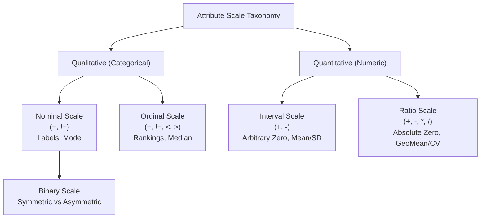

### 4.2 Discrete vs. Continuous Variables

- **Discrete Variable:** Possesses a finite or countably infinite set of states ($S \subseteq \mathbb{Z}$), generated by integer counting. Governed by a Probability Mass Function ($PMF$).
- **Continuous Variable:** Measured across an uncountable real continuum ($S \subseteq \mathbb{R}$), generated by physical instruments. Governed by a Probability Density Function ($PDF$) where $P(X = x) = 0$ for any exact single point.

*[Source: 3.Dataset and Attributes.pdf, Slides 1–11]*

---

## 5. Measures of Central Tendency

Central tendency identifies the single central or representative value around which a numerical distribution clusters.

### 5.1 Arithmetic Mean

The sample arithmetic mean ($\bar{x}$) and population mean ($\mu$) represent the balance point of the distribution:

$$
\bar{x} = \frac{1}{n} \sum_{i=1}^{n} x_i
$$

$$
\mu = \frac{1}{N} \sum_{i=1}^{N} x_i
$$

| Symbol | Definition | Dimension / Permissible Range |
| :---: | :--- | :--- |
| $\bar{x}$ | Sample arithmetic mean | Same physical unit as raw variable $x$ |
| $\mu$ | Population arithmetic mean | Same physical unit as raw variable $x$ |
| $n, N$ | Number of sample observations / population elements | Positive integer ($n \ge 1, N \ge 1$) |
| $x_i$ | Value of the $i$-th observed data point | Real number ($x_i \in \mathbb{R}$) |

#### Weighted Arithmetic Mean
When observations contribute unequal significance:

$$
\bar{x}_w = \frac{\sum_{i=1}^{n} w_i x_i}{\sum_{i=1}^{n} w_i}
$$

#### Trimmed Mean
To insulate the mean against severe outliers, a fraction $\alpha$ (e.g., $\alpha = 0.05$ for a 5% trimmed mean) of extreme observations is clipped from both tails:

$$
\bar{x}_{\text{trim},\alpha} = \frac{1}{n(1 - 2\alpha)} \sum_{i=\lfloor n\alpha \rfloor + 1}^{n - \lfloor n\alpha \rfloor} x_{(i)}
$$

### 5.2 Median and Midrange

- **Median:** The middle value of an ordered sequence. For sample size $n$:
  - If $n$ is odd: $\text{Median} = x_{\left(\frac{n+1}{2}\right)}$
  - If $n$ is even: $\text{Median} = \frac{x_{\left(\frac{n}{2}\right)} + x_{\left(\frac{n}{2} + 1\right)}}{2}$
- **Midrange:** The arithmetic average of the two extreme values: $\text{Midrange} = \frac{\min(X) + \max(X)}{2}$.

### 5.3 Mode and Empirical Relationship

The mode is the value that appears with the greatest frequency. Distributions are categorized as unimodal, bimodal, trimodal, or multimodal.

In moderately skewed unimodal distributions, Karl Pearson's empirical relationship connects the three metrics:

$$
\text{Mean} - \text{Mode} \approx 3(\text{Mean} - \text{Median})
$$

### 5.4 Central Tendency for Grouped Continuous Data

When continuous data is aggregated into frequency intervals, exact individual values are lost. We apply continuous linear interpolation.

#### Grouped Data Arithmetic Mean

$$
\bar{x} = \frac{\sum_{i=1}^{k} f_i m_i}{\sum_{i=1}^{k} f_i}
$$

where $m_i = \frac{L_i + U_i}{2}$ is the midpoint of the $i$-th class interval and $f_i$ is its frequency.

#### Grouped Data Median Interpolation Formula

$$
\text{Median} = L_1 + \left( \frac{\frac{N}{2} - (\sum f)_l}{f_{\text{median}}} \right) w
$$

| Symbol | Mathematical Definition | Physical Context |
| :---: | :--- | :--- |
| $L_1$ | Exact lower class boundary of the median class | Real value |
| $N$ | Total frequency count of the dataset ($\sum f_i$) | Positive integer |
| $(\sum f)_l$ | Cumulative frequency of all intervals preceding median class | Integer ($0 \le (\sum f)_l < N/2$) |
| $f_{\text{median}}$ | Absolute frequency of the median class | Positive integer |
| $w$ | Width of the median class interval | Positive real value ($w = \text{Upper} - \text{Lower}$) |

#### Grouped Data Mode Interpolation Formula

$$
\text{Mode} = L_1 + \left( \frac{\Delta_1}{\Delta_1 + \Delta_2} \right) w
$$

$$
\Delta_1 = f_m - f_{m-1},\quad \Delta_2 = f_m - f_{m+1}
$$

| Symbol | Definition | Physical Context |
| :---: | :--- | :--- |
| $L_1$ | Exact lower boundary of the modal class | Real value |
| $f_m$ | Frequency of the modal class (maximum frequency) | Positive integer |
| $f_{m-1}$ | Frequency of the class directly preceding the modal class | Non-negative integer |
| $f_{m+1}$ | Frequency of the class directly succeeding the modal class | Non-negative integer |
| $w$ | Width of the modal class interval | Positive real value |

*[Source: 4.Statistical Descriptions of Data_new.pdf, Slides 1–28]*

---

## 6. Measures of Data Dispersion and Spread

Central tendency alone cannot fully describe an empirical distribution. Two distributions may possess identical arithmetic means ($\bar{x} = 50$) yet exhibit completely different dispersion profiles. Characterizing spread is essential for risk analysis, quality control, and identifying extreme departures from expected behavior.

### 6.1 Range, Quantiles, Quartiles, and Percentiles

- **Range:** The arithmetic difference between the largest and smallest values: $\text{Range} = x_{\max} - x_{\min}$.
- **Quantiles:** Cut points dividing the ordered probability distribution or sorted sample into continuous intervals with equal probabilities.
- **Percentiles:** The $k$-th percentile ($P_k$) is the value below which $k\%$ of the observations fall.
- **Quartiles:** Three specific cut points that partition the dataset into four equal segments (each containing 25% of the data):
  - **First Quartile ($Q_1$ / 25th Percentile):** $P_{Q_1} = \frac{n + 1}{4}$
  - **Second Quartile ($Q_2$ / 50th Percentile / Median):** $P_{Q_2} = \frac{n + 1}{2}$
  - **Third Quartile ($Q_3$ / 75th Percentile):** $P_{Q_3} = \frac{3(n + 1)}{4}$
- **Interquartile Range ($IQR$):** The distance between the 75th and 25th percentiles:

$$
IQR = Q_3 - Q_1
$$

The $IQR$ measures the spread of the central 50% of the distribution and is inherently resistant to extreme outliers.

### 6.2 The Five-Number Summary and Boxplot Analysis

The Five-Number Summary provides a non-parametric description of data location, spread, and shape:

$$
\text{Five-Number Summary} = [\text{Minimum},\; Q_1,\; \text{Median},\; Q_3,\; \text{Maximum}]
$$

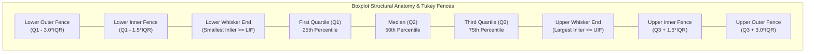

#### John Tukey's Outlier Identification Fences
- **Lower Inner Fence ($LIF$):** $Q_1 - 1.5 \times IQR$
- **Upper Inner Fence ($UIF$):** $Q_3 + 1.5 \times IQR$
- **Lower Outer Fence ($LOF$):** $Q_1 - 3.0 \times IQR$
- **Upper Outer Fence ($UOF$):** $Q_3 + 3.0 \times IQR$

#### Outlier Classification Taxonomy
- **Inlier:** Any data point falling within the inner fences: $x \in [LIF, UIF]$.
- **Mild Outlier:** Any point falling between the inner and outer fences: $x \in [LOF, LIF)$ or $x \in (UIF, UOF]$. Plotted as hollow circles.
- **Extreme Outlier:** Any point falling beyond the outer fences: $x < LOF$ or $x > UOF$. Plotted as filled circles or asterisks.

### 6.3 Distribution Skewness Diagnosis

A distribution's geometric shape and tail asymmetry are diagnosed by comparing central metrics and boxplot component spans:

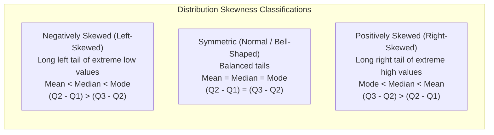

### 6.4 Variance, Standard Deviation, and Single-Pass Shortcut

While $IQR$ is robust against outliers, parametric inferential statistics relies on **Variance** and **Standard Deviation**, which measure the average squared deviation of observations from the arithmetic mean.

#### Population Variance ($\sigma^2$) and Standard Deviation ($\sigma$)

$$
\sigma^2 = \frac{1}{N} \sum_{i=1}^{N} (x_i - \mu)^2,\quad \sigma = \sqrt{\frac{1}{N} \sum_{i=1}^{N} (x_i - \mu)^2}
$$

#### Sample Variance ($s^2$) and Bessel's Correction
When calculating sample variance, dividing by $n$ underestimates the true population variance because sample deviations are measured relative to $\bar{x}$ rather than the true population mean $\mu$. Dividing by $n - 1$ (**Bessel's Correction**) yields an unbiased estimator:

$$
s^2 = \frac{1}{n - 1} \sum_{i=1}^{n} (x_i - \bar{x})^2,\quad s = \sqrt{\frac{1}{n - 1} \sum_{i=1}^{n} (x_i - \bar{x})^2}
$$

#### Derivation of the Single-Pass Computational Shortcut Formula
The definition formula requires two passes over the dataset: pass 1 to compute $\bar{x}$, pass 2 to sum $(x_i - \bar{x})^2$. We derive the single-pass formula algebraically:

$$
\begin{aligned}
\sum_{i=1}^{n} (x_i - \bar{x})^2 &= \sum_{i=1}^{n} \left( x_i^2 - 2 x_i \bar{x} + \bar{x}^2 \right) \\
&= \sum_{i=1}^{n} x_i^2 - 2 \bar{x} \sum_{i=1}^{n} x_i + \sum_{i=1}^{n} \bar{x}^2 \\
&= \sum_{i=1}^{n} x_i^2 - 2 \left( \frac{1}{n} \sum_{i=1}^{n} x_i \right) \left( \sum_{i=1}^{n} x_i \right) + n \left( \frac{1}{n} \sum_{i=1}^{n} x_i \right)^2 \\
&= \sum_{i=1}^{n} x_i^2 - \frac{2}{n} \left( \sum_{i=1}^{n} x_i \right)^2 + \frac{1}{n} \left( \sum_{i=1}^{n} x_i \right)^2 \\
&= \sum_{i=1}^{n} x_i^2 - \frac{1}{n} \left( \sum_{i=1}^{n} x_i \right)^2
\end{aligned}
$$

Substituting this back into Bessel's formula yields the single-pass computational formula:

$$
s^2 = \frac{1}{n - 1} \left[ \sum_{i=1}^{n} x_i^2 - \frac{1}{n} \left( \sum_{i=1}^{n} x_i \right)^2 \right]
$$

### 6.5 Mean Absolute Deviation (MAD)
The Mean Absolute Deviation provides a linear alternative to standard deviation that does not quadratically inflate extreme deviations:

$$
MAD = \frac{1}{n} \sum_{i=1}^{n} |x_i - \bar{x}|
$$

*[Source: 4.Statistical Descriptions of Data_new.pdf, Slides 29–48]*

---

## 7. Graphical Displays and Distribution Diagnostics

Visual diagnostics provide qualitative confirmation of theoretical distribution assumptions prior to statistical modeling.

### 7.1 Histograms vs. Bar Graphs

Although visually similar, histograms and bar graphs operate on fundamentally distinct mathematical scales:
- **Bar Graph:** Visualizes discrete categorical counts. Bars are separated by distinct visual gaps, order along the categorical axis may be rearranged, and bar area is meaningless.
- **Histogram:** Visualizes continuous numerical frequencies. Adjacent rectangular bars have no gaps (unless a bin frequency is zero), order is fixed along the real number line, and the **area under each bar is directly proportional to the frequency density** of that class interval.

### 7.2 Bivariate Scatter Plots and Correlation Patterns

A scatter plot maps paired bivariate continuous observations $(x_1, y_1), (x_2, y_2), \dots, (x_n, y_n)$ onto Cartesian coordinates.

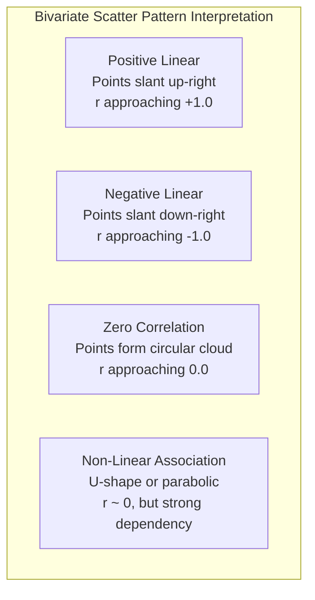

### 7.3 The Normal (Gaussian) Distribution and Theoretical Z-Scores

The Gaussian distribution forms the bedrock of parametric inferential statistics. Its continuous Probability Density Function ($PDF$) is:

$$
f(x) = \frac{1}{\sigma \sqrt{2\pi}} \exp\left( -\frac{(x - \mu)^2}{2\sigma^2} \right)
$$

| Symbol | Mathematical Meaning | Physical / Analytical Context |
| :---: | :--- | :--- |
| $f(x)$ | Probability density at value $x$ | Non-negative real value ($f(x) \ge 0$) |
| $\mu$ | Distribution mean / center of symmetry | Real number ($-\infty < \mu < \infty$) |
| $\sigma$ | Standard deviation / scale parameter | Strictly positive real number ($\sigma > 0$) |
| $\pi, e$ | Mathematical constants ($\pi \approx 3.14159, e \approx 2.71828$) | Invariant geometric & analytical constants |

#### The Empirical Rule (68–95–99.7% Rule)
- $P(\mu - 1\sigma \le X \le \mu + 1\sigma) \approx 0.6827$ (68.27% of observations)
- $P(\mu - 2\sigma \le X \le \mu + 2\sigma) \approx 0.9545$ (95.45% of observations)
- $P(\mu - 3\sigma \le X \le \mu + 3\sigma) \approx 0.9973$ (99.73% of observations)

#### Standard Normal Transformation (Z-Score)
Any arbitrary Gaussian variable $X \sim \mathcal{N}(\mu, \sigma^2)$ is mapped to the standard normal distribution $Z \sim \mathcal{N}(0, 1)$ via:

$$
Z = \frac{x - \mu}{\sigma}
$$

### 7.4 Quantile Plots and Quantile-Quantile (Q-Q) Plots

- **Quantile Plot:** Graphs sorted data values $x_{(i)}$ against their empirical fractional non-exceedance probability $f_i = \frac{i - 0.5}{n}$.
- **Quantile-Quantile (Q-Q) Plot:** A powerful diagnostic tool that plots empirical sample quantiles against theoretical standard normal quantiles to assess whether an observed sample originates from a specified theoretical distribution.

#### Mathematical Mechanics of the Q-Q Plot
1. Sort sample in ascending order: $x_{(1)} \le x_{(2)} \le \dots \le x_{(n)}$.
2. Compute plotting positions: $f_i = \frac{i - 0.5}{n}$ for $i = 1, \dots, n$.
3. Compute theoretical quantiles via standard normal inverse CDF: $Z_{\text{theo}, i} = \Phi^{-1}(f_i)$.
4. Compute actual sample standardized scores: $Z_{\text{act}, i} = \frac{x_{(i)} - \bar{x}}{s}$.
5. Plot coordinate pairs $(Z_{\text{theo}, i}, Z_{\text{act}, i})$. If the sample is drawn from a normal distribution, the plotted points align strictly along the identity line $y = x$.

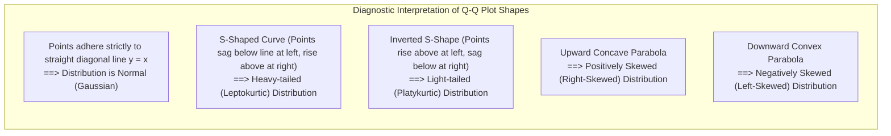

### 7.5 "When to Use What" Visualization Matrix

| Data Modality / Dimensionality | Primary Analytical Objective | Optimal Visualization Method | Alternative Visual Encodings |
| :--- | :--- | :--- | :--- |
| **1D Continuous** | Distribution shape & spread | Histogram with KDE overlay | Boxplot, Violin plot, Quantile plot |
| **1D Categorical** | Frequency counts & composition | Horizontal Bar Chart | Lollipop chart, Pareto chart, Waffle chart |
| **2D Continuous** | Bivariate correlation & clusters | Cartesian Scatter Plot | Hexbin plot, 2D Contour Density plot |
| **2D Categorical** | Cross-tabulation joint frequency | Heatmap matrix | Grouped Bar Chart, Mosaic plot |
| **1D Continuous vs 1D Categorical** | Group distribution comparison | Side-by-Side Boxplots | Ridgeplot (Joyplot), Violin plots |
| **High-Dimensional Continuous** | Multi-attribute correlation | Scatter Plot Matrix (SPLOM) | Parallel Coordinates, RadViz, t-SNE |
| **Hierarchical / Part-to-Whole** | Tree structure decomposition | Treemap | Sunburst diagram, Dendrogram |

*[Source: 4.Statistical Descriptions of Data_new.pdf, Slides 50–101]*

---

## 8. Data Preprocessing Pipeline

Real-world industrial data is notoriously "dirty"—incomplete, noisy, inconsistent, and highly dimensional. Feeding unprocessed data into analytical models leads to misleading visualizations and inaccurate inferences.

### 8.1 Dirty Data Mechanisms & Data Quality Dimensions

### 8.2 The Four Preprocessing Tasks

The standard preprocessing workflow is structured into four sequential phases:

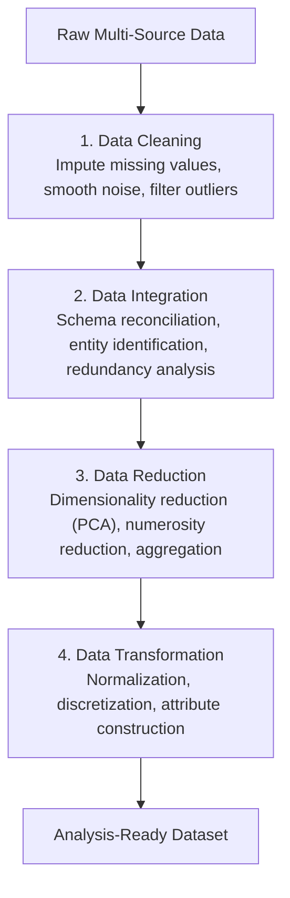

### 8.3 Handling Missing Data: Imputation Strategies

Missing values occur via three primary statistical mechanisms: Missing Completely at Random (MCAR), Missing at Random (MAR), and Missing Not at Random (MNAR). Seven engineering strategies address missingness:

| Strategy | Operational Mechanics | Advantages | Disadvantages & Risks |
| :--- | :--- | :--- | :--- |
| **1. Ignore the Tuple** | Omit the entire row/record containing null attributes. | Zero computational complexity, avoids introducing artificial bias. | Disastrous sample size reduction if nulls are widespread; introduces bias if missingness is non-random. |
| **2. Manual Entry** | Domain human experts manually research and populate missing values. | Highest semantic precision and domain validity. | Completely unscalable for large datasets; prohibitively expensive. |
| **3. Global Constant** | Replace all missing entries with a single token (e.g., `"UNKNOWN"` or `NaN`). | Simple, transparent, prevents algorithms from crashing. | Can be misclassified as a valid category; distorts numerical statistical calculations. |
| **4. Central Tendency Imputation** | Impute using attribute mean (symmetric) or median (skewed data). | Fast, maintains overall sample size and estimated sample mean. | Artificially attenuates variance, alters distribution shape, inflates kurtosis. |
| **5. Class-Conditional Mean** | Impute using the mean/median of records belonging to the same target class. | More granular than global mean; preserves class-specific profiles. | Can reinforce class boundary biases; invalid in strictly unsupervised tasks. |
| **6. Predictive Model Imputation** | Train regression models, decision trees, or k-NN algorithms to predict the missing feature. | Maximizes inter-attribute relational fidelity and conditional distributions. | Computationally intensive; models may overfit and underestimate standard errors. |
| **7. Missingness Indicator** | Impute with median and append a binary indicator flag ($I_{\text{miss}} \in \{0, 1\}$). | Retains complete records while allowing algorithms to learn missingness signals. | Doubles attribute dimensionality. |

### 8.4 Noise Smoothing Techniques

Noise represents random error or variance in a measured continuous variable. Three primary techniques smooth noise:

#### 1. Binning (Discretization & Smoothing)
- Sorted data is partitioned into discrete bins.
- **Equal-Width Binning:** Divides the numerical range $[\min, \max]$ into $k$ equal-width intervals:

$$
W = \frac{\max(A) - \min(A)}{k}
$$

- **Equal-Depth (Equal-Frequency) Binning:** Partitions ordered data such that each bin contains exactly $N/k$ observations.
- Once partitioned, smoothing is applied via:
  - *Smoothing by Bin Means:* Each value is replaced by the bin average.
  - *Smoothing by Bin Medians:* Each value is replaced by the bin median.
  - *Smoothing by Bin Boundaries:* Each value is replaced by the closest boundary (bin minimum or maximum).

#### 2. Regression
Data is smoothed by fitting mathematical functions:
- *Linear Regression:* $y = w_0 + w_1 x$.
- *Multiple Linear Regression:* $y = w_0 + \sum w_i x_i$.

#### 3. Clustering
Outliers and noisy observations are identified and suppressed by grouping similar data objects into clusters (e.g., via k-Means). Data points lying far outside all cluster centroids are isolated as noise.

### 8.5 Data Integration & Redundancy Analysis

Data integration merges records across disparate operational schemas. Redundant attributes (duplicate information stored under different column headers) degrade performance and induce multicollinearity.

#### Redundancy in Categorical Data: Chi-Square ($\chi^2$) Contingency Test
For two categorical attributes $A$ (with $r$ states) and $B$ (with $c$ states) organized into a contingency table:

$$
e_{ij} = \frac{\text{Row}_i \text{ Total} \times \text{Column}_j \text{ Total}}{N}
$$

$$
\chi^2 = \sum_{i=1}^{r} \sum_{j=1}^{c} \frac{(o_{ij} - e_{ij})^2}{e_{ij}}
$$

| Symbol | Mathematical Definition | Permissible Range |
| :---: | :--- | :--- |
| $o_{ij}$ | Observed joint frequency count in cell $(i, j)$ | Non-negative integer ($o_{ij} \ge 0$) |
| $e_{ij}$ | Expected theoretical frequency count under null hypothesis $H_0$ | Positive real number ($e_{ij} > 0$) |
| $r, c$ | Number of rows (categories of $A$) and columns (categories of $B$) | Positive integers ($r \ge 2, c \ge 2$) |
| $N$ | Grand total of all observations ($\sum \sum o_{ij}$) | Positive integer |
| $\chi^2$ | Chi-square test statistic | Real number ($\chi^2 \ge 0$) |

The test has $(r - 1)(c - 1)$ degrees of freedom. If $\chi^2 > \chi^2_{\alpha, df}$, we reject $H_0$; the attributes are statistically dependent and redundant.

#### Redundancy in Numerical Data: Pearson Correlation & Covariance
For continuous attributes $A$ and $B$:

$$
Cov(A, B) = \frac{1}{n - 1} \sum_{i=1}^{n} (a_i - \bar{A})(b_i - \bar{B}) = \frac{\sum a_i b_i - \frac{1}{n}(\sum a_i)(\sum b_i)}{n - 1}
$$

$$
r_{A,B} = \frac{Cov(A, B)}{s_A s_B} = \frac{n \sum AB - (\sum A)(\sum B)}{\sqrt{[n \sum A^2 - (\sum A)^2][n \sum B^2 - (\sum B)^2]}}
$$

The correlation coefficient $r_{A,B} \in [-1.0, +1.0]$:
- $r > 0 \implies$ Positive linear correlation.
- $r < 0 \implies$ Negative linear correlation.
- $r = 0 \implies$ Absence of linear correlation (*Caveat: Does not guarantee independence; strong non-linear relationships may yield $r = 0$*).

### 8.6 Data Normalization Techniques

Normalization transforms numerical features into standardized ranges to prevent attributes with large absolute scales (e.g., Annual Salary: $\$100,000$) from overpowering attributes with small scales (e.g., Age: $25$).

#### 1. Min-Max Normalization
Linearly transforms value $v$ of attribute $A$ into range $[\text{new\_min}_A, \text{new\_max}_A]$:

$$
v' = \frac{v - \min_A}{\max_A - \min_A} (\text{new\_max}_A - \text{new\_min}_A) + \text{new\_min}_A
$$

#### 2. Z-Score (Zero-Mean) Normalization
Standardizes values based on empirical mean $\mu_A$ and standard deviation $\sigma_A$:

$$
v' = \frac{v - \mu_A}{\sigma_A}
$$

*Robust Variant using Mean Absolute Deviation:*

$$
v'_{\text{MAD}} = \frac{v - \mu_A}{s_A},\quad \text{where } s_A = \frac{1}{n} \sum_{i=1}^{n} |a_i - \mu_A|
$$

#### 3. Normalization by Decimal Scaling
Normalizes by moving the decimal point of values of attribute $A$:

$$
v' = \frac{v}{10^j}
$$

where $j$ is the smallest integer such that $\max(|v'|) < 1$, formally:

$$
j = \lceil \log_{10}(\max(|v|)) \rceil
$$

*[Source: 5. data_preprocessing.pdf, Slides 1–57]*

---

## 9. Measuring Data Similarity and Dissimilarity

In pattern recognition, clustering, and visual layout algorithms, we must quantify the mathematical proximity (similarity or dissimilarity) between data objects.

### 9.1 Mathematical Proximity Fundamentals & Metric Axioms

Let $d(i, j)$ be a dissimilarity (distance) function between objects $x_i$ and $x_j$. For $d$ to qualify as a formal mathematical metric, it must satisfy four universal axioms:

1. **Non-negativity:** $d(i, j) \ge 0$
2. **Identity of Indiscernibles:** $d(i, j) = 0 \iff x_i = x_j$
3. **Symmetry:** $d(i, j) = d(j, i)$
4. **Triangle Inequality:** $d(i, j) \le d(i, k) + d(k, j)$ for all $x_i, x_j, x_k$

### 9.2 Data Matrix vs. Dissimilarity Matrix

- **Data Matrix ($n \times p$):** Two-mode format representing $n$ objects across $p$ dimensions.

$$
X = \begin{bmatrix}
x_{11} & \dots & x_{1f} & \dots & x_{1p} \\
\vdots & \ddots & \vdots & \ddots & \vdots \\
x_{n1} & \dots & x_{nf} & \dots & x_{np}
\end{bmatrix}
$$

- **Dissimilarity Matrix ($n \times n$):** Single-mode format storing pairwise distances. Symmetric with zero diagonal entries:

$$
D = \begin{bmatrix}
0 & & & \\
d(2, 1) & 0 & & \\
\vdots & \vdots & \ddots & \\
d(n, 1) & d(n, 2) & \dots & 0
\end{bmatrix}
$$

### 9.3 Proximity for Categorical and Binary Attributes

#### Proximity for Nominal Attributes
For nominal attribute $f$ with $M$ states:

$$
d(i, j) = \frac{p - m}{p}
$$

where $p$ is the total number of nominal attributes and $m$ is the number of matching states.

#### Proximity for Binary Attributes
Let two binary objects $x_i$ and $x_j$ be cross-tabulated into a $2 \times 2$ contingency matrix:
- $q$: Number of attributes where both objects are $1$.
- $r$: Number of attributes where object $i = 1$ and object $j = 0$.
- $s$: Number of attributes where object $i = 0$ and object $j = 1$.
- $t$: Number of attributes where both objects are $0$.
- Total attributes: $p = q + r + s + t$.

1. **Symmetric Binary Proximity (Simple Matching Coefficient - SMC):**

$$
SMC = \frac{q + t}{q + r + s + t},\quad d(i, j) = \frac{r + s}{q + r + s + t}
$$

2. **Asymmetric Binary Proximity (Jaccard Coefficient):**
In asymmetric binary data, mutual absence ($t$) carries negligible diagnostic information and is completely omitted:

$$
s_J = \frac{q}{q + r + s},\quad d(i, j) = \frac{r + s}{q + r + s}
$$

### 9.4 Proximity for Ordinal Attributes

To compute distance across ordinal variables with $M_f$ ordered states:
1. Replace categorical state with its rank: $r_{if} \in \{1, 2, \dots, M_f\}$.
2. Normalize ranks into the continuous interval $[0.0, 1.0]$:

$$
z_{if} = \frac{r_{if} - 1}{M_f - 1}
$$

3. Compute dissimilarity on normalized scores $z_{if}$ using numeric distance metrics.

### 9.5 Minkowski Distance Metric Space

For two continuous numeric vectors $x_i = (x_{i1}, \dots, x_{ip})$ and $x_j = (x_{j1}, \dots, x_{jp})$ in $\mathbb{R}^p$:

$$
d(x_i, x_j) = \left( \sum_{k=1}^{p} |x_{ik} - x_{jk}|^h \right)^{\frac{1}{h}}
$$

Special cases determined by norm parameter $h \ge 1$:
1. **Manhattan Distance ($L_1$ Norm, $h = 1$):** City-block rectilinear distance:

$$
d_{L_1}(x_i, x_j) = \sum_{k=1}^{p} |x_{ik} - x_{jk}|
$$

2. **Euclidean Distance ($L_2$ Norm, $h = 2$):** Straight-line ruler distance:

$$
d_{L_2}(x_i, x_j) = \sqrt{\sum_{k=1}^{p} (x_{ik} - x_{jk})^2}
$$

3. **Chebyshev / Supremum Distance ($L_\infty$ Norm, $h \to \infty$):** Maximum coordinate deviation:

$$
d_{L_\infty}(x_i, x_j) = \lim_{h \to \infty} \left( \sum_{k=1}^{p} |x_{ik} - x_{jk}|^h \right)^{\frac{1}{h}} = \max_{k=1,\dots,p} |x_{ik} - x_{jk}|
$$

### 9.6 Proximity for Mixed-Type Attributes: Gower's General Dissimilarity

Real datasets contain combinations of nominal, binary, ordinal, and numeric features. J.C. Gower formulated the general coefficient combining heterogeneous attributes into a single unified dissimilarity measure:

$$
d(i, j) = \frac{\sum_{f=1}^{p} \delta_{ij}^{(f)} d_{ij}^{(f)}}{\sum_{f=1}^{p} \delta_{ij}^{(f)}}
$$

where $\delta_{ij}^{(f)}$ is an indicator flag set to $0$ if either observation is missing or if attribute $f$ is asymmetric binary with $x_{if} = x_{jf} = 0$, and $1$ otherwise. The individual attribute distance $d_{ij}^{(f)}$ is normalized into $[0, 1]$ according to its specific scale type.

### 9.7 Cosine Similarity for High-Dimensional Sparse Text Vectors

In document analysis, text is represented as word-count vectors. Because vocabularies are vast ($p > 10,000$), documents are sparse vectors with mostly zero entries. Euclidean distance penalizes differing document lengths; **Cosine Similarity** evaluates the cosine of the angle between vectors, normalizing for document length:

$$
\text{sim}_{\cos}(x, y) = \frac{x \cdot y}{\|x\| \|y\|} = \frac{\sum_{k=1}^{p} x_k y_k}{\sqrt{\sum_{k=1}^{p} x_k^2} \sqrt{\sum_{k=1}^{p} y_k^2}}
$$

The complementary **Cosine Distance** is:

$$
d_{\cos}(x, y) = 1 - \text{sim}_{\cos}(x, y)
$$

*[Source: 5.1_Similarity and Dissimilarity.pdf, Slides 1–18]*

---

## 10. Comprehensive Worked Numerical Problems

Every problem in this section is derived directly from the datasets and parameters specified in the Unit 1 lecture decks. Each solution follows the rigorous university examination format: **Problem Statement**, **Given Parameters & Data Representation**, **Required Outputs**, **Governing Formulas & Symbol Definitions**, **Step-by-Step Intermediate Calculations**, and **Final Answer with Contextual Interpretation**.

---

### Problem 10.1: Grouped Data Median and Mode Interpolation
*[Source: 4.Statistical Descriptions of Data_new.pdf, Slides 23–28]*

#### Problem Statement
A university athletic department recorded the sprint completion times (in seconds) of $N = 21$ runners, grouped into four continuous class intervals. In a parallel agricultural quality inspection, the lengths (in millimeters) of $N = 50$ baby carrots were measured and grouped into eight class intervals. For both datasets:
1. Construct the frequency distribution and cumulative frequency distribution tables.
2. Calculate the estimated arithmetic mean using class midpoints.
3. Determine the median class and calculate the interpolated median using the continuous grouping formula.
4. Determine the modal class and calculate the interpolated mode using the empirical frequency formula.
5. Diagnose the distribution skewness by comparing the mean, median, and mode.

---

#### Dataset 1: Sprint Times of Runners ($N = 21$)

##### 1. Given Parameters & Data Representation

| Class Interval (Seconds) | Exact Class Boundaries | Frequency ($f_i$) | Class Midpoint ($m_i$) | $f_i \times m_i$ | Cumulative Frequency ($cf$) |
| :---: | :---: | :---: | :---: | :---: | :---: |
| $51 - 55$ | $50.5 - 55.5$ | 2 | 53 | $2 \times 53 = 106$ | 2 |
| $56 - 60$ | $55.5 - 60.5$ | 7 | 58 | $7 \times 58 = 406$ | 9 |
| $61 - 65$ | $60.5 - 65.5$ | 8 | 63 | $8 \times 63 = 504$ | 17 |
| $66 - 70$ | $65.5 - 70.5$ | 4 | 68 | $4 \times 68 = 272$ | 21 |
| **Total** | — | **$N = \sum f_i = 21$** | — | **$\sum f_i m_i = 1288$** | — |

- Total observations: $N = 21$
- Uniform class width: $w = 55.5 - 50.5 = 5\text{ s}$

##### 2. Required Outputs
- Grouped Mean ($\bar{x}$)
- Grouped Interpolated Median
- Grouped Interpolated Mode
- Direction of Skewness

##### 3. Governing Formulas

$$
\bar{x} = \frac{\sum_{i=1}^{k} f_i m_i}{N}
$$

$$
\text{Median} = L_1 + \left( \frac{\frac{N}{2} - (\sum f)_l}{f_{\text{median}}} \right) w
$$

$$
\text{Mode} = L_1 + \left( \frac{\Delta_1}{\Delta_1 + \Delta_2} \right) w = L_1 + \left( \frac{f_m - f_{m-1}}{(f_m - f_{m-1}) + (f_m - f_{m+1})} \right) w
$$

##### 4. Step-by-Step Calculation

**Step 4.1: Arithmetic Mean**

$$
\bar{x} = \frac{1288}{21} = 61.3333\text{ s}
$$

**Step 4.2: Grouped Median**
- Identify Median Position: $\frac{N}{2} = \frac{21}{2} = 10.5$.
- Inspect cumulative frequencies: The first interval whose cumulative frequency equals or exceeds $10.5$ is $61 - 65$ ($cf = 17$).
- Parameters for median class $61 - 65$:
  - Exact lower class boundary: $L_1 = 60.5$
  - Cumulative frequency preceding median class: $(\sum f)_l = 9$
  - Frequency of median class: $f_{\text{median}} = 8$
  - Class width: $w = 5$
- Substitution:

$$
\text{Median} = 60.5 + \left( \frac{10.5 - 9}{8} \right) \times 5 = 60.5 + \left( \frac{1.5}{8} \right) \times 5 = 60.5 + \frac{7.5}{8} = 60.5 + 0.9375 = 61.4375\text{ s}
$$

**Step 4.3: Grouped Mode**
- Identify Modal Class: The class with the maximum frequency is $61 - 65$ ($f_m = 8$).
- Parameters for modal class $61 - 65$:
  - Lower class boundary: $L_1 = 60.5$
  - Preceding frequency: $f_{m-1} = 7$
  - Succeeding frequency: $f_{m+1} = 4$
  - Differences: $\Delta_1 = f_m - f_{m-1} = 8 - 7 = 1$; $\Delta_2 = f_m - f_{m+1} = 8 - 4 = 4$.
- Substitution:

$$
\text{Mode} = 60.5 + \left( \frac{1}{1 + 4} \right) \times 5 = 60.5 + \left( \frac{1}{5} \right) \times 5 = 60.5 + 1.0 = 61.5000\text{ s}
$$

**Step 4.4: Skewness Diagnosis**
- Comparing the three measures:

$$
\bar{x}\;(61.333\text{ s}) < \text{Median}\;(61.438\text{ s}) < \text{Mode}\;(61.500\text{ s})
$$

- The mean is pulled to the left of the median and mode. Therefore, the runner completion time distribution exhibits **slight negative skewness (left-skewed)**.

---

#### Dataset 2: Lengths of Baby Carrots ($N = 50$)

##### 1. Given Parameters & Data Representation

| Length Interval (mm) | Exact Boundaries | Frequency ($f_i$) | Midpoint ($m_i$) | $f_i \times m_i$ | Cumulative Frequency ($cf$) |
| :---: | :---: | :---: | :---: | :---: | :---: |
| $150 - 154$ | $149.5 - 154.5$ | 5 | 152 | $5 \times 152 = 760$ | 5 |
| $155 - 159$ | $154.5 - 159.5$ | 2 | 157 | $2 \times 157 = 314$ | 7 |
| $160 - 164$ | $159.5 - 164.5$ | 6 | 162 | $6 \times 162 = 972$ | 13 |
| $165 - 169$ | $164.5 - 169.5$ | 8 | 167 | $8 \times 167 = 1336$ | 21 |
| $170 - 174$ | $169.5 - 174.5$ | 9 | 172 | $9 \times 172 = 1548$ | 30 |
| $175 - 179$ | $174.5 - 179.5$ | 11 | 177 | $11 \times 177 = 1947$ | 41 |
| $180 - 184$ | $179.5 - 184.5$ | 6 | 182 | $6 \times 182 = 1092$ | 47 |
| $185 - 189$ | $184.5 - 189.5$ | 3 | 187 | $3 \times 187 = 561$ | 50 |
| **Total** | — | **$N = 50$** | — | **$\sum f_i m_i = 8530$** | — |

- Total items: $N = 50$; Uniform width: $w = 5\text{ mm}$.

##### 2. Step-by-Step Calculation

**Step 2.1: Arithmetic Mean**

$$
\bar{x} = \frac{8530}{50} = 170.6000\text{ mm}
$$

**Step 2.2: Grouped Median**
- Median Position: $\frac{N}{2} = \frac{50}{2} = 25$.
- Inspecting $cf$: Interval $170 - 174$ contains $cf = 30 \ge 25$.
- Parameters: $L_1 = 169.5$, $(\sum f)_l = 21$, $f_{\text{median}} = 9$, $w = 5$.

$$
\text{Median} = 169.5 + \left( \frac{25 - 21}{9} \right) \times 5 = 169.5 + \frac{20}{9} = 169.5 + 2.2222 = 171.7222\text{ mm}
$$

**Step 2.3: Grouped Mode**
- Modal Class: Maximum frequency is $f_m = 11$, located in interval $175 - 179$.
- Parameters: $L_1 = 174.5$, $f_{m-1} = 9$, $f_{m+1} = 6$, $w = 5$.
- Differences: $\Delta_1 = 11 - 9 = 2$; $\Delta_2 = 11 - 6 = 5$.

$$
\text{Mode} = 174.5 + \left( \frac{2}{2 + 5} \right) \times 5 = 174.5 + \frac{10}{7} = 174.5 + 1.4286 = 175.9286\text{ mm}
$$

**Step 2.4: Skewness Diagnosis**

$$
\bar{x}\;(170.60\text{ mm}) < \text{Median}\;(171.72\text{ mm}) < \text{Mode}\;(175.93\text{ mm})
$$

- Confirms **negative (left) skewness**; the longer tail of shorter carrots pulls the mean below both the median and the dominant modal peak.

---

### Problem 10.2: Five-Number Summary, IQR, Tukey Inner Fences & Outlier Detection
*[Source: 4.Statistical Descriptions of Data_new.pdf, Slides 29–64]*

#### Problem Statement
A quality audit measured the operational temperature ($^\circ\text{C}$) of $n = 11$ server chassis:
$$
\{34, 28, 50, 29, 35, 25, 30, 37, 29, 38, 35\}
$$
1. Sort the dataset and compute the Five-Number Summary ($Min, Q_1, \text{Median}, Q_3, Max$).
2. Compute the Interquartile Range ($IQR$).
3. Establish Tukey's Lower and Upper Inner Fences, and Lower and Upper Outer Fences.
4. Identify any mild or extreme outliers.
5. Specify the exact numerical boundaries of the boxplot whiskers and diagnose distribution skewness.

---

#### 1. Given Parameters & Data Representation
- Raw data: $\{34, 28, 50, 29, 35, 25, 30, 37, 29, 38, 35\}$, Sample size: $n = 11$.
- Sorted array in ascending order:

$$
x_{(1)}=25,\; x_{(2)}=28,\; x_{(3)}=29,\; x_{(4)}=29,\; x_{(5)}=30,\; x_{(6)}=34,\; x_{(7)}=35,\; x_{(8)}=35,\; x_{(9)}=37,\; x_{(10)}=38,\; x_{(11)}=50
$$

#### 2. Governing Formulas
- First Quartile ($Q_1$): Position $P_{Q_1} = \frac{n + 1}{4}$
- Median ($Q_2$): Position $P_{Q_2} = \frac{n + 1}{2}$
- Third Quartile ($Q_3$): Position $P_{Q_3} = \frac{3(n + 1)}{4}$
- Interquartile Range: $IQR = Q_3 - Q_1$
- Tukey Fences:
  - Lower Inner Fence ($LIF$): $Q_1 - 1.5 \times IQR$
  - Upper Inner Fence ($UIF$): $Q_3 + 1.5 \times IQR$
  - Lower Outer Fence ($LOF$): $Q_1 - 3.0 \times IQR$
  - Upper Outer Fence ($UOF$): $Q_3 + 3.0 \times IQR$

#### 3. Step-by-Step Calculation

**Step 3.1: Five-Number Summary**
- Minimum: $x_{(1)} = 25$
- Position of $Q_1$: $\frac{11 + 1}{4} = 3^{\text{rd}}$ value $\implies Q_1 = x_{(3)} = 29$
- Position of Median ($Q_2$): $\frac{11 + 1}{2} = 6^{\text{th}}$ value $\implies \text{Median} = x_{(6)} = 34$
- Position of $Q_3$: $\frac{3(11 + 1)}{4} = 9^{\text{th}}$ value $\implies Q_3 = x_{(9)} = 37$
- Maximum: $x_{(11)} = 50$
- **Five-Number Summary Vector:** $[25, 29, 34, 37, 50]$

**Step 3.2: Interquartile Range ($IQR$)**

$$
IQR = Q_3 - Q_1 = 37 - 29 = 8
$$

- Step size: $1.5 \times IQR = 1.5 \times 8 = 12$
- Outer step size: $3.0 \times IQR = 3.0 \times 8 = 24$

**Step 3.3: Tukey Fences**
- Lower Inner Fence: $LIF = 29 - 12 = 17$
- Upper Inner Fence: $UIF = 37 + 12 = 49$
- Lower Outer Fence: $LOF = 29 - 24 = 5$
- Upper Outer Fence: $UOF = 37 + 24 = 61$

**Step 3.4: Outlier Classification**
- A data point $x$ is an **inlier** if $LIF \le x \le UIF$ ($17 \le x \le 49$).
- A point $x$ is a **mild outlier** if $UIF < x \le UOF$ ($49 < x \le 61$) or $LOF \le x < LIF$ ($5 \le x < 17$).
- A point $x$ is an **extreme outlier** if $x > UOF$ ($x > 61$) or $x < LOF$ ($x < 5$).
- Evaluation: Observation $x_{(11)} = 50$.
  - Since $49 < 50 \le 61$, the value **$50^\circ\text{C}$ is a mild outlier**.

**Step 3.5: Boxplot Whiskers & Skewness**
- Lower whisker terminates at the smallest data value within the inner fences: $x_{\min \ge 17} = 25$.
- Upper whisker terminates at the largest data value within the inner fences: $x_{\max \le 49} = 38$.
- The outlier point $50$ is plotted as an isolated marker beyond the upper whisker.
- Skewness diagnosis:
  - Upper inner box: $Q_3 - \text{Median} = 37 - 34 = 3$
  - Lower inner box: $\text{Median} - Q_1 = 34 - 29 = 5$
  - Within the central 50%, data is slightly left-compressed, but the presence of the severe upper extension to $50$ causes an extended **right tail**, creating overall **positive skewness** in distribution diagnostics.

---

### Problem 10.3: Normality Assessment via Quantile-Quantile (Q-Q) Plot ($n = 9$)
*[Source: 4.Statistical Descriptions of Data_new.pdf, Slides 85–97]*

#### Problem Statement
A laboratory recorded the following $n = 9$ environmental sensor measurements:
$$
\{7.19, 6.31, 5.89, 4.50, 3.77, 4.25, 5.19, 5.79, 6.79\}
$$
1. Sort the observations and compute the sample mean ($\bar{x}$) and sample standard deviation ($s$).
2. Assign plotting percentiles $f_i = \frac{i - 0.5}{n}$ to each rank.
3. Determine theoretical standard normal quantiles ($Z_{\text{theo}}$) using the standard normal inverse CDF ($\Phi^{-1}(f_i)$).
4. Compute the actual sample Z-scores ($Z_{\text{act}} = \frac{x_{(i)} - \bar{x}}{s}$).
5. Tabulate the Q-Q coordinate pairs and evaluate whether the sample originates from a Gaussian distribution.

---

#### 1. Given Parameters & Data Representation
- Sample size: $n = 9$. Sorted array $x_{(i)}$:
  $x_{(1)}=3.77, x_{(2)}=4.25, x_{(3)}=4.50, x_{(4)}=5.19, x_{(5)}=5.79, x_{(6)}=5.89, x_{(7)}=6.31, x_{(8)}=6.79, x_{(9)}=7.19$.

#### 2. Governing Formulas

$$
\bar{x} = \frac{\sum_{i=1}^{n} x_i}{n},\quad s = \sqrt{\frac{\sum_{i=1}^{n} (x_i - \bar{x})^2}{n - 1}},\quad f_i = \frac{i - 0.5}{n},\quad Z_{\text{theo}} = \Phi^{-1}(f_i),\quad Z_{\text{act}} = \frac{x_{(i)} - \bar{x}}{s}
$$

#### 3. Step-by-Step Calculation

**Step 3.1: Sample Statistics**
- Sum: $\sum x_i = 3.77 + 4.25 + 4.50 + 5.19 + 5.79 + 5.89 + 6.31 + 6.79 + 7.19 = 49.68$
- Sample Mean: $\bar{x} = \frac{49.68}{9} = 5.5200$
- Sum of Squared Deviations $\sum (x_i - \bar{x})^2$:
  - $(3.77 - 5.52)^2 = (-1.75)^2 = 3.0625$
  - $(4.25 - 5.52)^2 = (-1.27)^2 = 1.6129$
  - $(4.50 - 5.52)^2 = (-1.02)^2 = 1.0404$
  - $(5.19 - 5.52)^2 = (-0.33)^2 = 0.1089$
  - $(5.79 - 5.52)^2 = (0.27)^2 = 0.0729$
  - $(5.89 - 5.52)^2 = (0.37)^2 = 0.1369$
  - $(6.31 - 5.52)^2 = (0.79)^2 = 0.6241$
  - $(6.79 - 5.52)^2 = (1.27)^2 = 1.6129$
  - $(7.19 - 5.52)^2 = (1.67)^2 = 2.7889$
  - Total $\sum (x_i - \bar{x})^2 = 12.0604$
- Sample Standard Deviation:

$$
s = \sqrt{\frac{12.0604}{9 - 1}} = \sqrt{\frac{12.0604}{8}} = \sqrt{1.50755} \approx 1.2278
$$

**Step 3.2: Percentile & Quantile Mapping Table**

| Rank ($i$) | Sorted $x_{(i)}$ | Percentile $f_i = \frac{i - 0.5}{9}$ | Cumulative % | Theoretical $Z_{\text{theo}} = \Phi^{-1}(f_i)$ | Theoretical Quantile ($\bar{x} + s Z$) | Actual $Z_{\text{act}} = \frac{x_{(i)} - \bar{x}}{s}$ |
| :---: | :---: | :---: | :---: | :---: | :---: | :---: |
| 1 | 3.77 | $\frac{0.5}{9} = 0.0556$ | 5.56% | **$-1.593$** | 3.56 | **$-1.425$** |
| 2 | 4.25 | $\frac{1.5}{9} = 0.1667$ | 16.67% | **$-0.967$** | 4.33 | **$-1.034$** |
| 3 | 4.50 | $\frac{2.5}{9} = 0.2778$ | 27.78% | **$-0.589$** | 4.80 | **$-0.831$** |
| 4 | 5.19 | $\frac{3.5}{9} = 0.3889$ | 38.89% | **$-0.282$** | 5.17 | **$-0.269$** |
| 5 | 5.79 | $\frac{4.5}{9} = 0.5000$ | 50.00% | **$0.000$** | 5.52 | **$+0.220$** |
| 6 | 5.89 | $\frac{5.5}{9} = 0.6111$ | 61.11% | **$+0.282$** | 5.87 | **$+0.301$** |
| 7 | 6.31 | $\frac{6.5}{9} = 0.7222$ | 72.22% | **$+0.589$** | 6.24 | **$+0.643$** |
| 8 | 6.79 | $\frac{7.5}{9} = 0.8333$ | 83.33% | **$+0.967$** | 6.71 | **$+1.034$** |
| 9 | 7.19 | $\frac{8.5}{9} = 0.9444$ | 94.44% | **$+1.593$** | 7.48 | **$+1.360$** |

**Step 3.3: Normality Diagnostic Evaluation**
- Plotting $(Z_{\text{theo}}, Z_{\text{act}})$:
  - $(-1.59, -1.43), (-0.97, -1.03), (-0.59, -0.83), (-0.28, -0.27), (0.00, +0.22), (+0.28, +0.30), (+0.59, +0.64), (+0.97, +1.03), (+1.59, +1.36)$.
- **Conclusion:** The plotted coordinate pairs align tightly along the reference diagonal line $y = x$ without systematic S-shaped curvature or parabolic arching. Therefore, the data satisfies the assumption of **univariate normality**.

---

### Problem 10.4: Binning Techniques for Data Smoothing
*[Source: 5. data_preprocessing.pdf, Slides 18–25]*

#### Problem Statement
An e-commerce dataset contains sorted customer transaction unit prices (in USD):
$$
\{4, 8, 9, 15, 21, 21, 24, 25, 26, 28, 29, 34\}
$$
1. Partition the data into $k = 3$ equal-depth (frequency-based) bins.
2. Smooth the equal-depth bins using:
   - Smoothing by Bin Means
   - Smoothing by Bin Medians
   - Smoothing by Bin Boundaries
3. Partition the dataset into $k = 3$ equal-width bins and compare the resulting bin distributions.

---

#### 1. Given Parameters & Data Representation
- Total elements: $N = 12$, Number of bins: $k = 3$.
- Sorted array: $X = [4, 8, 9, 15, 21, 21, 24, 25, 26, 28, 29, 34]$.

#### 2. Step-by-Step Calculation

**Step 2.1: Equal-Depth Partitioning**
- Elements per bin: $\text{Depth} = \frac{N}{k} = \frac{12}{3} = 4$.
  - **Bin 1:** $[4, 8, 9, 15]$
  - **Bin 2:** $[21, 21, 24, 25]$
  - **Bin 3:** $[26, 28, 29, 34]$

**Step 2.2: Smoothing by Bin Means**
- **Bin 1 Mean:** $\frac{4 + 8 + 9 + 15}{4} = \frac{36}{4} = 9.0 \implies [9, 9, 9, 9]$
- **Bin 2 Mean:** $\frac{21 + 21 + 24 + 25}{4} = \frac{91}{4} = 22.75 \implies [23, 23, 23, 23]$ (rounded)
- **Bin 3 Mean:** $\frac{26 + 28 + 29 + 34}{4} = \frac{117}{4} = 29.25 \implies [29, 29, 29, 29]$ (rounded)

**Step 2.3: Smoothing by Bin Medians**
- **Bin 1 Median:** $\frac{8 + 9}{2} = 8.5 \implies [8.5, 8.5, 8.5, 8.5]$
- **Bin 2 Median:** $\frac{21 + 24}{2} = 22.5 \implies [22.5, 22.5, 22.5, 22.5]$
- **Bin 3 Median:** $\frac{28 + 29}{2} = 28.5 \implies [28.5, 28.5, 28.5, 28.5]$

**Step 2.4: Smoothing by Bin Boundaries**
- **Bin 1 Boundaries:** Minimum = 4, Maximum = 15.
  - $4 \implies 4$; $8 \implies 4$; $9 \implies 4$; $15 \implies 15 \implies$ **$[4, 4, 4, 15]$**
- **Bin 2 Boundaries:** Minimum = 21, Maximum = 25.
  - $21 \implies 21$; $21 \implies 21$; $24 \implies 25$; $25 \implies 25 \implies$ **$[21, 21, 25, 25]$**
- **Bin 3 Boundaries:** Minimum = 26, Maximum = 34.
  - $26 \implies 26$; $28 \implies 26$; $29 \implies 26$; $34 \implies 34 \implies$ **$[26, 26, 26, 34]$**

**Step 2.5: Equal-Width Partitioning**
- Range: $W = \frac{\text{Max} - \text{Min}}{k} = \frac{34 - 4}{3} = \frac{30}{3} = 10.0$.
  - Interval 1: $[4, 14]$ $\implies$ Elements: $\{4, 8, 9\}$ (Frequency = 3)
  - Interval 2: $(14, 24]$ $\implies$ Elements: $\{15, 21, 21, 24\}$ (Frequency = 4)
  - Interval 3: $(24, 34]$ $\implies$ Elements: $\{25, 26, 28, 29, 34\}$ (Frequency = 5)

---

### Problem 10.5: Chi-Square ($\chi^2$) Contingency Test for Categorical Redundancy
*[Source: 5. data_preprocessing.pdf, Slides 30–39]*

#### Problem Statement
In a market basket data integration task, an enterprise evaluated whether customer `Gender` ($A$) and preference for `Reading Fiction` ($B$) are statistically independent. The observed contingency data across $N = 1500$ individuals is:

| | Like Fiction ($B_1$) | Do Not Like Fiction ($B_2$) | Total |
| :---: | :---: | :---: | :---: |
| **Male ($A_1$)** | 250 | 50 | 300 |
| **Female ($A_2$)** | 200 | 1000 | 1200 |
| **Total** | 450 | 1050 | **1500** |

1. Formulate the Null ($H_0$) and Alternative ($H_1$) hypotheses.
2. Compute the matrix of expected frequencies ($e_{ij}$).
3. Calculate the test statistic $\chi^2$.
4. Determine the degrees of freedom ($df$) and critical value at $\alpha = 0.001$.
5. State the hypothesis decision and assess attribute redundancy.

---

#### 1. Hypothesis Formulation
- **Null Hypothesis ($H_0$):** Gender and Fiction reading preference are statistically independent ($P(A \cap B) = P(A)P(B)$). No correlation or redundancy exists.
- **Alternative Hypothesis ($H_1$):** Gender and Fiction reading preference are statistically dependent. The attributes share redundant mutual information.

#### 2. Governing Formula

$$
e_{ij} = \frac{\text{Row } i \text{ Total} \times \text{Column } j \text{ Total}}{N},\quad \chi^2 = \sum_{i=1}^{r} \sum_{j=1}^{c} \frac{(o_{ij} - e_{ij})^2}{e_{ij}},\quad df = (r - 1)(c - 1)
$$

#### 3. Step-by-Step Calculation

**Step 3.1: Expected Frequencies ($e_{ij}$)**
- $e_{11} (\text{Male, Fiction}) = \frac{300 \times 450}{1500} = 90.0$
- $e_{12} (\text{Male, Non-Fiction}) = \frac{300 \times 1050}{1500} = 210.0$
- $e_{21} (\text{Female, Fiction}) = \frac{1200 \times 450}{1500} = 360.0$
- $e_{22} (\text{Female, Non-Fiction}) = \frac{1200 \times 1050}{1500} = 840.0$

*Expected Frequencies Table ($e_{ij}$):*

| | Like Fiction | Do Not Like Fiction | Total |
| :---: | :---: | :---: | :---: |
| **Male** | 90.0 | 210.0 | 300.0 |
| **Female** | 360.0 | 840.0 | 1200.0 |
| **Total** | 450.0 | 1050.0 | 1500.0 |

**Step 3.2: Chi-Square Cell Contributions**

$$
\chi^2_{1,1} = \frac{(250 - 90)^2}{90} = \frac{25600}{90} \approx 284.4444
$$

$$
\chi^2_{1,2} = \frac{(50 - 210)^2}{210} = \frac{25600}{210} \approx 121.9048
$$

$$
\chi^2_{2,1} = \frac{(200 - 360)^2}{360} = \frac{25600}{360} \approx 71.1111
$$

$$
\chi^2_{2,2} = \frac{(1000 - 840)^2}{840} = \frac{25600}{840} \approx 30.4762
$$

**Step 3.3: Total $\chi^2$ Summation**

$$
\chi^2 = 284.4444 + 121.9048 + 71.1111 + 30.4762 = 507.9365
$$

**Step 3.4: Degrees of Freedom & Critical Value**
- $df = (2 - 1) \times (2 - 1) = 1$.
- Critical value at $\alpha = 0.001$: $\chi^2_{0.001, 1} = 10.828$.

**Step 3.5: Statistical Decision & Redundancy Interpretation**
- Calculated $\chi^2 = 507.94 \gg 10.828 \implies p \ll 10^{-10}$.
- **Decision:** **Reject $H_0$** at the $0.1\%$ significance level.
- **Engineering Implication:** Gender and preference for fiction are strongly dependent, exhibiting severe redundancy. Retaining both attributes introduces multicollinearity into downstream predictive models.

---

### Problem 10.6: Pearson Correlation Coefficient ($r$) and Sample Covariance
*[Source: 5. data_preprocessing.pdf, Slides 40–48]*

#### Problem Statement
A clinical study tracked patient age ($X$, in years) and fasting blood glucose level ($Y$, in mg/dL) across $n = 6$ patients:
$$
\{(43, 99), (21, 65), (25, 79), (42, 75), (57, 87), (59, 81)\}
$$
1. Construct the complete summation table for $\sum X, \sum Y, \sum X^2, \sum Y^2, \sum XY$.
2. Calculate the sample means $\bar{X}$ and $\bar{Y}$.
3. Calculate the sample covariance $Cov(X, Y)$.
4. Calculate the sample standard deviations $s_X$ and $s_Y$.
5. Compute the Pearson correlation coefficient $r_{X,Y}$ and classify the strength and direction of the linear relationship.

---

#### 1. Given Parameters & Summation Table ($n = 6$)

| Patient ($i$) | Age ($X_i$) | Glucose ($Y_i$) | $X_i^2$ | $Y_i^2$ | $X_i Y_i$ |
| :---: | :---: | :---: | :---: | :---: | :---: |
| 1 | 43 | 99 | 1849 | 9801 | 4257 |
| 2 | 21 | 65 | 441 | 4225 | 1365 |
| 3 | 25 | 79 | 625 | 6241 | 1975 |
| 4 | 42 | 75 | 1764 | 5625 | 3150 |
| 5 | 57 | 87 | 3249 | 7569 | 4959 |
| 6 | 59 | 81 | 3481 | 6561 | 4779 |
| **Sum ($\sum$)** | **247** | **486** | **11409** | **40022** | **20485** |

#### 2. Governing Formulas

$$
\bar{X} = \frac{\sum X}{n},\quad \bar{Y} = \frac{\sum Y}{n}
$$

$$
Cov(X, Y) = \frac{\sum XY - \frac{(\sum X)(\sum Y)}{n}}{n - 1}
$$

$$
r_{X,Y} = \frac{Cov(X, Y)}{s_X s_Y} = \frac{n \sum XY - (\sum X)(\sum Y)}{\sqrt{[n \sum X^2 - (\sum X)^2][n \sum Y^2 - (\sum Y)^2]}}
$$

#### 3. Step-by-Step Calculation

**Step 3.1: Sample Means**

$$
\bar{X} = \frac{247}{6} = 41.1667\text{ years},\quad \bar{Y} = \frac{486}{6} = 81.0000\text{ mg/dL}
$$

**Step 3.2: Sample Covariance**

$$
Cov(X, Y) = \frac{20485 - \frac{247 \times 486}{6}}{6 - 1} = \frac{20485 - 20007}{5} = \frac{478}{5} = 95.6000
$$

- Since $Cov(X, Y) = +95.6 > 0$, age and glucose levels vary together positively.

**Step 3.3: Sample Standard Deviations**

$$
s_X^2 = \frac{11409 - \frac{(247)^2}{6}}{5} = \frac{11409 - 10168.1667}{5} = \frac{1240.8333}{5} = 248.1667 \implies s_X \approx 15.7533\text{ years}
$$

$$
s_Y^2 = \frac{40022 - \frac{(486)^2}{6}}{5} = \frac{40022 - 39366}{5} = \frac{656}{5} = 131.2000 \implies s_Y \approx 11.4543\text{ mg/dL}
$$

**Step 3.4: Pearson Correlation Coefficient ($r$)**

$$
r_{X,Y} = \frac{Cov(X, Y)}{s_X s_Y} = \frac{95.6000}{15.7533 \times 11.4543} = \frac{95.6000}{180.4431} \approx 0.5298
$$

*Verification via Computational Single-Pass Formula:*

$$
r_{X,Y} = \frac{6(20485) - (247)(486)}{\sqrt{[6(11409) - (247)^2][6(40022) - (486)^2]}} = \frac{122910 - 120042}{\sqrt{[68454 - 61009][240132 - 236196]}}
$$

$$
r_{X,Y} = \frac{2868}{\sqrt{7445 \times 3936}} = \frac{2868}{\sqrt{29303520}} = \frac{2868}{5413.2726} \approx 0.5298
$$

**Step 3.5: Statistical Interpretation**
- $r = +0.530$ indicates a **moderate positive linear relationship**.
- As patient age increases, blood glucose levels tend to increase linearly, accounting for $r^2 = (0.5298)^2 = 0.2807$ ($28.1\%$) of the shared variance.

---

### Problem 10.7: Data Normalization Methods
*[Source: 5. data_preprocessing.pdf, Slides 49–57]*

#### Problem Statement
An income attribute in an engineering dataset ranges from $\min = \$12,000$ to $\max = \$98,000$, with an empirical mean of $\mu = \$54,000$ and a standard deviation of $\sigma = \$16,000$. A financial record displays a salary of $v = \$73,600$.
1. Normalize $v$ into the range $[0.0, 1.0]$ using Min-Max Normalization.
2. Normalize $v$ into the range $[-1.0, 1.0]$ using Min-Max Normalization.
3. Compute the Z-score normalized value of $v$.
4. In another dataset, an attribute has values in the interval $[-986, 917]$. Normalize the extreme values $-986$ and $+917$ using Decimal Scaling.

---

#### 1. Governing Formulas

$$
v'_{\text{min-max}} = \frac{v - \min_A}{\max_A - \min_A} (\text{new\_max}_A - \text{new\_min}_A) + \text{new\_min}_A
$$

$$
v'_{\text{z-score}} = \frac{v - \mu_A}{\sigma_A}
$$

$$
v'_{\text{decimal}} = \frac{v}{10^j} \quad \text{where } j = \lceil \log_{10}(\max(|v|)) \rceil
$$

#### 2. Step-by-Step Calculation

**Step 2.1: Min-Max Normalization to $[0.0, 1.0]$**

$$
v' = \frac{73600 - 12000}{98000 - 12000} (1.0 - 0.0) + 0.0 = \frac{61600}{86000} \approx 0.7163
$$

**Step 2.2: Min-Max Normalization to $[-1.0, 1.0]$**

$$
v'' = \frac{61600}{86000} \times (1.0 - (-1.0)) + (-1.0) = (0.716279 \times 2.0) - 1.0 = 1.432558 - 1.0 = +0.4326
$$

**Step 2.3: Z-Score Normalization**

$$
v'_{\text{z-score}} = \frac{73600 - 54000}{16000} = \frac{19600}{16000} = +1.2250
$$

- *Interpretation:* The salary of $\$73,600$ lies exactly **$1.225$ standard deviations above the population mean**.

**Step 2.4: Decimal Scaling Normalization**
- Given interval: $[-986, 917]$. Maximum absolute value: $\max(|v|) = \max(|-986|, |917|) = 986$.
- Determine scaling factor $j$: Smallest integer such that $\frac{986}{10^j} < 1 \implies j = 3$ ($10^3 = 1000$).
- Transformation:
  - $v_1 = -986 \implies v'_1 = \frac{-986}{1000} = \mathbf{-0.986}$
  - $v_2 = +917 \implies v'_2 = \frac{+917}{1000} = \mathbf{+0.917}$

---

### Problem 10.8: Minkowski Distance Dissimilarity Matrices ($L_1, L_2, L_\infty$)
*[Source: 5.1_Similarity and Dissimilarity.pdf, Slides 9–13]*

#### Problem Statement
Given four spatial data objects in $\mathbb{R}^2$:
$$
x_1 = (1, 2),\quad x_2 = (3, 5),\quad x_3 = (2, 0),\quad x_4 = (4, 5)
$$
Construct the complete, lower-triangular dissimilarity matrices using:
1. Manhattan Distance ($L_1$ norm, $h = 1$)
2. Euclidean Distance ($L_2$ norm, $h = 2$)
3. Chebyshev / Supremum Distance ($L_\infty$ norm, $h \to \infty$)

---

#### 1. Governing Formulas

$$
L_1: d(x_i, x_j) = |x_{i1} - x_{j1}| + |x_{i2} - x_{j2}|
$$

$$
L_2: d(x_i, x_j) = \sqrt{(x_{i1} - x_{j1})^2 + (x_{i2} - x_{j2})^2}
$$

$$
L_\infty: d(x_i, x_j) = \max(|x_{i1} - x_{j1}|, |x_{i2} - x_{j2}|)
$$

#### 2. Step-by-Step Pairwise Distance Computations

**Step 2.1: Coordinate Differences ($\Delta_1 = x_{i1} - x_{j1}$, $\Delta_2 = x_{i2} - x_{j2}$)**
- $(x_2, x_1)$: $\Delta_1 = 3 - 1 = 2$, $\Delta_2 = 5 - 2 = 3$
- $(x_3, x_1)$: $\Delta_1 = 2 - 1 = 1$, $\Delta_2 = 0 - 2 = -2$
- $(x_4, x_1)$: $\Delta_1 = 4 - 1 = 3$, $\Delta_2 = 5 - 2 = 3$
- $(x_3, x_2)$: $\Delta_1 = 2 - 3 = -1$, $\Delta_2 = 0 - 5 = -5$
- $(x_4, x_2)$: $\Delta_1 = 4 - 3 = 1$, $\Delta_2 = 5 - 5 = 0$
- $(x_4, x_3)$: $\Delta_1 = 4 - 2 = 2$, $\Delta_2 = 5 - 0 = 5$

**Step 2.2: Manhattan Distance ($L_1$)**
- $d_{L_1}(x_2, x_1) = |2| + |3| = 5.0$
- $d_{L_1}(x_3, x_1) = |1| + |-2| = 1 + 2 = 3.0$
- $d_{L_1}(x_4, x_1) = |3| + |3| = 6.0$
- $d_{L_1}(x_3, x_2) = |-1| + |-5| = 1 + 5 = 6.0$
- $d_{L_1}(x_4, x_2) = |1| + |0| = 1.0$
- $d_{L_1}(x_4, x_3) = |2| + |5| = 7.0$

*Manhattan Dissimilarity Matrix ($D_{L_1}$):*

$$
D_{L_1} = \begin{bmatrix}
0 & & & \\
5 & 0 & & \\
3 & 6 & 0 & \\
6 & 1 & 7 & 0
\end{bmatrix}
$$

**Step 2.3: Euclidean Distance ($L_2$)**
- $d_{L_2}(x_2, x_1) = \sqrt{2^2 + 3^2} = \sqrt{13} \approx 3.6056$
- $d_{L_2}(x_3, x_1) = \sqrt{1^2 + (-2)^2} = \sqrt{5} \approx 2.2361$
- $d_{L_2}(x_4, x_1) = \sqrt{3^2 + 3^2} = \sqrt{18} \approx 4.2426$
- $d_{L_2}(x_3, x_2) = \sqrt{(-1)^2 + (-5)^2} = \sqrt{26} \approx 5.0990$
- $d_{L_2}(x_4, x_2) = \sqrt{1^2 + 0^2} = 1.0000$
- $d_{L_2}(x_4, x_3) = \sqrt{2^2 + 5^2} = \sqrt{29} \approx 5.3852$

*Euclidean Dissimilarity Matrix ($D_{L_2}$):*

$$
D_{L_2} = \begin{bmatrix}
0 & & & \\
3.61 & 0 & & \\
2.24 & 5.10 & 0 & \\
4.24 & 1.00 & 5.39 & 0
\end{bmatrix}
$$

**Step 2.4: Chebyshev / Supremum Distance ($L_\infty$)**
- $d_{L_\infty}(x_2, x_1) = \max(|2|, |3|) = 3.0$
- $d_{L_\infty}(x_3, x_1) = \max(|1|, |-2|) = 2.0$
- $d_{L_\infty}(x_4, x_1) = \max(|3|, |3|) = 3.0$
- $d_{L_\infty}(x_3, x_2) = \max(|-1|, |-5|) = 5.0$
- $d_{L_\infty}(x_4, x_2) = \max(|1|, |0|) = 1.0$
- $d_{L_\infty}(x_4, x_3) = \max(|2|, |5|) = 5.0$

*Chebyshev Dissimilarity Matrix ($D_{L_\infty}$):*

$$
D_{L_\infty} = \begin{bmatrix}
0 & & & \\
3 & 0 & & \\
2 & 5 & 0 & \\
3 & 1 & 5 & 0
\end{bmatrix}
$$

---

### Problem 10.9: Asymmetric Binary Proximity & Jaccard Similarity
*[Source: 5.1_Similarity and Dissimilarity.pdf, Slides 6–8]*

#### Problem Statement
An epidemiological study tracked $3$ patients (`Jack`, `Mary`, `Jim`) across one symmetric binary attribute (`Gender`) and six asymmetric binary medical attributes (`Fever`, `Cough`, `Test-1`, `Test-2`, `Test-3`, `Test-4`).

| Patient | Gender | Fever | Cough | Test-1 | Test-2 | Test-3 | Test-4 |
| :---: | :---: | :---: | :---: | :---: | :---: | :---: | :---: |
| **Jack** | M | Y | N | P | N | N | N |
| **Mary** | F | Y | N | P | A | P | N |
| **Jim** | M | Y | Y | N | N | N | N |

*(Note: In the medical tests, P = Positive = 1, A/N = Absent/Negative = 0; Y = Yes = 1, N = No = 0).*

1. Isolate the six asymmetric binary attributes and encode the patient vectors.
2. Construct the $2 \times 2$ contingency tables for each patient pair: $(\text{Jack}, \text{Mary})$, $(\text{Jack}, \text{Jim})$, and $(\text{Jim}, \text{Mary})$.
3. Calculate the asymmetric binary distance ($d$) and Jaccard similarity coefficient ($s_J$) for all pairs.
4. Rank the patient pairs from most clinically similar to least similar.

---

#### 1. Binary Encoding Matrix (6 Asymmetric Attributes)

| Attribute | Jack | Mary | Jim |
| :--- | :---: | :---: | :---: |
| Fever | 1 | 1 | 1 |
| Cough | 0 | 0 | 1 |
| Test-1 | 1 | 1 | 0 |
| Test-2 | 0 | 0 | 0 |
| Test-3 | 0 | 1 | 0 |
| Test-4 | 0 | 0 | 0 |

#### 2. Governing Formulas

$$
d(i, j) = \frac{r + s}{q + r + s},\quad s_J(i, j) = 1 - d(i, j) = \frac{q}{q + r + s}
$$

#### 3. Step-by-Step Calculation

**Step 3.1: Pair (Jack, Mary)**
- Both 1 ($q$): Fever, Test-1 $\implies q = 2$
- Jack = 1, Mary = 0 ($r$): None $\implies r = 0$
- Jack = 0, Mary = 1 ($s$): Test-3 $\implies s = 1$
- Both 0 ($t$): Cough, Test-2, Test-4 $\implies t = 3$ (omitted)

$$
d(\text{Jack}, \text{Mary}) = \frac{0 + 1}{2 + 0 + 1} = \frac{1}{3} \approx 0.3333,\quad s_J(\text{Jack}, \text{Mary}) = \frac{2}{3} \approx 0.6667
$$

**Step 3.2: Pair (Jack, Jim)**
- Both 1 ($q$): Fever $\implies q = 1$
- Jack = 1, Jim = 0 ($r$): Test-1 $\implies r = 1$
- Jack = 0, Jim = 1 ($s$): Cough $\implies s = 1$
- Both 0 ($t$): Test-2, Test-3, Test-4 $\implies t = 3$ (omitted)

$$
d(\text{Jack}, \text{Jim}) = \frac{1 + 1}{1 + 1 + 1} = \frac{2}{3} \approx 0.6667,\quad s_J(\text{Jack}, \text{Jim}) = \frac{1}{3} \approx 0.3333
$$

**Step 3.3: Pair (Jim, Mary)**
- Both 1 ($q$): Fever $\implies q = 1$
- Jim = 1, Mary = 0 ($r$): Cough $\implies r = 1$
- Jim = 0, Mary = 1 ($s$): Test-1, Test-3 $\implies s = 2$
- Both 0 ($t$): Test-2, Test-4 $\implies t = 2$ (omitted)

$$
d(\text{Jim}, \text{Mary}) = \frac{1 + 2}{1 + 1 + 2} = \frac{3}{4} = 0.7500,\quad s_J(\text{Jim}, \text{Mary}) = \frac{1}{4} = 0.2500
$$

**Step 3.4: Asymmetric Distance Matrix & Ranking**

$$
D_{\text{asym}} = \begin{bmatrix}
0 & & \\
0.33 & 0 & \\
0.67 & 0.75 & 0
\end{bmatrix}
$$

- **Clinical Proximity Ranking:**
  1. **Jack and Mary** are most similar ($s_J = 0.67$, $d = 0.33$), sharing two positive lab results.
  2. **Jack and Jim** are intermediate ($s_J = 0.33$, $d = 0.67$), sharing only Fever.
  3. **Jim and Mary** are most dissimilar ($s_J = 0.25$, $d = 0.75$), presenting contrasting clinical profiles.

---

### Problem 10.10: Cosine Similarity for High-Dimensional Sparse Document Vectors
*[Source: 5.1_Similarity and Dissimilarity.pdf, Slides 16–18]*

#### Problem Statement
In an automated topic indexing system, two text documents $d_1$ and $d_2$ are represented as term-frequency vectors over a 10-word dictionary:
$$
d_1 = (5, 0, 3, 0, 2, 0, 0, 2, 0, 0)
$$
$$
d_2 = (3, 0, 2, 0, 1, 1, 0, 1, 0, 1)
$$
1. Compute the vector dot product $d_1 \cdot d_2$.
2. Compute the Euclidean lengths (norms) $\|d_1\|$ and $\|d_2\|$.
3. Calculate the Cosine Similarity $\cos(d_1, d_2)$ and Cosine Distance.
4. Contrast cosine similarity with Euclidean distance for sparse text processing.

---

#### 1. Governing Formulas

$$
d_1 \cdot d_2 = \sum_{k=1}^{p} d_{1k} d_{2k},\quad \|d_1\| = \sqrt{\sum_{k=1}^{p} d_{1k}^2},\quad \|d_2\| = \sqrt{\sum_{k=1}^{p} d_{2k}^2}
$$

$$
\text{sim}_{\cos}(d_1, d_2) = \frac{d_1 \cdot d_2}{\|d_1\| \|d_2\|},\quad \text{dist}_{\cos}(d_1, d_2) = 1 - \text{sim}_{\cos}(d_1, d_2)
$$

#### 2. Step-by-Step Calculation

**Step 2.1: Dot Product ($d_1 \cdot d_2$)**

$$
d_1 \cdot d_2 = (5 \times 3) + (0 \times 0) + (3 \times 2) + (0 \times 0) + (2 \times 1) + (0 \times 1) + (0 \times 0) + (2 \times 1) + (0 \times 0) + (0 \times 1) = 25
$$

**Step 2.2: Vector Lengths (Norms)**

$$
\|d_1\| = \sqrt{5^2 + 0^2 + 3^2 + 0^2 + 2^2 + 0^2 + 0^2 + 2^2 + 0^2 + 0^2} = \sqrt{25 + 9 + 4 + 4} = \sqrt{42} \approx 6.48074
$$

$$
\|d_2\| = \sqrt{3^2 + 0^2 + 2^2 + 0^2 + 1^2 + 1^2 + 0^2 + 1^2 + 0^2 + 1^2} = \sqrt{9 + 4 + 1 + 1 + 1 + 1} = \sqrt{17} \approx 4.12311
$$

**Step 2.3: Cosine Similarity & Distance**

$$
\text{sim}_{\cos}(d_1, d_2) = \frac{25}{\sqrt{42} \times \sqrt{17}} = \frac{25}{\sqrt{714}} = \frac{25}{26.72078} \approx 0.9356
$$

$$
\text{dist}_{\cos}(d_1, d_2) = 1 - 0.9356 = 0.0644
$$

**Step 2.4: Technical Assessment**
- The documents achieve an exceptionally high cosine similarity of **$0.9356$** (very close to $1.0$).
- *Why Cosine Outperforms Euclidean:* In document retrieval, document $d_1$ is longer than $d_2$ ($\|d_1\| = 6.48$ vs. $\|d_2\| = 4.12$). Euclidean distance measures absolute term counts, penalizing document length. Cosine similarity measures the cosine of the angle between vectors, normalizing for document magnitude and isolating true **topical alignment**.

---

## 11. Structured Comparison Tables

To facilitate rapid comparative analysis for academic examinations, this section compiles nine structured comparison matrices spanning every critical taxonomy and methodology across Unit 1.

---

### Table 11.1: Data Classification by Structural Organization
*[Source: 2.Types of Data.pdf, Slides 1–12; 3.Dataset and Attributes.pdf, Slides 12–30]*

| Comparison Criterion | Structured Data | Semi-Structured Data | Unstructured Data |
| :--- | :--- | :--- | :--- |
| **Underlying Data Model** | Strict relational / tabular schema ($m \times n$ matrix). | Hierarchical, graph, or self-describing key-value tree. | No predefined data model; free-form binary or character stream. |
| **Schema Binding** | **Schema-on-Write:** Schema must be compiled before records can be inserted. | **Schema-on-Read / Self-describing:** Tags and attributes embedded alongside data. | **Schema-on-Analysis:** No native schema; structure must be extracted via NLP or CV. |
| **Query Language & Standards** | Declarative SQL (Structured Query Language), relational calculus. | Path expressions: XPath, XQuery, JSONPath, SPARQL. | Specialized full-text search engines (Lucene, Elasticsearch), vector search. |
| **Flexibility & Extensibility** | Low: Modifying schema (`ALTER TABLE`) requires costly database migrations. | High: New keys and nested sub-objects can be added dynamically per record. | Maximum: Any content format (audio, video, raw text) can be stored verbatim. |
| **Typical File Formats** | CSV, TSV, relational DB tables, Parquet, ORC. | XML, JSON, YAML, BSON, NoSQL document stores. | Plaintext TXT, PDF, DOCX, JPEG, PNG, MP4, WAV, PCAP network dumps. |
| **Industrial Examples** | Core banking ledgers, airline reservation tables, ERP inventory databases. | REST API payloads, HL7/FHIR clinical records, web server access logs. | Radiologist clinical notes, passenger terminal CCTV streams, customer service voice calls. |

---

### Table 11.2: Stevens' Taxonomy of Measurement Scales
*[Source: 3.Dataset and Attributes.pdf, Slides 4–11]*

| Attribute Scale | Definition & Character | Permissible Mathematical Operations | Valid Measures of Central Tendency | Valid Measures of Dispersion | Invariant Scale Transformations | Real-World Engineering Examples |
| :--- | :--- | :--- | :--- | :--- | :--- | :--- |
| **Nominal** | Categorical labels indicating qualitative identity without intrinsic order. | $=,\; \neq$ (Equality testing only). | Mode | Entropy, Variation Ratio, Frequency Counts | One-to-one mapping (permutations: $x' = f(x)$). | Hair color, IP address subnet tags, marital status, department ID. |
| **Binary (Symmetric)** | Nominal scale with exactly 2 states carrying equal significance. | $=,\; \neq$ | Mode | Binary entropy | Re-coding: $0 \leftrightarrow 1$. | Gender (Male/Female), coin toss state (Heads/Tails). |
| **Binary (Asymmetric)** | Binary scale where state 1 (presence) carries high informational weight. | $=,\; \neq$ (Presence prioritized). | Mode (Positive state focus) | Asymmetric distance ($1 - \text{Jaccard}$) | Positive state must remain 1. | Medical diagnostic test (Positive/Negative), rare fraud indicator. |
| **Ordinal** | Categorical labels with an intrinsic, ordered hierarchy, but unequal intervals. | $=,\; \neq,\; <,\; >,\; \le,\; \ge$ (Order comparisons). | Median, Mode (Arithmetic mean is invalid). | Range, Interquartile Range ($IQR$), Percentile bounds | Strictly monotonic increasing functions ($x' = f(x),\; f(a) > f(b) \iff a > b$). | Customer satisfaction (Poor, Fair, Good, Excellent), academic letter grades (A, B, C, D, F). |
| **Interval** | Quantitative numeric scale with uniform intervals, but an arbitrary zero point. | $+,\; -$ (Addition, subtraction, differences, linear scaling). | Mean, Median, Mode | Standard deviation, Variance, Range, $IQR$ | Positive linear / affine transformation ($x' = ax + b,\; a > 0$). | Temperature in Celsius or Fahrenheit, calendar years (AD/BC), IQ test scores. |
| **Ratio** | Quantitative numeric scale with uniform intervals and an absolute, non-arbitrary zero. | $+,\; -,\; \times,\; \div$ (All arithmetic operations, ratios, logs). | Geometric Mean, Harmonic Mean, Arithmetic Mean, Median, Mode | Coefficient of Variation ($CV$), Standard deviation, Variance, $IQR$ | Geometric positive scaling ($x' = ax,\; a > 0$). | Monetary salary, distance in meters, vehicle velocity, Kelvin temperature, item count. |

---

### Table 11.3: Discrete vs. Continuous Variables
*[Source: 3.Dataset and Attributes.pdf, Slides 10–11]*

| Comparison Criterion | Discrete Attributes | Continuous Attributes |
| :--- | :--- | :--- |
| **Mathematical Domain** | Countable set: Finite or countably infinite ($S \subseteq \mathbb{Z}$ or $\mathbb{N}$). | Uncountable real continuum: Values exist in any interval ($S \subseteq \mathbb{R}$). |
| **Generation Mechanism** | Generated by **counting** discrete events or isolated entities. | Generated by **measuring** physical or continuous phenomena. |
| **Intermediate Values** | No intermediate values exist between consecutive steps (e.g., no 2.5 children). | Infinitely many fine values exist between any two real numbers. |
| **Underlying Probability Function** | Probability Mass Function ($PMF$): $P(X = x) \ge 0$, $\sum P(x) = 1$. | Probability Density Function ($PDF$): $P(X = x) = 0$, $\int_{-\infty}^{\infty} f(x)dx = 1$. |
| **Computational Representation** | Integer data types (`int32`, `int64`, categorical enums). | Floating-point data types (`float32`, `float64`, `double`). |
| **Canonical Examples** | Number of server faults, student enrollment count, customer queue size. | Server CPU execution time, ambient barometric pressure, vehicle speed. |

---

### Table 11.4: Bar Graph vs. Histogram
*[Source: 4.Statistical Descriptions of Data_new.pdf, Slides 65–72]*

| Feature / Property | Bar Graph | Histogram |
| :--- | :--- | :--- |
| **Input Data Scale** | Categorical variables (Nominal or Ordinal scales). | Continuous numeric variables (Interval or Ratio scales). |
| **X-Axis Nature** | Discrete category identifiers; no continuous physical scale. | Continuous real-number scale partitioned into adjacent bins/classes. |
| **Bar Spacing** | **Distinct gaps** exist between bars to denote qualitative separation. | **No gaps** between bars (contiguous) unless a bin frequency is zero. |
| **Width of Bars** | Arbitrary visual parameter; carries no mathematical meaning. | Represents class interval width ($w = \text{Upper} - \text{Lower}$). |
| **Interpretation of Area** | Bar height represents the metric; bar area is mathematically meaningless. | **Area under each rectangle is directly proportional** to bin frequency. |
| **Bar Re-ordering** | Nominal categories can be re-ordered freely without altering meaning. | Bins cannot be reordered; physical continuity must be preserved. |

---

### Table 11.5: Histogram vs. Boxplot
*[Source: 4.Statistical Descriptions of Data_new.pdf, Slides 54–72]*

| Comparison Dimension | Histogram | Boxplot (Box-and-Whisker) |
| :--- | :--- | :--- |
| **Modality Visibility** | **Superior:** Unimodal, bimodal, and multimodal peaks are explicitly visible. | **Poor:** Multimodal distributions collapse into a single central box. |
| **Outlier Diagnosis** | Indirect: Outliers appear as isolated low bars separated by empty bins. | **Direct & Formal:** Individual outliers plotted beyond Tukey fences. |
| **Sample Size Sensitivity** | Strongly dependent on bin-width selection ($h$); small $n$ creates noisy profiles. | Highly robust for small to moderate $n$; based on non-parametric order ranks. |
| **Compactness / Comparison** | Takes substantial screen space; difficult to overlay $> 3$ distributions. | **Exceptionally compact:** Dozens of groups can be compared side-by-side. |
| **Mathematical Foundation** | Tabulated empirical frequency density over continuous bins. | Five-Number Summary ($Min, Q_1, \text{Median}, Q_3, Max$) and $IQR$. |

---

### Table 11.6: Minkowski Metric Spaces ($L_1, L_2, L_\infty, L_p$)
*[Source: 5.1_Similarity and Dissimilarity.pdf, Slides 9–13]*

| Metric Space | Norm Order ($h$) | Mathematical Formula | Geometric Unit Circle ($\|x\| = 1$) | Sensitivity to Extreme Outliers | Primary Industrial / Computational Domains |
| :--- | :---: | :---: | :---: | :--- | :--- |
| **Manhattan ($L_1$)** | $h = 1$ | $d(x, y) = \sum_{k=1}^{p} \|x_k - y_k\|$ | Diamond (Rotated Square) | **Low / Robust:** Linear penalty prevents domination by single massive error. | Urban grid navigation, sparse gene expression, robust $L_1$ regression. |
| **Euclidean ($L_2$)** | $h = 2$ | $d(x, y) = \sqrt{\sum_{k=1}^{p} (x_k - y_k)^2}$ | Circle (Hyper-sphere) | **Moderate to High:** Quadratic squaring amplifies large coordinate gaps. | Classical physical mechanics, GIS spatial distance, k-Means clustering. |
| **Chebyshev ($L_\infty$)** | $h \to \infty$ | $d(x, y) = \max_k(\|x_k - y_k\|)$ | Axis-aligned Square (Hyper-cube) | **Absolute:** Determined entirely by the single largest coordinate deviation. | CNC machine tool positioning, warehouse crane routing, worst-case error. |
| **General Minkowski** | $h \ge 1$ | $d(x, y) = \left( \sum_{k=1}^{p} \|x_k - y_k\|^h \right)^{1/h}$ | Super-ellipse ($h > 2$) or Sub-ellipse ($1 \le h < 2$) | Increases monotonically with parameter $h$. | Theoretical distance metric learning, generalized clustering algorithms. |

---

### Table 11.7: Proximity Metrics for Binary Data: Symmetric vs. Asymmetric
*[Source: 5.1_Similarity and Dissimilarity.pdf, Slides 6–8]*

| Evaluation Property | Simple Matching Coefficient ($SMC$) | Jaccard Coefficient ($s_J$) |
| :--- | :--- | :--- |
| **Target Binary Scale** | **Symmetric Binary** (Both states $0$ and $1$ carry identical significance). | **Asymmetric Binary** (Presence of state $1$ carries critical informational value). |
| **Mathematical Formula** | $SMC = \frac{q + t}{q + r + s + t}$ | $s_J = \frac{q}{q + r + s}$ |
| **Complementary Distance** | $d_{\text{sym}} = \frac{r + s}{q + r + s + t}$ | $d_{\text{asym}} = \frac{r + s}{q + r + s}$ |
| **Handling of Joint Absence ($t$)** | **Included:** Mutual absence ($0 - 0$) directly increases calculated similarity. | **Completely Omitted:** Mutual absence provides no evidence of similarity. |
| **Invariance to Coding Reversal** | Invariant: Inverting $0 \leftrightarrow 1$ yields an identical similarity score. | Variant: Reversing $0 \leftrightarrow 1$ fundamentally changes the similarity metric. |
| **Canonical Applications** | Demographics (Gender, Voting Yes/No on symmetric referendums). | Clinical symptom matching, rare disease diagnosis, market basket transactions. |

---

### Table 11.8: Data Normalization Methods
*[Source: 5. data_preprocessing.pdf, Slides 49–57]*

| Technique | Governing Equation | Output Range | Outlier Sensitivity | Preservation Properties | Primary Use Case |
| :--- | :--- | :--- | :--- | :--- | :--- |
| **Min-Max Normalization** | $v' = \frac{v - \min_A}{\max_A - \min_A}(\text{span}) + \text{new\_min}_A$ | Strictly bounded (typically $[0, 1]$ or $[-1, 1]$). | **Extremely High:** A single massive outlier compresses all normal values. | Preserves exact relative linear distances between data points. | Neural networks requiring $[0, 1]$ inputs; image pixel scaling ($[0, 255] \to [0, 1]$). |
| **Z-Score Normalization** | $v' = \frac{v - \mu_A}{\sigma_A}$ | Unbounded (typically centered at $0$, mostly $[-3, +3]$). | **Moderate:** $\mu$ and $\sigma$ are affected by outliers, but output remains robust. | Transforms distribution to zero mean and unit variance. | Distance-based algorithms (k-Means, k-NN, SVM, PCA) across heterogeneous scales. |
| **Z-Score via MAD** | $v' = \frac{v - \mu_A}{s_A}$ ($s_A = \text{MAD}$) | Unbounded (centered at $0$). | **Extremely Low / Robust:** Median and MAD are resilient to extreme tails. | Preserves scale while neutralizing leverage of extreme outliers. | Financial risk datasets, telemetry signals plagued by severe sensor glitch spikes. |
| **Decimal Scaling** | $v' = \frac{v}{10^j},\; j = \lceil \log_{10}(\max\|v\|) \rceil$ | Strictly bounded in $(-1.0, +1.0)$. | **High:** Extreme values dictate the magnitude factor $j$ for all observations. | Preserves original decimal digit mantissa and linear geometry. | Fixed-point hardware acceleration, integer-to-floating point preprocessing. |

---

### Table 11.9: Equal-Width vs. Equal-Depth Binning
*[Source: 5. data_preprocessing.pdf, Slides 18–25]*

| Operational Feature | Equal-Width (Distance) Binning | Equal-Depth (Frequency) Binning |
| :--- | :--- | :--- |
| **Partitioning Rule** | Divides continuous range $[\min, \max]$ into $k$ intervals of width $W = \frac{\max - \min}{k}$. | Partitions ordered data such that each bin contains exactly $N/k$ observations. |
| **Bin Interval Widths** | **Constant across all bins:** $W_1 = W_2 = \dots = W_k$. | **Variable:** Dense clusters produce narrow bins; sparse tails produce wide bins. |
| **Observation Counts** | **Highly variable:** Can produce densely packed bins alongside completely empty bins. | **Strictly uniform:** Every bin contains the exact same sample count. |
| **Outlier Robustness** | **Extremely Poor:** Severe outliers artificially inflate $W$, creating empty intermediate bins. | **Highly Robust:** Outliers are isolated in terminal bins without distorting inner bins. |
| **Underlying Statistical Role** | Corresponds to traditional histogram binning and uniform spatial grids. | Corresponds to empirical quantile partitioning (Percentiles, Deciles, Quartiles). |

---

## 12. Unit-End Essentials

---

### 12.1 Consolidated Abbreviation / Acronym Index

| Abbreviation | Complete Formal Expansion | Primary Context & Architectural Role in Unit 1 |
| :--- | :--- | :--- |
| **DAV** | Data Analysis and Visualization | Core academic discipline and course subject (`3CS103ME24`). |
| **KDD** | Knowledge Discovery in Databases | Overall iterative process of turning raw data into actionable knowledge. |
| **OLTP** | Online Transaction Processing | Real-time, transaction-oriented operational databases (e-commerce, POS). |
| **OLAP** | Online Analytical Processing | Multi-dimensional analytical processing systems used in data warehousing. |
| **RDBMS** | Relational Database Management System | Tabular database engines enforcing relational schemas via SQL. |
| **POS** | Point of Sale | Retail checkout systems generating streaming, high-frequency transaction data. |
| **GIS** | Geographic Information Systems | Spatial data architectures tracking geographic coordinates and topological maps. |
| **GHO** | Global Health Observatory | World Health Organization (WHO) open-access public health data registry. |
| **LCD** | Local Climatological Data | NOAA environmental and atmospheric open data registry. |
| **NOAA** | National Oceanic and Atmospheric Administration | United States scientific agency providing global oceanic and weather datasets. |
| **AWS** | Amazon Web Services | Cloud infrastructure platform hosting open Big Data repositories (NEXRAD, Landsat). |
| **CSR** | Customer Service Representative | Human operators generating semi-structured customer support tickets and logs. |
| **COO** | Chief Operating Officer | Executive stakeholder driving operational workflows and prescriptive optimization. |
| **IQR** | Interquartile Range | Non-parametric dispersion metric measuring central 50% spread ($Q_3 - Q_1$). |
| **MAD** | Mean Absolute Deviation | Robust dispersion metric averaging absolute deviations from the mean. |
| **Q-Q** | Quantile-Quantile (Plot) | Graphical diagnostic tool plotting sample quantiles against theoretical quantiles. |
| **PDF** | Probability Density Function | Continuous mathematical function describing relative likelihood of random variables. |
| **CDF** | Cumulative Distribution Function | Probability that a real-valued random variable $X$ takes a value $\le x$. |
| **MCAR** | Missing Completely at Random | Missing data mechanism where missingness is independent of any observed/unobserved data. |
| **MAR** | Missing at Random | Missing data mechanism where missingness depends systematically on observed attributes. |
| **MNAR** | Missing Not at Random | Missing data mechanism where missingness depends directly on the unobserved value itself. |
| **HL7** | Health Level Seven | International messaging standard for clinical and administrative health data exchange. |
| **FHIR** | Fast Healthcare Interoperability Resources | Modern RESTful, JSON/XML-based healthcare data interchange standard. |
| **SMC** | Simple Matching Coefficient | Symmetric binary proximity metric incorporating mutual absences. |
| **CNC** | Computer Numerical Control | Automated manufacturing machine tools utilizing Chebyshev ($L_\infty$) travel paths. |
| **JSON** | JavaScript Object Notation | Universal semi-structured, human-readable key-value serialization standard. |
| **XML** | Extensible Markup Language | Tag-based, hierarchical semi-structured markup language. |
| **CSV** | Comma-Separated Values | Delimited plaintext representation of structured tabular datasets. |
| **TSV** | Tab-Separated Values | Tab-delimited plaintext tabular representation. |

---

### 12.2 Unit 1 Master Formula Sheet

$$
\begin{array}{rll}
\text{Arithmetic Mean:} & \bar{x} = \frac{1}{n} \sum_{i=1}^{n} x_i & \mu = \frac{1}{N} \sum_{i=1}^{N} x_i \\
\text{Weighted Mean:} & \bar{x}_w = \frac{\sum_{i=1}^{n} w_i x_i}{\sum_{i=1}^{n} w_i} & \\
\text{Grouped Mean:} & \bar{x} = \frac{\sum_{i=1}^{k} f_i m_i}{\sum_{i=1}^{k} f_i} & \\
\text{Grouped Median:} & \text{Median} = L_1 + \left( \frac{\frac{N}{2} - (\sum f)_l}{f_{\text{median}}} \right) w & \\
\text{Grouped Mode:} & \text{Mode} = L_1 + \left( \frac{\Delta_1}{\Delta_1 + \Delta_2} \right) w & \Delta_1 = f_m - f_{m-1},\; \Delta_2 = f_m - f_{m+1} \\
\text{Empirical Relation:} & \text{Mean} - \text{Mode} \approx 3(\text{Mean} - \text{Median}) & \\
\text{Midrange:} & \text{Midrange} = \frac{\min + \max}{2} & \\
\text{Interquartile Range:} & IQR = Q_3 - Q_1 & \\
\text{Tukey Inner Fences:} & LIF = Q_1 - 1.5(IQR) & UIF = Q_3 + 1.5(IQR) \\
\text{Tukey Outer Fences:} & LOF = Q_1 - 3.0(IQR) & UOF = Q_3 + 3.0(IQR) \\
\text{Sample Variance:} & s^2 = \frac{1}{n - 1} \sum_{i=1}^{n} (x_i - \bar{x})^2 & s^2 = \frac{1}{n - 1} \left[ \sum_{i=1}^{n} x_i^2 - \frac{1}{n} \left(\sum_{i=1}^{n} x_i\right)^2 \right] \\
\text{Mean Absolute Deviation:} & MAD = \frac{1}{n} \sum_{i=1}^{n} |x_i - \bar{x}| & \\
\text{Standard Z-Score:} & Z = \frac{x - \mu}{\sigma} & \\
\text{Plotting Percentile:} & f_i = \frac{i - 0.5}{n} & \\
\text{Equal-Width Binning:} & W = \frac{\max_A - \min_A}{k} & \\
\text{Chi-Square Expected:} & e_{ij} = \frac{(\text{Row } i \text{ Total}) \times (\text{Col } j \text{ Total})}{N} & \\
\text{Chi-Square Statistic:} & \chi^2 = \sum_{i=1}^{r} \sum_{j=1}^{c} \frac{(o_{ij} - e_{ij})^2}{e_{ij}} & df = (r - 1)(c - 1) \\
\text{Sample Covariance:} & Cov(A, B) = \frac{\sum_{i=1}^{n} (a_i - \bar{A})(b_i - \bar{B})}{n - 1} & Cov(A, B) = \frac{\sum a_i b_i - \frac{1}{n}(\sum a_i)(\sum b_i)}{n - 1} \\
\text{Pearson Correlation:} & r_{A,B} = \frac{Cov(A, B)}{s_A s_B} & r_{A,B} = \frac{n \sum AB - (\sum A)(\sum B)}{\sqrt{[n \sum A^2 - (\sum A)^2][n \sum B^2 - (\sum B)^2]}} \\
\text{Min-Max Normalization:} & v' = \frac{v - \min_A}{\max_A - \min_A}(\text{new\_max}_A - \text{new\_min}_A) + \text{new\_min}_A & \\
\text{Decimal Scaling:} & v' = \frac{v}{10^j} & j = \lceil \log_{10}(\max |v|) \rceil \\
\text{Manhattan Distance ($L_1$):} & d(x, y) = \sum_{k=1}^{p} |x_k - y_k| & \\
\text{Euclidean Distance ($L_2$):} & d(x, y) = \sqrt{\sum_{k=1}^{p} (x_k - y_k)^2} & \\
\text{Chebyshev Distance ($L_\infty$):} & d(x, y) = \max_{k=1,\dots,p} |x_k - y_k| & \\
\text{Minkowski Metric ($L_p$):} & d(x, y) = \left( \sum_{k=1}^{p} |x_k - y_k|^h \right)^{1/h} & \\
\text{Symmetric Distance:} & d(i, j) = \frac{r + s}{q + r + s + t} & SMC = \frac{q + t}{q + r + s + t} \\
\text{Asymmetric Distance:} & d(i, j) = \frac{r + s}{q + r + s} & s_J = \frac{q}{q + r + s} \\
\text{Ordinal Normalized Rank:} & z_{if} = \frac{r_{if} - 1}{M_f - 1} & \\
\text{Cosine Similarity:} & \text{sim}_{\cos}(x, y) = \frac{x \cdot y}{\|x\| \|y\|} & \\
\end{array}
$$

---

### 12.3 Unit 1 Master Definition Sheet

- **Asymmetric Binary Attribute:** A binary variable where presence (state 1) carries high informational weight, whereas mutual absence (state 0) carries negligible diagnostic value.
- **Chebyshev ($L_\infty$) Distance:** A Minkowski metric space where distance equals the maximum absolute coordinate difference across all dimensions.
- **Chi-Square ($\chi^2$) Independence Test:** A statistical hypothesis test evaluating whether two categorical attributes exhibit significant dependency by comparing observed contingency counts against theoretical expected frequencies under null independence.
- **Continuous Attribute:** A quantitative variable whose measurement domain is an uncountable real continuum ($\mathbb{R}$), measured to arbitrary physical precision.
- **Data Matrix:** A structured two-dimensional $n \times p$ array representing $n$ data objects along rows and $p$ attribute dimensions along columns.
- **Data Normalization:** The mathematical scaling of attribute ranges into a standardized domain (e.g., $[0, 1]$ or unit variance) to eliminate scale bias in distance-based machine learning algorithms.
- **Data Preprocessing:** The engineering pipeline comprising cleaning, integration, reduction, and transformation applied to raw data to resolve missingness, noise, inconsistencies, and high dimensionality.
- **Discrete Attribute:** A variable possessing a finite or countably infinite set of states, typically generated by integer counting.
- **Dissimilarity Matrix:** An $n \times n$ lower-triangular matrix storing pairwise numerical distances between all objects in a dataset, with diagonal entries equal to zero.
- **Equal-Depth Binning:** An unsupervised discretization technique that partitions sorted data into $k$ buckets such that each bucket contains an identical number of observations.
- **Equal-Width Binning:** An unsupervised discretization technique dividing the physical range $[\min, \max]$ into $k$ intervals of identical width.
- **Euclidean ($L_2$) Distance:** The straight-line metric distance between two points in Euclidean $p$-space, derived via the generalized Pythagorean theorem.
- **Five-Number Summary:** A robust non-parametric summary of empirical distribution spread consisting of $[\text{Minimum}, Q_1, \text{Median}, Q_3, \text{Maximum}]$.
- **Histogram:** A graphic display of continuous numeric frequencies where contiguous rectangles represent class intervals and rectangle area is proportional to bin frequency.
- **Interquartile Range ($IQR$):** A robust dispersion metric measuring the spread of the central $50\%$ of the data, defined as $Q_3 - Q_1$.
- **Jaccard Similarity Coefficient:** A proximity metric for asymmetric binary data computing the ratio of mutual presences over the union of positive attributes ($q / (q + r + s)$).
- **Manhattan ($L_1$) Distance:** The rectilinear grid distance between two vectors computed as the sum of absolute coordinate differences.
- **Mean Absolute Deviation ($MAD$):** A robust dispersion statistic computing the average absolute deviation of observations from the arithmetic mean.
- **Nominal Scale:** A qualitative measurement scale where values serve purely as unordered classification tags or labels.
- **Ordinal Scale:** A categorical measurement scale possessing an intrinsic ranking or order, but lacking quantifiable, uniform intervals.
- **Pearson Correlation Coefficient ($r$):** A normalized bivariate statistic assessing the strength and direction of linear association between two continuous variables, bounded in $[-1.0, +1.0]$.
- **Quantile-Quantile (Q-Q) Plot:** A distribution diagnostic plot mapping the empirical quantiles of an observed sample against theoretical Gaussian quantiles to test for normality.
- **Ratio Scale:** A quantitative numeric scale characterized by uniform intervals and an absolute, physically non-arbitrary zero point.
- **Semi-Structured Data:** Digital data lacking a formal relational schema but organized via self-describing internal tags, markers, or hierarchical trees (e.g., JSON, XML).
- **Structured Data:** Highly formatted digital records conforming strictly to a predefined schema-on-write tabular structure ($m \times n$ relational database).
- **Tukey Fences:** Statistical boundaries defined at $1.5 \times IQR$ and $3.0 \times IQR$ beyond the quartiles used to identify mild and extreme outliers.
- **Unstructured Data:** Unformatted digital files lacking a predefined data model or schema, comprising free-form text, images, video, and audio.
- **Z-Score Normalization:** The linear transformation of an attribute to zero mean ($\mu = 0$) and unit standard deviation ($\sigma = 1$).

---

### 12.4 Exam-Oriented Review

---

#### Section 12.4.1: Ten High-Probability 2-Mark Questions & Model Answers

##### Q1: Differentiate between Schema-on-Write and Schema-on-Read.
**Model Answer:**
- **Schema-on-Write:** Enforced in structured relational databases (RDBMS); table schemas, field types, and integrity constraints must be defined and compiled *prior* to inserting data records.
- **Schema-on-Read:** Utilized in semi-structured and Big Data architectures (JSON, NoSQL, Data Lakes); raw data is stored without upfront schema constraints, and structure is parsed and applied dynamically *during query execution*.

##### Q2: Why is the arithmetic mean an invalid measure of central tendency for ordinal data?
**Model Answer:**
Ordinal scales preserve hierarchical ranking ($A > B > C$) but lack uniform mathematical intervals ($A - B \ne B - C$). Because addition and division require equal unit spacing, calculating an arithmetic mean on ordinal ranks yields mathematically meaningless values; the **median** must be used instead.

##### Q3: State the empirical relationship connecting the mean, median, and mode in moderately skewed unimodal distributions.
**Model Answer:**

$$
\text{Mean} - \text{Mode} \approx 3(\text{Mean} - \text{Median}) \iff \text{Mode} \approx 3\text{Median} - 2\text{Mean}
$$

##### Q4: Define Tukey's Inner and Outer Fences for outlier identification.
**Model Answer:**
Given First Quartile ($Q_1$), Third Quartile ($Q_3$), and $IQR = Q_3 - Q_1$:
- **Inner Fences:** $[Q_1 - 1.5\text{IQR},\; Q_3 + 1.5\text{IQR}]$ (Data points outside are **mild outliers**).
- **Outer Fences:** $[Q_1 - 3.0\text{IQR},\; Q_3 + 3.0\text{IQR}]$ (Data points outside are **extreme outliers**).

##### Q5: Explain why mutual absence ($t = 0-0$) is omitted when calculating distance between asymmetric binary attributes.
**Model Answer:**
In asymmetric binary data (e.g., rare diseases or fraud), negative states occur overwhelmingly across the population and carry negligible diagnostic information. Including mutual absence ($t$) would artificially inflate similarity between two individuals simply because they both lack thousands of unrelated conditions.

##### Q6: What condition must be satisfied for sample covariance $Cov(X, Y)$ to equal zero, and does $Cov(X, Y) = 0$ guarantee independence?
**Model Answer:**
$Cov(X, Y) = 0$ when there is no *linear* association between $X$ and $Y$. However, $Cov(X, Y) = 0$ does **not** guarantee statistical independence; a strong non-linear relationship (e.g., $Y = X^2$) can exist while covariance remains zero.

##### Q7: List the four metric space axioms required for a dissimilarity function $d(i, j)$ to qualify as a true metric.
**Model Answer:**
1. **Non-negativity:** $d(i, j) \ge 0$
2. **Identity of Indiscernibles:** $d(i, j) = 0 \iff i = j$
3. **Symmetry:** $d(i, j) = d(j, i)$
4. **Triangle Inequality:** $d(i, j) \le d(i, k) + d(k, j)$ for all objects $i, j, k$.

##### Q8: Why is Cosine Similarity preferred over Euclidean Distance for high-dimensional sparse text vectors?
**Model Answer:**
Euclidean distance is sensitive to absolute vector length, penalizing two topically identical documents if one is substantially longer than the other. Cosine similarity measures the angle between vectors, normalizing for document length and isolating pure **topical direction**.

##### Q9: In data smoothing, distinguish between smoothing by bin means and smoothing by bin boundaries.
**Model Answer:**
- **Smoothing by Bin Means:** Every value within a bin is replaced by the arithmetic mean of all values in that bin.
- **Smoothing by Bin Boundaries:** Every value within a bin is replaced by the nearest boundary value (either the minimum or maximum of that bin).

##### Q10: How is the scaling parameter $j$ determined in Decimal Scaling Normalization?
**Model Answer:**
The parameter $j$ is the smallest positive integer such that the maximum absolute value of the attribute divided by $10^j$ is strictly less than $1.0$:

$$
j = \lceil \log_{10}(\max |v|) \rceil
$$

---

#### Section 12.4.2: Six High-Probability 5-Mark Conceptual Questions & Model Answers

##### Q1: Explain the Data Analysis Process Spectrum (Descriptive, Diagnostic, Predictive, Prescriptive), outlining the business question, analytical complexity, and tooling for each stage.
**Model Answer:**
The analytical spectrum forms an evolutionary hierarchy of business intelligence:
1. **Descriptive Analytics ("What happened?"):**
   - Synthesizes historical data into operational dashboards, KPIs, and aggregated summaries.
   - *Tools:* SQL, Excel, Tableau, Power BI.
2. **Diagnostic Analytics ("Why did it happen?"):**
   - Investigates root causes via drill-down slicing, bivariate correlation analysis, and regression.
   - *Tools:* Python (Pandas, Seaborn), R, OLAP cubes.
3. **Predictive Analytics ("What will happen?"):**
   - Forecasts future probabilities using supervised machine learning, time-series, and statistical modeling.
   - *Tools:* Scikit-Learn, XGBoost, TensorFlow, R (`forecast`).
4. **Prescriptive Analytics ("How can we make it happen?"):**
   - Recommends optimal automated business interventions using simulation and mathematical optimization.
   - *Tools:* Gurobi, CPLEX, Pyomo, Operations Research engines.

##### Q2: Compare Histograms, Bar Graphs, and Boxplots regarding input data requirements, display mechanics, and distribution diagnostic capabilities.
**Model Answer:**
- **Bar Graphs:**
  - *Data:* Categorical (nominal/ordinal).
  - *Mechanics:* Discrete bars with visible gaps; height represents count/metric; area is meaningless.
  - *Diagnostics:* Compares categorical frequencies; reveals no continuous distribution shape.
- **Histograms:**
  - *Data:* Continuous numeric (interval/ratio).
  - *Mechanics:* Contiguous rectangular bins over continuous x-axis; area represents frequency density.
  - *Diagnostics:* Unsurpassed for revealing distribution modality (unimodal vs. bimodal), spread, and local gaps.
- **Boxplots:**
  - *Data:* Continuous numeric.
  - *Mechanics:* Five-number summary box with whiskers spanning to Tukey fences; outliers plotted as points.
  - *Diagnostics:* Exceptional for side-by-side comparison across dozens of categories and explicit outlier detection; however, masks multi-modal distribution peaks.

##### Q3: Detail the complete workflow of constructing a Quantile-Quantile (Q-Q) Plot to assess univariate normality.
**Model Answer:**
The Q-Q plot workflow comprises five mathematical steps:
1. **Sort Data:** Arrange the sample of $n$ observations in strictly ascending order: $x_{(1)} \le x_{(2)} \le \dots \le x_{(n)}$.
2. **Assign Empirical Percentiles:** Compute plotting position $f_i = \frac{i - 0.5}{n}$ for each rank $i = 1, \dots, n$ (ensuring $0 < f_i < 1$).
3. **Compute Theoretical Z-Scores:** Evaluate the standard normal inverse cumulative distribution: $Z_{\text{theo}, i} = \Phi^{-1}(f_i)$.
4. **Map Theoretical Quantiles:** Convert Z-scores to data scale using sample mean and standard deviation: $Q_{\text{theo}, i} = \bar{x} + s Z_{\text{theo}, i}$ (or retain standard $Z$-scale).
5. **Plot & Interpret:** Plot coordinate pairs $(Z_{\text{theo}, i}, Z_{\text{act}, i})$ against the reference line $y = x$. If points align linearly, the sample is normally distributed. S-shaped curves indicate heavy/light tails; concave/convex parabolas indicate skewness.

##### Q4: Describe the four primary data preprocessing tasks and explain why real-world corporate data requires extensive preprocessing before machine learning.
**Model Answer:**
Real-world industrial data is inherently "dirty" due to sensor faults, legacy system migrations, and human data entry error. The four preprocessing tasks are:
1. **Data Cleaning:** Imputes missing values, smooths noise via binning or regression, and filters outliers.
2. **Data Integration:** Reconciles disparate schemas, resolves semantic entity naming conflicts, and eliminates categorical/numerical redundancy ($\chi^2$, Pearson $r$).
3. **Data Reduction:** Compresses data volume while maintaining analytical integrity via attribute subset selection, PCA, numerosity reduction, and aggregation.
4. **Data Transformation & Discretization:** Scales attributes via normalization (Min-Max, Z-score) and converts continuous features into discrete bins.

##### Q5: Explain the Chi-Square ($\chi^2$) Contingency Test for categorical redundancy in data integration, defining the test statistic, expected frequency formula, degrees of freedom, and decision criteria.
**Model Answer:**
The Chi-Square contingency test assesses whether two categorical attributes $A$ (with $r$ states) and $B$ (with $c$ states) are statistically independent:
1. **Expected Frequencies:** Under $H_0$ (independence), expected cell frequency is:

$$
e_{ij} = \frac{(\text{Row } i \text{ Total}) \times (\text{Column } j \text{ Total})}{N}
$$

2. **Test Statistic:** Measures cumulative deviation between observed ($o_{ij}$) and expected ($e_{ij}$) frequencies:

$$
\chi^2 = \sum_{i=1}^{r} \sum_{j=1}^{c} \frac{(o_{ij} - e_{ij})^2}{e_{ij}}
$$

3. **Degrees of Freedom:** $df = (r - 1)(c - 1)$.
4. **Decision Rule:** Compare computed $\chi^2$ against critical value $\chi^2_{\alpha, df}$. If $\chi^2 > \chi^2_{\text{crit}}$, reject $H_0$; the attributes are statistically dependent, indicating redundant information that can be streamlined.

##### Q6: Derive and contrast Min-Max Normalization and Z-Score Normalization. Discuss their respective failure modes when applied to skewed data containing extreme outliers.
**Model Answer:**
- **Min-Max Normalization:** Linearly maps attribute $A$ into $[\text{new\_min}_A, \text{new\_max}_A]$:

$$
v' = \frac{v - \min_A}{\max_A - \min_A}(\text{new\_max}_A - \text{new\_min}_A) + \text{new\_min}_A
$$

- **Z-Score Normalization:** Scales $A$ based on mean $\mu_A$ and standard deviation $\sigma_A$:

$$
v' = \frac{v - \mu_A}{\sigma_A}
$$

- **Failure Modes under Outliers:**
  - *Min-Max:* Catastrophically sensitive to outliers. A single massive extreme value sets an inflated $\max_A$, compressing 99% of normal data points into a microscopic sub-interval (e.g., $[0.0, 0.05]$), destroying variance.
  - *Z-Score:* Outliers inflate both $\mu_A$ and $\sigma_A$, shifting the true center and underestimating the standard scores of moderate points. However, it preserves relative differences better than Min-Max. The robust solution is **Z-score normalization using Median and Mean Absolute Deviation (MAD)**.

---

#### Section 12.4.3: Four High-Probability 10–15 Mark Numerical Exam Questions & Complete Solutions

*(Note: See Section 10 for complete, step-by-step mathematical solutions to these four primary 15-mark numerical questions:)*
1. **Comprehensive Grouped Data Central Tendency & Interpolation (Runner $N=21$ & Carrots $N=50$):** Fully solved in **Problem 10.1**.
2. **Tukey Boxplot Five-Number Summary, Fences & Skewness Analysis:** Fully solved in **Problem 10.2**.
3. **Chi-Square Contingency Test for Categorical Redundancy ($2 \times 2$ Table, $N=1500$):** Fully solved in **Problem 10.5**.
4. **Minkowski Distance Dissimilarity Matrices ($L_1, L_2, L_\infty$):** Fully solved in **Problem 10.8**.