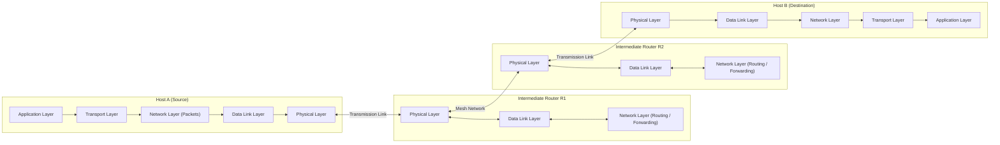
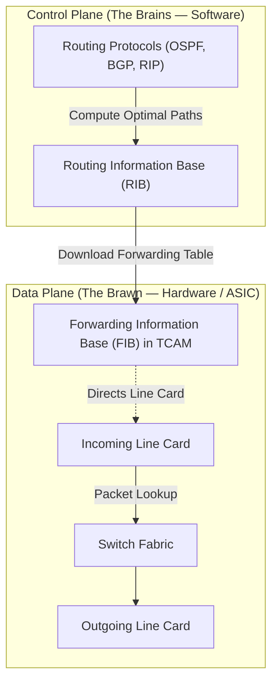
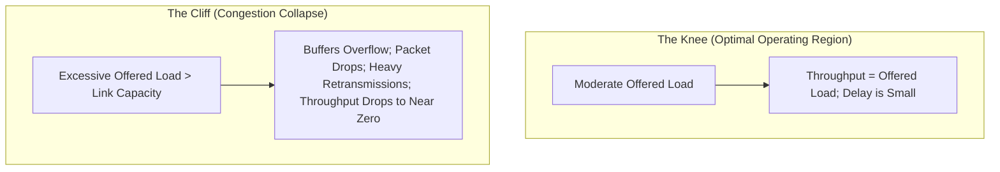

## 1. Chapter Overview & Store-and-Forward Architecture

The **Network Layer (Layer 3)** is responsible for host-to-host end-to-end packet delivery across arbitrary, heterogeneous networks. Unlike the Data Link Layer, which coordinates transmission across a single physical wire or local link between directly connected nodes, the Network Layer must navigate complex mesh topologies containing multiple intermediate switches and routers.



---

### Store-and-Forward Packet Switching

In a store-and-forward packet-switched network:
1. **Packet Transmission:** The sending host divides application messages into data units called **packets** (Layer 3 protocol data units) and prepends an IP header containing source and destination addresses.
2. **Intermediate Buffering:** When a packet arrives at an intermediate router, it is entirely accumulated in the router's input memory buffer until all bits have been received and verified against transmission errors (using the Layer 2 frame checksum).
3. **Routing Lookup:** The router inspects the packet header's destination address, queries its internal **routing table**, and determines the optimal outgoing transmission line.
4. **Queueing & Forwarding:** The packet is placed in the outgoing queue for that line. If the outgoing link is currently busy transmitting another packet, the newly arrived packet waits in the queue until the link becomes free.

---

### Figure 5.1: Store-and-Forward Packet Switching Architecture


**What it shows:**
The physical and logical separation between end systems (hosts located on customer premises LANs) and the network core (the carrier's subnet composed of routers interconnected by transmission lines).

**Components:**
* **Hosts ($H_1, H_2$):** User computing devices running user applications that generate and consume data. Hosts contain all 7 layers of the network protocol stack.
* **Routers ($R_A, R_B, R_C, R_D, R_E, R_F$):** Dedicated network-layer switching computers whose sole task is moving packets from incoming lines to outgoing lines. Routers only implement Layers 1, 2, and 3.
* **Transmission Lines:** High-speed point-to-point physical circuits (copper, optical fiber, wireless microwave) connecting router pairs.
* **Network Subnet:** The collection of routers and transmission lines operated by telecommunications carriers (ISPs).

**Flow / Operation:**
Host $H_1$ transmits a packet onto its local LAN to its default gateway router $R_A$. Router $R_A$ stores the incoming packet, inspects the destination IP address, runs a route lookup, and places the packet onto the link toward router $R_B$ or $R_C$. This store-and-forward hop sequence repeats until the packet reaches the terminal router connected to destination host $H_2$.

[Source: Ch 5 Network Layer.pdf, Slides 3–5]

---

### Network Layer Service Interface: Design Philosophy

The network layer must provide a clean service interface to the transport layer above it. Historically, two opposing philosophies emerged regarding where network complexity should reside:

1. **The Internet Philosophy (Connectionless / Dumb Core):**
   * Driven by DARPA and computer scientists.
   * **Core Principle:** The network core should remain as simple, cheap, and robust as possible. Routers provide an unreliable, best-effort datagram delivery service without maintaining per-flow connection state.
   * **Host Responsibility:** Reliability, end-to-end flow control, error recovery, and congestion control are implemented entirely at the network edges within host transport protocols (e.g., TCP).
   * **Advantage:** Maximum resilience; if a router crashes, datagrams simply reroute around the failure without terminating active sessions.

2. **The Telecommunications Philosophy (Connection-Oriented / Smart Core):**
   * Driven by telephone carriers (ITU-T, ATM, X.25).
   * **Core Principle:** The network should provide guaranteed quality of service, bounded delay, and in-order delivery analogous to traditional telephone calls.
   * **Network Responsibility:** Routers establish a **virtual circuit (VC)** before transmitting data, reserving buffers and bandwidth along the entire end-to-end path.
   * **Advantage:** Guaranteed bandwidth, zero packet reordering, and simple end-user terminals (dumb terminals).

[Source: Ch 5 Network Layer.pdf, Slide 6; Chapter5-NetworkLayer.pdf, Slides 4–7]

---

## 2. Core Terminology Dictionary

1. **Packet:** The basic Layer 3 protocol data unit (PDU) containing payload data and network-layer routing headers.
2. **Routing:** The control plane process of determining end-to-end paths across the entire network topology from source to destination.
3. **Forwarding:** The data plane process of transferring an arriving packet from an input interface to the appropriate output interface within a single router.
4. **Datagram:** A self-contained packet that carries complete destination addressing information and is routed independently of all other packets.
5. **Virtual Circuit (VC):** A logical end-to-end connection established prior to data transmission, along which all packets follow the same physical path and maintain strict sequence order.
6. **Virtual Circuit Identifier (VCI):** A local identifier assigned to a connection on a specific link, remapped at each intermediate router via label swapping.
7. **Routing Table (RIB):** A database maintained in router software storing known network prefixes, metrics, and associated next-hop interfaces.
8. **Forwarding Table (FIB):** A high-speed hardware-optimized table (often stored in TCAM) used by the line cards to perform line-rate destination address lookups.
9. **Optimality Principle:** A mathematical theorem stating that if router $J$ is on the optimal path from router $I$ to router $K$, then the optimal path from $J$ to $K$ lies along the exact same path.
10. **Sink Tree:** The directed acyclic graph formed by the union of all optimal paths from all network nodes converging toward a single destination root node.
11. **Convergence:** The state where all routers in a network possess a consistent, mutually agreed-upon view of the network topology.
12. **Counting to Infinity:** A failure mode in Distance Vector routing where two or more routers exchange mutually invalid, increasing distance metrics in an infinite loop following a link failure.
13. **Split Horizon:** A loop-prevention rule stating that a router must never advertise a route back out the same physical interface through which that route was learned.
14. **Poison Reverse:** An enhancement to Split Horizon where a router advertises a learned route back to the neighbor with an infinite distance metric ($\infty = 16$), actively poisoning the reverse direction.
15. **Link State Packet (LSP):** A small broadcast packet generated by a router containing its unique ID, sequence number, age, and list of directly connected active neighbors with associated link costs.
16. **Reverse Path Forwarding (RPF):** An efficient broadcast algorithm where a router accepts and floods a packet only if it arrived on the interface used to send unicast packets toward the source.
17. **Congestion:** A network condition occurring when aggregate incoming traffic exceeds the storage capacity of router buffers or the transmission capacity of outgoing links.
18. **Jitter:** The statistical variation in packet end-to-end arrival delays across a connection.
19. **Traffic Shaping:** Regulating the average rate and burstiness of transmitted packets at the network edge to conform to a pre-negotiated traffic contract.
20. **Leaky Bucket:** A traffic shaping algorithm that converts an arbitrary, bursty incoming packet stream into an absolutely smooth, constant-rate outgoing packet stream.
21. **Token Bucket:** A flexible traffic shaping algorithm that permits bounded bursts of data up to the token capacity while enforcing a strict long-term average transmission rate.
22. **Maximum Transmission Unit (MTU):** The maximum physical frame payload size in bytes that can be transmitted across a given physical link (e.g., 1500 bytes for standard Ethernet).
23. **Fragmentation:** The division of an oversized IP packet into multiple smaller packets capable of traversing a downstream physical link with a smaller MTU.
24. **Path MTU Discovery (PMTUD):** A technique where a source sets the Don't Fragment (DF) bit in IP packets to probe the bottleneck MTU along an end-to-end path via ICMP "Fragmentation Needed" feedback.
25. **CIDR (Classless Inter-Domain Routing):** An IP addressing architecture that replaces rigid address classes (Class A, B, C) with arbitrary-length prefix masks represented in slash notation (e.g., `/24`).
26. **Route Summarization (Supernetting):** Aggregating multiple contiguous subnet prefixes into a single shorter prefix advertisement to shrink global routing tables.
27. **Longest Matching Prefix:** The forwarding rule stating that when an IP destination matches multiple routing table entries, the packet is forwarded according to the entry with the longest prefix mask (most specific network).
28. **Network Address Translation (NAT):** A technique enabling an entire private local network to share a single public IPv4 address by dynamically remapping transport port numbers.
29. **Time to Live (TTL):** An 8-bit counter in the IPv4 header decremented by at least 1 at every router hop to prevent looping packets from circulating indefinitely.
30. **Autonomous System (AS):** A collection of connected routers under a single administrative authority that shares a common, coherent interior routing strategy.

[Source: Ch 5 Network Layer.pdf, Slides 6–22; Chapter5-NetworkLayer.pdf, Slides 1–25]

---

## 3. Connectionless (Datagram) vs Connection-Oriented (Virtual-Circuit) Networks

The network layer provides either a connectionless service (implemented as **datagram networks**) or a connection-oriented service (implemented as **virtual-circuit networks**).

---

### Datagram Networks (Connectionless Service)

In a datagram network:
* **No Call Setup:** Packets are injected into the network immediately without any preliminary connection handshake.
* **Independent Routing:** Every packet carries the complete 32-bit source and 32-bit destination IP addresses. Each router independently analyzes the destination address and selects the best outgoing line based on its current routing table.
* **Multipath Routing:** Two successive packets generated by the exact same source application destined for the exact same receiving host may traverse completely different physical paths due to dynamic load balancing or intermediate link cost adjustments.
* **Out-of-Order Delivery:** Because packets take varying paths with different delays, packets can arrive out of order, be duplicated, or be dropped during congestion.

---

### Figure 5.2: Datagram Network Routing Tables & Forwarding


**What it shows:**
A 6-node datagram subnet ($A, B, C, D, E, F$) routing packets independently from Host 1 to Host 2.

**Components:**
* **Hosts:** Host 1 connected to ingress router $A$; Host 2 connected to egress router $F$.
* **Routers:** $A, B, C, D, E, F$.
* **Routing Table at Router $A$:** Maps destination addresses to outgoing physical lines.
* **Packets (1, 2, 3, 4):** A sequence of packets transmitted by Host 1.

**Flow / Operation:**
Host 1 generates packets 1, 2, 3, 4 destined for Host 2. Packets 1, 2, and 3 follow path $A 	o B 	o C 	o E 	o F$. Before packet 4 is injected, traffic congestion builds up on link $A-B$, causing Router $A$ to update its routing table. Router $A$ routes packet 4 over link $A-D$, following path $A 	o D 	o E 	o F$. Packet 4 may arrive at Host 2 before packet 3.

[Source: Ch 5 Network Layer.pdf, Slides 7–8]

---

### Virtual-Circuit Networks (Connection-Oriented Service)

In a virtual-circuit network:
* **Three-Phase Communication:** Communication requires three distinct phases:
  1. *Virtual Circuit Setup:* A setup packet traverses the subnet to discover a path, establish connection state in every intermediate router, and negotiate Quality of Service parameters.
  2. *Data Transfer:* All subsequent data packets follow the pre-established path in strict sequence.
  3. *Virtual Circuit Teardown:* A release packet dismantles the connection and frees router state and allocated buffers.
* **Virtual Circuit Identifier (VCI) & Label Swapping:** Packets do not carry 32-bit global addresses. Instead, each packet carries a short, local **Virtual Circuit Identifier (VCI)** in its header. When a packet enters a router on incoming line $L_{	ext{in}}$ with label $V_{	ext{in}}$, the router looks up $(L_{	ext{in}}, V_{	ext{in}})$ in its VC table to find the outgoing line $L_{	ext{out}}$ and the replacement label $V_{	ext{out}}$. The router rewrites the header with $V_{	ext{out}}$ and transmits the packet onto $L_{	ext{out}}$.

---

### Figure 5.3: Virtual-Circuit Routing Tables and Label Swapping


**What it shows:**
The internal routing and forwarding state maintained inside router tables across a virtual-circuit subnet.

**Components:**
* **Host $H_1$ and Host $H_2$:** Communicating end systems.
* **Virtual Circuit Table:** A 4-column translation table inside each router:
  $$	ext{Table Columns: } [	ext{Incoming Interface}, 	ext{Incoming VCI}, 	ext{Outgoing Interface}, 	ext{Outgoing VCI}]$$

**Flow / Operation:**
A packet arrives at Router $A$ from Host $H_1$ on Interface 1 bearing VCI = 1. Router $A$'s table translates `(Interface 1, VCI 1) -> (Interface 2, VCI 1)`. At downstream Router $C$, incoming `(Interface 1, VCI 1)` is translated to `(Interface 2, VCI 2)`. Because labels are local to each individual physical link, two unrelated virtual circuits sharing the same physical link never conflict as long as each possesses a unique local identifier.

[Source: Ch 5 Network Layer.pdf, Slides 9–12]

---

### Figure 5.4: Virtual-Circuit vs Datagram Tradeoffs


**What it shows:**
A systematic comparison of design attributes between virtual-circuit and datagram network architectures.

| Issue | Datagram Subnet (Internet) | Virtual-Circuit Subnet (ATM / X.25) |
| :--- | :--- | :--- |
| **Circuit Setup** | None required; immediate packet transmission. | Required before any data packet can be sent. |
| **Addressing** | Full 32-bit or 128-bit source and destination addresses in every packet. | Short local Virtual Circuit Identifier (VCI) in each packet. |
| **State Information** | Routers maintain no per-flow connection state; routing tables store only destination network prefixes. | Routers maintain full connection state for every passing VC; consumes memory. |
| **Routing Decisions** | Each packet is routed independently; routes adapt dynamically to link failures and congestion. | Route is determined during call setup; all packets follow this static path unless rerouted. |
| **Router Failure Impact** | High resilience; packets automatically detour around failed routers without aborting user sessions. | Catastrophic; if any intermediate router crashes, all virtual circuits traversing it are terminated. |
| **Quality of Service (QoS)** | Difficult to guarantee; best-effort delivery. | Easy to guarantee; bandwidth and buffers can be reserved during circuit setup. |
| **Congestion Control** | Complex; packet drops occur dynamically when router buffers saturate. | Preventable via call admission control; new connection requests are rejected if capacity is full. |

[Source: Ch 5 Network Layer.pdf, Slides 13–14]

---

## 4. Routing Principles & Graph Theory Foundations

Routing is the core algorithm executed in the network layer control plane. It determines how routing tables are constructed and dynamically adapted.

---

### Routing vs Forwarding (The Brains vs The Brawn)

* **Routing (The Brains / Control Plane):** The distributed decision-making process that discovers network topology, exchanges reachability information with peer routers, calculates optimal paths, and populates the routing table. Operates on software time scales (milliseconds to seconds).
* **Forwarding (The Brawn / Data Plane):** The line-rate physical hardware operation of transferring a packet from an incoming interface buffer across the router's switching fabric to the designated outgoing interface queue based on table lookups. Operates on hardware time scales (nanoseconds).



---

### Desirable Routing Algorithm Properties

A robust routing algorithm must satisfy six fundamental criteria:
1. **Correctness:** The algorithm must compute valid, loop-free paths that accurately terminate at the intended destination.
2. **Simplicity:** It must be computationally tractable for routers with constrained CPU and memory resources.
3. **Robustness:** It must run continuously for decades without crashing, automatically self-healing when hardware links fail, topologies alter, or routers reboot.
4. **Stability:** The algorithm must converge rapidly to a steady state and avoid endless route oscillations or flapping.
5. **Fairness:** It must equitably allocate network resources among competing source-destination flows.
6. **Optimality:** It must optimize a globally meaningful cost metric (e.g., maximize total throughput while minimizing packet delay).

---

### The Fairness vs Efficiency Conflict

Fairness and efficiency are fundamentally at war in network routing:

### Figure 5.5: Fairness vs Efficiency Tradeoff


**What it shows:**
A linear network topology where four local flows ($A 	o A', B 	o B', C 	o C', D 	o D'$) compete against one long-distance cross-network flow ($X 	o X'$).

**Analysis:**
* **Maximizing Global Efficiency:** If the objective is to maximize total aggregate packets delivered per second, the network should allocate 100% of line capacity to the local flows $A 	o A', B 	o B', C 	o C', D 	o D'$. Each local packet traverses exactly one hop, maximizing channel utilization per packet. The long flow $X 	o X'$ traverses four hops and consumes four times as much line capacity per packet; shutting off $X 	o X'$ yields the highest overall network throughput.
* **Maximizing Fairness:** Fairness demands that flow $X 	o X'$ receive an equitable share of link bandwidth, even though doing so drastically reduces the total number of packets the network can deliver per unit time.
* **Design Conclusion:** Routing algorithms must adopt objective cost functions (such as min-max fairness) that prevent complete starvation of long-distance traffic while maintaining high channel utilization.

[Source: Ch 5 Network Layer.pdf, Slides 18–19]

---

### Classification of Routing Algorithms

Routing algorithms are divided into two fundamental classes:
1. **Nonadaptive (Static) Routing:** Routes do not depend on real-time traffic measurements or topology changes. Paths are manually computed offline and installed into router tables at boot time.
   * *Advantages:* Simple, zero CPU overhead, predictable.
   * *Disadvantages:* Cannot route around broken links or adapt to traffic hotspots.
2. **Adaptive (Dynamic) Routing:** Routers continuously monitor network state, measure delays, detect link failures, exchange routing metrics with neighbors, and automatically adjust routing tables.
   * *Basis for adjustment:* Metric choice (hop count, measured link delay, available bandwidth, dollar cost).
   * *Information collection:* Isolated (local only), Distributed (exchanged with immediate neighbors), or Centralized (computed by a central Software-Defined Network controller).

[Source: Ch 5 Network Layer.pdf, Slide 20]

---

### The Optimality Principle and The Sink Tree

### Theorem: The Optimality Principle

**Statement:**
If router $J$ is on the optimal path from router $I$ to router $K$, then the optimal path from $J$ to $K$ also falls along the exact same path.

**Proof by Contradiction:**
1. Suppose a route $r_{I 	o K}$ is the optimal (lowest-cost) path from $I$ to $K$, passing through intermediate router $J$.
2. Decompose path $r_{I 	o K}$ into two segments: $r_{I 	o J}$ (from $I$ to $J$) and $r_{J 	o K}$ (from $J$ to $K$).
3. Now assume there exists a better route from $J$ to $K$, designated as $r'_{J 	o K}$, such that $	ext{Cost}(r'_{J 	o K}) < 	ext{Cost}(r_{J 	o K})$.
4. By concatenating path $r_{I 	o J}$ with the purported superior path $r'_{J 	o K}$, we construct an alternative end-to-end path from $I$ to $K$ with cost:
   $$
   	ext{Cost}(r'_{I 	o K}) = 	ext{Cost}(r_{I 	o J}) + 	ext{Cost}(r'_{J 	o K}) < 	ext{Cost}(r_{I 	o J}) + 	ext{Cost}(r_{J 	o K}) = 	ext{Cost}(r_{I 	o K})
   $$
5. This strictly contradicts our initial premise that $r_{I 	o K}$ was the optimal path. Therefore, no superior route from $J$ to $K$ can exist, and the subpath $r_{J 	o K}$ must itself be optimal. $lacksquare$

---

### Definition: Sink Tree

**Meaning:**
The set of all optimal paths from all network sources converging toward a single destination node forms a directed tree rooted at that destination. This tree is called a **Sink Tree**.

**Properties:**
* A tree contains no cycles or closed loops.
* A packet directed along the branches of a sink tree will always reach its destination in a finite number of hops without encountering routing loops.
* Because a network with $N$ routers has $N$ potential destinations, there are exactly $N$ distinct sink trees in any functioning subnet.

---

### Figure 5.6: The Optimality Principle & Sink Tree


**What it shows:**
(a) A general mesh network of 8 routers ($A$ through $H$). (b) The optimal sink tree rooted at destination Router $B$, minimizing total hop count.

**Analysis:**
Notice that the sink tree connects every node in the subnet to root node $B$ with zero loops. The goal of all shortest-path routing algorithms is to discover and construct this sink tree for every router in the network.

[Source: Ch 5 Network Layer.pdf, Slides 21–22]

---

## 5. Shortest Path Routing (Dijkstra's Algorithm)

Shortest path routing models the network as an undirected weighted graph $G = (V, E)$, where vertices $V$ represent routers, edges $E$ represent physical communication links, and edge weights represent link cost metrics (e.g., hop count, geographic distance, transmission delay, or inverse bandwidth).

Dijkstra's algorithm computes the single-source shortest path tree from a designated source node to all other nodes in the network.

---

### Algorithm: Dijkstra's Shortest Path Algorithm

**Purpose:** Compute the minimum-cost sink tree from a starting source node to every node in the network.

**Data Structures:**
* Each node $i$ maintains a label $(d_i, p_i)$, where $d_i$ is the current best-known path distance from the source, and $p_i$ is the predecessor node along that path.
* Two sets of nodes are maintained:
  * **Tentative Set ($T$):** Nodes whose shortest paths have not yet been proven optimal.
  * **Permanent Set ($P$):** Nodes whose absolute shortest path from the source has been finalized and will never change.

**Procedure:**
1. **Initialization:**
   * Make the source node permanent with distance 0: Label $(	ext{Source}) = (0, -)$. Place in set $P$.
   * Initialize all other nodes $u \in V \setminus \{	ext{Source}\}$ as tentative with infinite distance: Label $(u) = (\infty, -)$. Place in set $T$.
   * Set the working node $curr = 	ext{Source}$.
2. **Neighbor Relaxation:**
   * For each tentative neighbor $v \in T$ adjacent to current node $curr$:
     $$
     	ext{If } d_{curr} + 	ext{Cost}(curr, v) < d_v \implies 	ext{Update label: } d_v = d_{curr} + 	ext{Cost}(curr, v), \quad p_v = curr
     $$
3. **Select Next Permanent Node:**
   * Scan all tentative nodes in set $T$. Identify the node $k \in T$ with the minimum tentative distance $d_k$:
     $$
     k = rg\min_{u \in T} d_u
     $$
   * Move node $k$ from tentative set $T$ to permanent set $P$. Node $k$'s distance is now locked.
   * If all destination nodes are permanent, stop. Otherwise, set $curr = k$ and repeat from Step 2.

**Complexity:**
* Simple array implementation: $O(|V|^2)$.
* Binary heap priority queue implementation: $O(|E| + |V| \log |V|)$.
* Fibonacci heap implementation: $O(|E| + |V| \log |V|)$.

---

### Figure 5.7: Dijkstra's Algorithm Step-by-Step Execution


**What it shows:**
The step-by-step evolution of permanent labels (shaded circles) and tentative labels as Dijkstra's algorithm finds the shortest path from Source $A$ to Destination $D$.

#### Step-by-Step Trace:
* **Initial State:** Node $A$ is made permanent: $A(0, -)$. Neighbors of $A$ are relaxed: $B(2, A), G(6, A)$. All others $\infty$.
* **Step 1:** Smallest tentative node is $B$ ($d=2$). Make $B$ permanent. Relax neighbors of $B$: $C(2+7=9, B), E(2+2=4, B)$.
* **Step 2:** Tentative nodes: $E(4), G(6), C(9)$. Smallest is $E$ ($d=4$). Make $E$ permanent. Relax neighbors of $E$: $G(4+1=5, E)$ (improves on previous 6!), $F(4+2=6, E)$.
* **Step 3:** Tentative nodes: $G(5), F(6), C(9)$. Smallest is $G$ ($d=5$). Make $G$ permanent.
* **Step 4:** Tentative nodes: $F(6), C(9)$. Smallest is $F$ ($d=6$). Make $F$ permanent. Relax neighbors of $F$: $D(6+2=8, F), C(6+3=9, F)$.
* **Step 5:** Smallest is $D$ ($d=8$). Make $D$ permanent. Shortest path to $D$ found: $A 	o B 	o E 	o F 	o D$ with total length 8.

[Source: Ch 5 Network Layer.pdf, Slides 23–26]

---

## 6. Distance Vector Routing & The Count-to-Infinity Problem

**Distance Vector Routing** (historically known as the distributed Bellman-Ford algorithm) is a dynamic, decentralized routing protocol originally deployed in the ARPANET and standardized in RIP (Routing Information Protocol - RFC 1058).

---

### Protocol Operation

1. **Routing Table State:** Each router maintains a table (vector) giving the best-known distance to every possible destination in the network, along with the outgoing interface line to use.
2. **Periodic Exchange:** Periodically (e.g., every 30 seconds in RIP), each router broadcasts its distance vector to all directly connected immediate neighbors.
3. **Bellman-Ford Equation:** When router $I$ receives a vector $D^{(J)}$ from adjacent neighbor $J$:
   * Let $c(I, J)$ be the measured link cost from $I$ to $J$.
   * Router $I$ recalculates its cost to every destination $K$ using:

$$
D(I, K) = \min_{J \in 	ext{Neighbors}} \left[ c(I, J) + D(J, K) 
ight]
$$

---

### Figure 5.8: Distance Vector Routing Table Update


**What it shows:**
How Router $J$ recalculates its routing table using distance vectors received from its four active neighbors ($A, I, H, K$).

**Detailed Calculation:**
* Router $J$ measures delays to its neighbors: to $A = 8	ext{ ms}$, to $I = 10	ext{ ms}$, to $H = 12	ext{ ms}$, to $K = 6	ext{ ms}$.
* Neighbors send vectors giving their delays to destination $G$: $A$ claims 18 ms, $I$ claims 31 ms, $H$ claims 6 ms, $K$ claims 31 ms.
* Router $J$ computes total path delay to $G$ via each neighbor:
  * Via $A$: $8 + 18 = 26	ext{ ms}$
  * Via $I$: $10 + 31 = 41	ext{ ms}$
  * Via $H$: $12 + 6 = 18	ext{ ms}$
  * Via $K$: $6 + 31 = 37	ext{ ms}$
* **Result:** Router $J$ selects the minimum value (18 ms), installs next-hop $H$, and records metric 18 ms in its routing table.

[Source: Ch 5 Network Layer.pdf, Slides 27–29]

---

### The Count-to-Infinity Problem

The core structural vulnerability of Distance Vector routing is its asymmetric reaction to good news versus bad news:
* **Good news propagates rapidly:** If a new low-cost link is brought online, routers update their tables in $O(1)$ exchange cycles per hop.
* **Bad news propagates at a crawl:** If a critical link fails, routers create mutual dependency loops and count up to infinity step by step.

---

### Figure 5.9: The Count-to-Infinity Problem


**What it shows:**
A 5-node linear network ($A-B-C-D-E$) demonstrating (a) rapid convergence when node $A$ comes up, versus (b) catastrophic counting to infinity when node $A$ goes down.

#### Step-by-Step Mathematical Trace of Failure:
1. **Initial Stable State:** Link metric between adjacent nodes is 1. All nodes route to $A$:
   * $B$ routes to $A$ with metric 1.
   * $C$ routes to $A$ via $B$ with metric 2.
   * $D$ routes to $A$ via $C$ with metric 3.
   * $E$ routes to $A$ via $D$ with metric 4.
2. **Link $A-B$ Fails:**
   * Node $B$ loses its physical link to $A$.
   * However, in the next exchange, node $C$ advertises: *"I can reach $A$ with distance 2."*
   * Node $B$ does not know that $C$'s path to $A$ actually traverses $B$ itself!
   * Therefore, $B$ calculates: $D(B, A) = c(B, C) + D(C, A) = 1 + 2 = 3$, installing next-hop $C$.
3. **Subsequent Rounds:**
   * In round 2, $B$ advertises distance 3 to $C$. $C$ recalculates: $D(C, A) = 1 + 3 = 4$, advertising 4 to $D$.
   * In round 3, $D$ recalculates: $D(D, A) = 1 + 4 = 5$, and so forth.
   * The vector values slowly increment: $3, 4, 5, 6, 7, \dots$ until reaching the artificial threshold defined as infinity ($\infty = 16$ in RIP).
   * Packets destined for $A$ bounce endlessly between $B$ and $C$ until their TTL counters expire.

[Source: Ch 5 Network Layer.pdf, Slides 30–32]

---

### Solutions to Count-to-Infinity: Split Horizon & Poison Reverse

To mitigate two-node routing loops, protocols implement **Split Horizon with Poison Reverse**:

### Figure 5.10: Split Horizon with Poison Reverse


**What it shows:**
The suppression of routing loops between adjacent routers.

**Mechanism:**
* **Simple Split Horizon:** If node $C$ routes traffic to destination $A$ through next-hop neighbor $B$, then $C$ must *never* advertise reachability to $A$ back to $B$. In its periodic updates sent out interface $C-B$, node $C$ simply omits destination $A$.
* **Poison Reverse:** Instead of omitting the route, $C$ explicitly advertises destination $A$ back to $B$ with an infinite cost metric ($	ext{Distance} = \infty$). This ensures that if link $A-B$ goes down, $B$ will never consider $C$ as an alternate route to $A$.
* **Limitation:** Split Horizon with Poison Reverse completely eliminates two-node loops. However, it **fails to prevent three-node or multi-node loops** (e.g., $A-B-C-D-A$), where circular dependency spans three or more routers. To completely eliminate loops, networks must transition to Link State protocols or Path Vector protocols.

[Source: Ch 5 Network Layer.pdf, Slide 33]

---

## 7. Link State Routing

Due to the convergence latency and Count-to-Infinity vulnerabilities of Distance Vector protocols, modern interior routing protocols (such as **OSPF** and **IS-IS**) employ **Link State Routing**.

The fundamental concept: **Each router discovers its immediate neighbors, measures the cost to them, encapsulates this local connectivity in a Link State Packet (LSP), floods the LSP to every router in the network, and then independently computes shortest paths using Dijkstra's algorithm.**

---

### The Five Steps of Link State Routing

To implement Link State routing, every router executes five sequential procedures:
1. **Discover Neighbors:** Learn its neighbors' network addresses by broadcasting a `HELLO` packet upon boot.
2. **Measure Link Cost:** Measure the delay, bandwidth, or cost metric to each directly connected neighbor.
3. **Construct Link State Packet (LSP):** Build an LSP containing its identity, current sequence number, remaining age, and a complete list of its immediate neighbors with their link costs.
4. **Reliable Flooding:** Distribute the LSP reliably to *all* routers in the subnet using controlled flooding.
5. **Compute Shortest Paths:** Once an identical copy of all LSPs has been gathered into the local Link State Database (LSDB), execute Dijkstra's algorithm locally to construct the sink tree and populate the forwarding table.

[Source: Ch 5 Network Layer.pdf, Slides 34–36]

---

### Step 1: Neighbor Discovery via HELLO Packets

When a router boots, it broadcasts a special `HELLO` packet on all its outgoing physical point-to-point links and broadcast LAN interfaces.
* On point-to-point lines, the router on the other end immediately replies with its unique router identity.
* On shared broadcast LANs (e.g., Ethernet), multiple routers are connected. The LAN is modeled as a fictitious "designated router" or pseudo-node to avoid establishing an $O(N^2)$ mesh of adjacencies.

---

### Figure 5.11: Link State Neighbor Discovery & Designated Routers


**What it shows:**
Nine routers connected to a shared multi-access broadcast LAN discovering adjacencies via `HELLO` packets.

**Operation:**
Rather than modeling every router as having an individual link to all other 8 routers (requiring 36 bidirectional links in the graph), the broadcast LAN is modeled as a central artificial node (Designated Router), reducing the graph complexity to 9 radial links.

[Source: Ch 5 Network Layer.pdf, Slide 37]

---

### Step 2: Measuring Link Costs

Link state protocols require an objective cost metric:
* **Delay Metric:** The router sends a specialized `ECHO` packet across the link that the remote end must timestamp and return instantly. The round-trip time divided by two provides an accurate measure of link delay.
* **Load Sensitivity vs Route Oscillation:** If link cost includes real-time queuing delay, traffic automatically shifts to alternative unloaded links. However, if traffic is heavy, shifting traffic can cause violent load oscillations between alternative paths (route flapping). Modern OSPF implementations typically base metrics strictly on static link bandwidth ($10^8 / \text{Bandwidth in bps}$) rather than real-time queuing load to guarantee stability.

[Source: Ch 5 Network Layer.pdf, Slide 38]

---

### Step 3: Constructing Link State Packets (LSPs)

Once neighbor identities and link metrics are established, each router constructs a Link State Packet.

---

### Figure 5.12: Link State Packets for a Sample Network


**What it shows:**
(a) A sample 6-router topology ($A, B, C, D, E, F$) with link costs. (b) The exact Link State Packets generated by each of the 6 routers.

**Structure of an LSP:**
```text
+-----------------------+
| Router ID (Source)    |  <- Unique identifier of the advertising router
+-----------------------+
| Sequence Number (32b) |  <- Incremented with each newly generated LSP
+-----------------------+
| Age (TTL Countdown)   |  <- Decremented every second; purges stale state
+-----------------------+
| Neighbor 1 | Cost 1   |  <- List of adjacent active neighbors
| Neighbor 2 | Cost 2   |     and their associated link weights
| Neighbor 3 | Cost 3   |
+-----------------------+
```

[Source: Ch 5 Network Layer.pdf, Slides 39–40]

---

### Step 4: Reliable Flooding of LSPs

Flooding distributes LSPs to all routers. To avoid broadcast storms and infinite packet loops, routers manage LSPs using sequence numbers and age fields:
1. **Sequence Number Tracking:** Each router tracks the highest sequence number received from each source. When an LSP arrives:
   * If its sequence number is *higher* than the stored record, it is accepted, stored in the database, and forwarded out all interfaces except the one it arrived on.
   * If its sequence number is *equal to or less than* the stored record, it is a duplicate or stale packet and is discarded immediately.
2. **Aging Mechanism:** The Age field is decremented by 1 every second. If an LSP's age reaches zero, it is purged from the database. Furthermore, routers re-flood their LSPs periodically (e.g., every 30 minutes in OSPF) with a refreshed sequence number and age to maintain synchronization.
3. **Handling Router Crashes:** If a router reboots and resets its sequence number to 0, downstream routers reject the new LSPs. To resolve this, when a neighbor receives an LSP with a sequence number lower than what it possesses in its database, it sends its newer LSP back to the rebooted router, prompting it to adopt a sequence number higher than its pre-crash state.

---

### Step 5: Computing Shortest Paths (The Global Map)

### Figure 5.13: Link State Global Database & Local Map


**What it shows:**
Once reliable flooding completes, every router in the network possesses the exact same set of LSPs in its Link State Database (LSDB).

**Execution:**
Each router reconstructs the complete graph of the entire network inside its local memory. Each router then runs Dijkstra's algorithm independently, placing itself at the root. Because every router runs Dijkstra on an identical graph, the resulting paths are globally optimal and guaranteed to be loop-free!

[Source: Ch 5 Network Layer.pdf, Slides 41–42]

---

## 8. Hierarchical Routing & Route Aggregation

As networks expand to tens of thousands of routers, flat routing architectures collapse due to:
* Explosive growth of routing table memory consumption.
* CPU time required to execute Dijkstra's algorithm over millions of links ($O(|E| \log |V|)$).
* Prohibitive link bandwidth consumed by periodic LSP flooding or distance vector broadcasts.

To achieve scalability, routers are partitioned into **hierarchical regions**, clusters, or areas.

---

### Figure 5.14: Hierarchical Routing Table Reduction


**What it shows:**
A 17-router network divided into 5 regions. Router $1A$'s routing table is compared: (b) under flat routing (requiring 17 entries) versus (c) under 2-level hierarchical routing (requiring only 7 entries).

**Hierarchical Principle:**
Routers know full details on how to route packets within their local region, but know nothing about the internal topology of other regions. To reach a foreign region, packets are routed to the designated border/gateway router for that region.

---

### Optimal Depth of Routing Hierarchies

For a network of $N$ routers:
* In a 2-level hierarchy where routers are grouped into regions of size $m$, the table size is minimized when $m = \sqrt{N}$. The resulting table size is:
  $$
  \text{Table Size} = 2\sqrt{N}
  $$
* In an $k$-level hierarchy, the theoretical optimal routing table size converges to:
  $$
  \text{Optimal Table Size} \approx e \cdot \ln N
  $$
* **Tradeoff (The Cost of Hierarchy):** Path sub-optimality. Because border routers abstract away regional internals, packets may take slightly longer, non-optimal physical paths across regional boundaries compared to a completely flat network.

[Source: Ch 5 Network Layer.pdf, Slides 43–47]

---

## 9. Broadcast & Multicast Routing

### Broadcast Routing

Broadcast routing delivers a single packet from a source to *all* nodes in the network simultaneously.
* **Technique 1: Multi-Destination Routing:** Source attaches a list of all destination addresses to the header. When arriving at a router, the router splits the packet across outgoing lines containing subsets of destinations.
* **Technique 2: Flooding:** A router retransmits every incoming packet onto every outgoing link except the arrival link. Requires sequence number caches or hop-count limits to prevent broadcast storms.
* **Technique 3: Reverse Path Forwarding (RPF):** An elegant, highly efficient broadcast algorithm that eliminates loops without requiring routers to know the complete sink tree.

---

### Figure 5.15: Reverse Path Forwarding (RPF) Algorithm


**What it shows:**
(a) A network topology. (b) The sink tree for Source $I$. (c) The packet forwarding tree created by the Reverse Path Forwarding rule.

**The RPF Rule:**
When a broadcast packet arrives at Router $R$ from Source $S$:
1. Router $R$ consults its unicast routing table to see which interface it normally uses to *send* packets toward Source $S$.
2. If the broadcast packet arrived on that exact interface, the packet is on the correct reverse path. Router $R$ accepts the packet and replicates it out all other interfaces.
3. If the packet arrived on *any other interface*, it is rejected and silently discarded as a duplicate loop.

[Source: Ch 5 Network Layer.pdf, Slides 48–50]

---

### Multicast Routing

Multicast routing delivers a packet to a well-defined subset of stations called a **multicast group**.

### Figure 5.16: Multicast Routing & Pruned Spanning Trees


**What it shows:**
(a) A network containing two multicast groups (Group 1 and Group 2). (b) The spanning tree for Group 1. (c) The pruned multicast tree rooted at Router $C$.

**Pruning Mechanism:**
Routers use IGMP (Internet Group Management Protocol) to learn which hosts on their local subnet belong to a multicast group. Routers without downstream group members send `PRUNE` messages upstream, trimming non-participating branches from the broadcast tree.

[Source: Ch 5 Network Layer.pdf, Slides 51–55]

---

## 10. Congestion Control & Traffic Management

### Congestion vs Flow Control

* **Flow Control:** A point-to-point agreement between a single sender and a single receiver to prevent the fast sender from overrunning the slow receiver's local buffer.
* **Congestion Control:** A global network-wide issue where aggregate traffic injected by *all* hosts exceeds the capacity of intermediate transmission lines and router memory buffers.



[Source: Ch 5 Network Layer.pdf, Slides 56–58]

---

### Congestion Control Strategies

Networks deploy congestion control mechanisms operating across different time scales:

| Time Scale | Technique | Description |
| :--- | :--- | :--- |
| **Hours / Days** | Network Provisioning | Adding physical fiber lines, upgrading router line cards. |
| **Minutes** | Traffic-Aware Routing | Dynamically altering routing link costs to steer traffic around congested links. |
| **Seconds** | Call Admission Control | In virtual circuits, refusing to establish new connections if network links are near capacity. |
| **Milliseconds** | Traffic Throttling | Dynamically slowing down senders via ECN, Choke Packets, or implicit packet loss. |
| **Microseconds** | Load Shedding / RED | Dropping packets intelligently when router buffers fill up. |

---

### Traffic-Aware Routing & Route Oscillation

### Figure 5.17: Route Flapping in Traffic-Aware Routing


**What it shows:**
Instability caused by routing protocols dynamically shifting traffic onto unloaded paths.

**Problem:**
All traffic from $A$ to $B$ initially traverses Link 1. When Link 1's measured delay rises, the routing algorithm shifts *all* traffic to Link 2. Link 2 instantly becomes congested, while Link 1 becomes completely empty. In the next cycle, traffic shifts entirely back to Link 1. This unending **route flapping** wastes CPU cycles and destabilizes end-to-end TCP connections.
* **Remedy:** Multipath routing (spreading traffic across multiple paths proportionally) and smoothing metric changes over time using exponential averaging.

[Source: Ch 5 Network Layer.pdf, Slides 59–60]

---

### Traffic Throttling & EWMA Monitoring

To detect impending congestion before buffers completely overflow, routers continuously monitor average queue occupancy using an **Exponentially Weighted Moving Average (EWMA)**:

$$
q_{\text{avg}} = (1 - \alpha) \cdot q_{\text{avg}} + \alpha \cdot q_{\text{instant}}
$$

Where:
* $q_{\text{avg}}$ = filtered, smoothed running average queue length.
* $q_{\text{instant}}$ = instantaneously measured queue length at packet arrival.
* $\alpha$ = weight constant ($0 < \alpha < 1$, typically $\alpha \approx 0.002$).

---

### Figure 5.18: EWMA Queue Length Tracking & Throttling


**What it shows:**
Filtering out brief transient traffic spikes while reliably catching sustained congestion trends. When $q_{\text{avg}}$ crosses a warning threshold, the router activates traffic throttling.

[Source: Ch 5 Network Layer.pdf, Slide 64]

---

### Explicit Congestion Notification (ECN)

Rather than waiting for packets to drop, modern IP networks use **Explicit Congestion Notification (ECN)** standardized in RFC 3168:

### Figure 5.19: Explicit Congestion Notification (ECN) Header Bits


**What it shows:**
The two least-significant bits of the IPv4 Differentiated Services (DiffServ) / Traffic Class byte:
* `00`: Non-ECN-Capable Transport (Non-ECT)
* `01` or `10`: ECN-Capable Transport (ECT(1) or ECT(0))
* `11`: Congestion Encountered (CE)

**Mechanism:**
When an intermediate router detects queue buildup, instead of dropping the packet, it flips the ECN bits from `10` to `11` (CE). When the destination host receives the packet, it echoes the congestion flag back to the sender in the TCP header (`ECE` - ECN Echo flag). The sender reduces its transmission rate without suffering a packet drop!

[Source: Ch 5 Network Layer.pdf, Slide 65]

---

### Choke Packets: Source-Only vs Hop-by-Hop

### Figure 5.20: Choke Packets: End-to-End vs Hop-by-Hop


**Comparison:**
1. **End-to-End Choke Packets:** A congested intermediate router generates an ICMP Source Quench / Choke packet and sends it straight back to the originating source host.
   * *Drawback:* Propagation delay is large. In high-speed wide-area networks, millions of bytes continue to pour into the congested router before the source receives the choke packet and slows down.
2. **Hop-by-Hop Choke Packets:** The choke packet takes effect at *every intermediate hop* along the reverse path. Router $R_2$ immediately throttles traffic from upstream router $R_1$, forcing $R_1$ to buffer packets and throttle its own upstream links. Relief at the congestion point is immediate ($O(1)$ local link delay).

[Source: Ch 5 Network Layer.pdf, Slides 67–69]

---

### Random Early Detection (RED) & Load Shedding

### Figure 5.22: Random Early Detection (RED) Queue Thresholds


**What it shows:**
Router buffer management using two queue thresholds: $TH_{\min}$ and $TH_{\max}$.

**RED Drop Probability Function:**
* If $q_{\text{avg}} < TH_{\min}$: No packets are dropped; all incoming packets are queued.
* If $TH_{\min} \le q_{\text{avg}} \le TH_{\max}$: Packets are dropped with a linear probability $P$:
  $$
  P = P_{\max} \cdot \left( \frac{q_{\text{avg}} - TH_{\min}}{TH_{\max} - TH_{\min}} \right)
  $$
* If $q_{\text{avg}} > TH_{\max}$: All incoming packets are unconditionally dropped (forced drop).

**Why RED Works:**
In standard Drop-Tail queues, buffers fill completely before packets drop. When drops occur, hundreds of TCP flows drop packets simultaneously, causing all senders to throttle back at the same time (**Global TCP Synchronization**), followed by a simultaneous burst that overflows the buffers again. RED drops isolated packets early, desynchronizing TCP flows and keeping average queue occupancy low while maintaining 100% link utilization.

**Load Shedding Policies:**
When buffers overflow completely, routers must discard packets:
* **Wine Policy (Drop Old):** In real-time multimedia (voice/video), older frames are obsolete; drop old packets from the head of the queue.
* **Milk Policy (Drop New):** In file transfers (FTP/HTTP), early packets are already partially processed; drop newly arrived packets to protect earlier progress.

[Source: Ch 5 Network Layer.pdf, Slides 70–71]

---

## 11. Quality of Service (QoS), Jitter Control & Traffic Shaping

### Jitter Control & Playback Buffering

**Jitter** is the variance in packet transit times. High jitter disrupts streaming audio and video, resulting in choppy audio or frozen video frames.

### Figure 5.23: Jitter Control via Playback Buffers


**What it shows:**
Packets leaving the source at exact periodic intervals ($1, 2, 3, 4$), arriving at the destination with highly irregular transit delays, and being restored to a perfectly uniform playback cadence by holding them in a receiver **playback buffer**.

[Source: Ch 5 Network Layer.pdf, Slides 75–76]

---

### Traffic Shaping: Leaky Bucket vs Token Bucket

Traffic shaping regulates the rate at which hosts inject packets into the network.

---

### Figure 5.24: The Leaky Bucket Algorithm


**Operation:**
* The leaky bucket is modeled as a container with a small hole in the bottom.
* Regardless of how bursty water (data packets) pours into the top of the bucket, water leaks out the hole at a strictly **constant, uniform rate** $\rho$.
* If incoming data exceeds the bucket's storage capacity $C$, the bucket overflows, and excess packets are immediately discarded (or marked as low priority).
* *Limitation:* Does not permit hosts to burst, even when the network is idle.

---

### Figure 5.25: The Token Bucket Algorithm


**Operation:**
* A token generator deposits tokens into the bucket at a constant rate of $\rho$ tokens per second.
* The bucket has a finite storage capacity of $C$ tokens. If tokens arrive when the bucket is full, they spill over and are discarded.
* When a packet of size $b$ bytes arrives:
  * If at least $b$ tokens are present in the bucket, $b$ tokens are consumed, and the packet is transmitted immediately at the maximum link transmission speed $M$.
  * If insufficient tokens are available, the packet must wait in a queue until enough tokens accumulate, or it is discarded.
* *Advantage:* Permits controlled bursts up to bucket capacity $C$, while guaranteeing that the long-term sustained rate never exceeds $\rho$.

[Source: Ch 5 Network Layer.pdf, Slides 77–80]

---

### Figure 5.26: Token Bucket Maximum Burst Duration Calculation


### Mathematical Derivation of Maximum Burst Time ($S$)

Consider a token bucket with:
* Token arrival rate = $\rho$ bytes/second
* Bucket capacity = $C$ bytes
* Maximum physical transmission line speed = $M$ bytes/second (where $M > \rho$)

During a maximum burst of duration $S$ seconds:
1. The total bytes transmitted onto the line at full speed $M$ is:
   $$
   \text{Bytes Transmitted} = M \cdot S
   $$
2. The total tokens available during this burst period equals the initial tokens in the bucket ($C$) plus new tokens deposited during the burst ($\rho \cdot S$):
   $$
   \text{Tokens Available} = C + \rho \cdot S
   $$
3. Equating bytes transmitted to tokens consumed:
   $$
   M \cdot S = C + \rho \cdot S
   $$
   $$
   M \cdot S - \rho \cdot S = C \implies S(M - \rho) = C
   $$

$$
S = \frac{C}{M - \rho}
$$

4. The total maximum number of bytes transmitted during this burst is:
   $$
   B_{\max} = M \cdot S = \frac{M \cdot C}{M - \rho}
   $$

[Source: Ch 5 Network Layer.pdf, Slides 81–84]

---

## 12. Packet Scheduling

When multiple packet queues at an output port contend for transmission, the **packet scheduler** determines the service order.

---

### Figure 5.27: FIFO vs Fair Queuing


**Comparison:**
1. **First-In, First-Out (FIFO):** Packets are transmitted strictly in the order they arrived. Unfair: an aggressive, high-rate flow fills the queue, locking out well-behaved, low-rate flows.
2. **Round-Robin Fair Queuing (FQ):** The scheduler maintains a separate queue for each flow. The transmitter visits each non-empty queue in cyclic order, sending one packet from each.
   * *Flaw:* If Flow 1 sends 1000-byte packets and Flow 2 sends 100-byte packets, Flow 1 receives $10\times$ as much bandwidth!

---

### Figure 5.28: Weighted Fair Queuing (WFQ)


**Operation of Bit-by-Bit Weighted Fair Queuing (WFQ):**
WFQ computes the hypothetical finishing time of every packet under idealized bit-by-bit round-robin multiplexing.
Let packet $k$ of flow $i$ arrive at time $a_i^k$ with length $L_i^k$. Each flow is assigned a weight $w_i$.
The virtual finishing time $F_i^k$ is calculated as:

$$
F_i^k = \max \left( V(a_i^k), F_i^{k-1} \right) + \frac{L_i^k}{w_i}
$$

Where $V(t)$ is the current virtual time advancing inversely with the sum of weights of all currently active flows. The scheduler always transmits the packet with the **lowest virtual finishing time**. Flows with higher weights ($w_i$) receive proportionally larger bandwidth shares.

[Source: Ch 5 Network Layer.pdf, Slides 85–88]

---

## 13. Internetworking & Tunneling

An **internetwork** (or internet) is a collection of individual physical networks (LANs, MANs, WANs, wireless networks) connected by routers to function as a single, coordinated, large-scale communication system.

### Challenges of Heterogeneous Internetworking
Different underlying networks disagree on fundamental parameters:
* Different physical frame formats and Layer 2 addressing (Ethernet 48-bit MAC vs ATM 20-byte NSAP).
* Different maximum packet sizes (MTU: Ethernet 1500 bytes vs FDDI 4352 bytes vs 802.11 2312 bytes).
* Different service models (connectionless datagram vs connection-oriented virtual circuits).
* Different Quality of Service and multicast capabilities.

---

### Tunneling (Encapsulation)

When two networks of the same type (e.g., two IPv6 networks) are separated by an intermediate foreign network (e.g., an IPv4-only ISP core), **tunneling** connects them seamlessly without modifying intermediate routers.

---

### Figure 5.29: Tunneling IPv6 Packets over an IPv4 Network


**What it shows:**
An IPv6 packet traversing an intermediate IPv4-only carrier network.

**Operation:**
1. **Encapsulation at Ingress Router:** When the IPv6 packet arrives at the entrance of the IPv4 network, the ingress gateway router treats the entire IPv6 packet (header plus payload) as raw uninterpreted data. It prepends an IPv4 header whose destination address is the egress tunnel router.
2. **Transit:** Intermediate IPv4 routers inspect only the outer IPv4 header, forwarding the packet as standard IPv4 traffic.
3. **Decapsulation at Egress Router:** The egress router strips off the outer IPv4 header, extracts the original IPv6 packet intact, and injects it into the destination IPv6 network.

[Source: Ch 5 Network Layer.pdf, Slides 89–93]

---

## 14. Packet Fragmentation & Path MTU Discovery

Every physical link technology imposes a strict upper limit on the size of the Layer 2 frame payload, known as the **Maximum Transmission Unit (MTU)**:
* Standard Ethernet: $\text{MTU} = 1500\text{ bytes}$
* PPPoE: $\text{MTU} = 1492\text{ bytes}$
* FDDI: $\text{MTU} = 4352\text{ bytes}$
* Classic ATM: $\text{MTU} = 48\text{ bytes}$ (AAL5 payload)

When a router receives a packet larger than the outgoing interface's MTU, it must either fragment the packet or discard it.

---

### Transparent vs Non-Transparent Fragmentation

### Figure 5.30: Transparent vs Non-Transparent Fragmentation


1. **Transparent Fragmentation:**
   * An oversized packet is fragmented upon entering a small-MTU network.
   * All fragments are completely intercepted and **reassembled at the exit router** of that same small-MTU network before continuing onward.
   * *Drawbacks:* The exit router must buffer all fragments, calculate complex reassembly timers, and suffer severe delays if fragments take different internal paths or if one fragment is dropped.
2. **Non-Transparent Fragmentation (The Internet Model):**
   * Once an IP packet is fragmented by an intermediate router, fragments are **not reassembled** until they reach the final destination host.
   * Intermediate routers treat each fragment as an independent datagram, routing them over arbitrary paths.
   * *Drawback:* If even a single fragment is lost along the way, the entire original IP packet cannot be reconstructed, forcing the transport layer (TCP) to retransmit the entire packet.

[Source: Ch 5 Network Layer.pdf, Slides 94–98]

---

### IPv4 Fragmentation Fields

IPv4 supports non-transparent fragmentation using three dedicated header fields:

### Figure 5.31: IPv4 Fragmentation Header Fields


1. **Identification (16 bits):** A unique sequence number assigned by the source host to identify all fragments belonging to the same original datagram.
2. **Flags (3 bits):**
   * *Bit 0:* Reserved (must be 0).
   * *Bit 1 — DF (Don't Fragment):* If $\text{DF} = 1$, intermediate routers are strictly forbidden from fragmenting the packet. If the packet exceeds a link's MTU, the router discards it and returns an ICMP "Fragmentation Needed" error.
   * *Bit 2 — MF (More Fragments):* If $\text{MF} = 1$, more fragments follow. For the very last fragment of the packet, $\text{MF} = 0$.
3. **Fragment Offset (13 bits):** Specifies the starting position of the fragment's payload data relative to the original unfragmented IP payload, measured in **units of 8-byte blocks** (64 bits).

### The 8-Byte Offset Rule
Because the Fragment Offset field is only 13 bits wide while the Total Length field is 16 bits wide ($2^{16} = 65,536$ bytes), the offset is scaled by 8 ($2^{13} \times 8 = 65,536$).
Therefore: **Every intermediate fragment payload must contain a length that is a strict multiple of 8 bytes (except the final fragment).**

---

### Path MTU Discovery (PMTUD)

Modern operating systems avoid the performance penalties of router-level fragmentation using **Path MTU Discovery** (RFC 1191):
1. The sending host sets the **DF (Don't Fragment) bit = 1** in all outgoing IP packets.
2. The sender transmits packets sized to its local MTU (e.g., 1500 bytes).
3. If an intermediate link has a smaller MTU (e.g., 1400 bytes), the router cannot fragment the packet because $\text{DF} = 1$. The router discards the packet and returns an **ICMP Type 3, Code 4 message** ("Destination Unreachable, Fragmentation Needed and DF Set"), which also reports the router's next-hop MTU.
4. The sending host reduces its maximum segment size (MSS) to match the reported MTU and retransmits. This process repeats until packets traverse the entire path without error.

[Source: Ch 5 Network Layer.pdf, Slides 98–103]

---

## 15. The Internet Protocol Version 4 (IPv4)

### The IPv4 Header Format

Every IPv4 packet consists of a mandatory 20-byte base header, followed by optional variable-length option fields, followed by user payload data.

### Figure 5.32: Detailed IPv4 Header Layout


```text
 0                   1                   2                   3
 0 1 2 3 4 5 6 7 8 9 0 1 2 3 4 5 6 7 8 9 0 1 2 3 4 5 6 7 8 9 0 1
+-+-+-+-+-+-+-+-+-+-+-+-+-+-+-+-+-+-+-+-+-+-+-+-+-+-+-+-+-+-+-+-+
|Version|  IHL  |Type of Service|          Total Length         |
+-+-+-+-+-+-+-+-+-+-+-+-+-+-+-+-+-+-+-+-+-+-+-+-+-+-+-+-+-+-+-+-+
|         Identification        |Flags|     Fragment Offset     |
+-+-+-+-+-+-+-+-+-+-+-+-+-+-+-+-+-+-+-+-+-+-+-+-+-+-+-+-+-+-+-+-+
|  Time to Live |    Protocol   |        Header Checksum        |
+-+-+-+-+-+-+-+-+-+-+-+-+-+-+-+-+-+-+-+-+-+-+-+-+-+-+-+-+-+-+-+-+
|                       Source IP Address                       |
+-+-+-+-+-+-+-+-+-+-+-+-+-+-+-+-+-+-+-+-+-+-+-+-+-+-+-+-+-+-+-+-+
|                    Destination IP Address                     |
+-+-+-+-+-+-+-+-+-+-+-+-+-+-+-+-+-+-+-+-+-+-+-+-+-+-+-+-+-+-+-+-+
|                    Options (if any)           |    Padding    |
+-+-+-+-+-+-+-+-+-+-+-+-+-+-+-+-+-+-+-+-+-+-+-+-+-+-+-+-+-+-+-+-+
|                            Payload                            |
+-+-+-+-+-+-+-+-+-+-+-+-+-+-+-+-+-+-+-+-+-+-+-+-+-+-+-+-+-+-+-+-+
```

---

### Bit-by-Bit Field Analysis

1. **Version (4 bits):** Identifies the protocol version; contains binary `0100` (4) for IPv4.
2. **IHL (Internet Header Length — 4 bits):** Length of the header measured in **32-bit (4-byte) words**.
   * Minimum value: $5$ ($5 \times 4 = 20\text{ bytes}$, no options).
   * Maximum value: $15$ ($15 \times 4 = 60\text{ bytes}$, maximum 40 bytes of options).
3. **Type of Service / Differentiated Services (DiffServ — 8 bits):**
   * *DSCP (Differentiated Services Code Point — 6 bits):* Classifies packet priority for QoS.
   * *ECN (Explicit Congestion Notification — 2 bits):* Signals impending network congestion.
4. **Total Length (16 bits):** Total length of the entire IP datagram (header + payload) in bytes.
   * Theoretical maximum: $2^{16} - 1 = 65,535\text{ bytes}$.
5. **Identification (16 bits):** Unique identifier assigned to an IP packet to aid reassembly of fragments.
6. **Flags (3 bits):** `[0, DF, MF]` controlling fragmentation behavior.
7. **Fragment Offset (13 bits):** Position of fragment payload in 8-byte increments.
8. **Time to Live (TTL — 8 bits):** Hop counter decremented by at least 1 at every router hop. When $\text{TTL} = 0$, the packet is discarded and an ICMP "Time Exceeded" message is returned to the sender. Prevents permanent looping.
9. **Protocol (8 bits):** Identifies the upper-layer transport protocol payload:
   * `1`: ICMP
   * `2`: IGMP
   * `6`: TCP
   * `17`: UDP
   * `89`: OSPF
10. **Header Checksum (16 bits):** 1's complement sum of 16-bit words of the IP header *only* (payload is not checked). Recalculated at every router hop because TTL changes!
11. **Source IP Address (32 bits):** IPv4 address of original sender.
12. **Destination IP Address (32 bits):** IPv4 address of intended recipient.
13. **Options (Variable, 0 to 40 bytes):**
    * *Record Route:* Routers append their IP addresses to the header.
    * *Strict Source Routing:* Source specifies exact list of routers the packet must visit.
    * *Loose Source Routing:* Source specifies mandatory checkpoint routers.
    * *Timestamp:* Routers append their 32-bit timestamps.

[Source: Ch 5 Network Layer.pdf, Slides 106–109]

---

### Special IPv4 Addresses

| Address / Block | CIDR Prefix | Purpose / Behavior |
| :--- | :--- | :--- |
| `0.0.0.0` | `0.0.0.0/32` | "This host" on local network; used as source address during DHCP boot. |
| `0.0.0.0/0` | `0.0.0.0/0` | The Default Route entry in routing tables. |
| `127.0.0.0/8` | `127.0.0.0/8` | Loopback address block; packets never leave the local host OS stack (`127.0.0.1` = `localhost`). |
| `255.255.255.255` | `255.255.255.255/32` | Limited broadcast address; delivered to all hosts on local physical LAN; never forwarded across routers. |
| `169.254.0.0/16` | `169.254.0.0/16` | APIPA (Automatic Private IP Addressing) / Link-Local; self-assigned when DHCP fails. |
| `224.0.0.0/4` | `224.0.0.0/4` | Multicast address space (former Class D: `224.0.0.0` to `239.255.255.255`). |
| `240.0.0.0/4` | `240.0.0.0/4` | Reserved for experimental future use (former Class E). |

[Source: Ch 5 Network Layer.pdf, Slide 111]

---

## 16. Subnetting, Supernetting & Classless Inter-Domain Routing (CIDR)

### Classful Addressing & Its Exhaustion

Historically (RFC 791), IPv4 divided the 32-bit address space into rigid classes:
* **Class A (`0...`):** 8-bit Network ID, 24-bit Host ID ($16,777,216$ hosts). Only 128 networks existed.
* **Class B (`10...`):** 16-bit Network ID, 16-bit Host ID ($65,536$ hosts). Highly sought after; exhausted rapidly.
* **Class C (`110...`):** 24-bit Network ID, 8-bit Host ID ($256$ hosts). Too small for most organizations.

---

### Figure 5.33: Classful vs CIDR Slash Notation


### Classless Inter-Domain Routing (CIDR — RFC 1519)
CIDR completely eliminated address classes. An IP address is split into an arbitrary-length prefix (the Network Prefix) and Host bits using **slash notation (`/n`)**:
* An address `128.211.168.0/21` means the first 21 bits represent the Network Prefix, and the remaining $32 - 21 = 11\text{ bits}$ represent Host IDs.
* Total IP addresses in a `/21` block = $2^{32 - 21} = 2^{11} = 2048\text{ addresses}$.
* Total usable host addresses = $2^{11} - 2 = 2046\text{ hosts}$ (subtracting the all-0s Network Address and all-1s Directed Broadcast Address).

---

### Longest Matching Prefix Routing

When a router receives an incoming packet, its destination address may match multiple routing entries with different prefix lengths. The router must apply the **Longest Matching Prefix rule**:

### Rule: Longest Matching Prefix

**Statement:**
The packet is forwarded according to the routing table entry that has the **longest prefix mask** (most specific network).

---

### Figure 5.34: Longest Prefix Matching Lookup Example


**Routing Table Entries:**
```text
Prefix 1: 135.46.56.0/22   -> Outgoing Interface 0
Prefix 2: 135.46.60.0/22   -> Outgoing Interface 1
Prefix 3: 192.53.40.0/23   -> Outgoing Interface Router 1
Default:  0.0.0.0/0        -> Outgoing Interface Router 2
```

**Worked Lookups:**
1. Packet arrives for `135.46.63.10`:
   * Binary of 3rd octet 63 = `00111111_2`.
   * Matches `135.46.60.0/22` (range `135.46.60.0` to `135.46.63.255`).
   * **Forwarding Decision:** Interface 1.
2. Packet arrives for `135.46.57.14`:
   * Binary of 3rd octet 57 = `00111001_2`.
   * Matches `135.46.56.0/22` (range `135.46.56.0` to `135.46.59.255`).
   * **Forwarding Decision:** Interface 0.
3. Packet arrives for `135.46.52.2`:
   * 3rd octet 52 falls outside both `/22` blocks.
   * Matches Default route (`0.0.0.0/0`).
   * **Forwarding Decision:** Router 2.

[Source: Ch 5 Network Layer.pdf, Slides 113–115]

---

## 17. Network Address Translation (NAT) & Port Forwarding

By the early 1990s, IPv4 address exhaustion became acute. **Network Address Translation (NAT / NAPT — RFC 3022)** was introduced as an emergency measure to extend the lifespan of IPv4.

---

### Private IPv4 Address Blocks (RFC 1918)
Three address ranges are reserved for private internal enterprise networks and are never routed across the public Internet:
* `10.0.0.0/8` ($10.0.0.0$ to $10.255.255.255$ — $16,777,216$ addresses)
* `172.16.0.0/12` ($172.16.0.0$ to $172.31.255.255$ — $1,048,576$ addresses)
* `192.168.0.0/16` ($192.168.0.0$ to $192.168.255.255$ — $65,536$ addresses)

---

### Figure 5.35: Basic NAT / NAPT Operation & Port Translation


**How NAT (NAPT) Operates:**
1. **Outbound Packet:** Host `192.168.1.100` sends an HTTP request from port `5001` to a public web server `198.51.100.1:80`.
2. **NAT Translation:** When the packet reaches the border router:
   * The router replaces internal source IP `192.168.1.100` with its single public IP address `203.0.113.1`.
   * The router allocates an unused public TCP source port (e.g., `45001`) and rewrites the source port.
   * It enters the mapping in its **NAT Translation Table**:
     $$\text{NAT Entry: } [192.168.1.100:5001 \longleftrightarrow 203.0.113.1:45001]$$
   * The router recalculates IP and TCP checksums and forwards the packet onto the Internet.
3. **Inbound Reply:** When the web server replies to `203.0.113.1:45001`:
   * The NAT router queries its table for port `45001`.
   * It translates destination IP `203.0.113.1` back to `192.168.1.100` and destination port back to `5001`.
   * The packet is forwarded onto the local LAN.

---

### Port Forwarding

By default, NAT routers drop unsolicited incoming connection attempts from the public Internet because no corresponding translation entry exists in the table.
To host a publicly accessible server (e.g., a web server on internal host `192.168.1.50:80`):
* The administrator configures a static rule in the NAT table:
  $$\text{Static Rule: } [\text{Public IP } 203.0.113.1:\text{Port } 80 \longrightarrow 192.168.1.50:\text{Port } 80]$$
* All incoming packets arriving on public port 80 are automatically redirected to `192.168.1.50`.

---

### Architectural Concerns & Disadvantages of NAT
1. **Violates the End-to-End Principle:** The fundamental Internet design principle states that the network core should remain dumb and not inspect or alter application data.
2. **Layer Inversion:** A Layer 3 device (router) must inspect and modify Layer 4 transport ports.
3. **Breaks Certain Applications:** Protocols that embed IP addresses inside application payloads (e.g., FTP `PORT` command, SIP VoIP) break unless the router runs specialized Application-Level Gateways (ALGs).
4. **Complicates Peer-to-Peer Communication:** Two hosts behind different NATs cannot establish direct connections without NAT traversal techniques (STUN, TURN, UPnP, hole punching).

[Source: Ch 5 Network Layer.pdf, Slides 118–125]

---

## 18. Internet Protocol Version 6 (IPv6)

Designed to permanently resolve IPv4 address exhaustion, **IPv6** (RFC 8200) expands addressing and modernizes packet processing.

---

### Key Goals of IPv6
1. **Enormous Address Space:** 128-bit addresses ($2^{128} \approx 3.4 \times 10^{38}$ addresses — roughly $6.65 \times 10^{23}$ addresses per square meter of Earth's surface!).
2. **Simplified, Fixed-Length Header:** Base header is fixed at exactly 40 bytes, speeding up hardware parsing on high-speed line cards.
3. **Elimination of Router-Level Fragmentation:** Intermediate routers never fragment IPv6 packets; fragmentation is handled end-to-end via Path MTU Discovery.
4. **Elimination of Header Checksum:** Layer 2 (Ethernet CRC) and Layer 4 (TCP/UDP checksum) already perform integrity checking; removing the Layer 3 checksum eliminates recalculating checksums at every router hop.
5. **Built-in Security & QoS:** Native support for IPSec (Authentication Header and ESP) and dedicated 20-bit Flow Labels for real-time traffic handling.

---

### Figure 5.36: IPv6 Fixed Base Header Format


```text
 0                   1                   2                   3
 0 1 2 3 4 5 6 7 8 9 0 1 2 3 4 5 6 7 8 9 0 1 2 3 4 5 6 7 8 9 0 1
+-+-+-+-+-+-+-+-+-+-+-+-+-+-+-+-+-+-+-+-+-+-+-+-+-+-+-+-+-+-+-+-+
|Version| Traffic Class |           Flow Label                  |
+-+-+-+-+-+-+-+-+-+-+-+-+-+-+-+-+-+-+-+-+-+-+-+-+-+-+-+-+-+-+-+-+
|         Payload Length        |  Next Header  |   Hop Limit   |
+-+-+-+-+-+-+-+-+-+-+-+-+-+-+-+-+-+-+-+-+-+-+-+-+-+-+-+-+-+-+-+-+
|                                                               |
+                                                               +
|                                                               |
+                         Source Address                        +
|                           (128 bits)                          |
+                                                               +
|                                                               |
+-+-+-+-+-+-+-+-+-+-+-+-+-+-+-+-+-+-+-+-+-+-+-+-+-+-+-+-+-+-+-+-+
|                                                               |
+                                                               +
|                                                               |
+                      Destination Address                      +
|                           (128 bits)                          |
+                                                               +
|                                                               |
+-+-+-+-+-+-+-+-+-+-+-+-+-+-+-+-+-+-+-+-+-+-+-+-+-+-+-+-+-+-+-+-+
```

### IPv6 Header Fields:
* **Version (4 bits):** Binary `0110` (6).
* **Traffic Class (8 bits):** Replaces IPv4 Type of Service / DiffServ.
* **Flow Label (20 bits):** Identifies packets belonging to a specific real-time flow requiring uniform router treatment.
* **Payload Length (16 bits):** Length of payload in bytes following the 40-byte base header (includes any extension headers).
* **Next Header (8 bits):** Replaces IPv4 Protocol field. Identifies the type of header immediately following the base header (either an Extension Header or upper-layer protocol like TCP/UDP).
* **Hop Limit (8 bits):** Replaces IPv4 TTL. Decremented by 1 at each router hop; discarded when 0.
* **Source Address (128 bits / 16 bytes).**
* **Destination Address (128 bits / 16 bytes).**

---

### Figure 5.37: IPv6 Extension Header Chaining


**Daisy-Chaining Architecture:**
Instead of variable options inside the base header, IPv6 chains optional **Extension Headers** in a linked-list fashion between the base header and the transport layer protocol:
* `Base Header (Next Header = 0)` $\to$ `Hop-by-Hop Options (Next Header = 43)` $\to$ `Routing Header (Next Header = 6)` $\to$ `TCP Data`.
* Routers ignore extension headers unless the Next Header specifically requires intermediate inspection (such as Hop-by-Hop Options), dramatically accelerating line-rate forwarding.

[Source: Ch 5 Network Layer.pdf, Slides 126–132]

---

## 19. Internet Control & Auxiliary Protocols

IP does not operate in isolation; it relies on a suite of companion control protocols to manage diagnostic reporting, physical address resolution, and dynamic host configuration.

---

### Internet Control Message Protocol (ICMP)

ICMP (RFC 792) provides feedback about network-layer communication errors. ICMP messages are encapsulated directly inside IP datagrams ($\text{Protocol} = 1$).

### Figure 5.38: ICMP Message Format and Types


#### Common ICMP Message Types:
* **Type 0:** Echo Reply (Ping response).
* **Type 3:** Destination Unreachable:
  * *Code 0:* Net unreachable.
  * *Code 1:* Host unreachable.
  * *Code 3:* Port unreachable (generated by UDP when no listening socket exists).
  * *Code 4:* Fragmentation needed but DF bit set (essential for PMTUD).
* **Type 5:** Redirect (notifies host of a superior first-hop router).
* **Type 8:** Echo Request (Ping request).
* **Type 11:** Time Exceeded:
  * *Code 0:* TTL expired in transit (utilized by `traceroute`).
  * *Code 1:* Fragment reassembly time exceeded.

---

### Address Resolution Protocol (ARP)

ARP (RFC 826) dynamically maps a known logical IP address (Layer 3) to an unknown physical MAC hardware address (Layer 2) on a local broadcast network.

### Figure 5.39: ARP Request and Reply Operation


#### ARP Protocol Flow:
1. **ARP Cache Lookup:** Host $A$ checks its local ARP cache table. If the entry exists, it frames and transmits immediately.
2. **ARP Request Broadcast:** If missing, Host $A$ broadcasts an ARP Request frame:
   * Target IP: $192.168.1.20$
   * Target MAC: `FF:FF:FF:FF:FF:FF` (Broadcast)
   * *"Who has IP 192.168.1.20? Tell 192.168.1.10."*
3. **ARP Reply Unicast:** Host $B$ recognizes its IP address, records Host $A$'s mapping into its own cache, and returns an ARP Reply frame:
   * Target IP: $192.168.1.10$
   * Target MAC: Host $A$'s MAC (Unicast)
   * *"192.168.1.20 is at MAC 00:1A:2B:3C:4D:5E."*
4. **Proxy ARP:** A router replies to an ARP request on behalf of a remote host on another network, tricking the sender into sending traffic to the router.

---

### Dynamic Host Configuration Protocol (DHCP)

DHCP (RFC 2131) automatically assigns IP addresses, subnet masks, default gateways, and DNS server addresses to client hosts upon boot.

### Figure 5.40: DHCP DORA Four-Step Exchange


#### The DORA Exchange:
1. **Discover (Client $\to$ Server):** Client broadcasts `DHCPDISCOVER` using source IP `0.0.0.0` and destination IP `255.255.255.255` on UDP port 67.
2. **Offer (Server $\to$ Client):** DHCP server reserves an IP address and broadcasts `DHCPOFFER` on UDP port 68 proposing IP, mask, lease duration, and gateway.
3. **Request (Client $\to$ Server):** Client broadcasts `DHCPREQUEST` formally accepting the offered IP address.
4. **Acknowledge (Server $\to$ Client):** Server returns `DHCPACK` confirming lease allocation.

[Source: Ch 5 Network Layer.pdf, Slides 133–139]

---

## 20. Multi-Protocol Label Switching (MPLS)

MPLS (RFC 3031) integrates the high-speed forwarding simplicity of Layer 2 virtual circuits with the flexibility of Layer 3 IP routing.

---

### Figure 5.41: MPLS 32-Bit Shim Header Layout


An MPLS **shim header** (32 bits) is inserted between the Layer 2 frame header and the Layer 3 IP header (Layer 2.5):
* **Label (20 bits):** The local index for forwarding lookups.
* **Traffic Class / Experimental (3 bits):** Used for QoS / CoS priority queue selection.
* **Bottom of Stack (S — 1 bit):** Set to 1 if this is the innermost label before the IP payload; permits label stacking.
* **Time to Live (TTL — 8 bits):** Copied from IP TTL to prevent forwarding loops.

**Forwarding Operation:**
* **Ingress Label Edge Router (LER):** Classifies incoming IP packet into a Forwarding Equivalence Class (FEC), prepends an MPLS shim header, and forwards it onto a **Label Switched Path (LSP)**.
* **Label Switch Router (LSR):** In the carrier core, routers ignore the IP header entirely. They perform high-speed $O(1)$ exact-match lookups on the 20-bit label, swap the label for an outgoing label, and forward the packet.
* **Egress LER:** Strips the MPLS header (Penultimate Hop Popping / PHP) and forwards standard IP.

[Source: Ch 5 Network Layer.pdf, Slides 140–142]

---

## 21. Internet Routing Protocols (OSPF & BGP)

The global Internet routing architecture is organized as a two-tier hierarchy of **Autonomous Systems (AS)**:
* **Interior Gateway Protocols (IGP):** Route traffic within a single AS (e.g., OSPF, IS-IS). Focus: optimal path selection and fast convergence.
* **Exterior Gateway Protocols (EGP):** Route traffic between independent ASes (e.g., BGP). Focus: political policy, reachability, and commercial peering agreements.

---

### Open Shortest Path First (OSPF)

OSPF (RFC 2328) is a link-state IGP that uses Dijkstra's algorithm.

### Figure 5.42: OSPF Hierarchical Areas and Router Roles


#### OSPF Two-Level Area Hierarchy:
* **Backbone Area (Area 0):** The central core to which all other areas must physically connect.
* **Internal Routers:** Routers whose interfaces belong entirely to a single local area.
* **Area Border Routers (ABRs):** Routers connecting one or more local areas to the Backbone Area 0. ABRs summarize internal area topology into summary LSAs, shielding Area 0 from regional topology changes.
* **Autonomous System Boundary Routers (ASBRs):** Routers that interface with external networks running BGP or other routing protocols.

[Source: Ch 5 Network Layer.pdf, Slides 143–146]

---

### Border Gateway Protocol (BGP)

BGP-4 (RFC 4271) is the de facto inter-domain routing protocol of the global Internet.

### Figure 5.43: BGP Path-Vector Route Propagation Across Autonomous Systems


#### Path Vector Architecture & Loop Elimination:
* Unlike distance vector protocols, BGP does not advertise distance metrics. Instead, BGP advertises the **complete sequence of Autonomous System Numbers (AS-Path)** traversed to reach a destination prefix:
  $$\text{Route to } 198.51.100.0/24 \colon [\text{AS 100} \to \text{AS 300} \to \text{AS 500}]$$
* **Loop Detection:** When router $R$ receives a BGP route advertisement, it scans the AS-Path attribute. If its *own* AS number is already in the list, a routing loop exists; the route is discarded instantly!
* **Policy-Based Routing:** BGP decisions are based on business and political agreements (transit vs peering), not shortest physical distance.

[Source: Ch 5 Network Layer.pdf, Slides 147–149]

---

## 22. Mobile IP

Mobile IP (RFC 5944) enables mobile nodes to travel across different foreign networks while retaining their permanent, static IP address without dropping active TCP connections.

---

### Figure 5.44: Mobile IP Triangle Routing and Tunneling


#### Key Architectural Entities:
1. **Mobile Node (MN):** The wandering device.
2. **Home Network & Home Agent (HA):** The device's permanent home subnet and a router (HA) acting on its behalf.
3. **Foreign Network & Foreign Agent (FA):** The visiting subnet and a local router (FA) providing assistance.
4. **Care-of-Address (CoA):** A temporary IP address assigned to the MN on the foreign network.

#### Triangle Routing Mechanism:
1. **Registration:** When the MN connects to a foreign network, it obtains a CoA from the FA and registers this CoA back with its Home Agent.
2. **Forward Path (Correspondent Host $\to$ Mobile Node):**
   * A correspondent host transmits an IP packet to the MN's permanent Home IP address.
   * The packet is routed normally across the Internet to the Home Network.
   * The Home Agent intercepts the packet, encapsulates it inside an outer IP packet addressed to the Care-of-Address (**IP-in-IP Tunneling**), and forwards it across the Internet.
   * The Foreign Agent receives the tunnel packet, strips the outer header, and delivers the original packet to the Mobile Node.
3. **Reverse Path (Mobile Node $\to$ Correspondent Host):**
   * The Mobile Node transmits outbound packets directly to the Correspondent Host using its permanent Home IP as source address (direct path).

[Source: Ch 5 Network Layer.pdf, Slides 150–154]

---

## 23. Comprehensive Comparison Tables

### Table 5.1: Virtual-Circuit vs Datagram Subnets

| Characteristic | Datagram Subnet (Internet) | Virtual-Circuit Subnet (ATM / X.25) |
| :--- | :--- | :--- |
| **Connection Setup** | Not required | Mandatory prior to data transfer |
| **Addressing** | Full 32-bit (IPv4) or 128-bit (IPv6) source and destination | Short local VC identifier (VCI) |
| **Router State** | Destination prefixes only; no per-flow connection state | Full state per connection; tables consume memory |
| **Routing Adaptability** | Dynamic; packets adapt around link failures | Fixed; failure of intermediate router breaks connection |
| **Packet Sequence** | Out-of-order arrival possible | Strictly preserved end-to-end |
| **Congestion Control** | Reactive (packet drops, ECN, TCP backoff) | Preventative (Call Admission Control) |
| **Service Quality** | Best-effort; QoS requires complex scheduling (DiffServ) | Guaranteed bandwidth and bounded delay |

---

### Table 5.2: Distance Vector vs Link State Routing

| Feature | Distance Vector (RIP) | Link State (OSPF / IS-IS) |
| :--- | :--- | :--- |
| **Information Exchanged** | Entire routing table (vectors) | Local neighbor connectivity and link costs (LSP) |
| **Communication Target** | Directly connected immediate neighbors only | Flooded to all routers across the entire network |
| **Network View** | "Routing by rumor"; routers know only what neighbors tell them | Complete global topology map maintained locally |
| **Convergence Speed** | Slow; susceptible to counting to infinity | Very fast; Dijkstra runs immediately on updated LSDB |
| **Loop Vulnerability** | High; requires Split Horizon / Poison Reverse | None; Dijkstra guarantees loop-free sink trees |
| **Resource Consumption** | Minimal CPU and memory | High memory (LSDB) and CPU ($O(|E| \log |V|)$) |

---

### Table 5.3: Leaky Bucket vs Token Bucket Traffic Shaping

| Parameter | Leaky Bucket | Token Bucket |
| :--- | :--- | :--- |
| **Output Rate** | Strictly constant; completely smooths all traffic | Variable; permits high-speed bursts up to capacity |
| **Token Mechanism** | None; packet queue with fixed leak rate | Tokens accumulate at rate $\rho$ up to capacity $C$ |
| **Handling of Bursts** | Completely discards or buffers bursts; zero burstiness allowed | Permits bursts at physical link speed $M$ for duration $S$ |
| **Data Loss** | Packets dropped if bucket buffer fills | Packets delayed/dropped if tokens are unavailable |
| **Network Efficiency** | Low for bursty data; wastes idle link capacity | High; utilizes full idle capacity during bursts |

---

### Table 5.4: IPv4 vs IPv6 Architectural Comparison

| Attribute | IPv4 | IPv6 |
| :--- | :--- | :--- |
| **Address Length** | 32 bits (4 bytes) $\approx 4.3 \times 10^9$ addresses | 128 bits (16 bytes) $\approx 3.4 \times 10^{38}$ addresses |
| **Base Header Size** | Variable (20 to 60 bytes, depending on options) | Fixed at exactly 40 bytes |
| **Header Checksum** | Present; recalculated at every router hop | Eliminated; integrity left to Layer 2 and Layer 4 |
| **Router Fragmentation** | Routers fragment packets if MTU is exceeded | Routers never fragment; sender uses Path MTU Discovery |
| **Options Support** | Embedded within variable header (IHL field) | Linked as external Extension Headers |
| **Address Configuration** | Manual or dynamic via DHCP | Stateless Address Autoconfiguration (SLAAC) or DHCPv6 |
| **Security Support** | Optional (IPSec retrofitted) | Native, mandatory architectural support for IPSec |

---

## 24. Worked Numerical Problems

---

### Problem 1: Maximum Burst Duration in Token Bucket Traffic Shaping

**Problem Statement:**
A computer on a $50\text{ Mbps}$ network is regulated by a token bucket. The token bucket has a capacity of $1\text{ Megabyte}$ ($C = 10^6\text{ bytes}$) and is replenished at a sustained rate of $\rho = 10\text{ Megabytes/sec}$. The maximum physical transmission rate of the output link is $M = 50\text{ Megabytes/sec}$. Calculate:
1. The maximum duration of a burst transmitting at the full physical line speed ($50\text{ MB/s}$).
2. The total data volume transmitted during this maximum burst.

**Given:**
* Bucket Capacity $C = 1,000,000\text{ bytes}$
* Token Fill Rate $\rho = 10,000,000\text{ bytes/s}$
* Maximum Transmission Speed $M = 50,000,000\text{ bytes/s}$

**Formula:**

$$
S = \frac{C}{M - \rho}
$$

**Step-by-Step Calculation:**
1. Substitute the given values into the burst duration formula:

$$
\begin{aligned}
S &= \frac{1,000,000}{50,000,000 - 10,000,000} \\
  &= \frac{1,000,000}{40,000,000} = \frac{1}{40}\text{ seconds} = 0.025\text{ seconds} = 25\text{ milliseconds}
\end{aligned}
$$

2. Calculate total data volume emitted during the burst:

$$
\begin{aligned}
\text{Volume} &= M \cdot S \\
              &= 50,000,000\text{ bytes/s} \times 0.025\text{ s} = 1,250,000\text{ bytes} = 1.25\text{ Megabytes}
\end{aligned}
$$

**Final Answer:**
* Maximum Burst Duration: **$25\text{ ms}$** ($0.025\text{ s}$)
* Total Data Transmitted: **$1.25\text{ MB}$** ($10\text{ Megabits}$)

[Source: cn_tutorial.pdf, Tutorial 9, Q1; CN_Numericals_Network_Layer.pdf, Slide 24]

---

### Problem 2: Token Bucket Sustainable Rate Calculation

**Problem Statement:**
A token bucket scheme is used for traffic shaping. A new token is deposited into the bucket every $5\,\mu\text{s}$. Each token authorizes the transmission of one short packet containing 48 bytes of data. What is the maximum long-term sustainable data rate in Mbps?

**Given:**
* Token interval $T = 5\,\mu\text{s} = 5 \times 10^{-6}\text{ s}$
* Data per token $L = 48\text{ bytes} = 48 \times 8 = 384\text{ bits}$

**Formula:**

$$
R_{\text{sustainable}} = \frac{L}{T}
$$

**Step-by-Step Calculation:**

$$
\begin{aligned}
R_{\text{sustainable}} &= \frac{384\text{ bits}}{5 \times 10^{-6}\text{ seconds}} \\
                       &= 76.8 \times 10^6\text{ bits/second} = 76.8\text{ Mbps}
\end{aligned}
$$

**Final Answer:**
The maximum sustainable data rate is **$76.8\text{ Mbps}$**.

[Source: cn_tutorial.pdf, Tutorial 9, Q4]

---

### Problem 3: Leaky Bucket Fluid Retention Analysis

**Problem Statement:**
In a leaky bucket used to regulate liquid flow, water leaks out at a constant rate of $5\text{ gallons/minute}$. An input burst of $100\text{ gallons/minute}$ enters the bucket for $12\text{ seconds}$, followed by $48\text{ seconds}$ of complete silence (no input). How many gallons of liquid are left in the bucket at the end of the full 60-second cycle?

**Given:**
* Output leak rate $r = 5\text{ gal/min} = \frac{5}{60}\text{ gal/s} = \frac{1}{12}\text{ gal/s}$
* Input rate during burst $i = 100\text{ gal/min} = \frac{100}{60}\text{ gal/s} = \frac{5}{3}\text{ gal/s}$
* Burst duration $t_1 = 12\text{ s}$
* Silence duration $t_2 = 48\text{ s}$
* Total time $T = 60\text{ s}$

**Step-by-Step Calculation:**
1. Calculate total liquid entering the bucket during the 12-second burst:

$$
\text{Total Inflow} = \frac{5}{3}\text{ gal/s} \times 12\text{ s} = 20\text{ gallons}
$$

2. Calculate total liquid leaked out over the full 60 seconds:

$$
\text{Total Outflow} = \frac{5}{60}\text{ gal/s} \times 60\text{ s} = 5\text{ gallons}
$$

3. Liquid remaining in the bucket at $t = 60\text{ s}$:

$$
\text{Remaining} = \text{Total Inflow} - \text{Total Outflow} = 20 - 5 = 15\text{ gallons}
$$

**Final Answer:**
There are **$15\text{ gallons}$** of liquid remaining in the bucket.

[Source: cn_tutorial.pdf, Tutorial 9, Q2; Tutorial 10, Q5]

---

### Problem 4: Multi-Hop IP Fragmentation Trace

**Problem Statement:**
A host generates an IPv4 datagram with a total size of $4000\text{ bytes}$ (comprising a standard 20-byte IP header and $3980\text{ bytes}$ of upper-layer payload data). The packet has Identification = `0x4A21` and must traverse a path consisting of two intermediate links:
* Link 1: $\text{MTU} = 1500\text{ bytes}$
* Link 2: $\text{MTU} = 620\text{ bytes}$

Compute the exact fragmentation parameters (Total Length, Identification, DF, MF, Fragment Offset) for all fragments generated across Link 1 and Link 2.

**Step-by-Step Solution:**

#### Step 1: Fragmentation over Link 1 ($\text{MTU} = 1500$)
* Available payload per fragment: $\text{MTU} - 20 = 1500 - 20 = 1480\text{ bytes}$.
* Check 8-byte rule: $1480 / 8 = 185$ (an exact multiple of 8!).
* Division of 3980 bytes payload:
  * Fragment 1: 1480 bytes (bytes 0 to 1479).
  * Fragment 2: 1480 bytes (bytes 1480 to 2959).
  * Fragment 3: $3980 - 2 \times 1480 = 1020\text{ bytes}$ (bytes 2960 to 3979).

| Fragment | Total Length | ID | DF | MF | Fragment Offset (8-byte blocks) |
| :--- | :--- | :--- | :--- | :--- | :--- |
| **Frag 1** | 1500 bytes | `0x4A21` | 0 | 1 | $0 / 8 = 0$ |
| **Frag 2** | 1500 bytes | `0x4A21` | 0 | 1 | $1480 / 8 = 185$ |
| **Frag 3** | 1040 bytes | `0x4A21` | 0 | 0 | $2960 / 8 = 370$ |

#### Step 2: Re-Fragmentation over Link 2 ($\text{MTU} = 620$)
* Available payload space: $620 - 20 = 600\text{ bytes}$.
* Check 8-byte rule: $600 / 8 = 75$ (exact multiple of 8!).
* **Fragment 1 (1480 bytes) splits into:**
  * Frag 1a: 600 bytes payload, $\text{MF} = 1$, $\text{Offset} = 0 / 8 = 0$. Total Length = 620.
  * Frag 1b: 600 bytes payload, $\text{MF} = 1$, $\text{Offset} = 600 / 8 = 75$. Total Length = 620.
  * Frag 1c: 280 bytes payload, $\text{MF} = 1$, $\text{Offset} = 1200 / 8 = 150$. Total Length = 300.
* **Fragment 2 (1480 bytes) splits into:**
  * Frag 2a: 600 bytes payload, $\text{MF} = 1$, $\text{Offset} = 1480 / 8 = 185$. Total Length = 620.
  * Frag 2b: 600 bytes payload, $\text{MF} = 1$, $\text{Offset} = 2080 / 8 = 260$. Total Length = 620.
  * Frag 2c: 280 bytes payload, $\text{MF} = 1$, $\text{Offset} = 2680 / 8 = 335$. Total Length = 300.
* **Fragment 3 (1020 bytes) splits into:**
  * Frag 3a: 600 bytes payload, $\text{MF} = 1$, $\text{Offset} = 2960 / 8 = 370$. Total Length = 620.
  * Frag 3b: 420 bytes payload, $\text{MF} = 0$, $\text{Offset} = 3560 / 8 = 445$. Total Length = 440.

**Final Summary Table on Link 2:**

| Fragment | Total Length | ID | DF | MF | Fragment Offset |
| :--- | :--- | :--- | :--- | :--- | :--- |
| **Frag 1a** | 620 | `0x4A21` | 0 | 1 | 0 |
| **Frag 1b** | 620 | `0x4A21` | 0 | 1 | 75 |
| **Frag 1c** | 300 | `0x4A21` | 0 | 1 | 150 |
| **Frag 2a** | 620 | `0x4A21` | 0 | 1 | 185 |
| **Frag 2b** | 620 | `0x4A21` | 0 | 1 | 260 |
| **Frag 2c** | 300 | `0x4A21` | 0 | 1 | 335 |
| **Frag 3a** | 620 | `0x4A21` | 0 | 1 | 370 |
| **Frag 3b** | 440 | `0x4A21` | 0 | 0 | 445 |

[Source: CN_Numericals_Network_Layer.pdf, Slides 26–28; cn_tutorial.pdf, Tutorial 6, Q3]

---

### Problem 5: Regional ISP Subnet Allocation

**Problem Statement:**
A regional ISP is granted a contiguous block of 16,384 IPv4 addresses starting at `120.14.64.0`. The ISP needs to partition this block equally among 8 smaller sub-ISPs. For each sub-ISP, determine:
1. The CIDR prefix slash notation (`/n`).
2. The subnet mask in dotted-decimal format.
3. The number of IP addresses allocated per sub-ISP.
4. The exact starting network address and ending broadcast address for the first two sub-ISPs.

**Step-by-Step Calculation:**
1. **Analyze Initial Block:**
   * Total addresses = $16,384 = 2^{14}$.
   * Host bits = $14 \implies$ Prefix bits = $32 - 14 = 18$.
   * Base network block: `120.14.64.0/18`.
2. **Subnetting for 8 Sub-ISPs:**
   * Number of subnets required = $8 = 2^3 \implies$ Borrow 3 subnet bits.
   * New prefix length = $18 + 3 = 21 \implies \mathbf{/21}$.
   * Host bits remaining = $32 - 21 = 11\text{ bits}$.
   * Addresses per sub-ISP = $2^{11} = \mathbf{2048\text{ addresses}}$.
3. **Subnet Mask in Dotted Decimal:**
   * First 21 bits are 1s: `11111111.11111111.11111000.00000000`
   * 3rd octet = $128 + 64 + 32 + 16 + 8 = 248$.
   * Subnet Mask: $\mathbf{255.255.248.0}$.
4. **Address Ranges for Sub-ISPs:**
   * Increment in 3rd octet = $2048 / 256 = 8$.
   * **Sub-ISP 1:**
     * Network Address: `120.14.64.0/21`
     * Usable Host Range: `120.14.64.1` to `120.14.71.254`
     * Broadcast Address: `120.14.71.255`
   * **Sub-ISP 2:**
     * Network Address: `120.14.72.0/21`
     * Usable Host Range: `120.14.72.1` to `120.14.79.254`
     * Broadcast Address: `120.14.79.255`

[Source: Ch 5 Network Layer.pdf, Slides 45–46; CN_Numericals_Network_Layer.pdf, Slides 8–13]

---

### Problem 6: CIDR Route Aggregation (Supernetting)

**Problem Statement:**
A router receives routing updates for four contiguous `/21` network prefixes:
* `57.6.96.0/21`
* `57.6.104.0/21`
* `57.6.112.0/21`
* `57.6.120.0/21`

If all four prefixes share the identical outgoing interface, determine whether they can be aggregated into a single supernet prefix. If so, determine the aggregated prefix and subnet mask.

**Step-by-Step Calculation:**
1. Examine the varying 3rd octet of each network address in binary:
   * $96  = 64 + 32       = \mathbf{01100}000_2$
   * $104 = 64 + 32 + 8   = \mathbf{01101}000_2$
   * $112 = 64 + 32 + 16  = \mathbf{01110}000_2$
   * $120 = 64 + 32 + 16 + 8 = \mathbf{01111}000_2$
2. Notice that across all four addresses, the first 5 bits of the 3rd octet share the common prefix `01100` through `01111`? No, let's align the bits:
   * $96  = 0110\,0000_2$
   * $104 = 0110\,1000_2$
   * $112 = 0111\,0000_2$
   * $120 = 0111\,1000_2$
   * Common prefix across all four octets is the first 3 bits: `011...`!
   * Octet 1 has 8 bits, Octet 2 has 8 bits, Octet 3 shares $3\text{ bits} \implies 8 + 8 + 3 = 19\text{ bits}$.
   * Range spanned = $4 \times 2^{11} = 2^{13} = 8192\text{ addresses}$.
   * New prefix length = $32 - 13 = \mathbf{/19}$.
3. Verify lowest address: `57.6.96.0`.
   * Third octet base in binary: `01100000_2` = 96.
   * Mask for `/19`: $255.255.224.0$ ($128 + 64 + 32 = 224$).

**Final Answer:**
The four routes aggregate perfectly into **`57.6.96.0/19`** with subnet mask **`255.255.224.0`**.

[Source: cn_tutorial.pdf, Tutorial 8, Q5]

---

### Problem 7: Hierarchical Routing Optimal Cluster Size

**Problem Statement:**
For a network of 4800 routers organized into a 3-level hierarchy ($k$ clusters, each containing $k$ regions, each containing $k$ routers), determine the optimal value of $k$ to minimize the total size of the routing table at each router.

**Step-by-Step Calculation:**
1. A router in a 3-level hierarchy must maintain entries for:
   * All routers within its own local region: $k$ entries.
   * All other regions within its own cluster: $(k - 1)$ entries.
   * All other clusters within the network: $(k - 1)$ entries.
   * Total Routing Table Size:
     $$
     T = k + (k - 1) + (k - 1) = 3k - 2
     $$
2. Under the symmetric hypothesis:
   $$
   k \times k \times k = k^3 = 4800 \implies k = \sqrt[3]{4800} \approx 16.87
   $$
3. Test integer values around 16:
   * Let $k = 16$: $T = 3(16) - 2 = 46\text{ entries}$. (Covers $16^3 = 4096 < 4800$ routers).
   * Adjust dimensions to factor 4800: $16 \text{ clusters} \times 15 \text{ regions} \times 20 \text{ routers} = 4800$.
   * Routing table size: $20 + (15 - 1) + (16 - 1) = 20 + 14 + 15 = \mathbf{49\text{ entries}}$.
4. **Comparison with Flat Routing:** Flat routing requires **$4800\text{ entries}$**; hierarchical routing reduces table size by **$99\%$**!

[Source: cn_tutorial.pdf, Tutorial 8, Q4]

---

### Problem 8: Maximum Line Speed before IPv4 Identification Wraparound

**Problem Statement:**
A high-speed router transmits standard IPv4 packets of fixed length $1024\text{ bytes}$ (header + payload). Assuming that packets live in the network for a maximum packet lifetime of $T = 10\text{ seconds}$, calculate the maximum physical line speed (in Mbps) before the 16-bit IP Identification field wraps around and risks packet corruption.

**Given:**
* Packet Length $L = 1024\text{ bytes} = 8192\text{ bits}$
* Maximum Packet Lifetime $T = 10\text{ s}$
* ID Space = $2^{16} = 65,536\text{ unique IDs}$

**Calculation:**
1. Total unique bits that can be transmitted within window $T$:

$$
\text{Total Bits} = 65,536\text{ packets} \times 8192\text{ bits/packet} = 536,870,912\text{ bits}
$$

2. Maximum allowable transmission data rate:

$$
\text{Line Speed} = \frac{\text{Total Bits}}{T} = \frac{536,870,912\text{ bits}}{10\text{ seconds}} \approx 53.69\text{ Mbps}
$$

**Final Answer:**
The maximum line speed is **$53.69\text{ Mbps}$**. Above this speed, the 16-bit Identification field wraps within 10 seconds, causing reassembly collisions if fragments are delayed.

[Source: cn_tutorial.pdf, Tutorial 7, Q5]

---

## 25. Consolidated Formula Sheet

---

### 1. Token Bucket Maximum Burst Duration

$$
S = \frac{C}{M - \rho}
$$

* **Where:**
  * $S$ = Maximum burst duration (seconds)
  * $C$ = Token bucket capacity (bytes or bits)
  * $\rho$ = Token generation rate (bytes/s or bits/s)
  * $M$ = Maximum physical link transmission speed ($M > \rho$)
* **Meaning:** The maximum length of time a host can transmit at full wire speed before exhausting accumulated tokens.

---

### 2. Maximum Burst Volume

$$
B_{\max} = M \cdot S = \frac{M \cdot C}{M - \rho}
$$

* **Where:**
  * $B_{\max}$ = Total data volume emitted during maximum burst (bytes)

---

### 3. Bellman-Ford Distance Vector Equation

$$
D(I, K) = \min_{J \in \text{Neighbors}} \left[ c(I, J) + D(J, K) \right]
$$

* **Where:**
  * $D(I, K)$ = Shortest known distance from node $I$ to destination $K$
  * $c(I, J)$ = Link cost from node $I$ to adjacent neighbor $J$
  * $D(J, K)$ = Distance from neighbor $J$ to destination $K$

---

### 4. Exponentially Weighted Moving Average (EWMA) Queue Length

$$
q_{\text{avg}} = (1 - \alpha) \cdot q_{\text{avg}} + \alpha \cdot q_{\text{instant}}
$$

* **Where:**
  * $q_{\text{avg}}$ = Smoothed average queue size
  * $q_{\text{instant}}$ = Instantaneous measured queue size
  * $\alpha$ = Smoothing weight factor ($0 < \alpha < 1$, typically $\alpha \approx 0.002$)

---

### 5. Random Early Detection (RED) Drop Probability

$$
P = P_{\max} \cdot \left( \frac{q_{\text{avg}} - TH_{\min}}{TH_{\max} - TH_{\min}} \right)
$$

* **Where:**
  * $P$ = Drop probability for an incoming packet
  * $TH_{\min}, TH_{\max}$ = Minimum and maximum queue length thresholds
  * $P_{\max}$ = Maximum drop probability when queue reaches $TH_{\max}$

---

### 6. Weighted Fair Queuing (WFQ) Virtual Finishing Time

$$
F_i^k = \max \left( V(a_i^k), F_i^{k-1} \right) + \frac{L_i^k}{w_i}
$$

* **Where:**
  * $F_i^k$ = Virtual finish time of packet $k$ in flow $i$
  * $a_i^k$ = Arrival time of packet $k$
  * $L_i^k$ = Length of packet $k$ in bits
  * $w_i$ = Assigned weight of flow $i$
  * $V(t)$ = System virtual time function

---

### 7. Optimal Hierarchical Routing Table Size (2-Level)

$$
T_{\text{opt}} = 2\sqrt{N} \quad (\text{when region size } m = \sqrt{N})
$$

---

## 26. Definition Sheet

* **Store-and-Forward:** Forwarding method where a packet must be entirely received, buffered, and integrity-verified before transmission onto the next link.
* **Datagram:** Self-contained, independently routed network-layer packet carrying complete destination addressing.
* **Virtual Circuit:** Connection-oriented path established before data transmission, along which all packets travel in order.
* **Label Swapping:** The process of replacing an incoming virtual circuit identifier (VCI) or MPLS label with an outgoing label based on router table lookup.
* **Sink Tree:** The loop-free directed tree formed by all optimal shortest paths from all sources converging to a single destination root.
* **Optimality Principle:** Rule stating that subpaths of optimal paths are themselves optimal paths.
* **Count-to-Infinity:** Failure mode in Distance Vector routing where routers increment metrics infinitely following a link failure.
* **Split Horizon:** Rule forbidding a router from advertising a route back out the interface through which it learned that route.
* **Poison Reverse:** Explicitly advertising an unreachable metric ($\infty$) back to the route's source to prevent two-node loops.
* **Link State Packet (LSP):** Packet flooded by a router containing its neighbors, link metrics, sequence number, and age.
* **Reverse Path Forwarding (RPF):** Broadcast algorithm forwarding packets only if received on the interface used to send unicast traffic back to the source.
* **Leaky Bucket:** Traffic shaping device enforcing a strict, constant output rate regardless of burstiness.
* **Token Bucket:** Traffic shaping device allowing bursts up to bucket capacity while constraining long-term rate to token generation rate $\rho$.
* **MTU (Maximum Transmission Unit):** The maximum frame payload size in bytes supported by a physical link.
* **Path MTU Discovery (PMTUD):** Technique using the DF bit and ICMP feedback to probe the bottleneck MTU across a path without router fragmentation.
* **CIDR:** Classless addressing replacing Class A/B/C boundaries with arbitrary prefix masks (`/n`).
* **Longest Matching Prefix:** Forwarding rule selecting the routing table entry with the most specific (longest) subnet mask.
* **NAT (Network Address Translation):** Mapping private internal IP addresses and port numbers to a single public IP address.
* **Autonomous System (AS):** A collection of routers under common administrative management sharing a consistent routing policy.
* **OSPF:** Interior link-state protocol using Dijkstra's shortest-path algorithm within hierarchical areas.
* **BGP:** Exterior path-vector routing protocol managing routing policies and AS-Path loop detection between Autonomous Systems.
* **Mobile IP:** Architecture enabling a mobile device to retain a permanent Home IP address while traveling on foreign networks via IP tunneling.

---

## 27. Exam-Oriented Review

---

### High-Yield Exam Topics
1. **Dijkstra's Algorithm:** Trace shortest-path execution step-by-step; distinguish permanent vs tentative labels.
2. **Count-to-Infinity in Distance Vector:** Demonstrate the mathematical failure sequence when a link drops; compare Split Horizon vs Poison Reverse.
3. **Link State Flooding:** Detail the 5 steps of Link State routing; explain LSP aging, sequence numbers, and designated routers.
4. **Leaky vs Token Bucket:** Draw both mechanisms; derive burst duration $S = \frac{C}{M - \rho}$; calculate burst sizes.
5. **IPv4 Header Fields:** Explain IHL, Total Length, TTL, Protocol, and the three fragmentation fields (ID, Flags, Fragment Offset) with the 8-byte rule.
6. **CIDR & Subnetting:** Perform subnet calculations, address range splits, route summarization, and Longest Prefix Match lookups.
7. **NAT Architecture:** Trace an outbound and inbound packet through a NAPT table; discuss violations of the end-to-end principle.
8. **IPv6 Modernization:** Contrast IPv4 vs IPv6 headers; explain extension header chaining and Path MTU Discovery.

---

### Extracted Official Examination Questions & Model Solutions

#### Q1. Which layer of the OSI model is responsible for logical addressing and path determination?
* **Options:** A. Data Link Layer | B. Network Layer | C. Transport Layer | D. Session Layer
* **Answer:** **B. Network Layer**
* **Explanation:** The Network Layer is responsible for end-to-end logical addressing (IP addresses) and routing packets across intermediate hops.

#### Q2. What is the primary purpose of the TTL (Time to Live) field in an IPv4 header?
* **Options:** A. Ensure reliable delivery | B. Prevent packets from looping indefinitely | C. Measure packet delay | D. Allocate bandwidth
* **Answer:** **B. Prevent packets from looping indefinitely**
* **Explanation:** Every router decrements the 8-bit TTL field by at least 1. If TTL hits 0, the packet is discarded and an ICMP Time Exceeded message is returned, preventing circular routing loops from consuming infinite bandwidth.

#### Q3. In Distance Vector routing, what is the value conventionally defined as infinity in RIP?
* **Options:** A. 255 | B. 16 | C. 64 | D. 100
* **Answer:** **B. 16**
* **Explanation:** In RIP, the maximum network diameter is 15 hops; a metric of 16 indicates an unreachable destination ($\infty$), capping the count-to-infinity problem.

#### Q4. What is the subnetwork address if the destination address is `200.45.34.56` and the subnet mask is `255.255.240.0`?
* **Calculation:** Perform bitwise AND between IP and Subnet Mask:
  * Octet 1: $200 \text{ AND } 255 = 200$
  * Octet 2: $45 \text{ AND } 255 = 45$
  * Octet 3: $34 \text{ AND } 240$:
    * $34 = 0010\,0010_2$
    * $240 = 1111\,0000_2$
    * $0010\,0010_2 \text{ AND } 1111\,0000_2 = 0010\,0000_2 = 32$
  * Octet 4: $56 \text{ AND } 0 = 0$
* **Answer:** Subnetwork Address = **`200.45.32.0`**.

#### Q5. Why does IPv6 eliminate the header checksum?
* **Answer:**
  1. Integrity checking is already redundantly performed by Layer 2 frame CRCs (e.g., Ethernet FCS) and Layer 4 transport checksums (TCP/UDP).
  2. Eliminating the Layer 3 checksum dramatically accelerates router forwarding performance, because routers no longer need to recompute the checksum at every hop as the hop limit decrements.

#### Q6. Differentiate between Interior Gateway Protocols (IGP) and Exterior Gateway Protocols (EGP).
* **Comparison:**
  * **IGP (OSPF, RIP, IS-IS):** Operates within a single Autonomous System; optimizes engineering metrics (lowest delay, maximum bandwidth, shortest path); trusted administrative environment.
  * **EGP (BGP-4):** Operates between different Autonomous Systems; driven by commercial peering policies and political rules; uses Path-Vector routing to detect loops across untrusted multi-provider networks.

[Source: Computer_Networks_Question_Bank.pdf, Unit 3, Q1–Q30; cn_tutorial.pdf, Tutorials 5–9]
