# Complete Computer Networks Notes: Transport Layer

> **Course Code:** Computer Networks (CompNet)
> **Course Title:** Computer Networks & Data Communications
> **Primary Source:** `Ch 6 Transport Layer.pdf` (114 slides) — Official Faculty Lecture Material
> **Supplementary Sources:** `Chapter6-TransportLayer.pdf` (46 slides), `TCP and UDP.pdf` (113 slides), `cn_tutorial.pdf` (Tutorial 10), `Computer_Networks_Question_Bank.pdf` (Unit 4)
> **Files Integrated:** `Ch 6 Transport Layer.pdf`, `Chapter6-TransportLayer.pdf`, `TCP and UDP.pdf`, `cn_tutorial.pdf`, `Computer_Networks_Question_Bank.pdf`

---

## Source-to-Chapter Mapping

| Source File | Content / Role | Chapter Integration |
| :--- | :--- | :--- |
| `Ch 6 Transport Layer.pdf` (114 slides) | Primary lecture slides covering end-to-end transport architecture, service primitives, Berkeley Sockets API with C implementation, TSAP/NSAP addressing, Tomlinson's sequence space, Three-Way Handshake under delayed duplicates, Two-Army problem, symmetric connection release, dynamic buffer allocation, UDP protocol architecture (checksum, queues), and comprehensive TCP operations (byte-stream numbering, sliding window flow control, error control, Fast Retransmit, TCP Congestion Control AIMD/Tahoe/Reno, Jacobson's RTO calculation, Karn's algorithm, persistence timer). | Core theory, state transition diagrams, socket implementations, and 43 curated architectural figures. |
| `Chapter6-TransportLayer.pdf` (46 slides) | Supplementary presentation covering transport service primitives, state machine transitions, crash recovery combinations, and multiplexing architectures. | Extended protocol state machine analysis and crash recovery state tables. |
| `TCP and UDP.pdf` (113 slides) | Supplementary presentation detailing TCP and UDP header layouts, pseudo-header checksum bitwise arithmetic, and TCP sliding window numerical step traces. | Bit-level checksum calculations and sliding window trace diagrams. |
| `cn_tutorial.pdf` (Tutorial 10) | Course tutorial covering UDP transmission efficiency, hexadecimal UDP header decoding, and TCP 32-bit sequence number wraparound time calculations. | Section 18 (Worked Numerical Problems) and Section 21 (Exam-Oriented Review). |
| `Computer_Networks_Question_Bank.pdf` (Unit 4) | Official university examination question bank for Unit 4 (Transport Layer) containing objective MCQs and subjective problems. | Section 21 (Exam-Oriented Review). |

---

# Chapter 6 — Transport Layer

---

## 1. Chapter Overview & End-to-End Transport Architecture

The **Transport Layer (Layer 4)** is the cornerstone of the computer networking architecture. While the lower three layers (Physical, Data Link, and Network) form the **communication subnet** operated by network carriers, the Transport Layer resides entirely within the operating system of the communicating end-user hosts.

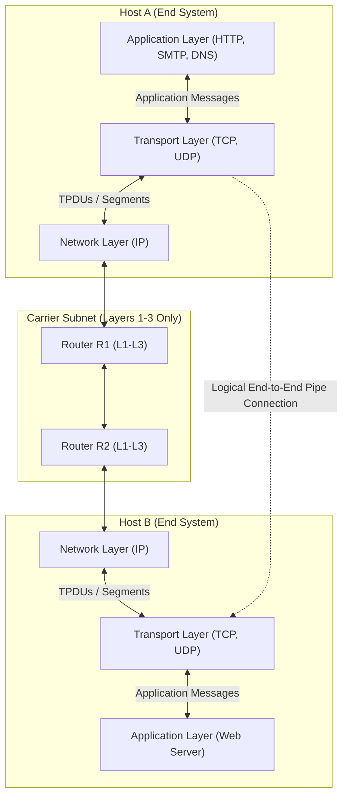

---

### Key Architectural Distinctions: Layer 4 vs Layer 3

1. **Process-to-Process vs Host-to-Host:**
   * The **Network Layer** provides logical communication between *hosts* (identified by IP addresses). It delivers a packet to the destination computer, but knows nothing about which software application on that computer needs the data.
   * The **Transport Layer** provides logical communication between *processes* running on those hosts (identified by Port numbers / TSAPs).
2. **True End-to-End Operation:**
   * Network-layer protocols (IP) run on intermediate routers. If an intermediate router drops a packet, IP makes no attempt to recover.
   * Transport-layer code runs *only* on the source and destination hosts. Intermediate routers never inspect or modify Layer 4 transport headers (except for Layer 4-aware NATs and firewalls).
3. **The UNIX Pipe Abstraction:**
   * Like a standard UNIX pipe, a reliable connection-oriented transport connection guarantees that bytes injected by the sender emerge at the receiver in the exact same sequence with zero bit errors, zero duplicates, and zero gaps.

---

### Figure 6.1: Transport Layer Positioning and TPDUs

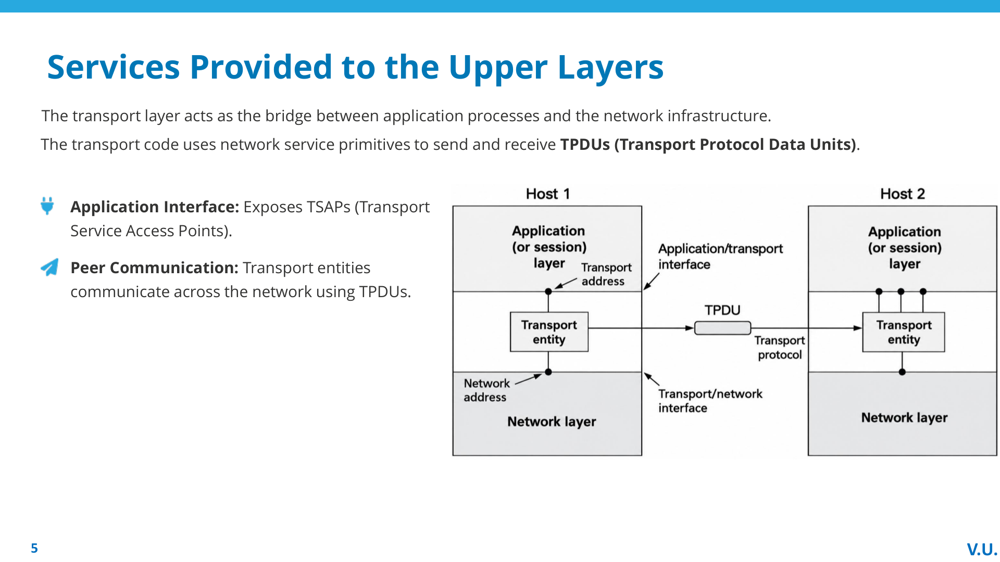

**What it shows:**
The transport layer acting as the bridge between application processes and the network infrastructure.
* **TPDU (Transport Protocol Data Unit):** The data unit exchanged between peer transport entities (called **Segments** in TCP, **User Datagrams** in UDP).
* **Layer Hierarchy:** Transport code utilizes Network Service Primitives (`N-UNITDATA.request`, `N-UNITDATA.indication`) to transmit and receive TPDUs encapsulated within network packets.

---

### Figure 6.2: The Pipe Abstraction for Transport Streams

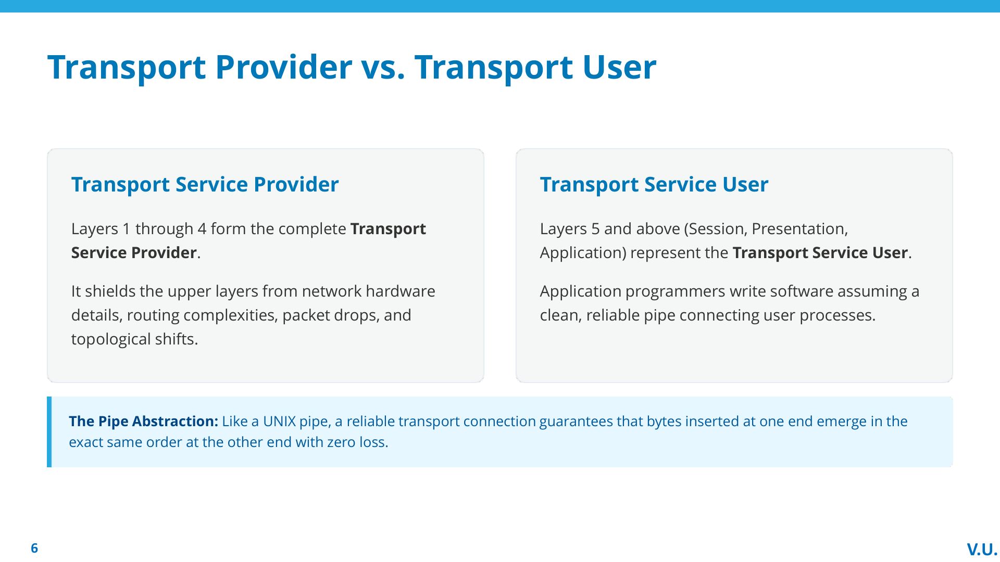

**What it shows:**
The abstraction of a continuous, error-free byte pipe presented by TCP to application layer processes, masking all underlying network complexities (packet fragmentation, reordering, loss, and router delays).

[Source: Ch 6 Transport Layer.pdf, Slides 4–7]

---

### Figure 6.3: Hierarchical Protocol Data Unit Encapsulation

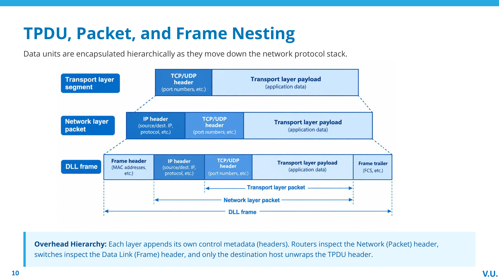

**Encapsulation Flow:**
1. **Application Layer:** Generates application message / user data.
2. **Transport Layer:** Prepends a Transport Header (e.g., TCP 20-byte header with source/dest ports, sequence numbers) to form a **Segment (TPDU)**.
3. **Network Layer:** Prepends an IP Header (source/dest IP, TTL) to form a **Packet (Datagram)**.
4. **Data Link Layer:** Prepends a MAC Header and appends a CRC Trailer to form a **Frame**.
5. **Physical Layer:** Transmits raw bits onto the medium.

[Source: Ch 6 Transport Layer.pdf, Slides 8–10]

---

## 2. Core Terminology Dictionary

1. **Transport Entity:** The software or hardware module within a host operating system's kernel that implements transport protocols (TCP/UDP).
2. **TPDU (Transport Protocol Data Unit):** The protocol data unit exchanged between peer transport entities.
3. **Segment:** The specific term for a TCP TPDU containing TCP headers and data payload.
4. **User Datagram:** The specific term for a UDP TPDU containing an 8-byte UDP header and payload.
5. **TSAP (Transport Service Access Point):** The logical endpoint identifier where an application process attaches to the transport entity (standardized as a 16-bit **Port Number** in TCP/IP).
6. **NSAP (Network Service Access Point):** The logical address identifying a network-layer host interface (standardized as a 32-bit or 128-bit **IP Address**).
7. **Socket Address:** The combination of an IP address and a Port number (e.g., `192.168.1.10:8080`), uniquely identifying an application process network-wide.
8. **Ephemeral Port:** A temporary, dynamically allocated transport port number assigned by the OS client stack (ports 49152 to 65535).
9. **Well-Known Port:** A standardized port number (0 to 1023) permanently reserved for ubiquitous system services (e.g., HTTP 80, HTTPS 443, DNS 53).
10. **Three-Way Handshake:** A three-message exchange protocol used to establish a reliable connection in the presence of delayed duplicate packets.
11. **Initial Sequence Number (ISN):** The starting sequence number chosen dynamically by a host for a new TCP connection, selected via clock-driven algorithms to prevent collisions with old duplicates.
12. **Maximum Segment Lifetime (MSL):** The conservative upper bound on the time a packet can survive in the network before being dropped (defined as 2 minutes in RFC 793).
13. **Forbidden Region:** The time-sequence space region where sequence numbers are legally barred from being allocated to avoid confusing new segments with delayed duplicates.
14. **Two-Army Problem:** A fundamental proof in distributed computing demonstrating that two entities communicating over an unreliable channel can never reach 100% guaranteed consensus to terminate a connection.
15. **Symmetric Release:** Connection teardown where each direction of data transfer is closed independently as two separate half-connections.
16. **Asymmetric Release:** Connection teardown where either party terminates the entire bidirectional connection abruptly (violates graceful data delivery).
17. **Upward Multiplexing:** Mapping multiple distinct transport connections onto a single shared network-layer virtual circuit to save carrier connection fees.
18. **Downward Multiplexing (Inverse Multiplexing):** Splitting a single high-throughput transport connection across multiple parallel network circuits to aggregate bandwidth.
19. **Sliding Window Flow Control:** A dynamic credit-based protocol where the receiver advertises its available buffer capacity (`rwnd`) to constrain the sender's transmission rate.
20. **Silly Window Syndrome:** A severe performance pathology where a receiver advertises tiny window updates (e.g., 1 byte), causing the sender to transmit tiny segments burdened by massive header overhead.
21. **Nagle's Algorithm:** A sender-side optimization that buffers small outgoing data chunks until all previously transmitted data has been acknowledged.
22. **Clark's Solution:** A receiver-side optimization that defers sending window updates until the receiver can advertise a window of at least one Maximum Segment Size (MSS) or half its buffer.
23. **Fast Retransmit:** Retransmitting a lost segment immediately upon receiving three duplicate ACKs without waiting for the retransmission timer (RTO) to expire.
24. **Slow Start:** The initial phase of TCP congestion control where the congestion window (`cwnd`) doubles every round-trip time ($O(2^n)$ exponential growth).
25. **Congestion Avoidance (AIMD):** The steady-state phase of TCP congestion control where `cwnd` increases linearly by 1 MSS per RTT upon successful delivery and halves upon packet loss (Additive Increase, Multiplicative Decrease).
26. **Slow Start Threshold (`ssthresh`):** The boundary variable separating the exponential Slow Start phase from the linear Congestion Avoidance phase.
27. **Jacobson's Algorithm:** The standard formula used by TCP to dynamically estimate smoothed round-trip time (SRTT), variance (RTTVAR), and retransmission timeout (RTO).
28. **Karn's Algorithm:** A rule stating that RTT measurements must never be taken for retransmitted segments, combined with exponential backoff of RTO upon timeout.
29. **Persistence Timer:** A timer used by TCP to query a receiver advertising a zero window (`rwnd = 0`) to prevent deadlock if a window update packet is lost.
30. **TIME_WAIT State:** A terminal TCP state where a host waits for $2\text{MSL}$ (typically 4 minutes) after closing a connection to absorb any late-arriving duplicate FIN/ACK packets.

[Source: Ch 6 Transport Layer.pdf, Slides 7–25; TCP and UDP.pdf, Slides 1–30]

---

## 3. Transport Service Primitives & Berkeley Socket API

### Abstract Transport Primitives

To allow application programs to establish, utilize, and dismantle connections independently of underlying network hardware, transport entities provide an Application Programming Interface (API) based on abstract primitives:

| Primitive | Packet Sent | Meaning |
| :--- | :--- | :--- |
| `LISTEN` | (None) | Block until an incoming connection attempt arrives from a remote client. |
| `CONNECT` | `CONNECTION REQ` | Actively attempt to establish a connection with a remote transport entity. |
| `SEND` | `DATA` | Transmit application payload data across the established connection. |
| `RECEIVE` | (None) | Block until a data packet arrives from the remote peer. |
| `DISCONNECT` | `DISCONNECTION REQ` | Initiate connection teardown to terminate the session. |

---

### Figure 6.4: Transport State Transition Diagram

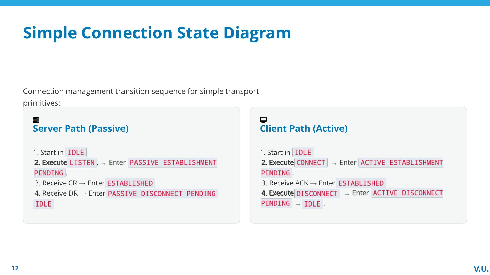

**State Transition Sequence:**
1. **Server Initialization:** Server executes `LISTEN`, transitioning from `IDLE` to `PASSIVE_WAIT`.
2. **Client Connection:** Client executes `CONNECT`, generating a `CONNECTION REQUEST` TPDU and entering `ACTIVE_WAIT`.
3. **Establishment:** Server receives the request, sends `CONNECTION ACCEPTED`, and transitions to `CONNECTED`. Client receives the acceptance and transitions to `CONNECTED`.
4. **Data Transfer:** Both parties exchange `DATA` TPDUs in full duplex.
5. **Teardown:** When finished, executing `DISCONNECT` transmits a `DISCONNECTION REQUEST`, transitioning back to `IDLE`.

[Source: Ch 6 Transport Layer.pdf, Slides 11–12]

---

### The Berkeley Sockets API

Developed in 1981 for BSD 4.2 UNIX, **Berkeley Sockets** became the universal standard API for network programming across all modern operating systems.

### Figure 6.5: Berkeley Socket Primitives Table

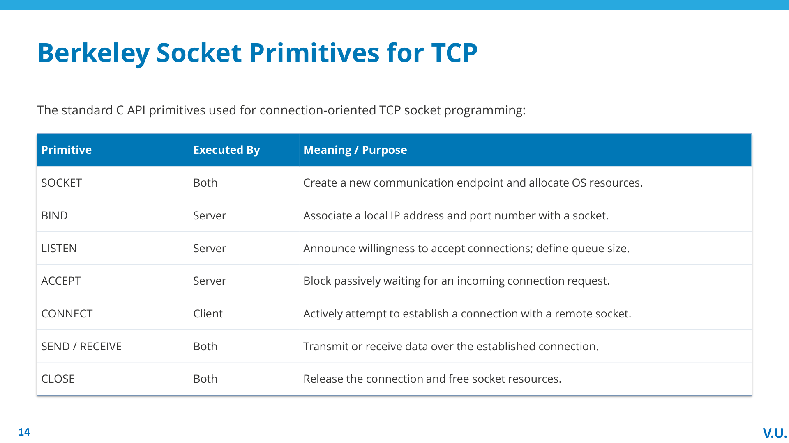

### Figure 6.6: Client-Server Socket Interaction Flow

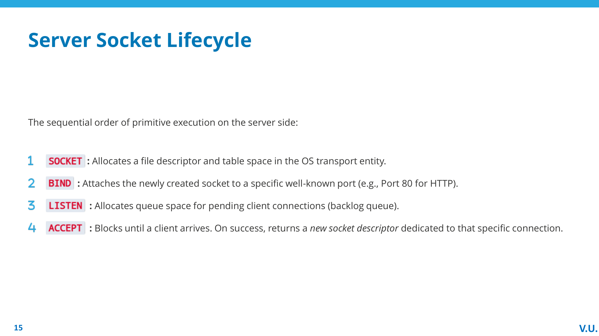

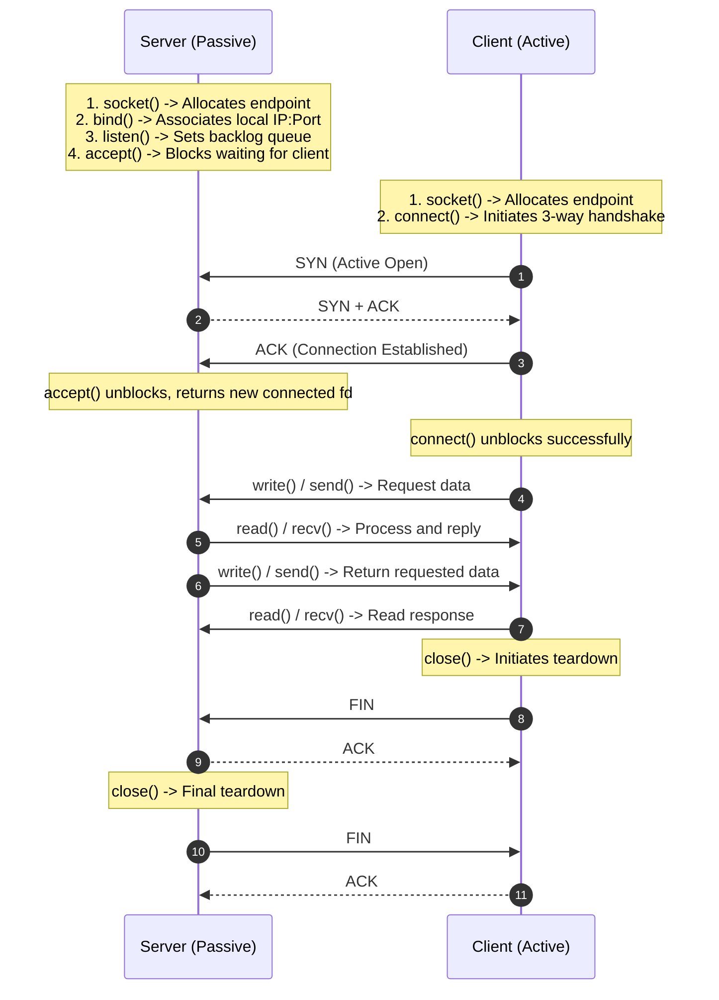

---

### Practical C Implementation: Network File Client & Server

#### Client Implementation (Excerpts):
```c
#include <sys/types.h>
#include <sys/socket.h>
#include <netinet/in.h>
#include <netdb.h>
#include <unistd.h>
#include <string.h>

#define SERVER_PORT 12345
#define BUF_SIZE 4096

int main(int argc, char **argv) {
    int s, bytes;
    char buf[BUF_SIZE];
    struct hostent *h;
    struct sockaddr_in channel;

    // 1. Resolve remote server IP address
    h = gethostbyname(argv[1]);

    // 2. Create client TCP socket endpoint
    s = socket(PF_INET, SOCK_STREAM, IPPROTO_TCP);

    // 3. Configure server address structure
    memset(&channel, 0, sizeof(channel));
    channel.sin_family = AF_INET;
    memcpy(&channel.sin_addr.s_addr, h->h_addr, h->h_length);
    channel.sin_port = htons(SERVER_PORT);

    // 4. Connect to remote server (TCP 3-way handshake)
    connect(s, (struct sockaddr *)&channel, sizeof(channel));

    // 5. Send file request name
    write(s, argv[2], strlen(argv[2]) + 1);

    // 6. Read stream of file bytes until EOF
    while ((bytes = read(s, buf, BUF_SIZE)) > 0) {
        write(1, buf, bytes); // Output to stdout
    }

    // 7. Cleanly close socket
    close(s);
    return 0;
}
```

#### Server Implementation (Excerpts):
```c
#include <sys/types.h>
#include <sys/socket.h>
#include <netinet/in.h>
#include <unistd.h>
#include <fcntl.h>
#include <string.h>

#define SERVER_PORT 12345
#define QUEUE_SIZE 10
#define BUF_SIZE 4096

int main() {
    int s, b, sa, fd, bytes;
    char buf[BUF_SIZE];
    struct sockaddr_in channel;

    // 1. Create welcoming socket
    s = socket(AF_INET, SOCK_STREAM, IPPROTO_TCP);

    // 2. Bind socket to local port
    memset(&channel, 0, sizeof(channel));
    channel.sin_family = AF_INET;
    channel.sin_addr.s_addr = htonl(INADDR_ANY);
    channel.sin_port = htons(SERVER_PORT);
    bind(s, (struct sockaddr *)&channel, sizeof(channel));

    // 3. Enter passive listening state with backlog queue
    listen(s, QUEUE_SIZE);

    // 4. Main accept loop
    while (1) {
        sa = accept(s, 0, 0); // Blocks waiting for client connection
        read(sa, buf, BUF_SIZE); // Read requested filename

        fd = open(buf, O_RDONLY); // Open file on server disk
        while ((bytes = read(fd, buf, BUF_SIZE)) > 0) {
            write(sa, buf, bytes); // Stream file data across TCP
        }
        close(fd);
        close(sa); // Close connected client socket
    }
}
```

[Source: Ch 6 Transport Layer.pdf, Slides 13–20]

---

## 4. Elements of Transport Protocols

Although Transport protocols resemble Data Link protocols (both handle framing, error control, flow control, and sequencing), the transport environment is vastly more complex:

| Aspect | Data Link Layer | Transport Layer |
| :--- | :--- | :--- |
| **Physical Channel** | Direct physical wire (e.g., Ethernet cable, point-to-point fiber) | The entire communication subnet mesh of routers |
| **Addressing** | Implicit (only one node on other end of wire) | Explicit (must name specific host IP and process port) |
| **Storage & Delay** | Minimal buffer in NIC; propagation delay is fixed | Unbounded storage in router queues; variable delays |
| **Packet Duplication** | Impossible on point-to-point wires | Common (routers buffer, duplicate, and misroute packets) |
| **Packet Reordering** | Frames arrive in strict FIFO physical order | Packets take different mesh routes; arrive out of order |
| **Resource Allocation** | Fixed physical link capacity | Dynamic, competing against thousands of other flows |

[Source: Ch 6 Transport Layer.pdf, Slides 21–22]

---

### Addressing: TSAPs, NSAPs, and Port Discovery

### Figure 6.7: TSAP and NSAP Addressing Hierarchy

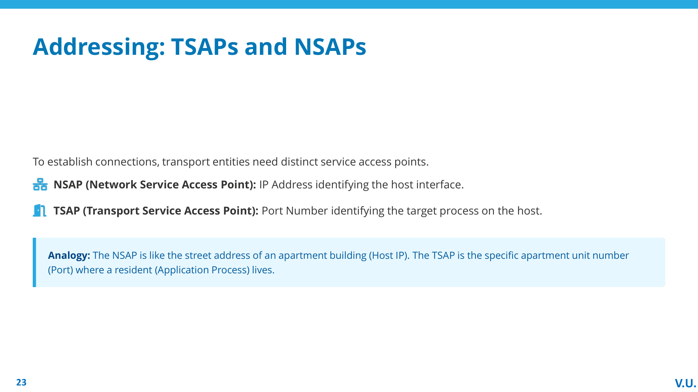

* **NSAP (Network Service Access Point):** The network address identifying a host interface (IP address).
* **TSAP (Transport Service Access Point):** The transport endpoint identifying an application process (Port number).
* **Analogy:** The NSAP is like the street address of an apartment building (Host IP). The TSAP is the specific apartment unit number inside that building (Port).

---

### Port Discovery & The Process Server (`inetd`)

### Figure 6.8: The Process Server (`inetd`) Architecture


Running separate server daemons for hundreds of rarely used services (e.g., FTP, Telnet, finger) permanently wastes CPU and RAM.
* **The Process Server Solution (`inetd` in UNIX):**
  1. A single master daemon (`inetd`) listens on dozens of service ports simultaneously.
  2. When a connection request arrives for service $X$, `inetd` accepts the connection, forks a new process, executes the dedicated server daemon for $X$, and transfers the socket file descriptor to the new daemon.
* **Name Servers / Portmappers:** For dynamic ports, clients contact a well-known Portmapper daemon (UDP/TCP port 111) to query which dynamic port a service is currently registered on.

[Source: Ch 6 Transport Layer.pdf, Slides 23–26]

---

### Sequence Space & The Forbidden Region (Tomlinson's Method)

Networks can buffer packets in router queues for extended intervals. If an old, delayed packet emerges after a connection has closed, it could be mistaken for fresh data in a new connection!

To prevent this, networks enforce a **Maximum Packet Lifetime ($T$)** (typically 120 seconds).
To ensure sequence numbers do not wrap around and collide with delayed packets:

### Figure 6.9: Forbidden Region in Sequence Number Allocation

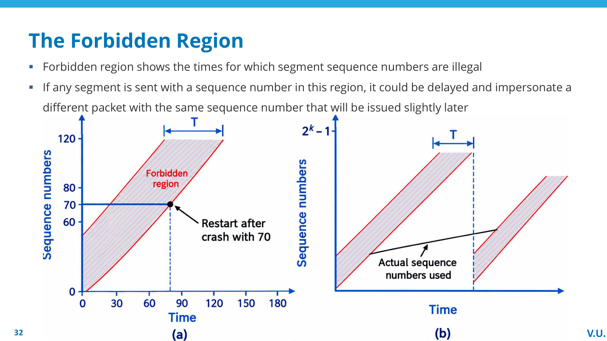

1. **Tomlinson's Clock-Driven Generator:** Each host maintains a continuous time-of-day clock that increments steadily at frequency $f$, even across OS reboots. When establishing a new connection, the host selects its **Initial Sequence Number (ISN)** from this clock.
2. **The Forbidden Region:** A diagonally shaded region in the time-sequence number plane where sequence numbers are strictly illegal:
   * Senders cannot transmit faster than the clock rate; otherwise, sequence numbers would enter the forbidden region from the left.
   * If a machine crashes, it must sleep for $T$ seconds before rebooting to guarantee all pre-crash packets have died out of the subnet.

[Source: Ch 6 Transport Layer.pdf, Slides 27–33]

---

## 5. The Three-Way Handshake

The **Three-Way Handshake** (invented by Ray Tomlinson) reliably establishes a transport connection even when the network contains delayed, duplicated, and misrouted packets from previous sessions.

---

### Figure 6.10: Three-Way Handshake — Normal Connection Setup

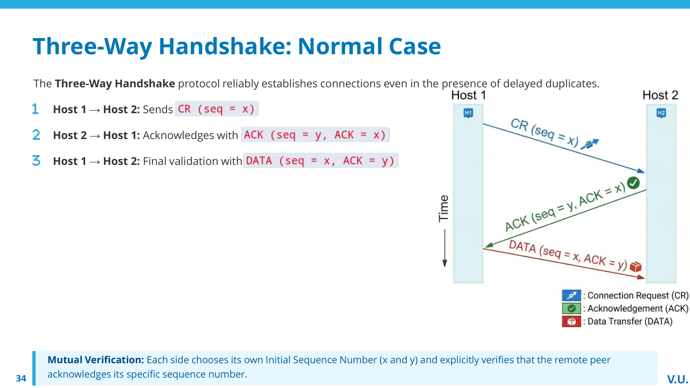

#### Normal Three-Way Handshake Exchange:
1. **Message 1 (Host 1 $\to$ Host 2):** Host 1 chooses its Initial Sequence Number $x$ and transmits:

$$
\text{SYN}(seq = x)
$$

2. **Message 2 (Host 2 $\to$ Host 1):** Host 2 receives the SYN, records $x$, chooses its own Initial Sequence Number $y$, and returns:

$$
\text{SYN}(seq = y) + \text{ACK}(ack = x + 1)
$$

3. **Message 3 (Host 1 $\to$ Host 2):** Host 1 verifies that Host 2 acknowledged $x+1$, confirming that Host 2 is alive and responding to *this* specific connection attempt. Host 1 transmits:

$$
\text{ACK}(ack = y + 1) + \text{DATA}
$$

Connection is now fully synchronized and open in both directions.

---

### Figure 6.11: Handling Delayed Duplicate SYN

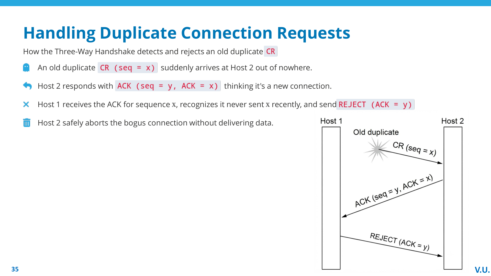

**Scenario:**
An old duplicate `SYN(seq = x)` from a long-dead session suddenly emerges from a router buffer and arrives at Host 2:
1. Host 2 thinks a new connection is being requested and replies with:

$$
\text{SYN}(seq = y) + \text{ACK}(ack = x + 1)
$$

2. When Host 1 receives this packet, it checks its active connection table. Host 1 realizes it never sent a `SYN` with sequence number $x$!
3. Host 1 rejects the phantom connection by sending a **Reset packet**:

$$
\text{RST}(seq = x + 1)
$$

4. Host 2 receives the RST and immediately aborts the half-open connection without allocating memory or delivering false data to the application.

---

### Figure 6.12: Handling Delayed Duplicate SYN and Duplicate ACK

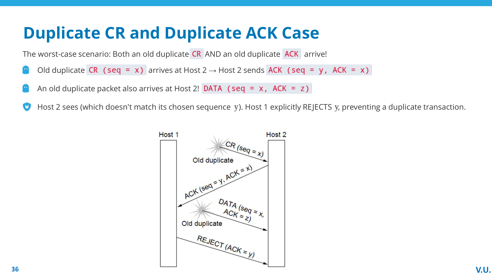

**Worst-Case Scenario:**
Both an old duplicate `SYN(seq = x)` AND an old duplicate `ACK` arrive:
1. Host 2 receives old duplicate `SYN(seq = x)` and replies with `SYN(seq = y) + ACK(ack = x + 1)`.
2. An old duplicate `ACK(ack = z)` arrives at Host 2. Host 2 inspects the acknowledgment number $z$. Since $z \ne y + 1$, Host 2 ignores it.
3. Host 1 sends a formal `RST` to terminate the bogus handshake.
4. **Mathematical Conclusion:** The three-way handshake is completely immune to arbitrary delayed duplicate packets.

[Source: Ch 6 Transport Layer.pdf, Slides 34–36]

---

## 6. Connection Release & The Two-Army Problem

Releasing a connection can be designed as:
* **Asymmetric Release:** Either host sends a `DISCONNECT` and abruptly terminates the connection.
  * *Flaw (Data Loss):* Host $A$ sends 10 packets, followed by a disconnect. If Host $B$ terminates immediately, any packets still in transit are destroyed!
* **Symmetric Release:** The connection is treated as two independent simplex channels. Each direction must be explicitly and independently closed.

---

### Figure 6.13: The Two-Army Consensus Impossibility Proof

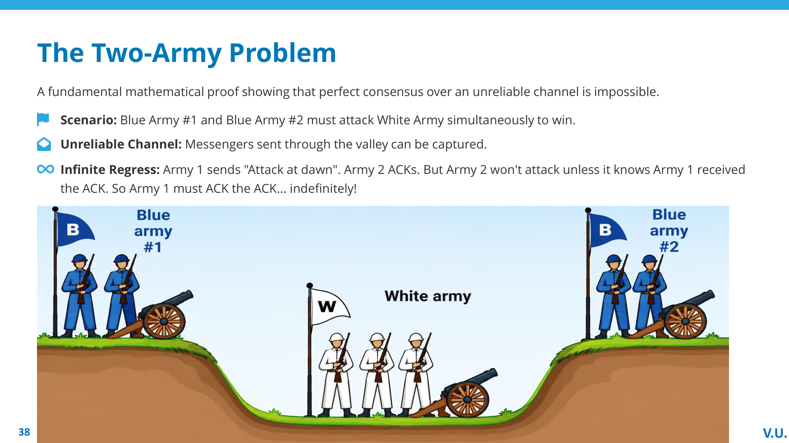

### The Two-Army Problem (Gray's Paradox)

**The Scenario:**
* Blue Army 1 and Blue Army 2 are camped in the hills surrounding White Army in the valley.
* If both Blue armies attack simultaneously, they win. If either attacks alone, White Army destroys them.
* The only communication between Blue 1 and Blue 2 is by sending messengers through the hostile valley, where messengers may be captured.

**The Paradox:**
1. Blue 1 sends a messenger: *"Attack at dawn tomorrow."*
2. Blue 1 cannot attack because it does not know if the messenger was captured.
3. Blue 2 receives the message and sends an acknowledgment back: *"Agreed, attacking at dawn."*
4. Blue 2 cannot attack because it does not know if its acknowledgment messenger made it through! If the messenger was caught, Blue 1 will not attack.
5. Blue 1 receives the ACK and sends an ACK-of-the-ACK: *"I got your agreement."*
6. Blue 1 now cannot attack until it knows whether its ACK-of-the-ACK made it through...

**Mathematical Theorem:**
**No protocol using unreliable communication can ever guarantee 100% mutual consensus to terminate a connection.** In real transport networks, protocols must rely on **timers** to terminate sessions when acknowledgments fail to arrive.

---

### Figure 6.14: Four Connection Release Scenarios with Timers

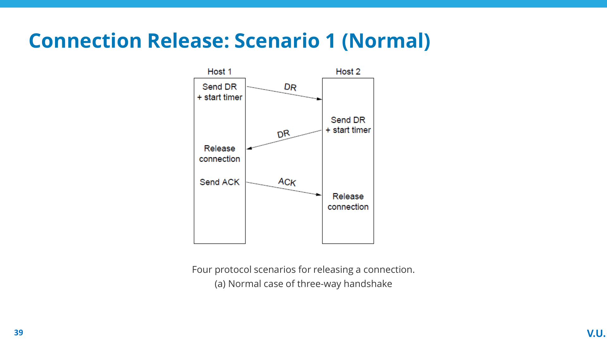

**Four Release Scenarios:**
1. **Normal Case:** Host 1 sends `DR` (Disconnect Request), Host 2 sends `DR` + `ACK`, Host 1 sends final `ACK`. Connection closes cleanly.
2. **Final ACK Lost:** Host 1 sends final `ACK`, but it is dropped. Host 2's disconnect timer expires; Host 2 closes anyway.
3. **Repeated DR Loss:** Host 2's `DR` is lost repeatedly. Host 1's timer expires; Host 1 releases its resources.
4. **Complete Network Disconnection:** All lines drop. Both hosts' independent inactivity timers eventually expire, terminating both sides.

[Source: Ch 6 Transport Layer.pdf, Slides 37–40]

---

## 7. Flow Control & Dynamic Buffer Allocation

Managing buffer memory at the receiver is critical in transport protocols. Unlike link-layer protocols where buffer capacity is statically pre-allocated per physical wire, a transport entity may support thousands of concurrent connections whose traffic fluctuates wildly.

---

### Dynamic Buffer Allocation & Credit-Based Flow Control

### Figure 6.15: Dynamic Buffer Allocation & Sliding Window Credits

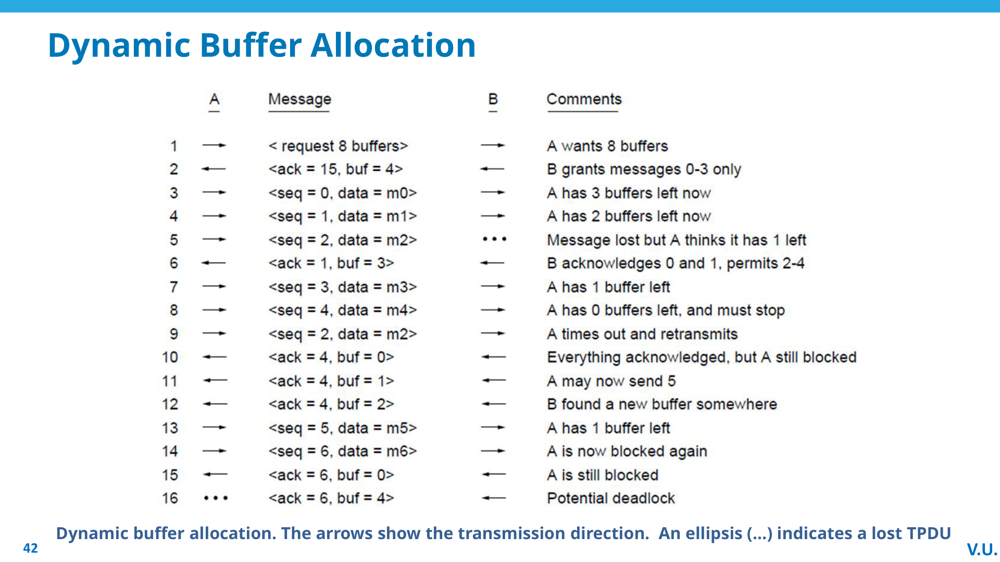

#### Mechanism of Credit-Based Flow Control:
1. **Decoupling Acknowledgment from Buffer Allocation:**
   * In traditional sliding window protocols, an ACK implies authorization to send more data.
   * In transport protocols, acknowledgments are completely **decoupled from buffer credits**.
   * A transport TPDU contains two distinct feedback fields:

$$
\text{ACK Number} = \text{Next expected sequence number}
$$


$$
\text{Window Credit} = \text{Number of additional bytes the receiver is willing to buffer}
$$

2. **Buffer Allocation Trace:**
   * Receiver sends: $\text{ACK} = 0, \text{Window} = 8$. The sender is granted 8 credits and transmits 8 packets ($0$ to $7$).
   * Receiver application reads 4 packets from the buffer. The receiver issues an update: $\text{ACK} = 4, \text{Window} = 4$.
   * If the receiver application becomes sluggish and buffers saturate, the receiver advertises a **Zero Window** ($\text{Window} = 0$). The sender is strictly throttled and must cease transmission until a new credit update arrives.

[Source: Ch 6 Transport Layer.pdf, Slides 41–42]

---

## 8. Multiplexing Techniques

Transport entities optimize resource utilization by multiplexing connections across layers:

### Figure 6.16: Upward and Downward Multiplexing

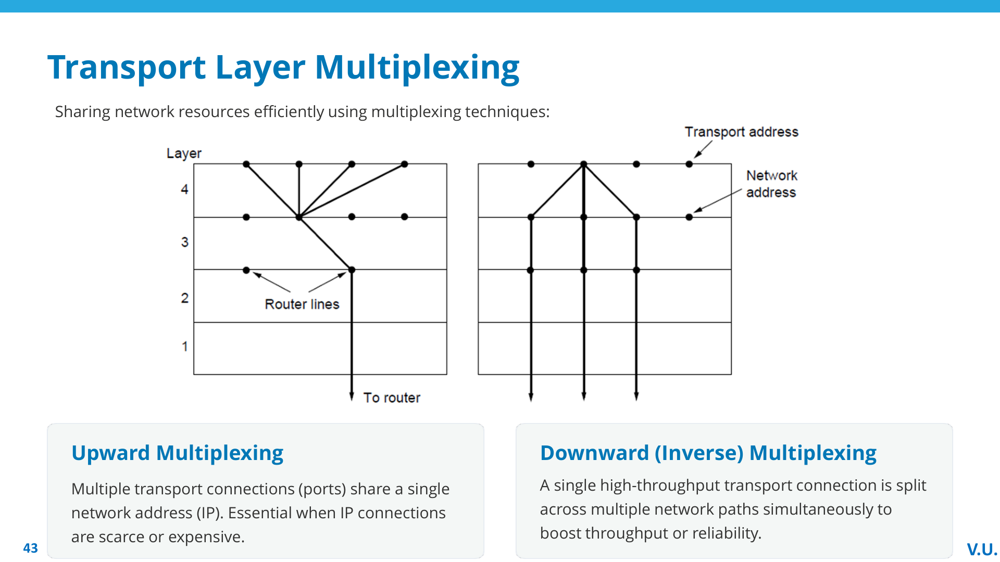

1. **Upward Multiplexing:**
   * Multiple distinct transport connections are aggregated and routed over a **single network-layer virtual circuit**.
   * *Motivation:* In commercial telecommunications networks (e.g., X.25, ATM), carriers charge a setup fee and per-minute connection charge for each active virtual circuit. Upward multiplexing minimizes carrier connection costs by pooling user sessions into one circuit.
2. **Downward Multiplexing (Inverse Multiplexing):**
   * A single high-throughput transport connection is split across **multiple parallel network-layer circuits**.
   * *Motivation:* When a user requires aggregate bandwidth exceeding the physical throughput of a single communication link (e.g., combining multiple DSL or cellular lines to stream 4K video).

[Source: Ch 6 Transport Layer.pdf, Slide 43]

---

## 9. Crash Recovery Strategies

When a network router or host crashes and reboots during an active transport session, the transport entity must recover gracefully.

### Crash Recovery State Analysis
Consider a client transmitting data to a server. The server must acknowledge received TPDUs and write them to disk for the application. The server can be programmed in one of two ways:
* **Strategy A (Acknowledge First):** Send ACK to client, then write TPDU to application.
* **Strategy B (Write First):** Write TPDU to application, then send ACK to client.

Now suppose the server crashes. The client can adopt one of two retransmission policies:
* **Policy 1 (Always Retransmit):** Resend the unacknowledged TPDU upon reboot.
* **Policy 2 (Never Retransmit):** Assume the TPDU was safely received.

| Event Sequence | Strategy A (ACK First) | Strategy B (Write First) |
| :--- | :--- | :--- |
| **Crash occurs between ACK and Write** | ACK sent; crash; no write. Client does not retransmit $\implies$ **Undetected Data Loss!** If client retransmits $\implies$ Correctly saved. | Not applicable (Write happens first). |
| **Crash occurs between Write and ACK** | Not applicable (ACK happens first). | Write completed; crash; no ACK. If client retransmits $\implies$ **Duplicate Data Written!** If client does not retransmit $\implies$ Correctly saved. |

**Fundamental Conclusion:**
**It is mathematically impossible for the transport layer to guarantee end-to-end recovery from a server crash without higher-layer application support** (such as transactional database logging and two-phase commit protocols).

[Source: Ch 6 Transport Layer.pdf, Slides 44–45]

---

## 10. User Datagram Protocol (UDP)

The **User Datagram Protocol (UDP — RFC 768)** is an unreliable, connectionless transport protocol providing minimal, lightweight process-to-process delivery.

---

### Figure 6.17: Position of UDP in the TCP/IP Stack

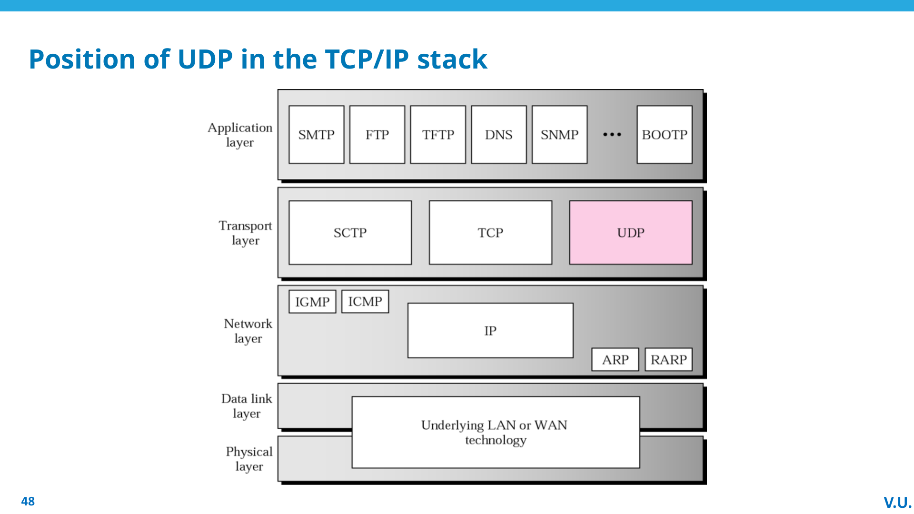

UDP is essentially an IP interface that adds two critical functions that raw IP cannot provide:
1. **Port Addressing (Multiplexing/Demultiplexing):** Distinguishing between multiple application processes on the same host.
2. **Error Detection (Checksum):** Verifying the payload data integrity (raw IP checks only the IP header!).

---

### Port Numbers & ICANN Ranges

### Figure 6.18: ICANN Transport Port Ranges

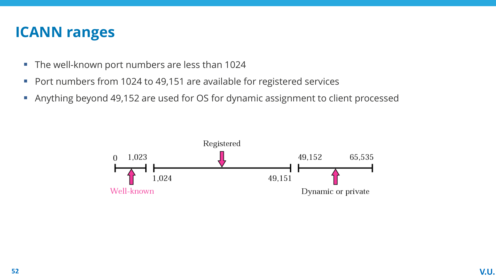

Transport ports are 16-bit integers ($0$ to $65,535$), partitioned by ICANN into three distinct operational ranges:
* **Well-Known Ports ($0$ to $1023$):** Assigned permanently to ubiquitous server daemons; requires administrative / root privileges to bind.
* **Registered Ports ($1024$ to $49,151$):** Registered by software vendors for specific third-party applications (e.g., MySQL 3306, PostgreSQL 5432).
* **Dynamic / Private / Ephemeral Ports ($49,152$ to $65,535$):** Allocated dynamically by the operating system for client-side outgoing connections.

#### Ubiquitous Well-Known UDP Ports:
* `53`: DNS (Domain Name System)
* `67` / `68`: DHCP (Dynamic Host Configuration Protocol Server / Client)
* `69`: TFTP (Trivial File Transfer Protocol)
* `123`: NTP (Network Time Protocol)
* `161` / `162`: SNMP (Simple Network Management Protocol)

[Source: Ch 6 Transport Layer.pdf, Slides 48–54]

---

### UDP Header Format

The UDP header is fixed at exactly **8 bytes** (64 bits), minimizing protocol overhead.

### Figure 6.19: UDP User Datagram Header Format

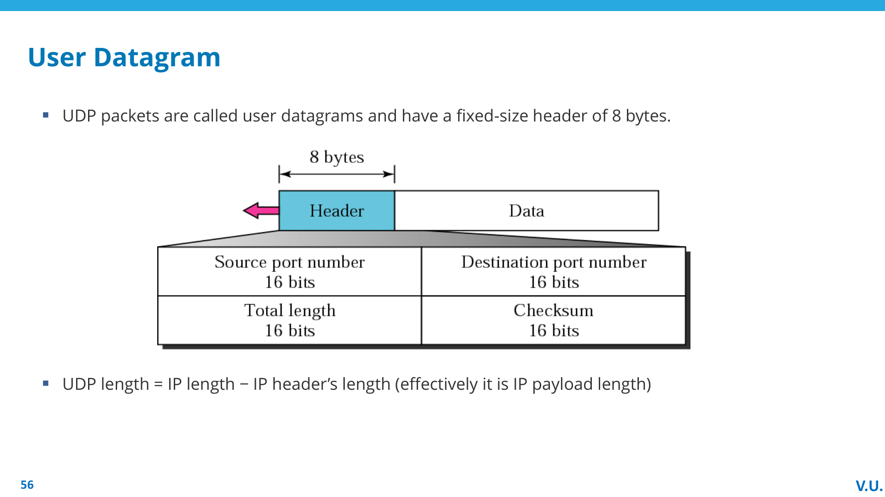

```text
 0                   1                   2                   3
 0 1 2 3 4 5 6 7 8 9 0 1 2 3 4 5 6 7 8 9 0 1 2 3 4 5 6 7 8 9 0 1
+-+-+-+-+-+-+-+-+-+-+-+-+-+-+-+-+-+-+-+-+-+-+-+-+-+-+-+-+-+-+-+-+
|      Source Port (16 bits)    |   Destination Port (16 bits)  |
+-+-+-+-+-+-+-+-+-+-+-+-+-+-+-+-+-+-+-+-+-+-+-+-+-+-+-+-+-+-+-+-+
|       Length (16 bits)        |       Checksum (16 bits)      |
+-+-+-+-+-+-+-+-+-+-+-+-+-+-+-+-+-+-+-+-+-+-+-+-+-+-+-+-+-+-+-+-+
|                             Data                              |
+-+-+-+-+-+-+-+-+-+-+-+-+-+-+-+-+-+-+-+-+-+-+-+-+-+-+-+-+-+-+-+-+
```

1. **Source Port (16 bits):** Port of sending application (optional; set to 0 if no reply is expected).
2. **Destination Port (16 bits):** Port of receiving application process.
3. **Length (16 bits):** Total length of UDP header plus data payload in bytes. Minimum value = $8\text{ bytes}$ (empty datagram).
4. **Checksum (16 bits):** 1's complement sum of 16-bit words. Optional in IPv4 (set to 0 if unused), but **strictly mandatory in IPv6**.

---

### UDP Checksum Calculation with Pseudo-Header

### Figure 6.20: UDP Checksum Calculation with Pseudo-Header

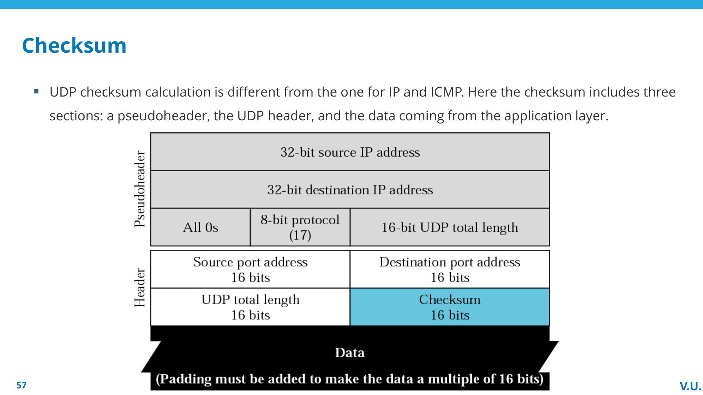

To protect against misrouted packets, the UDP checksum calculation incorporates a fictitious 12-byte **Pseudo-Header** prepended to the UDP datagram:

```text
+-+-+-+-+-+-+-+-+-+-+-+-+-+-+-+-+-+-+-+-+-+-+-+-+-+-+-+-+-+-+-+-+
|                       Source IP Address                       |
+-+-+-+-+-+-+-+-+-+-+-+-+-+-+-+-+-+-+-+-+-+-+-+-+-+-+-+-+-+-+-+-+
|                    Destination IP Address                     |
+-+-+-+-+-+-+-+-+-+-+-+-+-+-+-+-+-+-+-+-+-+-+-+-+-+-+-+-+-+-+-+-+
|      Zero     |    Protocol   |           UDP Length          |
+-+-+-+-+-+-+-+-+-+-+-+-+-+-+-+-+-+-+-+-+-+-+-+-+-+-+-+-+-+-+-+-+
```

* **Calculation Procedure:**
  1. Prepend the 12-byte pseudo-header containing Source IP, Destination IP, Protocol (`17`), and UDP Length.
  2. If the data payload contains an odd number of bytes, append an all-zero padding byte to make the length a multiple of 16 bits.
  3. Set the Checksum field in the UDP header to `0x0000`.
  4. Compute the 16-bit 1's complement sum over the pseudo-header, UDP header, and padded payload.
  5. Invert the result and insert it into the Checksum field.
  6. Discard the pseudo-header before transmitting onto the physical network!

---

### Figure 6.21: UDP Port Queues

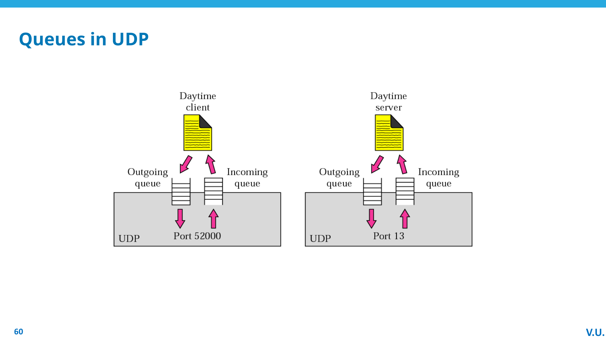

When UDP datagrams arrive for an application process, the operating system places them in an incoming queue associated with that port. If the application does not read datagrams fast enough, the queue overflows, and newly arrived datagrams are discarded without notification.

---

### Figure 6.22: UDP Multiplexing and Demultiplexing

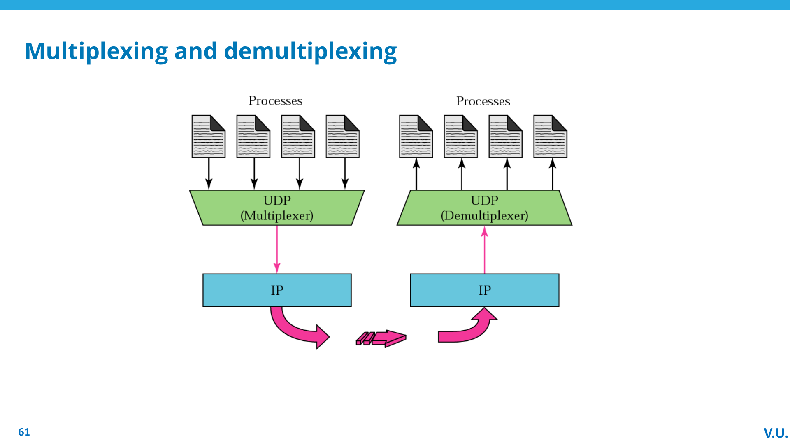

* **Multiplexing:** Multiple application processes send datagrams through their respective sockets; UDP attaches port headers and passes them to the single IP entity.
* **Demultiplexing:** When IP receives a packet with $\text{Protocol} = 17$, UDP inspects the Destination Port and delivers the payload to the matching application socket queue.

[Source: Ch 6 Transport Layer.pdf, Slides 55–62]

---

## 11. Transmission Control Protocol (TCP)

The **Transmission Control Protocol (TCP — RFC 793)** provides reliable, connection-oriented, full-duplex, flow-controlled, and congestion-controlled stream delivery between two communicating endpoints.

---

### TCP Stream Delivery & Buffering

TCP views application data not as discrete packets, but as an unstructured, continuous **stream of bytes**.

### Figure 6.23: TCP Sending and Receiving Circular Buffers

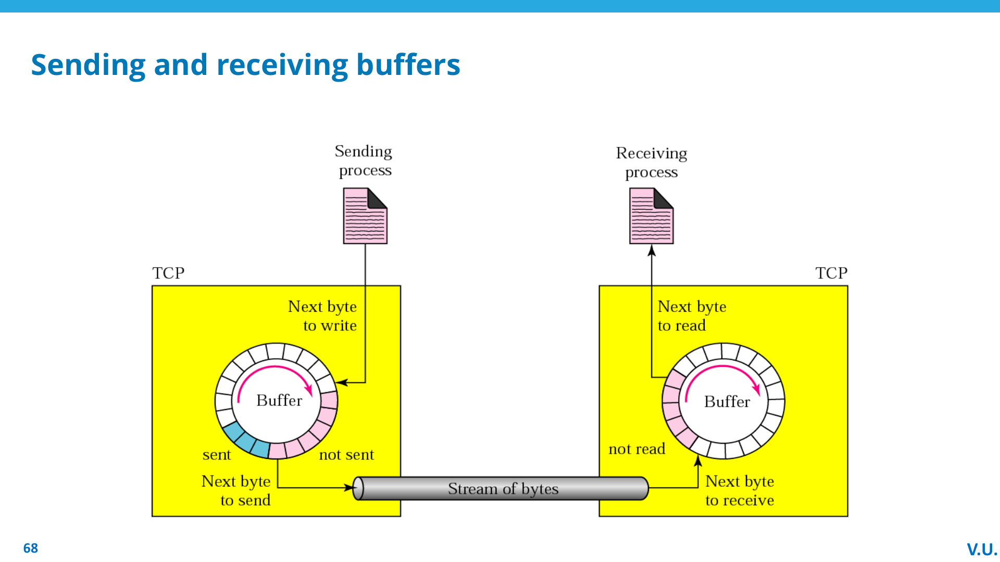

* Both sender and receiver maintain circular memory buffers.
* The sending application writes arbitrary byte chunks into the send buffer. TCP packages these bytes into **segments** sized up to the Maximum Segment Size (MSS) and transmits them across the network.
* The receiving TCP deposits arriving segments into the receive buffer, reconstructs the continuous stream, and delivers bytes to the receiving application.

---

### TCP Numbering System: Byte-Stream Sequence Numbers & Cumulative ACKs

* **Sequence Numbers:** Every individual byte in a TCP connection is assigned an independent 32-bit sequence number.
  * The sequence number placed in the TCP segment header is the **sequence number of the very first data byte** carried in that segment payload.
* **Cumulative Acknowledgment:** TCP ACKs are strictly cumulative.
  * An acknowledgment number $N$ signifies: *"I have successfully received all bytes up to $N - 1$. I am now expecting byte number $N$."*

[Source: Ch 6 Transport Layer.pdf, Slides 63–71]

---

### TCP Segment Format

The TCP header is variable in length: minimum 20 bytes (no options), maximum 60 bytes.

### Figure 6.24: TCP Segment Format

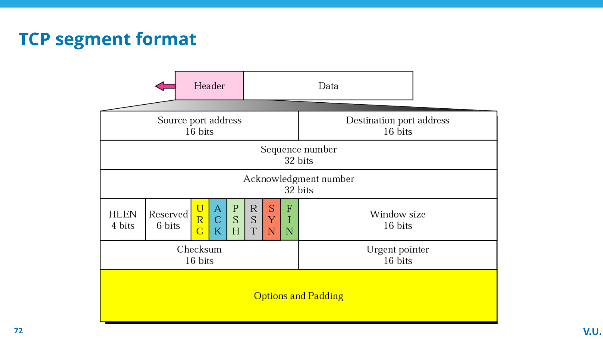

```text
 0                   1                   2                   3
 0 1 2 3 4 5 6 7 8 9 0 1 2 3 4 5 6 7 8 9 0 1 2 3 4 5 6 7 8 9 0 1
+-+-+-+-+-+-+-+-+-+-+-+-+-+-+-+-+-+-+-+-+-+-+-+-+-+-+-+-+-+-+-+-+
|          Source Port          |       Destination Port        |
+-+-+-+-+-+-+-+-+-+-+-+-+-+-+-+-+-+-+-+-+-+-+-+-+-+-+-+-+-+-+-+-+
|                        Sequence Number                        |
+-+-+-+-+-+-+-+-+-+-+-+-+-+-+-+-+-+-+-+-+-+-+-+-+-+-+-+-+-+-+-+-+
|                    Acknowledgment Number                      |
+-+-+-+-+-+-+-+-+-+-+-+-+-+-+-+-+-+-+-+-+-+-+-+-+-+-+-+-+-+-+-+-+
|  Data |           |U|A|P|R|S|F|                               |
| Offset| Reserved  |R|C|S|S|Y|I|            Window             |
|       |           |G|K|H|T|N|N|                               |
+-+-+-+-+-+-+-+-+-+-+-+-+-+-+-+-+-+-+-+-+-+-+-+-+-+-+-+-+-+-+-+-+
|           Checksum            |         Urgent Pointer        |
+-+-+-+-+-+-+-+-+-+-+-+-+-+-+-+-+-+-+-+-+-+-+-+-+-+-+-+-+-+-+-+-+
|                    Options                    |    Padding    |
+-+-+-+-+-+-+-+-+-+-+-+-+-+-+-+-+-+-+-+-+-+-+-+-+-+-+-+-+-+-+-+-+
|                             Data                              |
+-+-+-+-+-+-+-+-+-+-+-+-+-+-+-+-+-+-+-+-+-+-+-+-+-+-+-+-+-+-+-+-+
```

---

### Field Analysis:

1. **Source Port (16 bits):** Originating port.
2. **Destination Port (16 bits):** Destination port.
3. **Sequence Number (32 bits):** Sequence number of first payload byte.
4. **Acknowledgment Number (32 bits):** Next expected sequence byte. Valid only if ACK flag is set.
5. **Data Offset / HLEN (4 bits):** Length of TCP header measured in **32-bit (4-byte) words**. Minimum = $5$ ($5 \times 4 = 20\text{ bytes}$), Maximum = $15$ ($15 \times 4 = 60\text{ bytes}$).
6. **Reserved (4 bits):** Reserved for future use (must be 0; or used for NS/CWR/ECE flags).
7. **Control Flags (6 bits):**

### Figure 6.25: TCP Control Flags

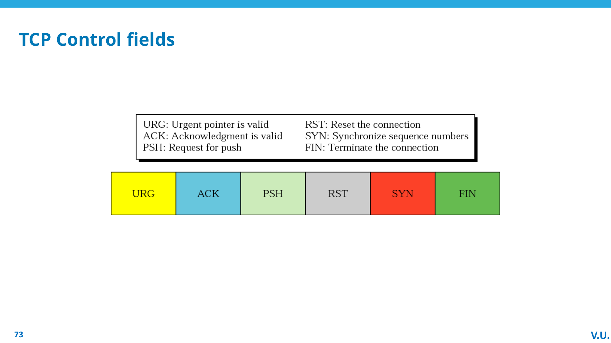

* **URG:** Urgent Pointer field is valid. Signals high-priority out-of-band data (e.g., Ctrl-C break).
* **ACK:** Acknowledgment field is valid (set on every segment after initial SYN).
* **PSH:** Push function; receiver should deliver buffered data to application immediately without waiting for buffer to fill.
* **RST:** Reset the connection; rejects invalid connections or handles unrecoverable errors.
* **SYN:** Synchronize sequence numbers; initiates connection establishment.
* **FIN:** Finish; sender has finished transmitting data; initiates connection teardown.
8. **Window Size (`rwnd` — 16 bits):** Flow control credit; number of bytes receiver can accept starting from acknowledgment number.
9. **Checksum (16 bits):** Mandatory 1's complement sum covering pseudo-header, TCP header, and data.

### Figure 6.26: TCP Checksum with Pseudo-Header

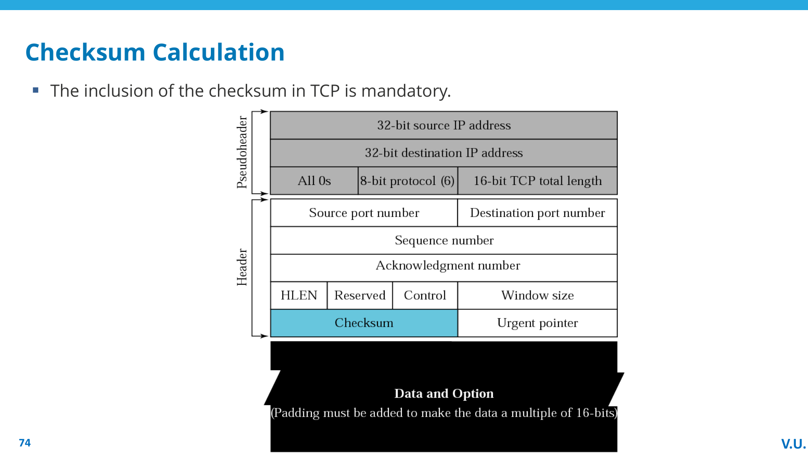

10. **Urgent Pointer (16 bits):** Byte offset from sequence number indicating location of urgent data.
11. **Options (Variable, 0 to 40 bytes):** Maximum Segment Size (MSS), Window Scale factor, Selective ACK (SACK), Timestamps.

[Source: Ch 6 Transport Layer.pdf, Slides 72–75]

---

## 12. TCP Connection Management

### TCP Connection Establishment (Three-Way Handshake)

### Figure 6.27: TCP Connection Establishment Flow

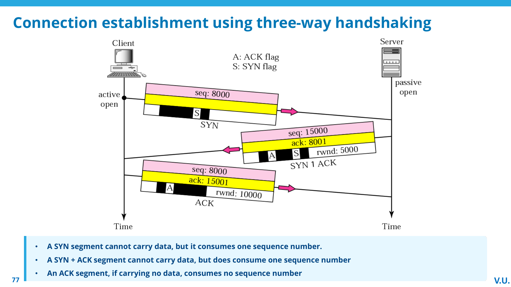

1. **Step 1 (Client $\to$ Server):** Client sends active open:

$$
\text{SYN} = 1, \quad \text{seq} = \text{ISN}_C, \quad \text{ACK} = 0
$$

   *(Consumes 1 sequence number).* Client enters `SYN_SENT`.
2. **Step 2 (Server $\to$ Client):** Server accepts connection:

$$
\text{SYN} = 1, \quad \text{ACK} = 1, \quad \text{seq} = \text{ISN}_S, \quad \text{ack} = \text{ISN}_C + 1
$$

   *(Consumes 1 sequence number).* Server enters `SYN_RCVD`.
3. **Step 3 (Client $\to$ Server):** Client completes handshake:

$$
\text{SYN} = 0, \quad \text{ACK} = 1, \quad \text{seq} = \text{ISN}_C + 1, \quad \text{ack} = \text{ISN}_S + 1
$$

   Client enters `ESTABLISHED`. Upon receiving this ACK, Server enters `ESTABLISHED`.

---

### TCP Connection Termination & Half-Close

TCP termination is symmetric; each simplex stream must be closed independently.

### Figure 6.28: TCP Connection Termination Sequence

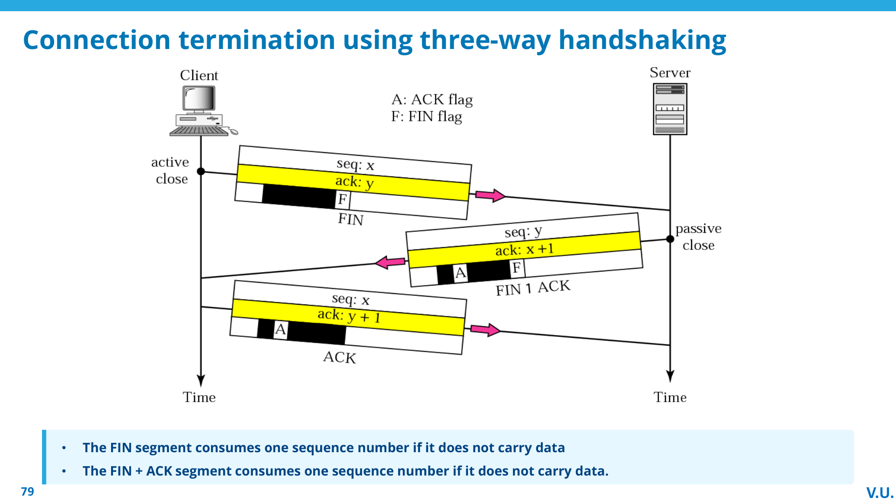

### Figure 6.29: TCP Half-Close State Operation

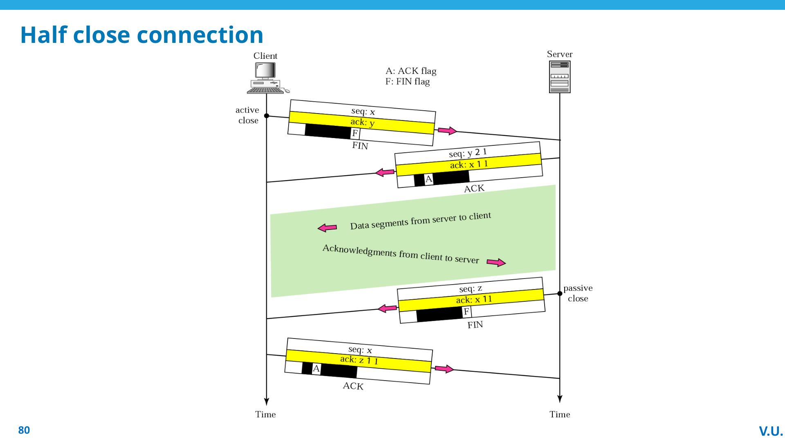

1. **Step 1 (Client $\to$ Server):** Client application calls `close()`. Client sends:

$$
\text{FIN} = 1, \quad \text{seq} = u
$$

   Client enters `FIN_WAIT_1`.
2. **Step 2 (Server $\to$ Client):** Server acknowledges FIN:

$$
\text{ACK} = 1, \quad \text{ack} = u + 1
$$

   Client enters `FIN_WAIT_2`. Server enters `CLOSE_WAIT`.
   * **Half-Close State:** The client can no longer send data, but it can **continue to receive data** from the server indefinitely!
3. **Step 3 (Server $\to$ Client):** When the server finishes sending data, it calls `close()`:

$$
\text{FIN} = 1, \quad \text{seq} = v
$$

   Server enters `LAST_ACK`.
4. **Step 4 (Client $\to$ Server):** Client acknowledges the server's FIN:

$$
\text{ACK} = 1, \quad \text{ack} = v + 1
$$

   Server immediately enters `CLOSED`.
   * **TIME_WAIT State:** The client does *not* close immediately. It enters `TIME_WAIT` and starts a timer set to **$2\text{MSL}$ (typically 4 minutes)**.
   * *Why TIME_WAIT is essential:*
     1. If the client's final ACK is lost, the server will retransmit its FIN. The client must remain alive to re-acknowledge the FIN; otherwise, the server receives an RST and assumes connection error.
     2. It allows all lingering packets in the network to die out before a new connection can legally reuse the same local port.

[Source: Ch 6 Transport Layer.pdf, Slides 76–80]

---

## 13. TCP Flow Control & Sliding Window Dynamics

TCP enforces flow control using a **variable-size sliding window protocol**.
The actual transmission window size $W$ at the sender is bounded by two independent constraints:

$$
W = \min(\text{rwnd}, \text{cwnd})
$$

Where:
* $\text{rwnd}$ = **Receiver Advertised Window** (enforces flow control: protects receiver memory buffer).
* $\text{cwnd}$ = **Congestion Window** (enforces congestion control: protects intermediate network links).

---

### Window Movements: Opening, Closing, and Shrinking

### Figure 6.30: TCP Sliding Window Mechanics

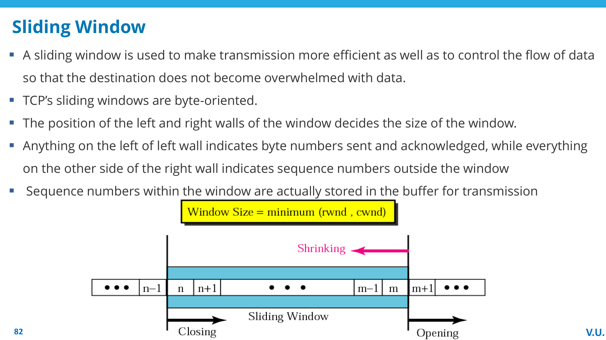

1. **Closing (Left Wall Moves Right):** Occurs when the sender receives an ACK acknowledging bytes previously transmitted. The left wall shifts right, advancing the window.
2. **Opening (Right Wall Moves Right):** Occurs when the receiving application reads bytes from its buffer, freeing space and allowing the receiver to advertise a larger window (`rwnd`).
3. **Shrinking (Right Wall Moves Left):** Occurs if a receiver advertises a smaller window than before, attempting to pull back its window grant.
   * **Strict Rule:** RFC 793 strongly discourages shrinking the window. Senders may have already transmitted data into the advertised window space; shrinking the window leads to false packet drops and corrupted states.

---

### Detailed Window Movement Sequence Trace

### Figure 6.31: TCP Sliding Window Sequence Trace

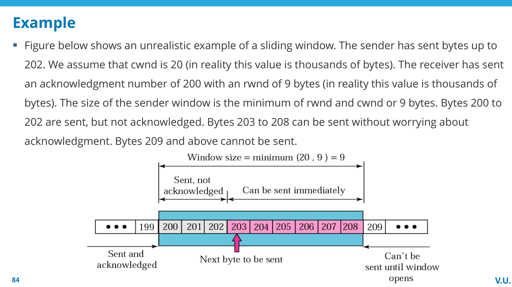

* **Initial State:** Sender transmits bytes 201 to 260 based on initial $\text{rwnd} = 60$.
* **Event 1:** Receiver receives bytes 201–205. The receiver application consumes nothing. The receiver returns:

$$
\text{ACK} = 206, \quad \text{rwnd} = 55
$$

  *(Left wall moves right by 5 bytes; right wall stays stationary).*
* **Event 2:** Receiver application reads 20 bytes from its receive buffer. Receiver returns:

$$
\text{ACK} = 206, \quad \text{rwnd} = 75
$$

  *(Right wall moves right by 20 bytes: Window Opening).*

[Source: Ch 6 Transport Layer.pdf, Slides 81–89]

---

### Silly Window Syndrome & Its Solutions

**Silly Window Syndrome** is a severe performance degradation where data is transmitted in tiny micro-packets (e.g., 1 byte of application payload wrapped in 40 bytes of TCP/IP headers, resulting in a disastrous $2.4\%$ channel efficiency!).

#### Causes:
* *Receiver Pathology:* The receiver application reads 1 byte from a full buffer, prompting the receiver TCP to advertise `rwnd = 1`.
* *Sender Pathology:* The sender application generates 1 byte at a time (e.g., interactive Telnet keystroke) and the sender TCP immediately transmits a 1-byte packet.

#### Solutions:
1. **Clark's Solution (Receiver-Side):**
   * The receiver is forbidden from sending a window update of 1 byte.
   * The receiver must wait until it can advertise a window of at least:

$$
\text{Advertised Window} \ge \min(\text{MSS}, \text{Buffer Size} / 2)
$$

   * Until then, the receiver advertises `rwnd = 0`.
2. **Nagle's Algorithm (Sender-Side):**
   * If outgoing data is smaller than the Maximum Segment Size (MSS), the sender may transmit the first small chunk immediately.
   * However, all subsequent small chunks **must be accumulated in the send buffer** until:
     1. The sender accumulates enough bytes to form a full MSS segment, OR
     2. All previously transmitted data has been acknowledged by the receiver.

[Source: TCP and UDP.pdf, Slides 65–75]

---

## 14. TCP Error Control & Retransmission

TCP provides complete reliability over an unreliable IP network through **Error Control**.

---

### Figure 6.32: TCP Normal Error Control Operation

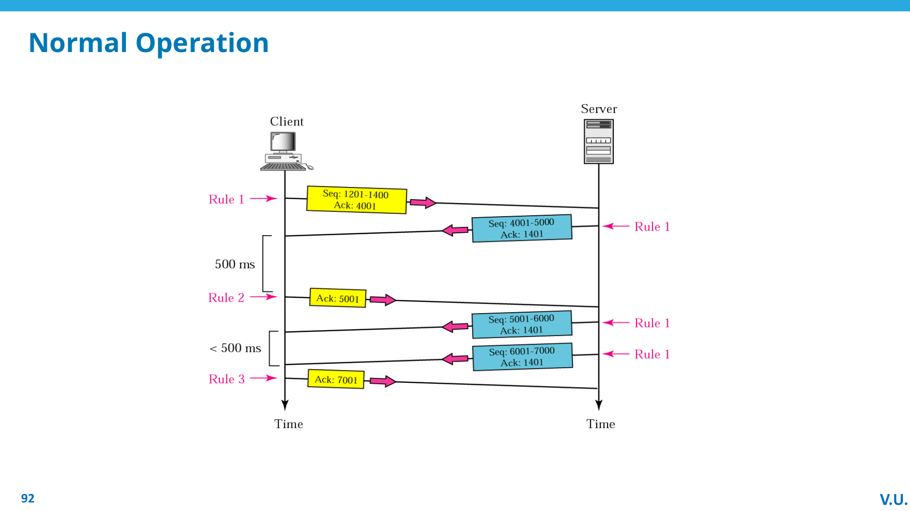

Under normal conditions:
* Data segments carrying payload are transmitted.
* The receiver sends cumulative ACKs acknowledging in-order data bytes. ACKs are piggybacked on reverse-path data segments whenever possible.

---

### Figure 6.33: Lost Segment and Retransmission Timeout (RTO)

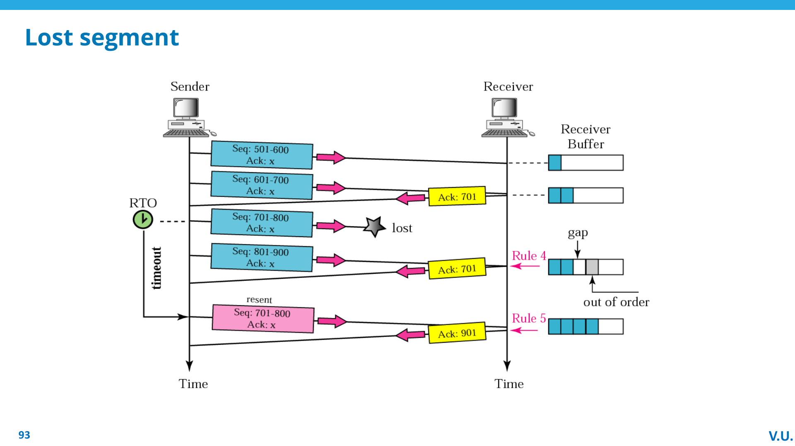

When a segment is lost in transit:
1. The sender starts a **Retransmission Timer (RTO)** whenever a segment is sent.
2. If no ACK arrives before the RTO expires, the sender assumes the segment was lost and retransmits it.
3. *Limitation:* The RTO timer is relatively coarse (often hundreds of milliseconds), causing the sender to idle during packet drops.

---

### Figure 6.34: Fast Retransmission with Duplicate ACKs

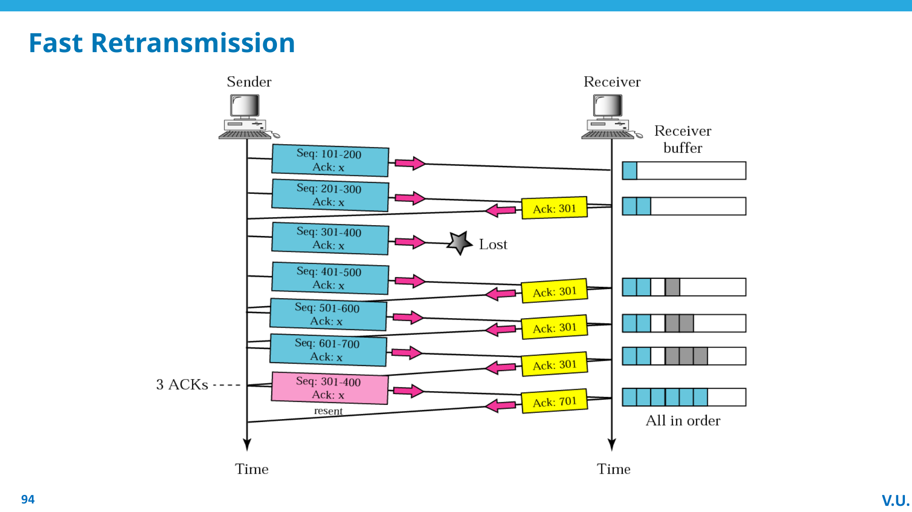

To avoid waiting for the sluggish RTO timer:
1. When a receiver receives an out-of-order segment (e.g., segment 3 arrives, but segment 2 is missing), it buffers segment 3 and **immediately re-sends an ACK for the last in-order byte** (acknowledging byte 1).
2. If segments 4 and 5 also arrive, the receiver repeats the exact same ACK: generating **duplicate ACKs**.
3. **The 3 Duplicate ACK Rule:** When the sender receives **three consecutive duplicate ACKs** for the same sequence number, it treats this as strong statistical proof that the missing segment was lost (and not merely reordered).
4. The sender immediately retransmits the missing segment **before the RTO timer expires**!

---

### Figure 6.35: Lost ACK & Deadlock Prevention

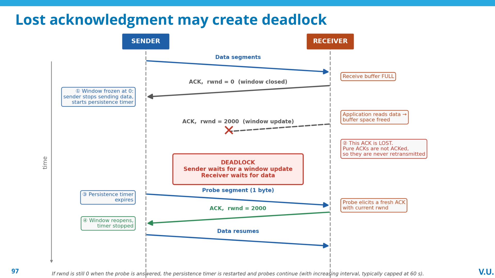

* **Lost ACK Correction:** Because ACKs are cumulative, if ACK 200 is lost but subsequent ACK 300 arrives successfully, the sender knows that all bytes up to 299 were received; the loss of ACK 200 causes zero harm.
* **Deadlock Prevention:** If a receiver advertises `rwnd = 0`, the sender stops transmitting. Later, when buffer space opens, the receiver sends `rwnd = 2000`. If this window update packet is lost, the sender waits forever for a window update, and the receiver waits forever for data: a **deadlock**!
* **Resolution:** TCP runs a **Persistence Timer** to break this deadlock (see Section 16).

[Source: Ch 6 Transport Layer.pdf, Slides 90–97]

---

## 15. TCP Congestion Control

When offered traffic exceeds network line capacity, intermediate router queues overflow, resulting in packet drops and congestion collapse.

### Figure 6.36: Network Performance Under Congestion

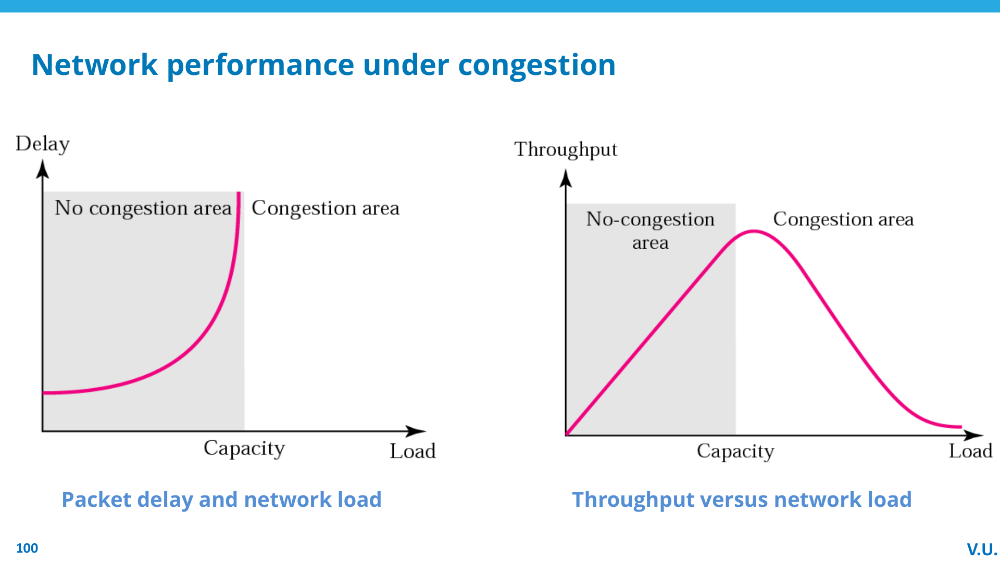

* As network load increases, throughput initially matches offered load.
* Near capacity, router buffers saturate, delays soar to infinity, and packet drops trigger massive retransmissions, driving effective throughput to near zero (**Congestion Collapse**).

---

### The Four TCP Congestion Control Algorithms (RFC 5681)

TCP dynamically regulates its transmission rate by adjusting the **Congestion Window (`cwnd`)** through four interrelated algorithms:

---

### 1. Slow Start (Exponential Growth)

### Figure 6.37: TCP Slow Start Phase

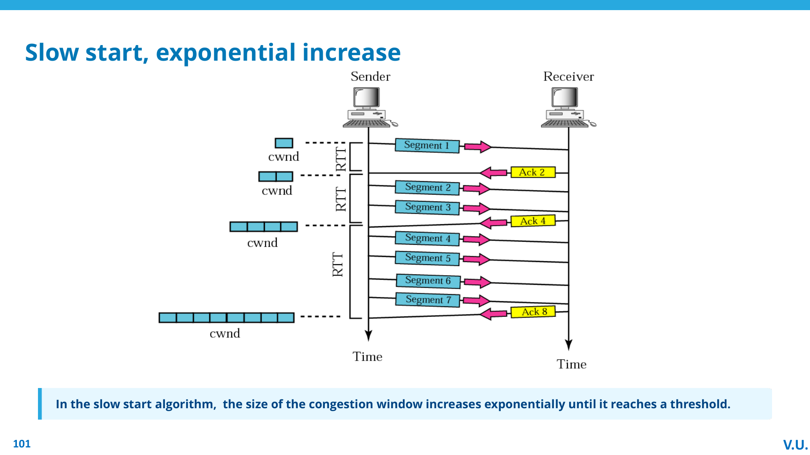

* **Initialization:** When a connection starts, $\text{cwnd} = 1\text{ MSS}$.
* **Growth Rule:** For *every individual ACK* received, `cwnd` increases by 1 MSS:

$$
\text{cwnd} \longleftarrow \text{cwnd} + 1\text{ MSS}
$$

* **Net Effect:** Because each segment generates an ACK, `cwnd` **doubles every Round-Trip Time (RTT)**:

$$
\text{Round 1: } 1\text{ MSS} \longrightarrow \text{Round 2: } 2\text{ MSS} \longrightarrow \text{Round 3: } 4\text{ MSS} \longrightarrow \text{Round 4: } 8\text{ MSS} \dots
$$

* Slow Start terminates when `cwnd` reaches the **Slow Start Threshold (`ssthresh`)**, at which point TCP transitions to Congestion Avoidance.

---

### 2. Congestion Avoidance (Additive Increase, Multiplicative Decrease — AIMD)

### Figure 6.38: TCP Congestion Avoidance Phase

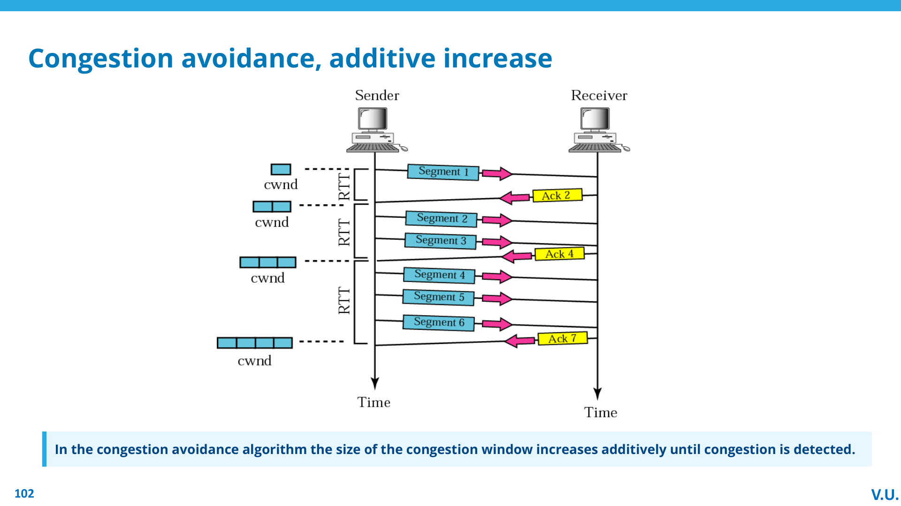

* Once $\text{cwnd} \ge \text{ssthresh}$, exponential doubling stops.
* **Growth Rule (Additive Increase):** `cwnd` increases by only **1 MSS per full RTT**:

$$
\text{For each ACK received: } \text{cwnd} \longleftarrow \text{cwnd} + \frac{1}{\text{cwnd}}\text{ MSS}
$$

* Senders probe for available bandwidth gently and linearly.

---

### 3. Reaction to Congestion: Tahoe vs Reno

### Figure 6.39: TCP Congestion Policy: Tahoe vs Reno

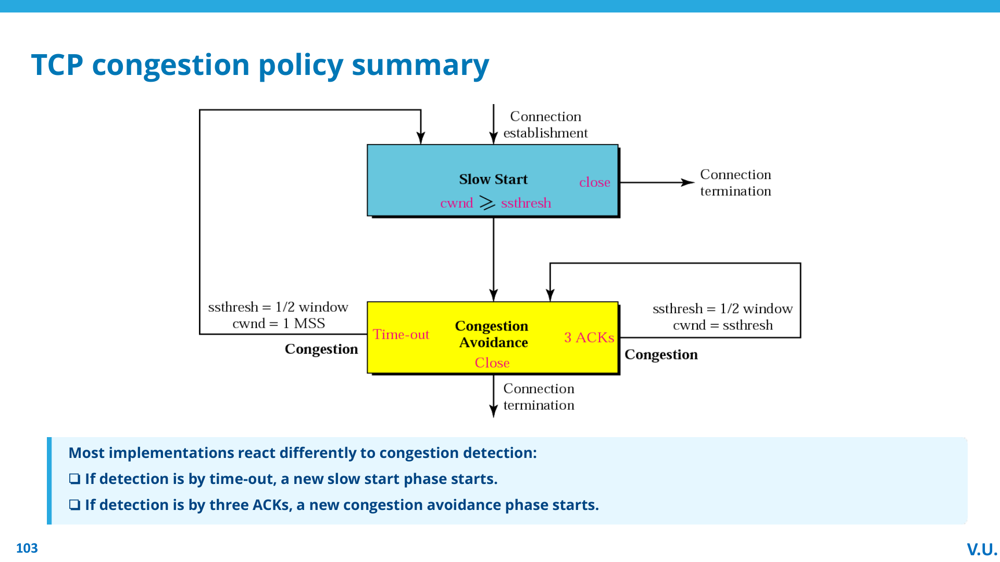

### Figure 6.40: TCP Congestion Window Evolution Trace

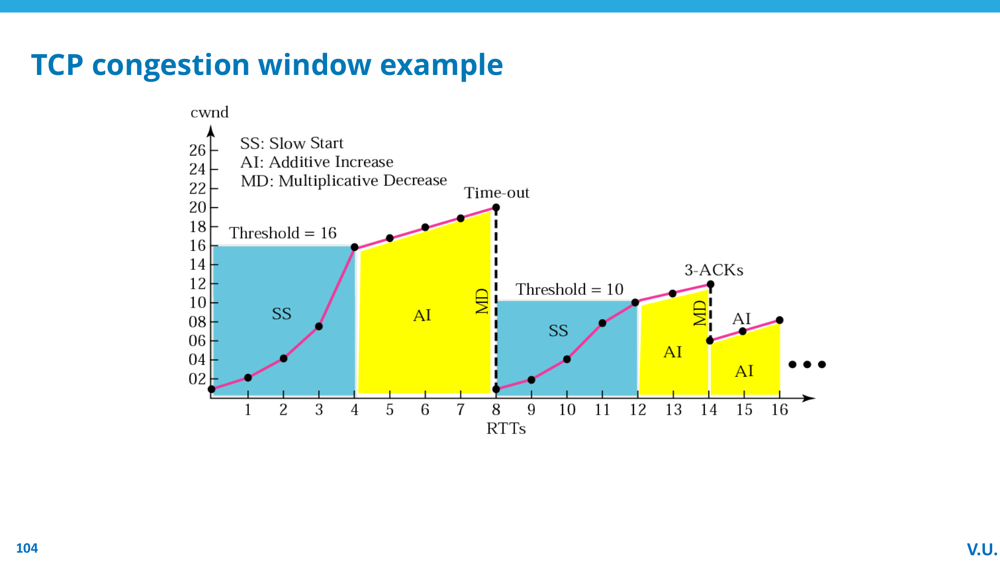

When congestion occurs, TCP detects it via either **Timeout (RTO)** or **3 Duplicate ACKs**:

#### 1. In the Case of Timeout (Severe Congestion):
Both TCP Tahoe and TCP Reno react identically:
$$
\text{ssthresh} \longleftarrow \max\left(\frac{\text{cwnd}}{2}, 2\text{ MSS}\right)
$$
$$
\text{cwnd} \longleftarrow 1\text{ MSS}
$$
The connection drops back into Slow Start from $1\text{ MSS}$.

#### 2. In the Case of 3 Duplicate ACKs (Mild Congestion):
* **TCP Tahoe (Old):**
  * Halves `ssthresh`: $\text{ssthresh} = \text{cwnd} / 2$.
  * Resets `cwnd = 1 MSS` and restarts Slow Start.
* **TCP Reno (Modern — Fast Recovery):**
  * Recognizes that duplicate ACKs mean packets are still flowing through the network!
  * **Multiplicative Decrease:** Halves the threshold:

$$
\text{ssthresh} \longleftarrow \frac{\text{cwnd}}{2}
$$

  * Sets `cwnd` to the new threshold plus 3 MSS (to account for the 3 buffered segments):

$$
\text{cwnd} \longleftarrow \text{ssthresh} + 3\text{ MSS}
$$

  * Executes **Fast Recovery:** Skips Slow Start entirely and continues directly in **Congestion Avoidance (linear growth)**!

[Source: Ch 6 Transport Layer.pdf, Slides 98–104]

---

## 16. TCP Timers

To perform reliable stream transport, standard TCP implementations maintain five distinct timers:

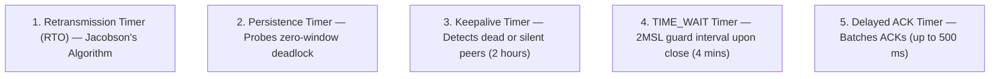

---

### 1. Retransmission Timer (RTO) & Jacobson's Algorithm

Setting RTO too short causes unnecessary spurious retransmissions; setting RTO too long causes excessive idle delay during packet drops. Because network RTT fluctuates dynamically, TCP continuously estimates smoothed RTT using **Jacobson's Algorithm** (RFC 6298):

### Figure 6.41: Jacobson's RTT & RTO Calculation

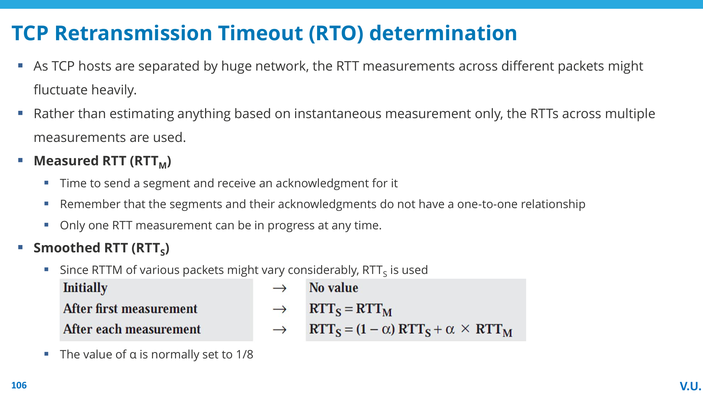

#### Step 1: Measure Sample RTT ($M$)
For each in-flight segment, measure the elapsed time $M$ between transmitting the segment and receiving its ACK.

#### Step 2: Compute Smoothed RTT ($SRTT$)
Update the running exponential weighted average:

$$
SRTT \longleftarrow (1 - \alpha) \cdot SRTT + \alpha \cdot M
$$

*(Standard recommended weight: $\alpha = \frac{1}{8} = 0.125$).*

#### Step 3: Compute RTT Deviation ($RTTVAR$)
Compute the mean absolute deviation of RTT:

$$
RTTVAR \longleftarrow (1 - \beta) \cdot RTTVAR + \beta \cdot |SRTT - M|
$$

*(Standard recommended weight: $\beta = \frac{1}{4} = 0.25$).*

#### Step 4: Compute Retransmission Timeout ($RTO$)

$$
RTO = SRTT + 4 \cdot RTTVAR
$$

*(With the safety constraint: $\text{RTO} \ge 1.0\text{ second}$).*

---

### 2. Karn's Algorithm

### Figure 6.42: Karn's Algorithm for Retransmitted Segments

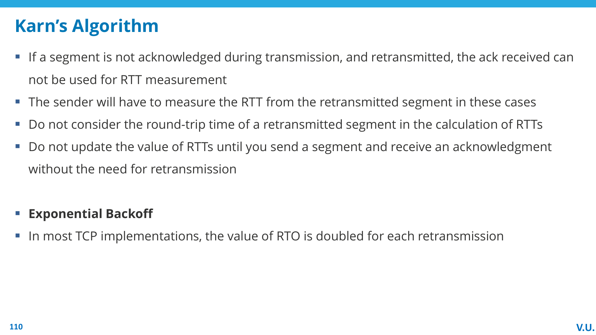

#### The Ambiguity Problem:
If segment 1 is sent at $t=0$, timed out at $t=1.0$, retransmitted at $t=1.0$, and an ACK arrives at $t=1.2$:
* Did the ACK belong to the original transmission ($RTT = 1.2\text{ s}$)?
* Or did it belong to the retransmission ($RTT = 0.2\text{ s}$)?
There is no way to know! Updating $SRTT$ with false samples corrupts the timer.

#### Karn's Rules:
1. **Rule 1:** Never measure sample RTT ($M$) for any segment that has been retransmitted. Discard the sample!
2. **Rule 2 (Exponential Timer Backoff):** Whenever a retransmission occurs, immediately double the current RTO:

$$
RTO_{\text{new}} = 2 \cdot RTO_{\text{old}}
$$

   *(Up to an upper bound of 64 seconds).* Once an in-order, un-retransmitted segment is successfully acknowledged, recalculate RTO using Jacobson's formulas.

---

### 3. Persistence Timer & Zero-Window Probing

### Figure 6.43: TCP Persistence Timer & Zero-Window Probes

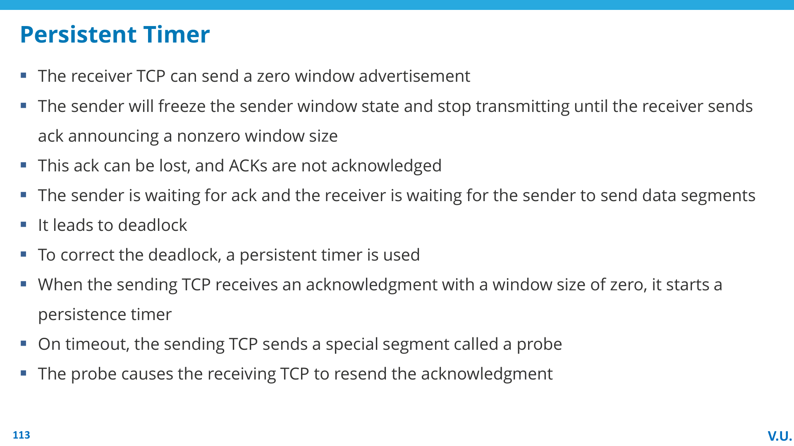

When the receiver advertises `rwnd = 0`, the sender halts and starts the **Persistence Timer**.
When the timer expires, the sender transmits a **Probe Segment** containing 1 byte of dummy data.
The receiver must reply to the probe with an ACK advertising its current window size.
* If the window is still 0, the persistence timer doubles and resets.
* If buffer space has opened, the new window grant unfreezes the connection!

[Source: Ch 6 Transport Layer.pdf, Slides 105–113]

---

## 17. Comprehensive Comparison Tables

### Table 6.1: UDP vs TCP Architectural Comparison

| Attribute | User Datagram Protocol (UDP) | Transmission Control Protocol (TCP) |
| :--- | :--- | :--- |
| **Connection State** | Connectionless; no setup handshake | Connection-oriented; 3-way handshake required |
| **Reliability** | Unreliable; best-effort delivery | 100% reliable; guaranteed in-order delivery |
| **Data Stream Model** | Discrete packet messages (datagrams) | Continuous byte stream |
| **Header Overhead** | Fixed 8 bytes | Variable 20 to 60 bytes |
| **Flow Control** | None (receiver buffers can overflow) | Credit-based sliding window (`rwnd`) |
| **Congestion Control** | None (blasts packets at wire rate) | Dynamic rate throttling (`cwnd`, AIMD) |
| **Checksum** | Optional in IPv4; mandatory in IPv6 | Strictly mandatory in all implementations |
| **Transmission Mode** | Unicast, Multicast, Broadcast | Strict point-to-point Unicast only |
| **Primary Use Cases** | DNS, DHCP, VoIP, streaming video, gaming | HTTP/HTTPS, FTP, SSH, SMTP |

---

### Table 6.2: TCP Congestion Control: Tahoe vs Reno

| Feature | TCP Tahoe (1988) | TCP Reno (1990) |
| :--- | :--- | :--- |
| **Slow Start** | Yes (starts at $1\text{ MSS}$, doubles per RTT) | Yes (identical behavior) |
| **Congestion Avoidance** | Yes (additive increase $+1\text{ MSS}$ per RTT) | Yes (identical behavior) |
| **Reaction to Timeout** | Sets $\text{ssthresh} = \text{cwnd} / 2$; $\text{cwnd} = 1\text{ MSS}$ | Sets $\text{ssthresh} = \text{cwnd} / 2$; $\text{cwnd} = 1\text{ MSS}$ |
| **Reaction to 3 Duplicate ACKs** | Resets $\text{cwnd} = 1\text{ MSS}$; runs Slow Start | Cuts $\text{cwnd} = \text{cwnd} / 2$; runs **Fast Recovery** |
| **Fast Recovery Algorithm** | Not present | Present; avoids resetting window to 1 |
| **Average Throughput** | Lower (sawtooth plunges to zero on drops) | Higher (sustained hovering around link capacity) |

---

## 18. Worked Numerical Problems

---

### Problem 1: TCP Sequence Number Wraparound Time at High Speed

**Problem Statement:**
A TCP connection is transmitting data across a high-speed network at a constant rate of $1\text{ Megabyte/second}$ ($1\text{ MB/s} = 10^6\text{ bytes/s}$). The connection begins with an Initial Sequence Number of $7000$.
1. How long does it take before the 32-bit sequence number space wraps completely around and returns back to zero?
2. If the transmission rate is upgraded to $1\text{ Gbps}$ ($1.25 \times 10^8\text{ bytes/s}$), what is the new wraparound time?

**Given:**
* Sequence Number Space = $2^{32} = 4,294,967,296\text{ unique sequence numbers}$
* Initial Sequence Number $\text{ISN} = 7000$
* Data Rate $R_1 = 1\text{ MB/s} = 10^6\text{ bytes/s}$

**Step-by-Step Calculation:**
1. Because the sequence number space is circular ($2^{32}$ total bytes), the initial starting value ($7000$) is negligible when computing full wrap time.
   Total bytes before wrap:
   $$
   \text{Bytes} = 2^{32} = 4,294,967,296\text{ bytes}
   $$
2. Wraparound time at $1\text{ MB/s}$:
   $$
   T_1 = \frac{2^{32}\text{ bytes}}{10^6\text{ bytes/s}} = 4294.97\text{ seconds} \approx \mathbf{71.58\text{ minutes}} \approx \mathbf{1.19\text{ hours}}
   $$
3. Wraparound time at $1\text{ Gbps}$ ($R_2 = 10^9 / 8 = 125,000,000\text{ bytes/s}$):
   $$
   T_2 = \frac{4,294,967,296\text{ bytes}}{125,000,000\text{ bytes/s}} \approx \mathbf{34.36\text{ seconds}}
   $$
   *(Note: Because $34.36\text{ s} < \text{MSL} = 120\text{ s}$, standard TCP breaks at gigabit speeds! High-speed TCP must use the RFC 1323 PAWS — Protection Against Wrapped Sequences option).*

**Final Answer:**
* At $1\text{ MB/s}$: **$4295\text{ seconds}$ ($71.58\text{ minutes}$)**.
* At $1\text{ Gbps}$: **$34.36\text{ seconds}$**.

[Source: cn_tutorial.pdf, Tutorial 10, Q6]

---

### Problem 2: Hexadecimal UDP Header Dump Decoding

**Problem Statement:**
The following is an actual hexadecimal dump of an 8-byte UDP header captured from a network packet analyzer:
```text
06 32 00 0D 00 1C E2 17
```
Decode this header and determine:
1. The Source Port number (in decimal).
2. The Destination Port number (in decimal).
3. The Total Length of the user datagram (in decimal).
4. The Length of the data payload (in decimal).
5. Whether the packet is directed from client-to-server or server-to-client.
6. The client/server application process involved.

**Step-by-Step Decoding:**
1. **Source Port (Bytes 1–2: `06 32`):**
   $$
   \text{Hex } 0632_{16} = (6 \times 256) + (3 \times 16) + 2 = 1536 + 48 + 2 = \mathbf{1586}
   $$
2. **Destination Port (Bytes 3–4: `00 0D`):**
   $$
   \text{Hex } 000D_{16} = 13_{10} = \mathbf{13}
   $$
3. **Total Length (Bytes 5–6: `00 1C`):**
   $$
   \text{Hex } 001C_{16} = (1 \times 16) + 12 = \mathbf{28\text{ bytes}}
   $$
4. **Length of Data Payload:**
   $$
   \text{Payload Length} = \text{Total Length} - \text{Header Length} = 28 - 8 = \mathbf{20\text{ bytes}}
   $$
5. **Direction of Packet:**
   * Source Port = $1586$ (Ephemeral client port $> 1023$).
   * Destination Port = $13$ (Well-known server port $< 1024$).
   * **Direction:** **Client to Server**.
6. **Application Process:**
   * Well-known port 13 corresponds to the **Daytime Protocol** (RFC 867).

[Source: cn_tutorial.pdf, Tutorial 10, Q4]

---

### Problem 3: UDP Transmission Efficiency Calculation

**Problem Statement:**
A client application uses UDP to transmit a tiny data payload of $16\text{ bytes}$ to a server. Calculate the transmission efficiency of this communication:
1. At the UDP layer alone.
2. At the combined IP + UDP level (assuming a standard 20-byte IPv4 header).

**Given:**
* Payload Data = $16\text{ bytes}$
* UDP Header = $8\text{ bytes}$
* IPv4 Header = $20\text{ bytes}$

**Step-by-Step Calculation:**
1. **Efficiency at UDP Level:**
   $$
   \text{Total UDP Size} = 16 + 8 = 24\text{ bytes}
   $$
   $$
   \text{Efficiency}_{\text{UDP}} = \frac{\text{Useful Payload Bytes}}{\text{Total UDP Bytes}} = \frac{16}{24} = \frac{2}{3} \approx \mathbf{66.67\%}
   $$
2. **Efficiency at IP + UDP Level:**
   $$
   \text{Total Packet Size} = 20\text{ (IP)} + 8\text{ (UDP)} + 16\text{ (Data)} = 44\text{ bytes}
   $$
   $$
   \text{Efficiency}_{\text{Total}} = \frac{16}{44} \approx \mathbf{36.36\%}
   $$

[Source: cn_tutorial.pdf, Tutorial 10, Q3]

---

### Problem 4: Handling Oversized Datagrams in UDP

**Problem Statement:**
An application process generates an oversized message of $68,000\text{ bytes}$. Can this message be transmitted across the Internet using a single UDP user datagram? Explain the mathematical constraints.

**Analysis & Solution:**
1. **UDP Header Length Field Constraint:**
   * The UDP Length field is an unsigned 16-bit integer:

$$
\text{Maximum Possible Value} = 2^{16} - 1 = 65,535\text{ bytes}
$$

   * Because the UDP header consumes 8 bytes, the absolute maximum data payload UDP can theoretically carry is:

$$
65,535 - 8 = 65,527\text{ bytes}
$$

2. **Conclusion:**
   * A payload of $68,000\text{ bytes}$ **strictly exceeds the 16-bit capacity of the UDP header** ($68,000 > 65,527$).
   * **Result:** It is physically impossible to transmit a 68,000-byte message in a single UDP datagram. The application layer must fragment the data into at least two separate UDP datagrams.

[Source: cn_tutorial.pdf, Tutorial 10, Q2]

---

### Problem 5: Jacobson's RTO Dynamic Estimation Step-by-Step Trace

**Problem Statement:**
A TCP connection has a current Smoothed Round-Trip Time of $SRTT = 100\text{ ms}$ and an RTT Deviation of $RTTVAR = 10\text{ ms}$. A new segment is transmitted, and its acknowledgment returns after $M = 140\text{ ms}$.
Using standard Jacobson parameters ($\alpha = 0.125, \beta = 0.25$), compute:
1. The new Smoothed RTT ($SRTT$).
2. The new RTT Deviation ($RTTVAR$).
3. The newly updated Retransmission Timeout ($RTO$).

**Given:**
* Initial $SRTT_0 = 100\text{ ms}$
* Initial $RTTVAR_0 = 10\text{ ms}$
* Measured Sample $M = 140\text{ ms}$
* $\alpha = 0.125 = \frac{1}{8}$
* $\beta = 0.25 = \frac{1}{4}$

**Step-by-Step Calculation:**
1. **Update Smoothed RTT ($SRTT$):**
   $$
   \begin{aligned}
   SRTT_1 &= (1 - \alpha) \cdot SRTT_0 + \alpha \cdot M \\
          &= (1 - 0.125) \cdot 100 + 0.125 \cdot 140 \\
          &= 87.5 + 17.5 = \mathbf{105\text{ ms}}
   \end{aligned}
   $$
2. **Update RTT Deviation ($RTTVAR$):**
   Absolute error difference: $|SRTT_0 - M| = |100 - 140| = 40\text{ ms}$.
   $$
   \begin{aligned}
   RTTVAR_1 &= (1 - \beta) \cdot RTTVAR_0 + \beta \cdot |SRTT_0 - M| \\
            &= (1 - 0.25) \cdot 10 + 0.25 \cdot 40 \\
            &= 7.5 + 10 = \mathbf{17.5\text{ ms}}
   \end{aligned}
   $$
3. **Compute Retransmission Timeout ($RTO$):**
   $$
   \begin{aligned}
   RTO &= SRTT_1 + 4 \cdot RTTVAR_1 \\
       &= 105 + 4 \cdot (17.5) = 105 + 70 = \mathbf{175\text{ ms}}
   \end{aligned}
   $$

**Final Answer:**
* $SRTT = \mathbf{105\text{ ms}}$
* $RTTVAR = \mathbf{17.5\text{ ms}}$
* $RTO = \mathbf{175\text{ ms}}$

[Source: Ch 6 Transport Layer.pdf, Slides 106–109]

---

## 19. Consolidated Formula Sheet

---

### 1. Transmission Window Constraint

$$
W = \min(\text{rwnd}, \text{cwnd})
$$

* **Where:**
  * $W$ = Number of bytes sender is authorized to transmit without acknowledgment
  * $\text{rwnd}$ = Receiver advertised flow control window (bytes)
  * $\text{cwnd}$ = Sender congestion window (bytes)

---

### 2. TCP Sequence Space Wraparound Time

$$
T_{\text{wrap}} = \frac{2^{32} \text{ bytes}}{\text{Data Rate (bytes/sec)}}
$$

* **Where:**
  * $2^{32} = 4,294,967,296$ unique byte sequence numbers

---

### 3. Jacobson's Smoothed RTT ($SRTT$)

$$
SRTT \longleftarrow (1 - \alpha) \cdot SRTT + \alpha \cdot M
$$

* **Where:**
  * $SRTT$ = Smoothed round-trip time estimate
  * $M$ = Measured sample RTT for current packet
  * $\alpha$ = Smoothing factor (standard $\alpha = 0.125$)

---

### 4. Jacobson's RTT Deviation ($RTTVAR$)

$$
RTTVAR \longleftarrow (1 - \beta) \cdot RTTVAR + \beta \cdot |SRTT - M|
$$

* **Where:**
  * $RTTVAR$ = Mean deviation / variance of RTT
  * $\beta$ = Weight factor (standard $\beta = 0.25$)

---

### 5. Retransmission Timeout ($RTO$)

$$
RTO = SRTT + 4 \cdot RTTVAR
$$

* **Condition:** $\text{RTO} \ge 1.0\text{ second}$ (safety floor).

---

### 6. Karn's Exponential Backoff

$$
RTO_{\text{backoff}} = 2 \cdot RTO
$$

* **Condition:** Applied on every retransmission timeout up to 64 seconds.

---

### 7. Additive Increase in Congestion Avoidance

$$
\text{cwnd} \longleftarrow \text{cwnd} + \frac{\text{MSS} \times \text{MSS}}{\text{cwnd}} \approx \text{cwnd} + 1\text{ MSS per RTT}
$$

---

## 20. Definition Sheet

* **Transport Entity:** OS kernel module implementing transport protocols (Layer 4).
* **TPDU:** Transport Protocol Data Unit (Segments in TCP, User Datagrams in UDP).
* **TSAP (Port):** 16-bit logical address identifying an application process on a host.
* **Three-Way Handshake:** Connection setup protocol using SYN, SYN+ACK, ACK to eliminate duplicate confusion.
* **Two-Army Problem:** Proof that guaranteed consensus over an unreliable network is impossible.
* **Symmetric Release:** Independently tearing down each simplex direction of a connection.
* **Ephemeral Port:** Short-lived dynamic client port ($49152$ to $65535$).
* **Well-Known Port:** Permanently reserved server port ($0$ to $1023$).
* **Cumulative ACK:** Acknowledgment confirming receipt of all preceding bytes up to $N - 1$.
* **Fast Retransmit:** Immediate retransmission upon receipt of 3 duplicate ACKs without waiting for RTO.
* **Fast Recovery:** Halving `cwnd` and continuing in Congestion Avoidance upon 3 dup ACKs (skips Slow Start).
* **Slow Start:** Exponential doubling of `cwnd` per RTT starting from $1\text{ MSS}$.
* **Congestion Avoidance (AIMD):** Linear increase of `cwnd` by $1\text{ MSS}$ per RTT until packet loss.
* **Jacobson's Algorithm:** Dynamic formula tracking SRTT and RTTVAR to compute RTO.
* **Karn's Algorithm:** Rule prohibiting RTT sampling on retransmitted segments, plus exponential RTO backoff.
* **Persistence Timer:** Timer polling zero-window receivers with probe segments to prevent deadlock.
* **TIME_WAIT State:** $2\text{MSL}$ waiting period ensuring late duplicate packets die before port reuse.
* **Silly Window Syndrome:** Performance collapse caused by transmitting tiny 1-byte payloads.
* **Nagle's Algorithm:** Sender optimization buffering sub-MSS chunks until previous data is acknowledged.
* **Clark's Solution:** Receiver optimization refusing to advertise window updates smaller than 1 MSS or half buffer.

---

## 21. Exam-Oriented Review

---

### High-Yield Exam Topics
1. **Three-Way Handshake Reliability:** Draw timing diagrams for normal setup, delayed duplicate SYN, and delayed duplicate SYN+ACK; explain how RST packets abort bogus connections.
2. **Two-Army Problem:** Explain why perfect consensus is impossible over unreliable links and why transport protocols require inactivity timers.
3. **TCP vs UDP Differences:** Memorize full 8-point comparison table (connection, reliability, stream vs datagram, headers, checksum, ports).
4. **TCP Segment Header:** Know all fields (Source/Dest Port, Sequence #, ACK #, Data Offset, 6 Control Flags, Window Size, Checksum, Urgent Pointer).
5. **TCP Congestion Control:** Graph `cwnd` evolution across rounds; define Slow Start, `ssthresh`, Congestion Avoidance (AIMD), Fast Retransmit, and Fast Recovery; contrast Tahoe vs Reno.
6. **Jacobson's & Karn's Algorithms:** Compute numerical updates for $SRTT$, $RTTVAR$, and $RTO$; explain the retransmission ambiguity problem.
7. **Silly Window Syndrome:** Describe Clark's receiver-side solution and Nagle's sender-side algorithm.

---

### Extracted Official Examination Questions & Model Solutions

#### Q1. In the TCP/IP protocol suite, which protocol provides unreliable, connectionless process-to-process communication?
* **Options:** A. TCP | B. IP | C. UDP | D. ICMP
* **Answer:** **C. UDP (User Datagram Protocol)**
* **Explanation:** While IP provides unreliable host-to-host communication, UDP adds port numbers to provide process-to-process delivery.

#### Q2. What is the minimum header size of a TCP segment?
* **Options:** A. 8 bytes | B. 20 bytes | C. 40 bytes | D. 60 bytes
* **Answer:** **B. 20 bytes**
* **Explanation:** A TCP header with no options has Data Offset = 5 ($5 \times 4\text{ bytes} = 20\text{ bytes}$). With maximum options, it reaches 60 bytes.

#### Q3. Why does TCP enter the TIME_WAIT state for 2MSL after closing a connection?
* **Answer:**
  1. To allow sufficient time for the final ACK to reach the remote peer, or to re-acknowledge a retransmitted FIN if the final ACK was lost.
  2. To guarantee that all delayed, wandering duplicate segments belonging to this session expire from the network before a new connection can reuse the same local port number.

#### Q4. What triggers TCP Fast Retransmit?
* **Options:** A. Expiration of the RTO timer | B. Receipt of 3 duplicate ACKs | C. Receipt of an RST segment | D. Zero window probe
* **Answer:** **B. Receipt of 3 duplicate ACKs**
* **Explanation:** Receiving three duplicate ACKs for the same sequence number strongly indicates that an isolated segment was lost, triggering an immediate retransmission without waiting for the slow RTO timer to expire.

#### Q5. What is the function of the TCP Persistence Timer?
* **Answer:** To prevent connection deadlock when a receiver's non-zero window update packet is lost in transit after advertising a zero window (`rwnd = 0`). The sender transmits 1-byte probe segments periodically to force the receiver to re-advertise its window size.

[Source: Computer_Networks_Question_Bank.pdf, Unit 4, Q1–Q25; cn_tutorial.pdf, Tutorial 10]
