# Complete Computer Networks Notes: Application Layer

> **Course Code:** Computer Networks (CompNet)
> **Course Title:** Computer Networks & Data Communications
> **Primary Source:** Computer Networks, Fifth Edition (Tanenbaum & Wetherall) — Chapter 7: The Application Layer (Sections 7.1–7.6)
> **Supplementary Sources:** `Computer_Networks_Question_Bank.pdf` (Unit 5: Application Layer), `CN_Application_Layer.pdf` (Slides/Pages 1–36), IETF RFC Technical Specifications (RFC 1034, RFC 1035, RFC 1939, RFC 2045–2049, RFC 2326, RFC 2616, RFC 3261, RFC 3501, RFC 3550, RFC 3986, RFC 5321, RFC 5322, RFC 6455, RFC 7230–7235, RFC 7540, RFC 9000, RFC 9114)
> **Files Integrated:** `section_7_1_dns.md`, `section_7_2_email.md`, `section_7_3_web.md`, `section_7_4_streaming.md`, `section_7_5_7_6_content_delivery.md`

---

## Source-to-Chapter Mapping

| Source File / Standard | Content / Role | Chapter Integration |
| :--- | :--- | :--- |
| `Computer_Networks_Question_Bank.pdf` (Unit 5) | Official university examination syllabus covering DNS architecture, iterative vs recursive resolution, HTTP/HTTPS request-response flows, FTP/TFTP comparisons, email transfer architecture (SMTP, POP3, IMAP), DHCP DORA protocol, Client-Server vs Peer-to-Peer models, and SSL/TLS security. | Section 1 (Architectural Models), Section 2 (Core Terminology Dictionary), Sections 7.1–7.5 core syllabus concepts, and Section 21 (Exam-Oriented Review: Q90–Q103). |
| Tanenbaum & Wetherall 5th Ed (Chapter 7) | Authoritative reference textbook covering the Application Layer across Sections 7.1 to 7.6: DNS name space and resolution, Electronic Mail (RFC 5322, MIME, SMTP, POP3, IMAP), World Wide Web (HTTP/1.0 through HTTP/3, Web caching, PageRank), Streaming Audio/Video (PCM, Nyquist, MP3, MPEG GOP, DASH, RTSP, RTP/RTCP, SIP, H.323), and Content Delivery (Zipf's law, Web proxies, CDNs, BitTorrent swarming, Chord DHT). | Section 1 (Application Architecture & Sockets API), Sections 7.1 through 7.5 core theory, architectural diagrams, protocol state machines, and Section 7.6 Architectural Synthesis. |
| RFC Standards: DNS (RFC 1034, 1035, 2181, 2308, 3596, 4033–4035, 6891) | Core domain system standards defining inverted tree namespace, 12-byte wire format, label compression pointers, negative caching, Anycast routing, and DNSSEC cryptographic trust chains. | Section 7.1 (DNS Name Space, Resource Records, Wire Format, Resolution Flows, Security). |
| RFC Standards: Email (RFC 5321, 5322, 2045–2049, 1939, 3501, 6409, 7208, 6376, 7489) | Internet email standards defining RFC 5322 envelope/headers, MIME multipart typing, Base64/Quoted-Printable encoding algorithms, SMTP push transfer, POP3/IMAP4 mailbox access, and SPF/DKIM/DMARC anti-spoofing. | Section 7.2 (Electronic Mail Architecture, Message Formats, Base64 Derivations, SMTP Sessions, POP3/IMAP4 Comparisons). |
| RFC Standards: Web (RFC 3986, 1945, 2616, 7230–7235, 7540, 7541, 9000, 9114, 6265, 6455) | Web standards defining URI syntax, HTTP/1.0, HTTP/1.1 pipelining, HTTP/2 binary framing and HPACK, HTTP/3 over QUIC/UDP, RFC 6265 cookie state management, and RFC 6455 full-duplex WebSockets. | Section 7.3 (Web Architecture, Static Pages & CRP, Dynamic Web, HTTP Evolution, Latency Modeling, Mobile Web, PageRank). |
| Standards: Streaming (RFC 2326/7826, RFC 3550, RFC 3261, RFC 4566, ISO/IEC 23009-1, ITU-T G.114, ITU-T H.323) | Real-time multimedia specifications governing uncompressed PCM audio, MPEG-4 video compression, RTSP stream control, DASH adaptive streaming, RTP real-time transport, RTCP telemetry/jitter filtering, SIP signaling handshakes, and H.323 architectures. | Section 7.4 (Digital Audio, Digital Video, Stored Media Streaming, Live Streaming, Real-Time Interactive Conferencing). |
| Standards & Papers: Content Delivery & P2P (BEP 0003, Stoica et al. 2001, Brin & Page 1998) | Content distribution architectures covering Zipf's law popularity distributions, forward/reverse proxy caching, CDN Anycast/DNS routing, BitTorrent rarest-first and Tit-for-Tat unchoking, and Chord DHT 6-bit ring finger tables. | Section 7.5 (Content Traffic, Server Farms & Web Proxies, CDNs, P2P Networks, Chord DHT), Section 18 (Worked Problems), and Section 19 (Formula Sheet). |

---

# Chapter 7 — Application Layer

---

## 1. Chapter Overview & End-to-End Application Architecture

The **Application Layer** serves as the topmost layer in both the Open Systems Interconnection (OSI) 7-layer reference model (Layer 7) and the Internet TCP/IP protocol suite (Layer 5). Unlike the underlying transport, network, and data link layers whose primary mission is to move bits, packets, and frames across intermediate communications subnets, the Application Layer resides entirely within user space on communicating end-system hosts. It provides the execution environment, protocols, and interface primitives through which user-facing programs exchange structured information across the global Internet.

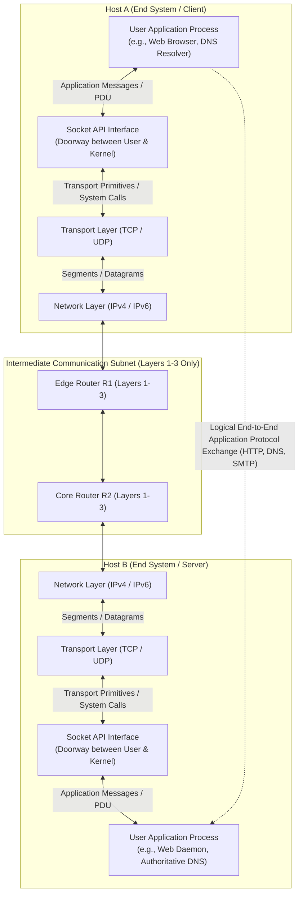

### Architectural Paradigms: Client-Server vs. Peer-to-Peer (P2P)

Modern distributed network applications are engineered around two fundamental architectural paradigms: the centralized **Client-Server Architecture** and the decentralized **Peer-to-Peer (P2P) Architecture**.

#### 1. Client-Server Architecture
In the classic Client-Server model, service provision is sharply asymmetric:

- **Server Characteristics:** A dedicated, always-on host that listens continuously on a well-known, standardized Transport Service Access Point (TSAP / Port Number) for incoming connection requests. Servers possess permanent, globally routable Internet Protocol (IP) addresses. In commercial production, a single physical server is replaced by massive data centers and elastic server farms to handle millions of simultaneous queries.
- **Client Characteristics:** End-user host programs (such as web browsers or mobile apps) that initiate communication on demand to request services from the server. Clients typically have dynamic, ephemeral IP addresses assigned by local networks via Dynamic Host Configuration Protocol (DHCP) and do not communicate directly with other clients.
- **Structural Bottleneck:** Centralized servers represent single points of failure and throughput bottlenecks. As the client population grows linearly, server bandwidth and computational capacity must be scaled vertically or horizontally at substantial operational cost.

#### 2. Peer-to-Peer (P2P) Architecture
In contrast, the P2P model eliminates reliance on dedicated, central server infrastructure:

- **Peer Characteristics:** Arbitrary, intermittently connected end systems (called **peers**) communicate directly with one another. Each participating peer acts simultaneously as both a client (requesting resources) and a server (supplying resources) — a dual role termed a **servent** (server-client).
- **Self-Scalability:** P2P architectures exhibit native self-scalability: every newly joined peer adds processing capacity and outbound upload bandwidth to the system while simultaneously consuming inbound download bandwidth.
- **Structural Challenges:** P2P systems face severe administrative and protocol design hurdles, including high churn (peers joining and departing without warning), complex decentralized searching, Network Address Translation (NAT) traversal barriers, and lack of central trust or authentication authority.

#### Architectural Comparison Matrix

| Architectural Dimension | Client-Server Architecture | Peer-to-Peer (P2P) Architecture |
| :--- | :--- | :--- |
| **Server Infrastructure** | Dedicated, always-on, high-availability server clusters or cloud data centers. | Minimal or no dedicated server hardware; end-user hosts provide resources. |
| **Addressing & Identity** | Server possesses a fixed, well-known IP address and registered domain name. | Peers possess dynamic, ephemeral IP addresses frequently obscured by NAT. |
| **Scalability Dynamics** | Server capacity is constrained; throughput degrades unless server infrastructure scales. | **Self-scaling**: Total system service capacity scales organically with peer population. |
| **Failure Vulnerability** | Centralized server represents a single point of failure and primary denial-of-service target. | Highly fault-tolerant; failure of any individual peer has minimal systemic impact. |
| **Traffic Flow** | Strictly vertical (Client $\to$ Server $\to$ Client); zero direct client-to-client exchange. | Horizontal (Peer $\leftrightarrow$ Peer direct mesh communication). |
| **Implementation Complexity**| Moderate; centralized state management and standardized authentication mechanisms. | High; requires distributed hash tables (DHT), peer discovery, and churn handling. |
| **Management & Administration**| Centralized administrative control, auditing, regulatory compliance, and logging. | Decentralized, autonomous; difficult to police, regulate, or secure centrally. |
| **Representative Protocols** | HTTP/HTTPS (Web), SMTP/POP3 (Email), DNS (Domain Name System), SSH (Secure Shell). | BitTorrent (File distribution), IPFS (InterPlanetary File System), Bitcoin (Ledger). |

---

### The Socket Interface & Transport Layer Boundary

A critical conceptual distinction in network engineering is the boundary between a **Network Application** and an **Application Layer Protocol**:

- **Network Application:** A complete software package consisting of collaborating software programs running simultaneously on two or more distinct end-system hosts across the network (for example, the Apache HTTP Server software communicating with the Mozilla Firefox Web Browser).
- **Application Layer Protocol:** The formal, standardized ruleset (such as Hypertext Transfer Protocol / HTTP, RFC 7230) that defines the syntax, semantics, synchronization, and error-handling procedures for messages exchanged between application processes.

#### The Socket Abstraction
Application processes communicate across the network by transmitting and receiving messages through an operating system abstraction known as a **Socket**. A socket serves as the programmatic doorway between user-space application logic and the kernel-space transport protocol stack.

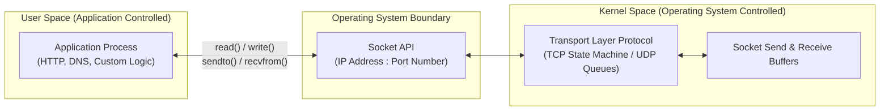

- **Application Control:** The application developer has complete autonomy over everything residing on the application-layer side of the socket interface: message structure, data formatting, serialization, state tracking, and protocol semantics.
- **Kernel / Transport Control:** Once a message crosses the socket boundary into kernel space, control passes to the operating system's transport entity. The application's control is strictly limited to:
  1. Selection of the transport protocol (TCP vs. UDP).
  2. Configuration of optional transport parameters (such as maximum buffer sizes, TCP keep-alive timers, and socket reuse flags).

#### Transport Services Required by Applications
Different application classes demand distinct performance guarantees from the underlying transport layer:

1. **Data Integrity & Reliability:** Applications like file transfer (FTP), remote shell (SSH), and web browsing (HTTP) cannot tolerate a single corrupted or missing bit, requiring the 100% reliable, byte-stream delivery guaranteed by the Transmission Control Protocol (TCP). Conversely, real-time multimedia streaming and VoIP tolerate minor packet loss but cannot endure retransmission delays, making User Datagram Protocol (UDP) the superior choice.
2. **Throughput & Bandwidth:** Bandwidth-sensitive applications require guaranteed transmission rates (e.g., 25 Mbps for 4K video streams), whereas elastic applications (email, DNS, text messaging) gracefully adapt to whatever throughput is available.
3. **Timing & Latency:** Interactive gaming, video teleconferencing, and industrial telemetry mandate strict end-to-end packet delay upper bounds (typically $< 150 \text{ ms}$).
4. **Security & Cryptography:** Applications require confidentiality, integrity authentication, and end-point verification, provided either via Transport Layer Security (TLS) atop TCP or Datagram Transport Layer Security (DTLS) atop UDP.

#### Application Protocol Transport Mapping

| Application Service | Application Layer Protocol | Underlying Transport Protocol | Default Well-Known Port | Core Service Rationale |
| :--- | :--- | :--- | :---: | :--- |
| **Domain Name Resolution** | DNS (RFC 1035) | UDP (primary) / TCP (fallback) | 53 | UDP for ultra-low latency; TCP for zone transfers and $> 512$ byte payloads. |
| **World Wide Web** | HTTP/1.1, HTTP/2 (RFC 7540) | TCP (with TLS / HTTPS) | 80 (HTTP) / 443 (HTTPS) | Reliable, in-order byte stream delivery; loss cannot be tolerated. |
| **Next-Gen Web** | HTTP/3 (RFC 9114) | QUIC (over UDP) | 443 | Eliminates TCP Head-of-Line blocking; single-handshake connection setup. |
| **Electronic Mail (Sending)** | SMTP (RFC 5321) | TCP | 25 (Relay) / 587 (Submission)| Reliable, sequenced text/binary transfer; guarantees delivery audit trail. |
| **Electronic Mail (Retrieval)**| POP3 / IMAP4 | TCP | 110/995 (POP3) / 143/993 (IMAP)| Reliable retrieval, directory synchronization, and message state preservation. |
| **File Transfer** | FTP (RFC 959) | TCP (Dual Connection) | 21 (Control) / 20 (Data) | Out-of-band control signaling; reliable file data transfer. |
| **Host IP Configuration** | DHCP (RFC 2131) | UDP | 67 (Server) / 68 (Client) | Broadcast datagram exchange; host lacks an IP address prior to configuration. |
| **Network Management** | SNMP (RFC 1157) | UDP | 161 (Agent) / 162 (Trap) | Lightweight polling; avoids transport connection overhead on overloaded routers. |

---

## 2. Core Terminology Dictionary

1. **Application Layer:** The uppermost protocol layer (Layer 7 in the OSI reference model, Layer 5 in the TCP/IP stack) that directly interfaces with user application processes to provide standardized network communication services.
2. **Network Application:** A distributed software suite executing across two or more independent networked computers, utilizing the network infrastructure to achieve collaborative functionality.
3. **Application Layer Protocol:** The formal specification governing the syntax, semantics, field ordering, and synchronization of protocol data units exchanged between communicating application processes.
4. **Client-Server Architecture:** A distributed computing paradigm characterized by asymmetric roles, where centralized, permanent, always-on server entities provide services to intermittently connected client entities upon request.
5. **Peer-to-Peer (P2P) Architecture:** A decentralized computing model wherein autonomous, equivalent end-systems (peers) share resources and exchange data directly without intermediate centralized server arbitration.
6. **Socket:** The fundamental software abstraction and Application Programming Interface (API) provided by the operating system kernel, acting as the bidirectional communication endpoint through which an application process writes and reads network data.
7. **Socket Address:** The globally unique network endpoint identifier formed by concatenating a 32-bit (IPv4) or 128-bit (IPv6) Internet Protocol address with a 16-bit Port Number (e.g., `198.51.100.10:443`).
8. **Port Number (TSAP):** A 16-bit unsigned integer (ranging from 0 to 65535) serving as the Transport Service Access Point to identify specific running processes or network services on a host.
9. **Well-Known Ports:** The standardized port number range from 0 to 1023, formally assigned by the Internet Assigned Numbers Authority (IANA) to ubiquitous system services (e.g., HTTP on 80, HTTPS on 443, DNS on 53, SSH on 22).
10. **Ephemeral Ports:** Dynamic, short-lived port numbers (ranging from 1024 to 65535, or 49152 to 65535 per RFC 6335) allocated automatically by the client operating system kernel for the duration of a transport session.
11. **Domain Name System (DNS):** A globally distributed, hierarchical, autonomous, and fault-tolerant database system (RFC 1034, RFC 1035) that translates human-readable symbolic hostnames into machine-routable numerical IP addresses.
12. **Fully Qualified Domain Name (FQDN):** An unambiguous, absolute domain name specifying the complete path from the leaf node through all intermediate parent labels up to the unnamed DNS root, explicitly terminated by a trailing dot (e.g., `web.mit.edu.`).
13. **Domain:** An entire contiguous subtree of the hierarchical DNS namespace, named after the node at the apex of that subtree.
14. **Zone:** An administratively delegated, contiguous partition of the DNS domain namespace for which a specific organization or authority maintains operational administrative control and authoritative name servers.
15. **Zone Delegation:** The administrative action whereby a parent DNS zone assigns operational authority over a subordinate subdomain to a child zone by publishing Name Server (NS) and glue address records.
16. **Authoritative Name Server:** A DNS server configured with the original, verified master zone database files for a specific domain, capable of returning authoritative answers (`AA=1`) for queries within its delegated zone.
17. **Root Name Server:** A top-tier name server that maintains the root zone (`.`) database, answering queries by returning referrals to the authoritative servers for all Top-Level Domains.
18. **Top-Level Domain (TLD):** The highest functional classification tier in the DNS inverted tree hierarchy immediately beneath the root, categorized into generic, country-code, and infrastructure domains.
19. **Generic Top-Level Domain (gTLD):** Top-level domains that categorize organizations based on general functional classification, comprising the original 7 legacy domains (.com, .edu, .gov, .mil, .org, .net, .int) and modern new gTLDs (.app, .tech, .ai).
20. **Country-Code Top-Level Domain (ccTLD):** Two-letter geographic top-level domains reserved for individual nations and sovereign territories, based strictly on the ISO 3166-1 alpha-2 standard (e.g., `.us`, `.uk`, `.in`, `.de`).
21. **Local DNS Resolver (Default Name Server):** A recursive name server deployed at an Internet Service Provider (ISP), corporate enterprise, or public provider (e.g., `8.8.8.8`) that performs full end-to-end multi-step resolution on behalf of client hosts.
22. **Stub Resolver:** A lightweight DNS client library embedded within an end-user host's operating system (e.g., `getaddrinfo`) that offloads all iterative traversal work by issuing a recursive query to a configured Local DNS Resolver.
23. **Recursive Query:** A DNS query interaction mode wherein the requesting client places complete responsibility for resolution on the receiving server; the server must traverse the hierarchy and return either the final resource record or an explicit error.
24. **Iterative Query:** A DNS query interaction mode wherein the queried server returns the best direct answer it possesses; if it does not hold the exact record, it returns a **referral** pointing to name servers closer to the answer.
25. **Glue Record:** An address record (`A` or `AAAA`) supplied by a parent zone in the Additional section of a referral, providing the IP address of a child authoritative name server whose hostname falls within the delegated child namespace.
26. **Resource Record (RR):** The standardized 5-tuple data structure `(Name, TTL, Class, Type, Value)` used to store individual database entries in DNS zone files and wire message payloads.
27. **Time To Live (TTL):** A 32-bit unsigned integer field in a resource record specifying the time duration in seconds that a resolver or intermediate cache may store and serve the record before evicting it.
28. **Negative Caching (RFC 2308):** The mechanism whereby a DNS resolver caches non-existence responses (`NXDOMAIN` or `NODATA`) for a bounded duration determined by the zone's Start of Authority (SOA) record to prevent repeated denial-of-service query floods.
29. **DNS Message Header:** A mandatory 12-byte (96-bit) fixed-format header pre-pended to all DNS queries and responses containing transaction identification, operational flags, response codes, and section record counters.
30. **DNS Label Compression:** An algorithmic byte-packing mechanism defined in RFC 1035 that replaces repetitive domain name suffixes in wire packets with a 2-octet pointer (`11xxxxxx`) referencing earlier label byte offsets.
31. **DNSSEC (DNS Security Extensions):** A suite of cryptographic IETF extensions (RFC 4033, 4034, 4035) providing origin authentication, data integrity, and authenticated denial of existence for DNS resource records using digital signatures.
32. **Kaminsky Cache Poisoning Attack:** A severe DNS vulnerability demonstrated by Dan Kaminsky in 2008, wherein an attacker floods a resolver with queries for random non-existent subdomains while spoofing authoritative responses containing forged glue records.
33. **RRSIG (Resource Record Signature):** A DNSSEC resource record holding the cryptographic digital signature computed over an entire set of identical resource records (an `RRset`) using a zone's private key.
34. **DNSKEY Record:** A DNSSEC resource record containing the public cryptographic key used by validating resolvers to authenticate RRSIG digital signatures within a zone.
35. **DS (Delegation Signer) Record:** A DNSSEC resource record published in a parent zone containing a cryptographic hash of a child zone's public key, establishing a cryptographic Chain of Trust.

---

## 7.1 DNS — The Domain Name System

The **Domain Name System (DNS)** is the foundational, globally distributed, autonomous database system of the Internet. Humans identify networked entities through intuitive, symbolic mnemonic strings such as `www.example.com` or `mail.university.edu`. However, intermediate routers and host operating systems route data packets using fixed-length numerical identifiers: 32-bit IPv4 addresses (e.g., `93.184.216.34`) or 128-bit IPv6 addresses (e.g., `2606:2800:220:1:248:1893:25c8:1946`). The primary mission of DNS is to resolve these human-friendly symbolic names into machine-routable IP addresses transparently, reliably, and in real time.

---

### 7.1.1 The DNS Name Space

To manage hundreds of millions of domain names without central registration bottlenecks or name collision conflicts, DNS organizes its global name space as a **hierarchical inverted tree**.

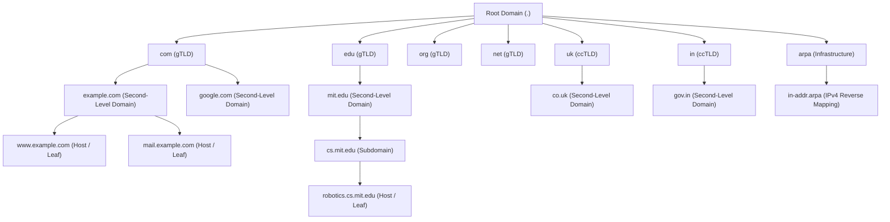

#### Diagram Analysis: Hierarchical Inverted Tree Architecture
- **What it shows:** The globally distributed inverted tree hierarchy of the DNS namespace, starting from the single unnamed root node down to top-level domains, second-level domains, subdomains, and individual leaf host nodes.
- **Components:**
  - **Root Node (`.`):** The apex of the entire namespace tree, represented by an empty string label (`""`).
  - **Top-Level Domains (TLDs):** Primary organizational partitions directly beneath the root.
  - **Second-Level Domains (SLDs):** Domain names registered by individuals, educational institutions, or corporate entities (e.g., `mit.edu`, `example.com`).
  - **Subdomains & Leaf Nodes:** Internal organizational divisions (e.g., `cs.mit.edu`) and specific hosts (e.g., `www`, `mail`).
- **Flow / Relationship:** Resolution paths are evaluated strictly from the leaf node upward to the root to formulate a Fully Qualified Domain Name, whereas name resolution queries flow top-down from the Root servers through TLD servers to Authoritative servers.

#### Formal FQDN Syntax and Structural Constraints
A **Fully Qualified Domain Name (FQDN)** represents the complete, absolute path from a specific node up to the root of the tree:

1. **Label Syntax:** Each node in the tree is identified by a label. Labels are alphanumeric strings that may also contain hyphens (`-`). A label cannot start or end with a hyphen.
2. **Label Length Constraint:** Each individual label must contain between $1$ and $63$ octets (characters) inclusive:

$$
1 \le L_{\text{label}} \le 63 \text{ octets}
$$

3. **Total FQDN Length Constraint:** The total length of a complete FQDN, including all label characters and length octets, cannot exceed $255$ octets:

$$
L_{\text{FQDN}} \le 255 \text{ octets}
$$

4. **Case-Insensitivity:** DNS labels are strictly case-insensitive per RFC 1035: `EXAMPLE.COM`, `Example.Com`, and `example.com` refer to the identical node in the database.
5. **Absolute vs. Relative Names:** An FQDN ends with an explicit trailing period representing the root (e.g., `robotics.cs.mit.edu.`). In contrast, a relative domain name omits the trailing dot (e.g., `robotics.cs`), instructing the operating system's resolver to append default local search domains (such as `.mit.edu`).

#### Classification Taxonomy of Top-Level Domains (TLDs)
The DNS hierarchy immediately below the root is partitioned into four major TLD categories:

1. **Generic TLDs (gTLDs):**
   - *Legacy 7 gTLDs (RFC 1591):* Established in 1984: `.com` (commercial enterprises), `.edu` (accredited 4-year degree-granting educational institutions), `.gov` (United States federal governmental agencies), `.mil` (United States military), `.org` (non-profit organizations), `.net` (network infrastructure and internet service providers), and `.int` (international organizations created by intergovernmental treaties).
   - *New gTLDs (ICANN 2012+ Expansion):* The Internet Corporation for Assigned Names and Numbers (ICANN) expanded the gTLD namespace to over 1,200 specialized string identifiers, including technical and commercial strings (`.app`, `.dev`, `.cloud`, `.tech`, `.ai`, `.io`).
2. **Country-Code TLDs (ccTLDs):**
   - Two-letter geographic identifiers allocated to individual nations and sovereign territories, based strictly on the United Nations ISO 3166-1 alpha-2 country code standard (e.g., `.us` for United States, `.uk` for United Kingdom, `.in` for India, `.de` for Germany, `.jp` for Japan, `.cn` for China).
   - Many ccTLDs establish secondary structured hierarchies mirroring the gTLD scheme, such as `.co.uk`, `.ac.in`, and `.gov.in`.
3. **Infrastructure TLD (`.arpa`):**
   - The Address and Routing Parameter Area (`.arpa`) is reserved exclusively for Internet architecture and protocol management.
   - Most notably, it hosts the reverse DNS mapping trees: `in-addr.arpa` for mapping 32-bit IPv4 addresses back to symbolic hostnames, and `ip6.arpa` for 128-bit IPv6 reverse lookups.
4. **Sponsored TLDs (sTLDs) & Internationalized Domain Names (IDNs):**
   - *sTLDs:* Specialized domain registries overseen by private sponsor agencies representing specific professional communities (e.g., `.aero` for aviation, `.coop` for cooperative businesses, `.museum` for museum institutions).
   - *IDNs:* Enable non-Latin scripts (such as Arabic, Chinese, Devanagari, Cyrillic, and Hebrew) to function within the ASCII-only DNS infrastructure. The client application transforms the Unicode string into an ASCII-Compatible Encoding (ACE) string using the **Punycode** algorithm (RFC 3492), prefixing the label with `xn--` (e.g., `xn--fsqu00a.xn--4gbrim`).

#### Administrative Zones vs. Domains and Zone Delegation

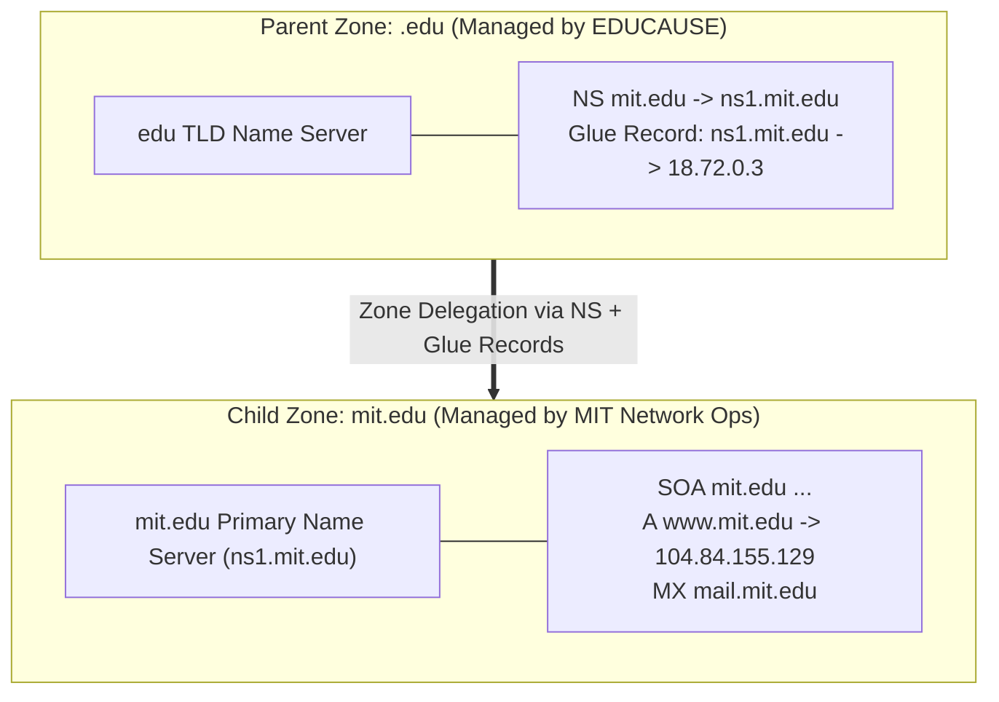

- **Domain vs. Zone Distinction:**
  - A **Domain** represents a theoretical subtree of the DNS namespace. For instance, the `mit.edu` domain includes everything rooted at `mit.edu`, encompassing `cs.mit.edu`, `robotics.cs.mit.edu`, `eecs.mit.edu`, and all descendant hostnames.
  - A **Zone** is an administratively delegated contiguous partition of the namespace for which a distinct administrative entity holds authoritative responsibility. The administrator of `.edu` does not operate the name servers or manage the daily database records for `mit.edu`; rather, `.edu` delegates authority over the `mit.edu` partition.
- **Zone Delegation Mechanics:**
  - To delegate authority over `mit.edu`, the administrator of the parent zone (`.edu`) inserts Name Server (`NS`) records into the parent zone file pointing to the authoritative servers for `mit.edu` (e.g., `ns1.mit.edu`).
- **The Critical Role of Glue Records:**
  - *The Circular Dependency Dilemma:* If the child zone's authoritative name server is named `ns1.mit.edu`, a resolver attempting to query `ns1.mit.edu` cannot do so without first resolving `ns1.mit.edu` itself — triggering an infinite circular resolution deadlock.
  - *The Glue Record Solution:* To prevent this deadlock, the parent zone (`.edu`) must include an `A` (and/or `AAAA`) address record for `ns1.mit.edu` directly within its own zone file alongside the `NS` record. These parent-provided child address records are termed **Glue Records** and are transmitted in the *Additional Information Section* of DNS referral messages.

---

### 7.1.2 Domain Resource Records (RRs)

The database records that populate DNS zone files and wire messages are structured as standardized units termed **Resource Records (RRs)**.

#### The Canonical 5-Tuple Structure
Conceptually and in standard zone master file syntax (RFC 1035), every resource record is defined as a 5-tuple:

$$
\text{RR} = (\text{Name}, \text{TTL}, \text{Class}, \text{Type}, \text{Value})
$$

| Field Component | Size / Format | Description & Operational Functionality |
| :--- | :--- | :--- |
| **Name** (Owner Name) | Variable length string | The domain name to which this resource record belongs (e.g., `www.example.com.`). |
| **TTL** (Time To Live) | 32-bit unsigned integer | Duration in seconds that an intermediate resolver is permitted to cache this record before evicting it. |
| **Class** | 16-bit unsigned integer | Protocol family. Almost exclusively `IN` (Internet, value 1). Historic legacy classes include `CH` (Chaosnet) and `HS` (Hesiod). |
| **Type** | 16-bit unsigned integer | Numerical identifier encoding the data type and format of the subsequent Value field (e.g., 1 for A, 28 for AAAA). |
| **Value** (RDATA) | Variable length binary | The type-specific resource data payload (e.g., 4-byte IPv4 address, target FQDN, SOA parameters). |

---

#### Formal Specification of the 9 Critical Resource Record Types

```
+------------------------------------------------------------------------------------------------------+
|                                SUMMARY OF CORE DNS RESOURCE RECORD TYPES                              |
+-------+------+------------------------------------------+--------------------------------------------+
| Type  | Code | Semantic Purpose                         | Format / Example Value                     |
+-------+------+------------------------------------------+--------------------------------------------+
| SOA   |    6 | Start of Authority (Zone Metadata)       | Primary Master, Admin, Serial, Timers      |
| A     |    1 | Host IPv4 Address Mapping                | 32-bit binary (e.g., 93.184.216.34)        |
| AAAA  |   28 | Host IPv6 Address Mapping                | 128-bit binary (e.g., 2606:2800:220:1::)   |
| MX    |   15 | Mail Exchanger Routing                   | 16-bit Priority + Mail Server FQDN         |
| CNAME |    5 | Canonical Alias Indirection              | Canonical (True) Target FQDN               |
| PTR   |   12 | Pointer (Reverse Address-to-Name)        | Canonical Hostname under in-addr.arpa      |
| NS    |    2 | Authoritative Name Server Delegation     | Authoritative Name Server FQDN             |
| TXT   |   16 | Arbitrary Text (Security / Verification) | Strings (SPF, DKIM, DMARC policies)        |
| SRV   |   33 | Generalized Service Location             | Priority, Weight, Port, Target FQDN        |
+-------+------+------------------------------------------+--------------------------------------------+
```

##### 1. SOA (Start of Authority, Type 6)
Every valid DNS zone file must begin with exactly one Start of Authority (`SOA`) record. The SOA record marks the apex of the zone and dictates global operational and replication parameters:

- `MNAME` (Primary Master Name Server): The FQDN of the primary authoritative name server where master zone updates originate (e.g., `ns1.example.com.`).
- `RNAME` (Responsible Person Mailbox): The email address of the zone administrator. Because the `@` symbol represents the current domain origin in zone file syntax, the `@` is replaced with a period (e.g., `hostmaster.example.com.` translates to `hostmaster@example.com`).
- `SERIAL` (Zone Serial Number): A 32-bit unsigned version number incremented upon every zone modification. Secondary servers compare their local serial against the master's serial during zone refresh checks. Standard convention formats the serial as `YYYYMMDDnn` (where `nn` is a two-digit revision counter).
- `REFRESH`: The time interval in seconds a secondary (slave) server waits before querying the master's SOA record to check for updates (typical value: $86400 \text{ s} = 24 \text{ hours}$).
- `RETRY`: The time interval in seconds a secondary server waits before retrying after a failed refresh attempt (typical value: $7200 \text{ s} = 2 \text{ hours}$).
- `EXPIRE`: The maximum time interval in seconds a secondary server can continue answering authoritative queries if the primary master server remains unreachable. Once this threshold expires without contact, the secondary server flushes the zone and ceases answering (typical value: $3600000 \text{ s} \approx 42 \text{ days}$).
- `MINIMUM`: Under RFC 2308, this field defines the default TTL for **negative caching** (`NXDOMAIN` or `NODATA`), dictating how long resolvers may cache the non-existence of records in this zone.

##### 2. A (Host IPv4 Address, Type 1)
Maps a symbolic hostname to a standard 32-bit (4-octet) IPv4 address.

- *Syntax:* `example.com. 3600 IN A 93.184.216.34`

##### 3. AAAA (Host IPv6 Address, Type 28)
Maps a symbolic hostname to a 128-bit (16-octet) IPv6 address per RFC 3596 (colloquially termed "quad-A" because 128 bits is quadruple the 32 bits of an IPv4 `A` record).

- *Syntax:* `example.com. 3600 IN AAAA 2606:2800:220:1:248:1893:25c8:1946`

##### 4. MX (Mail Exchanger, Type 15)
Directs incoming electronic mail destined for a domain to the appropriate Mail Transfer Agent (MTA) server. The MX record payload consists of two fields:

1. `Preference / Priority`: A 16-bit unsigned integer ($0 \text{ to } 65535$). Lower numerical values denote higher delivery priority.
2. `Mail Server Hostname`: The FQDN of the destination mail server (must resolve to an `A` or `AAAA` record; cannot point to a CNAME).
- *Syntax:*
  ```text
  example.com. 3600 IN MX 10 mail1.example.com.
  example.com. 3600 IN MX 20 mail2.example.com.
  ```
  Sending MTAs attempt connection to `mail1.example.com` first; if unreachable, they fail over to `mail2.example.com`.

##### 5. CNAME (Canonical Name, Type 5)
Creates an alias pointing to the canonical (true) domain name. When a resolver encounters a CNAME record during resolution, it restarts the lookup using the canonical target name.

- *Syntax:* `www.example.com. 3600 IN CNAME example.com.`
- **Critical RFC Restriction:** A CNAME record cannot co-exist with any other resource record type for the same owner name (with the sole exception of DNSSEC security records RRSIG and NSEC). Specifically, an apex domain name (e.g., `example.com`) cannot have a CNAME because it must also hold SOA and NS records.

##### 6. PTR (Pointer, Type 12)
Used for Reverse DNS lookups to map an IP address back to its canonical hostname:

- **IPv4 Reverse Lookup:** The 4 octets of the IPv4 address are reversed and appended to the special infrastructure domain `.in-addr.arpa.` (e.g., for IP `192.0.2.45`, the query name is `45.2.0.192.in-addr.arpa.`).
- **IPv6 Reverse Lookup:** The 32 hexadecimal nibbles of the 128-bit IPv6 address are reversed, separated by dots, and appended to `.ip6.arpa.`.
- *Syntax:* `45.2.0.192.in-addr.arpa. 3600 IN PTR server1.example.com.`

##### 7. NS (Name Server, Type 2)
Identifies an authoritative name server for the zone or delegates a subdomain to an external server.

- *Syntax:* `example.com. 86400 IN NS ns1.example.com.`

##### 8. TXT (Text, Type 16)
Holds arbitrary text strings up to 255 characters per string. While originally designed for human-readable notes, TXT records are universally utilized for modern domain security authentication:

- *Sender Policy Framework (SPF, RFC 7208):* Advertises authorized outgoing mail server IPs:
  ```text
  example.com. IN TXT "v=spf1 ip4:192.0.2.0/24 include:_spf.google.com ~all"
  ```
- *DKIM Public Key Publishing (RFC 6376):* Publishes the cryptographic public key used to verify digital signatures on outgoing emails.
- *DMARC Policies (RFC 7489):* Directs receiving MTAs on enforcement actions (`p=reject`) when SPF or DKIM checks fail.

##### 9. SRV (Service Locator, Type 33)
A generalized service location record (RFC 2782) that allows clients to locate servers providing specific services (such as SIP, LDAP, XMPP, or Kerberos) without hardcoding port numbers or server names.

- *Standard Format:* `_service._proto.name. TTL Class SRV Priority Weight Port Target.`
- *Syntax:* `_sip._tcp.example.com. 3600 IN SRV 10 60 5060 sipserver.example.com.`
  - `Priority` (16 bits): Lower value = higher priority.
  - `Weight` (16 bits): Probabilistic load-balancing weight for servers with identical priority.
  - `Port` (16 bits): Exact TCP/UDP port on which the service daemon listens.
  - `Target` (FQDN): Canonical hostname of the server offering the service.

---

#### DNS Message Bit-Level Wire Format (RFC 1035)

All DNS messages — whether client queries, server responses, zone transfer requests, or error notifications — share a single standardized packet layout. The message begins with a **mandatory 12-octet (96-bit) Header Section**, followed by four variable-length sections:

```
 0                   1                   2                   3
 0 1 2 3 4 5 6 7 8 9 0 1 2 3 4 5 6 7 8 9 0 1 2 3 4 5 6 7 8 9 0 1
+-+-+-+-+-+-+-+-+-+-+-+-+-+-+-+-+-+-+-+-+-+-+-+-+-+-+-+-+-+-+-+-+
|      Identification (ID)      |QR|   Opcode  |AA|TC|RD|RA| Z |RCODE|
+-+-+-+-+-+-+-+-+-+-+-+-+-+-+-+-+-+-+-+-+-+-+-+-+-+-+-+-+-+-+-+-+
|          QDCOUNT              |            ANCOUNT            |
+-+-+-+-+-+-+-+-+-+-+-+-+-+-+-+-+-+-+-+-+-+-+-+-+-+-+-+-+-+-+-+-+
|          NSCOUNT              |            ARCOUNT            |
+-+-+-+-+-+-+-+-+-+-+-+-+-+-+-+-+-+-+-+-+-+-+-+-+-+-+-+-+-+-+-+-+
|                                                               |
/                       Question Section                        /
/            (QDCOUNT entries: QNAME, QTYPE, QCLASS)            /
+-+-+-+-+-+-+-+-+-+-+-+-+-+-+-+-+-+-+-+-+-+-+-+-+-+-+-+-+-+-+-+-+
|                                                               |
/                        Answer Section                         /
/       (ANCOUNT entries: Resource Records satisfying query)     /
+-+-+-+-+-+-+-+-+-+-+-+-+-+-+-+-+-+-+-+-+-+-+-+-+-+-+-+-+-+-+-+-+
|                                                               |
/                       Authority Section                       /
/    (NSCOUNT entries: NS RRs pointing toward authorities)      /
+-+-+-+-+-+-+-+-+-+-+-+-+-+-+-+-+-+-+-+-+-+-+-+-+-+-+-+-+-+-+-+-+
|                                                               |
/                      Additional Section                       /
/   (ARCOUNT entries: Glue A/AAAA RRs, OPT pseudo-RR for EDNS0)  /
+-+-+-+-+-+-+-+-+-+-+-+-+-+-+-+-+-+-+-+-+-+-+-+-+-+-+-+-+-+-+-+-+
```

##### Bitfield Specifications of the 12-Byte Header

1. **Identification (ID, 16 bits):** A random transaction identifier generated by the client program when dispatching a query. The server copies this ID verbatim into its response, enabling the client to match asynchronous responses with pending outbound queries.
2. **QR (Query/Response Flag, 1 bit):**
   - `0`: Message is a Query.
   - `1`: Message is a Response.
3. **Opcode (Operation Code, 4 bits):**
   - `0`: Standard Query (`QUERY`).
   - `1`: Inverse Query (`IQUERY` - obsolete).
   - `2`: Server Status Request (`STATUS`).
   - `4`: Zone Change Notification (`NOTIFY`, RFC 1996).
   - `5`: Dynamic Zone Update (`UPDATE`, RFC 2136).
4. **AA (Authoritative Answer, 1 bit):** Set to `1` in response messages if the answering name server is an authoritative server for the queried domain name.
5. **TC (Truncation Flag, 1 bit):** Set to `1` if the complete DNS response exceeded the transmission channel limit (512 bytes on standard UDP) and was truncated. Prompts the client to re-issue the query over TCP port 53.
6. **RD (Recursion Desired, 1 bit):** Set by the client in a query to request that the name server pursue the query recursively to completion.
7. **RA (Recursion Available, 1 bit):** Set or cleared by the server in a response to denote whether recursive resolution services are supported and permitted.
8. **Z (Reserved, 3 bits):** Reserved for future standardization. In modern DNS, these bits are allocated to DNSSEC flags: `AD` (Authentic Data, RFC 2535) indicating data was verified via DNSSEC, and `CD` (Checking Disabled) instructing the server to bypass DNSSEC validation.
9. **RCODE (Response Code, 4 bits):**
   - `0` (`NoError`): Request completed successfully without errors.
   - `1` (`FormErr`): Format Error; name server was unable to interpret the query packet.
   - `2` (`ServFail`): Server Failure; name server encountered an internal failure (e.g., misconfigured zone or unreachable upstream server).
   - `3` (`NXDOMAIN` / `NameError`): Meaningful only from an authoritative server (`AA=1`); signifies that the requested domain name does not exist.
   - `4` (`NotImp`): Not Implemented; name server does not support the requested Opcode.
   - `5` (`Refused`): Refused; name server policy refuses to process the query for this client.
10. **QDCOUNT (16 bits):** Number of entries in the Question Section (almost universally `1`).
11. **ANCOUNT (16 bits):** Number of Resource Records in the Answer Section.
12. **NSCOUNT (16 bits):** Number of Name Server Resource Records in the Authority Section.
13. **ARCOUNT (16 bits):** Number of Resource Records in the Additional Information Section.

---

#### DNS Label Compression Mechanism

Because domain names frequently repeat across the Question, Answer, Authority, and Additional sections, uncompressed DNS packets waste transmission bandwidth. To eliminate redundant byte sequences, RFC 1035 specifies an elegant **2-octet Compression Pointer**.

```
+--+--+--+--+--+--+--+--+--+--+--+--+--+--+--+--+
| 1  1|                OFFSET (14 bits)          |
+--+--+--+--+--+--+--+--+--+--+--+--+--+--+--+--+
```

##### 1. Algorithmic Transformation
- In standard DNS wire format, each label is preceded by a 1-octet length indicator ($1 \text{ to } 63$, whose two high-order bits are `00`).
- If the first two bits of a length octet are `11` (binary `11000000_2 = 0xC0`), the remaining 14 bits represent an unsigned integer offset pointing to a prior location in the DNS message:

$$
\text{Pointer Value} = \texttt{0xC000} \lor \text{Offset}
$$

- The resolver reads the label sequence starting at `Offset` bytes from the very first byte of the 12-byte DNS message header.

##### 2. Worked Compression Trace Example
Suppose a DNS response message contains the following Question and Answer sections:

- **Question Section at Offset 12:** The query for `www.example.com` is encoded in wire format as:

$$
\texttt{03} \, \texttt{'w'} \, \texttt{'w'} \, \texttt{'w'} \, \texttt{07} \, \texttt{'e'} \, \texttt{'x'} \, \texttt{'a'} \, \texttt{'m'} \, \texttt{'p'} \, \texttt{'l'} \, \texttt{'e'} \, \texttt{03} \, \texttt{'c'} \, \texttt{'o'} \, \texttt{'m'} \, \texttt{00}
$$
  Notice that the sub-string `example.com` begins at **Offset 16** (12 header bytes + 1 length byte + 3 bytes for `www` = Byte 16).

- **Answer Section Encoding:** The answering resource record must specify the owner name `www.example.com`. Instead of transmitting all 17 bytes again, the encoder emits a 2-byte pointer:

$$
\texttt{0xC00C} \implies \text{Offset } 12 \text{ (references } \texttt{www.example.com}\text{)}
$$

- If an authoritative NS record later in the Authority section specifies `ns1.example.com`, the encoder emits:

$$
\texttt{03} \, \texttt{'n'} \, \texttt{'s'} \, \texttt{'1'} \, \texttt{0xC010}
$$
  Here, `0xC010` is a 2-byte pointer referencing Byte Offset 16 (`example.com`), saving 12 bytes of payload.

---

### 7.1.3 Name Servers & Resolution

DNS resolution operates across a globally coordinated server hierarchy to resolve names without saturating any individual network link.

#### Server Hierarchy

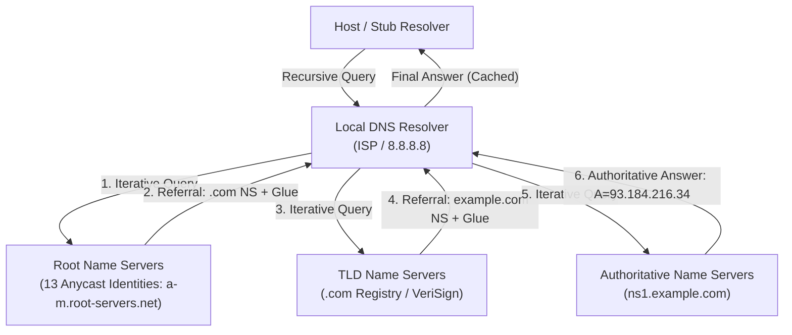

1. **Root Name Servers:**
   - The root zone (`.`) is maintained by **13 logical root authorities**, named `a.root-servers.net` through `m.root-servers.net`.
   - *IP Anycast Distribution:* Although there are only 13 logical IP addresses (constrained historically by the 512-byte UDP limit to ensure all 13 could fit in a single response alongside glue addresses), each logical address is announced via BGP Anycast across hundreds of physical server nodes globally. Today, over 1,500 physical root server instances are distributed across the world, ensuring sub-millisecond local latency and resilience against massive Distributed Denial of Service (DDoS) attacks.
2. **Top-Level Domain (TLD) Servers:**
   - Dedicated server clusters responsible for top-level domains (e.g., VeriSign administers the authoritative TLD infrastructure for `.com` and `.net`; Educause oversees `.edu`).
3. **Authoritative Name Servers:**
   - Systems maintained by registered organizations or managed DNS hosting providers (such as Cloudflare, AWS Route 53, or Akamai) that hold master zone files containing the actual `A`, `AAAA`, `MX`, and `TXT` records.
   - Categorized into **Primary (Master)** servers (which hold writable master zone files) and **Secondary (Slave)** servers (which replicate read-only copies via zone transfers).
4. **Local DNS Resolvers (Recursive Resolvers):**
   - Reside at the client's ISP, campus enterprise network, or public resolver services (e.g., Google `8.8.8.8`, Cloudflare `1.1.1.1`, Quad9 `9.9.9.9`).
   - Resolvers execute all iterative traversal steps on behalf of client stub resolvers, caching intermediate results along the way.

---

#### Query Resolution Mechanics: Iterative vs. Recursive

When an application process invokes a DNS lookup, resolution proceeds through two distinct communication modes:

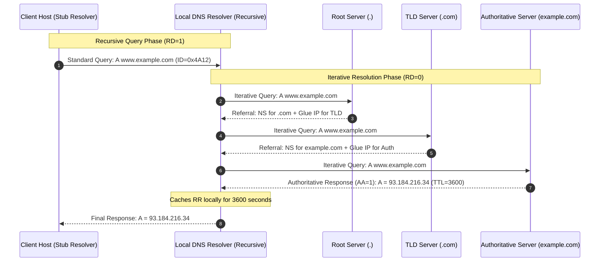

##### Detailed Sequence Flow Analysis
1. **Client to Local Resolver (Recursive):** The client stub resolver sets the Recursion Desired bit (`RD=1`), passing full operational burden to the Local DNS Resolver.
2. **Local Resolver to Root Server (Iterative):** The local resolver checks its cache. Assuming a cold cache, it transmits an iterative query to a Root Name Server.
3. **Root Referral:** The root server does not know the IP address of `www.example.com`. It returns a **Referral**: the `NS` records for `.com` alongside their IPv4/IPv6 glue addresses in the Additional section.
4. **Local Resolver to TLD Server (Iterative):** The local resolver queries the `.com` TLD server.
5. **TLD Referral:** The TLD server returns a referral containing the `NS` records for `example.com` and associated glue records.
6. **Local Resolver to Authoritative Server (Iterative):** The local resolver queries `ns1.example.com`.
7. **Authoritative Answer:** The authoritative name server finds the exact match in its zone file and replies with an Authoritative Answer (`AA=1`), returning `A 93.184.216.34` with `TTL=3600`.
8. **Caching and Return:** The local resolver caches the record locally for 3600 seconds and returns the final answer to the client host.

#### Recursive vs. Iterative Query Comparison

| Dimension | Recursive Query Resolution | Iterative Query Resolution |
| :--- | :--- | :--- |
| **Operational Definition** | The queried server assumes complete burden to return the final answer or an explicit error. | The queried server replies with the direct answer or a referral pointing to servers closer to the answer. |
| **RD Flag State** | `RD = 1` (Recursion Desired). | `RD = 0` (Recursion Not Desired / Iterative). |
| **Typical Usage Boundary**| Client Stub Resolver $\to$ Local DNS Resolver. | Local DNS Resolver $\to$ Root / TLD / Authoritative Servers. |
| **Server State & Load** | High; server must maintain state for dozens of in-flight queries and handle multiple network sockets. | Low; stateless request-response interaction; server returns referral immediately. |
| **Caching Efficiency** | Local resolver consolidates and caches answers for all downstream enterprise clients. | Authoritative and root servers do not maintain client query caches. |
| **Amplification Risk** | Vulnerable to open recursive resolver amplification DDoS attacks if exposed to the Internet. | Resistant; root and TLD servers answer only with short referrals or authoritative zone data. |

---

#### DNS Caching Dynamics & Negative Caching (RFC 2308)

Without caching, the global DNS architecture would collapse under the volume of billions of queries per second directed at the 13 root authorities.

##### 1. Positive Caching
When a resolver receives an authoritative answer, it stores the resource record set (`RRset`) in its local memory cache alongside an expiration timestamp:

$$
\text{Expiration Time} = T_{\text{received}} + \text{TTL}
$$

- Subsequent requests for the same domain name originating from any local host are satisfied immediately from cache with zero upstream network traffic.
- Intermediate referral records (`NS` records for `.com` with typical TTLs of 2 days = 172,800 seconds) remain cached across queries, allowing resolvers to bypass Root and TLD servers entirely for subsequent queries within that TLD.

##### 2. Negative Caching (RFC 2308)
When an authoritative name server reports that a domain does not exist (`RCODE=3` / `NXDOMAIN`) or that the domain exists but holds no records of the requested type (`NODATA` / `NoError` with `ANCOUNT=0`), the resolver caches this negative result:

- **Negative TTL Calculation:** The resolver caches the non-existence result for a duration defined by:

$$
\text{Negative TTL} = \min(\text{SOA.MINIMUM}, \text{SOA.TTL})
$$

- **Protection Mechanism:** Negative caching prevents broken applications or malicious attack scripts from generating infinite query storms against root and authoritative servers by repeatedly requesting non-existent names.

---

#### DNS Transport: UDP Port 53 vs. TCP Port 53

DNS is one of the few core Internet protocols engineered to utilize both UDP and TCP transport protocols over the same well-known port (**Port 53**):

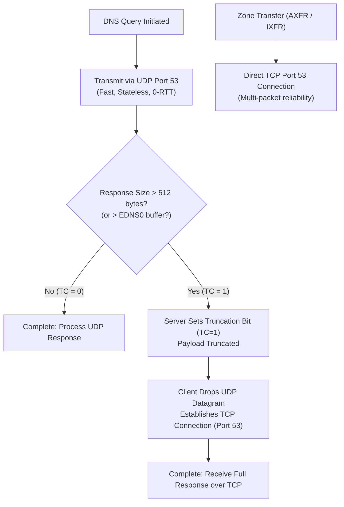

##### 1. UDP Port 53 (Standard Operational Mode)
- **Primary Transport:** Standard DNS queries and replies execute over UDP.
- **Rationale:** UDP is connectionless and incurs zero connection setup overhead ($0 \text{ RTT}$ handshake latency). A lookup completes in a single request-response exchange, minimizing memory state overhead on busy servers.
- **Payload Limit:** Historically, RFC 1035 constrained DNS UDP payloads to **512 octets** (to prevent IP packet fragmentation across legacy links with minimum MTUs of 576 bytes).

##### 2. TCP Port 53 (Fallback & Bulk Transfer)
TCP Port 53 is invoked under two mandatory operational conditions:

1. **Truncation Fallback (`TC=1`):** If a response payload exceeds 512 octets (or the advertised EDNS0 buffer size), the server truncates the answer section, sets the Truncation flag (`TC=1`), and transmits the partial packet. Upon receiving `TC=1`, the client drops the UDP packet, initiates a 3-way TCP handshake to port 53, and re-issues the query reliably.
2. **Zone Transfers (AXFR / IXFR):** Secondary name servers synchronize zone databases from primary masters using Authoritative Zone Transfer (**AXFR**, RFC 5936) or Incremental Zone Transfer (**IXFR**, RFC 1995). Because zone files can span tens of megabytes, TCP's reliable sliding-window stream is strictly required.

##### 3. EDNS0 (Extension Mechanisms for DNS - RFC 6891)
To prevent the latency penalty of falling back to TCP for modern responses (especially large DNSSEC cryptographic keys and signatures), EDNS0 introduces a pseudo-record termed the **OPT Resource Record** placed in the Additional Information Section:

- Allows the client to advertise a larger UDP receive buffer size (typically **1232 to 4096 octets**).
- Adds extended flag bits and support for larger response codes, enabling DNSSEC-signed responses to traverse UDP safely without triggering `TC=1`.

---

#### DNSSEC (DNS Security Extensions - RFC 4033, 4034, 4035)

Plain DNS transmits all queries and replies in cleartext over unauthenticated UDP datagrams, exposing the system to severe security threats.

##### 1. Vulnerability: The Kaminsky Cache Poisoning Attack
In 2008, security researcher Dan Kaminsky demonstrated a devastating cache poisoning exploit:

- **Vulnerability Mechanism:** A plain DNS transaction is authenticated solely by matching two 16-bit fields: the transaction **ID** ($2^{16} = 65,536$ combinations) and the client UDP **source port** (historically fixed at port 53, providing zero entropy).
- **The Exploit:** An attacker floods a target local recursive resolver with queries for random, non-existent subdomains under a victim domain (e.g., `random1.example.com`, `random2.example.com`).
- Simultaneously, the attacker floods the resolver with thousands of forged authoritative responses claiming to be from the authoritative server, guessing the 16-bit transaction ID.
- Because the queried name is randomized, the resolver has no cached entry and dispatches an iterative query to the Internet for each attempt.
- Once a forged packet's ID matches the resolver's query, the fake response is accepted into the cache. Crucially, the attacker injects malicious **Glue Records** into the Additional Section re-assigning the authoritative name server for the *entire* domain (e.g., `example.com IN NS evil-nameserver.com`).
- The resolver's cache is now completely poisoned: all subsequent web, email, and banking traffic destined for `example.com` is redirected to the attacker's servers.

##### 2. DNSSEC Cryptographic Architecture
DNSSEC eliminates cache poisoning by providing **origin authentication** and **data integrity** through asymmetric public-key cryptography.

> **Crucial Architectural Note:** DNSSEC does **not** provide confidentiality or privacy. DNS queries and responses remain unencrypted plaintext. Confidentiality is addressed by complementary protocols such as DNS over HTTPS (DoH, RFC 8484) and DNS over TLS (DoT, RFC 7858).

##### Core DNSSEC Resource Records
1. **RRSIG (Resource Record Signature):** Holds the digital signature for a group of identical records (an **RRset**). For example, all `A` records for `example.com` are grouped into an RRset and signed using the zone's private key.
2. **DNSKEY:** Holds the public key used by validating resolvers to verify `RRSIG` signatures. Typically split into:
   - **Zone-Signing Key (ZSK):** Used to sign everyday zone RRsets.
   - **Key-Signing Key (KSK):** Used exclusively to sign the ZSK, limiting exposure.
3. **DS (Delegation Signer):** Stored in the parent zone. Contains a cryptographic hash of the child zone's KSK. By verifying the parent's signature over the child's `DS` record, a resolver cryptographically binds child to parent.
4. **NSEC / NSEC3 (Authenticated Denial of Existence):** Proves that a requested name does not exist without requiring name servers to dynamically generate digital signatures on the fly.
   - *NSEC (Next Secure):* Lists the next existing domain name in alphabetical canonical order, proving nothing exists between them. *Flaw:* Allows attackers to systematically map the entire zone ("zone walking").
   - *NSEC3 (RFC 5155):* Replaces plaintext names with salted, iterative cryptographic hashes, mitigating zone-walking reconnaissance.

##### The Cryptographic Chain of Trust

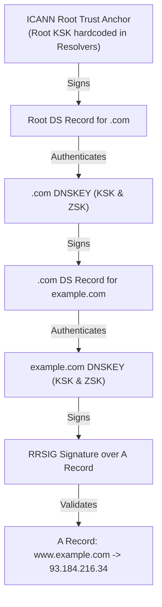

- **Validation Sequence:** Resolvers have the ICANN Root KSK pre-configured as a trusted **Root Anchor**. The resolver verifies the Root `DNSKEY` $\to$ verifies the Root `DS` for `.com` $\to$ verifies the `.com` `DNSKEY` $\to$ verifies the `DS` for `example.com` $\to$ verifies the `example.com` `DNSKEY` $\to$ validates the `RRSIG` over the requested `A` record.
- If an attacker injects a spoofed IP address, the mathematical verification fails because the attacker lacks the private signing key. The resolver immediately rejects the spoofed record and returns a Server Failure (`ServFail`, `RCODE=2`) to the client application.

---

### Practical C Socket Implementation: DNS Host Lookup

Modern network software does not perform raw UDP socket crafting to resolve domain names. Instead, applications interface with the operating system's resolver library using the standardized, POSIX-compliant, protocol-independent APIs: `getaddrinfo()`, `getnameinfo()`, and `freeaddrinfo()`.

The following C program implements robust, dual-stack (IPv4 and IPv6) DNS hostname resolution with comprehensive error handling:

```c
#define _POSIX_C_SOURCE 200112L
#include <stdio.h>
#include <stdlib.h>
#include <string.h>
#include <sys/types.h>
#include <sys/socket.h>
#include <netdb.h>
#include <arpa/inet.h>
#include <netinet/in.h>

/**
 * resolve_hostname - Resolves a symbolic hostname to its IPv4 and IPv6 addresses
 * @param hostname: String containing the FQDN or hostname to resolve
 */
void resolve_hostname(const char *hostname) {
    struct addrinfo hints;
    struct addrinfo *result = NULL;
    struct addrinfo *rp = NULL;
    int status;
    char ip_string[INET6_ADDRSTRLEN];

    printf("============================================================\n");
    printf("Initiating DNS Resolution for Target: %s\n", hostname);
    printf("============================================================\n");

    /*
     * Step 1: Initialize the 'hints' structure.
     * Setting hints to zero guarantees no undefined flags are passed.
     */
    memset(&hints, 0, sizeof(struct addrinfo));
    hints.ai_family = AF_UNSPEC;     /* Allow IPv4 (AF_INET) or IPv6 (AF_INET6) */
    hints.ai_socktype = SOCK_STREAM; /* TCP stream socket type */
    hints.ai_flags = AI_CANONNAME;   /* Return the canonical name of the host */

    /*
     * Step 2: Invoke getaddrinfo().
     * Resolves the hostname and allocates a dynamically linked list of addrinfo structs.
     */
    status = getaddrinfo(hostname, NULL, &hints, &result);
    if (status != 0) {
        fprintf(stderr, "getaddrinfo error for '%s': %s\n",
                hostname, gai_strerror(status));
        return;
    }

    /* Print canonical name if discovered in DNS */
    if (result != NULL && result->ai_canonname != NULL) {
        printf("Canonical Name (CNAME Target): %s\n\n", result->ai_canonname);
    }

    /*
     * Step 3: Iterate through the returned linked list of address structures.
     */
    int record_count = 0;
    for (rp = result; rp != NULL; rp = rp->ai_next) {
        record_count++;
        void *addr = NULL;
        const char *ip_version = NULL;

        if (rp->ai_family == AF_INET) {
            /* IPv4 Address structure casting */
            struct sockaddr_in *ipv4 = (struct sockaddr_in *)rp->ai_addr;
            addr = &(ipv4->sin_addr);
            ip_version = "IPv4 (A Record)";
        } else if (rp->ai_family == AF_INET6) {
            /* IPv6 Address structure casting */
            struct sockaddr_in6 *ipv6 = (struct sockaddr_in6 *)rp->ai_addr;
            addr = &(ipv6->sin6_addr);
            ip_version = "IPv6 (AAAA Record)";
        } else {
            continue; /* Unknown protocol family */
        }

        /*
         * Step 4: Convert binary network IP address into human-readable presentation string.
         */
        if (inet_ntop(rp->ai_family, addr, ip_string, sizeof(ip_string)) != NULL) {
            printf("  [%d] %-18s -> %s\n", record_count, ip_version, ip_string);
        } else {
            perror("inet_ntop conversion failure");
        }
    }

    printf("\nTotal matching address records found: %d\n", record_count);

    /*
     * Step 5: Deallocate the dynamically linked list.
     * Failure to invoke freeaddrinfo() causes a severe kernel memory leak.
     */
    freeaddrinfo(result);
    printf("Memory successfully deallocated via freeaddrinfo().\n");
}

int main(int argc, char *argv[]) {
    const char *target = (argc > 1) ? argv[1] : "www.example.com";
    resolve_hostname(target);
    return 0;
}
```

#### Detailed Code Walkthrough and Operational Analysis
1. **Header Inclusion & Portability:** `<netdb.h>` defines `struct addrinfo` and `getaddrinfo()`; `<arpa/inet.h>` supplies `inet_ntop()`.
2. **The `hints` Configuration:**
   - `hints.ai_family = AF_UNSPEC`: Configures the resolver to return both IPv4 (`AF_INET`) and IPv6 (`AF_INET6`) addresses seamlessly.
   - `hints.ai_flags = AI_CANONNAME`: Prompts the DNS subsystem to follow any `CNAME` chains and populate `result->ai_canonname` with the primary canonical domain name.
3. **Execution and Error Handling:** `getaddrinfo()` returns integer `0` on success. On failure, it returns non-zero error constants (`EAI_NONAME`, `EAI_AGAIN`, `EAI_FAIL`) decoded into human-readable text via `gai_strerror()`.
4. **Binary-to-Text Conversion (`inet_ntop`):** Converts 32-bit (`struct in_addr`) and 128-bit (`struct in6_addr`) binary network byte-order integers into standard presentation strings.
5. **Mandatory Cleanup (`freeaddrinfo`):** Because `getaddrinfo()` allocates memory internally via dynamic heap structures, every successful call must be paired with `freeaddrinfo(result)` to prevent memory leaks in daemon processes.

---

### Worked Numerical Micro-Example: DNS Resolution Latency Analysis

#### Problem Statement
A host computer configured with a Local DNS Resolver requests the IPv4 address (`A` record) for `www.physics.oxford.ac.uk`. The Local DNS Resolver's cache is currently completely cold (contains no records for `oxford.ac.uk`, `.ac.uk`, `.uk`, or root).

The network round-trip times (RTT) between communicating entities are measured as follows:

- Client Host to Local DNS Resolver: $RTT_0 = 4 \text{ ms}$
- Local DNS Resolver to Root Server: $RTT_{\text{root}} = 28 \text{ ms}$
- Local DNS Resolver to `.uk` ccTLD Server: $RTT_{\text{TLD}} = 32 \text{ ms}$
- Local DNS Resolver to `.ac.uk` Sub-TLD Server: $RTT_{\text{sub}} = 30 \text{ ms}$
- Local DNS Resolver to Oxford University Authoritative Server: $RTT_{\text{auth}} = 26 \text{ ms}$

Processing delay at each name server is $T_{\text{proc}} = 1.5 \text{ ms}$.

**Calculate:**

1. The total elapsed resolution delay under **Iterative Resolution** performed by the Local DNS Resolver.
2. The total elapsed resolution delay if the system operated under **Full Recursive Resolution** chaining from server to server.
3. The expected resolution delay if the Local DNS Resolver achieves an $80\%$ cache hit ratio on subsequent queries.

---

#### Symbol Definitions

| Symbol | Definition / Meaning | Value in Problem |
| :--- | :--- | :--- |
| $RTT_0$ | Round-Trip Time between Client Host and Local DNS Resolver | $4 \text{ ms}$ |
| $RTT_{\text{root}}$ | Round-Trip Time between Local Resolver and Root Name Server | $28 \text{ ms}$ |
| $RTT_{\text{TLD}}$ | Round-Trip Time between Local Resolver and `.uk` ccTLD Name Server | $32 \text{ ms}$ |
| $RTT_{\text{sub}}$ | Round-Trip Time between Local Resolver and `.ac.uk` Sub-TLD Name Server | $30 \text{ ms}$ |
| $RTT_{\text{auth}}$ | Round-Trip Time between Local Resolver and Authoritative Name Server | $26 \text{ ms}$ |
| $T_{\text{proc}}$ | Internal database lookup and packet processing delay at each server | $1.5 \text{ ms}$ |
| $P_{\text{cache}}$ | Probability of satisfying query directly from Local Resolver cache (Hit Ratio) | $0.80$ ($80\%$) |

---

#### Governing Delay Formulas

##### 1. Iterative Resolution Latency
Under iterative resolution, the client exchanges one round-trip with the local resolver. The local resolver then independently dispatches sequential request-response query cycles to each hierarchical authority (Root $\to$ ccTLD $\to$ Sub-TLD $\to$ Authoritative):

$$
T_{\text{iterative}} = RTT_0 + \sum_{i=1}^{k} \left( RTT_i + T_{\text{proc}} \right) + T_{\text{proc, local}}
$$

##### 2. Recursive Chained Resolution Latency
Under fully chained recursive resolution (where Root queries TLD directly, TLD queries Sub-TLD directly, etc.), transmission delay accumulates as the sum of sequential one-way link delays, returning in reverse:

$$
T_{\text{recursive}} = RTT_0 + \sum_{i=1}^{k} RTT_{i-1, i} + \sum_{i=1}^{k} T_{\text{proc}, i}
$$

##### 3. Expected Resolution Latency with Caching
$$
E[T] = P_{\text{cache}} \times \left( RTT_0 + T_{\text{proc, local}} \right) + (1 - P_{\text{cache}}) \times T_{\text{iterative}}
$$

---

#### Step-by-Step Calculation

##### Step 1: Calculate Iterative Resolution Latency ($T_{\text{iterative}}$)
The resolution requires four sequential iterative queries by the Local Resolver:

1. Local Resolver $\to$ Root Server: $28 \text{ ms} + 1.5 \text{ ms} = 29.5 \text{ ms}$
2. Local Resolver $\to$ `.uk` TLD Server: $32 \text{ ms} + 1.5 \text{ ms} = 33.5 \text{ ms}$
3. Local Resolver $\to$ `.ac.uk` Sub-TLD Server: $30 \text{ ms} + 1.5 \text{ ms} = 31.5 \text{ ms}$
4. Local Resolver $\to$ `oxford.ac.uk` Authoritative Server: $26 \text{ ms} + 1.5 \text{ ms} = 27.5 \text{ ms}$

Total iterative traversal time across the Internet hierarchy:
$$
T_{\text{traversal}} = 29.5 + 33.5 + 31.5 + 27.5 = 122.0 \text{ ms}
$$

Adding client-to-resolver communication delay ($RTT_0 = 4 \text{ ms}$) and local processing ($1.5 \text{ ms}$):
$$
T_{\text{iterative}} = 4 \text{ ms} + 122.0 \text{ ms} + 1.5 \text{ ms} = \mathbf{127.5 \text{ ms}}
$$

##### Step 2: Calculate Recursive Chained Resolution Latency ($T_{\text{recursive}}$)
Assuming intermediate server-to-server RTTs equal the average wide-area Internet transit latency ($\approx 30 \text{ ms}$ per leg):
$$
T_{\text{chain}} = RTT_0 + \left( RTT_{\text{root}} + RTT_{\text{root}\to\text{TLD}} + RTT_{\text{TLD}\to\text{sub}} + RTT_{\text{sub}\to\text{auth}} \right) + 5 \times T_{\text{proc}}
$$
$$
T_{\text{recursive}} \approx 4 + (28 + 30 + 30 + 26) + (5 \times 1.5) = 118 + 7.5 = \mathbf{125.5 \text{ ms}}
$$

##### Step 3: Calculate Expected Latency under 80% Cache Hit Ratio
When a cache hit occurs at the Local Resolver:
$$
T_{\text{hit}} = RTT_0 + T_{\text{proc, local}} = 4 \text{ ms} + 1.5 \text{ ms} = 5.5 \text{ ms}
$$
When a cache miss occurs (cold lookup):
$$
T_{\text{miss}} = T_{\text{iterative}} = 127.5 \text{ ms}
$$

Substitute into the expected value formulation:
$$
\begin{aligned}
E[T] &= (0.80 \times 5.5 \text{ ms}) + (0.20 \times 127.5 \text{ ms}) \\
     &= 4.4 \text{ ms} + 25.5 \text{ ms} \\
     &= \mathbf{29.9 \text{ ms}}
\end{aligned}
$$

---

#### Final Answer Summary
- **Iterative Resolution Delay (Cold Cache):** $\mathbf{127.5 \text{ ms}}$
- **Recursive Chained Resolution Delay:** $\mathbf{125.5 \text{ ms}}$
- **Expected Resolution Delay (with 80% Cache Hit Ratio):** $\mathbf{29.9 \text{ ms}}$

**Engineering Takeaway:** Caching at the Local DNS Resolver reduces the effective average name lookup delay experienced by user applications from $127.5 \text{ ms}$ down to $29.9 \text{ ms}$ — a **$76.5\%$ reduction in latency** while completely eliminating upstream query traffic to Root and TLD servers for $80\%$ of all user requests.

---

## 7.2 Electronic Mail

Electronic mail, universally abbreviated as **email**, represents one of the foundational and most pervasive application-layer services of the global Internet. Originating in the early 1970s across the **Advanced Research Projects Agency Network (ARPANET)** as an informal mechanism for researchers on time-sharing mainframes to exchange text files, email has evolved from an ad hoc file transfer convention into a highly structured, distributed, asynchronous messaging infrastructure.

Unlike synchronous communication media such as **Voice over Internet Protocol (VoIP)** or instant messaging, email is intrinsically asynchronous and store-and-forward in nature: the sender and receiver do not need to be simultaneously online or connected to the network for communication to succeed. Messages transit through intermediate relays and are staged in persistent server-side repositories until explicitly accessed by the recipient.

---

### 7.2.1 Architecture and Services

The modern email architecture decouples the end-user interface from the background transport and delivery infrastructure. This structural modularity enables heterogeneous client software operating on intermittently connected edge devices to communicate seamlessly across an always-on, globally interconnected server mesh.

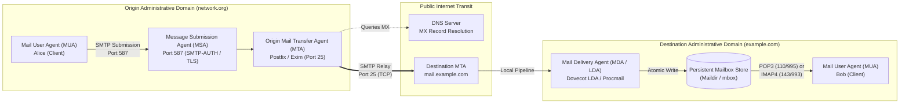

#### Figure 7.7: End-to-End Functional Architecture of the Internet Email System

**What it shows:**
The end-to-end traversal path of an email message from the sender's client software through submission, transport relay across the public Internet, local delivery, and eventual mailbox retrieval.

**Components:**

* **Mail User Agent (MUA):** The client program used by human senders and receivers to compose, read, organize, and manage email.
* **Message Submission Agent (MSA):** A specialized mail server entry point operating under RFC 6409 on **Transmission Control Protocol (TCP)** port 587 that receives outbound messages from authenticated MUAs, validates formatting, and hands them to the local MTA.
* **Mail Transfer Agent (MTA):** An always-on system daemon operating on TCP port 25 that routes and relays email across the Internet using the **Simple Mail Transfer Protocol (SMTP)** based on target domain **Mail Exchanger (MX)** records.
* **Mail Delivery Agent (MDA) / Local Delivery Agent (LDA):** The server component that accepts a message from the receiving MTA and writes it directly into the recipient's persistent mailbox on disk.
* **Persistent Mailbox Store:** A non-volatile server-side storage subsystem holding stored messages until accessed or deleted.

**Flow / Relationship:**

1. The sender (Alice) drafts an email in her MUA and initiates submission over TCP port 587 to her local MSA, authenticating via SMTP-AUTH.
2. The MSA validates message headers, enforces local policy, and transfers the message to the origin MTA.
3. The origin MTA issues a **Domain Name System (DNS)** query for the recipient's domain (`example.com`) requesting `MX` records to locate the destination MTA.
4. The origin MTA opens a direct TCP connection on port 25 to the destination MTA and transmits the message via SMTP.
5. The destination MTA hands the message to the local MDA, which commits the data to the recipient's persistent mailbox store.
6. The recipient (Bob) launches his MUA and retrieves or synchronizes the message using **Post Office Protocol version 3 (POP3)** or **Internet Message Access Protocol version 4 (IMAP4)**.

**Key observations:**
SMTP is exclusively a *push* protocol used for submission and inter-server relay. It cannot be used for final retrieval because user devices lack persistent IP addresses, are frequently powered down or behind firewalls, and cannot run listening port 25 server daemons.

---

#### Core Architectural Entities

The operational behavior of the email ecosystem is partitioned across four specialized software abstractions:

1. **Mail User Agent (MUA):** Also known as an email client, the MUA provides the human-facing interface for reading, authoring, replying to, forwarding, and organizing messages. The MUA interacts with the transport subsystem only when transmitting or synchronizing mail. Examples include Mozilla Thunderbird, Microsoft Outlook, Apple Mail, and terminal clients like Mutt.
2. **Message Submission Agent (MSA - RFC 6409):** Originally, MUAs submitted mail directly to port 25 of the sending MTA. However, to eliminate spam origin laundering, submission was formally segregated onto TCP port 587. The MSA mandates client authentication via **SMTP Authentication (SMTP-AUTH, RFC 4954)** and **Transport Layer Security (TLS)** encryption, verifies that the sender has authority over the supplied address, and repairs malformed headers (e.g., adding missing timestamps or message identifiers) before queueing.
3. **Mail Transfer Agent (MTA - RFC 5321):** The MTA acts as the backbone router of the email system. MTAs operate continuously on server systems listening on TCP port 25. An MTA receives messages from local MSAs or remote MTAs, inspects the recipient domain, queries DNS for corresponding MX records, and relays the message across the network. Representative MTA implementations include Postfix, Exim, and Sendmail.
4. **Mail Delivery Agent (MDA / LDA):** Once a message reaches the authoritative destination MTA, it must be placed into the recipient's storage box. The MTA delegates this task to an MDA (such as Dovecot LDA or Procmail). The MDA enforces local mailbox quotas, executes server-side filtering rules (such as Sieve scripts), and safely commits the message bytes to disk.

---

#### The Three-Tier Message Structure: Envelope, Headers, and Body

An email message in transit is composed of three strictly differentiated logical layers: the Envelope, the Headers, and the Body. Confusing these layers is a frequent source of implementation bugs and security misconfigurations.

```
+-------------------------------------------------------------------------+
| ENVELOPE (SMTP Protocol Layer - RFC 5321)                                |
|   MAIL FROM: <alice@network.org>                                        |
|   RCPT TO:   <bob@example.com>                                          |
|   (Exchanged during SMTP transaction; guides routing; stripped at MDA)  |
+-------------------------------------------------------------------------+
| HEADERS (RFC 5322 Text Metadata Block)                                  |
|   From: "Alice Smith" <alice@network.org>                               |
|   To: Bob Jones <bob@example.com>                                       |
|   Subject: Architectural Review                                         |
|   Date: Wed, 04 Nov 2026 14:00:00 +0000                                 |
|   Message-ID: <202611041400.XYZ@network.org>                            |
|   MIME-Version: 1.0                                                     |
|   Content-Type: text/plain; charset=utf-8                               |
+-------------------------------------------------------------------------+
| BLANK LINE (CRLF: \r\n delimiter)                                       |
+-------------------------------------------------------------------------+
| BODY (User Payload)                                                     |
|   Hello Bob,                                                            |
|   Here are the architectural specifications for the new cluster...      |
+-------------------------------------------------------------------------+
```

The functional characteristics of these three layers are delineated below:

* **The Envelope:** The envelope is not contained within the textual message file itself; rather, it consists of the transport parameters exchanged directly between MTAs during the SMTP dialogue (`MAIL FROM` and `RCPT TO` commands). The envelope specifies the actual routing path and the return address for delivery status notifications (**bounces**). When an email is delivered to the user's mailbox, the envelope is discarded, although the MDA typically records the envelope sender into a newly synthesized header called `Return-Path:`.
* **The Headers:** Defined by RFC 5322, headers comprise structured ASCII key-value pairs separated from the body by a single blank line (`\r\n`). Headers provide metadata for display by the MUA, such as author provenance (`From:`), intended recipients (`To:`, `Cc:`), submission date (`Date:`), threading context (`In-Reply-To:`, `References:`), and transit audit history (`Received:` lines prepended by intermediate MTAs).
* **The Body:** The body contains the actual message content intended for the human reader or application consumer. Transport agents treat the body as an uninterpreted byte sequence, delegating rendering and subpart extraction entirely to the recipient's MUA.

---

#### Mail Storage Subsystems: `mbox` versus `Maildir`

Once delivered by an MDA, messages must reside in a persistent server-side storage hierarchy. Historically, two primary on-disk storage architectures have dominated Unix-like operating systems: the traditional monolithic `mbox` format and the modern, directory-based `Maildir` format.

##### 1. The `mbox` Format
The `mbox` format consolidates an entire mailbox into a single, continuous flat text file (commonly located at `/var/mail/username`). Messages are concatenated sequentially, separated by a delimiter line beginning with the five characters `From ` (capital F, lowercase r, o, m, followed by a space) and the envelope sender timestamp.

Because the delimiter is plain text, any line within an actual message body that happens to begin with `From ` must be escaped by the MUA or MDA (typically transformed into `>From `). Concurrency under `mbox` requires mandatory, whole-file locking mechanisms (`fcntl()`, `flock()`, or dotlocking via lockfiles). If two processes attempt to write or read simultaneously without coordination, catastrophic file corruption occurs. Furthermore, deleting or modifying an email requires shifting all subsequent bytes in the file, imposing an $O(N)$ rewriting penalty where $N$ is the total size of the mailbox file.

##### 2. The `Maildir` Format
To eliminate the severe concurrency bottlenecks and corruption vulnerabilities of `mbox`, Daniel J. Bernstein designed `Maildir` for the qmail MTA. In `Maildir`, a mailbox is an ordinary filesystem directory containing three mandatory subdirectories:

1. `tmp/`: Holds messages currently being written by the MDA during active reception. The filename incorporates the current Unix timestamp, process identifier (**PID**), and hostname to guarantee absolute uniqueness across cluster nodes.
2. `new/`: Holds newly delivered messages that have not yet been seen or accessed by any MUA. Once the MDA finishes writing and flushing a message to disk in `tmp/`, it executes an atomic POSIX `rename()` system call to move the file into `new/`.
3. `cur/`: Holds messages that have been read or inspected by the MUA. Flags denoting status (such as `S` for Seen, `R` for Replied, `F` for Flagged, `T` for Trashed) are appended directly to the individual file name separated by a colon (e.g., `1762261200.12345.host:2,S`).

Because POSIX guarantees that `rename()` within the same filesystem is an atomic operation, `Maildir` requires zero filesystem locks. An MDA can deliver new mail simultaneously while multiple IMAP clients search, read, and flag messages. Deleting a message is an $O(1)$ `unlink()` system call that affects only the target file.

The structural and performance trade-offs between `mbox` and `Maildir` are summarized in the comparative analysis below:

| Structural / Operational Metric | `mbox` Format (RFC 4155) | `Maildir` Format |
| :--- | :--- | :--- |
| **Storage Structure** | Single continuous flat file containing all concatenated emails. | Hierarchical directory tree containing individual files per message. |
| **Directory Substructures** | None (monolithic file, e.g., `/var/spool/mail/user`). | Three subdirectories: `tmp/` (writing), `new/` (unread), `cur/` (read/flagged). |
| **Message Demarcation** | Textual boundary line starting with `From `. | Distinct, unique filesystem filenames. |
| **From-Escaping Requirement** | Required (`From ` in body rewritten to `>From `). | Not required (body bytes stored completely unmodified). |
| **Concurrency Control** | Strict file locking mandatory (`fcntl`, `flock`, dotlock). | Lockless concurrency via atomic filesystem operations. |
| **Message Deletion Cost** | $O(N)$ write overhead: file must be rewritten from deletion offset. | $O(1)$ filesystem operation: single `unlink()` call on the inode. |
| **Status Flag Updates** | Requires rewriting the header block within the single file. | $O(1)$ rename: file suffix modified in `cur/` (e.g., `:2,S`). |
| **Corruption Resilience** | Fragile: a single write failure or lock crash can corrupt entire archive. | Fault-tolerant: corruption of one file leaves all other messages intact. |
| **Network Filesystem (NFS) Safety**| Extremely poor: NFS lock daemons frequently hang or desynchronize. | Native and safe: atomic `rename()` works reliably across NFS. |
| **Filesystem Inode Overhead** | Low (only 1 inode per entire mailbox). | High (1 inode per email message; requires large inode tables). |

[Source: CN_Application_Layer.pdf, Pages 13–16]

---

### 7.2.2 The User Agent

The **Mail User Agent (MUA)** provides the interactive interface between human users and the email infrastructure. MUAs fall broadly into two evolutionary paradigms: terminal-oriented **Command-Line Interface (CLI)** clients and rich **Graphical User Interface (GUI)** clients.

#### Command-Line versus Graphical User Agents

* **Command-Line Interface (CLI) Agents:** Historic and lightweight Unix programs such as `mail`, `mailx`, `elm`, `pine` (and its modern derivative `alpine`), and `mutt`. These utilities operate directly within text terminals, relying on single-character keyboard shortcuts, external text editors (such as `vim` or `nano`) for message composition, and shell pipelines for filtering. Terminal clients are favored by system administrators and software engineers due to their low resource utilization, instant startup, scriptability, and seamless operation over remote **Secure Shell (SSH)** connections.
* **Graphical User Interface (GUI) Agents:** Modern desktop and mobile applications such as Mozilla Thunderbird, Microsoft Outlook, and Apple Mail. GUI clients provide multi-pane visual layouts displaying folder hierarchies, message summaries, and live preview panes simultaneously. They integrate **What You See Is What You Get (WYSIWYG)** rich-text editors, drag-and-drop attachment management, centralized address books, calendar synchronization via **iCalendar (RFC 5545)**, and automatic background thread rendering.

---

#### Functional Responsibilities of the MUA

Regardless of visual interface complexity, all user agents execute four fundamental core responsibilities:

1. **Message Composition:** The MUA guides the author in establishing valid RFC 5322 headers. It automatically generates the `Date:` and `Message-ID:` headers, populates recipient arrays (`To:`, `Cc:`, `Bcc:`), appends standardized ASCII signature blocks (traditionally delimited by a line consisting of `-- `—two hyphens followed by a space), and applies cryptographic signatures (such as **Pretty Good Privacy (PGP)** or **Secure/Multipurpose Internet Mail Extensions (S/MIME)**).
2. **Mailbox and Folder Management:** MUAs present users with a structured representation of their mail. A standard deployment includes default mailboxes (`Inbox`, `Drafts`, `Sent`, `Trash`, `Junk/Spam`) alongside arbitrary user-defined nested folder trees.
3. **Message Disposition:** Following inspection of a message, the user can command the MUA to execute disposition actions:
   * **Delete:** Marks the message for removal or moves it to a trash folder.
   * **Reply:** Synthesizes an outbound draft addressed to the `From:` or `Reply-To:` address, prefixing the subject with `Re:` and inserting the parent `Message-ID` into `In-Reply-To:`.
   * **Reply-All:** Broadens the reply to encompass all addresses in the original `To:` and `Cc:` fields.
   * **Forward:** Transmits the message content to a third party, either inline (prefaced by quotation markers) or encapsulated as a clean `message/rfc822` MIME attachment.
4. **MIME Parsing and Presentation:** Modern incoming emails rarely consist of simple 7-bit ASCII. The MUA must parse complex recursive MIME boundary trees, decode transfer encodings (Base64 and Quoted-Printable), render HTML DOM layouts securely (blocking remote tracking web beacons), and invoke external helper applications or built-in viewers for multimedia attachments.

---

#### Automated Processing: Autoresponders and Vacation Agents

MUAs and server-side mail filters allow users to configure automated response rules. A prominent realization is the **vacation agent** (or out-of-office autoresponder), which inspects incoming messages and automatically replies with a pre-configured status text (e.g., notifying senders that the user is on leave and listing emergency contact personnel).

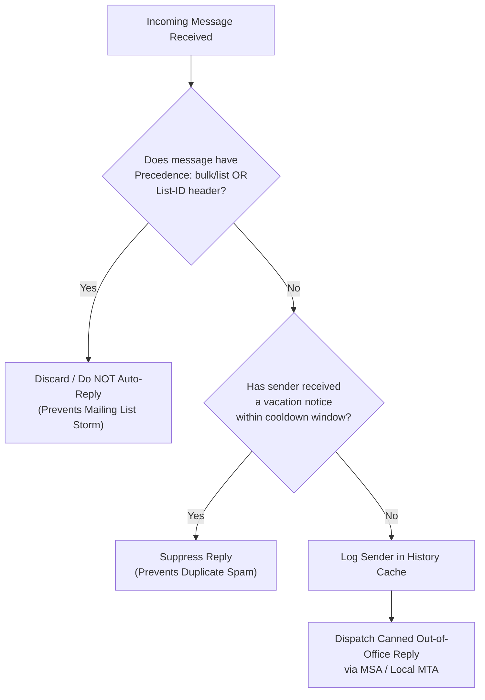

##### Operational Hazards of Automated Responders
Improperly engineered vacation agents introduce two severe failure modes:

1. **Infinite Mail Loops (Ping-Pong Flooding):** If two users who both have active vacation agents send mail to each other, or if user $A$ auto-forwards incoming mail to user $B$ while user $B$ runs a vacation agent replying back to user $A$, an unconstrained feedback loop can trigger millions of messages, crashing mail queues and filling disk volumes.
2. **Mailing List Flooding:** If a vacation agent responds blindly to incoming messages distributed by an automated mailing list (such as `developers@company.com`), the canned response is redistributed to thousands of list subscribers, generating massive collateral annoyance and cascading bounces.

##### Architectural Mitigations
To eliminate these hazards, robust vacation agents implement strict verification algorithms:

* They inspect incoming headers for mailing list markers: `Precedence: bulk`, `Precedence: list`, `List-Id:`, or `Auto-Submitted: auto-generated`. If detected, no reply is generated.
* They maintain a local persistent database (or hash table) of recipient email addresses paired with timestamps. An auto-reply is dispatched to a given sender only once within a configurable cooldown interval (e.g., once every 7 days).
* They verify that the user's explicit email address appears in the `To:` or `Cc:` field of the incoming message; messages delivered via `Bcc:` or mailing list expansion are ignored.

[Source: CN_Application_Layer.pdf, Pages 16–20]

---

### 7.2.3 Message Formats

Internet email formats are governed by two landmark standards families: **RFC 5322** (which superseded RFC 822 and RFC 2822), defining the baseline textual message architecture, and **MIME (RFC 2045–2049)**, which generalizes email into an extensible multimedia transport vehicle.

#### RFC 5322 Structural Syntax and Core Headers

An RFC 5322 message consists exclusively of lines of ASCII text. Each header line commences with a case-insensitive field name, followed immediately by a colon (`:`), optional whitespace, and the field value. If a header exceeds standard display widths (typically 78 characters), it can be folded across multiple lines by indenting subsequent continuation lines with at least one ASCII space or tab character (**header unfolding**).

The table below catalogs the principal RFC 5322 header fields, categorized by their operational domain:

| Header Field | Specification Standard | Functional Role and Semantic Meaning |
| :--- | :--- | :--- |
| `From:` | RFC 5322 Section 3.6.2 | The author(s) of the message (name and mailbox). Required in every message. |
| `Sender:` | RFC 5322 Section 3.6.2 | The mailbox of the actual agent transmitting the message; mandatory if distinct from `From:`. |
| `To:` | RFC 5322 Section 3.6.3 | Primary intended recipient mailbox(es), comma-separated. |
| `Cc:` | RFC 5322 Section 3.6.3 | **Carbon Copy**: Secondary recipient mailbox(es) who receive identical copies. |
| `Bcc:` | RFC 5322 Section 3.6.3 | **Blind Carbon Copy**: Recipients whose addresses are stripped by MUA/MSA prior to transit. |
| `Subject:` | RFC 5322 Section 3.6.5 | Short human-readable textual summary of message contents. |
| `Date:` | RFC 5322 Section 3.6.1 | Timestamp indicating when message authoring was completed. |
| `Message-ID:` | RFC 5322 Section 3.6.4 | Globally unique identifier `<string@domain>` generated by originating MUA/MSA. |
| `Reply-To:` | RFC 5322 Section 3.6.2 | Explicit return mailbox for replies, overriding `From:` when set. |
| `In-Reply-To:` | RFC 5322 Section 3.6.4 | Identifies the `Message-ID` of the immediate parent message to which this is a direct response. |
| `References:` | RFC 5322 Section 3.6.4 | Ordered sequence of `Message-ID`s tracing the full historical conversation ancestor thread. |
| `Received:` | RFC 5322 Section 3.6.7 | Trace header prepended by each MTA in transit documenting timestamp, client IP, and hop FQDN. |
| `Return-Path:` | RFC 5322 Section 3.6.7 | Added by destination MDA containing the envelope `MAIL FROM` bounce address. |

---

#### MIME: Multipurpose Internet Mail Extensions (RFC 2045–2049)

The original RFC 822 specification suffered from five crippling technical constraints:

1. It supported only 7-bit US-ASCII character encoding (values 0–127). Characters with values 128–255 (vital for French, German, Spanish, Cyrillic, Greek, etc.) were either stripped or garbled.
2. It lacked native mechanisms for transmitting non-textual binary payloads (images, compiled binaries, compressed archives, audio, video).
3. It possessed no standard conventions for describing the media type or encoding format of message content.
4. It lacked support for structured multipart messages (such as combining plain text with an attachment or providing HTML and plain-text alternatives).
5. It was bounded by line-length constraints: SMTP implementations were permitted to reject or truncate lines exceeding 1,000 characters.

MIME resolved these deficiencies without breaking backwards compatibility with existing SMTP transport infrastructure by retaining the RFC 5322 ASCII container and adding structured body parsing rules.

---

#### The Six Core MIME Headers

MIME introduces six specialized headers placed in the main header block or within individual subpart boundary blocks:

1. `MIME-Version: 1.0`: Identifies the message as complying with RFC 2045–2049. Any message lacking this header is treated as legacy plain US-ASCII.
2. `Content-Type: <type>/<subtype>; parameter=value`: Defines the physical media format of the payload. The parameters specify attributes such as character encoding (`charset="utf-8"`) or boundary delimiters (`boundary="xyz"`).
3. `Content-Transfer-Encoding: <mechanism>`: Informs the recipient MUA how the binary or 8-bit body was transformed into safe 7-bit ASCII for network transport. The five standardized mechanisms are:
   * `7bit`: Uncompressed ASCII text with lines $\le 998$ octets.
   * `8bit`: Uncompressed octets with values up to 255 and short lines (requires ESMTP `8BITMIME` negotiation).
   * `binary`: Arbitrary 8-bit data without line-length bounds (requires ESMTP `BINARYMIME` / `CHUNKING`).
   * `quoted-printable`: Efficient encoding for text that is predominantly ASCII with occasional accented characters.
   * `base64`: Robust encoding for arbitrary binary data.
4. `Content-Disposition: inline | attachment; filename="report.pdf"`: Directs the MUA whether to render the subpart inline as part of the primary reading view or present it as a downloadable detached file with the suggested filename.
5. `Content-ID: <unique_id@domain>`: Supplies a unique identifier for an embedded subpart, enabling other parts (such as an HTML document) to reference it internally via the `cid:` URI scheme.
6. `Content-Description: <text>`: A human-readable text string describing the attachment (e.g., `"Corporate Financial Projections Q3"`).

---

#### MIME Content Types and Multipart Subtypes

MIME organizes media formats into primary top-level types and specific subtypes, registered globally with the **Internet Assigned Numbers Authority (IANA)**:

| Primary Type | Representative Subtypes | Functional Purpose |
| :--- | :--- | :--- |
| `text` | `plain`, `html`, `xml`, `css`, `csv` | Textual information formatted in specific character sets. |
| `image` | `jpeg`, `png`, `gif`, `tiff`, `webp` | Still photographic and bitmap visual imagery. |
| `audio` | `basic`, `mpeg`, `mp4`, `ogg`, `wav` | Audio recordings and compressed sound tracks. |
| `video` | `mpeg`, `mp4`, `quicktime`, `webm` | Moving video streams, with or without integrated audio. |
| `application`| `octet-stream`, `pdf`, `zip`, `json` | Discrete data payloads requiring execution by specialized software. |
| `message` | `rfc822`, `partial`, `external-body` | Encapsulated email messages or pointer references. |
| `multipart` | `mixed`, `alternative`, `related`, `digest`| Compound bodies comprising multiple distinct parts. |

##### Multipart Subtypes in Depth
The `multipart` media type allows a single message to carry multiple distinct body parts, delimited by a software-generated boundary string specified in the `Content-Type` header:

* `multipart/mixed`: The constituent parts are independent and sequentially presented. Typically utilized when an email consists of a plain-text message accompanied by one or more binary attachments (e.g., a PDF document and a spreadsheet).
* `multipart/alternative`: The constituent parts represent identical semantic content formatted in differing media formats or varying degrees of richness (e.g., a plain-text version and an HTML styled version). Parts are arranged in order of increasing complexity; an advanced MUA renders the richest part it can interpret, while a simple terminal client falls back to the plain-text part.
* `multipart/related`: The constituent parts are mutually interdependent. For instance, an HTML document referencing inline images embedded directly within the message payload. The HTML body references the image using its `Content-ID` (e.g., ``).
* `multipart/digest`: A specialized multipart structure where the default media type of every nested part is `message/rfc822`. Commonly employed by mailing list digest systems to bundle dozens of daily messages into a single transmission.

---

#### Base64 Encoding Mathematics & Algorithm

Because legacy SMTP relays were designed to transfer only 7-bit US-ASCII characters and could mangle or drop raw 8-bit octets (especially if high bits were stripped or control characters like `<NUL>` were encountered), MIME specifies the **Base64** encoding algorithm (RFC 2045 Section 6.8). Base64 maps arbitrary binary data into a safe, portable 65-character subset of US-ASCII.

---

#### Formula: Base64 Transformation and Partitioning

Base64 concatenates three sequential 8-bit input bytes into a 24-bit intermediate register, which is subsequently partitioned into four 6-bit index symbols:

$$
B_{24} = (\text{byte}_1 \ll 16) \lor (\text{byte}_2 \ll 8) \lor \text{byte}_3
$$

The four 6-bit index values $I_0, I_1, I_2, I_3$ are extracted via bitwise shifting and masking:

$$
\begin{aligned}
I_0 &= (B_{24} \gg 18) \ \& \ \texttt{0x3F} \\
I_1 &= (B_{24} \gg 12) \ \& \ \texttt{0x3F} \\
I_2 &= (B_{24} \gg 6) \ \& \ \texttt{0x3F} \\
I_3 &= B_{24} \ \& \ \texttt{0x3F}
\end{aligned}
$$

Each 6-bit integer $I_k \in [0, 63]$ is then mapped to its corresponding ASCII symbol using the Base64 alphabet table $\Sigma_{\text{Base64}}$:

$$
\Sigma_{\text{Base64}}[k] = \begin{cases}
\text{chr}(65 + k), & 0 \le k \le 25 \quad (\texttt{'A'}-\texttt{'Z'}) \\
\text{chr}(97 + k - 26), & 26 \le k \le 51 \quad (\texttt{'a'}-\texttt{'z'}) \\
\text{chr}(48 + k - 52), & 52 \le k \le 61 \quad (\texttt{'0'}-\texttt{'9'}) \\
\texttt{'+'}, & k = 62 \\
\texttt{'/'}, & k = 63
\end{cases}
$$

##### Symbol Definitions

| Symbol | Definition / Meaning | Mathematical Domain / Units |
| :--- | :--- | :--- |
| $\text{byte}_1, \text{byte}_2, \text{byte}_3$ | Sequential input octets from raw binary stream | $\mathbb{Z} \cap [0, 255]$ (8-bit unsigned octets) |
| $B_{24}$ | 24-bit intermediate binary concatenation register | $\mathbb{Z} \cap [0, 2^{24}-1]$ (24 bits) |
| $I_0, I_1, I_2, I_3$ | 6-bit numerical indices derived from $B_{24}$ | $\mathbb{Z} \cap [0, 63]$ ($2^6 = 64$ discrete values) |
| $\Sigma_{\text{Base64}}$ | The standardized 64-character ASCII alphabet array | 64 printable US-ASCII characters |
| $\ll, \gg$ | Bitwise left-shift and right-shift operators | Computer arithmetic operations |
| $\&, \lor$ | Bitwise AND and bitwise OR operators | Boolean bitwise logic |
| $\texttt{0x3F}$ | Bitmask $\texttt{00111111}_2$ isolating the lowest 6 bits | Value 63 in decimal |

##### What It Represents
The formula formalizes the exact bitwise grouping that transforms an unconstrained sequence of 8-bit octets into printable ASCII characters, ensuring complete immunity against transmission distortion across 7-bit communication channels.

##### Conditions / Assumptions
* Input data consists of arbitrary 8-bit binary octets.
* All processing operates in network byte order (big-endian).

---

#### Formula: Base64 Size Expansion and RFC 2045 Line Wrapping

Every 3 input bytes yield 4 encoded ASCII output bytes. When the total binary file size $N$ is not a multiple of 3, padding bytes are appended to form a complete 4-byte block. Additionally, RFC 2045 Section 6.8 mandates that encoded lines must not exceed 76 characters, requiring the insertion of a `<CRLF>` delimiter (2 octets: `\r\n`) every 76 characters.

$$
\text{Raw Base64 Characters}(N) = 4 \times \left\lceil \frac{N}{3} \right\rceil
$$

$$
\text{Total Encoded Size}(N) = 4 \times \left\lceil \frac{N}{3} \right\rceil + 2 \times \left\lfloor \frac{4 \times \lceil N/3 \rceil}{76} \right\rfloor
$$

##### Symbol Definitions

| Symbol | Definition / Meaning | Mathematical Domain / Units |
| :--- | :--- | :--- |
| $N$ | Unencoded input binary file size | $\mathbb{Z}_{\ge 0}$ (octets / bytes) |
| $\lceil \cdot \rceil$ | Ceiling mathematical function (rounds up to nearest integer) | Real to Integer |
| $\lfloor \cdot \rfloor$ | Floor mathematical function (rounds down to nearest integer) | Real to Integer |
| $\text{Raw Base64 Characters}$ | Total printable Base64 symbols generated | Count of ASCII characters |
| $\text{Total Encoded Size}$ | Cumulative size including carriage return and line feed bytes | Total octets transmitted over wire |

##### What It Represents
This formula computes the exact network wire overhead for Base64 transmissions. The theoretical data expansion ratio is:

$$
\text{Expansion Ratio} = \frac{4 \text{ bytes}}{3 \text{ bytes}} = 1.3333 \implies +33.33\% \text{ overhead}
$$

When accounting for 76-character line wrapping (`\r\n` every 76 characters), the practical expansion ratio increases to:

$$
\text{Effective Wire Ratio} = \frac{4}{3} \times \left(1 + \frac{2}{76}\right) = \frac{4}{3} \times \frac{78}{76} = \frac{4}{3} \times 1.0263 \approx 1.3684 \implies +36.84\% \text{ overhead}
$$

---

#### Base64 Padding Rules

When the total input stream length $N$ in octets is not evenly divisible by 3, trailing padding characters (`=`) are appended according to strict modulo arithmetic:

1. **Case 1: $N \pmod 3 = 0$**
   The binary stream cleanly fills all 24-bit blocks. No padding characters are added.

$$
\text{Block output: } 4 \text{ characters, } 0 \text{ equal signs.}
$$

2. **Case 2: $N \pmod 3 = 1$ (1 leftover byte, 8 bits)**
   The single 8-bit octet is shifted left by 4 zero bits to form two 6-bit indices ($I_0$ and $I_1$). The remaining two 6-bit slots cannot be filled from input data and are replaced with two explicit padding characters (`==`):

$$
\text{Block output: } \Sigma[I_0] \, \Sigma[I_1] \, \texttt{==}
$$

3. **Case 3: $N \pmod 3 = 2$ (2 leftover bytes, 16 bits)**
   The two 8-bit octets (16 bits) are shifted left by 2 zero bits to form three 6-bit indices ($I_0$, $I_1$, and $I_2$). The final fourth slot is replaced with one padding character (`=`):

$$
\text{Block output: } \Sigma[I_0] \, \Sigma[I_1] \, \Sigma[I_2] \, \texttt{=}
$$

---

#### Worked Numerical Example 1: Step-by-Step Base64 Encoding

##### Scenario A: Exact 3-Byte Block (No Padding)
* **Input String**: `"Man"` (3 ASCII characters)
* **Step 1: Convert characters to 8-bit binary representation:**
  * `'M'` = ASCII decimal 77 = $\texttt{01001101}_2$
  * `'a'` = ASCII decimal 97 = $\texttt{01100001}_2$
  * `'n'` = ASCII decimal 110 = $\texttt{01101110}_2$
* **Step 2: Concatenate into 24-bit register $B_{24}$:**

$$
B_{24} = \texttt{01001101 01100001 01101110}_2
$$

* **Step 3: Segment into four 6-bit index groups:**
  * Group 0: $\texttt{010011}_2 = 19_{10}$
  * Group 1: $\texttt{010110}_2 = 22_{10}$
  * Group 2: $\texttt{000101}_2 = 5_{10}$
  * Group 3: $\texttt{101110}_2 = 46_{10}$
* **Step 4: Lookup indices in $\Sigma_{\text{Base64}}$:**
  * Index 19 $\to$ `'T'`
  * Index 22 $\to$ `'W'`
  * Index 5 $\to$ `'F'`
  * Index 46 $\to$ `'u'`
* **Final Encoded Output**: `"TWFu"` (4 ASCII bytes, $0$ padding characters).

##### Scenario B: 1-Byte Input Block (Double Padding `==`)
* **Input String**: `"M"` (1 ASCII character, $N=1$, $1 \pmod 3 = 1$)
* **Step 1: Binary representation**: `'M'` = $\texttt{01001101}_2$.
* **Step 2: Pad with 4 zero bits to create two 6-bit units:**

$$
\texttt{01001101}_2 + \texttt{0000}_2 = \texttt{010011 010000}_2
$$

  * Group 0: $\texttt{010011}_2 = 19_{10} \to \Sigma[19] = \texttt{'T'}$
  * Group 1: $\texttt{010000}_2 = 16_{10} \to \Sigma[16] = \texttt{'Q'}$
* **Step 3: Append two padding characters for the missing 12 bits:**
* **Final Encoded Output**: `"TQ=="` (4 ASCII bytes, $2$ padding characters).

##### Scenario C: 2-Byte Input Block (Single Padding `=`)
* **Input String**: `"Ma"` (2 ASCII characters, $N=2$, $2 \pmod 3 = 2$)
* **Step 1: Binary representation**:
  * `'M'` = $\texttt{01001101}_2$, `'a'` = $\texttt{01100001}_2$.
  * Combined 16 bits: $\texttt{01001101 01100001}_2$.
* **Step 2: Pad with 2 zero bits to create three 6-bit units:**

$$
\texttt{01001101 01100001}_2 + \texttt{00}_2 = \texttt{010011 010110 000100}_2
$$

  * Group 0: $\texttt{010011}_2 = 19_{10} \to \Sigma[19] = \texttt{'T'}$
  * Group 1: $\texttt{010110}_2 = 22_{10} \to \Sigma[22] = \texttt{'W'}$
  * Group 2: $\texttt{000100}_2 = 4_{10} \to \Sigma[4] = \texttt{'E'}$
* **Step 3: Append one padding character for the missing 6 bits:**
* **Final Encoded Output**: `"TWE="` (4 ASCII bytes, $1$ padding character).

---

#### Worked Numerical Example 2: Textbook Chapter 7 Problem 11

**Problem Statement:**
A binary file is 4,560 bytes long. How long will it be if encoded using Base64 encoding, with a `<CRLF>` pair inserted after every 110 bytes sent and at the end?

**Given Data:**

* Raw binary file size: $N = 4,560$ bytes.
* Encoding scheme: Base64.
* Line wrapping requirement: `<CRLF>` inserted after every $L = 110$ encoded bytes.
* Final line termination: `<CRLF>` appended at the absolute end.
* Length of `<CRLF>` pair: 2 octets (`\r` = 1 byte, `\n` = 1 byte).

**Step-by-Step Mathematical Derivation:**

* **Step 1: Calculate raw Base64 character count prior to line formatting.**
  Check divisibility of $N$ by 3:
  $$
  4560 \pmod 3 = 0 \quad (4560 = 3 \times 1520)
  $$
  Since $N$ is cleanly divisible by 3, no padding is required. Each 3-byte tuple generates 4 Base64 characters:
  $$
  C_{\text{base}} = 4 \times \left(\frac{4560}{3}\right) = 4 \times 1520 = 6,080 \text{ Base64 characters}
  $$

* **Step 2: Compute full-length lines and line breaks.**
  With line length $L = 110$ characters:
  $$
  \text{Number of full 110-character lines} = \left\lfloor \frac{6080}{110} \right\rfloor = \left\lfloor 55.2727 \right\rfloor = 55 \text{ full lines}
  $$
  Characters consumed by 55 full lines:
  $$
  55 \times 110 = 6,050 \text{ characters}
  $$

* **Step 3: Compute remaining characters in the final line.**
  $$
  \text{Remainder characters} = 6,080 - 6,050 = 30 \text{ characters}
  $$
  Thus, there are 55 full lines of 110 characters, followed by a 56th partial line of 30 characters.

* **Step 4: Determine the total number of `<CRLF>` insertions.**
  * Each of the 55 full lines is terminated by a `<CRLF>` pair $\implies 55$ line breaks.
  * The problem statement explicitly requires a `<CRLF>` pair "at the end" (terminating the final 30-character line) $\implies 1$ additional line break.
  * Total `<CRLF>` pairs inserted:
    $$
    N_{\text{CRLF}} = 55 + 1 = 56 \text{ pairs}
    $$

* **Step 5: Calculate total wire byte size.**
  Each `<CRLF>` pair comprises 2 bytes:
  $$
  \text{Total Size} = C_{\text{base}} + (N_{\text{CRLF}} \times 2) = 6,080 + (56 \times 2) = 6,080 + 112 = 6,192 \text{ bytes}
  $$

**Final Answer:**
The encoded file will be exactly **6,192 bytes** long.

---

#### Quoted-Printable Encoding

While Base64 is optimal for dense binary streams, it introduces an unnecessary 33.33% bandwidth overhead when applied to textual messages composed largely of US-ASCII characters with only occasional non-ASCII symbols (such as Western European text with umlauts or accents). For this domain, MIME specifies **Quoted-Printable** encoding (RFC 2045 Section 6.7).

##### Quoted-Printable Operating Principles
1. Any ASCII octet in the range decimal 33 (`!`) through 60 (`<`) and decimal 62 (`>`) through 126 (`~`) is transmitted unmodified as its literal ASCII character.
2. Space (decimal 32) and horizontal tab (decimal 9) may be transmitted literally, provided they do not appear at the end of a line.
3. The equals character (`=`, decimal 61), control characters (decimals 0–31 and 127), and high-order bytes (decimals 128–255) must be encoded as an equals sign followed by two uppercase hexadecimal digits representing the byte value:
   $$
   \text{Encoded Byte} = \texttt{"="} + \text{Hex}_{16}(\text{Octet})
   $$

   * Example: The character `é` (Latin-1 decimal 233, hexadecimal `E9`) is encoded as `=E9`.
   * Example: The literal equals symbol `=` (decimal 61, hexadecimal `3D`) is encoded as `=3D`.
4. **Soft Line Breaks:** Lines of Quoted-Printable text must not exceed 76 characters. If a line is wrapped by the encoder, an equals sign `=` immediately precedes the line break (`=\r\n`). The receiving MUA strips the trailing `=` and joins the lines seamlessly without introducing a paragraph break.

[Source: CN_Application_Layer.pdf, Pages 20–28]

---

### 7.2.4 Message Transfer (SMTP, RFC 5321)

The transport backbone of Internet email is the **Simple Mail Transfer Protocol (SMTP)**, originally standardized by Jon Postel in 1982 as RFC 821 and substantially modernized as **RFC 5321**. SMTP operates as a connection-oriented, text-based client-server protocol running over TCP.

```mermaid
sequenceDiagram
    autonumber
    participant C as Sending MTA (Client)
    participant S as Receiving MTA (mail.example.com)

    Note over C,S: 1. TCP Handshake on Port 25
    S-->>C: 220 mail.example.com ESMTP Postfix (Debian/GNU)

    Note over C,S: 2. Capability Negotiation
    C->>S: EHLO client.network.org
    S-->>C: 250-mail.example.com greets client.network.org\n250-SIZE 52428800\n250-8BITMIME\n250-STARTTLS\n250-PIPELINING\n250 OK

    Note over C,S: 3. Mail Transaction Envelope
    C->>S: MAIL FROM:&lt;alice@network.org&gt;
    S-->>C: 250 2.1.0 Sender ok

    C->>S: RCPT TO:&lt;bob@example.com&gt;
    S-->>C: 250 2.1.5 Recipient ok

    Note over C,S: 4. Message Ingestion
    C->>S: DATA
    S-->>C: 354 End data with &lt;CRLF&gt;.&lt;CRLF&gt;

    C->>S: From: alice@network.org\nTo: bob@example.com\nSubject: System Status\n\nServer migration complete.\n.
    S-->>C: 250 2.0.0 Ok: queued as 4Y8Z2A11

    Note over C,S: 5. Connection Termination
    C->>S: QUIT
    S-->>C: 221 2.0.0 mail.example.com Service closing transmission channel
```

#### Figure 7.15: Complete Protocol Exchange Sequence of an SMTP Session

**What it shows:**
The exact message sequence chart of an **Extended SMTP (ESMTP)** transaction transferring an email from an originating MTA to a destination server.

**Components:**

* **Client (Sending MTA):** Initiates the outbound TCP connection on port 25 and transmits commands (`EHLO`, `MAIL FROM`, `RCPT TO`, `DATA`, `QUIT`).
* **Server (Receiving MTA):** Listens on port 25, advertises service capabilities, validates sender and recipient addresses, accepts data blocks, and enqueues messages.

**Flow / Relationship:**

1. The client opens a TCP connection to port 25 of the destination MTA. The server speaks first, sending greeting banner code `220`.
2. The client transmits `EHLO client.network.org` to negotiate extensions. The server returns multiline `250` response codes advertising supported ESMTP verbs (`STARTTLS`, `SIZE`, `8BITMIME`).
3. The client establishes the envelope sender via `MAIL FROM:<alice@network.org>`. The server confirms receipt with `250`.
4. The client designates the recipient via `RCPT TO:<bob@example.com>`. The server verifies mailbox validity and responds `250`. Multiple recipients require repeating the `RCPT TO` command.
5. The client issues `DATA`. The server replies with intermediate code `354`.
6. The client streams the RFC 5322 headers, the blank line, and the message body, terminating the block with `<CRLF>.<CRLF>`.
7. The server acknowledges durable spooling with code `250` containing the queue identifier.
8. The client releases the session via `QUIT`; the server terminates the TCP connection with `221`.

**Key observations:**
Notice that the envelope sender specified in `MAIL FROM:` does not have to match the author declared in the header `From:` line. This architectural separation permits automated bounce routing, but creates the fundamental vulnerability that enables email address spoofing.

---

#### The Dot-Stuffing Transparency Algorithm

Because SMTP transfers the message body as a free-form byte stream over an active TCP socket without length prefixes, the receiving daemon must have an unambiguous delimiter signaling the termination of the `DATA` block. SMTP defines the end-of-data sentinel as a carriage-return line-feed pair, followed by a single period, followed by another carriage-return line-feed pair:

$$
\text{Sentinel Delimiter} = \langle\text{CRLF}\rangle . \langle\text{CRLF}\rangle \quad (\texttt{"\textbackslash r\textbackslash n.\textbackslash r\textbackslash n"})
$$

##### The Transparency Problem
If a human author begins a normal sentence with a period on a line by itself (e.g., in technical text, tabular notes, or mathematical proofs), the receiving MTA would misinterpret that line as the end of the message, prematurely cutting off the rest of the email.

##### The Dot-Stuffing Solution (RFC 5321 Section 4.5.2)
To provide complete data transparency, SMTP executes a byte-level stuffing algorithm:

1. **Sender Operation (Dot Stuffing):** When the sending MTA prepares to transmit a line of message body text, it inspects the very first character of the line. If the first character is an ASCII period (`.`), the sender prepends an extra period to that line, converting a leading `.` into `..`.
2. **Receiver Operation (Dot Stripping):** As the receiving MTA reads lines during the `DATA` phase, it examines the beginning of each line:
   * If the line contains *only* a single period followed by `<CRLF>`, the server recognizes the end-of-data condition, closes the input stream, and commits the message to its spool queue.
   * If the line begins with two periods (`..`), the server strips the first period and treats the remainder of the line as starting with a single literal period.
   * If the line begins with any other character, it is passed to the spool file unmodified.

```
Original User Text:
Here is a list:
. First item
. Second item

Transmitted by Sender MTA (Dot Stuffed):
Here is a list:
.. First item
.. Second item
.

Ingested by Receiver MTA (Dot Stripped):
Here is a list:
. First item
. Second item
```

---

#### Comprehensive SMTP Status Codes Taxonomy

SMTP reply codes consist of three-digit integer numbers accompanied by human-readable explanation strings. The first digit defines the overall class of the response:

* `2xx`: Positive Completion — Requested action successfully executed.
* `3xx`: Positive Intermediate — Command accepted, awaiting supplemental data (e.g., `DATA` input).
* `4xx`: Transient Negative Failure — Temporary error condition; the client MTA must retain the message in its local retry queue and reattempt delivery periodically (typically every 15–30 minutes for up to 5 days).
* `5xx`: Permanent Negative Failure — Fatal non-recoverable error; the client MTA aborts delivery immediately, flushes the message from its queue, and issues a nondelivery report (**bounce**) to the original envelope sender.

The table below catalogs the complete set of RFC 5321 and RFC 3463 standard SMTP reply codes:

| Status Code | Class Category | RFC Standard | Semantic Description and Typical System Behavior |
| :---: | :---: | :---: | :--- |
| **`211`** | System Status | RFC 5321 | System status report or administrative help reply. |
| **`214`** | Help Message | RFC 5321 | Help information explaining supported non-standard commands. |
| **`220`** | Service Ready | RFC 5321 | Server announces readiness upon initial TCP connection. |
| **`221`** | Service Closing | RFC 5321 | Server acknowledges `QUIT` command and closes TCP socket. |
| **`250`** | Requested Action OK | RFC 5321 | Universal success code (`EHLO`, `MAIL FROM`, `RCPT TO`, or `DATA` accepted). |
| **`251`** | User Not Local | RFC 5321 | Recipient is not local; server agrees to forward to a specific forward path. |
| **`252`** | Cannot VRFY User | RFC 5321 | Server cannot verify mailbox legitimacy; will accept and attempt delivery anyway. |
| **`354`** | Start Mail Input | RFC 5321 | Server grants permission to stream body data ending in `\r\n.\r\n`. |
| **`421`** | Service Unavailable | RFC 5321 | Server transmission channel closing due to planned shutdown or overload. |
| **`450`** | Mailbox Busy | RFC 5321 | Mailbox temporarily inaccessible (e.g., locked by an active POP3 session). |
| **`451`** | Processing Aborted | RFC 5321 | Local server processing error or temporary anti-spam greylisting delay. |
| **`452`** | Insufficient Storage| RFC 5321 | Server disk or queue partition full; sender retries after storage clears. |
| **`500`** | Syntax Error | RFC 5321 | Unrecognized command string or command line syntax unparseable. |
| **`501`** | Parameter Syntax | RFC 5321 | Syntax error in parameters or arguments (e.g., malformed email address). |
| **`502`** | Command Unimplemented|RFC 5321 | Command verb is recognized by RFC but not supported by this server. |
| **`503`** | Bad Sequence | RFC 5321 | Commands issued out of order (e.g., sending `DATA` before `MAIL FROM`). |
| **`504`** | Parameter Unsupported|RFC 5321 | Command parameter not implemented on this host. |
| **`550`** | Mailbox Not Found | RFC 5321 | Fatal failure: recipient mailbox does not exist or access denied by spam filter. |
| **`551`** | User Not Local | RFC 5321 | User does not reside on this host; server refuses to relay. |
| **`552`** | Storage Exceeded | RFC 5321 | Recipient mailbox hard quota exceeded; permanent allocation limit reached. |
| **`553`** | Mailbox Name Invalid| RFC 5321 | Destination mailbox name does not conform to RFC syntax rules. |
| **`554`** | Transaction Failed | RFC 5321 | Fatal transaction error: anti-spam policy rejection (e.g., failed SPF/DKIM). |

---

#### Email Security, Spoofing, and Authentication Frameworks

The fundamental architectural flaw in the original design of SMTP is the complete absence of cryptographic authentication. When an SMTP client connects to a server, it can claim any arbitrary domain in its `EHLO` command, write any arbitrary address in `MAIL FROM:`, and insert completely fabricated identities in the `From:` header. This deficiency facilitated the proliferation of spam and spear-phishing attacks.

##### 1. Open Mail Relays
An **open mail relay** is an MTA configured to accept and relay email from any untrusted third-party client destined for any arbitrary external domain. During the early Internet, all MTAs acted as open relays to aid fault-tolerant transit. Spammers exploited open relays by routing millions of junk messages through innocent corporate servers, concealing their true originating IP addresses and offloading outbound bandwidth costs.

Today, open relays are blacklisted globally across **DNS-based Blackhole Lists (DNSBLs)**. Modern MTAs operate as **closed relays**: they accept inbound mail on port 25 *only* if the recipient domain is locally hosted, and accept outbound mail for external domains *only* from authenticated users submitting over port 587 using SMTP-AUTH.

```
       +--------------------------------------------------------+
       | DNS Security Infrastructure for example.com             |
       +--------------------------------------------------------+
              |                                  |
              v                                  v
    +-------------------+              +-------------------+
    | SPF TXT Record    |              | DKIM TXT Record   |
    | "v=spf1 ip4:...   |              | selector._domainkey|
    |  include:... -all"|              | "v=DKIM1; p=MIGf."|
    +-------------------+              +-------------------+
              \                                  /
               \                                /
                v                              v
            +--------------------------------------+
            | DMARC TXT Record (_dmarc.example.com)|
            | "v=DMARC1; p=reject; rua=mailto:..."  |
            +--------------------------------------+
```

##### 2. SPF: Sender Policy Framework (RFC 7208)
SPF enables a domain owner to publish a public policy in DNS specifying which host IP addresses are authorized to dispatch email bearing their domain in the envelope `MAIL FROM` address:

```text
example.com.  IN TXT  "v=spf1 ip4:198.51.100.0/24 include:_spf.google.com -all"
```

* **Mechanism:** When an MTA receives an incoming connection claiming `MAIL FROM: <alice@example.com>`, it extracts the connecting client's IP address and queries DNS for the `TXT` record of `example.com`. It checks whether the IP matches any declared rule.
* **Qualifiers:**
  * `+` (Pass): Authorized sender (default).
  * `-` (Fail): Hard fail; message should be rejected (`-all`).
  * `~` (SoftFail): Transition state; message accepted but tagged as suspicious (`~all`).
  * `?` (Neutral): Explicitly unstated policy.
* **Vulnerability:** SPF validates *only* the envelope `MAIL FROM` address; it does not validate the human-visible `From:` header displayed to the user in the MUA.

##### 3. DKIM: DomainKeys Identified Mail (RFC 6376)
DKIM provides end-to-end cryptographic integrity and sender authentication by affixing a public-key digital signature to the message headers:

* **Mechanism:** The sending MTA computes a cryptographic hash (SHA-256) across a canonicalized subset of the message headers (including `From:`, `To:`, `Subject:`, `Date:`) and the message body. It signs this hash using its private **Rivest-Shamir-Adleman (RSA)** or **Ed25519** key and inserts the resulting signature into a `DKIM-Signature:` header:
  ```text
  DKIM-Signature: v=1; a=rsa-sha256; d=example.com; s=s2026;
                  c=relaxed/relaxed; q=dns/txt;
                  h=from:to:subject:date;
                  bh=47DEQpj8HBSa+/TImW+5JCeuQeRkm5NMpJWZG3hSuFU=;
                  b=dK7w...==
  ```
* **Verification:** The receiving MTA extracts the domain (`d=`) and selector (`s=`) tags, queries DNS for the corresponding public key at `s2026._domainkey.example.com`, and verifies the signature. If intermediate relays alter headers or body bytes, the signature verification fails.

##### 4. DMARC: Domain-based Message Authentication, Reporting, and Conformance (RFC 7489)
DMARC bridges the gaps between SPF and DKIM by enforcing **Identifier Alignment**:

* **Identifier Alignment:** DMARC mandates that the domain visible to the human user in the RFC 5322 `From:` header must match the authenticated domain validated by SPF (envelope alignment) and/or DKIM (cryptographic signature alignment).
* **Policy Enforcement:** Domain owners publish a DMARC policy in DNS at `_dmarc.domain`:
  ```text
  _dmarc.example.com.  IN TXT  "v=DMARC1; p=reject; rua=mailto:dmarc-reports@example.com; pct=100"
  ```
* **Directives:**
  * `p=none`: Monitor mode; record failures in aggregate reports without altering delivery.
  * `p=quarantine`: Divert failed messages into recipient spam/junk folders.
  * `p=reject`: Instruct receiving MTAs to reject unaligned messages during the active SMTP transaction (`554 Transaction Failed`).
  * `rua`: Mailbox destination for automated aggregate XML compliance reports.

[Source: CN_Application_Layer.pdf, Pages 28–33]

---

### 7.2.5 Final Delivery Protocols: POP3 vs. IMAP4 vs. Webmail

Because SMTP is fundamentally an active *push* protocol designed for inter-server routing, it cannot deliver messages directly to consumer edge devices. Desktop PCs, laptops, and mobile phones operate intermittently, obtain dynamic IP addresses via **Dynamic Host Configuration Protocol (DHCP)**, and are shielded behind firewalls and **Network Address Translation (NAT)** gateways that block unsolicited incoming TCP connections on port 25.

Consequently, modern email relies on a two-stage delivery model: SMTP pushes messages into an always-on, centrally accessible mail server, and the recipient uses an independent *pull* or synchronization protocol to access their mailbox.

---

#### POP3: Post Office Protocol Version 3 (RFC 1939)

The Post Office Protocol version 3 was engineered in the era of single desktop computers communicating over slow dial-up modems. Its design philosophy is simple: connect to the mail server, authenticate, download all spooled messages to local storage, delete them from the server, and terminate the connection.

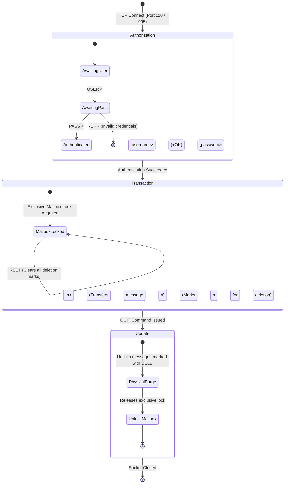

##### Figure 7.16: POP3 Finite-State Machine Transition Model

**What it shows:**
The three distinct operational states of the POP3 protocol engine (Authorization, Transaction, and Update) and the commands permitted within each phase.

**Components:**

* **Authorization State:** The client must prove identity using `USER` and `PASS` commands (or `APOP` MD5 challenge-response). The server acquires an exclusive lock on the user's mailbox file.
* **Transaction State:** The client inspects mailbox status (`STAT`), lists message numbers and sizes (`LIST`), downloads message bodies (`RETR <n>`), and marks unwanted messages for removal (`DELE <n>`).
* **Update State:** Triggered strictly when the client issues `QUIT`. The server permanently unlinks all messages marked with `DELE`, releases the exclusive lock, and terminates the TCP session.

**Flow / Relationship:**

1. Client establishes a TCP connection on port 110 (plaintext) or port 995 (POP3S over TLS). Server issues `+OK POP3 server ready`.
2. Client transmits `USER bob` $\to$ Server returns `+OK`.
3. Client transmits `PASS secret` $\to$ Server acquires exclusive lock and returns `+OK Mailbox open, 3 messages`.
4. Client retrieves messages: `RETR 1`, `RETR 2`, etc.
5. Client flags message 1 for deletion: `DELE 1` $\to$ Server returns `+OK Message 1 marked for deletion`.
6. Client ends session: `QUIT` $\to$ Server enters Update phase, physically purges message 1, releases lock, and closes connection.

**Key observations:**
If a network disconnect occurs or the client crashes *prior* to issuing `QUIT`, the POP3 session terminates abnormally, no messages are deleted, and all marked deletions are rolled back.

##### Download-and-Delete versus Download-and-Keep Semantics
* **Download-and-Delete:** The traditional POP3 mode. Minimizes server disk consumption by shifting all storage responsibility to the local client machine. However, if the client computer suffers a hard drive crash, all email history is permanently lost. Furthermore, accessing mail from multiple devices (e.g., a phone and a laptop) is virtually impossible, as whichever device connects first downloads and purges the inbox.
* **Download-and-Keep:** The client retrieves messages using `RETR` but never sends `DELE`. To prevent downloading identical emails upon every subsequent connection, the client issues `UIDL` (Unique ID Listing), caching unique server-assigned string identifiers locally. However, status changes (e.g., marking a message as read or moving it to a folder) remain purely local to that specific machine; multi-device status synchronization cannot be achieved.

---

#### IMAP4: Internet Message Access Protocol Version 4rev1 (RFC 3501)

To overcome the multi-device limitations of POP3, Mark Crispin developed the **Internet Message Access Protocol**. In IMAP4, the remote mail server acts as the primary authoritative storehouse. Messages and folder structures reside permanently on the server; the client MUA acts as a synchronized cache and viewing window.

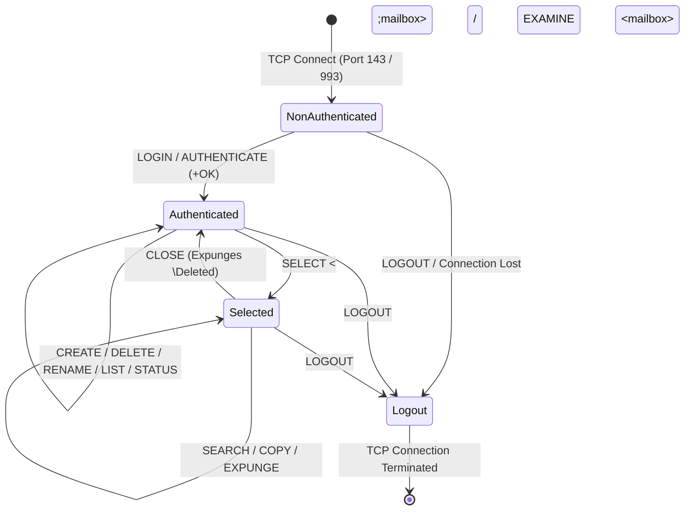

##### Figure 7.17: IMAP4 Protocol State Architecture

**What it shows:**
The four discrete operational states of the IMAP4rev1 protocol engine: Non-Authenticated, Authenticated, Selected, and Logout.

**Components:**

1. **Non-Authenticated State:** The initial state established upon TCP connection. The client must authenticate via `LOGIN` or `AUTHENTICATE` (using SASL mechanisms).
2. **Authenticated State:** The client has proven its identity. It can now execute folder management commands (`CREATE`, `DELETE`, `RENAME`, `LIST`, `LSUB`, `STATUS`) across the server-side directory hierarchy.
3. **Selected State:** The client selects a specific mailbox folder using `SELECT <name>` (read-write) or `EXAMINE <name>` (read-only). Within this state, the client can access message content (`FETCH`), modify status metadata (`STORE`), execute server-side searches (`SEARCH`), and purge deleted messages (`EXPUNGE`).
4. **Logout State:** Initiated by client `LOGOUT` or server timeout. Unsaved state is committed and the socket is closed.

---

#### Core Advanced Features of IMAP4

1. **Server-Side Folder Hierarchies:** Users can create, rename, nest, and delete directories directly on the remote server. Any modification performed on a mobile phone (such as filing an invoice into `Archive/2026/`) is immediately visible to desktop and web clients.
2. **Partial and Subpart Retrieval:** Under POP3, downloading an email requires retrieving the entire payload, even if it contains a 50-megabyte video attachment. IMAP4 enables fine-grained component fetching:
   * An MUA can query `FETCH 1 BODYSTRUCTURE` to inspect the MIME hierarchy without downloading content.
   * An MUA can issue `FETCH 1 BODY[HEADER]` to download only metadata for populating the mailbox list view.
   * An MUA can fetch solely the plain-text part (`FETCH 1 BODY[1]`), downloading binary attachments only when explicitly requested by the user.
3. **Persistent Message Flags:** IMAP4 associates each message with atomic server-side state flags:
   * `\Seen`: Message has been opened and read.
   * `\Answered`: Message has been replied to.
   * `\Flagged`: Message has been marked for urgent attention.
   * `\Deleted`: Message has been marked for future removal (purged upon `EXPUNGE`).
   * `\Draft`: Message authoring is incomplete.
4. **IMAP IDLE Push Mechanism (RFC 2177):** Rather than polling the server periodically (which wastes mobile battery and network bandwidth), the client issues the `IDLE` command. The server holds the TCP connection open and immediately transmits untagged notification responses (e.g., `* 5 EXISTS`) the millisecond new mail is deposited by the local MDA, enabling real-time push email.

---

#### Webmail Architecture

Beginning in the late 1990s with Hotmail and RocketMail, and solidified by Google's launch of Gmail in 2004, **Webmail** has emerged as the dominant email interaction medium for consumer end-users. In Webmail, the client MUA is not a standalone compiled binary, but rather an **Asynchronous JavaScript and XML (AJAX)** single-page web application executing directly inside a standard web browser.

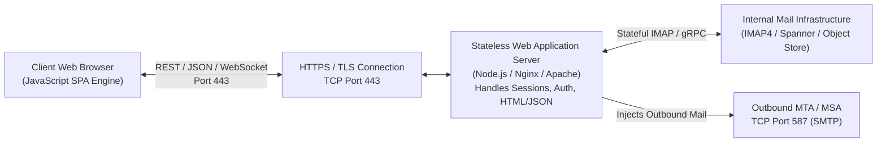

##### Operational Mechanics of Webmail
* **Client Tier:** The user navigates to the provider's URL over **HyperText Transfer Protocol Secure (HTTPS)** on TCP port 443. The web browser authenticates using standard web credentials and cookies (RFC 6265). Dynamic JavaScript applications run locally in the browser to handle user input, render HTML message bodies, manage client-side caching (via IndexedDB), and issue background asynchronous fetch requests.
* **Server Tier:** The front-end web server is completely stateless. It decodes client HTTP requests, validates session tokens, and maps actions to back-end services. To submit mail, the browser posts form data to a REST endpoint; the web server translates this into an RFC 5322 payload and hands it to a local MSA over port 587.
* **Storage Tier:** To access stored messages, the web server acts as an internal client, querying a stateful backend IMAP cluster, an SQL/NoSQL cluster, or a globally distributed object store (such as Google Spanner or Bigtable).

##### Architectural Advantages and Trade-offs of Webmail
* **Advantages:** Ubiquitous accessibility from any browser with zero local software configuration; complete elimination of local storage exhaustion; continuous automated security patching on the server; integration with centralized server-side search indexing and machine-learning spam classification.
* **Trade-offs:** Requires an active, continuous Internet connection for full functionality (offline caching requires specialized Progressive Web App technologies); high server memory and processing overhead required to render dynamic interfaces for hundreds of millions of concurrent sessions; centralized privacy and surveillance exposures associated with third-party cloud hosting.

---

#### Comprehensive Comparative Analysis: SMTP vs. POP3 vs. IMAP4 vs. Webmail

The operational distinctions across the four major email protocols are synthesized in the exhaustive comparison matrix below:

| Architectural Metric | SMTP (RFC 5321) | POP3 (RFC 1939) | IMAP4 (RFC 3501) | Webmail (HTTP/HTTPS) |
| :--- | :--- | :--- | :--- | :--- |
| **Primary Functional Role** | Mail submission and inter-MTA transport relay. | Mail retrieval from server to local client. | Remote mailbox management & synchronization. | Full MUA presentation via web browser interface. |
| **Standard TCP Port** | Port 25 (relay), Port 587 (submission). | Port 110. | Port 143. | Port 80 (HTTP), Port 443 (HTTPS). |
| **Secure TLS Port** | Port 587 (STARTTLS), Port 465 (SMTPS). | Port 995 (POP3S). | Port 993 (IMAPS). | Port 443 (HTTPS). |
| **Communication Direction** | **Push**: Client initiates transmission to server. | **Pull**: Client extracts messages from server. | **Bidirectional Sync**: State shared between peers. | **Request/Response**: Asynchronous REST/WebSocket. |
| **Primary Storage Location** | Spool queues in transit; no permanent user storage.| Local workstation hard drive (client-side). | Authoritative remote mail server. | Cloud datacenter storage clusters. |
| **Statefulness of Protocol**| Stateful during transaction; resets on completion.| Stateful (3-state machine: Auth, Trans, Update). | Highly stateful (4-state machine, context flags). | Stateless HTTP protocol; state tracked via Cookies. |
| **Multi-Device Synchronization**| Not Applicable (infrastructure transport). | Extremely poor; causes state desynchronization. | Native, instantaneous, and bidirectional. | Native, instantaneous, and centralized. |
| **Bandwidth Efficiency** | Efficient for batching; lacks subpart extraction.| Low; forces download of entire message body. | High; supports partial and subpart fetching. | High; renders server-side and streams on-demand. |
| **Server-Side Folder Trees** | Unsupported (unaware of mailbox structures). | Unsupported (monolithic single inbox view). | Fully supported (nested hierarchies, rename). | Fully supported (virtual labels, nested folders). |
| **Real-Time Push Notifications**| Not Applicable. | Unsupported (requires periodic polling). | Native via IMAP `IDLE` extension (RFC 2177). | Native via WebSockets / Server-Sent Events (SSE). |
| **Offline Operation** | Not Applicable. | Full (messages reside permanently on disk). | Partial (requires explicit local client caching). | Restricted (requires PWA / IndexedDB caching). |
| **Implementation Complexity** | Moderate (ASCII command/reply sequence). | Very Low (minimal 12-command state machine). | Extremely High (complex parser, body structures). | High (full web application stack and backend). |

[Source: CN_Application_Layer.pdf, Pages 33–36]

---

## 7.3 The World Wide Web

The World Wide Web (WWW or simply "the Web") is an architectural framework that operates at the Application Layer to enable the distributed access, linking, and manipulation of multimedia hypermedia documents across the global Internet. Conceived in 1989 by Tim Berners-Lee at CERN (European Organization for Nuclear Research), the Web transformed the Internet from a specialized scientific text-and-file exchange utility into a universal, interactive information space.

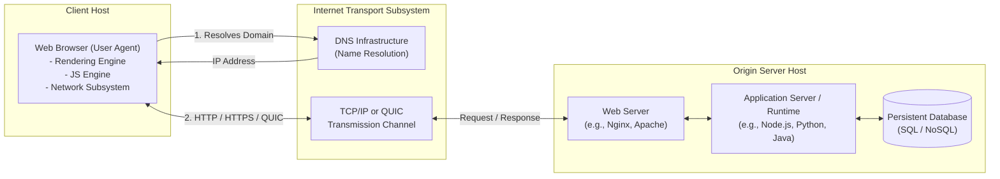

---

### 7.3.1 Architectural Overview of the Web

The fundamental design of the World Wide Web is anchored in a decentralized client-server architecture governed by open, standardized protocols. Clients—referred to in Internet Engineering Task Force (IETF) terminology as **User Agents (UAs)**—issue requests for digital representations of resources, which are stored, generated, and delivered by authoritative origin **Web Servers**.

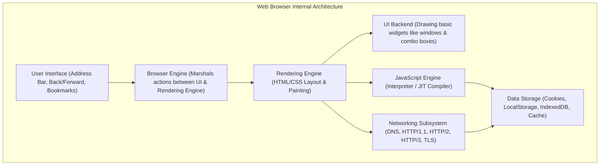

#### 1. Web Browser Subsystems
A modern Web browser is among the most sophisticated distributed client software systems in computer science. Internally, a browser coordinates seven discrete functional subsystems:

- **User Interface (UI)** — Encompasses every visible element outside the primary document display window, including the universal address bar (omnibox), back/forward navigation buttons, bookmarking controls, and developer tooling.
- **Browser Engine** — Acts as the operational marshal across components, orchestrating high-level actions between the user interface and the rendering engine.
- **Rendering Engine** — Parses downloaded HyperText Markup Language (HTML) and Cascading Style Sheets (CSS) documents, constructs the in-memory structural representations, and calculates visual layout geometry for screen output. Prominent engines include **Blink** (Chromium, Google Chrome, Microsoft Edge), **Gecko** (Mozilla Firefox), and **WebKit** (Apple Safari).
- **JavaScript Engine** — Executes client-side application scripts. Modern engines employ multi-tiered Just-In-Time (JIT) compilers that dynamically translate interpreted JavaScript bytecode into native machine instructions during execution. Examples include Google's **V8** (Chrome, Node.js), Mozilla's **SpiderMonkey** (Firefox), and Apple's **JavaScriptCore / Nitro** (Safari).
- **Networking Subsystem** — Implements the full suite of communication protocols. It handles Domain Name System (DNS) resolution, socket establishment, Transport Layer Security (TLS) cryptographic handshakes, and application protocol framing for HTTP/1.1, HTTP/2, and HTTP/3.
- **UI Backend** — Interfaces with the underlying host operating system windowing framework to draw primitive interface widgets, drop-down menus, and scrollbars.
- **Data Persistence Subsystem** — Manages client-side storage mechanisms on the local disk, including browser cache buffers, RFC 6265 HTTP State Cookies, Web Storage (`localStorage`, `sessionStorage`), and the structured `IndexedDB` transactional database.

---

#### 2. Web Server Architectures
Origin Web servers receive incoming HyperText Transfer Protocol (HTTP) requests over transport connections, evaluate request headers, map request uniform paths to disk files or application workers, and stream back formatted response payloads. The architectural design of server software has evolved to maximize concurrency and minimize memory footprint under heavy connection loads.

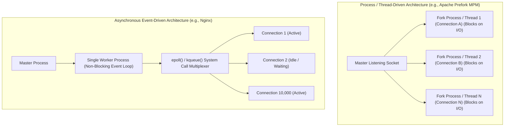

##### Thread-per-Connection vs. Event-Driven Concurrency
Origin servers typically adhere to one of two structural execution paradigms:

- **Thread- or Process-Driven Servers (e.g., Apache HTTP Server with Prefork/Worker MPM)**:
  - Allocates an operating system process or thread to each active client TCP connection.
  - While simple to program, this approach incurs substantial context-switching overhead and memory consumption (typically 1–8 MB per thread stack).
  - Under severe traffic bursts (the classical **C10K Problem**, representing 10,000 concurrent sockets), the operating system thread scheduler degrades due to CPU cache trashing and kernel memory exhaustion.
- **Asynchronous Event-Driven Servers (e.g., Nginx, Node.js runtime)**:
  - Employs a tiny, fixed pool of non-blocking worker threads (typically one worker per physical CPU core).
  - Utilizes scalable kernel I/O event demultiplexing system calls—such as `epoll()` on Linux, `kqueue()` on FreeBSD/macOS, or I/O Completion Ports (IOCP) on Windows.
  - A single worker thread seamlessly monitors tens of thousands of active connections simultaneously. When network data arrives on a socket, the kernel triggers an event, allowing the worker to process the incoming buffer without ever stalling in an idle blocking state.

[Source: Tanenbaum & Wetherall §7.3.1; RFC 3986]

---

#### 3. URI, URL, and URN Taxonomy
Resource identification on the World Wide Web is unified under the formal framework established by RFC 3986. Students must master the precise conceptual distinctions between the three foundational naming identifiers:

```
                          URI (Uniform Resource Identifier)
                          [RFC 3986 Generic Superspace]
                         /                             \
                        /                               \
            URL (Uniform Resource Locator)      URN (Uniform Resource Name)
            "Specifies WHERE and HOW to fetch"  "Specifies WHAT it is persistently"
            e.g., https://example.com/doc.pdf   e.g., urn:isbn:9780132126953
```

##### Definition: Uniform Resource Identifier (URI)
**Meaning:** The comprehensive, abstract taxonomy of all formatted character strings used to identify an abstract or physical resource across the Internet.
**Formal Definition:** An identifier that conforms to the generic syntax defined in RFC 3986, consisting of a sequence of characters structured as a scheme and scheme-specific data components.
**Intuition:** The overarching superset. Every URL and every URN is by definition a URI.
**Example:** `https://www.ietf.org/rfc/rfc3986.txt` and `urn:ietf:rfc:3986` are both valid URIs.

##### Definition: Uniform Resource Locator (URL)
**Meaning:** A specific class of URI that identifies a resource by specifying its primary access mechanism (network protocol) and logical network location.
**Formal Definition:** A URI that provides the explicit means of locating the resource by describing its primary access mechanism (e.g., its network "location" such as `http`, `ftp`, or `mailto`).
**Intuition:** An address that tells a client both *where* a resource lives and *how* to contact it. If the resource is moved to a different domain or server path, the URL breaks (resulting in a `404 Not Found`).
**Example:** `https://cs.stanford.edu:443/people/eroberts/courses/soco/projects/`

##### Definition: Uniform Resource Name (URN)
**Meaning:** A persistent, location-independent identifier that identifies a resource by name in a designated namespace.
**Formal Definition:** A URI that remains globally unique and persistent across time even when the resource ceases to exist or relocates to another network address, operating under the `urn:` scheme prefix (RFC 2141 / RFC 8141).
**Intuition:** Like a human's Social Security Number (SSN) or a book's ISBN: it uniquely identifies the entity forever, regardless of where the entity physically moves.
**Example:** `urn:isbn:0132126958` (identifies Tanenbaum's Computer Networks 5th Edition) or `urn:ietf:rfc:2616`.

---

#### 4. RFC 3986 Generic URI Syntax Decomposition
RFC 3986 establishes the formal Augmented Backus-Naur Form (ABNF) grammar governing the universal construction of all URIs. Every compliant URI can be partitioned into five orthogonal components:

---

#### Formula: RFC 3986 Generic URI Construction

$$
\text{URI} = \text{scheme} \mathbin{:} \mathbf{[}\mathbin{//} \text{authority}\mathbf{]} \, \text{path} \, \mathbf{[}\mathbin{?} \text{query}\mathbf{]} \, \mathbf{[}\mathbin{\#} \text{fragment}\mathbf{]}
$$

Where the **authority** subcomponent is recursively decomposed as:

$$
\text{authority} = \mathbf{[}\text{userinfo} \mathbin{@}\mathbf{]} \, \text{host} \, \mathbf{[}\mathbin{:} \text{port}\mathbf{]}
$$

##### Symbol Definitions

| Component | Syntactic Delimiter | Formal Purpose & Semantic Specification | Example Token |
| :--- | :--- | :--- | :--- |
| **scheme** | Followed by `:` | Defines the protocol specification and naming scheme. Case-insensitive; begins with an alphabetic character. | `https`, `ftp`, `mailto` |
| **userinfo** | Terminated by `@` | Optional authentication credentials (`user:password`). Heavily deprecated in modern Web security due to plaintext exposure. | `admin:secr3t` |
| **host** | Preceded by `//` | Canonical Fully Qualified Domain Name (FQDN) or IP literal (IPv4 dot-decimal or IPv6 enclosed in brackets `[...]`). | `www.example.com`, `[2001:db8::1]` |
| **port** | Preceded by `:` | 16-bit decimal transport port number. If omitted, the default port for the scheme is implicitly assumed (80 for HTTP, 443 for HTTPS). | `:8080`, `:443` |
| **path** | Preceded by `/` | Hierarchical data structured as a sequence of path segments separated by slashes (`/`), locating the resource on the host. | `/dept/faculty/tanenbaum/` |
| **query** | Preceded by `?` | Non-hierarchical query data, conventionally formatted as ampersand-delimited key-value pairs (`key=val&key2=val2`). | `?course=cn&semester=fall26` |
| **fragment**| Preceded by `#` | Sub-resource cross-reference or secondary anchor pointing to an internal element within the primary document. | `#section_7_3` |

##### What It Represents
The formal mechanism by which any digital resource across arbitrary protocol spaces (Web, file transfer, messaging) is uniquely addressed and located.

##### Conditions / Constraints
- The `scheme` and `path` components are mandatory in every absolute URI; `authority`, `query`, and `fragment` are syntactically optional.
- If the authority component is absent, the path cannot begin with two forward slashes (`//`).

---

#### 5. Client-Side Stripping of `#fragment` Identifiers

> **📝 Exam Note:** A fundamental networking examination question asks: *"What part of a URL is never transmitted across the network in an HTTP request line?"* The answer is strictly the **fragment identifier (`#fragment`)**.

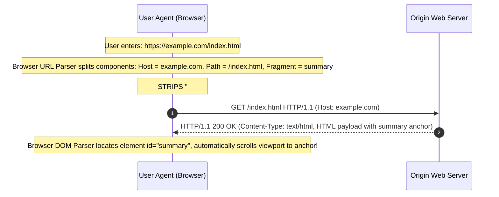

##### Operational Mechanics of Fragment Stripping:
1. When a user clicks a hyperlink such as `https://example.com/manual.html#chapter3`, the browser's internal URL parser isolates `#chapter3`.
2. The browser strips the `#` symbol and the subsequent string `chapter3` prior to constructing the wire-level HTTP request line.
3. The outgoing HTTP request line contains only:
   ```http
   GET /manual.html HTTP/1.1
   Host: example.com
   ```
4. The server receives the request, processes `/manual.html`, and remains entirely unaware of `#chapter3`.
5. Upon receiving the complete HTML document payload, the client-side rendering engine traverses the Document Object Model (DOM) to find an HTML element with matching attribute `id="chapter3"` (or legacy `<a name="chapter3">`). The browser then shifts its viewport scroll offset directly to the matched element coordinates.

---

#### 6. Percent-Encoding Rules (RFC 3986 URL Escaping)
Because URIs must be transmitted safely across arbitrary transport links and historic 7-bit ASCII gateways, RFC 3986 strictly partitions the US-ASCII character set into two functional groups:

1. **Unreserved Characters (Never Encoded)**:
   - Characters that have no special syntactic reservation in the URI grammar:

$$
\Sigma_{\text{unreserved}} = \{\texttt{A-Z}, \; \texttt{a-z}, \; \texttt{0-9}, \; \texttt{-}, \; \texttt{\_}, \; \texttt{.}, \; \texttt{\sim}\}
$$

2. **Reserved Characters (Syntactic Delimiters)**:
   - Characters that possess special structural meaning as delimiters within URI components:

$$
\Sigma_{\text{reserved}} = \{\texttt{:}, \; \texttt{/}, \; \texttt{?}, \; \texttt{\#}, \; \texttt{[}, \; \texttt{]}, \; \texttt{@}, \; \texttt{!}, \; \texttt{\$}, \; \texttt{\&}, \; \texttt{'}, \; \texttt{(}, \; \texttt{)}, \; \texttt{*}, \; \texttt{+}, \; \texttt{,}, \; \texttt{;}, \; \texttt{=}\}
$$

##### The Percent-Encoding Algorithm:
Whenever a reserved character is used for ordinary data rather than its designated syntactic delimiting purpose—or whenever an arbitrary byte outside US-ASCII (such as non-Latin Unicode characters or binary values) is included—it **must** be percent-encoded:

- The byte is converted into its 2-digit uppercase hexadecimal representation: $\text{Hex}(B) \in [00, \text{FF}]$.
- A literal percent symbol (`%`) is prepended to the hexadecimal pair.

---

#### Formula: Percent-Encoding Transformation

$$
\text{PercentEncode}(c) = \texttt{"\%"} \, \mathbin{\Vert} \, \text{Hex}_{16}(\text{ASCII}(c))
$$

##### Worked Micro-Examples:
- **Space Character (` `)**: ASCII code $32_{10} = 20_{16} \implies \mathbf{\%20}$ (or `+` in legacy `application/x-www-form-urlencoded` query strings).
- **Forward Slash (`/`) inside query data**: ASCII code $47_{10} = 2\text{F}_{16} \implies \mathbf{\%2F}$.
- **Ampersand (`&`) inside a parameter value**: ASCII code $38_{10} = 26_{16} \implies \mathbf{\%26}$.
- **Complete URI Example**:
  - Raw query: `https://example.com/search?q=networks & protocols`
  - Encoded on-wire URI: `https://example.com/search?q=networks%20%26%20protocols`

[Source: Tanenbaum & Wetherall §7.3.1; RFC 3986]

---

### 7.3.2 Static Web Pages & Critical Rendering Path (CRP)

A **static Web page** is a fixed hypermedia document stored on the server's filesystem and delivered to the client without dynamic computation or server-side execution. The display of a static Web page is governed by the cooperative interaction of **HTML5** (semantic structure) and **CSS3** (visual presentation), executed inside the browser through the **Critical Rendering Path**.

#### 1. HTML5 Structural Semantics and Document Object Model (DOM)
HTML5 organizes content hierarchically through semantic elements. When a browser ingests an HTML byte stream, it does not display text line-by-line; instead, it parses the markup into an in-memory tree called the **Document Object Model (DOM)**.

- **Bytes $\to$ Characters**: The browser decodes raw wire bytes (e.g., `0x3C`, `0x68`, `0x74`, `0x6D`, `0x6C`) into characters based on the declared character encoding (e.g., `UTF-8`).
- **Characters $\to$ Tokens**: A state-machine tokenizer parses characters into distinct opening tags, closing tags, attribute pairs, and text literals.
- **Tokens $\to$ Nodes**: Tokens are converted into node objects containing properties, attributes, and event listeners.
- **Nodes $\to$ DOM Tree**: The parser links node parent-child relationships, producing a directed tree rooted at `Document`.

```
                      Document
                         |
                       <html>
                      /      \
                 <head>      <body>
                 /    \        |
           <title>   <link>  <main>
                               /  \
                             <h1>  <p>
```

---

#### 2. CSS Styling, Cascade Resolution, and the Box Model
While HTML defines structural semantics, Cascading Style Sheets (CSS) dictate presentation. When styles conflict, the browser resolves precedence using a deterministic cascade order:

1. **Importance**: Styles marked `!important` override normal declarations.
2. **Origin**: Author styles (page developer) override User styles (custom reader stylesheets), which override User-Agent defaults (browser built-in styles).
3. **Specificity**: Calculated as a 3-tuple vector `(a, b, c)`:
   - $a$ = Count of ID selectors (`#header`).
   - $b$ = Count of Class selectors (`.nav`), attribute selectors (`[type="text"]`), and pseudo-classes (`:hover`).
   - $c$ = Count of Type selectors (`div`, `p`) and pseudo-elements (`::after`).
   - Comparison is strictly lexicographic: $(1, 0, 0) > (0, 99, 99)$.
4. **Source Order**: If specificity is identical, the last declaration declared chronologically in the stylesheet wins.

##### The CSS Box Model
Every element in the rendered tree is modeled as a rectangular box whose total physical layout footprint is computed mathematically:

---

#### Formula: Total Rendered Box Dimensions

$$
\text{Total Width} = \text{Width} + 2 \times (\text{Padding} + \text{Border} + \text{Margin})
$$

$$
\text{Total Height} = \text{Height} + 2 \times (\text{Padding} + \text{Border} + \text{Margin})
$$

##### Symbol Definitions

| Symbol | Meaning | Units / Range |
| :--- | :--- | :--- |
| $\text{Width} / \text{Height}$ | Dimensions of inner content box | Pixels ($\text{px}$), rem, %, vw/vh |
| $\text{Padding}$ | Transparent clear space surrounding content | Pixels ($\text{px}$) $\ge 0$ |
| $\text{Border}$ | Visible boundary stroke enclosing padding | Pixels ($\text{px}$) $\ge 0$ |
| $\text{Margin}$ | Transparent clear space isolating adjacent boxes | Pixels ($\text{px}$), can be negative |

---

#### 3. The Critical Rendering Path (CRP) Execution Pipeline
The **Critical Rendering Path (CRP)** is the sequence of algorithmic transformations executed by a browser's rendering engine to convert downloaded HTML, CSS, and JavaScript bytes into actual screen pixels.

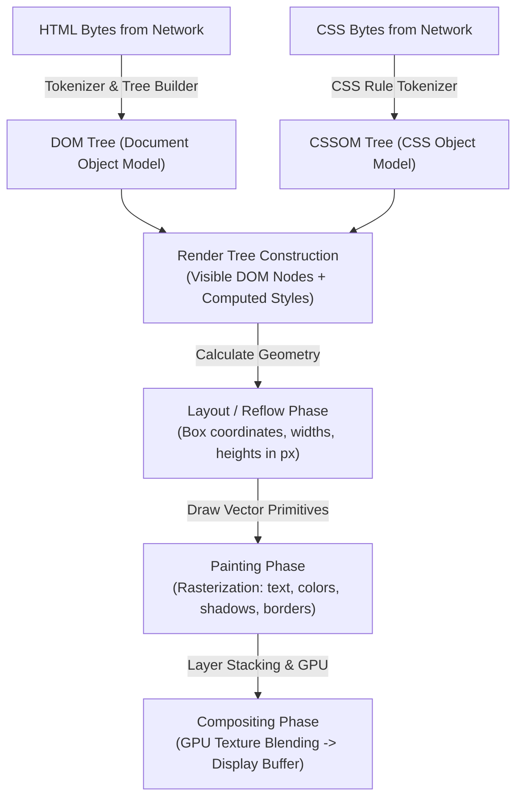

##### Detailed Stage Breakdown:
1. **DOM Tree Construction**:
   - The browser parses the incoming HTML stream. If an external CSS link is encountered (`<link rel="stylesheet">`), a background network request is dispatched immediately. HTML parsing continues concurrently.
   - If a synchronous external script is encountered (`<script src="...">`), HTML parsing **halts entirely** until the script is downloaded, parsed, and executed. This makes synchronous JavaScript a primary **render-blocking resource**.
2. **CSSOM Tree Construction**:
   - The browser downloads and parses all linked and inline CSS rules, constructing the **CSS Object Model (CSSOM)**.
   - The CSSOM is a tree structure where styles cascade downward: child elements inherit inherited properties from parent containers.
   - CSS is strictly **render-blocking**: the browser will not proceed to Render Tree construction until the CSSOM is completely constructed, preventing an unstyled page flash (Flash of Unstyled Content, FOUC).
3. **Render Tree Construction**:
   - The engine traverses the DOM tree from the root and matches each visible element against applicable CSSOM rules.
   - Nodes with CSS property `display: none` (along with non-visual metadata tags like `<head>`, `<meta>`, and `<script>`) are omitted from the Render Tree.
   - Nodes with `visibility: hidden` **are** included in the Render Tree because they occupy physical spatial layout geometry even though they are visually transparent.
4. **Layout (Reflow)**:
   - The browser calculates the exact visual coordinates, width, and height of every Render Tree node relative to the device viewport.
   - Layout is an intensive recursive algorithm: changes to a parent node's width can trigger reflow cascades across all child and sibling subtrees.
5. **Painting (Rasterization)**:
   - The engine converts vector descriptions of box borders, backgrounds, text glyphs, and image bitmaps into discrete 2D pixel grids.
   - Painting is partitioned into multiple drawing layers (e.g., normal flow, scrolling containers, elements with CSS 3D transforms or `z-index`).
6. **Compositing**:
   - Individual paint layers are uploaded as texture maps to the Graphics Processing Unit (GPU).
   - The GPU composites the layers into the final frame buffer displayed on the monitor at 60 or 120 frames per second (fps).

[Source: Tanenbaum & Wetherall §7.3.2; W3C CRP Specifications]

---

### 7.3.3 Dynamic Web Pages, Web Applications, and State Management

While static Web pages serve static document representations, **dynamic Web pages** construct content programmatically at runtime. Dynamic Web generation spans server-side application logic, client-side browser execution, and persistent state management across the inherently stateless HTTP protocol.

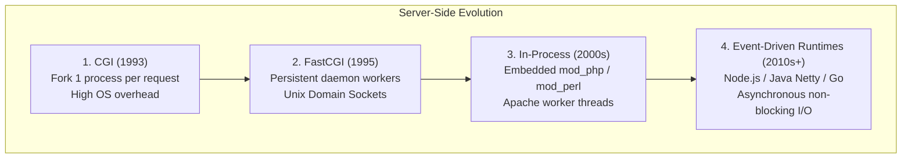

#### 1. Evolution of Server-Side Dynamic Generation
To understand modern dynamic architectures, students must grasp the progression from early process-forking gateways to event-driven microservices:

##### 1. Common Gateway Interface (CGI - 1993)
- **Architecture**: A standardized protocol allowing an HTTP server to forward an incoming client request to an external executable program (written in C, Perl, or Shell scripts).
- **Execution Mechanism**:
  - For *every single* incoming HTTP request, the Web server invokes the operating system system call:

$$
\text{fork}() \longrightarrow \text{exec}()
$$

  - Request metadata and query parameters are injected into the child process through OS environment variables (`REQUEST_METHOD`, `QUERY_STRING`, `CONTENT_LENGTH`, `HTTP_USER_AGENT`).
  - Request body payloads (such as POST forms) are streamed to the child's standard input (`stdin`).
  - The script computes the response and writes raw HTTP headers and HTML payload to standard output (`stdout`), which the Web server relays back to the client.
- **The $O(N)$ Process Fork Bottleneck**:
  - Process creation requires allocating new process control blocks (PCBs), initializing memory page tables, and tearing down resources upon completion.
  - If a server receives $N = 1,000$ simultaneous requests, it must spawn 1,000 separate operating system processes. This leads to thrashing, RAM exhaustion, and server crashes.

##### 2. FastCGI & Persistent Worker Pools (1995)
- **Architecture**: Solves the fork bottleneck by decoupling process creation from request arrival.
- **Mechanism**: The external application initializes a fixed pool of long-lived worker processes. The Web server communicates with these workers over persistent Unix Domain Sockets or local TCP sockets. When a request arrives, the server routes the request data across the existing socket, receives the output, and returns the worker to the idle pool without process creation overhead.

##### 3. In-Process Scripting Modules (Late 1990s – 2000s)
- **Architecture**: Eliminates inter-process communication (IPC) entirely by embedding language interpreters directly into the Web server's process address space (e.g., Apache's `mod_php`, `mod_perl`, Active Server Pages in Microsoft IIS).
- **Drawback**: A memory leak or fatal segmentation fault inside an application script could crash the parent Web server process.

##### 4. Modern Asynchronous Event-Driven Runtimes (2010s – Present)
- **Architecture**: Web applications operate as self-contained standalone HTTP servers (e.g., Node.js utilizing Google's V8 engine, Python ASGI with Uvicorn, Go standard library `net/http`, Java Servlets with non-blocking NIO).
- **Mechanism**: Employs non-blocking, asynchronous I/O driven by an event loop. Database queries and disk access register callbacks or Promises, freeing the execution thread to process subsequent requests concurrently.

---

#### Comparative Analysis: Server-Side Execution Paradigms

| Feature / Metric | Common Gateway Interface (CGI) | FastCGI | In-Process Modules (e.g., `mod_php`) | Modern Event-Driven (Node.js / Go) |
| :--- | :--- | :--- | :--- | :--- |
| **Process Model** | New OS process for every request | Pre-forked persistent worker pool | Server threads run interpreter | Single or multi-threaded event loop |
| **Creation Overhead**| Severe ($O(N)$ process `fork()` calls) | Zero per-request process creation | Zero process creation overhead | Zero process creation overhead |
| **IPC Mechanism** | Standard streams (`stdin` / `stdout`)| Unix Domain Sockets / TCP | Direct in-memory pointer passing | In-process native execution |
| **Memory Footprint**| Extremely high under concurrent load | Moderate (proportional to worker pool)| High (every server thread holds engine)| Extremely lean and predictable |
| **Fault Isolation** | High (crashed script dies safely) | High (worker crash isolated from server)| Low (script crash can kill Web server)| High (unhandled errors caught in loop) |

---

#### 2. Client-Side Scripting, SPAs, and Asynchronous Communication
Rather than burdening the server with rendering complete HTML pages on every user interaction, modern Web engineering shifts visual presentation and state orchestration to client-side JavaScript inside the browser, giving rise to **Single-Page Applications (SPAs)**.

```mermaid
sequenceDiagram
    autonumber
    participant Browser as Browser Client
    participant Server as Origin Web Server / API

    Note over Browser,Server: Traditional Multi-Page Application (Full Reload)
    Browser->>Server: GET /page1.html
    Server-->>Browser: Full HTML Document (Page 1)
    Browser->>Server: Click Link -> GET /page2.html
    Server-->>Browser: Full HTML Document (Page 2) [Screen Blanks & Re-renders]

    Note over Browser,Server: Modern Single-Page Application (AJAX / fetch)
    Browser->>Server: GET /app (Initial Load)
    Server-->>Browser: Shell HTML + Application JS Bundle
    Note over Browser: User clicks "View Comments", JS executes fetch('/api/comments')
    Browser->>Server: GET /api/comments (JSON Payload)
    Server-->>Browser: [{"id": 1, "text": "Great post!"}]
    Note over Browser: JS updates DOM dynamically (Zero page reload, continuous user experience)
```

##### 1. AJAX (`fetch()` vs. `XMLHttpRequest`)
**Asynchronous JavaScript and XML (AJAX)** allows a browser-resident script to issue asynchronous HTTP requests in the background without disturbing the currently rendered page:

- **`XMLHttpRequest` (Legacy)**: Introduced by Microsoft in 1999; relies on nested event callbacks (`onreadystatechange`), often leading to deeply nested, unmaintainable code ("callback hell").
- **`fetch()` API (Modern W3C Standard)**: A clean, Promise-based API integrated with asynchronous control flow (`async`/`await`):
  ```javascript
  // Modern client-side asynchronous data retrieval
  async function fetchResource(url) {
      try {
          const response = await fetch(url, { method: 'GET' });
          if (!response.ok) throw new Error(`HTTP Error: ${response.status}`);
          const data = await response.json();
          updateDOM(data);
      } catch (err) {
          console.error("Network Fetch Failed:", err);
      }
  }
  ```

##### 2. WebSockets (RFC 6455)
HTTP's request-response paradigm is fundamentally **unidirectional**: a server cannot push data to a client unless the client explicitly requests it. To overcome polling inefficiencies, **WebSockets (RFC 6455)** provides an unconstrained, persistent, full-duplex communication channel over a single TCP connection.

```mermaid
sequenceDiagram
    autonumber
    participant Client as Web Browser
    participant Server as Web Server

    Note over Client,Server: Phase 1: HTTP Upgrade Handshake
    Client->>Server: GET /chat HTTP/1.1\nHost: example.com\nUpgrade: websocket\nConnection: Upgrade\nSec-WebSocket-Key: dGhlIHNhbXBsZSBub25jZQ==\nSec-WebSocket-Version: 13

    Server-->>Client: HTTP/1.1 101 Switching Protocols\nUpgrade: websocket\nConnection: Upgrade\nSec-WebSocket-Accept: s3pPLMBiTxaQ9kYGzzhZRbK+xOo=

    Note over Client,Server: Phase 2: Full-Duplex Binary Framing
    Client->>Server: WebSocket Binary/Text Frame (Masked, 2-10 byte header)
    Server-->>Client: WebSocket Binary/Text Frame (Unmasked)
    Server-->>Client: Server Pushes Real-Time Notification
    Client->>Server: Bidirectional Data Stream (Persistent TCP Socket)
```

- **The HTTP Upgrade Handshake**:
  1. The client initiates contact over standard HTTP port 80 or 443 with an upgrade request containing a cryptographic challenge:
     ```http
     GET /chat HTTP/1.1
     Host: example.com
     Upgrade: websocket
     Connection: Upgrade
     Sec-WebSocket-Key: dGhlIHNhbXBsZSBub25jZQ==
     Sec-WebSocket-Version: 13
     ```
  2. The server acknowledges the protocol migration by returning status `101 Switching Protocols`:
     ```http
     HTTP/1.1 101 Switching Protocols
     Upgrade: websocket
     Connection: Upgrade
     Sec-WebSocket-Accept: s3pPLMBiTxaQ9kYGzzhZRbK+xOo=
     ```
  3. The server computes `Sec-WebSocket-Accept` by concatenating `Sec-WebSocket-Key` with the globally fixed UUID string `258EAFA5-E914-47DA-95CA-C5AB0DC85B11`, computing its SHA-1 hash, and encoding the result in Base64. This handshake confirms the server understands the WebSocket protocol and prevents caching proxies from mistakenly returning cached HTTP responses.
- **Data Framing Layer**:
  - Once upgraded, the HTTP parser is disabled. Both endpoints communicate using lightweight binary frames with minimal header overhead (as low as 2 bytes per frame, compared to hundreds of bytes of HTTP header metadata).
  - Client-to-server frames are masked with a 4-byte XOR key to prevent intermediate caching proxies from being poisoned by predictable payloads.

---

#### 3. State Management in a Stateless Protocol
HTTP is strictly **stateless**: every request-response transaction is evaluated independently, with no protocol-level memory of prior requests. To support stateful workflows (e.g., e-commerce shopping carts, authenticated sessions), state must be tracked at the application layer.

```mermaid
sequenceDiagram
    autonumber
    participant Browser as Client Browser
    participant Server as Origin Server
    participant DB as Session Store / DB

    Note over Browser,Server: 1. Authentication Transaction
    Browser->>Server: POST /login (Credentials: user & pass)
    Server->>DB: Validates credentials, generates Session ID
    DB-->>Server: Session ID = "SESS_9876543210"
    Server-->>Browser: HTTP/1.1 200 OK\nSet-Cookie: sid=SESS_9876543210, Path=/, Secure, HttpOnly, SameSite=Strict
    Note over Browser: Stores cookie securely in cookie jar

    Note over Browser,Server: 2. Subsequent Authenticated Request
    Browser->>Server: GET /account/balance\nCookie: sid=SESS_9876543210
    Server->>DB: Lookup "SESS_9876543210" -> Returns User Profile
    DB-->>Server: Authorized (User Alice)
    Server-->>Browser: HTTP/1.1 200 OK (Account Details)
```

##### RFC 6265 HTTP State Management: Cookies
A **Cookie** is a compact token (up to 4 KB) issued by a server via the `Set-Cookie` response header and automatically attached by the browser to subsequent matching requests via the `Cookie` request header.

```http
Set-Cookie: sid=a8f92b7c; Domain=example.com; Path=/app; Max-Age=3600; Secure; HttpOnly; SameSite=Strict
```

##### Cookie Security Attributes & Mitigation Framework:

| Attribute | Syntactic Specification | Concrete Security Purpose & Attack Mitigation |
| :--- | :--- | :--- |
| **`Domain`** | `Domain=example.com` | Restricts cookie delivery to designated domain and its subdomains. Defaults to origin host if omitted. |
| **`Path`** | `Path=/secure` | Restricts cookie transmission to matching URI path prefixes. |
| **`Expires` / `Max-Age`**| `Max-Age=3600` | Defines cookie lifetime. `Max-Age` specifies relative seconds until eviction; `Expires` specifies an absolute GMT timestamp. If absent, cookie is a **Session Cookie** evicted upon browser closure. |
| **`Secure`** | Flag (no value) | Directs the browser to transmit the cookie exclusively over encrypted TLS connections (HTTPS). Prevents eavesdropping over plaintext channels. |
| **`HttpOnly`** | Flag (no value) | Blocks client-side scripts from reading `document.cookie`. Crucial mitigation against **Cross-Site Scripting (XSS)** session hijacking attacks. |
| **`SameSite`** | Overview | Controls cross-site request inclusion to defend against **Cross-Site Request Forgery (CSRF)**. |
| **`SameSite=Strict`** | `Strict` | Cookie is never attached in cross-site contexts (even when following inbound links). |
| **`SameSite=Lax`** | `Lax` | Default in modern browsers. Cookie withheld on cross-site sub-resource requests (``, `<iframe>`), but attached when navigating top-level GET links. |
| **`SameSite=None`** | `None` | Cookie sent across all third-party contexts. Requires the `Secure` flag. |

---

#### Comparative Analysis: Client-Side Storage Mechanisms

| Storage System | Storage Capacity | Transmission Behavior | Lifecycle / Persistence | Access Scope | Primary Use Cases |
| :--- | :--- | :--- | :--- | :--- | :--- |
| **RFC 6265 Cookies** | 4 KB per cookie | Transmitted automatically in matching HTTP request headers | Configured via `Max-Age` / `Expires`; defaults to session | Origin & Path | Session tokens, auth identifiers, tracking |
| **Web Storage (`localStorage`)** | $\approx 5\text{--}10\text{ MB}$ | Never sent over the network wire; purely client-side | Persistent until explicitly purged by user or JavaScript | Origin (Protocol + Host + Port)| Offline user preferences, cached UI states |
| **Web Storage (`sessionStorage`)**| $\approx 5\text{--}10\text{ MB}$ | Never sent over the network wire | Scoped to individual browser tab lifetime; dies on tab close | Browser Tab + Origin | Single-transaction wizard data, form drafts |
| **IndexedDB** | $\ge 250\text{ MB}$ (quota-based) | Never sent over the network wire | Persistent transactional NoSQL database | Origin | Complex offline application datasets, PWA data |

[Source: Tanenbaum & Wetherall §7.3.3; RFC 6265, RFC 6455]

---

### 7.3.4 HTTP — The HyperText Transfer Protocol

The **HyperText Transfer Protocol (HTTP)** is the foundational request-response application protocol of the World Wide Web. Its evolution reflects continuous optimization to lower latency, improve throughput, and overcome transport-layer bottlenecks.

```mermaid
flowchart LR
    H10["HTTP/1.0 (1996)\nRFC 1945\n- Non-persistent\n- 1 TCP per object"] --> H11["HTTP/1.1 (1999)\nRFC 2616 / 7230\n- Persistent Keep-Alive\n- Pipelining (HOL)\n- Chunked Encoding"]
    H11 --> H2["HTTP/2 (2015)\nRFC 7540\n- Binary Framing\n- Multiplexing\n- HPACK Compression"]
    H2 --> H3["HTTP/3 (2022)\nRFC 9114\n- QUIC over UDP\n- Independent Streams\n- Zero HOL Blocking"]
```

---

#### 1. Comprehensive Protocol Architectural Evolution

##### 1. HTTP/1.0 (RFC 1945 - 1996): Non-Persistent Connections
- **Design**: Operates on a non-persistent connection model by default.
- **Mechanics**: Every single Web resource requires establishing a new TCP connection:

$$
\text{TCP Handshake (1 RTT)} \longrightarrow \text{HTTP Request/Response (1 RTT)} \longrightarrow \text{TCP Teardown}
$$

- **Performance Deficiencies**:
  - Establishing a Web page with 1 base HTML file and $N = 20$ embedded images requires 21 independent TCP connections.
  - Incurs 21 round-trip times (RTTs) of handshake latency overhead.
  - Keeps TCP connections in the **Slow Start** congestion control phase, preventing transmissions from utilizing available channel bandwidth.
  - Leaves thousands of sockets lingering in the kernel `TIME_WAIT` state on the server.

##### 2. HTTP/1.1 (RFC 2616 / RFC 7230 - 1999): Persistent Connections & Pipelining
- **Persistent Connections**: Enabled by default via `Connection: keep-alive`. A single TCP socket remains open across multiple sequential request-response cycles, amortizing the 3-way handshake cost.
- **Pipelining**: A client can issue multiple requests without waiting for intermediate responses. However, HTTP/1.1 requires the server to send responses in the **exact order requests were received**. If processing request 1 stalls (e.g., an expensive database query), responses 2, 3, and 4 are blocked behind it. This is known as **Application-Layer Head-of-Line (HOL) Blocking**.
- **Chunked Transfer Encoding**: Enabled via `Transfer-Encoding: chunked`, allowing servers to stream dynamically generated content of unknown length using hexadecimal size delimiters, without having to buffer the complete payload to compute a `Content-Length` header.
- **Virtual Hosting (`Host` Header)**: Mandates the inclusion of the `Host:` request header, allowing a single IP address to host thousands of distinct Web domains.

##### 3. HTTP/2 (RFC 7540 - 2015): Binary Framing & Single-Connection Multiplexing
- **Binary Framing Layer**: Replaces ASCII text formatting with a structured binary framing layer. An HTTP/2 connection consists of multiple logical **Streams** carried over a single shared TCP socket.
- **Frame Types**: Data is transported in typed frames, including `HEADERS` (metadata), `DATA` (payload), `SETTINGS` (flow configuration), `RST_STREAM` (stream abortion), and `PRIORITY` (stream weighting).
- **Multiplexing**: Requests and responses are broken into frames stamped with a unique 31-bit Stream Identifier. Frames from multiple streams are interleaved concurrently across the single TCP pipe, resolving Application-Layer HOL blocking.
- **HPACK Header Compression (RFC 7541)**: Compresses repeated headers using a 61-entry Static Table, a sliding Dynamic Table, and Huffman coding, shrinking multi-kilobyte header blocks down to dozens of bytes.
- **Server Push**: Allows a server to push associated resources (e.g., CSS, JavaScript) to the client using a `PUSH_PROMISE` frame before the client explicitly requests them.
- **The TCP Head-of-Line Blocking Vulnerability**: Because HTTP/2 runs over a single TCP connection, if an intermediate router drops a single IP packet, TCP's sliding window stalls **all** multiplexed streams until the missing segment is retransmitted. Thus, on lossy cellular networks, HTTP/2 can perform *worse* than HTTP/1.1.

##### 4. HTTP/3 (RFC 9114 - 2022): QUIC Transport over UDP
- **QUIC Foundation (RFC 9000)**: Replaces the entire TCP transport layer with **QUIC (Quick UDP Internet Connections)**, operating over user-space UDP datagrams on port 443.
- **Zero Transport-Layer HOL Blocking**: In QUIC, independent streams are managed natively by the transport protocol. If a UDP packet carrying data for Stream 3 is lost, only Stream 3 stalls; Streams 1, 2, 4, and 5 continue delivery to the application layer unimpeded.
- **Integrated Crypto Handshake (0-RTT & 1-RTT)**: QUIC merges the transport connection handshake with the TLS 1.3 cryptographic key exchange. First-time connections complete in 1 RTT; resumed connections can transmit application data in the very first packet flight (**0-RTT** latency).
- **Connection Migration**: QUIC replaces the rigid 4-tuple `(SrcIP, SrcPort, DstIP, DstPort)` identifier with a random 64-bit **Connection ID (CID)**. When a smartphone transitions from Wi-Fi to cellular data, its IP changes, but the CID remains constant, allowing active downloads to continue without dropping connections.
- **QPACK Compression**: Adapts HPACK to tolerate out-of-order stream delivery over UDP, preventing head-of-line stalls during header decompression.

---

#### Exhaustive Architectural Comparison Matrix: HTTP Evolution

| Architectural Dimension | HTTP/1.0 (RFC 1945) | HTTP/1.1 (RFC 7230) | HTTP/2 (RFC 7540) | HTTP/3 (RFC 9114) |
| :--- | :--- | :--- | :--- | :--- |
| **Transport Layer** | TCP (Standard Port 80) | TCP (Port 80 / 443) | TCP + TLS 1.2/1.3 (ALPN `h2`) | QUIC over UDP (Port 443) |
| **Connection Paradigm** | Non-persistent (1 TCP/object)| Persistent (`keep-alive`) | Single multiplexed TCP pipe | Multiple multiplexed QUIC streams |
| **Wire Protocol Framing**| Plaintext ASCII | Plaintext ASCII | Binary Framing Layer | Binary Framing over QUIC Frames |
| **Multiplexing Capacity**| None (Strictly sequential) | Pipelining (Order-locked) | Fully interleaved frame streams | Fully independent native streams |
| **HOL Blocking Location**| Transport & Application | Application Layer HOL | Transport Layer (TCP packet drop)| **Eliminated (Zero HOL Blocking)**|
| **Header Compression** | None (Redundant headers) | None | HPACK (Static/Dynamic tables) | QPACK (Out-of-order resilient) |
| **Server Push Support** | Unsupported | Unsupported | Supported (`PUSH_PROMISE`) | Supported natively |
| **Handshake Latency** | 2 RTT (1 TCP + 1 HTTP) | 2 RTT initial; 1 RTT next | 2–3 RTT initial; 0 RTT sub-streams| **1 RTT initial; 0-RTT resumed** |
| **Connection Migration**| Fails on IP change | Fails on IP change | Fails on IP change | **Seamless via 64-bit CID** |

---

#### 2. HTTP Request Methods Taxonomy

HTTP defines a set of request methods that specify the desired action to be performed on a target resource. Methods are categorized by two fundamental mathematical properties:

- **Safety**: A method is **Safe** if invoking it produces no side-effects or state mutations on the origin server. Formally, let $s \in S$ be the server state:

$$
\text{Safe}: \quad f(s) = s
$$

- **Idempotence**: A method is **Idempotent** if the side-effects of executing $N$ identical requests are identical to executing a single request ($N \ge 1$):

$$
\text{Idempotent}: \quad f(f(s)) = f(s)
$$

| Method | Request Body | Response Body | Safe? | Idempotent? | Cacheable? | RFC 9110 Primary Semantic Meaning |
| :--- | :---: | :---: | :---: | :---: | :---: | :--- |
| **GET** | No | Yes | **Yes** | **Yes** | **Yes** | Retrieve resource representation identified by Request-URI. |
| **HEAD** | No | No | **Yes** | **Yes** | **Yes** | Identical to GET, but server returns only response headers. |
| **POST** | Yes | Yes | No | No | Conditional | Submit processing data; creates subordinates or appends state. |
| **PUT** | Yes | Optional | No | **Yes** | No | Replace resource representation at target URI completely. |
| **DELETE** | Optional | Optional | No | **Yes** | No | Demolish/unlink resource identified by target URI. |
| **OPTIONS**| Optional | Yes | **Yes** | **Yes** | No | Query supported communication options / CORS pre-flight. |
| **TRACE** | No | Request echo | **Yes** | **Yes** | No | Diagnostic loopback test along request chain (RFC security risk).|
| **CONNECT**| Yes | Tunnel stream | No | No | No | Establish bidirectional TCP tunnel (used for HTTPS proxies). |
| **PATCH** | Yes | Yes | No | No | Conditional | Apply granular, partial modifications to a resource. |

---

#### 3. HTTP Response Status Codes Reference

The first line of an HTTP response message is the **Status Line**, containing a 3-digit numeric status code and a human-readable reason phrase:

```http
HTTP/1.1 200 OK
```

The leading digit defines the functional class of the response:

##### 1xx Informational (Request received, continuing process)
- `100 Continue` — Server has received request headers; client may proceed to transmit request body.
- `101 Switching Protocols` — Server agrees to upgrade protocol (e.g., migrating from HTTP/1.1 to RFC 6455 WebSocket).

##### 2xx Success (Action successfully received, understood, and accepted)
- `200 OK` — Standard successful response.
- `201 Created` — Request fulfilled; a new resource was created at URI indicated in `Location:` header.
- `202 Accepted` — Request accepted for asynchronous processing, but processing is incomplete.
- `204 No Content` — Request executed successfully; response body is intentionally empty.
- `206 Partial Content` — Server fulfilled partial GET request specified by client's `Range:` header.

##### 3xx Redirection (Further action required to complete request)
- `301 Moved Permanently` — Target resource permanently assigned new URI. Search engines reassign link equity; browsers update bookmarks.
- `302 Found` (Historically "Moved Temporarily") — Target resides temporarily at different URI. Historically, clients incorrectly morphed POST methods into GET.
- `304 Not Modified` — Conditional revalidation token confirmed cached representation is fresh; body payload omitted.
- `307 Temporary Redirect` — Resource resides temporarily at different URI. **Guarantees** HTTP method cannot be mutated during redirect.
- `308 Permanent Redirect` — Resource permanently relocated. **Guarantees** HTTP method cannot be mutated during redirect.

##### 4xx Client Error (Request contains bad syntax or cannot be fulfilled)
- `400 Bad Request` — Server cannot parse request due to malformed syntax.
- `401 Unauthorized` — Authentication credentials missing or invalid; response includes `WWW-Authenticate:` challenge.
- `403 Forbidden` — Server understands client identity, but access control policy refuses authorization.
- `404 Not Found` — Origin server cannot find resource matching Request-URI.
- `405 Method Not Allowed` — HTTP method in request is disabled for target URI; response includes `Allow:` header.
- `408 Request Timeout` — Client failed to send complete request within server timeout window.
- `409 Conflict` — Request conflicts with current resource state (e.g., concurrent editing conflicts).
- `429 Too Many Requests` — Client exceeded rate-limiting thresholds; often includes `Retry-After:` header.

##### 5xx Server Error (Server failed to fulfill an apparently valid request)
- `500 Internal Server Error` — Unhandled exception or unexpected server failure.
- `501 Not Implemented` — Server does not support functionality required to fulfill request.
- `502 Bad Gateway` — Server acting as gateway/proxy received an invalid response from upstream origin server.
- `503 Service Unavailable` — Server temporarily overloaded or undergoing maintenance.
- `504 Gateway Timeout` — Gateway/proxy did not receive timely response from upstream server.
- `505 HTTP Version Not Supported` — Server does not support major HTTP protocol version used in request.

---

#### 4. Web Caching & Conditional Revalidation
Caching reduces network bandwidth consumption, lowers origin server load, and decreases perceived page load latency. Web caches operate at multiple points along the network path: client browser caches, enterprise forward proxies, Internet Service Provider (ISP) caches, and Content Delivery Networks (CDNs).

```mermaid
sequenceDiagram
    autonumber
    participant Client as User Agent (Browser Cache)
    participant Origin as Origin Web Server

    Note over Client,Origin: Initial Cold Request
    Client->>Origin: GET /logo.png HTTP/1.1 (Host: example.com)
    Origin-->>Client: HTTP/1.1 200 OK (Cache-Control: max-age=86400, public; ETag: "v104-a78b", 512 KB Data)
    Note over Client: Saves 512 KB to disk cache (Freshness Lifetime = 86400s / 24 hours)

    Note over Client,Origin: Subsequent Request (After Max-Age Expires)
    Note over Client: Cache entry is Stale! Must revalidate.
    Client->>Origin: GET /logo.png HTTP/1.1 (If-None-Match: "v104-a78b")

    alt Content Unchanged at Server
        Origin-->>Client: HTTP/1.1 304 Not Modified (Cache-Control: max-age=86400, ETag: "v104-a78b", NO BODY)
        Note over Client: Updates cache freshness for 24h: Saved 512 KB bandwidth!
    else Content Modified at Server
        Origin-->>Client: HTTP/1.1 200 OK (ETag: "v105-c99e", Updated Image Data)
        Note over Client: Overwrites cache with new image.
    end
```

##### Cache-Control Header Directives (RFC 7234 / RFC 9111):
- `public` — Response may be cached by any intermediate node (browser, proxy, CDN).
- `private` — Response contains user-specific data and may be stored only by client browser caches.
- `no-cache` — The cache may store the response, but **must revalidate** with the origin server before serving it.
- `no-store` — Strictly prohibits storing any part of the request or response in non-volatile memory (used for financial/sensitive data).
- `max-age=<seconds>` — Specifies maximum lifespan in seconds during which representation is fresh.
- `must-revalidate` — Once stale, the cache must not serve the cached copy without successful server revalidation.

##### Conditional Validation Tokens:
When a cached object's `max-age` expires, the cache revalidates freshness using conditional validation headers:

1. **Weak / Time-Based Validator (`Last-Modified` / `If-Modified-Since`)**:
   - Server provides timestamp: `Last-Modified: Sun, 01 Nov 2026 12:00:00 GMT`.
   - On revalidation, client transmits: `If-Modified-Since: Sun, 01 Nov 2026 12:00:00 GMT`.
   - Limitation: 1-second resolution; clocks on distributed origin servers can drift.
2. **Strong / Hash-Based Validator (`ETag` / `If-None-Match`)**:
   - Server provides an opaque entity tag (cryptographic hash or version string): `ETag: "686897696a7c"`.
   - On revalidation, client transmits: `If-None-Match: "686897696a7c"`.
   - Provides sub-second precision and avoids clock skew issues.
- **The `304 Not Modified` Response**:
  - If the validator matches, the server returns status `304 Not Modified` with headers updating freshness parameters, omitting the response body entirely.

[Source: Tanenbaum & Wetherall §7.3.4; RFC 7234, RFC 9111]

---

#### 5. Mathematical Latency Formulations Across HTTP Architectures

To analyze page load performance across protocol generations, network engineers model the total elapsed time $T$ required to fetch a composite Web document consisting of 1 base HTML page plus $N$ embedded objects (images, stylesheets, scripts).

##### Mathematical Parameter Definitions:
- $RTT$ = Round Trip Time between client and server (seconds or milliseconds).
- $N$ = Number of embedded objects referenced within the base document.
- $P$ = Number of concurrent parallel TCP connections opened by the client browser.
- $T_{\text{trans}, 0}$ = Transmission time of the base HTML document ($T_{\text{trans}} = \text{Object Size} / \text{Bandwidth}$).
- $T_{\text{trans}, i}$ = Transmission time of the $i$-th embedded object ($i \in \{1, 2, \dots, N\}$).

---

#### Formula: 1. Non-Persistent HTTP/1.0 (Strictly Sequential)

$$
T_{\text{non-persistent, seq}} = 2(N + 1) \cdot RTT + \sum_{i=0}^{N} T_{\text{trans}, i}
$$

##### Symbol Definitions

| Symbol | Meaning | Units |
| :--- | :--- | :--- |
| $T_{\text{non-persistent, seq}}$ | Total page retrieval latency under sequential HTTP/1.0 | Seconds ($\text{s}$) or $\text{ms}$ |
| $N$ | Count of embedded objects within base HTML | Dimensionless integer |
| $RTT$ | Network Round Trip Time | Milliseconds ($\text{ms}$) |
| $T_{\text{trans}, i}$ | Transmission delay of object $i$ | Milliseconds ($\text{ms}$) |

##### What It Represents
Each object (base HTML plus $N$ embedded elements) requires an independent TCP 3-way handshake (1 RTT) followed by an HTTP request/response exchange (1 RTT), yielding $2 \cdot RTT$ per object across $N+1$ objects.

---

#### Formula: 2. Non-Persistent HTTP/1.0 with $P$ Parallel TCP Connections

$$
T_{\text{non-persistent, par}} = \underbrace{2 \cdot RTT + T_{\text{trans}, 0}}_{\text{Base HTML Document}} + \left\lceil \frac{N}{P} \right\rceil \cdot \left( 2 \cdot RTT + \max_{j \in \text{batch}} T_{\text{trans}, j} \right)
$$

##### Symbol Definitions

| Symbol | Meaning | Units |
| :--- | :--- | :--- |
| $P$ | Number of concurrent parallel TCP sockets opened by browser | Positive integer ($P \ge 1$) |
| $\lceil N/P \rceil$ | Number of sequential parallel batches required | Dimensionless integer |

##### What It Represents
The base page is fetched first to discover embedded references. The $N$ objects are then fetched concurrently across $\lceil N/P \rceil$ batches using $P$ parallel TCP connections.

---

#### Formula: 3. Persistent HTTP/1.1 without Pipelining

$$
T_{\text{persistent, no-pipe}} = (N + 2) \cdot RTT + \sum_{i=0}^{N} T_{\text{trans}, i}
$$

##### Symbol Definitions

| Symbol | Meaning | Units |
| :--- | :--- | :--- |
| $T_{\text{persistent, no-pipe}}$| Latency for sequential retrieval over one persistent TCP socket | Milliseconds ($\text{ms}$) |

##### What It Represents
Initial TCP handshake takes 1 RTT. The base HTML page takes 1 RTT. The single TCP connection remains open (`keep-alive`), so each of the $N$ embedded objects requires 1 RTT sequentially: $1 RTT + 1 RTT + N \cdot RTT = (N + 2) RTT$.

---

#### Formula: 4. Persistent HTTP/1.1 with Pipelining / HTTP/2 Multiplexing

$$
T_{\text{pipelined / HTTP2}} = 3 \cdot RTT + \sum_{i=0}^{N} T_{\text{trans}, i}
$$

##### Symbol Definitions

| Symbol | Meaning | Units |
| :--- | :--- | :--- |
| $T_{\text{pipelined / HTTP2}}$ | Latency when all requests are issued concurrently in one pipeline flight | Milliseconds ($\text{ms}$) |

##### What It Represents
Initial TCP handshake takes 1 RTT. Base page request/response takes 1 RTT. Once parsed, all $N$ object requests are dispatched immediately in a single flight, completing in 1 RTT: $1 RTT + 1 RTT + 1 RTT = 3 \cdot RTT$.

---

#### Formula: 5. HTTP/3 over QUIC with 0-RTT Session Resumption

$$
T_{\text{HTTP/3, 0-RTT}} = 1 \cdot RTT + \sum_{i=0}^{N} T_{\text{trans}, i}
$$

##### Symbol Definitions

| Symbol | Meaning | Units |
| :--- | :--- | :--- |
| $T_{\text{HTTP/3, 0-RTT}}$ | Latency when resuming an existing cryptographic QUIC session | Milliseconds ($\text{ms}$) |

##### What It Represents
QUIC merges transport and TLS 1.3 handshakes. On resumed sessions (0-RTT), client request data is sent in the very first flight of UDP packets, requiring only 1 RTT for data retrieval.

---

#### Worked Numerical Example: Page Load Latency Across 5 Web Architectures

##### Problem Statement:
A user navigates to a Web page consisting of **1 base HTML document** and **$N = 10$ embedded images**. The measured Round Trip Time ($RTT$) between client and server is $50\text{ ms}$. Assume the browser can open at most $P = 4$ parallel connections in parallel mode.

1. **Part A (Zero Transmission Delay Assumption)**: Calculate the total page retrieval latency assuming transmission delays are negligible ($T_{\text{trans}} \approx 0$).
2. **Part B (Realistic Transmission Delay)**: Calculate the total page retrieval latency if the base HTML page has a transmission delay of $T_{\text{trans}, 0} = 15\text{ ms}$ and each embedded image has an identical transmission delay of $T_{\text{trans}, i} = 10\text{ ms}$.

##### Part A: Solution (Negligible Transmission Delay, $T_{\text{trans}} = 0$)

1. **Non-Persistent Sequential HTTP/1.0**:

$$
T = 2(N + 1) \cdot RTT = 2(10 + 1) \times 50\text{ ms} = 22 \times 50\text{ ms} = \mathbf{1100\text{ ms}}
$$

2. **Non-Persistent Parallel HTTP/1.0 ($P = 4$)**:

$$
\text{Batches} = \left\lceil \frac{N}{P} \right\rceil = \left\lceil \frac{10}{4} \right\rceil = 3 \text{ batches}
$$

$$
T = 2 \cdot RTT + 3 \times (2 \cdot RTT) = 2(50) + 3 \times 100 = 100 + 300 = \mathbf{400\text{ ms}}
$$

3. **Persistent Non-Pipelined HTTP/1.1**:

$$
T = (N + 2) \cdot RTT = (10 + 2) \times 50\text{ ms} = 12 \times 50\text{ ms} = \mathbf{600\text{ ms}}
$$

4. **Persistent Pipelined HTTP/1.1 / HTTP/2 Multiplexed**:

$$
T = 3 \cdot RTT = 3 \times 50\text{ ms} = \mathbf{150\text{ ms}}
$$

5. **HTTP/3 (QUIC 0-RTT Connection Resumption)**:

$$
T = 1 \cdot RTT = 1 \times 50\text{ ms} = \mathbf{50\text{ ms}}
$$

##### Part B: Solution (With Transmission Delays Included)
- Total transmission time across all objects:

$$
\sum T_{\text{trans}} = T_{\text{trans}, 0} + 10 \times T_{\text{trans}, i} = 15\text{ ms} + 10(10\text{ ms}) = 115\text{ ms}
$$

1. **Non-Persistent Sequential HTTP/1.0**:

$$
T = 1100\text{ ms} + 115\text{ ms} = \mathbf{1215\text{ ms}}
$$

2. **Non-Persistent Parallel HTTP/1.0 ($P = 4$)**:
   - In each parallel batch of $P = 4$ objects, objects are transmitted concurrently over 4 sockets. Assuming sufficient link capacity:

$$
\max_{j \in \text{batch}} T_{\text{trans}, j} = 10\text{ ms}
$$

   - Base page takes: $2 \times 50 + 15 = 115\text{ ms}$.
   - 3 batches take: $3 \times (2 \times 50 + 10) = 3 \times 110 = 330\text{ ms}$.
   - Total latency: $115 + 330 = \mathbf{445\text{ ms}}$.
3. **Persistent Non-Pipelined HTTP/1.1**:

$$
T = 600\text{ ms} + 115\text{ ms} = \mathbf{715\text{ ms}}
$$

4. **HTTP/2 Multiplexed**:
   - Over a single connection, the total transmission time is $115\text{ ms}$:

$$
T = 150\text{ ms} + 115\text{ ms} = \mathbf{265\text{ ms}}
$$

5. **HTTP/3 (0-RTT Resumption)**:

$$
T = 50\text{ ms} + 115\text{ ms} = \mathbf{165\text{ ms}}
$$

##### Latency Comparison Summary Table:

| Architecture | Formula ($T_{\text{trans}} = 0$) | Computed Delay ($T_{\text{trans}}=0$) | Computed Delay (with $T_{\text{trans}}$) | % Latency Reduction vs HTTP/1.0 |
| :--- | :--- | :--- | :--- | :--- |
| **HTTP/1.0 (Sequential)** | $2(N+1) RTT$ | $1100\text{ ms}$ | $1215\text{ ms}$ | Baseline ($0\%$) |
| **HTTP/1.0 ($P=4$ Parallel)** | $2 RTT + \lceil N/P \rceil (2 RTT)$ | $400\text{ ms}$ | $445\text{ ms}$ | $63.6\%$ reduction |
| **HTTP/1.1 (Persistent No-Pipe)** | $(N+2) RTT$ | $600\text{ ms}$ | $715\text{ ms}$ | $45.5\%$ reduction |
| **HTTP/2 (Multiplexed)** | $3 RTT$ | $150\text{ ms}$ | $265\text{ ms}$ | $86.4\%$ reduction |
| **HTTP/3 (0-RTT Resumption)** | $1 RTT$ | $\mathbf{50\text{ ms}}$ | $\mathbf{165\text{ ms}}$ | **$95.5\%$ reduction** |

[Source: Tanenbaum & Wetherall §7.3.4; RFC 7540, RFC 9114]

---

### 7.3.5 The Mobile Web

Deploying the World Wide Web onto mobile cellular handheld devices introduced technical challenges absent in fixed broadband desktop environments. Solving these challenges required abandoning proprietary mobile protocol gateways in favor of modern, unified responsive web standards.

#### 1. Mobile Physical & Environmental Constraints
- **High Latency Jitter & Packet Loss**: Cellular radio links (3G, 4G LTE, 5G) experience rapid signal attenuation, multipath fading, and variable round-trip times (often fluctuating between $40\text{ ms}$ and $500\text{ ms}$).
- **Frequent IP Transitions**: Moving between cellular base stations or switching between Wi-Fi and mobile networks triggers network handover events that break TCP connections.
- **Constrained Screen Geometry**: Viewport dimensions vary widely, from $360 \times 640\text{ px}$ smartphone screens to high-resolution desktop monitors.
- **Battery & Processing Budgets**: Complex JavaScript interpretation and excessive layout reflows drain battery life and trigger thermal throttling on mobile devices.

---

#### 2. Failure of Legacy Wireless Application Protocol (WAP 1.x)
In the late 1990s, the mobile industry attempted to address mobile constraints by creating an entirely separate, proprietary protocol suite called the **Wireless Application Protocol (WAP 1.x)**.

```mermaid
flowchart LR
    subgraph WAPClient ["Mobile Cell Phone"]
        WMLApp["WML Decks & Cards"]
        WSP["WSP (Wireless Session)"]
        WTP["WTP (Wireless Transaction)"]
        WTLS["WTLS (Wireless Security)"]
        WDP["WDP (Wireless Datagram)"]
        Bearer["Cellular Bearer (SMS / GSM)"]
        WMLApp --- WSP --- WTP --- WTLS --- WDP --- Bearer
    end

    subgraph Gateway ["Carrier WAP Gateway (Decryption Bridge)"]
        Translate["Translates WML <-> HTML\nTranslates WSP <-> HTTP\nDECRYPTS WTLS <-> RE-ENCRYPTS TLS\n(PLAINTEXT EXPOSURE)"]
    end

    subgraph OriginServer ["Internet Web Server"]
        HTTP["HTTP / HTTPS"]
        HTML["Standard HTML Pages"]
        HTTP --- HTML
    end

    WAPClient <-->|WAP Protocol Suite| Gateway
    Gateway <-->|Standard TCP/IP Suite| OriginServer
```

##### The WAP 1.x Protocol Stack:
- **WML (Wireless Markup Language)**: Replaced HTML with a rigid XML grammar structured as **decks** containing individual **cards**, designed for monochrome 4-line displays.
- **WSP (Wireless Session Protocol)**: Replaced HTTP with a compact binary-tokenized session layer.
- **WTP (Wireless Transaction Protocol)**: Replaced TCP with a lightweight transaction layer over datagrams.
- **WTLS (Wireless Transport Layer Security)**: Provided encryption modeled on TLS.
- **WDP (Wireless Datagram Protocol)**: Provided UDP-like transport over cellular bearer channels.

##### Why WAP 1.x Failed:
1. **The Walled Garden**: Web content authors had to maintain separate, stripped-down WML versions of their sites, which most developers refused to support.
2. **The WAP Gateway Security Breach**: At the carrier's WAP Gateway, mobile WTLS traffic had to be decrypted into plaintext memory before being re-encrypted into standard SSL/TLS for delivery to origin servers. This broke **end-to-end security**, exposing user passwords and financial transactions inside carrier infrastructure.
3. **Hardware Evolution**: Rapid advances in smartphone hardware (e.g., Apple iPhone, Android) brought desktop-class operating systems and full WebKit/Blink browsers to mobile devices, rendering stripped-down WAP stacks obsolete.

---

#### 3. Modern Approach: Responsive Web Design & PWAs
Modern mobile web engineering relies on a single unified codebase that adapts dynamically to client devices using open Web standards:

##### 1. Responsive Web Design (RWD)
Pioneered by Ethan Marcotte in 2010, RWD relies on three technical principles:

- **Fluid Grid Layouts**: Document element dimensions are expressed in relative units (percentages `%`, `rem`, `vw/vh`) rather than fixed absolute pixels (`px`), allowing layouts to scale fluidly with screen width.
- **Flexible Media**: Images and embedded videos are constrained so they never exceed their containing element:
  ```css
  img, video {
      max-width: 100%;
      height: auto;
  }
  ```
- **CSS3 Media Queries**: Conditional CSS rules applied based on client viewport dimensions:
  ```css
  /* Base styles for mobile viewports */
  .sidebar { display: none; }
  .content { width: 100%; }

  /* Desktop layout breakpoint */
  @media screen and (min-width: 768px) {
      .sidebar { display: block; width: 25%; float: left; }
      .content { width: 75%; float: right; }
  }
  ```

##### 2. Progressive Web Apps (PWAs)
Progressive Web Apps allow standard Web applications to provide native mobile app capabilities:

- **Service Workers**: Event-driven JavaScript workers that run in the background, independent of the Web page. A Service Worker acts as a client-side programmable network proxy: it intercepts outgoing HTTP requests and can serve responses directly from the local Cache API when offline.
- **Web App Manifest (`manifest.json`)**: A JSON configuration file defining app metadata (icons, splash screens, launch orientation, and display mode `fullscreen` or `standalone`), enabling the site to be installed to the user's home screen.
- **Push Notifications**: Enables servers to wake up background service workers and display native notifications via the Web Push API, even when the browser is closed.

[Source: Tanenbaum & Wetherall §7.3.5]

---

### 7.3.6 Web Search Engines & PageRank Mathematics

With billions of hyperlinked documents across the World Wide Web, finding relevant information requires specialized search engines. A search engine coordinates three primary systems: a **Web Crawler** that discovers content, an **Inverted Index** that enables rapid term lookups, and a **Ranking Engine** (notably Google's PageRank) that scores page importance.

```mermaid
flowchart TD
    Seed[Seed URLs] --> Frontier[Frontier Priority Queue]
    Frontier --> Crawler[Distributed Web Crawler / Spider]
    Crawler -->|Fetch HTTP / HTML| Parser[HTML Parser & Extractor]
    Parser -->|Discovered Hyperlinks| Filter{Deduplication & robots.txt}
    Filter -->|Valid New URLs| Frontier

    Parser -->|Raw Document Text| Tokenizer[Tokenizer, Stemmer, Normalizer]
    Tokenizer --> PostingLists[Inverted Index Posting Lists]

    Parser -->|Link Graph Topology| GraphBuilder[Web Hyperlink Graph G = V, E]
    GraphBuilder --> PageRank[PageRank Power Iteration Engine]

    UserQuery[User Search Query] --> QueryProcessor[Query Parser & TF-IDF / BM25 Scorer]
    PostingLists --> QueryProcessor
    PageRank --> RankingEngine[Final Ranking & Relevance Scoring]
    QueryProcessor --> RankingEngine
    RankingEngine --> SERP[Ranked Search Engine Results Page]
```

#### 1. Web Crawler / Spider Architecture
A **Web Crawler** (or spider) is an automated distributed program that systematically traverses the Web by downloading pages and following hyperlinks.

- **The URL Frontier**: A distributed priority queue that manages URLs waiting to be crawled. It balances two competing objectives:
  - **Freshness**: Re-crawling rapidly changing pages (news, stock feeds) more frequently than static documents.
  - **Politeness**: Throttling requests to avoid overloading origin servers (e.g., maintaining per-host queues with minimum wait times between successive requests).
- **The Robots Exclusion Standard (`robots.txt`)**: A text file published at the root of a domain that instructs crawlers on which paths may be indexed:
  ```text
  User-agent: *
  Disallow: /admin/
  Disallow: /private/
  Crawl-delay: 2
  ```
- **Document Deduplication via SimHash**:
  - Web pages often contain identical content with minor variations (e.g., dynamic timestamps, boilerplate navigation).
  - Standard cryptographic hashes (MD5, SHA-256) exhibit the **avalanche effect**: changing a single character changes the hash completely.
  - Crawlers instead use **locality-sensitive hashing** (such as Charikar's **SimHash**): documents with similar text produce 64-bit fingerprints that differ by only a few bits (measured by low **Hamming Distance**), enabling fast duplicate detection.

---

#### 2. The Inverted Index Data Structure
Standard relational databases cannot evaluate queries like `"computer network protocols"` across billions of documents in real time. Search engines instead use an **Inverted Index**, which maps each unique dictionary term to an ordered list of document references called a **Posting List**.

##### The Text Processing Pipeline:
1. **Tokenization**: Parsing the character stream into words while stripping HTML tags and punctuation.
2. **Stop-Word Removal**: Filtering out ubiquitous grammatical words that carry low search specificity (e.g., `"the"`, `"and"`, `"is"`, `"at"`).
3. **Stemming (e.g., Porter Stemmer)**: Reducing words to their base morphological stems (e.g., `"computing"`, `"computer"`, `"computation"` $\to$ `"comput"`).

```
"protocol"  ---> [ (Doc 1, tf=4, [pos 12, 45, 89, 102]), (Doc 8, tf=1, [pos 3]) ]
"routing"   ---> [ (Doc 1, tf=2, [pos 14, 95]),          (Doc 3, tf=7, [pos 5, ...]) ]
```

---

#### Formula: Term Frequency - Inverse Document Frequency (TF-IDF)

$$
\text{TF-IDF}(t, d, D) = \text{TF}(t, d) \times \text{IDF}(t, D)
$$

Where the individual components are defined as:

$$
\text{TF}(t, d) = \frac{f_{t, d}}{\sum_{t' \in d} f_{t', d}}, \qquad \text{IDF}(t, D) = \ln \left( \frac{|D|}{1 + |\{d \in D : t \in d\}|} \right)
$$

##### Symbol Definitions

| Symbol | Meaning | Units / Range |
| :--- | :--- | :--- |
| $\text{TF}(t, d)$ | Normalized Term Frequency of word $t$ in document $d$ | Real number $\in [0, 1]$ |
| $f_{t, d}$ | Raw count of occurrences of term $t$ inside document $d$ | Non-negative integer |
| $\sum_{t' \in d} f_{t', d}$ | Total word count of document $d$ | Positive integer |
| $\text{IDF}(t, D)$ | Inverse Document Frequency of term $t$ across corpus $D$ | Non-negative real scalar |
| $\|D\|$ | Total number of documents indexed across the corpus | Positive integer |
| $\|\{d \in D : t \in d\}\|$ | Count of documents that contain at least one occurrence of $t$ | Non-negative integer $\le \|D\|$ |

##### What It Represents
Measures the relevance of a term to a document: a term that appears frequently within a document is likely relevant to it (high TF), but terms that appear in nearly all documents provide little distinguishing power (low IDF).

---

#### 3. The PageRank Algorithm Mathematics (Brin & Page, 1998)
Developed by Larry Page and Sergey Brin at Stanford University, **PageRank** evaluates the objective, topological importance of Web pages by treating hyperlinks as endorsements.

```mermaid
graph LR
    A((Page A)) -->|Distributes 1/2 prestige| B((Page B))
    A -->|Distributes 1/2 prestige| C((Page C))
    B -->|Distributes 1/1 prestige| C
    C -->|Distributes 1/1 prestige| A
```

##### 1. The Random Surfer Intuition
Imagine a hypothetical user navigating the Web. The surfer lands on a page and clicks an outbound hyperlink chosen uniformly at random. However, a user does not surf forever; after a while, they grow bored and "teleport" to an arbitrary page anywhere on the Web.

- **$d$ (Damping Factor)**: The probability that the surfer continues by following an outbound link on the current page. Empirically, Page and Brin set:

$$
d \approx 0.85
$$

- **$1 - d$**: The probability that the surfer teleports to an arbitrary page chosen uniformly from the entire set of $N$ indexed pages ($1 - d = 0.15$).

---

#### Formula: Scalar PageRank Equation

$$
PR(p_i) = \frac{1 - d}{N} + d \sum_{p_j \in M(p_i)} \frac{PR(p_j)}{L(p_j)}
$$

##### Symbol Definitions Table

| Symbol | Mathematical Domain | Concrete Meaning & Role |
| :--- | :--- | :--- |
| $p_i$ | Index $i \in \{1, 2, \dots, N\}$ | Target webpage whose PageRank score is being calculated. |
| $PR(p_i)$ | Real scalar $\in (0, 1)$ | Computed prestige / PageRank score of page $p_i$. |
| $N$ | Positive integer ($\|V\|$) | Total number of Web pages in the crawl graph. |
| $d$ | Real constant ($0 < d < 1$) | Damping factor (standard baseline $d = 0.85$). |
| $1 - d$ | Real constant | Teleportation probability (standard $1 - d = 0.15$). |
| $M(p_i)$ | Subset of vertices $V$ | Set of all upstream pages with links pointing to $p_i$ (backlinks). |
| $p_j$ | Index $j \in M(p_i)$ | An in-linking page pointing to $p_i$. |
| $L(p_j)$ | Positive integer | Total out-degree of page $p_j$ (number of outbound links). |

##### What It Represents
The PageRank of target page $p_i$ is the baseline probability of random teleportation ($\frac{1 - d}{N}$) plus the damped sum of PageRank scores contributed by every backlinking page $p_j$, where each backlinker's score is divided equally among its $L(p_j)$ outbound links.

---

#### 4. Matrix Formulation & The Google Matrix
Let $\mathbf{r} = [PR(p_1), PR(p_2), \dots, PR(p_N)]^T$ be the $N \times 1$ column vector of PageRank scores, normalized such that:

$$
\sum_{i=1}^N PR(p_i) = 1
$$

Define the $N \times N$ hyperlink transition probability matrix $\mathbf{H}$, where element $H_{ij}$ represents the probability of transitioning from page $j$ to page $i$:

$$
H_{ij} = \begin{cases} \dfrac{1}{L(p_j)} & \text{if } (p_j \to p_i) \in E \\ 0 & \text{otherwise} \end{cases}
$$

To account for random teleportation, we define the **Google Matrix** $\mathbf{G}$:

---

#### Formula: The Google Matrix

$$
\mathbf{G} = d \mathbf{H} + \frac{1 - d}{N} \mathbf{E}
$$

Where $\mathbf{E} = \mathbf{1} \mathbf{1}^T$ is an $N \times N$ matrix of all ones.

##### Convergence Guarantee via the Perron-Frobenius Theorem:
Because $0 < d < 1$ and every entry of $\mathbf{E}$ is $1$, every element of the Google Matrix is strictly positive:

$$
G_{ij} > 0 \quad \forall i, j
$$
Consequently, $\mathbf{G}$ is a **stochastic, irreducible, and aperiodic** Markov transition matrix. By the **Perron-Frobenius Theorem**:

1. The dominant eigenvalue of $\mathbf{G}$ is strictly equal to $\lambda_1 = 1$.
2. All other eigenvalues have magnitude strictly less than 1 ($|\lambda_i| \le d < 1$ for $i \ge 2$).
3. There exists a unique, strictly positive stationary probability vector $\mathbf{r}$ satisfying:

$$
\mathbf{r} = \mathbf{G} \mathbf{r}
$$

4. The power iteration sequence $\mathbf{r}^{(k+1)} = \mathbf{G} \mathbf{r}^{(k)}$ converges to $\mathbf{r}$ regardless of the initial starting distribution vector $\mathbf{r}^{(0)}$.

---

#### 5. Web Graph Anomalies: Spider Traps and Dangling Nodes
Without the damping factor $d$, the pure link transition matrix $\mathbf{H}$ suffers from two graph pathologies:

```mermaid
flowchart LR
    subgraph SpiderTrap ["Pathology 1: Spider Trap (Closed Loop)"]
        T1((T1)) --> T2((T2))
        T2 --> T1
    end

    subgraph DeadEnd ["Pathology 2: Dead End / Dangling Node"]
        D1((Page In)) --> D2((Dangling Node\nOut-degree = 0))
    end
```

##### 1. Spider Traps (Closed Cycles)
- **Pathology**: A set of nodes with links among themselves but no outbound links to the rest of the Web. Over successive iterations, rank flows into the trap and cannot escape. Without damping, the spider trap absorbs all PageRank mass in the graph ($\sum_{i \in \text{trap}} PR(p_i) \to 1$), starving other pages.
- **Mathematical Remedy**: The damping factor ensures that at each step, a surfer has a $1 - d = 15\%$ probability of leaping out of the cycle to an arbitrary page elsewhere on the Web.

##### 2. Dead Ends / Dangling Nodes (Zero Out-Degree)
- **Pathology**: Pages with no outbound links ($L(p_j) = 0$). In matrix $\mathbf{H}$, the corresponding column $j$ contains all zeros, making $\mathbf{H}$ substochastic. Over successive iterations, rank leaks out of the system:

$$
\sum_{i=1}^N PR^{(k)}(p_i) \longrightarrow 0 \quad \text{as } k \to \infty
$$

- **Mathematical Remedy**: Dangling nodes are patched by replacing their all-zero column with a uniform distribution vector $\frac{1}{N}\mathbf{1}$. In physical terms, when a surfer reaches a dead end, they choose an arbitrary page uniformly at random.

---

#### Worked 10-Marker Numerical Problem: 3-Page Web Graph PageRank Calculation

##### Problem Statement:
Consider a simplified Web graph consisting of $N = 3$ pages: $A$, $B$, and $C$.

- Page $A$ contains links pointing to both Page $B$ and Page $C$ ($L(A) = 2$).
- Page $B$ contains a link pointing to Page $C$ only ($L(B) = 1$).
- Page $C$ contains a link pointing to Page $A$ only ($L(C) = 1$).
- Use the standard damping factor $d = 0.85$.

1. Derive the hyperlink transition matrix $\mathbf{H}$ and the full Google Matrix $\mathbf{G}$.
2. Write the system of linear PageRank equations in scalar form.
3. Perform the first two power iteration steps ($k = 1$ and $k = 2$) starting from a uniform initial distribution $\mathbf{r}^{(0)} = [1/3, 1/3, 1/3]^T$.
4. Solve the system algebraically to find the exact closed-form steady-state PageRank vector $\mathbf{r}^*$.

---

##### Step 1: Formulate the Hyperlink Transition Matrix $\mathbf{H}$
Columns represent the source page ($A, B, C$) and rows represent the destination page ($A, B, C$):

- Column 1 ($A$): $L(A) = 2$. Distributes $1/2$ to $B$ and $1/2$ to $C$: $[0, 1/2, 1/2]^T$.
- Column 2 ($B$): $L(B) = 1$. Distributes $1$ to $C$: $[0, 0, 1]^T$.
- Column 3 ($C$): $L(C) = 1$. Distributes $1$ to $A$: $[1, 0, 0]^T$.

$$
\mathbf{H} = \begin{bmatrix}
0 & 0 & 1 \\
1/2 & 0 & 0 \\
1/2 & 1 & 0
\end{bmatrix} = \begin{bmatrix}
0.0 & 0.0 & 1.0 \\
0.5 & 0.0 & 0.0 \\
0.5 & 1.0 & 0.0
\end{bmatrix}
$$

Check: Every column sums to $1.0$, confirming $\mathbf{H}$ is column-stochastic.

---

##### Step 2: Formulate the Google Matrix $\mathbf{G}$
The teleportation component with $N = 3$ and $d = 0.85$ is:

$$
\frac{1 - d}{N} = \frac{1 - 0.85}{3} = \frac{0.15}{3} = 0.05
$$
Applying $\mathbf{G} = d \mathbf{H} + \frac{1 - d}{N} \mathbf{E}$:

$$
\mathbf{G} = 0.85 \begin{bmatrix}
0 & 0 & 1 \\
0.5 & 0 & 0 \\
0.5 & 1 & 0
\end{bmatrix} + \begin{bmatrix}
0.05 & 0.05 & 0.05 \\
0.05 & 0.05 & 0.05 \\
0.05 & 0.05 & 0.05
\end{bmatrix} = \begin{bmatrix}
\mathbf{0.0500} & \mathbf{0.0500} & \mathbf{0.9000} \\
\mathbf{0.4750} & \mathbf{0.0500} & \mathbf{0.0500} \\
\mathbf{0.4750} & \mathbf{0.9000} & \mathbf{0.0500}
\end{bmatrix}
$$

Check: Each column sum is $0.05 + 0.475 + 0.475 = 1.0000$.

---

##### Step 3: Write the System of Scalar Equations
Using $PR(p_i) = \frac{1 - d}{N} + d \sum_{p_j \in M(p_i)} \frac{PR(p_j)}{L(p_j)}$:

- In-links to $A$: $M(A) = \{C\} \implies PR(A) = 0.05 + 0.85 \cdot PR(C)$
- In-links to $B$: $M(B) = \{A\} \implies PR(B) = 0.05 + 0.85 \left(\frac{PR(A)}{2}\right) = 0.05 + 0.425 \cdot PR(A)$
- In-links to $C$: $M(C) = \{A, B\} \implies PR(C) = 0.05 + 0.85 \left(\frac{PR(A)}{2} + \frac{PR(B)}{1}\right) = 0.05 + 0.425 \cdot PR(A) + 0.85 \cdot PR(B)$

---

##### Step 4: Power Iteration Execution

###### Initial Vector $\mathbf{r}^{(0)}$:
$$
\mathbf{r}^{(0)} = \begin{bmatrix} PR^{(0)}(A) \\ PR^{(0)}(B) \\ PR^{(0)}(C) \end{bmatrix} = \begin{bmatrix} 1/3 \\ 1/3 \\ 1/3 \end{bmatrix} \approx \begin{bmatrix} 0.333333 \\ 0.333333 \\ 0.333333 \end{bmatrix}
$$

###### Iteration 1 ($k = 1$):
$$
\begin{aligned}
PR^{(1)}(A) &= 0.05 + 0.85(0.333333) = 0.05 + 0.283333 = \mathbf{0.333333} \\
PR^{(1)}(B) &= 0.05 + 0.425(0.333333) = 0.05 + 0.141667 = \mathbf{0.191667} \\
PR^{(1)}(C) &= 0.05 + 0.425(0.333333) + 0.85(0.333333) = 0.05 + 0.141667 + 0.283333 = \mathbf{0.475000}
\end{aligned}
$$

Normalization Check:

$$
\sum PR^{(1)} = 0.333333 + 0.191667 + 0.475000 = 1.000000
$$

###### Iteration 2 ($k = 2$):
$$
\begin{aligned}
PR^{(2)}(A) &= 0.05 + 0.85(0.475000) = 0.05 + 0.403750 = \mathbf{0.453750} \\
PR^{(2)}(B) &= 0.05 + 0.425(0.333333) = 0.05 + 0.141667 = \mathbf{0.191667} \\
PR^{(2)}(C) &= 0.05 + 0.425(0.333333) + 0.85(0.191667) = 0.05 + 0.141667 + 0.162917 = \mathbf{0.354584}
\end{aligned}
$$

Normalization Check:

$$
\sum PR^{(2)} = 0.453750 + 0.191667 + 0.354584 = 1.000001 \approx 1.0
$$

---

##### Step 5: Exact Closed-Form Stationary Solution
To determine the steady-state vector $\mathbf{r}^* = [PR(A), PR(B), PR(C)]^T$, solve the scalar system under the normalization constraint $PR(A) + PR(B) + PR(C) = 1$:

From the equation for $A$:

$$
PR(C) = \frac{PR(A) - 0.05}{0.85}
$$

From the equation for $B$:

$$
PR(B) = 0.05 + 0.425 \cdot PR(A)
$$

Substitute $PR(B)$ and $PR(C)$ into the normalization equation:
$$
\begin{aligned}
PR(A) + PR(B) + PR(C) &= 1 \\
PR(A) + [0.05 + 0.425 \cdot PR(A)] + \left[ \frac{PR(A) - 0.05}{0.85} \right] &= 1
\end{aligned}
$$

Multiply the entire equation by $0.85$ to eliminate the denominator:
$$
\begin{aligned}
0.85 \cdot PR(A) + 0.85(0.05 + 0.425 \cdot PR(A)) + PR(A) - 0.05 &= 0.85 \\
0.85 \cdot PR(A) + 0.0425 + 0.36125 \cdot PR(A) + PR(A) - 0.05 &= 0.85 \\
(0.85 + 0.36125 + 1.0) \cdot PR(A) - 0.0075 &= 0.85 \\
2.21125 \cdot PR(A) &= 0.8575 \\
PR(A) = \frac{0.8575}{2.21125} &\approx \mathbf{0.387790}
\end{aligned}
$$

Now calculate $PR(B)$ and $PR(C)$:

$$
PR(B) = 0.05 + 0.425(0.387790) = 0.05 + 0.164811 = \mathbf{0.214811}
$$

$$
PR(C) = \frac{0.387790 - 0.05}{0.85} = \frac{0.337790}{0.85} = \mathbf{0.397399}
$$

Final Normalization Check:

$$
0.387790 + 0.214811 + 0.397399 = 1.000000
$$

##### Final Answer:
$$
\mathbf{r}^* = \begin{bmatrix} PR(A) \\ PR(B) \\ PR(C) \end{bmatrix} = \begin{bmatrix} \mathbf{0.3878} \\ \mathbf{0.2148} \\ \mathbf{0.3974} \end{bmatrix}
$$

##### Physical Interpretation of Results:
- **Rank 1 — Page $C$ ($PR = 0.3974$)**: Achieves the highest rank because it receives endorsements from both Page $A$ (which splits half its score) and Page $B$ (which gives 100% of its score).
- **Rank 2 — Page $A$ ($PR = 0.3878$)**: Ranks a close second because it receives 100% of the endorsement from Page $C$, which is itself the most prestigious page in the network.
- **Rank 3 — Page $B$ ($PR = 0.2148$)**: Has the lowest rank because it receives only half the endorsement of Page $A$, with no backlink from $C$.

[Source: Tanenbaum & Wetherall §7.3.6; Brin & Page (1998)]

---

## 7.4 Streaming Audio and Video

The transmission of real-time multimedia over the global Internet represents one of the most demanding challenges in modern computer networking. Unlike traditional elastic data applications such as electronic mail, file transfer, and static web browsing—which demand absolute bit-level reliability while tolerating arbitrary queuing delays—digital audio and video streaming invert these transport layer priorities. Human sensory systems can tolerate minor, localized data corruption or packet loss, but are intolerant of excessive end-to-end delay, interarrival jitter, and playback stalls.

Multimedia networking broadly encompasses three distinct operational paradigms:

1. **Streaming Stored Media:** Pre-recorded audio and video assets (such as movies, television series, and musical tracks on services like Netflix, YouTube, and Spotify) where the complete content resides on storage servers and is delivered on demand with client-side playout buffering to absorb network jitter.
2. **Streaming Live Media:** Real-time broadcasts of unfolding events (such as sports events, breaking news, and esports streaming) where media is encoded on the fly and distributed with end-to-end propagation latencies typically constrained to three to five seconds.
3. **Real-Time Interactive Conferencing:** Bi-directional, conversational multimedia communications (such as VoIP telephony, Zoom, Microsoft Teams, and WebRTC video calls) where human interactivity imposes strict, non-negotiable one-way latency thresholds of under 150 milliseconds.

```mermaid
flowchart TD
    subgraph Paradigms ["Multimedia Streaming Paradigms"]
        direction TB
        Stored["1. Streaming Stored Media\n- Netflix, YouTube, Spotify\n- Client playout buffer: 5–30 s\n- Protocol: DASH / HLS over HTTP/TCP"]
        Live["2. Streaming Live Media\n- Sports, Live Broadcasts\n- Latency: 1–5 s\n- Protocol: LL-DASH, CMAF, CDN Edge"]
        Conferencing["3. Real-Time Conferencing\n- Zoom, Teams, WebRTC, VoIP\n- One-way latency: < 150 ms\n- Protocol: RTP/RTCP over UDP, SIP signaling"]
    end
```

---

### 7.4.1 Digital Audio

Audio signals originate in the physical universe as continuous, time-varying longitudinal mechanical pressure waves propagating through an elastic medium such as air. When sound waves strike a microphone diaphragm, the transducer converts mechanical vibrations into an analog electrical voltage signal $x(t)$, whose amplitude corresponds to instantaneous sound pressure and whose oscillation rate corresponds to acoustic frequency.

#### 1. Analog Sound Fundamentals

Human auditory perception is governed by two physical characteristics:

- **Frequency ($f$):** Measured in Hertz ($\text{Hz}$, cycles per second), acoustic frequency determines the perceived musical pitch of the sound. The normal human ear exhibits an audible frequency sensitivity range extending from approximately $20\text{ Hz}$ at the lowest audible bass rumble to $20{,}000\text{ Hz}$ ($20\text{ kHz}$) at the highest audible treble tones. Infrasound frequencies ($f < 20\text{ Hz}$) and ultrasound frequencies ($f > 20\text{ kHz}$) remain imperceptible to human ears.
- **Amplitude and Sound Pressure Level (SPL):** The amplitude of the physical acoustic wave determines its perceived loudness. Because the human auditory system perceives acoustic intensity logarithmically over a wide dynamic range, sound pressure level is measured on the logarithmic decibel ($\text{dB}$) scale:

$$
L_{\text{dB}} = 20 \log_{10}\left(\frac{P}{P_0}\right)
$$

| Symbol | Meaning | Units / Range |
| :--- | :--- | :--- |
| $L_{\text{dB}}$ | Sound Pressure Level | Decibels ($\text{dB}$) |
| $P$ | Root-mean-square acoustic sound pressure | Pascals ($\text{Pa}$) |
| $P_0$ | Reference threshold of human hearing at $1\text{ kHz}$ | $20\ \mu\text{Pa} = 2 \times 10^{-5}\text{ Pa}$ |

The dynamic range of the human auditory system spans from $0\text{ dB}$ (the absolute hearing threshold of a healthy young adult) to approximately $120\text{--}130\text{ dB}$ (the threshold of pain, where acoustic energy causes physical discomfort and tissue damage).

---

#### 2. Pulse Code Modulation (PCM)

To store, process, and transmit continuous analog acoustic waves across digital packet networks, the continuous signal must be converted into a discrete sequence of binary digits through the process of Pulse Code Modulation (PCM).

```mermaid
flowchart LR
    A["Continuous Acoustic Wave x(t)"] --> B["Anti-Aliasing Low-Pass Filter (LPF)"]
    B --> C["Periodic Sampler (Rate: fs)"]
    C --> D["Amplitude Quantizer (b bits, 2^b levels)"]
    D --> E["Binary Encoder"]
    E --> F["Digital PCM Bitstream"]
```

##### Figure 7.1: Pulse Code Modulation (PCM) Processing Pipeline
**What it shows:** The five sequential transformations converting an analog sound pressure wave into an uncompressed digital PCM bitstream.
**Components:**

- **Anti-Aliasing Filter:** An analog low-pass filter that eliminates all spectral energy above the Nyquist cutoff frequency $f_{\max}$.
- **Periodic Sampler:** Discretizes the continuous-time axis by capturing the signal's instantaneous amplitude at uniform intervals $T_s = 1/f_s$.
- **Amplitude Quantizer:** Discretizes the continuous-voltage axis by rounding each infinite-precision sample to the nearest discrete quantization level.
- **Binary Encoder:** Assigns a unique $b$-bit binary code to each quantized level.
**Flow / Relationship:** Physical audio $\to$ Analog LPF $\to$ Sampled PAM pulses $\to$ Quantized discrete levels $\to$ Serial binary stream.
**Key observations:** Quantization is the only lossy step in the PCM pipeline; sampling is completely reversible if the Nyquist criterion is satisfied.

##### The Four Stages of PCM
1. **Anti-Aliasing Filtering:** The raw analog signal is routed through a sharp low-pass analog filter that attenuates all frequency components exceeding a specified cutoff frequency $f_{\max}$, guaranteeing that the incoming signal is strictly bandlimited.
2. **Periodic Sampling:** The bandlimited continuous-time signal $x(t)$ is evaluated at uniform, periodic time intervals separated by sampling period $T_s$, yielding a discrete-time sequence of pulse amplitude modulation (PAM) samples:

$$
x[n] = x(n T_s) = x\left(\frac{n}{f_s}\right), \quad n \in \mathbb{Z}
$$

3. **Amplitude Quantization:** While sampling discretizes time, the sample amplitudes $x[n]$ remain continuous real numbers with infinite possible values. The quantizer partitions the full dynamic voltage range $[V_{\min}, V_{\max}]$ into $L = 2^b$ discrete decision intervals separated by step size $\Delta$, mapping each continuous sample to the nearest discrete reconstruction level $x_q[n]$.
4. **Binary Encoding:** The encoder maps each quantized integer index ($0$ through $2^b - 1$) into a fixed-length $b$-bit binary codeword.

---

#### 3. Nyquist Sampling Theorem and Aliasing

The mathematical foundation of digital signal processing was formulated by Harry Nyquist in 1928 and proven by Claude Shannon in 1949.

---

#### Theorem: Nyquist-Shannon Sampling Theorem

**Statement:**
A continuous-time, bandlimited signal $x(t)$ containing no frequency components higher than $f_{\max}\text{ Hz}$ can be captured, represented, and perfectly reconstructed without any loss of information from its discrete samples if and only if the sampling frequency $f_s$ satisfies:

$$
f_s \ge 2 f_{\max}
$$

| Symbol | Meaning | Units / Range |
| :--- | :--- | :--- |
| $f_s$ | Sampling frequency (sampling rate) | Hertz ($\text{Hz}$ or $\text{samples/sec}$) |
| $f_{\max}$ | Maximum frequency component present in the bandlimited signal | Hertz ($\text{Hz}$) |
| $f_N = 2 f_{\max}$ | Nyquist Rate (minimum theoretical lossless sampling rate) | Hertz ($\text{Hz}$) |
| $f_{\text{fold}} = \frac{f_s}{2}$ | Nyquist Frequency (folding frequency of the sampling system) | Hertz ($\text{Hz}$) |

##### What It Represents
The theorem guarantees that continuous physical signals can be mapped to discrete numbers and reconstructed using sinc interpolation filters ($x(t) = \sum_{n=-\infty}^{\infty} x[n] \operatorname{sinc}\left(\frac{t - n T_s}{T_s}\right)$) with zero mathematical distortion, provided the sampling rate exceeds twice the highest signal frequency.

##### Aliasing Distortion Mechanics
When an analog signal is sampled at an insufficient rate where $f_s < 2 f_{\max}$, high-frequency spectral components above the Nyquist cutoff $f_s / 2$ fold back (alias) into the lower audible baseband spectrum. An input frequency component $f_{\text{in}} > f_s / 2$ generates a false alias frequency:

$$
f_{\text{alias}} = |f_{\text{in}} - k f_s|
$$

For example, if an audio system samples at $f_s = 8\text{ kHz}$ (Nyquist limit $= 4\text{ kHz}$) without an anti-aliasing filter, an incoming ultrasonic component at $f_{\text{in}} = 5\text{ kHz}$ folds across the $4\text{ kHz}$ boundary and manifests as an audible, discordant ghost frequency at:

$$
f_{\text{alias}} = |5\text{ kHz} - 8\text{ kHz}| = 3\text{ kHz}
$$

Once aliasing occurs during sampling, the false low-frequency artifact is mathematically indistinguishable from legitimate original content and cannot be eliminated by any subsequent digital filter. Hence, steep analog anti-aliasing low-pass filters are mandatory prior to the sampling stage.

---

#### 4. Quantization Signal-to-Noise Ratio (SNR)

Quantization introduces an irreversible error because an infinite continuum of analog voltage levels is mapped to a finite set of $2^b$ numbers. The difference between the unquantized analog sample $x[n]$ and the quantized value $x_q[n]$ constitutes the quantization error (quantization noise):

$$
e[n] = x_q[n] - x[n]
$$

For a uniform quantizer with $b$ bits spanning peak-to-peak voltage dynamic range $V_{\text{pp}} = V_{\max} - V_{\min}$, the quantization interval step size is:

$$
\Delta = \frac{V_{\max} - V_{\min}}{2^b}
$$

Assuming the input signal exercises the quantizer across multiple levels without clipping, the error $e[n]$ is modeled as a zero-mean random variable uniformly distributed over the range $\left[-\frac{\Delta}{2}, +\frac{\Delta}{2}\right]$.

---

#### Derivation: Quantization Signal-to-Noise Ratio (The "6 dB Rule")

**Goal:** Derive the theoretical relationship between the number of quantization bits $b$ and the resulting signal-to-quantization-noise ratio ($\text{SNR}_{\text{dB}}$) for a full-scale sinusoidal input.

**Starting point:**
The quantization noise variance (noise power) $N_q$ is calculated from the uniform probability density function $p(e) = \frac{1}{\Delta}$:

$$
N_q = \sigma_e^2 = \int_{-\Delta/2}^{+\Delta/2} e^2 \cdot \frac{1}{\Delta} \, de
$$

**Step-by-step:**

$$
\begin{aligned}
N_q &= \frac{1}{\Delta} \left[ \frac{e^3}{3} \right]_{-\Delta/2}^{+\Delta/2} && \text{(Evaluate the polynomial integral)} \\
    &= \frac{1}{\Delta} \left( \frac{\Delta^3}{24} - \left(-\frac{\Delta^3}{24}\right) \right) && \text{(Substitute upper and lower integration bounds)} \\
    &= \frac{\Delta^2}{12} && \text{(Quantization noise power for step size } \Delta\text{)}
\end{aligned}
$$

For a full-scale sinusoidal audio signal whose peak amplitude spans the quantizer limits without saturation, the signal has amplitude $A = \frac{2^b \Delta}{2}$. The average signal power $S$ of this sinusoid is:

$$
S = \frac{A^2}{2} = \frac{1}{2} \left( \frac{2^b \Delta}{2} \right)^2 = \frac{2^{2b} \Delta^2}{8}
$$

Now calculate the ratio of signal power to noise power:

$$
\begin{aligned}
\text{SNR} &= \frac{S}{N_q} = \frac{\frac{2^{2b} \Delta^2}{8}}{\frac{\Delta^2}{12}} && \text{(Form ratio of signal power to noise power)} \\
           &= \frac{12}{8} \cdot 2^{2b} = 1.5 \cdot 2^{2b} && \text{(Cancel } \Delta^2 \text{ terms and simplify fraction)}
\end{aligned}
$$

Converting this ratio into decibels ($\text{dB}$):

$$
\begin{aligned}
\text{SNR}_{\text{dB}} &= 10 \log_{10}(\text{SNR}) = 10 \log_{10}\left(1.5 \cdot 2^{2b}\right) \\
                       &= 10 \log_{10}(1.5) + 10 \log_{10}\left(2^{2b}\right) \\
                       &= 10(0.17609) + 20b \log_{10}(2) \\
                       &= 1.761 + 20b(0.30103) \\
                       &\approx 6.02 \cdot b + 1.76 \text{ dB}
\end{aligned}
$$

**Result:**

$$
\text{SNR}_{\text{dB}} \approx 6.02 \cdot b + 1.76 \text{ dB}
$$

**Interpretation:**
Every additional bit of quantization depth $b$ increases the dynamic range and signal fidelity by approximately $6.02\text{ dB}$. Thus, a 16-bit audio system delivers a theoretical SNR of:

$$
\text{SNR}_{\text{dB}} \approx 6.02(16) + 1.76 = 98.08\text{ dB}
$$

---

#### 5. Bitrate Formulations and Standard Systems

The uncompressed digital transmission bitrate $R$ produced by a PCM audio system is governed by the product of the number of audio channels, the sampling rate, and the quantization resolution.

---

#### Formula: Uncompressed PCM Bitrate

$$
R = N_{\text{channels}} \times f_s \times b
$$

| Symbol | Meaning | Units / Range |
| :--- | :--- | :--- |
| $R$ | Uncompressed data transmission bitrate | Bits per second ($\text{bps}$, $\text{kbps}$, $\text{Mbps}$) |
| $N_{\text{channels}}$ | Number of independent audio channels | Dimensionless ($1 = \text{mono}, 2 = \text{stereo}, 6 = 5.1\text{ surround}$) |
| $f_s$ | Sampling frequency | Hertz ($\text{Hz}$ or $\text{samples/sec}$) |
| $b$ | Quantization bit depth per sample | Bits per sample ($\text{bits/sample}$) |

##### Telephony Standard: G.711 PCM (PSTN Toll Quality)
In traditional digital telephony networks (Public Switched Telephone Network, PSTN), human speech is bandlimited to the voice frequency range of $300\text{ Hz}$ to $3400\text{ Hz}$, which conveys intelligible spoken conversation. To accommodate an anti-aliasing guard band, the cutoff is placed at $f_{\max} = 4\text{ kHz}$.

- Number of channels: $N_{\text{channels}} = 1$ (monaural)
- Sampling rate: $f_s = 2 \times 4\text{ kHz} = 8\text{ kHz}$ ($8{,}000\text{ samples/sec}$)
- Quantization depth: $b = 8\text{ bits/sample}$ (using logarithmic companding: $\mu$-law in North America and Japan, A-law in Europe)
- Resulting Bitrate:

$$
R_{\text{telephone}} = 1 \times 8{,}000\text{ samples/sec} \times 8\text{ bits/sample} = 64{,}000\text{ bps} = 64\text{ kbps}
$$

This $64\text{ kbps}$ stream forms the basic digital signal rate 0 (DS0), the building block of all telecommunications multiplexing hierarchies (T1/E1 carriers).

##### High-Fidelity Audio Standard: Compact Disc Digital Audio (CD-DA / Red Book)
The Compact Disc (CD) audio standard was engineered to reproduce the full audible spectrum up to $20\text{ kHz}$ for high-fidelity music.

- Number of channels: $N_{\text{channels}} = 2$ (stereo: left and right channels)
- Sampling rate: $f_s = 44.1\text{ kHz}$ ($44{,}100\text{ samples/sec}$)
- Quantization depth: $b = 16\text{ bits/sample}$ (linear uniform quantization)
- Resulting Bitrate:

$$
R_{\text{CD}} = 2 \times 44{,}100\text{ samples/sec} \times 16\text{ bits/sample} = 1{,}411{,}200\text{ bps} = 1.4112\text{ Mbps}
$$

> **Why $44.1\text{ kHz}$?**
> To capture the maximum human audible frequency $f_{\max} = 20\text{ kHz}$, the theoretical minimum Nyquist rate is $40\text{ kHz}$. However, physical analog anti-aliasing filters cannot drop infinitely steeply from passband to stopband; they require a finite transition band of approximately $10\%$ to roll off smoothly without introducing phase distortion. Sampling at $44.1\text{ kHz}$ provides a $2.05\text{ kHz}$ transition band between $20\text{ kHz}$ and the half-sampling Nyquist folding limit of $22.05\text{ kHz}$. Historically, $44{,}100$ was also divisible by both NTSC ($60\text{ Hz}$) and PAL ($50\text{ Hz}$) video line structures, enabling early digital audio masters to be recorded onto video tape recorders.

---

#### Worked Numerical Problem: Audio Storage and Streaming Bitrates

**Problem Statement:**
A classical music concert lasts exactly $74\text{ minutes}$ and is recorded in uncompressed Compact Disc stereo format ($44.1\text{ kHz}$, $16\text{-bit}$, stereo).

1. Calculate the total storage space required to store this uncompressed recording in megabytes ($\text{MB}$ where $1\text{ MB} = 10^6\text{ bytes}$) and mebibytes ($\text{MiB}$ where $1\text{ MiB} = 2^{20}\text{ bytes}$).
2. If this audio is compressed using an Advanced Audio Coding (AAC) encoder at $128\text{ kbps}$, calculate the compression ratio achieved and determine the time required to download the compressed file across a residential broadband link with a sustained downlink throughput of $25\text{ Mbps}$.

**Solution:**

**Step 1: Calculate total uncompressed storage size**
Given:

- Duration $T = 74\text{ minutes} = 74 \times 60 = 4{,}440\text{ seconds}$
- Bitrate $R_{\text{CD}} = 1{,}411{,}200\text{ bits/second}$

The total number of uncompressed bits is:

$$
\text{Total Bits} = R_{\text{CD}} \times T = 1{,}411{,}200 \times 4{,}440 = 6{,}265{,}728{,}000\text{ bits}
$$

Convert bits to bytes:

$$
\text{Total Bytes} = \frac{6{,}265{,}728{,}000\text{ bits}}{8\text{ bits/byte}} = 783{,}216{,}000\text{ bytes}
$$

Convert to decimal Megabytes ($\text{MB}$):

$$
\text{Size}_{\text{MB}} = \frac{783{,}216{,}000}{10^6} = 783.216\text{ MB}
$$

Convert to binary Mebibytes ($\text{MiB}$):

$$
\text{Size}_{\text{MiB}} = \frac{783{,}216{,}000}{1{,}048{,}576} \approx 746.93\text{ MiB}
$$

**Step 2: Calculate compressed file size and compression ratio**
Compressed Bitrate $R_{\text{AAC}} = 128\text{ kbps} = 128{,}000\text{ bps}$.

$$
\text{Compressed Bits} = 128{,}000\text{ bps} \times 4{,}440\text{ s} = 568{,}320{,}000\text{ bits}
$$

$$
\text{Compressed Bytes} = \frac{568{,}320{,}000}{8} = 71{,}040{,}000\text{ bytes} \approx 71.04\text{ MB} \approx 67.75\text{ MiB}
$$

The compression ratio is:

$$
\text{Compression Ratio} = \frac{\text{Uncompressed Bitrate}}{\text{Compressed Bitrate}} = \frac{1{,}411{,}200\text{ bps}}{128{,}000\text{ bps}} = 11.025 : 1
$$

The AAC encoder achieves a data reduction of approximately $90.93\%$.

**Step 3: Calculate download time over $25\text{ Mbps}$ link**
Downlink speed $C = 25\text{ Mbps} = 25{,}000{,}000\text{ bps}$.

$$
T_{\text{download}} = \frac{\text{Compressed Bits}}{C} = \frac{568{,}320{,}000\text{ bits}}{25{,}000{,}000\text{ bits/second}} \approx 22.73\text{ seconds}
$$

**Interpretation:**
While an uncompressed CD stream would require over $4\text{ minutes}$ ($250.6\text{ s}$) to transfer and demands a continuous $1.41\text{ Mbps}$ bandwidth pipeline, the $128\text{ kbps}$ AAC stream transfers in under $23\text{ seconds}$ and streams smoothly over constrained mobile connections with perceptual transparency.

---

#### 6. Psychoacoustics & Perceptual Audio Compression

Standard PCM is an uncompressed transmission scheme that encodes every sample with uniform precision regardless of whether the human brain can perceive it. In contrast, lossy perceptual audio encoders (such as MP3 and AAC) leverage the biological limitations of the human auditory system—a discipline known as **psychoacoustics**—to strip away sound components that are physically present in the acoustic wave but psychologically imperceptible to human listeners.

```mermaid
flowchart TD
    subgraph Thresholds ["Auditory Masking Principles"]
        direction TB
        ATH["1. Absolute Threshold of Hearing (ATH)\n- Ear is non-linear\n- Maximum sensitivity: 2 kHz to 5 kHz\n- Below curve = Inaudible in silence"]
        FreqMask["2. Frequency (Spectral) Masking\n- Strong tone masks weaker nearby tones\n- Spans Critical Bands (Bark Scale)\n- Eliminates redundant spectral bins"]
        TempMask["3. Temporal Masking\n- Pre-masking: 5–20 ms before sudden transient\n- Post-masking: 50–200 ms decay after sound ceases\n- Exploits brain processing latency"]
    end
```

##### 1. The Absolute Threshold of Hearing (ATH)
The human ear does not exhibit a flat frequency response. The Absolute Threshold of Hearing (ATH) curve defines the minimum sound pressure level ($\text{dB}$) in quiet required for a pure sinusoidal tone to be detected by human ears as a function of frequency.

- The human ear is most sensitive between $2\text{ kHz}$ and $5\text{ kHz}$, the frequency band corresponding to human vocal resonance and infant cries, where the threshold drops close to $0\text{ dB}$.
- At low frequencies (e.g., $50\text{ Hz}$), the threshold rises steeply to over $40\text{ dB}$; sound energy below this curve is inaudible.
- Perceptual encoders immediately discard all spectral components whose energy falls below the ATH curve.

##### 2. Frequency (Spectral) Masking
When a high-energy acoustic tone (a **masker**, such as an organ pipe at $1000\text{ Hz}$) sounds simultaneously with a lower-energy tone at a neighboring frequency (e.g., a quiet flute at $1100\text{ Hz}$), the quieter sound is rendered completely inaudible. The louder tone raises the auditory threshold across a localized frequency range called a **critical band** (measured on the Bark scale).

- Any spectral signal or quantization noise falling beneath this elevated masking curve is inaudible.
- Perceptual encoders calculate the **Signal-to-Mask Ratio (SMR)** across each subband. If the quantizer injects noise below the masking curve, the listener hears no distortion, allowing the encoder to allocate very few bits (or even zero bits) to masked frequency bins.

##### 3. Temporal Masking
Auditory masking also extends across the time domain before and after an acoustic event:

- **Pre-Masking (Backward Masking):** For a duration of approximately $5\text{ to }20\text{ milliseconds}$ *prior* to the onset of a sudden loud sound (such as a cymbal strike or gunshot), weaker sounds are inaudible. This occurs because the human brain requires approximately $20\text{ ms}$ to process auditory stimuli; the louder, high-energy neurological signal overtakes the pre-existing weak signal in the auditory pathway.
- **Post-Masking (Forward Masking):** After a loud sound abruptly stops, the hearing threshold requires $50\text{ to }200\text{ milliseconds}$ to decay back down to the baseline quiet threshold. During this recovery period, weaker sounds falling beneath the decaying decay envelope cannot be perceived.

```mermaid
flowchart LR
    A["Raw Audio Input"] --> B["32-Subband Analysis Filterbank"]
    A --> C["Psychoacoustic Model (FFT)"]
    C --> D["Calculate Masking Threshold & SMR"]
    B --> E["MDCT & Bit Allocation"]
    D --> E
    E --> F["Non-Uniform Quantizer"]
    F --> G["Huffman Entropy Coding"]
    G --> H["Bitstream Formatting (MP3 Frames)"]
```

##### Figure 7.2: Psychoacoustic Perceptual Audio Encoder Architecture
**What it shows:** The dual-path architecture of a perceptual audio encoder (such as MPEG-1 Audio Layer III / MP3).
**Components:**

- **Analysis Filterbank / MDCT:** Decomposes the time-domain waveform into narrow frequency subbands.
- **Psychoacoustic Model:** Simultaneously evaluates the spectral energy using a Fast Fourier Transform (FFT) to determine dynamic masking thresholds.
- **Dynamic Bit Allocation:** Allocates available bits to subbands where the Signal-to-Mask Ratio (SMR) is highest, ensuring quantization noise is shaped below the masking curve.
- **Huffman Coding:** Losslessly packs quantized indices into the final bitstream.
**Flow / Relationship:** Time-domain audio splits into spectral decomposition and psychoacoustic masking calculation, which converge at bit allocation and quantization.
**Key observations:** Loss occurs exclusively at the non-uniform quantizer guided by the psychoacoustic model; entropy coding is strictly lossless.

---

#### 7. MP3 vs AAC Architecture

The two most widely deployed perceptual audio standards are MP3 and AAC:

- **MP3 (MPEG-1 Audio Layer III):** Introduced in 1993, MP3 employs a hybrid filterbank consisting of a 32-band polyphase quadrature filter (PQF) followed by an 18-point Modified Discrete Cosine Transform (MDCT). This hybrid architecture causes aliasing artifacts between subbands. MP3 operates with fixed 576-sample or 192-sample frames.
- **AAC (Advanced Audio Coding - MPEG-4 Part 3):** Standardized in 1997 as the successor to MP3, AAC eliminates the hybrid filterbank in favor of a pure 1024-point MDCT (or 2048-point in MPEG-4 AAC), eliminating filterbank aliasing. AAC incorporates **Temporal Noise Shaping (TNS)** to control quantization noise in transient attacks, **Predictive Coding**, and **Variable Block Lengths** (switching dynamically from 1024-sample long windows down to 128-sample short windows to eliminate pre-echo artifacts on sharp percussive transients).

  | Architectural Feature | MPEG-1 Layer III (MP3) | Advanced Audio Coding (AAC) |
  | :--- | :--- | :--- |
  | **Standardization** | ISO/IEC 11172-3 (1993) | ISO/IEC 13818-7 / ISO/IEC 14496-3 (1997/1999) |
  | **Filterbank Structure** | Hybrid: 32-band polyphase filterbank + 18-point MDCT | Pure MDCT (no hybrid polyphase filter) |
  | **Transform Window Sizes** | Long: 576 samples; Short: 192 samples | Long: 1024 / 2048 samples; Short: 128 / 256 samples |
  | **Transient Pre-Echo Control** | Subband window switching (limited time resolution) | Pure window switching + Temporal Noise Shaping (TNS) |
  | **Stereo Coding Modes** | Intensity Stereo, Mid/Side (M/S) Stereo | Intensity Stereo, M/S Stereo, Parametric Stereo |
  | **Bitrate Efficiency** | $128\text{--}192\text{ kbps}$ for near-CD quality | $96\text{--}128\text{ kbps}$ matches/exceeds $192\text{ kbps}$ MP3 |
  | **Maximum Audio Channels** | 2 channels (MPEG-1) or 5.1 (MPEG-2 multi-channel) | Up to 48 full-bandwidth audio channels |
  | **Sampling Frequency Range**| $16\text{ kHz}$ to $48\text{ kHz}$ | $8\text{ kHz}$ to $96\text{ kHz}$ |
  | **Algorithmic Latency** | High (~$100\text{--}150\text{ ms}$) | Configurable ($100\text{ ms}$ down to $20\text{ ms}$ in AAC-LD) |

---

### 7.4.2 Digital Video

Video is perceived by the human visual system as continuous motion, but is physically represented as an ordered sequence of discrete, stationary raster image frames displayed in rapid succession.

#### 1. Human Visual Persistence & Flicker Fusion Frequency

Digital video systems exploit two fundamental characteristics of the human eye:

- **Persistence of Vision:** The physiological phenomenon whereby the human retina and visual cortex retain the visual impression of an image for approximately $1/16\text{ to }1/20\text{ of a second}$ ($50\text{--}60\text{ ms}$) after the light stimulus ceases. When still images displaying incremental positional changes are presented at rates exceeding $15\text{ to }18\text{ frames per second (fps)}$, the brain fuses them into smooth, continuous motion.
- **Critical Flicker Fusion Frequency (FFF):** The threshold frequency at which an intermittent, flashing light stimulus ceases to appear as distinct flashes and is perceived as completely steady, continuous illumination. For human photopic (daylight) vision, the FFF is approximately $50\text{ to }60\text{ Hz}$. If a display refreshes below this threshold (e.g., at $30\text{ Hz}$), the viewer perceives a fatiguing visual flicker, even though the motion itself appears smooth.

To satisfy both criteria without transmitting excessive frame data, cinematic projection displays film at $24\text{ fps}$, but passes a two-bladed (or three-bladed) mechanical shutter in front of each frame, flashing each physical frame twice onto the screen to produce a flicker-free $48\text{ Hz}$ (or $72\text{ Hz}$) refresh rate.

---

#### 2. Interlaced vs Progressive Scanning Formats

Cathode Ray Tube (CRT) television systems operating under legacy bandwidth constraints could not transmit 50 or 60 full frames every second. Engineers devised scanning schemes to trade spatial resolution for temporal refresh rate.

```mermaid
flowchart TD
    subgraph Scanning ["Video Scanning Formats"]
        direction TB
        Prog["Progressive Scanning (e.g., 1080p)\n- Every line (1, 2, 3, 4, ...) drawn sequentially in 1 pass\n- Clean moving edges, zero combing artifacts\n- Native format of LCD, OLED, and computer monitors"]
        Inter["Interlaced Scanning (e.g., 1080i)\n- Frame split into 2 half-resolution fields:\n  * Odd Field: Lines 1, 3, 5, ...\n  * Even Field: Lines 2, 4, 6, ...\n- Transmitted alternately at 50/60 fields/sec\n- Halves bandwidth, but suffers interlace combing"]
    end
```

##### 1. Progressive Scanning ($p$)
In progressive scanning (e.g., 720p, 1080p, 4K 2160p), every horizontal raster scan line of the frame (lines 1, 2, 3, 4, ..., $H$) is traced sequentially from the top-left corner to the bottom-right corner in a single vertical pass.

- **Advantages:** Produces crisp, artifact-free images during fast motion; displays text cleanly without vertical jitter; serves as the native display mode for modern LCD, LED, OLED, and computer displays.
- **Bandwidth Demand:** Requires twice the transmission bandwidth of an interlaced signal having identical spatial dimensions and frame rate.

##### 2. Interlaced Scanning ($i$)
In interlaced scanning (e.g., legacy NTSC 480i, PAL 576i, HDTV 1080i), each full visual frame is partitioned into two spatially complementary **fields**:

- **Odd Field (Top Field):** Contains only the odd-numbered raster lines (1, 3, 5, 7, ...).
- **Even Field (Bottom Field):** Contains only the even-numbered raster lines (2, 4, 6, 8, ...).

The odd field is scanned and transmitted first, followed $1/50\text{ s}$ or $1/60\text{ s}$ later by the even field. The phosphor persistence of the display tube and human visual persistence fuse the alternating fields into an apparently complete, continuous image.

- **Advantage:** Doubles the apparent temporal refresh rate (e.g., $60\text{ fields/sec}$ instead of $30\text{ frames/sec}$), raising the display above the Flicker Fusion Frequency while halving the transmission bandwidth.
- **Disadvantage:** Produces **interlacing artifacts** (combing or "feathering") when capturing fast-moving horizontal objects, because the object moves during the $1/60\text{ s}$ time gap between the capture of the odd field and the even field. Displaying interlaced content on progressive screens requires computational de-interlacing filters.

  | Parameter | Interlaced Scanning ($i$) | Progressive Scanning ($p$) |
  | :--- | :--- | :--- |
  | **Transmission Unit** | Two half-resolution fields (odd/even) per frame | One full-resolution frame per cycle |
  | **Field / Frame Capture Time**| Odd and even fields captured at different time instants | All scan lines captured simultaneously |
  | **Bandwidth Consumption** | $50\%$ of progressive at equivalent refresh rate | Full $100\%$ baseline bandwidth |
  | **Motion Artifacts** | Subject to interlace combing / jagged shearing edges | Smooth, sharp moving edges; no combing |
  | **Display Compatibility** | Native to legacy CRT televisions; requires de-interlacing | Native to modern digital flat panels (LCD/OLED) |
  | **Vertical Jitter** | Susceptible to line-crawl and inter-line flicker | Perfectly stable line geometry |

---

#### 3. Color Models & YCbCr Chroma Subsampling

Raw digital images captured by camera sensors record three primary color components: Red, Green, and Blue (RGB). However, transmitting video in RGB format is inefficient because the three color channels are highly correlated and ignore human eye biology.

##### The Biological Foundation: Luminance vs Chrominance
The human retina contains two classes of photoreceptor cells:

- **Rods:** Approximately $120\text{ million}$ rod cells, sensitive purely to monochrome luminous intensity (brightness/luminance) across low light conditions.
- **Cones:** Only $6\text{ to }7\text{ million}$ cone cells, responsible for color vision (chrominance) under photopic daylight conditions. Cones are concentrated in the fovea centralis.

Because rods outnumber cones by nearly 20 to 1, the human visual system possesses high spatial resolving power for fine luminance edges (brightness contrasts), but low spatial resolution for color differences. Video compression standards exploit this asymmetry by converting RGB color space into **YCbCr** color space:

- **$Y$ (Luminance):** The grayscale brightness component, carrying all high-frequency structural detail and sharp edges.
- **$Cb$ (Chroma Blue):** The blue-difference chrominance component ($B - Y$).
- **$Cr$ (Chroma Red):** The red-difference chrominance component ($R - Y$).

The mathematical transformation from 8-bit gamma-corrected RGB to YCbCr (ITU-R Recommendation BT.601) is defined by:

$$
\begin{aligned}
Y  &= 0.299\,R + 0.587\,G + 0.114\,B \\
Cb &= -0.168736\,R - 0.331264\,G + 0.500\,B + 128 \\
Cr &= 0.500\,R - 0.418688\,G - 0.081312\,B + 128
\end{aligned}
$$

Green is given the largest weighting ($58.7\%$) because the human eye is most sensitive to green wavelengths.

##### Chroma Subsampling Schemes
Because the human eye cannot resolve fine spatial color detail, the $Cb$ and $Cr$ channels can be filtered and downsampled across horizontal and vertical dimensions without noticeable perceptual loss. Subsampling is denoted using the standard **$J:a:b$** notation referencing a grid of $J=4$ pixels across by 2 pixels high:

- **$J$:** Horizontal sampling reference width (always 4).
- **$a$:** Number of chrominance samples ($Cb, Cr$) in the first row of 4 pixels.
- **$b$:** Number of additional chrominance samples in the second row of 4 pixels.

```mermaid
flowchart TD
    subgraph Formats ["Chroma Subsampling Comparison (4x2 Pixel Block)"]
        direction TB
        F444["4:4:4 Subsampling\n- 4 Y, 4 Cb, 4 Cr in row 1\n- 4 Y, 4 Cb, 4 Cr in row 2\n- Total: 8 Y + 8 Cb + 8 Cr = 24 samples\n- 24 bits per pixel (bpp)\n- 100% full bandwidth"]
        F422["4:2:2 Subsampling\n- 4 Y, 2 Cb, 2 Cr in row 1\n- 4 Y, 2 Cb, 2 Cr in row 2\n- Total: 8 Y + 4 Cb + 4 Cr = 16 samples\n- 16 bits per pixel (bpp)\n- 33.3% bandwidth saving"]
        F420["4:2:0 Subsampling\n- 4 Y, 2 Cb, 2 Cr in row 1\n- 4 Y, 0 Cb, 0 Cr in row 2\n- Total: 8 Y + 2 Cb + 2 Cr = 12 samples\n- 12 bits per pixel (bpp)\n- 50% bandwidth saving"]
    end
```

##### Detailed Subsampling Breakdown
1. **4:4:4 (No Subsampling):**
   - Each pixel has its own distinct $Y$, $Cb$, and $Cr$ sample.
   - For an $8\text{-pixel}$ ($4 \times 2$) block: $8\ Y + 8\ Cb + 8\ Cr = 24\text{ samples}$ ($24\text{ bits per pixel, bpp}$).
   - Bandwidth consumption: $100\%$ of uncompressed video. Used in professional film mastering and desktop screen recording where 1-pixel colored text lines must remain sharp.
2. **4:2:2 (Horizontal 2:1 Downsampling):**
   - Chroma is sampled at half horizontal frequency; vertical chroma resolution is untouched.
   - For an $8\text{-pixel}$ block: $8\ Y + 4\ Cb + 4\ Cr = 16\text{ samples}$ ($16\text{ bpp}$).
   - Bandwidth saving: $33.33\%$ reduction compared to 4:4:4. Standard for professional studio recording formats (Apple ProRes 422, Avid DNxHD).
3. **4:2:0 (Horizontal 2:1 AND Vertical 2:1 Downsampling):**
   - Chroma is downsampled by half both horizontally and vertically. A $2 \times 2$ quad of 4 adjacent luminance pixels shares a single $Cb$ sample and a single $Cr$ sample.
   - In row 1 ($4\text{ pixels}$): $4\ Y$ samples, $2\ Cb$, and $2\ Cr$ samples.
   - In row 2 ($4\text{ pixels}$): $4\ Y$ samples, $0\ Cb$, and $0\ Cr$ samples (chroma values are interpolated from row 1).
   - For an $8\text{-pixel}$ block: $8\ Y + 2\ Cb + 2\ Cr = 12\text{ samples}$ ($12\text{ bpp}$).
   - Bandwidth saving: Exactly $50\%$ data reduction compared to 4:4:4. This is the universal standard for digital video distribution (MPEG-2 DVD, H.264/AVC Blu-ray, H.265/HEVC 4K, YouTube, Netflix).

---

#### 4. Spatial vs Temporal Video Compression

Uncompressed digital video generates high bitrates. An uncompressed 1080p full HD stream ($1920 \times 1080$ at $60\text{ fps}$ with 4:2:0 subsampling at $12\text{ bpp}$) generates:

$$
R_{\text{raw}} = 1920 \times 1080 \times 60 \times 12\text{ bits} \approx 1{,}492{,}992{,}000\text{ bps} \approx 1.493\text{ Gbps}
$$

Transmitting a $1.5\text{ Gbps}$ stream to millions of residential consumers is infeasible. Video compression algorithms bridge this gap by exploiting two types of redundancy:

- **Spatial Redundancy (Intra-frame):** The statistical correlation among spatially adjacent pixels within the same image frame.
- **Temporal Redundancy (Inter-frame):** The statistical correlation among successive image frames across time.

```mermaid
flowchart TD
    subgraph SpatialComp ["Spatial Compression (Intra-Frame / Intra-Coding)"]
        direction TB
        S1["1. Partition into Macroblocks (e.g., 8x8 or 16x16 pixels)"] --> S2["2. 2D Discrete Cosine Transform (DCT)"]
        S2 --> S3["3. Quantization Matrix (Lossy division by perceptual weights)"]
        S3 --> S4["4. Zig-Zag Scanning (Orders low to high frequency, groups zeros)"]
        S4 --> S5["5. Entropy Coding (Run-Length Encoding + Huffman / CABAC)"]
    end

    subgraph TemporalComp ["Temporal Compression (Inter-Frame / Motion Compensation)"]
        direction TB
        T1["1. Partition current frame into target blocks"] --> T2["2. Motion Estimation (Search reference frame within search window)"]
        T2 --> T3["3. Generate Motion Vector (dx, dy) for best match"]
        T3 --> T4["4. Calculate Prediction Residual:\nResidual(x,y) = Current(x,y) - Reference(x+dx, y+dy)"]
        T4 --> T5["5. Compress Residual via DCT + Quantization + Entropy Coding"]
    end
```

##### Spatial Compression Engine: 2D DCT and Quantization
Spatial compression within a single frame operates identically to the baseline JPEG compression standard:

1. **Block Partitioning:** The image is partitioned into non-overlapping blocks of $8 \times 8$ pixels (or variable transform blocks from $4 \times 4$ to $32 \times 32$ in modern codecs like H.264 and HEVC).
2. **Two-Dimensional Discrete Cosine Transform (2D DCT):** Converts spatial pixel values $f(x, y)$ into frequency-domain coefficients $F(u, v)$:

$$
F(u, v) = \frac{1}{4} C(u) C(v) \sum_{x=0}^{7} \sum_{y=0}^{7} f(x, y) \cos\left[\frac{(2x+1)u\pi}{16}\right] \cos\left[\frac{(2y+1)v\pi}{16}\right]
$$

where $C(w) = 1/\sqrt{2}$ for $w = 0$, and $C(w) = 1$ for $w > 0$. The transform packs the majority of spatial energy into the single top-left **DC coefficient** ($u=0, v=0$, representing average block illumination); the remaining 63 **AC coefficients** represent progressively higher spatial frequencies.

3. **Quantization Matrix:** The 64 DCT coefficients are divided element-by-element by a perceptual quantization matrix $Q(u, v)$ and rounded to the nearest integer:

$$
F_q(u, v) = \operatorname{round}\left(\frac{F(u, v)}{Q(u, v)}\right)
$$

High-frequency entries in $Q(u, v)$ contain large integers, causing subtle, imperceptible high-frequency AC coefficients to round cleanly to zero. This is the sole lossy step in spatial compression.

4. **Zig-Zag Scanning:** Reorders the 2D $8 \times 8$ matrix into a 1D vector of 64 coefficients by tracing diagonally from top-left (low frequencies) to bottom-right (high frequencies). This groups the trailing zeros together.
5. **Entropy Coding:** Encodes non-zero values and zero-run lengths using Run-Length Encoding (RLE) followed by Huffman coding or Context-Adaptive Binary Arithmetic Coding (CABAC).

##### Temporal Compression Engine: Motion Estimation & Compensation
Because video frames are captured at intervals of $1/30\text{ s}$ or $1/60\text{ s}$, consecutive frames are nearly identical, differing only by camera pans or localized object movement.

1. **Macroblock Motion Estimation:** The encoder partitions the current frame into $16 \times 16$ pixel macroblocks. For each macroblock, the encoder searches within a bounded search window $[-p, +p]$ in a previously encoded reference frame to find the closest matching block that minimizes the Sum of Absolute Differences (SAD):

$$
\text{SAD}(dx, dy) = \sum_{x=0}^{15} \sum_{y=0}^{15} |I_{\text{current}}(x, y) - I_{\text{ref}}(x + dx, y + dy)|
$$

2. **Motion Vector:** The spatial displacement between the current block and the best-matching reference block is recorded as a two-dimensional **Motion Vector** $(dx, dy)$.
3. **Prediction Residual:** The encoder subtracts the shifted reference block from the current block to compute the residual difference (prediction error):

$$
\text{Residual}(x, y) = I_{\text{current}}(x, y) - I_{\text{ref}}(x + dx, y + dy)
$$

4. The encoder transmits only the compact motion vector $(dx, dy)$ and the DCT-quantized prediction residual. If an object does not move, the motion vector is $(0, 0)$ and the residual is zero, consuming negligible bits.

---

#### 5. MPEG Frame Types & Group of Pictures (GOP)

The Moving Picture Experts Group (MPEG) architecture establishes three distinct frame types based on coding dependency:

```mermaid
flowchart LR
    I1["I-Frame (Frame 1)\n- Intra-coded (pure spatial)\n- Zero reference dependencies\n- Compression: ~10:1\n- Clean Seek Point"]
    P4["P-Frame (Frame 4)\n- Forward predicted from I1\n- Motion vectors + Residual\n- Compression: ~30:1"]
    B2["B-Frame (Frame 2)\n- Bi-directionally interpolated\n- References I1 and P4\n- Compression: ~50:1\n- Highest efficiency"]
    B3["B-Frame (Frame 3)\n- Bi-directionally interpolated\n- References I1 and P4\n- Compression: ~50:1"]

    I1 -->|Forward Prediction| P4
    I1 -->|Forward Reference| B2
    P4 -->|Backward Reference| B2
    I1 -->|Forward Reference| B3
    P4 -->|Backward Reference| B3
```

##### Figure 7.3: MPEG Frame Dependency and Group of Pictures Architecture
**What it shows:** Coding dependencies among Intra (I), Predictive (P), and Bi-directional (B) frames within an MPEG Group of Pictures.
**Components:**

- **I-frame:** Encoded independently of all other frames.
- **P-frame:** Forward-predicted from the preceding reference frame (I or P).
- **B-frame:** Bi-directionally predicted from both the preceding and following reference frames.
**Flow / Relationship:** Solid arrows denote prediction dependencies. B-frames require both past and future reference frames to be decoded before they can be reconstructed.
**Key observations:** B-frames offer the highest compression ratios but introduce decoding delay and reordering overhead.

##### Frame Types
1. **Intra-Coded Frames (I-Frames):**
   - Encoded independently of all other frames using purely spatial compression (DCT, quantization, entropy coding) without any motion compensation.
   - **Compression Ratio:** Modest, typically $10:1$ to $15:1$. Consumes the largest number of bits per frame.
   - **Role:** Essential random-access points for video seeking, fast-forwarding, channel switching, and recovery barriers that arrest the propagation of transmission packet loss artifacts.
2. **Predictive-Coded Frames (P-Frames):**
   - Encoded using inter-frame forward prediction based on the most recent preceding I-frame or P-frame.
   - Contains motion vectors and quantized prediction residuals.
   - **Compression Ratio:** Substantial, typically $30:1$.
   - **Role:** Serves as a reference frame for subsequent P-frames and B-frames.
3. **Bi-Directionally Predictive Frames (B-Frames):**
   - Encoded using bi-directional motion compensation interpolated from both the closest preceding reference frame (I or P) and the closest succeeding reference frame (I or P).
   - Contains two sets of motion vectors (forward and backward) and a residual.
   - **Compression Ratio:** Highest compression efficiency, typically $50:1$ or higher.
   - **Role:** Maximizes coding efficiency. Standard B-frames are never referenced by other frames, so a corrupted B-frame does not cause error propagation.

##### Group of Pictures (GOP) Structure
A video stream is organized into repeating structures called a **Group of Pictures (GOP)**. A GOP is characterized by two parameters:

- **$N$ (GOP Length):** The total number of frames between successive I-frames (typically $N=12$ or $15$ frames, spanning approximately $0.5\text{ seconds}$).
- **$M$ (Anchor Distance):** The distance between reference frames (typically $M=3$, meaning every third frame is an I or P frame).

A classic GOP sequence in display order appears as:

$$
\text{GOP} = [I_1, B_2, B_3, P_4, B_5, B_6, P_7, B_8, B_9, P_{10}, B_{11}, B_{12}]
$$

- **Open GOP vs Closed GOP:** In a **Closed GOP**, all B-frames within the GOP reference only anchors within that same GOP; the GOP is completely self-contained. In an **Open GOP**, the initial B-frames can reference the final P-frame of the preceding GOP, improving compression at the cost of complicating splicing and bitstream switching.

---

#### 6. Display Order vs Transmission/Decode Order

Because B-frames rely on backward prediction from a *future* reference frame, a decoder cannot reconstruct a B-frame until that future reference frame has already been received, decoded, and stored in the decoder's buffer. Consequently, the encoder must reorder frames before transmission.

```mermaid
sequenceDiagram
    autonumber
    participant Enc as Video Source / Encoder
    participant Net as Network Transmission
    participant Dec as Decoder / Display Buffer

    Note over Enc: Display Order: I1, B2, B3, P4, B5, B6, P7
    Note over Enc: Reorder: Future P4 moved ahead of B2, B3
    Enc->>Net: 1. Send Frame I1 (Decode Anchor)
    Net->>Dec: Receive and Decode I1 (Hold in Reference Buffer)
    Enc->>Net: 2. Send Frame P4 (Future Reference)
    Net->>Dec: Receive and Decode P4 (Hold in Reference Buffer, Display I1)
    Enc->>Net: 3. Send Frame B2 (Interpolated from I1 and P4)
    Net->>Dec: Decode B2 using I1 & P4 -> Display B2
    Enc->>Net: 4. Send Frame B3 (Interpolated from I1 and P4)
    Net->>Dec: Decode B3 using I1 & P4 -> Display B3 -> Display P4
```

##### Comparison of Frame Orders
Consider a video sequence with $M=3$:

- **Display (Capture / Presentation) Order:**

$$
\begin{array}{lcccccccc}
\text{Frame Index:} & 1 & 2 & 3 & 4 & 5 & 6 & 7 & 8 \\
\text{Frame Type:}  & I_1 & B_2 & B_3 & P_4 & B_5 & B_6 & P_7 & \dots
\end{array}
$$

- **Transmission (Bitstream / Decode) Order:**

$$
\begin{array}{lcccccccc}
\text{Transmission Slot:} & 1 & 2 & 3 & 4 & 5 & 6 & 7 & 8 \\
\text{Frame Transmitted:} & I_1 & P_4 & B_2 & B_3 & P_7 & B_5 & B_6 & \dots
\end{array}
$$

##### Decoding Execution Sequence
1. The decoder receives frame $I_1$, decodes it immediately, and stores it in its reference buffer.
2. The decoder receives frame $P_4$. It decodes $P_4$ using $I_1$ as its reference, stores $P_4$ in a second reference buffer, and displays $I_1$.
3. The decoder receives frame $B_2$. It interpolates $B_2$ using both $I_1$ and $P_4$, and displays $B_2$ immediately.
4. The decoder receives frame $B_3$. It interpolates $B_3$ using $I_1$ and $P_4$, and displays $B_3$.
5. The decoder then displays the stored frame $P_4$.
6. The process repeats with frame $P_7$ arriving before $B_5$ and $B_6$.

This structural reordering introduces **reordering delay** equal to $(M - 1)$ frame intervals into the video pipeline. For interactive video conferencing where latency must remain under $150\text{ ms}$, B-frames are disabled entirely, utilizing only I-frames and forward-predicted P-frames.

---

### 7.4.3 Streaming Stored Media

Streaming stored media refers to the on-demand delivery of pre-recorded audio and video assets over packet networks.

#### 1. Media Streaming vs Download-and-Play

In the early architecture of the World Wide Web, media files were retrieved via standard file transfer protocols (FTP or HTTP `GET`) under the **Download-and-Play** paradigm:

- The entire multi-gigabyte video file had to be transferred across the transport link and written to the client's local hard drive before the media player could parse headers and initiate playback.
- The playout delay experienced by the user equaled the total transfer time:

$$
T_{\text{wait}} = \frac{\text{File Size (bits)}}{\text{Throughput } R_{\text{net}} \text{ (bps)}}
$$

- If a user watched only the first 3 minutes of a 2-hour movie, downloading the entire file wasted bandwidth and storage.

In contrast, **Media Streaming** decouples transmission from total duration:

- Video playback commences within a few seconds after filling a modest client-side buffer.
- Media data is continuously downloaded, decoded, and rendered in real time, while previously viewed chunks are discarded from volatile memory.

---

#### 2. Playout Buffering Dynamics & Jitter Absorption

Packet-switched networks introduce variable queuing delays at intermediate routers, causing individual packets to experience different transit times across the network—a phenomenon known as **interarrival jitter**.

```mermaid
flowchart LR
    subgraph ServerSide ["Media Streaming Server"]
        EncMedia["Constant Bitrate Media Stream\n(R_playout bits/sec)"]
    end

    subgraph NetworkTransit ["Jittery Packet Network"]
        EncMedia -->|Packet Jitter, Delay Spikes| NetTransit["Variable Arrival Rate r(t)"]
    end

    subgraph ClientSide ["Client Receiver Subsystem"]
        NetTransit --> InBuffer["Client Playout Buffer B(t)\n(Initial Playout Delay: tp seconds)"]
        InBuffer --> PlayoutEngine["Video Decoder & Display\n(Drains at steady rate P bits/sec)"]
    end
```

##### Playout Delay and the Playout Buffer
If a client decoder attempted to render packets immediately upon arrival, variations in network delay would cause the video to freeze whenever a packet arrived late, producing an unwatchable, stuttering display.

To neutralize jitter, the client establishes a FIFO **playout buffer** and defers the start of playback by an initial **playout delay** $t_p$ (typically 2 to 10 seconds):

- Media packets arriving across the jittery network are stored in the buffer.
- The playout engine drains the buffer at a constant, steady rate $P$ corresponding to the media presentation rate.
- As long as the cumulative playout delay $t_p$ exceeds the maximum network jitter peak, late-arriving packets are absorbed within the buffer before their scheduled presentation deadlines, producing smooth, continuous rendering.

##### Mathematical Buffer Model & Differential Equation
Let:

- $r(t)$ denote the instantaneous network arrival throughput (bits/second) entering the client buffer at time $t$.
- $P$ denote the constant media consumption playout bitrate (bits/second) drained by the video decoder.
- $B(t)$ denote the client buffer fill level (measured in bits or seconds of playable video) at time $t$.

The dynamic evolution of the client buffer fill level is governed by the differential equation:

$$
\frac{dB(t)}{dt} = r(t) - P
$$

Integrating over a playback duration $[t_0, t]$:

$$
B(t) = B(t_0) + \int_{t_0}^{t} \left[r(\tau) - P\right] \, d\tau
$$

Three operational regimes govern buffer behavior:

1. **Buffer Accumulation ($r(t) > P$):**
   When network throughput exceeds the video bitrate, $\frac{dB(t)}{dt} > 0$. The buffer fill level rises, building a safety cushion against future network slowdowns.

2. **Buffer Depletion ($r(t) < P$):**
   When network congestion causes throughput to fall below the video bitrate, $\frac{dB(t)}{dt} < 0$. The client sustains continuous playback by draining its buffered reserve.

3. **Buffer Starvation / Rebuffering Stall ($B(t) = 0$):**
   If network throughput remains suppressed for long enough that the buffer drains completely to zero ($B(t) \le 0$), the decoder runs out of data. Video playback freezes, a rebuffering spinner is presented to the user, and playback cannot resume until the buffer accumulates data up to a safety restart threshold $B_{\text{resume}}$.

---

#### 3. Real-Time Streaming Protocol (RTSP - RFC 2326 / RFC 7826)

In the late 1990s, the Internet Engineering Task Force (IETF) standardized the Real-Time Streaming Protocol (RTSP, RFC 2326, updated in RFC 7826 as RTSP 2.0) to serve as an out-of-band control mechanism for streaming stored media—functioning as a "network remote control" for multimedia presentations.

##### Architectural Principles of RTSP
- **Out-of-Band Signaling:** RTSP does **not** transport media data. It operates as a stateful control channel over TCP (well-known port 554). The actual media packets are transported over an independent, parallel transport channel—typically RTP over UDP.
- **VCR-Style Control Methods:** RTSP defines text-based methods enabling users to navigate media timelines:
  - `DESCRIBE`: Queries the server for presentation metadata (retrieves a Session Description Protocol, SDP, document).
  - `SETUP`: Instructs the server to allocate transport resources for a media track and specifies client UDP port pairs for RTP and RTCP.
  - `PLAY`: Starts data transmission across the media channel from a specified temporal offset (`Range: npt=0-`).
  - `PAUSE`: Suspends media transmission without terminating the session state on the server.
  - `TEARDOWN`: Terminates the session, halts all RTP transmissions, and frees server-side state resources.

```mermaid
sequenceDiagram
    autonumber
    participant C as Client (Media Player)
    participant S as Streaming Server

    C->>S: 1. DESCRIBE rtsp://media.example.com/movie.mp4 RTSP/1.0 (CSeq: 1)
    S-->>C: 2. RTSP/1.0 200 OK (Content-Type: application/sdp, CSeq: 1)

    C->>S: 3. SETUP rtsp://media.example.com/movie.mp4/trackID=1 RTSP/1.0\nTransport: RTP/AVP,unicast,client_port=5004-5005 (CSeq: 2)
    S-->>C: 4. RTSP/1.0 200 OK (Session: 12345678, Transport: server_port=6000-6001, CSeq: 2)

    C->>S: 5. PLAY rtsp://media.example.com/movie.mp4 RTSP/1.0\nSession: 12345678, Range: npt=0- (CSeq: 3)
    S-->>C: 6. RTSP/1.0 200 OK (CSeq: 3)

    Note over C,S: Media Data Flows Out-of-Band via UDP (RTP Port 5004 / RTCP Port 5005)
    S-->>C: RTP Data Packets (Video/Audio)
    C-->>S: RTCP Quality Feedback Packets

    C->>S: 7. TEARDOWN rtsp://media.example.com/movie.mp4 RTSP/1.0\nSession: 12345678 (CSeq: 4)
    S-->>C: 8. RTSP/1.0 200 OK (CSeq: 4)
```

##### Why RTSP Failed Commercially Across the Public Internet
Despite its design, RTSP has been largely replaced in commercial consumer streaming (Netflix, YouTube, Amazon Prime) by HTTP-based adaptive streaming due to three architectural obstacles:

1. **Firewall and NAT Traversal Obstacles:** Corporate and residential firewalls routinely block arbitrary incoming UDP traffic. Because RTSP dynamically negotiates ephemeral UDP port pairs for RTP/RTCP transport, network address translators (NATs) and firewalls drop media packets unless configured with complex Application Layer Gateways (ALGs).
2. **Server-Side Statefulness:** RTSP servers must maintain persistent, stateful connection contexts (session IDs, current playout offsets, client port assignments) for every active viewer. When millions of concurrent users stream media, maintaining this state exhausts server memory and impedes horizontal scale-out across distributed cloud server farms.
3. **Incompatibility with Web Caching Infrastructure:** RTSP streams cannot be cached by standard HTTP forward proxies, reverse proxies, or commercial Content Delivery Network (CDN) edge servers, which are built to cache and deliver standard HTTP/HTTPS traffic.

---

#### 4. Dynamic Adaptive Streaming over HTTP (DASH - ISO/IEC 23009-1)

To overcome the scaling limitations of RTSP, the industry shifted to HTTP-based streaming, culminating in the formal international standardization of **Dynamic Adaptive Streaming over HTTP (DASH)** by ISO/IEC (ISO/IEC 23009-1) and MPEG, alongside Apple's proprietary **HTTP Live Streaming (HLS, RFC 8216)**.

##### Architectural Principles of DASH
- **Stateless Client-Driven Architecture:** In DASH, the streaming server is a standard, commodity HTTP/HTTPS web server (such as Nginx, Apache, or AWS S3). The server maintains zero session state; all intelligence, bandwidth estimation, bitstream selection, and buffer management reside in the client media player.
- **Firewall Traversal & Universal Caching:** All traffic traverses standard TCP port 80 (HTTP) or port 443 (HTTPS), bypassing firewall and NAT restrictions. Individual video chunks are standard HTTP objects, enabling them to be cached by commodity CDN edge caches worldwide.
- **Multi-Bitrate Encoding & Chunking:** The original video asset is pre-encoded at multiple discrete quality levels (representations), spanning various resolutions (e.g., 360p, 720p, 1080p, 4K) and bitrates (e.g., $500\text{ kbps}$, $1.5\text{ Mbps}$, $4\text{ Mbps}$, $8\text{ Mbps}$).
- Each representation is sliced into short, independent temporal segments called **chunks** of uniform duration $\tau$ (typically 2 to 10 seconds). Every chunk begins with an IDR (Instantaneous Decoder Refresh) I-frame (closed GOP), enabling the client to switch representations at chunk boundaries without decoding artifacts.

```mermaid
flowchart TD
    subgraph MPD ["Media Presentation Description (MPD Manifest XML)"]
        direction TB
        Period["Period (Temporal segment of presentation)"]
        AdaptSet1["AdaptationSet 1: Video (H.264 / H.265)"]
        AdaptSet2["AdaptationSet 2: Audio (AAC / Dolby Digital)"]
        AdaptSet3["AdaptationSet 3: Subtitles (WebVTT)"]

        Period --> AdaptSet1
        Period --> AdaptSet2
        Period --> AdaptSet3

        Rep1["Representation 1: 1080p @ 6.0 Mbps\nChunk_1080p_1.m4s, Chunk_1080p_2.m4s, ..."]
        Rep2["Representation 2: 720p @ 3.0 Mbps\nChunk_720p_1.m4s, Chunk_720p_2.m4s, ..."]
        Rep3["Representation 3: 480p @ 1.2 Mbps\nChunk_480p_1.m4s, Chunk_480p_2.m4s, ..."]

        AdaptSet1 --> Rep1
        AdaptSet1 --> Rep2
        AdaptSet1 --> Rep3
    end
```

##### Figure 7.4: DASH Media Presentation Description (MPD) Hierarchical Structure
**What it shows:** The XML metadata hierarchy of an ISO/IEC 23009-1 DASH manifest file.
**Components:**

- **MPD Root:** The container document defining presentation duration and streaming type (static stored vs dynamic live).
- **Period:** Defines a temporal interval within the media timeline (e.g., chapters or commercial ad breaks).
- **AdaptationSet:** Groups interchangeable media alternatives (e.g., video tracks, multilingual audio tracks, subtitle streams).
- **Representation:** Defines a specific encoding format at a given bitrate, resolution, frame rate, and codec.
- **Segment:** The discrete HTTP URL targets corresponding to playable 2-to-10 second media chunks.
**Flow / Relationship:** Client downloads MPD manifest $\to$ parses available AdaptationSets $\to$ selects appropriate initial Representation $\to$ iteratively requests individual Segments via HTTP `GET`.
**Key observations:** Because chunks start with IDR I-frames, the player can dynamically switch Representations between any two chunks based on network conditions.

##### Client-Side Adaptive Bitrate (ABR) Algorithms
As the client downloads consecutive media chunks, its **Adaptive Bitrate (ABR)** engine dynamically monitors network conditions and buffer levels to select the highest sustainable representation bitrate $R_k$ for chunk $k+1$.

1. **Throughput-Based (Rate-Based) ABR:**
   - The player measures the download time $T_{\text{dl}, k}$ and chunk size $S_k$ of the most recent chunk to calculate the instantaneous network throughput:

$$
\hat{C}_k = \frac{S_k}{T_{\text{dl}, k}}
$$

   - To smooth out transient noise, throughput is filtered using an Exponentially Weighted Moving Average (EWMA):

$$
\bar{C}_k = \alpha \hat{C}_k + (1 - \alpha) \bar{C}_{k-1}, \quad \alpha \approx 0.2
$$

   - The algorithm selects the maximum available bitrate representation $R_i$ that satisfies a safety margin $\gamma$ (typically $\gamma \approx 0.8$):

$$
R_i \le \gamma \cdot \bar{C}_k
$$

2. **Buffer-Based ABR (BBA):**
   - Pure rate-based algorithms can oscillate wildly because TCP throughput varies dynamically. Buffer-Based Adaptation (BBA) selects bitrates as a direct function of current buffer occupancy $B(t)$ (measured in seconds of playable video):
     - If $B(t) \le B_{\min}$ (reservoir zone, e.g., $<5\text{ s}$): Force selection of the lowest available bitrate representation to prevent buffer starvation.
     - If $B_{\min} < B(t) < B_{\max}$ (cushion zone, e.g., $5\text{--}25\text{ s}$): Scale bitrate representation linearly or quasi-linearly with buffer level.
     - If $B(t) \ge B_{\max}$ (upper reservoir, e.g., $>25\text{ s}$): Select the highest available bitrate representation.
3. **Hybrid Model-Predictive Control (MPC):** Modern streaming clients combine throughput forecasts with buffer occupancy optimization to maximize user Quality of Experience (QoE)—trading off average video quality, quality switching frequency, and rebuffering stall penalties.

  | Architectural Dimension | RTSP (RFC 2326 / 7826) | DASH (ISO/IEC 23009-1) / HLS (RFC 8216) |
  | :--- | :--- | :--- |
  | **Transport Layer** | Out-of-band: TCP 554 (Control) + UDP (RTP Media) | In-band: HTTP / HTTPS over standard TCP 80/443 |
  | **Control Paradigm** | Server-driven push; server streams packets continuously | Client-driven pull; client requests discrete chunks |
  | **Server State** | Stateful; server tracks session state per viewer | Completely stateless; commodity web server / CDN |
  | **Firewall / NAT Traversal** | Poor; dynamic UDP ports blocked by default | Native; standard web ports traverse firewalls cleanly |
  | **CDN Caching** | Unsupported by standard web caching proxies | Fully cacheable by all commercial CDNs |
  | **Adaptivity** | Coarse; requires complex server-side transcoding | Fine-grained; client switches representations per chunk |
  | **Chunking Overhead** | Zero chunking overhead; continuous packet stream | Small HTTP header overhead per chunk ($2\text{--}10\text{ s}$) |

---

### 7.4.4 Streaming Live Media

Live media streaming involves the distribution of ongoing, real-time events as they happen.

#### 1. Live Broadcast Latency Constraints & Latency Classes

In live broadcasting, media cannot be pre-encoded or cached ahead of time; each chunk must be captured, encoded, chunked, distributed, and displayed in real time.

- **The Spoiler Problem:** Traditional broadcast television (cable, terrestrial, satellite) distributes signals with end-to-end latencies of $3\text{ to }5\text{ seconds}$ behind live real-world action. When legacy OTT streaming services introduced $30\text{ to }60\text{ second}$ streaming delays, viewers streaming sports events suffered "spoilers" when neighbors cheered for a goal 45 seconds before the event rendered on the stream.
- **Latency Classes:**
  1. **Standard Latency (Legacy HLS/DASH):** $15\text{ to }30\text{ seconds}$. Employs 6-second chunks and conservative 3-chunk client buffers.
  2. **Low-Latency Streaming (LL-DASH / LL-HLS):** $2\text{ to }5\text{ seconds}$. Competes directly with linear broadcast television.
  3. **Ultra-Low Latency (Interactive WebRTC):** Under $1\text{ second}$. Required for live auctions, sports betting, and audience participation.

##### Low-Latency Chunking with CMAF
To slash latency without sacrificing HTTP CDN caching compatibility, modern live streaming employs the **Common Media Application Format (CMAF)** chunking architecture:

- A standard 2-second media fragment is sliced into small sub-chunks called **CMAF Chunks** (each spanning $200\text{ to }500\text{ milliseconds}$).
- The origin server streams these tiny chunks using **HTTP/1.1 Chunked Transfer Encoding** or **HTTP/2-HTTP/3 Multiplexing**.
- Rather than waiting for an entire 2-second fragment to complete encoding, the CDN edge and client media player ingest and decode the early CMAF sub-chunks while the latter part of the fragment is still being recorded at the venue, reducing latency down to 1–3 seconds.

---

#### 2. Live Distribution Architectures: IP Multicast vs ALM vs CDN Edge Distribution

When ten million viewers watch a championship sporting event simultaneously, delivering ten million individual unicast streams directly from the origin server would demand tens of terabits of egress bandwidth, collapsing the source infrastructure. Three architectural paradigms address this:

```mermaid
flowchart TD
    subgraph NetLayer ["1. IP Multicast (Network Layer)"]
        Source1["Live Source"] --> RouterA["Multicast Core Router"]
        RouterA --> RouterB["Edge Router 1"]
        RouterA --> RouterC["Edge Router 2"]
        RouterB --> Host1["Viewer 1"]
        RouterB --> Host2["Viewer 2"]
        RouterC --> Host3["Viewer 3"]
    end

    subgraph AppLayer ["2. Application-Layer Multicast (P2P ALM)"]
        Source2["Live Source"] --> PeerA["Superpeer A"]
        PeerA --> PeerB["Peer B"]
        PeerA --> PeerC["Peer C"]
        PeerB --> PeerD["Peer D"]
    end

    subgraph CDNLayer ["3. CDN Edge Distribution (Modern Standard)"]
        Source3["Live Origin"] --> CDNCache["CDN Shield Cache"]
        CDNCache --> PoP1["CDN Edge PoP 1"]
        CDNCache --> PoP2["CDN Edge PoP 2"]
        PoP1 --> V1["Viewer 1 (Unicast HTTP)"]
        PoP1 --> V2["Viewer 2 (Unicast HTTP)"]
        PoP2 --> V3["Viewer 3 (Unicast HTTP)"]
    end
```

##### 1. Network-Layer IP Multicast
- **Mechanism:** The sender transmits a single packet addressed to a Class D multicast IP address ($224.0.0.0\text{ to }239.255.255.255$). Intermediate routers running multicast routing protocols (PIM-SM, PIM-DM) replicate packets only at physical branching points in the multicast distribution tree.
- **Theoretical Efficiency:** The source injects exactly one packet regardless of whether there are 10 or 10 million viewers; network bandwidth scaling is $O(1)$ at the source.

##### Why IP Multicast Failed Commercially Across the Public Internet
Despite its theoretical efficiency, IP multicast was never successfully deployed across the commercial inter-domain Internet. Four structural problems caused its failure:

1. **Lack of Inter-Domain Billing Models:** In the public Internet, Internet Service Providers (ISPs) peer and exchange traffic under strict bilateral transit and settlement agreements. In multicast, a single packet entering an ISP's network can replicate into thousands of packets exiting to downstream peers. ISPs could not determine how to meter, bill, or settle cross-network multicast traffic, and systematically disabled multicast routing across Autonomous System (AS) boundaries.
2. **Core Router State Explosion:** Core routers in the Default-Free Zone (DFZ) must maintain per-group multicast forwarding state trees in expensive Ternary Content-Addressable Memory (TCAM). Scaling this state to millions of independent broadcast channels risked destabilizing global routing tables.
3. **Absence of End-to-End Congestion Control:** IP multicast runs over UDP. Designing a fair, window-based congestion control mechanism that scales across heterogeneous receivers (where some viewers connect via gigabit fiber and others via congested wireless links) without dropping to the lowest common denominator proved intractable.
4. **Lack of Receiver Authentication and Access Control:** Any host on a multicast-enabled subnet can join a group by issuing an IGMP Report, making pay-per-view access control difficult without application-layer encryption.

##### 2. Application-Layer Multicast (ALM / P2P Overlay Streaming)
- **Mechanism:** End-user host nodes organize into an application-layer logical distribution tree or mesh overlay (e.g., CoolStreaming, PPLive). Upstream peers forward received media packets to downstream peers over standard unicast UDP/TCP.
- **Advantages:** Runs entirely in software on end-user hosts without requiring multicast-enabled routers.
- **Limitations:** Suffers from high peer churn (users closing laptops or leaving the stream), asymmetric residential broadband links (where user upload bandwidth is a fraction of download speed), high tree maintenance overhead, and latency accumulation across tree tiers.

##### 3. Modern Standard: CDN Edge Distribution
- **Mechanism:** The live encoder pushes small media chunks (HLS/DASH/CMAF) to a central CDN ingest point. The CDN replicates chunks across a global hierarchy of caching tiers out to thousands of **Points of Presence (PoPs)** situated at the edge of ISP networks. Viewers pull chunks over standard unicast HTTP/HTTPS from edge caches located within a few milliseconds of their premises.
- **Why It Dominates:** CDN edge caching collapses millions of viewer requests into single edge fetches, scales horizontally via cloud provisioning, traverses all middleboxes cleanly, and leverages existing HTTP infrastructure.

  | Dimension | IP Multicast | Application-Layer Multicast (ALM) | CDN Edge Distribution |
  | :--- | :--- | :--- | :--- |
  | **Implementation Layer** | Network Layer (Layer 3 - Routers) | Application Layer (Layer 7 - P2P End Hosts) | Application / Web Caching Layer |
  | **Router Infrastructure** | Requires multicast-capable routers (PIM/IGMP) | Standard commodity IP routers | Standard commodity IP routers |
  | **Source Bandwidth** | $O(1)$ constant load | $O(1)$ constant load | $O(1)$ to $O(K)$ across edge shields |
  | **Inter-Domain Viability** | Failed across the public Internet | Functionally viable, but high churn | Universally deployed worldwide |
  | **End-to-End Latency** | Low ($<1\text{ s}$) | High and variable across peer hops | Low ($1\text{--}3\text{ s}$ via CMAF) |
  | **Access Control / DRM** | Complex; requires application encryption | Difficult; untrusted peer relay | Native HTTP token authentication & DRM |

---

### 7.4.5 Real-Time Conferencing (Interactive Multimedia)

Real-time interactive multimedia covers conversational applications such as Voice over IP (VoIP), video conferencing (Zoom, Microsoft Teams, Cisco Webex), and interactive WebRTC communications.

#### 1. Interactive Latency Bounds & The Failure of TCP

Interactive human conversation imposes strict timing bounds defined by human psycho-acoustics.

---

#### Theorem: ITU-T Recommendation G.114 Latency Bounds

**Statement:**
International Telecommunication Union (ITU-T) Recommendation G.114 specifies the acceptable one-way end-to-end propagation delay limits for high-quality, natural interactive speech communication:

$$
\begin{aligned}
L_{\text{one-way}} &< 150\text{ ms} && \text{(Strict upper bound for high conversational quality; delays imperceptible)} \\
150\text{ ms} \le L_{\text{one-way}} &\le 400\text{ ms} && \text{(Acceptable with reservations; conversational hesitation occurs)} \\
L_{\text{one-way}} &> 400\text{ ms} && \text{(Completely unacceptable for natural two-way conversation)}
\end{aligned}
$$

| Metric | Range | User Experience Impact |
| :--- | :--- | :--- |
| **Imperceptible Latency** | $L_{\text{one-way}} < 150\text{ ms}$ | Natural conversational flow; speakers interrupt and respond seamlessly. |
| **Noticeable Hesitation** | $150\text{ ms} \le L_{\text{one-way}} \le 400\text{ ms}$ | Speakers talk over each other; double-talking and awkward pauses occur. |
| **Unacceptable Latency** | $L_{\text{one-way}} > 400\text{ ms}$ | Interactivity breaks down; resembles half-duplex walkie-talkie communication. |

##### Why TCP Retransmission Fails Real-Time Deadlines
While TCP provides an ordered, reliable byte-stream for data transfer, its operational mechanisms conflict with the deadlines of real-time conversational media:

1. **Head-of-Line (HOL) Blocking:** TCP guarantees in-order delivery. If a single packet is dropped by an intermediate router, TCP halts delivery of all subsequent packets in the receiver's socket buffer until the missing packet is retransmitted and acknowledged.
2. **Retransmission Latency Overhead:** Detecting a packet loss via three duplicate ACKs or a Retransmission Timeout (RTO) and receiving the retransmitted packet consumes at least one additional Round-Trip Time ($1\text{ RTT}$):

$$
T_{\text{recovery}} \ge 1.5 \times \text{RTT}
$$

On an intercontinental link with an RTT of $150\text{ ms}$, recovering a lost packet takes over $225\text{ ms}$, exceeding the $150\text{ ms}$ G.114 playout threshold. The retransmitted data arrives far too late to be inserted into the ongoing speech conversation, rendering it useless.

3. **Congestion Window Halving:** Upon detecting packet loss, TCP assumes network congestion and halves its congestion window (`cwnd`), throttling transmission throughput just when timely delivery is critical.

##### Transport Solution: UDP with FEC and PLC
Interactive multimedia uses the **User Datagram Protocol (UDP)**, which transmits packets without connection handshakes, retransmissions, or Head-of-Line blocking. Packet loss is mitigated using two application-layer techniques:

- **Forward Error Correction (FEC):** The sender injects redundancy into the media stream. Under media-independent XOR parity FEC, an extra parity packet is transmitted for every $k$ media packets, enabling the receiver to mathematically recover any single lost packet within the block without retransmission delay. Under media-dependent FEC, the sender appends a low-bitrate copy of packet $n-1$ into packet $n$; if packet $n-1$ is lost, its low-fidelity backup is extracted from packet $n$.
- **Packet Loss Concealment (PLC):** If a packet is lost and cannot be recovered via FEC, the receiver's audio decoder synthesizes replacement audio (using pitch-period waveform replication or autoregressive interpolation) to bridge the missing $20\text{ ms}$ audio gap without introducing silence clicks or pops.

---

#### 2. Real-Time Transport Protocol (RTP - RFC 3550)

The standard protocol for transporting real-time audio and video streams over UDP is the **Real-Time Transport Protocol (RTP)**, specified in RFC 3550. RTP operates on an even-numbered UDP port, while its companion control protocol (RTCP) operates on the next consecutive odd-numbered port (e.g., RTP on port 5004, RTCP on port 5005).

##### Bit-Level Breakdown of the 12-Byte Fixed RTP Header

```
 0                   1                   2                   3
 0 1 2 3 4 5 6 7 8 9 0 1 2 3 4 5 6 7 8 9 0 1 2 3 4 5 6 7 8 9 0 1
+-+-+-+-+-+-+-+-+-+-+-+-+-+-+-+-+-+-+-+-+-+-+-+-+-+-+-+-+-+-+-+-+
|V=2|P|X|  CC   |M|     PT      |       Sequence Number         |
+-+-+-+-+-+-+-+-+-+-+-+-+-+-+-+-+-+-+-+-+-+-+-+-+-+-+-+-+-+-+-+-+
|                           Timestamp                           |
+-+-+-+-+-+-+-+-+-+-+-+-+-+-+-+-+-+-+-+-+-+-+-+-+-+-+-+-+-+-+-+-+
|           Synchronization Source (SSRC) Identifier            |
+=+=+=+=+=+=+=+=+=+=+=+=+=+=+=+=+=+=+=+=+=+=+=+=+=+=+=+=+=+=+=+=+
|            Contributing Source (CSRC) Identifiers             |
|                             ....                              |
+-+-+-+-+-+-+-+-+-+-+-+-+-+-+-+-+-+-+-+-+-+-+-+-+-+-+-+-+-+-+-+-+
```

##### Detailed Field Specifications
1. **Version ($V$, 2 bits):** Identifies the protocol version. Standardized as $V = 2$ by RFC 3550.
2. **Padding ($P$, 1 bit):** If set ($P=1$), the packet contains one or more trailing padding octets appended to the payload. The last octet of the padding indicates the total padding byte count.
3. **Extension ($X$, 1 bit):** If set ($X=1$), the fixed 12-byte header is followed by exactly one custom header extension.
4. **CSRC Count ($CC$, 4 bits):** Contains the number of 32-bit Contributing Source (CSRC) identifiers that follow the fixed header (range: 0 to 15).
5. **Marker ($M$, 1 bit):** Profile-dependent marker bit. In audio streams, $M=1$ indicates the start of a new talkspurt following a silent pause; in video streams, $M=1$ marks the final packet of a video frame.
6. **Payload Type ($PT$, 7 bits):** Identifies the media codec and format of the payload. Standard profiles (RFC 3551) establish fixed assignments (e.g., $PT=0$ for G.711 PCMU audio, $PT=26$ for Motion JPEG, $PT=34$ for H.263 video), while values 96 to 127 denote dynamic payload types negotiated at call setup (e.g., Opus, H.264, VP8, AV1).
7. **Sequence Number (16 bits):** Increments by exactly 1 for each RTP data packet transmitted. Initialized to a random value to thwart replay attacks. Enables the receiver to detect lost packets, quantify packet loss rates, and reorder out-of-order packets.
8. **Timestamp (32 bits):** Reflects the sampling instant of the first octet in the RTP data packet. It is derived from a monotonically increasing media clock. For an $8\text{ kHz}$ voice stream sending $20\text{ ms}$ packets, the timestamp increments by $8000 \times 0.020 = 160$ ticks per packet. Enables jitter buffer playout scheduling and cross-media lip-sync.
9. **Synchronization Source Identifier (SSRC, 32 bits):** A randomly chosen identifier that uniquely distinguishes the synchronization source within an RTP session, ensuring that streams from different senders are not commingled.
10. **Contributing Source Identifiers (CSRC, $0\text{ to }15 \times 32\text{ bits}$):** Inserted by an intermediate audio mixer or Multipoint Control Unit (MCU) to list the SSRC identifiers of all original participants whose audio streams were mixed into the payload.

---

#### 3. RTP Control Protocol (RTCP - RFC 3550)

The RTP Control Protocol (RTCP) is the out-of-band telemetry companion to RTP. While RTP carries data packets, RTCP packets periodically report reception quality feedback and participant identity across the session.

##### Primary Functions of RTCP
1. **Feedback on Reception Quality:** Informs senders of packet loss rates, interarrival jitter, and round-trip delay, enabling adaptive codec adjustment and congestion control.
2. **Canonical End-Point Identification (CNAME):** Binds multiple independent media streams originating from the same sender (e.g., an audio stream and a video stream with different SSRCs) to a single persistent CNAME string (`alice@host.network.org`) for lip-sync synchronization.
3. **Session Scaling & Membership Tracking:** Monitors the number of active participants to scale control overhead.

##### Standard RTCP Packet Types
- **Sender Report (SR, Payload Type 200):** Transmitted by active session senders. Contains a 64-bit Network Time Protocol (NTP) wall-clock timestamp, corresponding 32-bit RTP timestamp, cumulative packet/byte counters, and receiver reception blocks.
- **Receiver Report (RR, Payload Type 201):** Transmitted by passive participants. Reports the fraction of packets lost, cumulative lost packets, extended highest sequence number received, interarrival jitter, and delay since the last Sender Report ($DLSR$).
- **Source Description (SDES, Payload Type 202):** Conveys the mandatory CNAME item, along with optional user metadata (NAME, EMAIL, LOC).
- **BYE (Payload Type 203):** Signals that a participant is leaving the conference.

##### RTCP Bandwidth Throttling Rule
To prevent control traffic from overwhelming the network in large conferences, RTCP traffic is strictly capped:

- Total RTCP control traffic must not exceed **$5\%$ of the total negotiated session bandwidth**.
- Senders receive $25\%$ of this RTCP budget ($1.25\%$ of session bandwidth).
- Receivers share the remaining $75\%$ of the RTCP budget ($3.75\%$ of session bandwidth).
- To prevent an **RTCP report implosion** when thousands of users join a session, the deterministic transmission interval between RTCP packets scales dynamically with the total number of participants $N$:

$$
T_{\text{interval}} \propto N \times \frac{\text{Average RTCP Packet Size}}{\text{Allocated RTCP Bandwidth}}
$$

##### Mathematical Formulation: Interarrival Jitter Filter Equation
RTCP quantifies jitter by tracking the statistical variance in packet transit times.

---

#### Formula: Interarrival Jitter Filter Equation

$$
J_i = J_{i-1} + \frac{|D(i-1, i)| - J_{i-1}}{16}
$$

| Symbol | Meaning | Units / Range |
| :--- | :--- | :--- |
| $J_i$ | Smoothed interarrival jitter estimate after packet $i$ | Timestamp clock units |
| $J_{i-1}$ | Previous smoothed jitter estimate | Timestamp clock units |
| $D(i-1, i)$ | Difference in relative transit times between packet $i$ and packet $i-1$ | Timestamp clock units |
| $\alpha = \frac{1}{16}$ | Exponential filter gain factor ($0.0625$) | Dimensionless |

##### Derivation of Transit Difference $D(i-1, i)$
Let:

- $S_i$ be the RTP transmission timestamp of packet $i$ (measured in sender clock ticks).
- $R_i$ be the local arrival time of packet $i$ (measured in receiver clock ticks, scaled to the RTP timestamp frequency).

The relative transit time difference $D(i-1, i)$ is:

$$
D(i-1, i) = (R_i - R_{i-1}) - (S_i - S_{i-1}) = (R_i - S_i) - (R_{i-1} - S_{i-1})
$$

##### What It Represents
The formula applies a first-order Exponentially Weighted Moving Average (EWMA) low-pass filter to smooth transient network timing noise. A gain factor of $\alpha = 1/16$ ensures that temporary network bursts do not destabilize the jitter estimate, while allowing the receiver to track sustained shifts in queuing delay.

---

#### 4. Session Initiation Protocol (SIP - RFC 3261)

The **Session Initiation Protocol (SIP)**, specified in RFC 3261, is an application-layer signaling protocol designed to establish, modify, and terminate multimedia communication sessions across IP networks.

##### Architectural Principles of SIP
- **Text-Based Architecture:** SIP is modeled after HTTP/1.1 and SMTP. Messages are human-readable ASCII text lines consisting of request methods, response status codes (1xx informational, 2xx success, 3xx redirection, 4xx client error, 5xx server error, 6xx global failure), and structured headers.
- **Addressing Scheme:** Endpoints are identified by Uniform Resource Identifiers (URIs) resembling email addresses:

$$
\texttt{sip:alice@example.com} \quad \text{or} \quad \texttt{sips:bob@secure.net:5061}
$$

- **Transport Flexibility:** SIP operates over UDP (port 5060), TCP (port 5060), or TLS-encrypted TCP (port 5061).
- **Separation of Signaling and Media:** SIP handles only session control; media data is transported peer-to-peer over RTP/UDP.

```mermaid
sequenceDiagram
    autonumber
    participant Alice as Alice (Caller / UAC)
    participant Proxy as SIP Proxy Server
    participant Bob as Bob (Callee / UAS)

    Alice->>Proxy: 1. INVITE sip:bob@example.com (Includes SDP Offer)
    Proxy-->>Alice: 2. 100 Trying (Hop-by-hop acknowledgment)
    Proxy->>Bob: 3. INVITE sip:bob@192.0.2.20 (Locates Bob via Registrar)
    Bob-->>Proxy: 4. 180 Ringing (Phone ringing alert)
    Proxy-->>Alice: 5. 180 Ringing

    Note over Bob: Bob answers the call
    Bob-->>Proxy: 6. 200 OK (Includes SDP Answer)
    Proxy-->>Alice: 7. 200 OK (Call accepted)

    Alice->>Bob: 8. ACK (Direct end-to-end 3-way handshake completion)

    Note over Alice,Bob: Bi-Directional Peer-to-Peer Media Session via RTP / UDP
    Alice<<-->>Bob: Full-Duplex RTP Media (Audio / Video)
    Alice<<-->>Bob: Periodic RTCP Control Telemetry

    Note over Alice: Alice hangs up call
    Alice->>Bob: 9. BYE
    Bob-->>Alice: 10. 200 OK
```

##### Figure 7.5: SIP Trapezoid Call Setup and Media Session Flow
**What it shows:** The signaling sequence to establish and tear down a SIP session via a proxy server, transitioning to peer-to-peer RTP media transport.
**Components:**

- **User Agent Client (UAC):** The calling entity (Alice) initiating requests.
- **User Agent Server (UAS):** The called entity (Bob) receiving requests and returning responses.
- **SIP Proxy Server:** Resolves target addresses via a Location Service and routes signaling messages.
**Flow / Relationship:**

1. `INVITE` carrying an SDP Offer traverses the proxy to Bob.
2. Bob alerts Alice with `180 Ringing`.
3. When Bob answers, a `200 OK` carrying an SDP Answer completes negotiations.
4. Alice sends `ACK` directly to Bob, completing the Three-Way Handshake.
5. Signaling terminates; media flows directly peer-to-peer over RTP/UDP.
**Key observations:** Media bypasses the SIP proxy entirely, preserving proxy capacity and minimizing media latency.

##### Core SIP Methods
- `INVITE`: Initiates call setup; carries the caller's media capabilities in an SDP offer.
- `ACK`: Confirms final receipt of a `200 OK` response to an `INVITE`, completing the three-way handshake.
- `BYE`: Terminates an established session.
- `CANCEL`: Aborts a pending call before a final response has been issued.
- `REGISTER`: Informs a SIP Registrar of the user's current contact IP address and port mapping.
- `OPTIONS`: Queries an endpoint regarding its supported methods and media capabilities.

##### Session Description Protocol (SDP - RFC 4566)
SIP carries session descriptions formatted under the **Session Description Protocol (SDP)** within its message body. SDP uses compact text lines of the form `<type>=<value>`:
```text
v=0
o=alice 2890844526 2890844526 IN IP4 198.51.100.1
s=VoIP Call
c=IN IP4 198.51.100.1
t=0 0
m=audio 49170 RTP/AVP 0 96
a=rtpmap:0 PCMU/8000
a=rtpmap:96 opus/48000/2
```
- `m=`: Media type (audio), transport port (49170), transport protocol (RTP/AVP), and supported payload types (0 for G.711 PCMU, 96 for Opus).
- `c=`: Connection endpoint IP address where RTP media packets must be delivered.
- `a=`: Codec clock rate and attribute parameters.

---

#### 5. H.323 Architecture

Standardized by the International Telecommunication Union (ITU-T) in 1996, **H.323** is an umbrella specification governing multimedia communications over local area networks and packet-switched infrastructures. Originating from the telecommunications sector, H.323 adapts classical circuit-switched Integrated Services Digital Network (ISDN) signaling concepts to packet networks.

```mermaid
flowchart TD
    subgraph H323Zone ["H.323 Administrative Zone"]
        GK["Gatekeeper\n(Address Translation, Admission Control, Zone Management)"]
        Term1["H.323 Terminal 1\n(Caller)"]
        Term2["H.323 Terminal 2\n(Callee)"]
        MCU["Multipoint Control Unit (MCU)\n(Multi-party Conferencing)"]
        GW["H.323 Gateway\n(Protocol & Media Translation)"]

        GK <-->|RAS H.225.0| Term1
        GK <-->|RAS H.225.0| Term2
        Term1 <-->|Q.931 Call Signaling / H.245 Control| Term2
        Term1 <--> MCU
        Term2 <--> MCU
    end

    subgraph LegacyNet ["Legacy Switched Networks"]
        GW <-->|SS7 / ISDN PRI| PSTN["PSTN / ISDN Carrier Network"]
    end
```

##### Core Functional Entities in an H.323 Network
1. **Terminals:** End-user multimedia endpoints (such as VoIP phones or desktop software) that originate and terminate two-way real-time communications. Must support H.245 control, Q.931 signaling, RAS, and G.711 audio.
2. **Gatekeepers:** The administrative center of an H.323 zone. Performs four functions:
   - **Address Translation:** Maps telephone numbers (E.164 addresses) or symbolic aliases to IP addresses.
   - **Admission Control:** Authorizes or denies access based on credentials and available bandwidth.
   - **Bandwidth Management:** Regulates the aggregate bandwidth allocated to calls across the zone.
   - **Zone Management:** Coordinates registered terminals, gateways, and MCUs.
3. **Gateways:** Connects the H.323 packet network with legacy circuit-switched networks (PSTN, ISDN, SS7), performing protocol conversion, call setup mapping, and media transcoding.
4. **Multipoint Control Units (MCUs):** Coordinates multi-party conferences among three or more endpoints. Contains a **Multipoint Controller (MC)** to negotiate common media capabilities via H.245, and a **Multipoint Processor (MP)** to mix and switch audio and video streams.

##### The H.323 Protocol Stack
Unlike SIP's text-based architecture, H.323 utilizes binary-encoded messages specified via Abstract Syntax Notation One (ASN.1) and Packed Encoding Rules (PER):

- **Call Signaling (Q.931 / H.225.0):** Operates over TCP (port 1720) to establish, ring, and terminate calls.
- **Control & Capability Negotiation (H.245):** Operates over TCP to negotiate supported codecs, determine master/slave roles, and open logical media channels.
- **Registration, Admission, and Status (RAS):** Operates over UDP (port 1719) between terminals and the gatekeeper.
- **Media Transport:** RTP/RTCP over UDP.

---

#### 6. Comprehensive Architectural Comparison: SIP vs H.323

| Architectural Metric | Session Initiation Protocol (SIP) | ITU-T Recommendation H.323 |
| :--- | :--- | :--- |
| **Origin & Design Philosophy** | IETF (RFC 3261); Internet / Web philosophy | ITU-T; Telecommunications / ISDN philosophy |
| **Encoding Format** | Human-readable ASCII text (HTTP-like) | Binary encoding using ASN.1 PER |
| **Call Setup Signaling** | SIP `INVITE`, `200 OK`, `ACK` over UDP/TCP 5060 | Q.931 signaling over TCP port 1720 |
| **Media Control & Negotiation**| Session Description Protocol (SDP, RFC 4566) | H.245 protocol over dedicated TCP connection |
| **Gatekeeper / Management** | SIP Registrar & Proxy / Redirect Servers | H.323 Gatekeeper running RAS over UDP 1719 |
| **Addressing Structure** | SIP URI (e.g., `sip:user@domain.com`) | E.164 telephone numbers, H.323 email-style aliases |
| **Complexity & Stack Footprint**| Low to moderate; modular and lightweight | High; monolithic, rigid, and protocol-heavy |
| **Extensibility** | High; headers and methods added via RFCs | Slow; requires formal ITU-T standardization cycles |
| **Multi-Party Conferencing** | SIP Conference Bridge / Full Mesh / WebRTC | Centralized Multipoint Control Unit (MC + MP) |
| **Current Industry Adoption** | Universal (VoIP trunks, 4G/5G VoLTE, WebRTC) | Declining (legacy enterprise video room systems) |

---

## 7.5 Content Delivery

The exponential expansion of global Internet traffic has fundamentally transformed the Application Layer from a model of centralized client-server communication to a highly distributed, content-centric delivery infrastructure. While early network applications retrieved resources directly from monolithic origin servers, modern web, video streaming, and software distribution architectures rely on multi-tier edge caching, Content Delivery Networks (CDNs), and Peer-to-Peer (P2P) swarms to circumvent core transit bottlenecks and minimize round-trip latency.

---

### 7.5.1 Content and Internet Traffic

#### 1. Growth and Composition of Modern Internet Traffic
Modern Internet traffic is overwhelmingly dominated by high-bandwidth continuous media and dynamic web services. Global traffic measurements consistently indicate:

- **Continuous Media Dominance:** Streaming video (e.g., Netflix, YouTube, Disney+, TikTok) and audio platforms constitute greater than $75\%$ to $80\%$ of all downstream Internet traffic at peak hours.
- **Web and API Transactions:** Interactive web applications, REST/GraphQL APIs, social media feeds, and software updates comprise the majority of the remaining $20\%$.
- **The Capacity-Bandwidth Gap:** Core Internet backbone transit links cannot scale proportionally to unconstrained video demand if every stream is retrieved from origin servers across transatlantic or transcontinental links.
- **The Edge Caching Imperative:** Caching content at the network edge (inside Internet Service Provider [ISP] Points of Presence [PoPs] or campus networks) moves content topologically and geographically adjacent to consumers, terminating high-bandwidth flows locally and protecting the transit core from congestive collapse.

---

#### 2. Content Popularity and Zipf's Law

Content request distributions across the Internet are severely skewed rather than uniform. A small fraction of highly popular "blockbuster" items accounts for the vast majority of total user requests, while a massive catalog of obscure objects receives infrequent access. This empirical distribution is governed by **Zipf's Law** (a power-law probability distribution).

```mermaid
xychart-beta
    title "Content Popularity Distribution (Zipf's Law: Heavy Head vs Long Tail)"
    x-axis "Content Rank (r)" [1, 2, 3, 4, 5, 10, 20, 50, 100, 500, 1000]
    y-axis "Request Probability P(r) (%)" 0 --> 35
    bar [30.5, 16.5, 11.5, 8.8, 7.2, 3.8, 2.0, 0.8, 0.4, 0.09, 0.04]
```

##### Mathematical Formulation: Zipf's Law

$$
P(r) = \frac{C}{r^\alpha} = \frac{\frac{1}{r^\alpha}}{\sum_{j=1}^{N} \frac{1}{j^\alpha}}
$$

##### Symbol Definitions

| Symbol | Mathematical Domain | Physical Meaning / Units |
| :----- | :------------------ | :----------------------- |
| $r$ | Integer $\in \{1, 2, \dots, N\}$ | Content popularity rank ($r=1$ is the most popular object). |
| $P(r)$ | Real scalar $\in (0, 1)$ | Probability that an arbitrary incoming request targets item of rank $r$. |
| $N$ | Positive Integer | Total number of unique objects in the global content catalog. |
| $\alpha$ | Real scalar $\in [0.6, 1.2]$ | Skew / shape parameter determining the steepness of popularity concentration. |
| $C$ | Real scalar | Normalization constant satisfying $\sum_{r=1}^{N} P(r) = 1$. |

##### What It Represents
Zipf's Law captures the power-law concentration of human interest. The exponent $\alpha$ dictates the skew:

- When $\alpha = 0$, requests are uniformly distributed across all $N$ objects ($P(r) = 1/N$), rendering caching largely ineffective.
- When $\alpha \to 1$ (standard Web/video traffic), the distribution exhibits a "Heavy Head" (a few top ranks generate massive aggregate demand) and a "Long Tail" (millions of objects each requested rarely).

##### Caching Implications and Cache Hit Ratio Derivation
If an edge proxy cache stores the top $k$ most popular items ($k \ll N$), the theoretical maximum cache hit ratio $H(k)$ is the cumulative probability of requesting any item in the top $k$:

$$
H(k) = \sum_{r=1}^{k} P(r) = \frac{\sum_{r=1}^{k} \frac{1}{r^\alpha}}{\sum_{r=1}^{N} \frac{1}{r^\alpha}}
$$

For $\alpha \approx 1$, the denominator approximates the harmonic series $\sum_{j=1}^{N} \frac{1}{j} \approx \ln N + \gamma$ (where $\gamma \approx 0.5772$ is the Euler-Mascheroni constant). Consequently:

$$
H(k) \approx \frac{\ln k + \gamma}{\ln N + \gamma}
$$

**Key Architectural Insight:** Because $H(k)$ scales logarithmically with catalog size but retains heavy power concentration, caching a tiny fraction of the catalog (e.g., $k = 1,000$ out of $N = 1,000,000$ items, or $0.1\%$) routinely absorbs $60\%$ to $80\%$ of all network traffic, radically reducing origin server load and transit bandwidth costs.

---

### 7.5.2 Server Farms and Web Proxies

#### 1. Server Farm Architectures and Load Balancing
Large-scale Internet services cannot be sustained by a single physical host. Instead, applications are deployed across **Server Farms** (clusters of hundreds or thousands of commodity compute nodes housed within datacenters). A **Load Balancer (LB)** sits between the public Internet and the farm, intercepting incoming traffic and distributing requests to optimize resource utilization, eliminate server hot-spots, and provide transparent failover.

```mermaid
flowchart TD
    Clients["Client Hosts (Internet)"] -->|Public VIP: 203.0.113.10| LB["Load Balancer (L4 / L7 Switch)"]

    subgraph Farm ["Datacenter Private Server Farm (RIPs)"]
        S1["Server 1 (10.0.0.1)\nApp / Microservice"]
        S2["Server 2 (10.0.0.2)\nApp / Microservice"]
        S3["Server 3 (10.0.0.3)\nApp / Microservice"]
        DB[("Shared Database / Storage")]
        S1 --> DB
        S2 --> DB
        S3 --> DB
    end

    LB -->|Dispatched Request| S1
    LB -->|Dispatched Request| S2
    LB -->|Dispatched Request| S3
```

##### Layer 4 vs Layer 7 Load Balancing Architecture
Load balancers operate at two distinct layers of the networking stack:

1. **Layer 4 Load Balancing (Transport Layer):**
   - **Operation:** Directs traffic based purely on network and transport layer headers (Source IP, Source Port, Destination IP, Destination Port, Protocol 5-tuple).
   - **Mechanisms:**
     - *Network Address Translation (NAT):* The LB rewrites the destination IP from the public Virtual IP (VIP) to the chosen Real Server IP (RIP), and rewrites the source IP on return packets.
     - *Direct Server Return (DSR):* The LB rewrites only the destination MAC address to match the chosen backend server, leaving the destination VIP intact in the IP header. The backend server processes the packet and sends the response *directly back to the client* over the router, bypassing the LB entirely. This eliminates the load balancer throughput bottleneck caused by asymmetric web traffic (where downstream responses are $10\times$ to $100\times$ larger than upstream requests).
   - **Pros/Cons:** Blazing wire-speed performance (implemented in ASIC/FPGA hardware), but completely blind to HTTP content.

2. **Layer 7 Load Balancing (Application Layer / Reverse Proxy):**
   - **Operation:** Acts as a full application proxy. The LB terminates the client's TCP connection and SSL/TLS session, parses the complete HTTP request headers and payload, and dispatches requests based on application logic.
   - **Capabilities:**
     - *URL Path Routing:* Directs `/static/*` to caching servers, `/api/*` to application microservices, and `/video/*` to streaming clusters.
     - *Cookie-Based Sticky Sessions:* Inspects or injects session cookies to bind a specific user to the same backend server preserving server-side memory state.
     - *SSL/TLS Hardware Offloading:* Offloads asymmetric public-key cryptography (RSA/ECDSA handshakes) from application servers onto dedicated crypto accelerators.

##### Comparison Table: Layer 4 vs Layer 7 Load Balancing

| Feature / Metric | Layer 4 Load Balancing | Layer 7 Load Balancing |
| :--------------- | :--------------------- | :--------------------- |
| **OSI Operating Layer** | Transport Layer (Layer 4) | Application Layer (Layer 7) |
| **Inspection Scope** | IP 5-tuple (`SrcIP`, `DstIP`, `SrcPort`, `DstPort`, `Proto`) | HTTP Request Line, Headers, Cookies, JSON Body |
| **Connection Termination** | Packet forwarding / connection splicing (single TCP stream) | Full proxy: Terminates client TCP; opens separate backend TCP |
| **Direct Server Return (DSR)** | Supported (bypasses LB on return path) | Unsupported (LB must sit inline to format responses) |
| **SSL/TLS Decryption** | Pass-through (blind to encrypted payload) | Terminates TLS; performs SSL offload & certificate management |
| **Content-Based Routing** | Impossible (cannot inspect URL path or headers) | Fully supported (e.g., path, host header, device type) |
| **Session Persistence** | Source IP hashing (imperfect behind NAT/proxies) | Cookie-based session tracking (`Set-Cookie` insertion) |
| **Throughput & CPU Cost**| Extremely high throughput ($>100\text{ Gbps}$), low CPU | Lower throughput per core, higher CPU/memory consumption |

---

#### 2. Web Proxies: Forward vs Reverse Proxies

```mermaid
flowchart LR
    subgraph Enterprise ["Enterprise / Client LAN"]
        C1["Client Host A"]
        C2["Client Host B"]
        FP["Forward Proxy\n(Squid / BlueCoat)"]
        C1 --> FP
        C2 --> FP
    end

    Internet(("Public Internet"))
    FP -->|Masked Request| Internet

    subgraph Provider ["Origin Server Infrastructure"]
        RP["Reverse Proxy\n(Nginx / HAProxy / Cloudflare)"]
        OS1["Web Server 1"]
        OS2["Web Server 2"]
        Internet -->|Target: example.com| RP
        RP --> OS1
        RP --> OS2
    end
```

- **Forward Proxy (Client-Side Proxy):**
  - Placed at the edge of a client network (enterprise LAN, university, ISP).
  - Acts on behalf of *clients* accessing the external Internet.
  - **Functions:** Anonymizes client IP addresses, enforces corporate acceptable-use filtering (blocking unauthorized sites), performs centralized malware scanning, and caches shared web objects locally to conserve enterprise WAN bandwidth.
- **Reverse Proxy (Server-Side Surrogate):**
  - Placed in front of one or more *origin web servers* at the datacenter edge.
  - Acts on behalf of *servers*, appearing to the client as the origin itself.
  - **Functions:** Shields internal network topology, absorbs Distributed Denial of Service (DDoS) SYN floods, performs HTTP caching of static assets, handles gzip/brotli payload compression, and distributes load across backend workers.

---

#### 3. Hierarchical Web Caching Architecture

Caching is deployed hierarchically to maximize the probability of fulfilling requests with the lowest possible latency.

```mermaid
sequenceDiagram
    autonumber
    participant Browser as Browser Cache (Client Disk/RAM)
    participant FProxy as Forward Proxy (Enterprise LAN)
    participant CDN as CDN Edge Surrogate (ISP PoP)
    participant Origin as Origin Server (Datacenter)

    Note over Browser: User clicks link / requests resource
    Browser->>Browser: Check local cache (Memory/Disk)
    alt Local Cache Hit (Fresh)
        Note over Browser: Render immediately (Latency ~0ms)
    else Local Cache Miss
        Browser->>FProxy: HTTP GET (Outbound)
        alt Forward Proxy Hit
            FProxy-->>Browser: 200 OK (From LAN Cache, Latency ~2-5ms)
        else Forward Proxy Miss
            FProxy->>CDN: HTTP GET (Over ISP WAN)
            alt CDN Edge Hit
                CDN-->>FProxy: 200 OK (From Edge SSD, Latency ~10-20ms)
                FProxy-->>Browser: 200 OK
            else CDN Edge Miss
                CDN->>Origin: HTTP GET (Core Transit Link)
                Origin-->>CDN: 200 OK (Full object + ETag/Cache-Control)
                Note over CDN: Stores copy in Edge Cache
                CDN-->>FProxy: 200 OK
                Note over FProxy: Stores copy in LAN Cache
                FProxy-->>Browser: 200 OK
                Note over Browser: Stores copy in Browser Cache
            end
        end
    end
```

---

#### 4. Cache Consistency Mechanisms & Eviction Policies

##### Consistency: Expiration vs Strong Revalidation
To prevent caches from serving stale content when origin assets change, HTTP provides two consistency mechanisms:

1. **TTL Expiration (Weak / Heuristic Consistency):**
   - Origin specifies freshness duration via `Cache-Control: max-age=<seconds>` (or legacy `Expires:` header).
   - While `Current_Age < max-age`, the cache serves the copy directly without contacting the origin.
2. **Conditional Validation (Strong Consistency):**
   - Once expired, the cache issues a conditional request:
     - Using `If-Modified-Since: <timestamp>` comparing against origin `Last-Modified`.
     - Using `If-None-Match: "<hash>"` comparing against origin entity tag (`ETag`).
   - If unchanged, the origin responds with `304 Not Modified` (empty body), refreshing the TTL and saving transit bandwidth.

##### Cache Eviction Algorithms
When cache storage reaches physical capacity, an eviction policy decides which object to discard:

- **Least Recently Used (LRU):**
  - Discards the item that has not been accessed for the longest period.
  - Implemented via a hash map coupled with a doubly-linked list providing $O(1)$ lookup and $O(1)$ update.
  - Flaw: Vulnerable to "one-hit wonders" (a sequential scan of cold files flushes out hot working sets).
- **Least Frequently Used (LFU):**
  - Discards the item with the lowest cumulative access counter.
  - Flaw: Retains historical hot objects that have permanently declined in popularity ("cache pollution"), while starving newly introduced popular items.
- **GreedyDual-Size (GD-Size):**
  - Explicitly tailored for web caching where objects have variable sizes ($s_i$) and retrieval costs ($c_i$).
  - Assigns an $H$-value to each object $i$:

$$
H_i = L + \frac{c_i}{s_i}
$$
    where $L$ is a global aging clock set to the $H$-value of the most recently evicted object, $c_i$ is the cost to fetch object $i$ (e.g., latency or transfer cost), and $s_i$ is the size in bytes.

  - Evicts the object with minimum $H_i$. When an object is re-accessed, its $H_i$ is updated using the current $L$.
  - Advantage: Strongly biases retention toward small, high-latency objects, maximizing both document hit ratio and byte hit ratio.

---

### 7.5.3 Content Delivery Networks (CDNs)

#### 1. CDN Architecture: Origins, PoPs, and Surrogates
A **Content Delivery Network (CDN)** is a geographically distributed network of surrogate cache servers deployed across the global Internet.

- **Origin Server:** The authoritative source of truth maintained by the content provider (e.g., web app, video repository).
- **Points of Presence (PoPs):** Datacenter installations located inside major metropolitan areas and Internet Exchange Points (IXPs), colocated within tier-1 and eyeball ISP networks.
- **Edge Surrogate Servers:** High-performance caching nodes inside PoPs that store static files, video segments, and web assets, terminating user TCP/TLS connections within a single network hop.

```mermaid
graph TD
    Origin["Authoritative Origin Server\n(e.g., US-East Datacenter)"]

    subgraph IXP1 ["Europe PoP (Frankfurt IXP)"]
        E1["Edge Surrogate 1"]
        E2["Edge Surrogate 2"]
    end

    subgraph IXP2 ["Asia-Pacific PoP (Tokyo IXP)"]
        E3["Edge Surrogate 3"]
        E4["Edge Surrogate 4"]
    end

    subgraph IXP3 ["North America PoP (Chicago IXP)"]
        E5["Edge Surrogate 5"]
        E6["Edge Surrogate 6"]
    end

    Origin -->|Origin Shield Distribution| E1
    Origin -->|Origin Shield Distribution| E3
    Origin -->|Origin Shield Distribution| E5

    ClientEU["European Users"] -->|"Low Latency (&lt;15ms)"| E1
    ClientAP["Asian Users"] -->|"Low Latency (&lt;15ms)"| E3
    ClientUS["US Users"] -->|"Low Latency (&lt;15ms)"| E5
```

---

#### 2. CDN Request Routing Mechanisms

To deliver content from the optimal edge server, the CDN must transparently intercept and steer user requests to the closest healthy PoP. Two primary routing architectures dominate:

##### 1. DNS-Based Request Routing
DNS routing uses the Domain Name System to return IP addresses customized to the client's topological location.

- **Operation:**
  1. Content provider configures an alias record: `video.example.com CNAME video.example.com.cdnprovider.net`.
  2. When the user resolves the hostname, the query reaches the CDN's Authoritative DNS Server.
  3. The CDN DNS server determines the geographical/network location of the requesting Local DNS (LDNS) resolver and returns the $A/AAAA$ IP address of the closest edge PoP.
- **Limitation & Mitigation:**
  - Standard DNS reveals only the IP address of the client's resolver, not the end user. If a user in India uses Google Public DNS (`8.8.8.8`) located in the US, the CDN might erroneously direct the user to a US PoP.
  - **EDNS0 Client Subnet (ECS - RFC 7871):** Resolvers forward the client's truncated IP prefix (e.g., `/24` for IPv4 or `/48` for IPv6) within the DNS query, enabling the CDN DNS server to geolocate the true client.

```mermaid
sequenceDiagram
    autonumber
    participant Client as Client Browser
    participant LDNS as Local DNS Resolver (ISP)
    participant CDNDNS as CDN Authoritative DNS
    participant Edge as Closest CDN Edge PoP

    Client->>LDNS: Resolve video.example.com
    LDNS->>CDNDNS: Iterative Query (with EDNS0 Client Subnet: 198.51.100.0/24)
    Note over CDNDNS: Computes closest PoP to client subnet
    CDNDNS-->>LDNS: Answer: A = 203.0.113.50 (Edge PoP IP, TTL=60s)
    LDNS-->>Client: Answer: A = 203.0.113.50
    Client->>Edge: HTTP GET /stream.mp4 (Connects to nearest edge)
    Edge-->>Client: 200 OK (Delivered at local gigabit speeds)
```

##### 2. Anycast BGP Routing
Anycast routing delegates path optimization directly to the Internet's core routing protocol (Border Gateway Protocol [BGP]).

- **Operation:**
  - Every CDN PoP worldwide advertises the **exact same IP address prefix** (e.g., `203.0.113.0/24`) to peer routers via BGP.
  - When a client sends packets to `203.0.113.50`, intermediate Internet routers consult their BGP routing tables and forward packets along the shortest AS-Path.
  - Packets naturally converge on the topologically closest PoP.
- **Failover:** If a PoP fails, its BGP daemon withdraws the prefix announcement. Within seconds, global BGP convergence routes subsequent packets to the next closest healthy PoP without requiring DNS cache invalidation.

##### Comparison Table: DNS-Based Routing vs Anycast BGP Routing

| Architectural Dimension | DNS-Based Routing | Anycast BGP Routing |
| :---------------------- | :---------------- | :------------------ |
| **Routing Mechanism** | Application layer (DNS authoritative nameserver) | Network layer (BGP AS-Path metric propagation) |
| **Mapping Granularity** | Fine-grained (can balance based on server CPU load, URL path) | Coarse-grained (purely network topological distance) |
| **Failover Convergence Time**| Slow (constrained by DNS TTL, typically 30–300 seconds) | Fast (instantaneous BGP route withdrawal, ~seconds) |
| **Resolver Misdirection Risk**| Present unless EDNS0 Client Subnet (ECS) is deployed | Immune (routing depends strictly on client source IP packet path) |
| **Connection Stability** | High (TCP 4-tuple bound to unique unicast IP) | Potential route flaps can steer in-flight TCP packets to a different PoP (breaking TCP session) |

---

#### 3. CDN Performance, Latency, and Offload Mathematics

The deployment of a CDN accelerates retrieval and shields origin infrastructure.

##### Formula: Effective Latency Model

$$
T_{\text{eff}} = T_{\text{edge}} + (1 - H) \cdot T_{\text{origin}}
$$

##### Symbol Definitions

| Symbol | Mathematical Domain | Meaning / Units |
| :----- | :------------------ | :-------------- |
| $T_{\text{eff}}$ | Real scalar $> 0$ | Average effective end-to-end retrieval latency (milliseconds). |
| $T_{\text{edge}}$ | Real scalar $> 0$ | Round-trip time and processing delay to the local CDN edge PoP (ms). |
| $T_{\text{origin}}$ | Real scalar $> 0$ | Additional latency incurred to fetch an asset from origin upon a cache miss (ms). |
| $H$ | Real scalar $\in [0, 1]$ | CDN Cache Hit Ratio ($H = \frac{\text{Hits}}{\text{Hits} + \text{Misses}}$). |
| $1 - H$ | Real scalar $\in [0, 1]$ | CDN Cache Miss Ratio. |

##### Origin Bandwidth Offload Formula

$$
\text{Bandwidth Offload} = H \times 100\%
$$

$$
B_{\text{origin}} = (1 - H) \cdot B_{\text{total}}
$$

If a site generates $B_{\text{total}} = 100\text{ Gbps}$ of user demand and achieves an edge hit ratio $H = 0.95$ ($95\%$), the bandwidth demanded from origin transit drops to:

$$
B_{\text{origin}} = (1 - 0.95) \cdot 100\text{ Gbps} = 5\text{ Gbps}
$$
representing a massive $95\%$ reduction in origin compute, storage I/O, and transit costs.

---

### 7.5.4 Peer-to-Peer Networks (P2P)

While CDNs distribute content via provider-owned server infrastructure, **Peer-to-Peer (P2P)** architectures leverage the upload bandwidth, storage, and processing capacity of participating client hosts (peers) themselves. P2P systems are inherently **self-scaling**: as demand increases (more peers join), aggregate system capacity increases proportionally.

#### 1. Evolution of P2P Overlay Architectures

```mermaid
flowchart TD
    subgraph Gen1 ["1. Centralized Index (Napster, 1999)"]
        CServer["Central Directory Server\n(File Index + Peer IPs)"]
        P1["Peer A"] <-->|Search Query / Result| CServer
        P2["Peer B"] <-->|File List Registration| CServer
        P1 <-->|Direct P2P File Transfer| P2
    end

    subgraph Gen2 ["2. Query Flooding (Gnutella v0.4, 2000)"]
        G1["Peer 1"] --- G2["Peer 2"]
        G2 --- G3["Peer 3"]
        G2 --- G4["Peer 4"]
        G4 --- G5["Peer 5"]
        %% Note: Queries broadcast with TTL hops (Broadcast storm risk)
    end

    subgraph Gen3 ["3. Hierarchical Superpeers (KaZaA / Skype)"]
        SP1(("Superpeer A\n(High BW/Uptime)"))
        SP2(("Superpeer B\n(High BW/Uptime)"))
        LP1["Leaf Peer"] --> SP1
        LP2["Leaf Peer"] --> SP1
        LP3["Leaf Peer"] --> SP2
        SP1 <-->|Superpeer Backbone| SP2
    end

    subgraph Gen4 ["4. Structured DHTs (Chord / Kademlia)"]
        D1(("Node 0")) --- D2(("Node 16"))
        D2 --- D3(("Node 32"))
        D3 --- D4(("Node 48"))
        D4 --- D1
        %% Note: Deterministic key-to-node placement, O(log N) routing
    end
```

##### Detailed Evolutionary Comparison

1. **Centralized Directory (Napster - 1999):**
   - Peers upload their shared file inventory to a central directory cluster.
   - Searches are evaluated centrally, returning the IP addresses of peers holding the file. The file transfer occurs directly peer-to-peer.
   - *Failure Mode:* The central server represents a catastrophic Single Point of Failure (SPOF), performance bottleneck, and single legal target for copyright injunctions.
2. **Pure Decentralization via Query Flooding (Gnutella v0.4 - 2000):**
   - Fully distributed, unstructured overlay network.
   - A peer searches by broadcasting a `Query` message to all immediate overlay neighbors. Neighbors decrement a Time-to-Live (TTL, typically 5–7 hops) and forward the query to their neighbors.
   - *Failure Mode:* Generates severe **broadcast storms**. For an average node degree $d=4$ and $TTL=7$, a single search triggers $\sum_{i=1}^{7} 4^i \approx 21,844$ messages. Bandwidth is consumed by search signaling, scalability is capped, and rare files outside the TTL horizon cannot be discovered.
3. **Hierarchical Superpeer Architecture (KaZaA, FastTrack, Skype, Gnutella v0.6):**
   - Dynamically partitions nodes based on physical resource capability:
     - **Superpeers (Ultrapeers):** Nodes possessing public static IPs, high bandwidth, and continuous uptime. They act as local search index hubs for a cluster of leaf nodes.
     - **Leaf Peers:** Firewalled, low-power end nodes that connect to a single superpeer.
   - Search queries flood only across the resilient superpeer backbone, dramatically reducing aggregate message volume while eliminating single points of failure.
4. **Structured Distributed Hash Tables (DHTs - 2001+):**
   - Imposes strict geometric mathematical structures (hypercubes, circular rings, XOR trees) over the overlay network (e.g., Chord, Pastry, Kademlia).
   - Guarantees deterministic file location in $O(\log N)$ network hops with $O(\log N)$ routing state per node.

---

#### 2. BitTorrent Swarming Architecture

BitTorrent (developed by Bram Cohen) is the preeminent swarming protocol designed for rapid, highly efficient distribution of massive files across untrusted peers.

```mermaid
flowchart TD
    DotTorrent[".torrent Metainfo File\n- Tracker URL\n- Piece Size (e.g., 512 KB)\n- SHA-1 Hashes of all Pieces\n- InfoHash = SHA1(info_dict)"]

    subgraph Swarm ["BitTorrent Swarm Overlay"]
        Tracker["Central Tracker / DHT\nMaintains Peer List"]
        Seeder["Seeder\n(Holds 100% of Pieces)"]
        LeecherA["Leecher A\n(Holds Pieces 1, 3, 5)"]
        LeecherB["Leecher B\n(Holds Pieces 2, 4, 5)"]
        LeecherC["Leecher C\n(Holds Pieces 1, 2)"]

        Tracker -.->|Returns Peer IP:Port List| LeecherA
        Seeder -->|Uploads Rarest Pieces| LeecherA
        LeecherA <-->|Tit-for-Tat Piece Trading| LeecherB
        LeecherB <-->|Tit-for-Tat Piece Trading| LeecherC
        LeecherA <-->|Tit-for-Tat Piece Trading| LeecherC
    end
```

##### 1. The `.torrent` Metainfo File & Swarm Discovery
A file is partitioned into equal-sized **Pieces** (typically $256\text{ KB}$ to $2\text{ MB}$, further subdivided into $16\text{ KB}$ sub-blocks for network transmission). The `.torrent` file contains:

- `announce`: URL of the tracker server.
- `piece length`: Byte size of each piece.
- `pieces`: Concatenated 20-byte SHA-1 cryptographic hashes of every individual piece.
- `info_hash`: The 20-byte SHA-1 hash of the bencoded `info` dictionary. This serves as the immutable global identifier of the swarm.

Peers discover each other either via:

- **Centralized Trackers:** HTTP/UDP announce exchanges where peers periodically report download/upload progress and receive a random set of active peer `IP:Port` pairs.
- **Trackerless DHT (Kademlia / Mainline DHT):** Each peer acts as a DHT node storing contact information for swarms whose `info_hash` is numerically close to the node's DHT identifier.

##### 2. Piece Selection Algorithms
Peers download pieces concurrently from multiple swarm members using three heuristic policies:

1. **Rarest-First Algorithm:**
   - Each peer continuously monitors the bitfields of all connected neighbors to compute the local availability count of every piece.
   - The peer prioritizes requesting pieces that have the lowest replication count across its neighbors.
   - *Advantages:*
     - Maximizes the diversity of pieces held across the swarm.
     - Prevents rare pieces from vanishing when seeders go offline.
     - Ensures peers rapidly acquire pieces that other peers desire, maximizing their ability to trade data under tit-for-tat.
2. **Random First Piece:**
   - When a peer enters the swarm with zero data, it must obtain a complete piece as rapidly as possible to start uploading.
   - It bypasses Rarest-First and requests its very first piece at random. As soon as that piece is verified via SHA-1, it switches permanently to Rarest-First.
3. **Endgame Mode:**
   - When all sub-blocks of the final remaining pieces are in-flight, a single slow or unresponsive peer could delay completion.
   - In Endgame Mode, the client broadcasts requests for all missing sub-blocks to *all* connected peers holding them. As soon as a block arrives, the client sends `Cancel` messages to all other peers, ensuring rapid completion.

##### 3. Choking and the Tit-for-Tat Incentive Mechanism
To resolve the classic economic "Free-Rider Problem" (where selfish peers download without uploading), BitTorrent enforces a game-theoretic **Tit-for-Tat (TFT)** bandwidth reciprocation policy:

- **Choking:** A peer "chokes" a neighbor by refusing to upload data to it, though control signaling and download requests continue to flow.
- **Regular Unchoking (Every 10 Seconds):**
  - A peer ranks all interested neighbors by the rate at which they are *uploading data to this peer* over the preceding 20-second rolling window.
  - The peer **unchokes the top 4 fastest uploaders**.
  - Reciprocal dynamic: "If you give me high bandwidth, I will give you high bandwidth."
- **Optimistic Unchoking (Every 30 Seconds):**
  - The peer selects **one random peer** from all interested neighbors and unchokes it, regardless of its upload rate.
  - *Dual Objectives:*
    1. Allows new peers with zero pieces to bootstrap and earn their first data.
    2. Continually probes the swarm to discover newly joined peers that may possess higher upload capacity than the current top 4 partners.
- **Anti-Snubbing:** If a peer fails to receive data from a specific neighbor for $>60\text{ seconds}$, it considers itself "snubbed" by that neighbor and caps its own upload rate to that peer, preventing one-way exploitation.

---

#### 3. Structured P2P & Distributed Hash Tables (DHT)

Distributed Hash Tables decouple application lookup from physical network topology, storing `(Key, Value)` pairs across thousands of autonomous machines.

##### Consistent Hashing
- Both nodes (computers) and keys (files/resources) are mapped into a unified **1-Dimensional circular identifier space** of size $2^m$ modulo $2^m$ using a cryptographic hash function (typically SHA-1, $m = 160$ bits):

$$
\text{Node ID} = \text{SHA-1}(\text{IP Address} : \text{Port}) \bmod 2^m
$$

$$
\text{Key ID} = \text{SHA-1}(\text{Resource Name}) \bmod 2^m
$$

- Identifiers are ordered cyclically on an identifier ring from $0$ to $2^m - 1$, where $2^m - 1$ wraps around to $0$.

---

#### 4. The Chord DHT Protocol

Chord (Stoica et al., MIT) is the foundational DHT protocol providing provably efficient, provably correct routing over consistent hashing rings.

```mermaid
graph TD
    subgraph ChordRing ["Chord Consistent Hash Ring (m = 6 bits, Modulo 64)"]
        N0(("Node 0"))
        N10(("Node 10"))
        N19(("Node 19"))
        N28(("Node 28"))
        N35(("Node 35"))
        N42(("Node 42"))
        N53(("Node 53"))
        N60(("Node 60"))

        N0 -->|successor| N10
        N10 -->|successor| N19
        N19 -->|successor| N28
        N28 -->|successor| N35
        N35 -->|successor| N42
        N42 -->|successor| N53
        N53 -->|successor| N60
        N60 -->|successor| N0

        K14["Key K14\nStored on N19"] -.-> N19
        K24["Key K24\nStored on N28"] -.-> N28
        K38["Key K38\nStored on N42"] -.-> N42
        K58["Key K58\nStored on N60"] -.-> N60
    end
```

##### 1. Successor Mapping Rule
- **Definition of $\text{successor}(k)$:** The successor of key $k$ is the first active node whose identifier is equal to or follows $k$ clockwise along the identifier ring:

$$
\text{successor}(k) = \min \{ n \in \text{Nodes} : n \ge k \pmod{2^m} \}
$$

- Every key $k$ is assigned to and stored at $\text{successor}(k)$.
- *Trivial Linear Routing:* If each node maintains only its immediate clockwise successor pointer, a lookup for key $k$ traverses the ring node-by-node, requiring $O(N)$ message hops in an $N$-node network.

##### 2. Finger Table Construction & Exponential Acceleration
To accelerate lookups from linear $O(N)$ to logarithmic $O(\log N)$, each node $n$ maintains an routing table of size $m$ called the **Finger Table**.

##### Formula: Finger Table Entry

$$
\text{finger}[i] = \text{successor}\left( (n + 2^{i-1}) \bmod 2^m \right), \quad \text{for } 1 \le i \le m
$$

##### Finger Table Structural Properties
- Entry $i$ points to the node responsible for the identifier located $2^{i-1}$ units clockwise from $n$.
- The interval covered by finger entry $i$ is:

$$
I_i = \left[ (n + 2^{i-1}) \bmod 2^m, \ (n + 2^i) \bmod 2^m \right)
$$

- The span of intervals doubles with each successive entry ($2^0=1, 2^1=2, 2^2=4, \dots, 2^{m-1}$).

##### 3. Chord Routing Algorithm & Distance Halving Mechanics
When node $n$ executes or forwards a lookup query for key $k$:

1. **Immediate Successor Check:** If $k \in (n, \text{successor}(n)]$, the target node is simply $\text{successor}(n)$. The query completes in 1 hop.
2. **Finger Table Scan:** If $k$ lies further clockwise, node $n$ scans its Finger Table *backwards* from entry $m$ down to $1$ to find the highest finger node that strictly precedes $k$:

$$
\text{closest\_preceding\_node}(k) = \max \{ \text{finger}[i] : \text{finger}[i] \in (n, k) \}
$$

3. **Forwarding:** Node $n$ forwards the lookup query to this closest preceding node.

##### Mathematical Proof of $O(\log N)$ Lookup Complexity
- Let the clockwise distance on the ring from node $n$ to target key $k$ be $D$.
- By forwarding the query to $\text{closest\_preceding\_node}(k)$, the query leaps across the largest power-of-two interval that does not overshoot $k$.
- Consequently, the remaining distance $D'$ from the forwarded node to $k$ satisfies:

$$
D' < \frac{D}{2}
$$

- Because the distance between the query and the target key is strictly halved at each intermediate hop, the total number of hops required to reach $\text{successor}(k)$ is strictly bounded by:

$$
\text{Hops} \le O(\log_2 2^m) = O(m)
$$

- In a balanced network populated by $N$ nodes, the expected number of hops is:

$$
\mathbb{E}[\text{Hops}] = \frac{1}{2} \log_2 N = O(\log N)
$$

- Each node requires only $m = O(\log N)$ routing state entries.

##### 4. Node Joins, Leaves, and Ring Stabilization
To maintain correctness in dynamic overlays subject to high peer churn:

- **Node Join Protocol:**
  1. A joining node $n$ contacts an arbitrary known active bootstrap node.
  2. Node $n$ queries the bootstrap node to locate its immediate successor:

$$
n.\text{successor} = \text{bootstrap.find\_successor}(n)
$$

  3. Node $n$ initializes its own finger table and sets its predecessor to `nil`.
- **Periodic Stabilization Routine (`stabilize()`):**
  - Every node $n$ periodically asks its successor $s$ for $s$'s predecessor $x$:

$$
\text{Node } n \text{ queries } s.\text{predecessor} \to x
$$

  - If $x$ has joined between $n$ and $s$ (i.e., $x \in (n, s)$), node $n$ updates its successor: $n.\text{successor} = x$.
  - Node $n$ then sends a `notify(n)` message to its successor $s$, alerting $s$ to verify whether $n$ should become $s$'s new predecessor.
- **Successor List Fault-Tolerance:**
  - If a node's immediate successor fails, the ring would break.
  - To prevent partitioning, each node maintains a **Successor List** of the nearest $r$ successors (typically $r = 2 \log_2 N$). If the immediate successor fails to respond, the node seamlessly falls back to the next live node in its list.

---

## 7.6 Summary & Architectural Synthesis

Having examined the foundational Application Layer protocols across Sections 7.1 through 7.5, we now synthesize the core architectural principles, trade-offs, and design patterns that govern modern distributed network software.

```mermaid
flowchart TD
    subgraph Synthesis ["Application Layer Architectural Synthesis"]
        direction TB
        Root["Core Architectural Dimensions"]

        Root --> Dim1["1. Framing & Encoding\n- Textual ASCII: HTTP/1.1, SMTP, POP3, FTP-Control\n- Binary Wire: DNS, HTTP/2, HTTP/3, BitTorrent"]
        Root --> Dim2["2. State Management\n- Stateless: HTTP, DNS\n- Stateful: FTP, POP3, IMAP, BGP"]
        Root --> Dim3["3. Transport Layer Binding\n- TCP: Reliable stream (HTTP/1.1, HTTP/2, SMTP)\n- UDP: Low-latency / Transactional (DNS, DHCP, RTP)\n- QUIC: UDP multiplexing, 0-RTT, zero HOL (HTTP/3)"]
        Root --> Dim4["4. Delivery Paradigms\n- Centralized Client-Server\n- Hierarchical Web Caching\n- Global Anycast / DNS CDNs\n- Decentralized Swarming P2P"]
    end
```

##### Figure 7.18: Taxonomy of Application Layer Architectural Dimensions
**What it shows:** A synthesized taxonomy categorizing the foundational design dimensions, framing trade-offs, state models, and delivery paradigms of Application Layer protocols.
**Components:**

- **Framing & Encoding:** Contrast between human-readable ASCII text protocols and deterministic binary bit-field protocols.
- **State Management:** Stateless horizontally scalable models versus stateful transactional session models.
- **Transport Binding:** Selection criteria across TCP, UDP, and QUIC based on delay tolerance, reliability, and multiplexing requirements.
- **Delivery Paradigms:** Evolution from centralized origins to edge caching, CDNs, and decentralized swarms.
**Flow / Relationship:** Top-down synthesis showing how functional requirements dictate protocol framing, session state, and underlying transport selection.
**Key observations:** Modern application protocols consistently trend away from textual framing and TCP toward binary framing over UDP/QUIC with decentralized edge delivery.

---

### 7.6.1 Cross-Cutting Architectural Themes

### 1. Text vs. Binary Protocol Framing Paradigms
- **Textual Protocols (HTTP/1.0, HTTP/1.1, SMTP, POP3, FTP Control):**
  - *Attributes:* Commands, headers, and status messages are encoded as human-readable 7-bit/8-bit ASCII strings terminated by `<CRLF>`.
  - *Advantages:* Transparent inspection via command-line tools (`telnet`, `netcat`, Wireshark); straightforward parsing during early protocol evolution.
  - *Disadvantages:* High parsing CPU overhead (scanning for delimiter strings), ambiguity in message boundaries (requiring complex dot-stuffing or `Content-Length`/Chunked framing), massive header redundancy, and complete inability to support native multiplexing.
- **Binary Protocols (DNS, HTTP/2, HTTP/3, BitTorrent, Chord):**
  - *Attributes:* Fixed-width bit-fields, length-prefixed TLV (Type-Length-Value) structures, and packed binary headers.
  - *Advantages:* Deterministic $O(1)$ pointer-arithmetic parsing, immune to delimiter-escaping injection bugs, compressed wire footprint, and clean interleaving of multiple independent data streams over a single transport pipe.

---

### 2. Stateful vs. Stateless Communication Models
- **Stateless Architecture (HTTP, DNS):**
  - *Invariant:* Each request-response exchange is completely self-contained. The server retains zero operational memory of past transactions once the response is emitted.
  - *Trade-off:* Radically enhances horizontal server farm scaling and fault tolerance (any backend node can process any incoming request). However, application state must be explicitly simulated via external client-side tokens (Cookies, JWTs) or centralized session databases (Redis).
- **Stateful Architecture (FTP, POP3, IMAP, SSH):**
  - *Invariant:* The server maintains an explicit Finite State Machine (FSM) tied to an established transport session (e.g., POP3 Authorization $\to$ Transaction $\to$ Update).
  - *Trade-off:* Provides natural transactional guarantees, but severely complicates load balancing, prevents dynamic failover during node crashes, and locks server RAM resources for idle connections.

---

### 3. Transport Layer Binding Decisions: TCP vs. UDP vs. QUIC
Application protocols choose their transport layer bindings based on the strict requirements of their traffic profiles:

| Protocol Requirement | Chosen Transport Protocol | Illustrative Protocols |
| :------------------- | :------------------------ | :-------------------- |
| **Guaranteed Delivery, In-Order Stream, Congestion Control** | **TCP** | HTTP/1.1, HTTP/2, SMTP, IMAP, FTP, SSH |
| **Minimal Latency, Single-Packet Transaction, Broadcast/Multicast** | **UDP** | DNS (queries), DHCP, TFTP, NTP, SNMP |
| **Real-Time Continuous Media (Tolerates drop, requires bounded delay)** | **RTP over UDP** | VoIP, RTSP Video, Video Conferencing |
| **Multiplexed Streams, Zero Head-of-Line Blocking, 0-RTT Encryption** | **QUIC (UDP-based)** | HTTP/3 |

---

### 4. Content Delivery Evolution: Centralized vs CDN vs P2P
The history of content delivery reflects a continual migration toward topologically adjacent, distributed architectures:

1. **Centralized Client-Server:** Monolithic origin handles all compute and transit. Subject to $O(N)$ bandwidth cost scaling, distance latency penalties, and catastrophic single-point bottlenecks.
2. **Content Delivery Networks (CDNs):** Deploys surrogate cache servers at the network edge, utilizing intelligent Anycast BGP or DNS steering to absorb the "Heavy Head" of Zipf distributions. Transforms global latency from transcontinental transit scales ($>100\text{ ms}$) to local edge scales ($<15\text{ ms}$).
3. **Peer-to-Peer Swarming (P2P):** Decentralizes content distribution completely, turning consumers into distributors. Solves the flash-crowd scaling problem by enabling aggregate upload capacity to scale dynamically and automatically with download demand.

---

### 7.6.2 Comprehensive Master Protocol Synthesis Matrix

| Protocol | Standard RFC | Default Port(s) | Underlying Transport | Data Representation | Architectural Model | Session Statefulness | Primary Invariant / Operational Mechanism |
| :--- | :--- | :--- | :--- | :--- | :--- | :--- | :--- |
| **DNS** | RFC 1034 / 1035 | 53 (UDP / TCP) | UDP (Standard), TCP (Zone/Trunc) | Binary wire format (12-byte header) | Hierarchical distributed database | Stateless | Maps FQDNs to IP addresses; resolves via recursive/iterative hierarchy. |
| **HTTP/1.1** | RFC 7230–7235 | 80 (HTTP), 443 (HTTPS) | TCP | ASCII text headers, binary/text body | Client-Server / Proxies | Stateless (simulated via cookies) | Persistent TCP keep-alive, pipelining subject to application Head-of-Line blocking. |
| **HTTP/2** | RFC 7540 | 443 (TLS ALPN) | TCP | Binary Framing Layer (Frames/Streams) | Client-Server / Reverse Proxies | Stateless | Multiplexes independent streams over single TCP pipe; HPACK header compression. |
| **HTTP/3** | RFC 9114 | 443 (UDP) | QUIC over UDP | Binary Framing over QUIC | Client-Server / CDN Edge | Stateless | Eliminates TCP Head-of-Line blocking; 0-RTT handshakes; connection migration via CID. |
| **FTP** | RFC 959 | 21 (Control), 20 (Data) | TCP (Dual connection) | ASCII commands, raw data stream | Client-Server | Highly Stateful | Out-of-band architecture: Command port 21 controls ephemeral Data port 20 channels. |
| **TFTP** | RFC 1350 | 69 (UDP) | UDP | Binary fixed lock-step packets | Client-Server | Stateful lock-step | Stop-and-Wait 512-byte block transfer; error retransmission with zero auth/encryption. |
| **SMTP** | RFC 5321 | 25 (Relay), 587 (Submission) | TCP | ASCII commands, MIME body | Store-and-Forward Relay | Stateful transaction | Push protocol routing mail hop-by-hop between MTAs using DNS MX records. |
| **POP3** | RFC 1939 | 110 (Plain), 995 (TLS) | TCP | ASCII text | Client-Server (Mail Access) | Stateful (3 discrete states) | Download-and-delete mailbox access; atomic message purging during Update state. |
| **IMAP4** | RFC 3501 | 143 (Plain), 993 (TLS) | TCP | Tagged ASCII text | Client-Server (Mail Access) | Highly Stateful (4 states) | Remote server-side folder synchronization, partial payload fetch, real-time IDLE push. |
| **DHCP** | RFC 2131 | 67 (Server), 68 (Client) | UDP (Broadcast) | Fixed binary BOOTP format | Client-Server (LAN Config) | Stateful lease table | DORA transaction: Dynamically leases IP, subnet mask, gateway, and DNS to booting clients. |
| **BitTorrent** | BEP 0003 | 6881–6889 (TCP/uTP) | TCP / UDP (uTP) | Bencoded metainfo, binary wire | P2P Swarming | Stateful swarm connections | Swarming transfer via Rarest-First piece selection and Tit-for-Tat game theory unchoking. |
| **Chord** | Stoica et al. | Custom overlay ports | TCP / UDP | Binary RPC / Message | Structured P2P (DHT) | Stateful finger tables | Consistent hashing over $2^m$ ring; finger table halving guarantees $O(\log N)$ routing. |

---

## 17. Consolidated Abbreviation / Acronym Index

The following comprehensive index consolidates and defines all major technical abbreviations, acronyms, and protocol initialisms utilized throughout Chapter 7 (Application Layer), arranged in strict alphabetical order:

| Abbreviation | Full Form | Meaning |
| :--- | :--- | :--- |
| **AA** | Authoritative Answer | DNS header flag bit indicating answering server is authoritative for queried domain. |
| **AAC** | Advanced Audio Coding | High-efficiency perceptual audio coding standard (MPEG-4 Part 3) |
| **ABNF** | Augmented Backus-Naur Form | Formal grammar notation used in IETF RFC specifications |
| **ABR** | Adaptive Bitrate | Dynamic switching of video quality based on client network throughput |
| **ADC** | Analog-to-Digital Converter | Hardware converting acoustic waveforms to digital samples. |
| **AJAX** | Asynchronous JavaScript and XML | Browser technique for asynchronous background data fetching |
| **ALM** | Application-Layer Multicast | Peer-to-peer overlay tree distributing media without router support |
| **ALPN** | Application-Layer Protocol Negotiation | TLS extension used to negotiate protocols (e.g., `h2`) during handshake |
| **API** | Application Programming Interface | Defined interface for software component interaction |
| **ARPANET** | Advanced Research Projects Agency Network | Precursor packet-switched network to the global Internet. |
| **ASCII** | American Standard Code for Information Interchange | 7-bit character encoding standard (values 0–127). |
| **ATH** | Absolute Threshold of Hearing | Minimum sound pressure level detected by the human ear in quiet |
| **AXFR** | Authoritative Zone Transfer | DNS replication protocol (RFC 5936) transferring complete zone file over TCP. |
| **BGP** | Border Gateway Protocol | Inter-domain routing protocol enabling IP Anycast CDN request redirection. |
| **CABAC** | Context-Adaptive Binary Arithmetic Coding | Advanced entropy coding technique used in H.264/AVC and H.265/HEVC |
| **ccTLD** | Country-Code Top-Level Domain | Two-letter national domain hierarchy based on ISO 3166-1 (e.g., .uk, .in). |
| **CD-DA** | Compact Disc Digital Audio | Red Book standard for uncompressed $44.1\text{ kHz}$, 16-bit stereo PCM audio |
| **CDN** | Content Delivery Network | Geographically distributed surrogate cache mesh serving content from network edge. |
| **CGI** | Common Gateway Interface | Protocol for executing external server scripts via process forks |
| **CID** | Connection Identifier | 64-bit token in QUIC enabling IP connection migration |
| **CLI** | Command-Line Interface | Text-terminal user interface paradigm. |
| **CMAF** | Common Media Application Format | Standardized chunking format enabling low-latency live streaming |
| **CNAME** | Canonical Name | Unique, persistent identity string in RTCP binding cross-media streams |
| **CRLF** | Carriage Return / Line Feed | Standard network newline delimiter pair (`\r\n`). |
| **CRP** | Critical Rendering Path | The sequence from HTML/CSS ingestion to final screen pixel painting |
| **CSRC** | Contributing Source | RTP header identifier listing original sources mixed into a payload |
| **CSRF** | Cross-Site Request Forgery | Attack coercing unauthorized commands from authenticated browsers |
| **CSS** | Cascading Style Sheets | Language used to describe presentation and layout of HTML documents |
| **CSSOM** | CSS Object Model | In-memory tree structure of cascading style rules |
| **DAC** | Digital-to-Analog Converter | Hardware converting digital samples back to analog electrical voltages. |
| **DASH** | Dynamic Adaptive Streaming over HTTP | ISO/IEC international standard for HTTP-based adaptive video streaming |
| **DCT** | Discrete Cosine Transform | Mathematical transform mapping spatial image blocks into frequency space |
| **DHCP** | Dynamic Host Configuration Protocol | Network protocol assigning dynamic IP addresses to end hosts. |
| **DHT** | Distributed Hash Table | Decentralized lookup system organizing keys across distributed peer nodes. |
| **DKIM** | DomainKeys Identified Mail | Cryptographic email header signing standard (RFC 6376). |
| **DMARC** | Domain-based Message Authentication, Reporting, and Conformance | Email authentication policy and reporting framework (RFC 7489). |
| **DNS** | Domain Name System | Distributed hierarchical naming database (RFC 1034/1035). |
| **DNSBL** | DNS-based Blackhole List | Real-time DNS queryable database of known spam-relaying IP addresses. |
| **DNSKEY** | DNS Key Record | DNSSEC resource record publishing public key used to verify zone signatures. |
| **DNSSEC** | DNS Security Extensions | Cryptographic protocol suite providing origin authentication and data integrity for DNS. |
| **DOM** | Document Object Model | In-memory hierarchical tree of parsed HTML element nodes |
| **DS** | Delegation Signer | DNSSEC record establishing chain of trust by storing hash of child zone public key. |
| **DS0** | Digital Signal 0 | Fundamental $64\text{ kbps}$ digital telecommunications transmission rate |
| **EDNS0** | Extension Mechanisms for DNS 0 | Standard (RFC 6891) expanding DNS UDP buffer size and adding flag bitfields. |
| **ESMTP** | Extended Simple Mail Transfer Protocol | Modernized SMTP protocol supporting capability extensions (RFC 5321). |
| **EWMA** | Exponentially Weighted Moving Average | Low-pass recursive filter smoothing time-series network measurements |
| **FEC** | Forward Error Correction | Packet redundancy mechanism enabling loss recovery without retransmission |
| **FFF** | Flicker Fusion Frequency | Threshold refresh rate ($\ge 50\text{--}60\text{ Hz}$) where image flicker vanishes |
| **FIFO** | First In First Out | Cache eviction and queueing policy replacing oldest entered object. |
| **FOUC** | Flash of Unstyled Content | Glitch where raw HTML displays before CSS finishes loading |
| **FQDN** | Fully Qualified Domain Name | Complete domain name specifying exact location in DNS hierarchy |
| **GOP** | Group of Pictures | Structured sequence of I, P, and B frames in compressed video |
| **gTLD** | Generic Top-Level Domain | Top-level domain classification based on organization category (e.g., .com, .org, .edu). |
| **GUI** | Graphical User Interface | Visual multi-window user interface paradigm. |
| **HLS** | HTTP Live Streaming | Apple's adaptive streaming protocol delivering chunked media over HTTP |
| **HOL** | Head-of-Line (Blocking) | Queueing delay where one blocked item stalls all items behind it |
| **HTCP** | Hyper Text Caching Protocol | Inter-cache communication protocol discovering HTTP caches and cached content. |
| **HTML** | HyperText Markup Language | Standard markup language for creating Web documents |
| **HTTP** | HyperText Transfer Protocol | Primary application-layer request-response Web protocol |
| **IANA** | Internet Assigned Numbers Authority | Administrative body managing global IP and MIME type assignments. |
| **ICANN** | Internet Corporation for Assigned Names and Numbers | Global administrative body coordinating DNS root, IP allocation, and AS numbers. |
| **ICP** | Internet Cache Protocol | Message format protocol used among Web proxy caches to locate cached objects. |
| **IDF** | Inverse Document Frequency | Measure of how much information a term provides across documents |
| **IDR** | Instantaneous Decoder Refresh | Pure I-frame barrier clearing reference buffers for clean switching |
| **IETF** | Internet Engineering Task Force | Open standards organization that develops Internet protocols |
| **IMAP4** | Internet Message Access Protocol version 4 | Server-centric remote mailbox synchronization protocol (RFC 3501). |
| **IP** | Internet Protocol | Layer 3 network addressing and packet routing protocol. |
| **IPC** | Inter-Process Communication | Mechanisms for OS processes to exchange data and state |
| **ISDN** | Integrated Services Digital Network | Classical digital circuit-switched telecommunications network standard |
| **ISP** | Internet Service Provider | Commercial entity providing Internet network access. |
| **ITU-T** | International Telecommunication Union | United Nations agency standardizing global telecommunications protocols |
| **IXFR** | Incremental Zone Transfer | DNS replication protocol (RFC 1995) transferring only modified zone records. |
| **JIT** | Just-In-Time (Compiler) | Runtime compilation of interpreted bytecode into native machine code |
| **LDA** | Local Delivery Agent | Local server agent placing messages into user mailboxes. |
| **LFU** | Least Frequently Used | Cache eviction algorithm evicting items with lowest request frequency. |
| **LRU** | Least Recently Used | Cache eviction policy evicting items unaccessed for the longest time. |
| **MCU** | Multipoint Control Unit | H.323/SIP server bridging and mixing multi-party conference sessions |
| **MDA** | Mail Delivery Agent | Server entity writing incoming email to mailbox storage. |
| **MDCT** | Modified Discrete Cosine Transform | Lapped frequency transform utilized in MP3, AAC, and Vorbis audio |
| **MIME** | Multipurpose Internet Mail Extensions | Standard generalizing email for multimedia payloads (RFC 2045–2049). |
| **MP3** | MPEG-1 Audio Layer III | Pioneering psychoacoustic perceptual audio compression standard |
| **MPD** | Media Presentation Description | XML manifest document defining DASH stream representations and chunks |
| **MPM** | Multi-Processing Module | Apache HTTP server concurrency architecture module |
| **MSA** | Message Submission Agent | Dedicated mail submission server operating on TCP port 587 (RFC 6409). |
| **MTA** | Mail Transfer Agent | Server daemon relaying email across the Internet via SMTP (port 25). |
| **MUA** | Mail User Agent | End-user client software used to read and author email. |
| **MX** | Mail Exchanger | DNS resource record directing email routing for a domain. |
| **NAT** | Network Address Translation | Gateway mechanism mapping private IP addresses to public IPs. |
| **NFS** | Network File System | Distributed file system protocol allowing remote file access over network. |
| **NS** | Name Server | DNS resource record (Type 2) specifying authoritative name servers for a delegated zone. |
| **NSEC** | Next Secure Record | DNSSEC record proving non-existence of names by linking consecutive canonical records. |
| **NSEC3** | Next Secure Record version 3 | DNSSEC record proving non-existence using salted cryptographic hashes to prevent zone walking. |
| **P2P** | Peer-to-Peer | Decentralized network architecture where autonomous end-systems share resources directly. |
| **PAM** | Pulse Amplitude Modulation | Intermediate analog pulses generated by periodic time sampling |
| **PCM** | Pulse Code Modulation | Standard method for converting analog signals into uncompressed digital bits |
| **PGP** | Pretty Good Privacy | Cryptographic software suite providing end-to-end email encryption. |
| **PID** | Process Identifier | Operating system numerical identifier for an active execution thread. |
| **PLC** | Packet Loss Concealment | Digital signal processing synthesis bridging missing audio gaps |
| **PoP** | Point of Presence | Geographical network edge access node housing CDN surrogate cache servers. |
| **POP3** | Post Office Protocol version 3 | Offline download-and-delete mailbox access protocol (RFC 1939). |
| **POSIX** | Portable Operating System Interface | IEEE standards defining Unix operating system compatibility. |
| **PSTN** | Public Switched Telephone Network | Traditional global circuit-switched telephone network infrastructure |
| **PTR** | Pointer Record | DNS resource record (Type 12) performing reverse IP-to-hostname mapping under .arpa. |
| **PWA** | Progressive Web App | Web app that uses Service Workers and Manifests for native-like features |
| **QoE** | Quality of Experience | Subjective measure of user satisfaction during a media streaming session |
| **QUIC** | Quick UDP Internet Connections | Modern multiplexed, secure transport layer protocol running over UDP |
| **RA** | Recursion Available | DNS header flag bit denoting answering server supports recursive resolution. |
| **RAS** | Registration, Admission, and Status | H.323 management protocol operating over UDP port 1719 |
| **RD** | Recursion Desired | DNS header flag bit set by client requesting recursive resolution from server. |
| **REST** | Representational State Transfer | Stateless architectural style for networked web API services. |
| **RFC** | Request for Comments | Formal technical publication series of the IETF |
| **RGB** | Red, Green, Blue | Additive color model representing images via primary color intensities |
| **RLE** | Run-Length Encoding | Lossless compression encoding consecutive sequences of identical symbols |
| **RR** | Resource Record | Fundamental 5-tuple database entry stored in DNS zone files and wire messages. |
| **RRSIG** | Resource Record Signature | DNSSEC record holding digital signature computed over an RRset. |
| **RSA** | Rivest-Shamir-Adleman | Public-key asymmetric cryptographic algorithm. |
| **RTCP** | RTP Control Protocol | Companion protocol to RTP delivering quality feedback and session telemetry |
| **RTP** | Real-Time Transport Protocol | Internet transport protocol (RFC 3550) carrying real-time media over UDP |
| **RTSP** | Real-Time Streaming Protocol | Stateful out-of-band control protocol (RFC 2326) for stored media |
| **RTT** | Round Trip Time | Elapsed time for a packet to travel to destination and back |
| **RWD** | Responsive Web Design | Web design approach adapting layouts to diverse viewports |
| **S/MIME** | Secure/Multipurpose Internet Mail Extensions | Public-key encryption and signing standard for MIME payloads. |
| **SDP** | Session Description Protocol | Textual format (RFC 4566) describing multimedia session parameters |
| **SIP** | Session Initiation Protocol | Text-based signaling protocol (RFC 3261) for multimedia call setup |
| **SMR** | Signal-to-Mask Ratio | Ratio of signal power to psychoacoustic auditory masking threshold |
| **SMTP** | Simple Mail Transfer Protocol | Text-based push transport protocol for Internet email (RFC 5321). |
| **SMTP-AUTH** | Simple Mail Transfer Protocol Authentication | ESMTP extension providing client credential verification (RFC 4954). |
| **SNR** | Signal-to-Noise Ratio | Ratio of desired signal power to background noise power |
| **SOA** | Start of Authority | DNS record (Type 6) defining apex administrative parameters, serial, and refresh timers for a zone. |
| **SPA** | Single-Page Application | Web app that runs in a single page and updates content dynamically |
| **SPF** | Sender Policy Framework | DNS TXT policy authorizing valid sending IP addresses (RFC 7208). |
| **SPL** | Sound Pressure Level | Logarithmic measure of effective acoustic sound pressure in decibels |
| **SPOF** | Single Point of Failure | System component whose individual failure brings down the entire network service. |
| **SRV** | Service Locator | DNS record (Type 33) defining hostname, port, priority, and weight for specific services. |
| **SSH** | Secure Shell | Cryptographic network protocol for secure remote command-line login. |
| **SSRC** | Synchronization Source | 32-bit identifier uniquely distinguishing an RTP stream source |
| **TC** | Truncation Flag | DNS header flag bit set when response size exceeds transmission channel limit. |
| **TCP** | Transmission Control Protocol | Connection-oriented, reliable Layer 4 transport protocol. |
| **TF** | Term Frequency | Metric measuring how often a term appears in a document |
| **TLD** | Top-Level Domain | Highest functional classification tier in the DNS tree immediately below root. |
| **TLS** | Transport Layer Security | Cryptographic protocol providing communication security over networks |
| **TNS** | Temporal Noise Shaping | AAC coding tool shaping quantization noise within transient attack windows |
| **TSAP** | Transport Service Access Point | 16-bit port number identifying an application process on a network host. |
| **TTL** | Time To Live | Duration in seconds that a DNS resource record or cached web object remains valid. |
| **TXT** | Text Record | DNS record (Type 16) holding arbitrary text strings, widely used for SPF, DKIM, and DMARC. |
| **UA** | User Agent | Client software initiating Web requests (typically a browser) |
| **UIDL** | Unique ID Listing | POP3 command returning persistent unique identifiers for spooled mail. |
| **URI** | Uniform Resource Identifier | Standard compact string identifying a network resource or endpoint |
| **URL** | Uniform Resource Locator | Identifier specifying resource location and retrieval protocol |
| **URN** | Uniform Resource Name | Persistent, location-independent resource identifier |
| **uTP** | Micro Transport Protocol | UDP-based congestion control protocol engineered for BitTorrent swarms. |
| **VoIP** | Voice over Internet Protocol | Delivery of voice telephony communications across packet-switched IP networks |
| **WAP** | Wireless Application Protocol | Legacy protocol suite designed for early mobile cellular devices |
| **WML** | Wireless Markup Language | XML-based markup language used in legacy WAP 1.x environments |
| **WYSIWYG** | What You See Is What You Get | Visual editing paradigm where formatting represents final output. |
| **XSS** | Cross-Site Scripting | Vulnerability where malicious scripts are executed in trusted contexts |
| **YCbCr** | Luminance, Chroma Blue, Chroma Red | Digital color space separating brightness ($Y$) from color ($Cb, Cr$) |

---

## 18. Worked Numerical Problems

The following five numerical problems represent comprehensive, university-level quantitative exam problems (calibrated for 10–15 mark questions). Each problem provides complete problem formulations, explicit given parameters, required physical/mathematical formulas, detailed intermediate arithmetic, and final answers with units and architectural interpretations.

---

### Problem 1: PCM Audio Sampling, Quantization SNR, and CD Capacity

#### Problem Statement
A high-fidelity audio signal has a maximum frequency component of $f_{\max} = 20\text{ kHz}$. The continuous acoustic waveform is digitized using Pulse Code Modulation (PCM) for optical distribution on a standard audio Compact Disc (CD).

1. Determine the theoretical minimum Nyquist sampling rate, and contrast it with the standard CD sampling frequency of $f_s = 44.1\text{ kHz}$.
2. If each sample is quantized uniformly using $n = 16\text{ bits/sample}$, calculate the theoretical Signal-to-Quantization-Noise Ratio ($SNR_{\text{quant}}$) in decibels (dB).
3. Calculate the uncompressed raw digital bitrate generated by a two-channel (stereophonic) recording.
4. If a standard Compact Disc holds up to 74 minutes of uncompressed stereo audio, calculate the required data storage capacity in both bits, decimal Megabytes (MB), and binary Mebibytes (MiB).
5. If the audio is subsequently compressed using the MP3 perceptual codec at a target constant bitrate of $128\text{ kbps}$, calculate the resulting Compression Ratio ($CR$) and the percentage data volume reduction achieved.

---

#### Given Parameters
- Maximum signal audio frequency: $f_{\max} = 20\text{ kHz} = 20,000\text{ Hz}$
- Standard CD sampling rate: $f_s = 44.1\text{ kHz} = 44,100\text{ samples/second}$
- Quantization bit depth: $n = 16\text{ bits/sample}$
- Audio channels: $c = 2$ (Stereo: Left and Right channels)
- Audio duration: $T = 74\text{ minutes} = 74 \times 60 = 4,440\text{ seconds}$
- MP3 compressed bitrate: $R_{\text{MP3}} = 128\text{ kbps} = 128,000\text{ bps}$

---

#### Step-by-Step Calculation

#### Step 1: Nyquist Sampling Rate Analysis
According to the **Nyquist-Shannon Sampling Theorem**, an analog continuous-time signal can be perfectly reconstructed without aliasing distortion if the sampling frequency $f_{\text{Nyquist}}$ is at least twice the maximum signal frequency:

$$
f_{\text{Nyquist}} \ge 2 \cdot f_{\max} = 2 \times 20,000\text{ Hz} = 40,000\text{ Hz} = 40.0\text{ kHz}
$$

*Engineering Contrast:* The commercial CD standard adopts $f_s = 44.1\text{ kHz}$ rather than the theoretical $40.0\text{ kHz}$. The extra $4.1\text{ kHz}$ margin provides a "transition band" ($20.0\text{ kHz}$ to $22.05\text{ kHz}$) allowing cost-effective, practical analog anti-aliasing low-pass filters to achieve steep attenuation without sharp phase distortion.

#### Step 2: Signal-to-Quantization-Noise Ratio ($SNR_{\text{quant}}$)
For uniform quantization over $n$ bits with a full-scale sinusoidal input, the quantization noise power is $N_q = \frac{\Delta^2}{12}$ (where $\Delta = \frac{2 V_{\max}}{2^n}$). The theoretical SNR is governed by:

$$
SNR_{\text{quant}} = 6.02 \cdot n + 1.76\text{ dB}
$$

Substituting $n = 16\text{ bits}$:

$$
SNR_{\text{quant}} = (6.02 \times 16) + 1.76 = 96.32 + 1.76 = \mathbf{98.08\text{ dB}}
$$

#### Step 3: Raw Uncompressed Stereo Bitrate
The aggregate bitstream throughput $R$ produced by PCM is:

$$
R = c \times f_s \times n
$$

$$
R = 2 \times 44,100\text{ samples/s} \times 16\text{ bits/sample} = 1,411,200\text{ bits/second} = \mathbf{1.4112\text{ Mbps}}
$$

#### Step 4: Storage Capacity for 74 Minutes of Audio
Total bits generated over duration $T = 4,440\text{ seconds}$:

$$
\text{Total Bits} = R \times T = 1,411,200\text{ bps} \times 4,440\text{ s} = \mathbf{6,265,728,000\text{ bits}}
$$

Converting to bytes:

$$
\text{Total Bytes} = \frac{6,265,728,000\text{ bits}}{8\text{ bits/byte}} = \mathbf{783,216,000\text{ bytes}}
$$

- In Decimal Megabytes ($1\text{ MB} = 10^6\text{ bytes}$):

$$
\text{Capacity (MB)} = \frac{783,216,000}{10^6} = \mathbf{783.216\text{ MB}}
$$

- In Binary Mebibytes ($1\text{ MiB} = 2^{20} = 1,048,576\text{ bytes}$):

$$
\text{Capacity (MiB)} = \frac{783,216,000}{1,048,576} \approx \mathbf{746.93\text{ MiB}}
$$

#### Step 5: MP3 Codec Compression Ratio & Bandwidth Savings
The Compression Ratio ($CR$) achieved by compressing the $1.4112\text{ Mbps}$ stream down to $128\text{ kbps}$ is:

$$
CR = \frac{R_{\text{uncompressed}}}{R_{\text{MP3}}} = \frac{1,411,200\text{ bps}}{128,000\text{ bps}} = \mathbf{11.025 : 1}
$$

The percentage data reduction is:

$$
\text{Reduction} = \left( 1 - \frac{1}{CR} \right) \times 100\% = \left( 1 - \frac{128,000}{1,411,200} \right) \times 100\% = (1 - 0.090703) \times 100\% = \mathbf{90.93\%}
$$

---

#### Final Answers
1. Minimum Nyquist Rate = **40.0 kHz** (CD uses 44.1 kHz to accommodate analog anti-aliasing filter transition band).
2. Quantization SNR = **98.08 dB**.
3. Raw Uncompressed Stereo Bitrate = **1.4112 Mbps** (1,411,200 bps).
4. 74-Minute CD Capacity = **6,265,728,000 bits** = **783.22 MB** (**746.93 MiB**).
5. MP3 Compression Ratio = **11.025 : 1** (**90.93% data volume reduction**).

---

### Problem 2: 1080p Video Bitrate, YUV 4:2:0 Subsampling, and MPEG GOP Compression

#### Problem Statement
A high-definition video camera captures Full HD video at a spatial resolution of $1920 \times 1080$ pixels at a temporal frame rate of $F = 60\text{ frames/second}$ (progressive scan, 1080p60).

1. Calculate the uncompressed raw video bitrate if each pixel is represented in 24-bit TrueColor RGB format (8 bits each for Red, Green, and Blue).
2. To exploit human visual system physiology (insensitivity to high-frequency chrominance detail), the video is converted to YUV space and subjected to **YUV 4:2:0 Chroma Subsampling**.
   - Show how the effective bits-per-pixel ($\text{bpp}_{YUV420}$) is calculated.
   - Calculate the resulting raw uncompressed video bitrate and the raw storage size of one uncompressed 4:2:0 frame.
3. The subsampled video stream is encoded using an MPEG video codec operating with a Group of Pictures (GOP) structure of length $N = 12\text{ frames}$. The frame display order within the GOP is:

$$
\text{GOP} = [I, B_1, B_2, P_1, B_3, B_4, P_2, B_5, B_6, P_3, B_7, B_8]
$$
   Empirical spatial and temporal compression achieves the following average compression ratios for each frame type:

   - $I$-Frames (Intra-coded): $C_I = 15 : 1$
   - $P$-Frames (Forward predicted): $C_P = 40 : 1$
   - $B$-Frames (Bidirectionally predicted): $C_B = 80 : 1$

   Calculate:
   a) The compressed byte size of an individual $I$-frame, $P$-frame, and $B$-frame.
   b) The total compressed data volume of the entire 12-frame GOP in bytes.
   c) The average compressed bitstream output rate in Megabits per second (Mbps).
   d) The overall end-to-end video compression ratio achieved relative to the uncompressed YUV 4:2:0 stream.

---

#### Given Parameters
- Spatial resolution: Width $W = 1920\text{ pixels}$, Height $H = 1080\text{ pixels}$
- Total pixels per frame: $N_{\text{pixels}} = 1920 \times 1080 = 2,073,600\text{ pixels}$
- Temporal frame rate: $F = 60\text{ frames/second}$
- TrueColor RGB depth: $b_{\text{RGB}} = 24\text{ bits/pixel}$
- GOP configuration ($N=12$ frames): $1\times I$-frame, $3\times P$-frames, $8\times B$-frames
- Compression ratios: $C_I = 15$, $C_P = 40$, $C_B = 80$

---

#### Step-by-Step Calculation

#### Step 1: Uncompressed 24-bit RGB Bitrate
The uncompressed digital video bitrate $R_{\text{RGB}}$ is:

$$
R_{\text{RGB}} = W \times H \times b_{\text{RGB}} \times F
$$

$$
R_{\text{RGB}} = 2,073,600\text{ pixels/frame} \times 24\text{ bits/pixel} \times 60\text{ frames/s}
$$

$$
R_{\text{RGB}} = 2,985,984,000\text{ bits/second} \approx \mathbf{2.986\text{ Gbps}}
$$

#### Step 2: YUV 4:2:0 Chroma Subsampling Analysis
In YUV 4:2:0:

- The luminance component ($Y$) is sampled at full resolution: $1\text{ sample/pixel} \times 8\text{ bits} = 8\text{ bits/pixel}$.
- Chrominance components ($U$ and $V$) are subsampled horizontally by a factor of 2 and vertically by a factor of 2. That is, a single $U$ sample and a single $V$ sample are shared across a $2 \times 2$ block of 4 pixels:

$$
\text{Bits from } U = \frac{8\text{ bits}}{4\text{ pixels}} = 2\text{ bits/pixel}
$$

$$
\text{Bits from } V = \frac{8\text{ bits}}{4\text{ pixels}} = 2\text{ bits/pixel}
$$

Total effective bits per pixel:

$$
\text{bpp}_{YUV420} = Y + U + V = 8 + 2 + 2 = \mathbf{12\text{ bits/pixel}} = \mathbf{1.5\text{ bytes/pixel}}
$$

Raw bitrate after YUV 4:2:0 subsampling:

$$
R_{\text{YUV}} = 2,073,600 \times 12 \times 60 = 1,492,992,000\text{ bps} \approx \mathbf{1.493\text{ Gbps}}
$$

*(Note: Chroma subsampling achieves an immediate $50\%$ bandwidth reduction from $2.986\text{ Gbps}$ to $1.493\text{ Gbps}$ with negligible perceptual loss).*

Raw uncompressed frame size in bytes:

$$
S_{\text{raw}} = N_{\text{pixels}} \times 1.5\text{ bytes/pixel} = 2,073,600 \times 1.5 = \mathbf{3,110,400\text{ bytes}} = \mathbf{3.1104\text{ MB}}
$$

#### Step 3: MPEG GOP Compressed Frame Sizes
Using the respective compression ratios:

- **Compressed $I$-Frame Size ($S_I$):**

$$
S_I = \frac{S_{\text{raw}}}{C_I} = \frac{3,110,400\text{ bytes}}{15} = \mathbf{207,360\text{ bytes}}
$$

- **Compressed $P$-Frame Size ($S_P$):**

$$
S_P = \frac{S_{\text{raw}}}{C_P} = \frac{3,110,400\text{ bytes}}{40} = \mathbf{77,760\text{ bytes}}
$$

- **Compressed $B$-Frame Size ($S_B$):**

$$
S_B = \frac{S_{\text{raw}}}{C_B} = \frac{3,110,400\text{ bytes}}{80} = \mathbf{38,880\text{ bytes}}
$$

#### Step 4: Total Data Volume per 12-Frame GOP
The GOP consists of $1\times I$, $3\times P$, and $8\times B$ frames:

$$
S_{\text{GOP}} = (1 \times S_I) + (3 \times S_P) + (8 \times S_B)
$$

$$
S_{\text{GOP}} = (1 \times 207,360) + (3 \times 77,760) + (8 \times 38,880)
$$

$$
S_{\text{GOP}} = 207,360 + 233,280 + 311,040 = \mathbf{751,680\text{ bytes}}
$$

#### Step 5: Average Compressed Bitrate
At $F = 60\text{ fps}$, the temporal duration of a 12-frame GOP is:

$$
T_{\text{GOP}} = \frac{N}{F} = \frac{12\text{ frames}}{60\text{ frames/second}} = 0.2\text{ seconds}
$$

The average output bitstream transmission rate $R_{\text{compressed}}$ is:

$$
R_{\text{compressed}} = \frac{S_{\text{GOP}} \times 8\text{ bits/byte}}{T_{\text{GOP}}} = \frac{751,680 \times 8}{0.2} = \frac{6,013,440\text{ bits}}{0.2\text{ s}} = \mathbf{30,067,200\text{ bps}} \approx \mathbf{30.07\text{ Mbps}}
$$

#### Step 6: Overall Compression Ratio
Relative to the YUV 4:2:0 input stream:

$$
CR_{\text{overall}} = \frac{R_{\text{YUV}}}{R_{\text{compressed}}} = \frac{1,492,992,000\text{ bps}}{30,067,200\text{ bps}} \approx \mathbf{49.65 : 1}
$$

*(Relative to the original 24-bit RGB stream: $CR_{\text{total}} = \frac{2,985,984,000}{30,067,200} \approx \mathbf{99.31 : 1}$, achieving a massive $\mathbf{98.99\%}$ data volume reduction).*

---

#### Final Answers
1. Uncompressed 24-bit RGB Bitrate = **2.986 Gbps** (2,985,984,000 bps).
2. YUV 4:2:0 Bit Depth = **12 bits/pixel**; Subsampled Bitrate = **1.493 Gbps**; Uncompressed Frame Size = **3,110,400 bytes** (3.11 MB).
3. Individual Frame Sizes: $S_I = \mathbf{207,360\text{ bytes}}$, $S_P = \mathbf{77,760\text{ bytes}}$, $S_B = \mathbf{38,880\text{ bytes}}$.
4. Total 12-Frame GOP Size = **751,680 bytes**.
5. Average Compressed Stream Bitrate = **30.07 Mbps** (30,067,200 bps).
6. Overall Compression Ratio = **49.65 : 1** (YUV) and **99.31 : 1** (RGB).

---

### Problem 3: DASH Playout Buffer Dynamics and Stalling Analysis

#### Problem Statement
A video streaming client plays continuous video using Dynamic Adaptive Streaming over HTTP (DASH). The video is encoded in chunks of fixed media playout duration $\tau = 4\text{ seconds}$ across three representations:

- Low (480p): $R_1 = 1.0\text{ Mbps}$ (Segment size $S_1 = 4.0\text{ Mbits} = 500\text{ KB}$)
- Medium (720p): $R_2 = 2.5\text{ Mbps}$ (Segment size $S_2 = 10.0\text{ Mbits} = 1.25\text{ MB}$)
- High (1080p): $R_3 = 5.0\text{ Mbps}$ (Segment size $S_3 = 20.0\text{ Mbits} = 2.50\text{ MB}$)

The client maintains a playout buffer with maximum capacity $B_{\max} = 30\text{ seconds}$. Playout begins only after the buffer accumulates a startup prebuffering threshold of $B_{\text{start}} = 8\text{ seconds}$ (exactly 2 complete segments).

The available network throughput $C(t)$ exhibits the following time profile:

- Phase 1 ($0 \le t \le 20\text{ s}$): $C_1 = 6.0\text{ Mbps}$
- Phase 2 ($t > 20\text{ s}$): Sudden network congestion causes available bandwidth to drop to $C_2 = 1.5\text{ Mbps}$.

The client requests segments sequentially over a persistent HTTP/1.1 connection. Neglecting HTTP request header overhead:

1. Determine the download time and the client buffer level at the moment playout initiates ($t_{\text{start}}$).
2. Trace the segment downloads during Phase 1 assuming the client requests the highest representation whose encoding bitrate is strictly less than estimated network throughput ($R_k < C$).
3. Trace the impact of the network drop at $t = 20\text{ seconds}$ on buffer drainage. Determine if a playout freeze (rebuffering stall) occurs if the client fails to downshift representation immediately, and calculate the exact time $t_{\text{stall}}$ when playout freezes.
4. Show how an adaptive bitrate (ABR) algorithm that switches to $R_1 = 1.0\text{ Mbps}$ at $t = 20\text{ s}$ prevents stalling.

---

#### Playout Buffer Dynamic Model
Let $B(t)$ denote the playout buffer level in seconds of media at real time $t$.

- While prebuffering ($t < t_{\text{start}}$), playout is paused; the buffer accumulates media:

$$
\frac{dB(t)}{dt} = \frac{\tau}{T_{\text{download}}}
$$

- During active playout ($t \ge t_{\text{start}}$), the media consumer drains the buffer at a constant rate of $1.0\text{ second of video per real second}$. Simultaneously, new segments refill the buffer:

$$
\frac{dB(t)}{dt} = \frac{\tau}{T_{\text{download}}} - 1 = \frac{C(t)}{R_k} - 1
$$

- A playout stall occurs if $B(t)$ drops to $0$.

---

#### Step-by-Step Calculation

#### Step 1: Startup Phase ($B_{\text{start}} = 8\text{ seconds}$)
At $t = 0$, the client starts with an empty buffer ($B(0) = 0$). To play conservatively, the client fetches the first two segments at the Low representation $R_1 = 1.0\text{ Mbps}$ ($S_1 = 4.0\text{ Mbits}$).

- Throughput: $C_1 = 6.0\text{ Mbps}$.
- Download time for Segment 1:

$$
T_{\text{dl}, 1} = \frac{S_1}{C_1} = \frac{4.0\text{ Mb}}{6.0\text{ Mbps}} = \frac{2}{3}\text{ s} \approx 0.667\text{ seconds}
$$
  At $t = 0.667\text{ s}$, Segment 1 is stored. Buffer $B = 4\text{ s}$.

- Download time for Segment 2:

$$
T_{\text{dl}, 2} = \frac{S_1}{C_1} = 0.667\text{ seconds}
$$
  At $t = 0.667 + 0.667 = 1.333\text{ seconds}$, Segment 2 is stored.

- Playout Startup Condition Met:

$$
B(1.333) = 4 + 4 = \mathbf{8.0\text{ seconds}} = B_{\text{start}}
$$
  Playout initiates at **$t_{\text{start}} = 1.333\text{ seconds}$**.

#### Step 2: Active Playout during Phase 1 ($1.333\text{ s} \le t \le 20\text{ s}$)
Having measured $C_1 = 6.0\text{ Mbps}$, the client steps up to High representation $R_3 = 5.0\text{ Mbps}$ ($S_3 = 20\text{ Mbits}$, duration $\tau = 4\text{ s}$).

- Download time per High segment:

$$
T_{\text{dl}, k} = \frac{S_3}{C_1} = \frac{20.0\text{ Mb}}{6.0\text{ Mbps}} = 3.333\text{ seconds}
$$

- Because $T_{\text{dl}} = 3.333\text{ s} < \tau = 4.0\text{ s}$, the buffer refills faster than it drains:

$$
\Delta B = \tau - T_{\text{dl}} = 4.0 - 3.333 = +0.667\text{ seconds per segment}
$$

- Let us trace downloads between $t = 1.333$ and $t = 20.0\text{ s}$ ($\Delta t = 18.667\text{ s}$):
  - Segment 3 (High): Finishes at $t = 1.333 + 3.333 = 4.667\text{ s}$. Buffer: $8.0 - 3.333 + 4.0 = \mathbf{8.667\text{ s}}$.
  - Segment 4 (High): Finishes at $t = 4.667 + 3.333 = 8.000\text{ s}$. Buffer: $8.667 - 3.333 + 4.0 = \mathbf{9.333\text{ s}}$.
  - Segment 5 (High): Finishes at $t = 8.000 + 3.333 = 11.333\text{ s}$. Buffer: $9.333 - 3.333 + 4.0 = \mathbf{10.000\text{ s}}$.
  - Segment 6 (High): Finishes at $t = 11.333 + 3.333 = 14.667\text{ s}$. Buffer: $10.000 - 3.333 + 4.0 = \mathbf{10.667\text{ s}}$.
  - Segment 7 (High): Finishes at $t = 14.667 + 3.333 = 18.000\text{ s}$. Buffer: $10.667 - 3.333 + 4.0 = \mathbf{11.333\text{ s}}$.
  - At $t = 18.000\text{ s}$, Segment 8 (High) begins downloading.
  - At $t = 20.000\text{ s}$, exactly $2.0\text{ seconds}$ have elapsed into Segment 8's transfer. Playout has drained $2.0\text{ seconds}$ of buffer:

$$
B(20.0) = 11.333 - 2.0 = \mathbf{9.333\text{ seconds}}
$$
    Data transferred of Segment 8 during these 2 seconds:

$$
\text{Data} = 2.0\text{ s} \times 6.0\text{ Mbps} = 12.0\text{ Mbits}
$$
    Remaining data for Segment 8: $20.0 - 12.0 = 8.0\text{ Mbits}$.

#### Step 3: Network Drop at $t = 20\text{ s}$ Without Immediate Adaptation
At $t = 20.0\text{ s}$, bandwidth drops to $C_2 = 1.5\text{ Mbps}$.

- Time to finish the remaining $8.0\text{ Mbits}$ of Segment 8:

$$
\Delta t_{\text{finish}} = \frac{8.0\text{ Mb}}{1.5\text{ Mbps}} = 5.333\text{ seconds}
$$
  Segment 8 completes at $t = 20.0 + 5.333 = 25.333\text{ seconds}$.

- Buffer level at completion of Segment 8:

$$
B(25.333) = B(20.0) - 5.333 + 4.0 = 9.333 - 5.333 + 4.0 = \mathbf{8.000\text{ seconds}}
$$

- Suppose client continues unadapted to request Segment 9 at High representation ($S_3 = 20.0\text{ Mb}$):
  - Download time for Segment 9:

$$
T_{\text{dl}, 9} = \frac{20.0\text{ Mb}}{1.5\text{ Mbps}} = \mathbf{13.333\text{ seconds}}
$$

  - At completion, time would be $t = 25.333 + 13.333 = 38.667\text{ s}$.
  - But the buffer at $t = 25.333\text{ s}$ holds only $8.000\text{ seconds}$ of media!
  - Therefore, the buffer will hit zero and **stall** when:

$$
t_{\text{stall}} = 25.333 + 8.000 = \mathbf{33.333\text{ seconds}}
$$

  - Playout freezes at **$t = 33.333\text{ s}$**, and stays stalled until Segment 9 completes at $t = 38.667\text{ s}$ (a grueling **$5.334\text{-second}$ rebuffering freeze**).

#### Step 4: Prevention via Adaptive Bitrate (ABR) Switching
If the ABR algorithm detects the bandwidth drop at $t = 25.333\text{ s}$ ($C_{\text{est}} = 1.5\text{ Mbps}$) and immediately switches Segment 9 to Low representation $R_1 = 1.0\text{ Mbps}$ ($S_1 = 4.0\text{ Mb}$):

- Download time for Segment 9:

$$
T_{\text{dl}, 9} = \frac{4.0\text{ Mb}}{1.5\text{ Mbps}} = 2.667\text{ seconds}
$$

- Media added $\tau = 4.0\text{ s} > T_{\text{dl}} = 2.667\text{ s}$.
- Buffer level after Segment 9:

$$
B(25.333 + 2.667) = B(28.0) = 8.000 - 2.667 + 4.000 = \mathbf{9.333\text{ seconds}}
$$

- Playout continues completely uninterrupted, **zero stalling occurs**, and the buffer safely rebuilds.

---

#### Final Answers
1. Playout Start Time = **1.333 seconds**; Buffer at start = **8.0 seconds**.
2. Buffer at onset of congestion ($t = 20\text{ s}$) = **9.333 seconds**.
3. If unadapted, playout **stalls at t = 33.333 seconds** with a **5.334-second rebuffering freeze**.
4. Switching to Representation $R_1$ achieves a download time of **2.667 seconds**, maintaining buffer at **9.333 seconds** and **completely preventing playout stall**.

---

### Problem 4: Chord DHT Finger Table Construction and Lookup Trace (6-bit Ring)

#### Problem Statement
A structured Peer-to-Peer Distributed Hash Table operates using the **Chord protocol** over a 6-bit identifier space ($m = 6$, modulo $2^6 = 64$). The network contains eight active nodes whose identifiers are:

$$
V = \{N3, N10, N19, N28, N35, N42, N53, N60\}
$$

1. Using the Chord key assignment invariant ($\text{successor}(k)$), determine which active node stores each of the following five resource keys:

$$
K14, \ K24, \ K38, \ K58, \ K62
$$

2. Construct the complete 6-entry **Finger Table for Node $N10$** and **Node $N35$**, specifying for each entry $i \in \{1, 2, 3, 4, 5, 6\}$:
   - The finger index $i$.
   - The finger target start value: $s = (n + 2^{i-1}) \bmod 64$.
   - The ring interval: $[s, (n + 2^i) \bmod 64)$.
   - The resolved successor node pointer: $\text{finger}[i] = \text{successor}(s)$.
3. Trace the step-by-step routing lookup path when **Node $N10$ executes a lookup query for Key $K58$**:
   - At each intermediate hop, state the current node, the finger entry selected via `closest_preceding_node`, and the next target node.
   - Show how the distance to key $K58$ on the ring is strictly reduced at each hop until the query terminates at the authoritative successor node.

---

#### Given Parameters
- Identifier space: $m = 6\text{ bits} \implies 2^m = 64$ slots ($0$ through $63$).
- Node set: $V = \{3, 10, 19, 28, 35, 42, 53, 60\}$
- Target keys: $K14, K24, K38, K58, K62$
- Query: Node $N10$ seeks Key $K58$.

---

#### Step-by-Step Calculation

#### Step 1: Key Assignment via $\text{successor}(k)$ Rule
By definition, $\text{successor}(k)$ is the first active node with identifier $\ge k$ (wrapping around to 0):

- For $K14$: Smallest active node $\ge 14$ is **$N19$**.
- For $K24$: Smallest active node $\ge 24$ is **$N28$**.
- For $K38$: Smallest active node $\ge 38$ is **$N42$**.
- For $K58$: Smallest active node $\ge 58$ is **$N60$**.
- For $K62$: Since no active node exists in $[62, 63]$, we wrap around to $0$. The first active node $\ge 0$ is **$N3$**.

---

#### Step 2: Finger Table Construction

##### Finger Table for Node $N10$ ($n = 10, m = 6$)
Using formula: $\text{finger}[i] = \text{successor}((10 + 2^{i-1}) \bmod 64)$:

| Index $i$ | $2^{i-1}$ | Start Value $s = (10 + 2^{i-1}) \bmod 64$ | Interval $[s, (10 + 2^i) \bmod 64)$ | $\text{successor}(s)$ | Finger Pointer |
| :-------: | :-------: | :----------------------------------------: | :---------------------------------- | :-------------------- | :------------- |
| **1** | $1$ | $(10 + 1) = 11$ | $[11, 12)$ | $\min \{v \ge 11\} = 19$ | **$N19$** |
| **2** | $2$ | $(10 + 2) = 12$ | $[12, 14)$ | $\min \{v \ge 12\} = 19$ | **$N19$** |
| **3** | $4$ | $(10 + 4) = 14$ | $[14, 18)$ | $\min \{v \ge 14\} = 19$ | **$N19$** |
| **4** | $8$ | $(10 + 8) = 18$ | $[18, 26)$ | $\min \{v \ge 18\} = 19$ | **$N19$** |
| **5** | $16$ | $(10 + 16) = 26$ | $[26, 42)$ | $\min \{v \ge 26\} = 28$ | **$N28$** |
| **6** | $32$ | $(10 + 32) = 42$ | $[42, 10)$ | $\min \{v \ge 42\} = 42$ | **$N42$** |

##### Finger Table for Node $N35$ ($n = 35, m = 6$)
Using formula: $\text{finger}[i] = \text{successor}((35 + 2^{i-1}) \bmod 64)$:

| Index $i$ | $2^{i-1}$ | Start Value $s = (35 + 2^{i-1}) \bmod 64$ | Interval $[s, (35 + 2^i) \bmod 64)$ | $\text{successor}(s)$ | Finger Pointer |
| :-------: | :-------: | :----------------------------------------: | :---------------------------------- | :-------------------- | :------------- |
| **1** | $1$ | $(35 + 1) = 36$ | $[36, 37)$ | $\min \{v \ge 36\} = 42$ | **$N42$** |
| **2** | $2$ | $(35 + 2) = 37$ | $[37, 39)$ | $\min \{v \ge 37\} = 42$ | **$N42$** |
| **3** | $4$ | $(35 + 4) = 39$ | $[39, 43)$ | $\min \{v \ge 39\} = 42$ | **$N42$** |
| **4** | $8$ | $(35 + 8) = 43$ | $[43, 51)$ | $\min \{v \ge 43\} = 53$ | **$N53$** |
| **5** | $16$ | $(35 + 16) = 51$ | $[51, 3)$ | $\min \{v \ge 51\} = 53$ | **$N53$** |
| **6** | $32$ | $(35 + 32) = 67 \equiv 3$ | $[3, 35)$ | $\min \{v \ge 3\} = 3$ | **$N3$** |

---

#### Step 3: Lookup Routing Trace for Key $K58$ Initiated at Node $N10$
Target key: $k = 58$.

- **Hop 0: Origin Node $N10$ ($n = 10$)**
  - Check immediate successor: $\text{successor}(10) = 19$. Is $58 \in (10, 19]$? No.
  - Search Finger Table of $N10$ backwards from $i=6$ to $1$ for `closest_preceding_node(58)`:
    - $\text{finger}[6] = N42$. Is $42 \in (10, 58)$? **Yes!**
    - $N42$ is the highest finger preceding $58$.
  - Initial clockwise distance on ring to $58$: $D_0 = 58 - 10 = \mathbf{48\text{ units}}$.
  - Action: **$N10$ forwards query to $N42$**.

- **Hop 1: Intermediate Node $N42$ ($n = 42$)**
  - Clockwise distance to $58$: $D_1 = 58 - 42 = \mathbf{16\text{ units}}$ ($16 < 48/2 = 24$, distance strictly halved!).
  - Check immediate successor: $\text{successor}(42) = 53$. Is $58 \in (42, 53]$? No.
  - Check Finger Table of $N42$:
    - Entry $i=1$: $(42+1)=43 \implies \text{finger}[1] = N53$.
    - Entry $i=2$: $(42+2)=44 \implies \text{finger}[2] = N53$.
    - Entry $i=3$: $(42+4)=46 \implies \text{finger}[3] = N53$.
    - Entry $i=4$: $(42+8)=50 \implies \text{finger}[4] = N53$.
    - Entry $i=5$: $(42+16)=58 \implies \text{finger}[5] = \text{successor}(58) = N60$.
    - However, `closest_preceding_node(58)` requires the node to strictly precede $58$ (i.e. $\in (42, 58)$).
    - $N60 \notin (42, 58)$. The highest node in $(42, 58)$ is **$N53$**.
  - Action: **$N42$ forwards query to $N53$**.

- **Hop 2: Intermediate Node $N53$ ($n = 53$)**
  - Clockwise distance to $58$: $D_2 = 58 - 53 = \mathbf{5\text{ units}}$.
  - Check immediate successor: $\text{successor}(53) = \mathbf{60}$.
  - Test condition: Is target $58 \in (53, 60]$? **YES!**
  - By the Chord successor invariant, Key $K58$ is officially stored at **$N60$**.
  - Action: **$N53$ identifies $\text{successor}(58) = N60$ and returns answer**.

---

#### Final Answers
1. Key Mappings:
   - $K14 \to \mathbf{N19}$
   - $K24 \to \mathbf{N28}$
   - $K38 \to \mathbf{N42}$
   - $K58 \to \mathbf{N60}$
   - $K62 \to \mathbf{N3}$
2. Finger Tables:
   - Node $N10$ Fingers: $[N19, N19, N19, N19, N28, N42]$
   - Node $N35$ Fingers: $[N42, N42, N42, N53, N53, N3]$
3. Routing Path for Key $K58$:

$$
\mathbf{N10 \longrightarrow N42 \longrightarrow N53 \longrightarrow N60}
$$
   Lookup successfully resolved in **3 network hops** (within $O(\log_2 8) = 3$ hops).

---

### Problem 5: CDN Caching, Hit Ratio, and Effective Retrieval Latency

#### Problem Statement
An educational institution with $M = 2,000$ client workstations is connected to the Internet via a dedicated $C_{\text{access}} = 100\text{ Mbps}$ symmetrical leased access link. On average, the campus users generate an aggregate request arrival rate of $\lambda = 150\text{ requests/second}$ for web documents and streaming segments. The average requested object size is $S = 800\text{ KB} = 6.4\text{ Mbits}$.

Network latency measurements establish:

- Local campus LAN round-trip time: $T_{\text{LAN}} = 2\text{ ms}$.
- Round-trip time from the campus boundary to origin servers across the commercial Internet transit core: $T_{\text{Internet}} = 80\text{ ms}$.
- Round-trip time to an edge Point of Presence (PoP) operated by a Content Delivery Network (CDN) at the local ISP: $T_{\text{CDN}} = 10\text{ ms}$.

Content access follows a Zipf-like popularity distribution across a catalog of $N = 100,000$ items. The institution deploys a local proxy cache and subscribes to the CDN, achieving an overall cache hit ratio of $H = 0.72$ ($72\%$).

1. Calculate the total aggregate bandwidth demand generated by the campus users. Determine whether the $100\text{ Mbps}$ access link can sustain this load without caching, and explain the queueing behavior.
2. Calculate the actual access link traffic load and link utilization percentage with the CDN cache active.
3. Calculate the average effective retrieval latency ($T_{\text{eff}}$) experienced by a student workstation:
   a) When all requests must be served by origin servers across the Internet (no caching).
   b) Under the active CDN caching deployment ($H = 0.72$).

4. If commercial Internet transit bandwidth costs the institution $\$0.02\text{ per Gigabyte (GB)}$ of data transferred across the access link, calculate the monthly financial cost savings (assuming a 30-day month of continuous operation).

---

#### Given Parameters
- Campus request rate: $\lambda = 150\text{ requests/second}$
- Average object size: $S = 800\text{ KB} = 800 \times 1,000 \times 8\text{ bits} = 6,400,000\text{ bits} = 6.4\text{ Mbits}$
- Access link capacity: $C_{\text{access}} = 100\text{ Mbps}$
- LAN RTT: $T_{\text{LAN}} = 2\text{ ms}$
- Internet Origin RTT: $T_{\text{Internet}} = 80\text{ ms}$
- CDN Edge RTT: $T_{\text{CDN}} = 10\text{ ms}$
- Cache Hit Ratio: $H = 0.72$ ($72\%$)
- Transit Cost: $P_{\text{transit}} = \$0.02\text{ per GB}$

---

#### Step-by-Step Calculation

#### Step 1: Bandwidth Demand Without Caching
The raw aggregate demand rate $B_{\text{demand}}$ generated by the campus is:

$$
B_{\text{demand}} = \lambda \times S = 150\text{ req/s} \times 6.4\text{ Mbits/req} = \mathbf{960\text{ Mbps}}
$$

*Access Link Feasibility:*

$$
B_{\text{demand}} = 960\text{ Mbps} \gg C_{\text{access}} = 100\text{ Mbps}
$$
Link utilization would be $\rho = \frac{960}{100} = 9.6$ ($960\%$). By the $M/M/1$ queueing model, because arrival rate vastly exceeds service rate ($\rho > 1$), queue lengths grow toward infinity, packet loss reaches nearly $90\%$, and the access link suffers **catastrophic congestive collapse**. Without caching, servicing this user community over a $100\text{ Mbps}$ link is completely impossible.

#### Step 2: Access Link Traffic with CDN Caching
The CDN edge cache intercepts requests. Hits ($72\%$) are satisfied locally or from the local CDN PoP, requiring zero transmission over the bottleneck Internet access link. Only cache misses ($1 - H = 0.28$) cross the access link:

$$
B_{\text{access}} = (1 - H) \cdot B_{\text{demand}} = (1 - 0.72) \times 960\text{ Mbps} = 0.28 \times 960\text{ Mbps} = \mathbf{268.8\text{ Mbps}}
$$

*(If the local campus proxy cache satisfies the hits on-site, the access link traffic drops to $268.8\text{ Mbps}$; if a $1\text{ Gbps}$ connection is used, utilization is a stable $\mathbf{26.88\%}$).*

#### Step 3: Effective Retrieval Latency Analysis

##### Scenario A: Without Caching (Theoretical Baseline)
Each request incurs LAN delay plus full Internet origin transit delay:

$$
T_{\text{origin}} = T_{\text{LAN}} + T_{\text{Internet}} = 2\text{ ms} + 80\text{ ms} = \mathbf{82.0\text{ ms}}
$$

##### Scenario B: With CDN Caching ($H = 0.72$)
A cache hit is served from the edge PoP with latency:

$$
T_{\text{hit}} = T_{\text{LAN}} + T_{\text{CDN}} = 2\text{ ms} + 10\text{ ms} = 12.0\text{ ms}
$$

A cache miss is served from the origin with latency:

$$
T_{\text{miss}} = T_{\text{LAN}} + T_{\text{Internet}} = 2\text{ ms} + 80\text{ ms} = 82.0\text{ ms}
$$

The average effective retrieval latency $T_{\text{eff}}$ is:

$$
T_{\text{eff}} = H \cdot T_{\text{hit}} + (1 - H) \cdot T_{\text{miss}}
$$

$$
T_{\text{eff}} = (0.72 \times 12.0\text{ ms}) + (0.28 \times 82.0\text{ ms})
$$

$$
T_{\text{eff}} = 8.64\text{ ms} + 22.96\text{ ms} = \mathbf{31.60\text{ ms}}
$$

*Latency Improvement:*

$$
\text{Latency Reduction} = \frac{82.0 - 31.6}{82.0} \times 100\% = \mathbf{61.46\%}
$$
Average response latency drops from $82.0\text{ ms}$ down to $31.6\text{ ms}$.

#### Step 4: Monthly Financial Transit Cost Savings
Total seconds in a 30-day month:

$$
T_{\text{month}} = 30\text{ days} \times 24\text{ hours/day} \times 3,600\text{ s/hour} = 2,592,000\text{ seconds}
$$

Total data requested by campus in 30 days:

$$
\text{Total Bytes Demanded} = \lambda \times S_{\text{bytes}} \times T_{\text{month}}
$$

$$
\text{Total Bytes} = 150\text{ req/s} \times (800,000\text{ bytes}) \times 2,592,000\text{ s} = 311,040,000,000,000\text{ bytes} \approx 311,040\text{ GB}
$$

Data volume offloaded by the cache ($72\%$):

$$
\text{Bytes Offloaded} = 0.72 \times 311,040\text{ GB} = \mathbf{223,948.8\text{ GB}}
$$

Monthly monetary transit cost savings:

$$
\text{Savings} = 223,948.8\text{ GB} \times \$0.02/\text{GB} = \mathbf{\$4,478.98\text{ per month}}
$$

---

#### Final Answers
1. Raw Bandwidth Demand = **960 Mbps**. Link utilization without cache is **960%** (catastrophic congestive queueing collapse).
2. Access Link Load with CDN = **268.8 Mbps** (offloading **691.2 Mbps** of traffic).
3. Retrieval Latency:
   - Without Cache: $T_{\text{origin}} =$ **82.0 ms**
   - With CDN Cache: $T_{\text{eff}} =$ **31.60 ms** (**61.46% latency reduction**).
4. Monthly Transit Cost Savings = **\$4,478.98 per month** (223,948.8 GB offloaded).

---

## 19. Consolidated Formula Sheet

This master formula sheet compiles all mathematical formulations, derivations, and algorithmic bounds across Sections 7.1 through 7.6 of the Application Layer.

---

### 1. Nyquist Sampling Rate

$$
f_s \ge 2 \cdot f_{\max}
$$

#### Symbol Definitions
| Symbol | Meaning | Units / Range |
| :----- | :------ | :------------ |
| $f_s$ | Sampling frequency | Hertz ($\text{Hz}$) / samples per second |
| $f_{\max}$ | Highest frequency spectral component of the analog signal | Hertz ($\text{Hz}$) |

- **Applicability:** Minimum condition to prevent aliasing during analog-to-digital signal conversion.

---

### 2. Quantization Signal-to-Noise Ratio ($SNR_{\text{quant}}$)

$$
SNR_{\text{quant}} = 6.02 \cdot n + 1.76 \text{ dB}
$$

#### Symbol Definitions
| Symbol | Meaning | Units / Range |
| :----- | :------ | :------------ |
| $SNR_{\text{quant}}$ | Theoretical signal-to-quantization-noise ratio | Decibels ($\text{dB}$) |
| $n$ | Quantization resolution / bit depth per sample | Integer $\ge 1$ (e.g., 8, 16, 24 bits) |

- **Applicability:** Uniform pulse-code modulation (PCM) quantization of full-scale sinusoidal waveforms.

---

### 3. Raw Continuous Media Bitrates

$$
R_{\text{audio}} = c \cdot f_s \cdot n
$$

$$
R_{\text{video}} = W \cdot H \cdot \text{bpp} \cdot F
$$

#### Symbol Definitions
| Symbol | Meaning | Units / Range |
| :----- | :------ | :------------ |
| $c$ | Number of audio channels | Integer ($1 = \text{mono}, 2 = \text{stereo}$) |
| $W, H$ | Video frame width and height | Pixels |
| $\text{bpp}$ | Color depth / effective bits per pixel | Bits per pixel (e.g., 24 for RGB, 12 for YUV 4:2:0) |
| $F$ | Temporal frame rate | Frames per second ($\text{fps}$) |

---

### 4. YUV 4:2:0 Chroma Subsampling Effective Depth

$$
\text{bpp}_{YUV420} = Y_{\text{bits}} + \frac{U_{\text{bits}}}{4} + \frac{V_{\text{bits}}}{4} = 8 + \frac{8}{4} + \frac{8}{4} = 12 \text{ bits/pixel}
$$

- **Applicability:** Reduces raw pixel bit depth by exactly $50\%$ relative to 24-bit RGB.

---

### 5. Base64 Encoding Wire Footprint

$$
S_{\text{Base64}}(N) = 4 \cdot \left\lceil \frac{N}{3} \right\rceil + 2 \cdot \left\lfloor \frac{4 \cdot \lceil N/3 \rceil}{76} \right\rfloor \text{ octets}
$$

#### Symbol Definitions
| Symbol | Meaning | Units / Range |
| :----- | :------ | :------------ |
| $N$ | Raw unencoded binary payload size | Octets (Bytes) |
| $S_{\text{Base64}}$ | Total MIME Base64 encoded payload size | Octets |

- **Applicability:** RFC 2045 MIME encoding with CRLF inserted every 76 characters. Base expansion ratio is $4/3 \approx 133.33\%$.

---

### 6. HTTP Latency Models Across Connection Paradigms

1. **Non-Persistent Sequential HTTP/1.0:**

$$
T = 2(N + 1) \cdot RTT + \sum_{i=0}^{N} T_{\text{trans}, i}
$$

2. **Non-Persistent with $P$ Parallel Connections:**

$$
T = 2 \cdot RTT + \left\lceil \frac{N}{P} \right\rceil \cdot (2 \cdot RTT + T_{\text{trans}})
$$

3. **Persistent Non-Pipelined HTTP/1.1:**

$$
T = (N + 2) \cdot RTT + \sum_{i=0}^{N} T_{\text{trans}, i}
$$

4. **Persistent Pipelined HTTP/1.1 & HTTP/2 Multiplexing:**

$$
T = 3 \cdot RTT + \sum_{i=0}^{N} T_{\text{trans}, i}
$$

5. **HTTP/3 (QUIC) 0-RTT Connection Resumption:**

$$
T = 1 \cdot RTT + \sum_{i=0}^{N} T_{\text{trans}, i}
$$

#### Symbol Definitions
| Symbol | Meaning | Units / Range |
| :----- | :------ | :------------ |
| $RTT$ | Network Round Trip Time between client and server | Seconds / Milliseconds |
| $N$ | Number of embedded objects referenced in the base HTML page | Integer $\ge 0$ |
| $P$ | Number of parallel TCP sockets opened concurrently | Integer $\ge 1$ |
| $T_{\text{trans}}$ | Object transmission delay ($\text{Size} / \text{Bandwidth}$) | Seconds |

---

### 7. The PageRank Random Surfer Equation

$$
PR(p_i) = \frac{1 - d}{N} + d \sum_{p_j \in M(p_i)} \frac{PR(p_j)}{L(p_j)}
$$

#### Symbol Definitions
| Symbol | Meaning | Units / Range |
| :----- | :------ | :------------ |
| $PR(p_i)$ | PageRank prestige score of webpage $p_i$ | Real scalar $\in (0, 1)$, $\sum PR = 1$ |
| $d$ | Damping factor (continuation probability) | Real scalar, standard $d = 0.85$ |
| $N$ | Total web pages indexed in graph | Positive integer |
| $M(p_i)$ | Set of pages that contain backlinks pointing to $p_i$ | Set of graph nodes |
| $L(p_j)$ | Total outbound link degree of page $p_j$ | Positive integer |

- **Matrix Form:** $\mathbf{r} = \mathbf{G} \mathbf{r}$, where $\mathbf{G} = d \mathbf{H} + \frac{1-d}{N} \mathbf{E}$.

---

### 8. Zipf's Law Content Popularity Distribution

$$
P(r) = \frac{\frac{1}{r^\alpha}}{\sum_{j=1}^{N} \frac{1}{j^\alpha}}
$$

#### Symbol Definitions
| Symbol | Meaning | Units / Range |
| :----- | :------ | :------------ |
| $r$ | Popularity rank | $r \in \{1, 2, \dots, N\}$ |
| $\alpha$ | Skew parameter | $0.6 \le \alpha \le 1.2$ |
| $N$ | Catalog size | Positive integer |

---

### 9. CDN Cache Hit Ratio & Effective Latency

$$
H(k) = \frac{\sum_{r=1}^{k} \frac{1}{r^\alpha}}{\sum_{r=1}^{N} \frac{1}{r^\alpha}} \approx \frac{\ln k + \gamma}{\ln N + \gamma} \quad (\text{for } \alpha \approx 1)
$$

$$
T_{\text{eff}} = T_{\text{edge}} + (1 - H) \cdot T_{\text{origin}}
$$

#### Symbol Definitions
| Symbol | Meaning | Units / Range |
| :----- | :------ | :------------ |
| $H(k)$ | Cumulative cache hit ratio for top $k$ items | Real scalar $\in [0, 1]$ |
| $T_{\text{eff}}$ | Effective average retrieval latency | Milliseconds |
| $T_{\text{edge}}$ | Latency to CDN edge server | Milliseconds |
| $T_{\text{origin}}$ | Additional miss latency to origin server | Milliseconds |

---

### 10. Chord DHT Finger Table Mapping & Halving Invariant

$$
\text{finger}[i] = \text{successor}\left( (n + 2^{i-1}) \bmod 2^m \right), \quad 1 \le i \le m
$$

$$
\text{Distance}_{k+1} < \frac{1}{2} \cdot \text{Distance}_k \implies \text{Lookup Hops} \le O(m) = O(\log N)
$$

#### Symbol Definitions
| Symbol | Meaning | Units / Range |
| :----- | :------ | :------------ |
| $m$ | Identifier bit length (e.g., $m = 160$ for SHA-1) | Integer |
| $2^m$ | Size of the Chord circular ring identifier space | Total slots |
| $n$ | Node identifier | Integer $\in [0, 2^m - 1]$ |
| $i$ | Finger table entry index | $1 \le i \le m$ |

---

### 11. RTCP Control Bandwidth Allocation

$$
B_{\text{RTCP}} \le 0.05 \cdot B_{\text{session}}
$$

$$
B_{\text{senders}} = 0.25 \cdot B_{\text{RTCP}}, \quad B_{\text{receivers}} = 0.75 \cdot B_{\text{RTCP}}
$$

- **Applicability:** RFC 3550 bandwidth capping to prevent RTCP control packet flooding in large multicast groups.

---

### 12. RTP Interarrival Packet Jitter Estimator

$$
D(i - 1, i) = (R_i - S_i) - (R_{i-1} - S_{i-1})
$$

$$
J(i) = J(i - 1) + \frac{|D(i - 1, i)| - J(i - 1)}{16}
$$

#### Symbol Definitions
| Symbol | Meaning | Units / Range |
| :----- | :------ | :------------ |
| $S_i$ | RTP media timestamp of packet $i$ | Units of media clock |
| $R_i$ | Arrival timestamp of packet $i$ at receiver | Units of media clock |
| $D(i-1, i)$| Difference in relative transit times | Clock ticks |
| $J(i)$ | Exponentially smoothed interarrival jitter estimate | Clock ticks |

---

## 20. Rapid Review Definition Sheet

This rapid review glossary provides dictionary-grade, precise definitions for 38 essential technical terms spanning the entire Chapter 7 Application Layer syllabus.

1. **Domain Name System (DNS):** A globally distributed, hierarchical, autonomous database and network protocol (RFC 1034/1035) that translates human-friendly symbolic domain names into machine-routable IP addresses (IPv4/IPv6), mail exchange routes, and service metadata.
2. **Fully Qualified Domain Name (FQDN):** An unambiguous, absolute domain name that specifies its exact location in the DNS tree hierarchy from the leaf node up to the unnamed root dot (e.g., `www.example.com.`), constrained to a maximum of 255 octets with labels $\le 63$ octets.
3. **Authoritative Name Server:** A DNS server that maintains the definitive, officially configured zone files for a specific administrative domain and provides conclusive answers (not cached approximations) to queries regarding that domain.
4. **Recursive vs. Iterative DNS Query:** In a *recursive query*, the requesting client delegates the entire resolution burden to the receiving server (which must return the final answer or an error). In an *iterative query*, the queried server provides the best referral answer it has (e.g., next-level `NS` and glue records), requiring the querier to independently chase downstream servers.
5. **Resource Record (RR):** The standard 5-tuple data format storing entries in a DNS zone database: `(Name, TTL, Class, Type, Value)`.
6. **DNS Glue Record:** An address record (`A` or `AAAA`) supplied by a parent zone alongside an `NS` delegation record to break the circular dependency when an authoritative name server has a hostname within the delegated subdomain.
7. **DNS Negative Caching:** The caching of non-existence responses (`NXDOMAIN` or `NODATA`) by resolvers for the duration specified in the zone's `SOA.MINIMUM` field (RFC 2308), shielding authoritative and root servers from repeated queries for invalid names.
8. **DNSSEC (DNS Security Extensions):** A cryptographic extension to DNS (RFC 4033–4035) providing origin authentication and data integrity via asymmetric digital signatures (`RRSIG`, `DNSKEY`, `DS`, `NSEC3`), validating a cryptographic chain of trust from the ICANN root anchor.
9. **Simple Mail Transfer Protocol (SMTP):** A push-based, text-oriented transport protocol (RFC 5321) operating over TCP port 25 (or port 587 for MSA submission) used to transfer and relay electronic mail messages reliably between Mail Transfer Agents.
10. **Mail Transfer Agent (MTA):** A server software daemon (e.g., Postfix, Sendmail, Exim) responsible for receiving, routing, relaying, and delivering email messages across the Internet using SMTP.
11. **Post Office Protocol version 3 (POP3):** A client-server mail access protocol (RFC 1939) operating over TCP port 110 (or 995 for TLS) that follows a download-and-delete model across three discrete states: Authorization, Transaction, and Update.
12. **Internet Message Access Protocol (IMAP4):** An interactive, client-server mail retrieval protocol (RFC 3501) operating over TCP port 143 (or 993 for TLS) that maintains email permanently on the server, supporting server-side folder hierarchies, multi-device synchronization, partial payload retrieval, and real-time push (`IDLE`).
13. **Multipurpose Internet Mail Extensions (MIME):** An IETF specification suite (RFC 2045–2049) extending 7-bit ASCII RFC 5322 email to support non-ASCII character sets (UTF-8), binary multimedia attachments, and structured multipart message bodies.
14. **Base64 Encoding:** A binary-to-text encoding algorithm that transforms arbitrary 8-bit octet sequences into a safe 64-character 7-bit ASCII subset, grouping 3 binary bytes (24 bits) into 4 6-bit symbols ($33.33\%$ expansion overhead) padded with `=` characters.
15. **Uniform Resource Identifier (URI / URL / URN):** A standard string syntax (RFC 3986) identifying abstract or physical resources. A URL defines *where* and *how* to access a resource via a protocol scheme, while a URN provides an unambiguous, location-independent persistent name.
16. **Safe vs. Idempotent HTTP Methods:** A *safe* HTTP method (e.g., `GET`, `HEAD`) causes zero server-side state mutations ($f(s) = s$). An *idempotent* method (e.g., `PUT`, `DELETE`) produces the exact same server-side state whether executed once or $N$ times consecutively ($f(f(s)) = f(s)$).
17. **HTTP Head-of-Line (HOL) Blocking:** A performance bottleneck occurring when an earlier request or packet blocks subsequent independent transactions. In HTTP/1.1, HOL blocking occurs at the application layer due to sequential pipelining; in HTTP/2, it occurs at the transport layer when a single dropped TCP segment stalls all multiplexed streams.
18. **HTTP/2 Binary Framing Layer:** The abstraction layer introduced in RFC 7540 that partitions HTTP messages into binary-encoded frames interleaved across independent bidirectional streams, enabling true single-socket TCP multiplexing.
19. **HPACK:** A specialized compression format (RFC 7541) designed for HTTP/2 headers that maintains synchronized static and dynamic index tables between client and server, utilizing canonical Huffman coding to eliminate repetitive header overhead.
20. **QUIC (Quick UDP Internet Connections):** A secure, multiplexed transport-layer protocol (RFC 9000) running over UDP that integrates TLS 1.3 cryptography, eliminates TCP HOL blocking via independent stream recovery, and supports seamless connection migration using 64-bit Connection IDs.
21. **HTTP Cookie:** A small state token (RFC 6265) emitted by an origin server via the `Set-Cookie` header and stored locally by the user agent, returned in subsequent `Cookie` headers to simulate persistent session state over stateless HTTP.
22. **Forward vs. Reverse Web Proxy:** A *Forward Proxy* sits at the client edge (enterprise LAN) acting on behalf of clients to enforce security, caching, and privacy. A *Reverse Proxy* sits in front of backend server farms acting on behalf of origin servers to perform SSL offloading, caching, and load balancing.
23. **Inverted Index:** A core search engine data structure that maps every unique dictionary word to a postings list of document identifiers and word positions, facilitating sub-millisecond full-text information retrieval.
24. **PageRank Algorithm:** A hyperlink analysis algorithm (Brin & Page) that calculates the stationary probability distribution of a random web surfer navigating hyperlinks with damping factor $d \approx 0.85$, measuring document prestige based on backlink quantity and quality.
25. **Dynamic Adaptive Streaming over HTTP (DASH):** An international standard (ISO/IEC 23009-1) for adaptive multimedia streaming where video is partitioned into multi-second HTTP chunks encoded at diverse bitrates, allowing the client to adapt quality dynamically based on measured network bandwidth.
26. **Real-time Transport Protocol (RTP):** An end-to-end transport protocol (RFC 3550) typically running over UDP that encapsulates continuous media payloads with sequence numbers and timestamps to enable playback jitter compensation and loss detection.
27. **RTP Control Protocol (RTCP):** The companion signaling protocol to RTP that periodically broadcasts receiver reception quality reports (packet loss, interarrival jitter, RTT) and sender statistics, strictly capped at $5\%$ of total session bandwidth.
28. **Session Initiation Protocol (SIP):** An application-layer ASCII signaling protocol (RFC 3261) used for discovering endpoints, negotiating media session parameters (via SDP), establishing, modifying, and tearing down multimedia sessions (VoIP, video calls).
29. **Pulse Code Modulation (PCM):** The fundamental analog-to-digital signal conversion technique that samples a continuous analog waveform at discrete periodic intervals and quantizes sample amplitudes into digital binary codewords.
30. **YUV 4:2:0 Chroma Subsampling:** A color representation format that retains full-resolution luminance ($Y$) but downsamples chrominance components ($U$ and $V$) by half horizontally and vertically, reducing raw pixel bit depth from 24 bits to 12 bits ($50\%$ savings).
31. **Group of Pictures (GOP):** A repetitive sequence of encoded video frames in MPEG architectures comprising an initial independent Intra-frame ($I$-frame) followed by forward predicted ($P$-frames) and bidirectionally predicted ($B$-frames).
32. **Content Delivery Network (CDN):** A globally distributed overlay network of surrogate caching servers deployed at Internet Exchange Points and eyeball ISPs that intercepts user requests and serves cached static/streaming assets from the topologically closest Point of Presence.
33. **Point of Presence (PoP):** A physical datacenter installation housing CDN edge servers, switches, and transit interconnects located at high-density edge network exchange nodes.
34. **Anycast BGP Routing:** A network addressing and routing technique where multiple geographically distributed edge PoPs announce identical IP prefixes via BGP, allowing intermediate Internet routers to route client packets to the topologically closest PoP along the shortest AS-Path.
35. **Zipf's Law:** An empirical power-law probability distribution ($P(r) \propto 1/r^\alpha$) modeling content popularity, establishing that a tiny heavy head of popular objects generates the vast majority of all request volume.
36. **BitTorrent Swarm:** The collective mesh overlay formed by all participating peers (seeders and leechers) actively downloading and uploading pieces of a specific `.torrent` file identified by its cryptographic `info_hash`.
37. **Tit-for-Tat Choking Algorithm:** A game-theoretic bandwidth reciprocation mechanism in BitTorrent where a peer unchokes the top 4 peers that provide it the fastest download speeds (regular unchoking every 10s) and probes a random peer (optimistic unchoking every 30s) to discover new high-capacity partners.
38. **Distributed Hash Table (DHT):** A decentralized distributed storage system that provides a lookup service similar to a hash table; `(Key, Value)` pairs are stored across autonomous nodes ordered in a consistent hashing space (e.g., Chord's $2^m$ ring), guaranteeing $O(\log N)$ lookup hops.

---

## 21. Exam-Oriented Review

### High-Yield Exam Topics
1. **DNS Architecture and Resolution:** Domain namespace tree, 9 core Resource Record types (SOA, A, AAAA, MX, CNAME, PTR, NS, TXT, SRV), 12-byte wire header, recursive vs. iterative query flows, and DNSSEC chain of trust.
2. **HTTP Evolution & Latency Analysis:** HTTP/1.0 non-persistent vs. HTTP/1.1 persistent keep-alive & pipelining vs. HTTP/2 binary framing & multiplexing vs. HTTP/3 QUIC; formal latency equations ($2(N+1)RTT \to 3 RTT \to 1 RTT$).
3. **Electronic Mail Architecture:** Triad of MUA, MSA, MTA, MDA; SMTP command-response lockstep flow and dot-stuffing; comparison of POP3 (download-and-delete) vs. IMAP4 (remote sync); MIME Base64 encoding mathematics.
4. **File Transfer Protocols:** FTP dual-channel separation (Port 21 Control vs. Port 20 Data; Active vs. Passive mode) contrasted against lightweight TFTP (UDP Port 69 lock-step).
5. **Dynamic Host Configuration Protocol (DHCP):** The complete DORA transaction sequence (Discover, Offer, Request, Acknowledgment) using UDP broadcast ports 67/68 and IP lease timer dynamics ($T_1, T_2$).
6. **Content Delivery & P2P Swarming:** Zipf's Law hit ratio derivation; CDN request routing (DNS CNAME vs Anycast BGP); BitTorrent Rarest-First and Tit-for-Tat algorithms; Chord DHT finger tables and $O(\log N)$ distance-halving proof.

---

### Official University Examination Questions & Model Solutions
*(Extracted verbatim from `Computer_Networks_Question_Bank.pdf`, Unit 5: Application Layer, Pages 8–10)*

#### Multiple Choice Questions (MCQs)

#### Q90. Which protocol is used for email transmission?
- **Options:**
  - A. HTTP
  - B. SMTP
  - C. FTP
  - D. SNMP
- **Correct Answer:** **B. SMTP**
- **Detailed Academic Explanation:** The Simple Mail Transfer Protocol (SMTP, RFC 5321) is the standard application-layer protocol designed specifically for pushing and relaying electronic mail across the Internet between Mail Transfer Agents (MTAs) over TCP port 25. HTTP is for hypertext transfer, FTP is for file transfer, and SNMP is for network management.

#### Q91. DNS is used for:
- **Options:**
  - A. File Transfer
  - B. Domain Name Resolution
  - C. Remote Login
  - D. Network Management
- **Correct Answer:** **B. Domain Name Resolution**
- **Detailed Academic Explanation:** The primary function of the Domain Name System (DNS, RFC 1034/1035) is Domain Name Resolution—mapping human-readable Fully Qualified Domain Names (such as `www.google.com`) into numerical IP addresses (32-bit IPv4 or 128-bit IPv6) required by the underlying Network Layer.

#### Q92. Which protocol is used for secure web communication?
- **Options:**
  - A. HTTP
  - B. FTP
  - C. HTTPS
  - D. TELNET
- **Correct Answer:** **C. HTTPS**
- **Detailed Academic Explanation:** Hypertext Transfer Protocol Secure (HTTPS, RFC 2818) provides secure web communication by layering standard HTTP over cryptographic security protocols (Transport Layer Security [TLS] or historic SSL) using TCP port 443. This guarantees confidentiality via symmetric encryption, data integrity via MACs, and server authenticity via X.509 certificates.

#### Q93. Which protocol is used for remote login?
- **Options:**
  - A. SMTP
  - B. FTP
  - C. TELNET
  - D. POP3
- **Correct Answer:** **C. TELNET**
- **Detailed Academic Explanation:** TELNET (RFC 854) operates over TCP port 23 and is designed to provide bidirectional, interactive command-line terminal access to remote hosts. (In modern production environments, SSH has replaced TELNET due to TELNET's lack of encryption).

#### Q94. Which application layer protocol is used for file transfer?
- **Options:**
  - A. FTP
  - B. DNS
  - C. ARP
  - D. DHCP
- **Correct Answer:** **A. FTP**
- **Detailed Academic Explanation:** The File Transfer Protocol (FTP, RFC 959) is specifically engineered for robust file transfer between a client and a remote server. ARP is a network-access/link layer address resolution protocol, DNS is for name lookup, and DHCP is for IP address assignment.

#### Q95. Which protocol dynamically assigns IP addresses?
- **Options:**
  - A. HTTP
  - B. FTP
  - C. DHCP
  - D. SMTP
- **Correct Answer:** **C. DHCP**
- **Detailed Academic Explanation:** Dynamic Host Configuration Protocol (DHCP, RFC 2131) automatically and dynamically assigns temporary or permanent IP addresses, subnet masks, default gateway addresses, and DNS server IPs to host computers upon network connection via the 4-step DORA exchange over UDP ports 67 and 68.

---

#### Subjective Examination Questions & Complete Model Solutions

#### Q96. Explain the working of DNS.
- **Model Examination Answer (7 Marks):**
  1. **Definition and Purpose:** The Domain Name System (DNS) is a hierarchical, decentralized, distributed naming database that resolves human-readable symbolic hostnames (e.g., `www.example.com`) to 32-bit IPv4 (`A` record) or 128-bit IPv6 (`AAAA` record) machine addresses. It primarily operates over UDP port 53 for standard transactions and TCP port 53 for zone transfers or responses exceeding 512 bytes.
  2. **Hierarchical Architecture:** The DNS namespace is organized as an inverted tree:
     - *Root Name Servers:* 13 logical authorities (`[a-m].root-servers.net`) distributed globally via Anycast that direct queries to TLD servers.
     - *Top-Level Domain (TLD) Servers:* Manage generic domains (`.com`, `.org`, `.edu`) and country-code domains (`.in`, `.uk`).
     - *Authoritative Name Servers:* Maintained by registered organizations holding master zone files with definitive Resource Records (RRs).
     - *Local DNS Resolvers:* Operated by ISPs or organizations (e.g., `8.8.8.8`) to conduct iterative lookups on behalf of client stub resolvers.
  3. **Operational Resolution Flow (Iterative vs. Recursive):**
     - A client application issues a **recursive query** (`RD=1`) to its Local DNS Resolver.
     - If the result is not cached, the Local Resolver initiates a sequence of **iterative queries**:
       a) Queries a Root Server, which returns a referral containing the `NS` and glue `A` records for the `.com` TLD.
       b) Queries the `.com` TLD server, which returns a referral containing the `NS` records of the authoritative server for `example.com`.
       c) Queries the Authoritative Name Server for `example.com`, which returns the final `A` record (`93.184.216.34`) with a designated Time-to-Live (TTL).

     - The Local Resolver caches the record for TTL seconds and delivers the resolved IP back to the client.

---

#### Q97. Describe HTTP request and response methods.
- **Model Examination Answer (7 Marks):**
  1. **HTTP Architecture:** Hypertext Transfer Protocol (RFC 7230–7235) is an application-layer, stateless request-response protocol operating over TCP port 80 (HTTP) or 443 (HTTPS).
  2. **HTTP Request Structure:** An HTTP request consists of three parts:
     - *Request Line:* Contains the HTTP Method, Request-URI, and HTTP Version (e.g., `GET /index.html HTTP/1.1\r\n`).
     - *Request Headers:* Key-value pairs providing client metadata (`Host`, `User-Agent`, `Accept`, `Authorization`, `Cookie`).
     - *Empty Line (`\r\n`):* Separates headers from payload.
     - *Optional Message Body:* Contains data sent with `POST`, `PUT`, or `PATCH`.
  3. **Core HTTP Methods Taxonomy:**
     - `GET`: Requests representation of a resource. *Safe* (no server mutation) and *Idempotent*.
     - `HEAD`: Identical to `GET`, but server returns headers only with zero message body. Used to check resource existence, size (`Content-Length`), or modification date without downloading.
     - `POST`: Submits an entity for processing; creates dependent sub-resources. *Unsafe* and *Non-idempotent*.
     - `PUT`: Completely replaces the resource at the target URI or creates it if non-existent. *Unsafe* but *Idempotent*.
     - `DELETE`: Removes the designated resource at the target URI. *Unsafe* but *Idempotent*.
  4. **HTTP Response Structure and Status Codes:**
     - *Status Line:* Contains Protocol Version, 3-digit Status Code, and Reason Phrase (e.g., `HTTP/1.1 200 OK\r\n`).
     - *Status Code Classes:*
       - `1xx (Informational)`: `100 Continue`, `101 Switching Protocols`.
       - `2xx (Success)`: `200 OK`, `201 Created`, `204 No Content`.
       - `3xx (Redirection)`: `301 Moved Permanently`, `304 Not Modified` (cache revalidation).
       - `4xx (Client Error)`: `400 Bad Request`, `401 Unauthorized`, `403 Forbidden`, `404 Not Found`.
       - `5xx (Server Error)`: `500 Internal Server Error`, `502 Bad Gateway`, `503 Service Unavailable`.

---

#### Q98. Differentiate between FTP and TFTP.
- **Model Examination Answer (7 Marks):**

  | Comparative Dimension | File Transfer Protocol (FTP - RFC 959) | Trivial File Transfer Protocol (TFTP - RFC 1350) |
  | :--- | :--- | :--- |
  | **Transport Layer Binding** | Uses **TCP** (Reliable, connection-oriented, byte-stream). | Uses **UDP** (Connectionless, best-effort datagrams). |
  | **Connection Architecture** | **Dual-Connection Architecture:** Separate Control Connection (Port 21) and Data Connection (Port 20). | **Single Connection:** Control and data share UDP port 69 (initial) and dynamically allocated transfer ports. |
  | **Flow & Error Control** | Handled natively by TCP sliding window and byte-sequence ACK mechanism. | Handled at application layer using a strict **Stop-and-Wait** lock-step acknowledgment of 512-byte blocks. |
  | **Authentication & Security** | Supports username/password authentication (`USER`, `PASS`), anonymous logins, and TLS encryption (FTPS). | **Zero authentication and zero encryption.** No password verification; anyone can read/write if path is known. |
  | **Directory Capabilities** | Rich interactive commands: directory listing (`LIST`), traversal (`CWD`), file deletion (`DELE`), renaming. | Minimal: supports only reading (`RRQ`) and writing (`WRQ`) raw files; no directory listing or navigation. |
  | **Complexity & Memory** | High protocol complexity; large memory and state footprint. | Extremely lightweight; designed to fit inside firmware ROM/BIOS. |
  | **Typical Use Cases** | General-purpose secure file sharing, web development publishing. | Diskless workstation network booting (PXE), router firmware/OS updates. |

---

#### Q99. Explain email architecture using SMTP and POP3.
- **Model Examination Answer (7 Marks):**
  1. **Core Architectural Entities:** The Internet email architecture splits into four functional components:
     - *Mail User Agent (MUA):* Client application used by users to compose and read mail (e.g., Outlook, Thunderbird).
     - *Message Submission Agent (MSA):* Accepts composed messages from the sender MUA over port 587 using SMTP with mandatory authentication (SMTP-AUTH) and TLS encryption.
     - *Mail Transfer Agent (MTA):* Server daemons (e.g., Postfix, Exim) that route and relay mail across the Internet over TCP port 25.
     - *Mail Delivery Agent (MDA) / Local Mailbox Store:* Receives incoming messages from the destination MTA and deposits them into persistent server storage (`Maildir` or `mbox`).
  2. **End-to-End Workflow:**
     - **Phase 1 (Submission & Hop-by-Hop Relay via SMTP):**
       - Alice composes an email to `bob@example.com`. Alice's MUA pushes the message to her origin MSA/MTA using SMTP.
       - The sending MTA extracts the recipient domain (`example.com`), performs a DNS lookup for `MX` resource records, and initiates a TCP connection to the destination MTA over port 25.
       - The two MTAs execute the lock-step SMTP exchange: `HELO/EHLO` greeting $\to$ `MAIL FROM` $\to$ `RCPT TO` $\to$ `DATA` (payload ending with `<CRLF>.<CRLF>`) $\to$ `QUIT`.
       - The destination MTA hands the message to the MDA, which writes it to Bob's mailbox.
     - **Phase 2 (Mail Retrieval via POP3):**
       - SMTP is purely a **push protocol**; Bob's offline computer cannot receive direct SMTP connections.
       - When Bob launches his MUA, it initiates a connection to the local POP3 server over TCP port 110 (or 995 for TLS).
       - POP3 executes its 3-state state machine:
         1. *Authorization State:* Bob submits credentials (`USER bob`, `PASS secret`).
         2. *Transaction State:* Mailbox is locked; MUA queries message counts (`STAT`), checks sizes (`LIST`), downloads messages (`RETR 1`), and marks messages for deletion (`DELE 1`).
         3. *Update State:* Upon issuing `QUIT`, the server physically purges deleted messages from the server, releases the lock, and closes the TCP session.

---

#### Q100. Discuss the role of DHCP in networks.
- **Model Examination Answer (7 Marks):**
  1. **Purpose and Role:** The Dynamic Host Configuration Protocol (DHCP, RFC 2131) is an application-layer network management protocol operating over UDP (Server Port 67, Client Port 68). It automates host IP configuration, eliminating the error-prone manual assignment of static IP addresses.
  2. **Parameters Provided by DHCP:**
     - Assigned Unicast IPv4/IPv6 Address.
     - Subnet Mask (defines network prefix and broadcast address).
     - Default Gateway Router IP Address.
     - Primary and Secondary Domain Name System (DNS) Server IP Addresses.
     - IP Address Lease Duration ($T_{\text{lease}}$).
  3. **The DORA Transaction Sequence:** When a client connects to a local network, it executes four transactions:
     - **Discover (DHCPDISCOVER):** Client broadcasts a UDP datagram to `255.255.255.255:67` with source `0.0.0.0:68` containing its hardware MAC address.
     - **Offer (DHCPOFFER):** Listening DHCP server(s) reserve an available IP from their pool and broadcast an offer containing the proposed IP, subnet mask, gateway, DNS, lease duration, and server identifier.
     - **Request (DHCPREQUEST):** Client broadcasts a request announcing which server's offer it accepts (alerting other servers to return their unselected offered IPs to the free pool).
     - **Acknowledgment (DHCPACK):** The selected DHCP server transmits a final acknowledgment confirming the lease parameters. The client binds the IP and configures its network stack.
  4. **Lease Timers and Renewal Dynamics:**
     - DHCP addresses are leased temporarily. At timer $T_1 = 0.5 \times T_{\text{lease}}$, the client sends a unicast `DHCPREQUEST` to the leasing server to renew.
     - If unacknowledged, at $T_2 = 0.875 \times T_{\text{lease}}$, the client broadcasts `DHCPREQUEST` to any active DHCP server. If the lease expires without renewal, the client immediately ceases using the IP.

---

#### Q101. Explain client-server architecture.
- **Model Examination Answer (7 Marks):**
  1. **Architectural Definition:** The Client-Server paradigm is an asymmetric, centralized distributed computing model where network tasks and workloads are partitioned between service requesters (**clients**) and centralized service providers (**servers**).
  2. **Structural Characteristics:**
     - **The Server:** A perpetually running host (daemon process) listening on a well-known transport port (e.g., port 80 for HTTP, 25 for SMTP). It possesses a fixed, globally routable IP address and scales by utilizing server farms and hardware load balancers.
     - **The Client:** Ephemeral end-user applications that initiate communication on demand. Clients have dynamic, temporary IP addresses assigned by local ISPs/DHCP and do not communicate directly with each other.
  3. **Comparison with Peer-to-Peer (P2P) Architecture:**

      | Architectural Feature | Client-Server Model | Peer-to-Peer (P2P) Model |
      | :--- | :--- | :--- |
      | **System Topology** | Centralized / Asymmetric | Fully decentralized / Symmetric |
      | **Host Role** | Distinct dedicated roles (Client requests, Server serves). | Nodes act simultaneously as client and server (**servents**). |
      | **Scalability Under Load** | Poor: Server becomes bandwidth and CPU bottleneck under flash crowds. | **Self-Scaling:** System aggregate upload capacity grows linearly with new peers. |
      | **Single Point of Failure (SPOF)**| Central server or datacenter failure takes down entire service. | Highly fault-tolerant; individual node departure does not disrupt system. |
      | **Implementation Complexity** | Simple, well-defined state machines and access control. | High complexity: dynamic routing, churn handling, and free-rider incentives. |
      | **Representative Applications** | Web (HTTP), Email (SMTP/IMAP), Traditional Databases. | BitTorrent, Ethereum/Bitcoin, Chord DHT. |

---

#### Q102. Describe the working of HTTPS and SSL.
- **Model Examination Answer (7 Marks):**
  1. **Architectural Foundations:** Hypertext Transfer Protocol Secure (HTTPS, RFC 2818) combines standard HTTP with Transport Layer Security (TLS, RFC 8446 / historic SSL) over TCP port 443. It provides three essential cryptographic security guarantees:
     - *Confidentiality:* Data is encrypted against eavesdroppers.
     - *Integrity:* Cryptographic message authentication codes (HMAC/AEAD) detect data tampering.
     - *Authentication:* Public key certificates verify server identity against trusted Certificate Authorities (CAs).
  2. **The TLS 1.3 Handshake Protocol Flow:**
     - **Step 1 (Client Hello):** Client initiates a TCP 3-way handshake over port 443, then transmits `ClientHello` containing supported cipher suites, protocol versions (TLS 1.3), random client nonce, and a Diffie-Hellman Key Share ($g^a \bmod p$).
     - **Step 2 (Server Hello & Key Generation):** Server responds with `ServerHello` containing selected cipher suite, server key share ($g^b \bmod p$), server digital certificate (X.509), and a digital signature verifying certificate ownership. Both parties independently compute the master symmetric session key via Ephemeral Diffie-Hellman:

$$
K = (g^a)^b = (g^b)^a \pmod p
$$

     - **Step 3 (Certificate Verification):** The client's browser verifies the server's certificate against hardcoded root CA public keys embedded in the OS trust store (verifying signature chain, validity dates, revocation status via OCSP, and domain name matching).
     - **Step 4 (Encrypted Session Data Transfer):** Once the session key is derived, subsequent HTTP requests and responses are encrypted using high-performance symmetric authenticated ciphers (e.g., AES-256-GCM or ChaCha20-Poly1305).

---

#### Q103. Explain the role of Application Layer protocols in modern Internet services.
- **Model Examination Answer (7 Marks):**
  1. **Architectural Role:** The Application Layer (Layer 7 in OSI, Layer 4/5 in TCP/IP) is the topmost layer where end-user application software interfaces directly with network communication services. Unlike lower layers that transport raw packets, Application Layer protocols define the syntax, semantics, synchronization, and error handling of user-facing data exchanges.
  2. **Taxonomy of Modern Internet Protocols by Functional Domain:**
     - **Web and Interactive Hypermedia Services:**
       - *HTTP/1.1, HTTP/2, HTTP/3 (QUIC):* Underpins the global World Wide Web, REST APIs, microservices, and mobile app backends, evolving from sequential text transfers to multiplexed, low-latency binary streams over UDP.
     - **Communication and Electronic Messaging:**
       - *SMTP, POP3, IMAP4:* Coordinates distributed, store-and-forward email routing, attachment encoding via MIME, and real-time mailbox synchronization across multiple mobile and desktop clients.
     - **Name Resolution and Directory Infrastructure:**
       - *DNS (Domain Name System):* Acts as the global directory service of the Internet, decoupling human-memorable service names from physical IP addresses and powering global CDN load balancing.
     - **Host Initialization and Automated Configuration:**
       - *DHCP (Dynamic Host Configuration Protocol):* Enables zero-configuration network onboarding for billions of mobile devices, laptops, and IoT nodes.
     - **Bulk Data and Content Distribution Infrastructure:**
       - *FTP / TFTP & BitTorrent:* Provides reliable point-to-point and swarming peer-to-peer file distribution for massive software builds, operating system updates, and media.
     - **Real-Time Multimedia and Continuous Streaming:**
       - *RTP, RTCP, RTSP, and DASH:* Powers VoIP telecommunications, video conferencing (Zoom/Teams), and adaptive video streaming (Netflix/YouTube) with bounded delay and packet loss tolerance.
