# Chapter 2 — Business Data and Visualization Foundations

> **Course Code:** 3CS103ME24
> **Course Title:** Data Analysis and Visualization (DAV)
> **Primary Source:** Faculty Lecture Series by Mr. Pramathesh Shukla (Senior Data Analyst, BI & Analytics), Nirma University, BTech CSE Semester V
> **Files Integrated:**
> - `Session-1_Introduction to Business Data.pdf` (Slides 1–18)
> - `Session-2_Definition Purpose Usage.pdf` (Slides 1–17)
> - `Session-3_Features Business Data.pdf` (Slides 1–32)
> - `Session4_BI_Landscape.pdf` (Slides 1–32)
> - `Session5_KPIs_Social_Challenges.pdf` (Slides 1–32)

---

## 1. Unit Overview & Topic Mapping

Unit 2 transitions the student from foundational statistics into the architecture, operational utility, and strategic visualization of enterprise business data. While statistical analysis concerns itself with mathematical properties of abstract variables, business analytics is strictly anchored to organizational value: transforming recorded operational facts into actionable intelligence that drives speed, de-risks execution, and delivers competitive advantage.

This unit is organized across five pedagogical modules:

1. **Business Data & Analytics Foundations:** Defining business data, distinguishing operational categories, mapping data origins and structures, and formalizing the 5-Stage Analytics Pipeline ($\text{Collect} \to \text{Clean} \to \text{Analyse} \to \text{Visualise} \to \text{Decide}$) alongside enterprise roles (Data Analyst, Business Intelligence Developer, Data Scientist).
2. **Visualization Foundations & Taxonomy:** Traversing the Data-to-Insight ladder, establishing the four strategic purposes of visualization, and deploying the Master Chart Selection Framework across six visual families.
3. **Architectural Features of Business Data:** Analyzing the 5 V's of Big Data (Volume, Velocity, Variety, Veracity, Value), managing granularity ("store fine, report coarse"), decomposing temporal patterns (trend, seasonality, anomaly), navigating multi-dimensional OLAP hierarchies, and mitigating the six data quality dimensions that silently corrupt visual charts.
4. **Enterprise Business Intelligence Landscape:** Disentangling the Enterprise IT Triad ($\text{ERP [Capture]} \to \text{Data Mining [Discover]} \to \text{BI [Decide]}$), mapping the extended enterprise (CRM, SCM, HRMS), and surveying six specialized industrial visualization domains.
5. **Performance Management, Key Performance Indicators & Data Ethics:** Establishing the Measure-Metric-KPI hierarchy, evaluating indicators via SMART and Leading/Lagging frameworks, dismantling vanity metric traps, applying Balanced Scorecards and OKRs, and governing organizational data through data privacy regulations (GDPR, India DPDP Act 2023) and visual ethics protocols.

[Source: Session-1, Slides 1–3; Session-2, Slides 1–3; Session-3, Slides 1–4; Session-4, Slides 1–4; Session-5, Slides 1–4]

---

## 2. Core Terminology Dictionary (Quick-Reference Glossary)

1. **Business Data** — Any recorded factual observation concerning an organization's internal operations, customer interactions, or external market dynamics, captured systematically to enable measurement, benchmarking, and decision-making.
2. **Transactional Data** — Atomic, time-stamped records capturing discrete business exchange events, such as sales invoices, payments, bank transfers, or point-of-sale register entries.
3. **Behavioral / Service Data** — Qualitative and semi-structured interaction logs documenting customer and support activities, including call center transcripts, support tickets, and service-level agreements.
4. **Digital / Engagement Data** — High-velocity telemetry records generated by user interactions on digital interfaces, including clickstreams, page views, session durations, and checkout drop-off funnels.
5. **Financial Data** — Quantitative monetary metrics reflecting fiscal health, such as regional revenue, operating margins, cost of goods sold (COGS), and return on investment.
6. **Structured Data** — Highly standardized data adhering to a rigid pre-defined schema, organized into rows and columns, and directly queryable via relational databases (RDBMS) and SQL.
7. **Unstructured Data** — Information lacking a pre-defined conceptual model or tabular layout, comprising free-form text, emails, audio call recordings, video feeds, and social media commentary.
8. **Internal Data** — Proprietary records generated organically within enterprise boundaries, including internal sales records, warehouse stock levels, and human resources payroll logs.
9. **External Data** — Information procured from outside organizational boundaries, such as industry benchmark studies, competitor pricing feeds, weather reports, and macroeconomic indices.
10. **Analytics Pipeline** — The sequential 5-stage transformation lifecycle ($\text{Collect} \to \text{Clean} \to \text{Analyse} \to \text{Visualise} \to \text{Decide}$) converting raw telemetry into organizational execution.
11. **Business Data Visualization** — The graphical encoding of quantitative and qualitative business information designed to facilitate rapid visual perception of patterns, trends, and outliers for executive action.
12. **Exploratory Visualization** — Dynamic, iterative, analyst-facing visual data exploration executed to discover unknown patterns, correlations, and anomalies without a pre-determined narrative.
13. **Explanatory Visualization** — Curated, highly polished visual communication engineered for stakeholders to convey a specific, pre-validated conclusion with minimal cognitive friction.
14. **Dashboard** — A live, real-time or near-real-time graphical interface that continuously aggregates and monitors operational status and tactical indicators on a single screen.
15. **Scorecard** — A strategic management visual tool that tracks historical performance against predetermined quantitative targets and strategic milestones across fixed cycles.
16. **Static Report** — A periodic, deep-dive analytical document published at fixed intervals (e.g., quarterly business reviews) capturing snapshot metrics that are not dynamically updated.
17. **Volume** — The sheer scale and storage footprint of data generated, scaling from gigabytes to exabytes and requiring distributed computing architectures.
18. **Velocity** — The speed at which incoming data is generated, ingested, and processed, spanning batch cycles, near real-time pipelines, and microsecond streaming engines.
19. **Variety** — The structural heterogeneity of enterprise datasets, accommodating tabular records, natural language text, images, GPS coordinates, and media files simultaneously.
20. **Veracity** — The trustworthiness, accuracy, integrity, and cleanliness of data, directly dictating whether analytics outputs represent truth or misleading noise.
21. **Value** — The ultimate business utility, economic return, or strategic advantage extracted from stored and processed data assets.
22. **Data Granularity** — The level of physical detail or zoom depth represented within a dataset, ranging from atomic transaction rows (fine) to annual corporate summaries (coarse).
23. **Trend** — A long-term, monotonic or directional movement in a metric across an extended temporal baseline (e.g., secular growth in digital transaction adoption).
24. **Seasonality** — A predictable, cyclic pattern of peaks and troughs that recurs at regular calendar intervals (e.g., Q3 festival sales, monsoon demand shifts).
25. **Anomaly** — A transient, unpredicted deviation or outlier caused by an exogenous shock or system malfunction that does not represent a repeatable pattern.
26. **Dimension** — A qualitative categorization axis or perspective along which quantitative business measures are sliced, filtered, and aggregated (e.g., Geography, Product, Time).
27. **Hierarchy** — An ordered sequence of parent-child relationships nested within a single dimension enabling drill-down and roll-up OLAP operations (e.g., Year $\to$ Quarter $\to$ Month $\to$ Day).
28. **Enterprise Resource Planning (ERP)** — Integrated transactional software suites managing end-to-end enterprise operations (finance, inventory, logistics, HR) via a unified relational database.
29. **Data Mining** — The algorithmic discovery of latent, non-obvious patterns, associations, clusters, and predictive models hidden across massive historical datasets.
30. **Business Intelligence (BI)** — The architectural stack and analytical processes that transform historical and operational data into executive dashboards, KPIs, and actionable insights.
31. **Measure** — A raw, uncontextualized quantitative count or observation of business activity (e.g., 2,400,000 packages shipped).
32. **Metric** — A contextualized quantitative ratio, rate, or percentage calculated from one or more measures that enables comparison across time or cohorts (e.g., 98% on-time delivery rate).
33. **Key Performance Indicator (KPI)** — A high-priority metric formally linked to an organization's strategic objectives, monitored at executive levels to steer operational execution.
34. **Leading Indicator** — A predictive operational metric that reflects future performance and offers an early window for preemptive course-correction.
35. **Lagging Indicator** — An outcome-oriented metric that measures historical performance after business activities have concluded, essential for audit and accountability.
36. **Vanity Metric** — A metric that appears superficially impressive on executive slides (e.g., cumulative app downloads) but lacks correlation with commercial viability or user retention.
37. **Balanced Scorecard (BSC)** — A strategic performance management methodology tracking enterprise execution across four balanced perspectives: Financial, Customer, Internal Process, and Learning & Growth.
38. **Objectives and Key Results (OKR)** — An agile goal-setting framework coupling an inspiring qualitative objective with 3–5 quantitatively measurable key results evaluated across quarterly cadences.
39. **General Data Protection Regulation (GDPR)** — Comprehensive European Union data privacy regulation granting individuals data sovereignty, rights of access and erasure ("right to be forgotten"), and imposing heavy financial penalties for non-compliance.
40. **Digital Personal Data Protection (DPDP) Act 2023** — India's statutory privacy framework establishing rigorous consent mandates, fiduciary obligations, and enforcement mechanisms through the Data Protection Board.

[Source: Session-1, Slides 4–14; Session-2, Slides 4–14; Session-3, Slides 5–25; Session-4, Slides 5–26; Session-5, Slides 5–26]

---

## 3. Formal Definitions of Core Concepts

### Definition: Business Data
**Meaning:**
Any recorded observation, transaction, interaction, or state change captured within or outside an enterprise that is structured for measurement and analysis.

**Formal definition:**
A discrete representation of facts, concepts, or instructions concerning an organization’s operational throughput, customer engagements, financial standing, or competitive environment, systematically recorded in digital or analog media to support computation, comparative evaluation, and evidence-based decision-making.

**Intuition:**
In our daily lives, a number like a friend's birthday is personal trivia. In an enterprise, an identical date format recording when an account was created represents operational state. Data becomes *business data* the moment an organization can measure it, compare it against historical benchmarks, and take commercial action based on it.

**Example:**
An e-commerce order confirmation containing Timestamp: `2026-09-02T14:32:00Z`, Order ID: `ORD-98431`, Customer ID: `CUST-412`, SKU: `TECH-098`, Amount: `₹12,499`, Payment Mode: `UPI`, Fulfillment Hub: `AMD-04`.

[Source: Session-1, Slide 4]

---

### Definition: The 5-Stage Analytics Pipeline
**Meaning:**
The end-to-end procedural workflow through which raw organizational data is transformed into strategic decisions.

**Formal definition:**
A directed sequential processing framework consisting of five interdependent stages:
$$
\text{Collect} \longrightarrow \text{Clean} \longrightarrow \text{Analyse} \longrightarrow \text{Visualise} \longrightarrow \text{Decide}
$$
wherein raw multi-source ingestion undergoes validation and normalization, statistical or algorithmic modeling, cognitive graphical encoding, and stakeholder intervention.

**Intuition:**
Data is not born ready for executive consumption. Raw data from servers is noisy, malformed, and overwhelming. If you visualize raw data without cleaning, you display lies; if you analyze data without visualization, human leaders cannot process the conclusions in time to act.

**Example:**
In a global AdTech campaign, gathering daily impression logs across 12 ad networks (Collect) $\to$ de-duplicating click counts and correcting currency conversions (Clean) $\to$ evaluating cost-per-acquisition (CPA) regression models (Analyse) $\to$ rendering live interactive Tableau pacing dashboards (Visualise) $\to$ reallocating \$500,000 from underperforming display ads to high-performing search channels within 48 hours (Decide).

[Source: Session-1, Slide 11]

---

### Definition: Business Data Visualization
**Meaning:**
The graphical representation of quantitative and categorical business information designed for rapid human perception and operational intervention.

**Formal definition:**
The systematic mapping of structured and semi-structured business attributes into spatial, geometric, and chromatic visual channels (such as position, length, area, angle, and hue) to facilitate rapid human cognitive decoding of trends, distributions, correlations, and outliers.

**Intuition:**
The human visual cortex processes parallel spatial relationships, lengths, and colors in milliseconds (preattentive processing), whereas the prefrontal cortex processes sequential alphanumeric symbols slowly. Visualization acts as an impedance matcher between computer databases and human brains.

**Example:**
Replacing a 5,000-row spreadsheet of emergency room wait times with a wall-mounted triage display where departments are dynamically shaded Green ($\le 15\text{ min}$), Yellow ($16–30\text{ min}$), and Red ($> 30\text{ min}$), enabling hospital charge nurses to reallocate triage doctors in two seconds without reading a single digit.

[Source: Session-2, Slides 4–7]

---

### Definition: Data Granularity
**Meaning:**
The level of resolution, detail, or atomic aggregation embedded within a dataset.

**Formal definition:**
The degree of modularity or atomic decomposition characterizing a data structure, defining the semantic boundary of a single record, ranging along a continuum from atomic event records (fine granularity) to multi-dimensional summary aggregates (coarse granularity).

**Intuition:**
Granularity is the "camera zoom lens" of data. When zoomed all the way in (fine), you see every individual blade of grass (individual customer mouse clicks or itemized checkout rows); when zoomed all the way out (coarse), you see the entire green field (total annual company revenue).

**Example:**
In retail operations:

- *Fine Granularity:* Cash register log showing customer \#849 purchasing 1 bottle of milk for ₹32 at 08:14:22 AM at counter 3.
- *Coarse Granularity:* Monthly executive report showing ₹14.2 Crore total dairy revenue for Western India in August.

[Source: Session-3, Slides 13–14]

---

### Definition: The Enterprise IT Triad (ERP vs Data Mining vs BI)
**Meaning:**
The architectural division of enterprise software into operational execution, pattern discovery, and managerial decision support.

**Formal definition:**
A tripartite enterprise computing taxonomy comprising:

1. **Enterprise Resource Planning (ERP):** Real-time transactional capture systems executing operational workflows across integrated relational schemas.
2. **Data Mining:** Algorithmic exploratory systems executing statistical modeling and machine learning over historical data repositories to discover latent patterns.
3. **Business Intelligence (BI):** Analytical decision-support platforms packaging structured enterprise data into interactive visualizations, metrics, and scorecards for human decision-makers.

**Intuition:**
Think of an automobile: ERP is the engine, transmission, and steering wheel that actually runs the car minute-by-minute. Data Mining is the telemetry diagnostic lab analyzing thousands of past road tests to uncover fuel-efficiency patterns engineers never programmed. BI is the dashboard right in front of the driver showing the speedometer, fuel gauge, and navigation map so the human can decide when to brake or refuel.

**Example:**
At Amazon:

- *ERP:* The fulfillment engine reserving inventory across 150 warehouses the moment a user clicks "Buy Now".
- *Data Mining:* Collaborative filtering algorithms processing 10 years of purchase baskets to identify that users buying camping tents also buy mosquito repellent.
- *BI:* Seller Central dashboards displaying daily sales velocity and fulfillment latency so category managers can reprice products.

[Source: Session-4, Slides 7–11, 17]

---

### Definition: Key Performance Indicator (KPI)
**Meaning:**
A strategically vital metric that quantifies organizational success toward critical business objectives.

**Formal definition:**
A contextualized quantitative metric formally selected by executive leadership, governed by predefined targets, thresholds, and reporting intervals, evaluated to track organizational trajectory against primary strategic priorities.

**Intuition:**
A company tracks thousands of numbers (measures) and hundreds of ratios (metrics). A KPI is the elite subset of metrics that executive leadership watches constantly. If a KPI turns red, leadership meets immediately to change operational behavior.

**Example:**
In airline management, total flight hours is a Measure; fuel consumption per passenger-kilometer is a Metric; *On-Time Departure Rate* ($OTD \ge 92.5\%$) tied directly to quarterly executive compensation is a Key Performance Indicator.

[Source: Session-5, Slides 5–9]

---

## 4. Master Business Data & Analytics Foundations

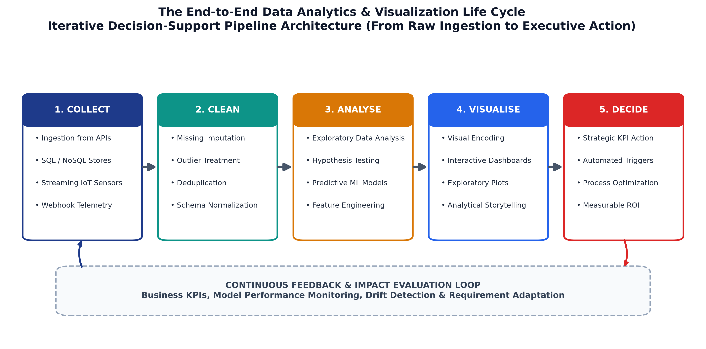


### 4.1 What Constitutes Business Data?
Every modern enterprise runs on data, but not all data qualifies as business data. Business data is defined strictly by its operational utility: it represents any recorded factual observation concerning an organization's internal workflows, customer touchpoints, or external operating environment that is captured so it can be systematically measured, compared, and acted upon.

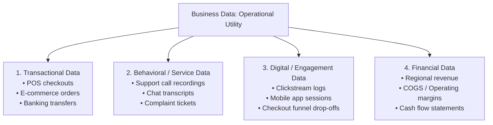

#### The Four Core Categories of Business Data
1. **Transactional Data:**
   - *Nature:* Structured, discrete, highly audited financial and operational events.
   - *Characteristics:* High volume, strict ACID compliance (Atomicity, Consistency, Isolation, Durability), timestamped, immutable once committed.
   - *Examples:* Retail point-of-sale receipt, credit card settlement, stock exchange trade order, airline seat reservation.
2. **Behavioral / Service Data:**
   - *Nature:* Qualitative, semi-structured, and unstructured customer-service interactions.
   - *Characteristics:* High richness, variable length, contains subjective sentiment and operational friction indicators.
   - *Examples:* Customer support telephone audio recordings, CRM ticket resolution logs, warranty claim descriptions, chatbot conversation transcripts.
3. **Digital / Engagement Data:**
   - *Nature:* Machine-generated telemetry capturing human digital footprints.
   - *Characteristics:* Immense velocity, microsecond event logging, hierarchical JSON/XML payloads.
   - *Examples:* Web server access logs, mobile app clickstreams, video streaming pause/rewind events, shopping cart abandonment points.
4. **Financial Data:**
   - *Nature:* Aggregated monetary metrics reflecting fiscal stability and commercial profitability.
   - *Characteristics:* Subject to statutory accounting principles (GAAP/IFRS), audited quarterly and annually.
   - *Examples:* Monthly recurring revenue (MRR), gross profit margin, EBITDA, accounts receivable aging schedules.

[Source: Session-1, Slide 4]

---

### 4.2 Structural and Environmental Dimensions of Business Data
Beyond operational categories, enterprise data splits across two foundational structural axes:

| Dimension Axis | Category | Definition & Architectural Fit | Enterprise Examples |
| :--- | :--- | :--- | :--- |
| **Structure** | **Structured Data** | Conforms to strict pre-defined data models. Directly queryable using SQL; resides in RDBMS and analytical warehouses. | Customer tables, transactional ledger tables, product inventory databases. |
| **Structure** | **Unstructured Data** | Lacks predefined tabular schemas. Requires natural language processing (NLP), computer vision, or audio transcription before tabular analytics. | Customer support emails, delivery photo confirmations, social media sentiment posts, PDF invoices. |
| **Origin** | **Internal Data** | Generated organically through internal business processes, proprietary software, and internal workforce operations. | Enterprise sales logs, employee attendance registers, internal supply chain ERP tables. |
| **Origin** | **External Data** | Collected or procured from third parties outside enterprise firewalls. Provides external context for benchmarking. | Central bank interest rate feeds, competitor web scraping, syndicated Nielsen retail reports, weather forecasts. |

[Source: Session-1, Slide 8]

---

### 4.3 Enterprise Data Sources
Modern business intelligence architectures ingest data from six primary operational systems:

1. **Transactional Systems:** Point-of-Sale (POS) terminals, e-commerce shopping cart databases, core banking platforms, and ERP financial ledgers.
2. **Customer Relationship Management (CRM) Platforms:** Centralized repositories (e.g., Salesforce, HubSpot) capturing prospect pipelines, communication histories, customer satisfaction scores (CSAT), and support tickets.
3. **Web & Mobile Analytics Engines:** Event tracking platforms (e.g., Google Analytics 4, Mixpanel, Segment) capturing URL visits, tap coordinates, scroll depths, and conversion funnels.
4. **Marketing & Advertising Technology (AdTech) Platforms:** Programmatic ad networks (e.g., Google Ads, Meta Ads Manager, DSPs) tracking impression delivery, cost-per-click (CPC), return on ad spend (ROAS), and creative attribution.
5. **Internet of Things (IoT) & Telematics Sensors:** Connected industrial machinery, delivery fleet GPS beacons, warehouse RFID scanners, and cold-chain temperature monitors.
6. **Surveys, Syndicate Market Research & Public Open Datasets:** Structured Net Promoter Score (NPS) surveys, census demographic databases, national economic indicators, and regulatory filings.

[Source: Session-1, Slide 9]

---

### 4.4 The Three Strategic Business Values of Data
Enterprises incur massive capital and operational expenses to store and compute data. These investments are justified by three strategic commercial imperatives:

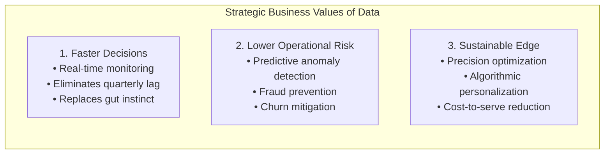

1. **Faster Decisions (Velocity of Action):**
   - *Mechanism:* Traditional management relied on delayed quarterly financial reports or subjective executive intuition ("gut feel"). Real-time telemetry enables instantaneous situational awareness.
   - *Impact:* Decisions are made within minutes or hours rather than weeks, allowing real-time commercial course-correction.
2. **Lower Operational Risk (Preemptive Mitigation):**
   - *Mechanism:* Algorithmic anomaly detection parses millions of transactions to detect patterns of impending failure before damage occurs.
   - *Impact:* Credit card fraud is blocked at the authorization terminal, high-risk churn customers are identified while still subscribed, and industrial machinery is serviced before catastrophic line stoppage.
3. **Competitive Edge (Execution Precision):**
   - *Mechanism:* Organizations measuring operational metrics with high precision can optimize micro-inefficiencies that competitors guess at.
   - *Impact:* Margins are maximized through dynamic pricing, inventory carrying costs are minimized via just-in-time replenishment, and marketing budgets yield higher conversions.

[Source: Session-1, Slide 6]

---

### 4.5 The 5-Stage Analytics Pipeline

Every data-driven decision follows an invariant engineering pipeline:

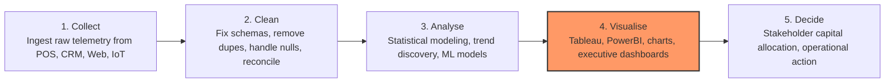

#### Detailed Breakdown of Pipeline Stages:
1. **Stage 1: Collect (Data Ingestion)**
   - *Objective:* Ingest raw, heterogeneous data streams from distributed operational source systems.
   - *Operations:* Database change-data-capture (CDC), REST API pulls, batch SFTP file transfers, Kafka streaming message ingestion.
   - *Challenge:* Managing disparate protocols, network dropped packets, and evolving source API schemas.
2. **Stage 2: Clean (Data Wrangling & Normalization)**
   - *Objective:* Transform dirty, incomplete real-world data into trusted, standardized schemas.
   - *Operations:* Imputing missing values, deduplicating identical primary keys, standardizing text casing and city spellings, validating data types and boundary constraints.
   - *Industry Reality:* Consumes approximately 70–80% of an analytics engineering team's total project lifecycle time.
3. **Stage 3: Analyse (Modeling & Pattern Extraction)**
   - *Objective:* Extract mathematical patterns, statistical descriptions, and predictive inferences.
   - *Operations:* Aggregating totals across dimensions, calculating variance and standard deviations, running regression equations, clustering customer segments.
4. **Stage 4: Visualise (Cognitive Encoding — The Core Focus of This Course)**
   - *Objective:* Translate tabular mathematical outputs into graphical formats optimized for rapid human perception.
   - *Operations:* Encoding measures into spatial positions, lengths, hues, and small multiples using tools like Tableau, Power BI, and Python libraries.
   - *Pedagogical Note:* Units 2, 3, and 5 of this course focus specifically on this stage.
5. **Stage 5: Decide (Executive Action & Intervention)**
   - *Objective:* Convert visual insight into concrete operational, commercial, or capital reallocation.
   - *Operations:* Reallocating underperforming marketing capital, shutting down failing distribution routes, renegotiating vendor supplier contracts.

[Source: Session-1, Slide 11]

---

### 4.6 Case Study: Global Media Portfolio Optimization ($5M Budget Reallocation)

**Context:**
A multinational consumer beverage conglomerate manages an annual digital advertising expenditure exceeding \$5,000,000 distributed across programmatic ad exchanges, social video platforms, search engines, and display ad networks. Historically, budget reallocation was performed quarterly based on delayed vendor invoice reports.

**The Pipeline Execution:**

1. *Collect:* Deployed automated daily API extractors pulling campaign delivery impressions, clickstreams, and real-time ad spend across all platforms into a centralized cloud data warehouse.
2. *Clean:* Automated Python cleaning scripts reconciled discrepancies between agency impression counts and platform-reported billable clicks, standardized varying currency exchange rates, and eliminated fraudulent bot clicks.
3. *Analyse:* Built statistical attribution models evaluating real-time Cost-Per-Acquisition (CPA) and Return-On-Ad-Spend (ROAS) across 15 separate digital ad channels.
4. *Visualise:* Engineered an interactive executive Tableau dashboard showing daily channel spend velocity against conversion target baselines, with color-coded performance tiers (Red: CPA > \$45, Yellow: CPA \$30–\$45, Green: CPA < \$30).
5. *Decide:* Executive marketing directors instantly noticed that programmatic display networks had suffered a 40% efficiency collapse due to ad fatigue, while paid search conversion rates had surged. Within 48 hours, leadership reallocated \$750,000 from programmatic display to search.

**Business Outcome:**
The campaign achieved a 22% overall gain in media effectiveness and an estimated \$620,000 increase in attributable gross revenue, proving that visualization is not mere graphic design, but a high-leverage commercial operational instrument.

[Source: Session-1, Slides 6, 12]

---

### 4.7 Professional Roles in Business Data: Analyst vs BI Developer vs Data Scientist

Organizations maintain distinct specialized engineering and analytical roles across the data lifecycle:

| Professional Dimension | Data Analyst | Business Intelligence Developer | Data Scientist |
| :--- | :--- | :--- | :--- |
| **Primary Mission** | Answering immediate business questions using existing historical data. | Designing, building, and maintaining enterprise reporting infrastructure and pipelines. | Developing complex statistical and machine learning models to forecast future outcomes. |
| **Core Question Addressed** | *"What happened, why did it happen, and how are we doing right now?"* | *"How do we make accurate, clean data flow reliably into self-serve dashboards?"* | *"What will happen next, and what is the optimal automated decision?"* |
| **Primary Outputs** | Executive reports, analytical slide decks, ad-hoc SQL queries, actionable operational recommendations. | Enterprise dimensional data models, ETL/ELT pipelines, certified Tableau/Power BI dashboards, data marts. | Predictive ML models, neural networks, recommendation engines, statistical classification algorithms. |
| **Primary Technical Stack** | SQL, Excel, Tableau, basic Python/R, Google Data Studio. | SQL, dbt, Snowflake/BigQuery, SSIS/Airflow, DAX, Power BI, Tableau Server architecture. | Python (Scikit-Learn, PyTorch, Pandas), R, Spark, Docker, MLflow, advanced linear algebra and probability. |
| **Typical Business Stakeholder** | Operations managers, marketing directors, finance heads. | Data architects, enterprise analysts, executive suite. | Product engineering teams, automated algorithmic systems, R&D leadership. |

[Source: Session-1, Slide 14]

---

---

## 5. Visualization Foundations & Taxonomy

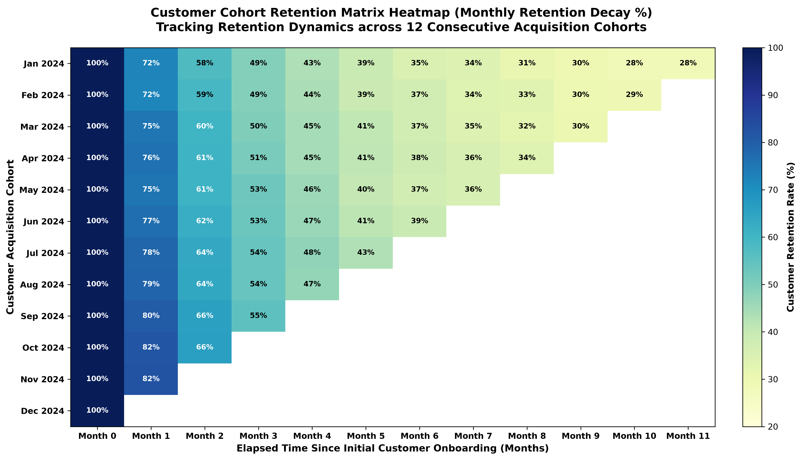


Business data visualization is not an aesthetic exercise in digital illustration; it is a foundational cognitive technology engineered to bridge the bandwidth gap between high-capacity computational databases and human visual perception. By systematically mapping numerical and categorical attributes to preattentive visual channels, organizations reduce cognitive load, detect non-linear patterns, and accelerate executive decision cycles from days to seconds.

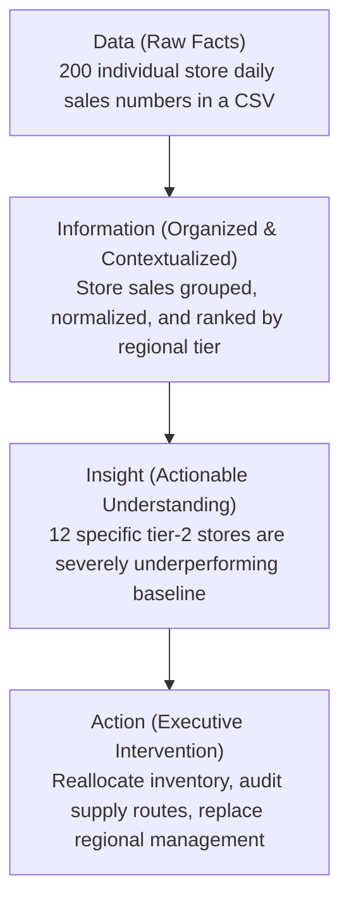

### 5.1 The Data-to-Insight Ladder
Every analytical artifact exists to elevate raw facts along a four-rung cognitive hierarchy:

1. **Data (Raw Facts):**
   - *Definition:* Unprocessed, uncontextualized atomic observations, symbols, or numerical measurements.
   - *Characteristics:* High entropy, unorganized, zero inherent narrative or operational judgment.
   - *Concrete Example:* A raw spreadsheet table listing 200 separate store revenue figures without timestamps, geographic tags, or sales targets.
2. **Information (Organized & Contextualized Data):**
   - *Definition:* Data that has undergone aggregation, categorization, relational structuring, or statistical summarization.
   - *Characteristics:* Interpretable within a reference frame, answers basic descriptive questions ("Who?", "What?", "Where?").
   - *Concrete Example:* The same 200 store sales figures grouped by geographic territory, ranked from highest to lowest revenue, and normalized by store square footage.
3. **Insight (Actionable Understanding):**
   - *Definition:* The synthesis of information, business domain knowledge, and comparative baselines that reveals the causal *why* and highlights emerging risks or opportunities.
   - *Characteristics:* Diagnoses friction, identifies non-obvious correlations, guides future intervention.
   - *Concrete Example:* Recognizing that 12 specific stores located in the Western Region have experienced an identical 28% sales collapse immediately following the launch of a competing regional retail chain.
4. **Action / Decision (Strategic Intervention):**
   - *Definition:* The concrete organizational change, capital reallocation, or process redesign triggered by the validated insight.
   - *Characteristics:* Generates measurable commercial outcomes, closes the feedback loop.
   - *Concrete Example:* Executive management reallocating \$200,000 in regional promotional budgets, introducing localized loyalty incentives, and retraining store fulfillment associates.

[Source: Session-2, Slides 4–5]

---

### 5.2 The Four Strategic Purposes of Business Visualization

Enterprise visualizations are deployed to serve four distinct organizational functions, frequently blending several objectives within a single operational interface:

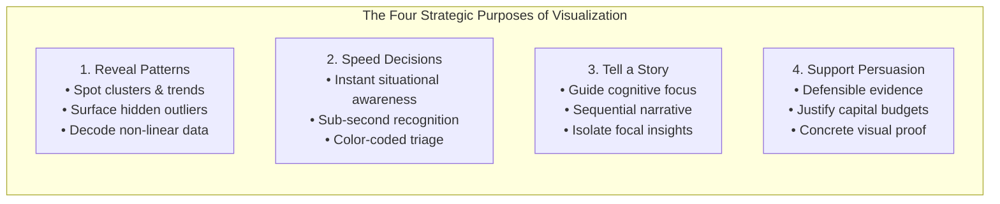

1. **Reveal Patterns:**
   - *Cognitive Role:* Leverages human visual perception to instantly detect mathematical clustering, continuous trends, cyclic seasonality, and isolated outliers that remain entirely invisible inside multi-column tabular spreadsheets.
2. **Speed Up Decisions (Operational Velocity):**
   - *Cognitive Role:* Condenses multi-dimensional operational metrics into color-coded status indicators (e.g., green/yellow/red alerting) that communicate operational stability or distress in under two seconds without requiring numerical calculation.
3. **Tell a Story (Narrative Guidance):**
   - *Cognitive Role:* Establishes a guided cognitive path for the viewer, using visual hierarchy, annotations, and contrasting accent colors to direct executive attention directly to the primary operational takeaway.
4. **Support Persuasion (Executive Justification):**
   - *Cognitive Role:* Delivers indisputable, evidence-backed visual proof required to align disparate stakeholders, defend capital budget allocation requests, and justify strategic pivots.

[Source: Session-2, Slide 6]

---

### 5.3 Detailed Case Studies in Visualization Utility

#### Case Study 1: Hospital Emergency Room (ER) Wait-Time Triage Dashboard (Pattern + Speed)
- **Operational Challenge:** In a high-volume urban trauma center, charge nurses and ER clinical directors must continuously balance acute patient inflows across pediatric, surgical, trauma, and general medical wards. Tabular spreadsheets displaying patient admission timestamps and calculated wait minutes required mental arithmetic that clinical staff under intense cognitive pressure could not execute.
- **Visual Design Solution:** The hospital deployed large wall-mounted triage displays across nursing stations. Instead of tabular numbers, each department was rendered as a prominent visual block dynamically shaded using an intuitive traffic-light chromatic scale:
  - **Green:** Average wait time $\le 15\text{ minutes}$ (Normal operating capacity).
  - **Yellow:** Average wait time $16–30\text{ minutes}$ (Warning: capacity approaching saturation).
  - **Red:** Average wait time $> 30\text{ minutes}$ (Critical: patient care thresholds breached).
- **Cognitive & Operational Result:** A charge nurse glancing at the wall from 10 feet away while administering triage can determine in two seconds which ward is in crisis without reading a single numerical value. Clinical staff are immediately reassigned to red wards, cutting average triage delay by 34%. This demonstrates that when visual latency approaches zero, lives are saved.

#### Case Study 2: Venture Capital (VC) Pitch Deck Inflection Chart (Story + Persuasion)
- **Commercial Challenge:** A pre-Series A mobile software startup sought \$3,000,000 in venture capital to scale operations. The founders possessed 30 pages of financial tables and user engagement metrics, but prospective venture partners reviewing hundreds of decks per week suffered cognitive fatigue.
- **Visual Design Solution:** The founders compressed their growth narrative into a single, high-contrast line chart plotting Monthly Active Users (MAU) across an 18-month timeline. The first 12 months showed slow, linear adoption ($10,000 \to 18,000\text{ MAU}$), followed by a sharp, prominent annotation pointing to month 13 ("V2.0 Algorithmic Social Feed Launched"), after which the curve transitioned into an unmistakable exponential "hockey-stick" inflection climbing to $340,000\text{ MAU}$.
- **Cognitive & Operational Result:** Prospective venture partners visually grasped the precise moment of product-market fit in three seconds. The single line chart proved momentum and capital scalability far more persuasively than dozens of narrative paragraphs, resulting in an oversubscribed funding round.

[Source: Session-2, Slide 7]

---

### 5.4 The Master Chart Selection Framework

Selecting an improper chart type is the most common cause of visual miscommunication. The choice of graphical encoding must be governed strictly by the analytical message to be conveyed:

| Visual Family | Primary Analytical Message | Recommended Chart Encodings | Secondary / Specialized Variants | Primary Visual Channels Utilized |
| :--- | :--- | :--- | :--- | :--- |
| **Comparison** | *"How does Category X compare quantitatively against Category Y?"* | Vertical Column Chart, Horizontal Bar Chart. | Grouped Bar Chart, Bullet Graph. | Length / Position along an aligned common baseline. |
| **Trend over Time** | *"How has Measure X evolved continuously across a temporal baseline?"* | Line Chart, Area Chart. | Step Line Chart, Sparkline. | Position (y-axis) mapped across continuous temporal progression (x-axis), slope. |
| **Distribution** | *"How are values of continuous Variable X spread out, clustered, or skewed?"* | Histogram, Box Plot (Tukey 5-number summary). | Kernel Density Estimate (KDE) curve, Violin Plot. | Area, bar height, spatial distribution of quartiles and whiskers. |
| **Relationship** | *"Is there a correlation, dependency, or clustering between Variable X and Variable Y?"* | Scatter Plot. | Bubble Chart (3rd variable mapped to area), Scatterplot Matrix (SPLOM). | 2D Spatial Cartesian coordinates $(x, y)$, point clustering, regression slope. |
| **Composition** | *"What are the individual constituent parts or proportions of Whole X?"* | 100% Stacked Bar Chart, Waterfall Chart, Treemap. | Donut Chart ($\le 3\text{ slices}$ only; avoid multi-slice pie charts). | Length of segments, 2D area partitioning (Treemap). |
| **Geographic** | *"How are metrics distributed spatially across real-world physical locations?"* | Choropleth Map (color shaded regions), Proportional Symbol / Bubble Map. | Flow Map, Heatmap density layer. | Latitude / Longitude coordinates, region fill hue / saturation, circle area. |

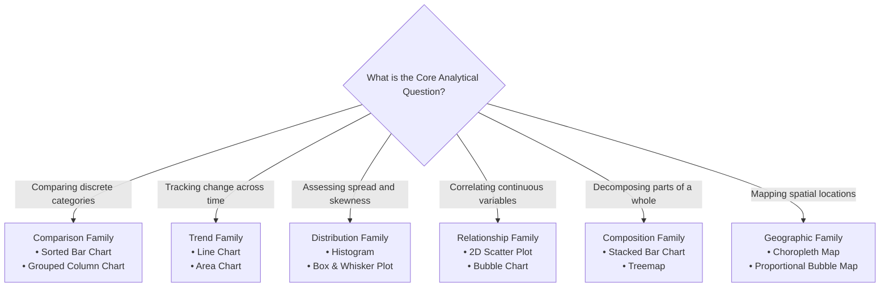

[Source: Session-2, Slides 8–9]

---

### 5.5 Usage Paradigms in Enterprise: Exploratory vs Explanatory Visualization

Visualization serves two distinct user personas operating at opposite ends of the analytical workflow:

```mermaid
flowchart LR
    subgraph EXP["Exploratory Visualization"]
        direction TB
        E1["User: Data Analyst / Data Scientist"]
        E2["Environment: Jupyter, RStudio, Tableau Prep"]
        E3["Focus: Fast iteration, pattern hunting, hypothesis testing"]
        E4["Quality Bar: Rough, throwaway charts, unpolished"]
    end

    subgraph TRANS["The Shift"]
        T1["Analyst discovers verified insight<br/>↓<br/>Distills single message for stakeholders"]
    end

    subgraph EXPN["Explanatory Visualization"]
        direction TB
        X1["User: Business Executive / Stakeholder"]
        X2["Environment: Executive Dashboards, Board Decks"]
        X3["Focus: Communicating a single validated takeaway"]
        X4["Quality Bar: Highly polished, strict color hierarchy, zero clutter"]
    end

    EXP --> TRANS --> EXPN
```

| Comparative Dimension | Exploratory Visualization | Explanatory Visualization |
| :--- | :--- | :--- |
| **Primary Intended Audience** | The data analyst or data scientist themselves. | Executive stakeholders, clients, operational managers. |
| **Analytical Objective** | Searching through unfamiliar data to discover hypotheses, outliers, and correlations. | Communicating a specific, pre-validated conclusion to drive a commercial decision. |
| **Iterative Velocity & Lifespan** | Extremely rapid; dozens of charts generated, analyzed, and discarded in minutes. | Deliberate, curated; artifacts are saved, shared, and monitored over long periods. |
| **Aesthetic Polish & Formatting** | Low; raw default labels, dense data points, unformatted axis scales are acceptable. | High; clear editorial headlines, clean typographic hierarchy, custom tooltips, zero clutter. |
| **Cognitive Load on Viewer** | High; requires analytical expertise to interpret complex distributions. | Low; designed for immediate preattentive visual decoding in seconds. |

[Source: Session-2, Slide 10]

---

### 5.6 Enterprise Information Delivery Artifacts: Dashboards vs Scorecards vs Reports

Choosing the incorrect delivery artifact impairs organizational agility just as severely as selecting the wrong chart:

| Information Artifact | Temporal Dynamic | Primary Purpose & Usage | Target User Persona | Enterprise Industry Example |
| :--- | :--- | :--- | :--- | :--- |
| **Dashboard** | Live, dynamic, continuous streaming or near real-time refreshes. | Tactical, at-a-glance monitoring of active operations, anomalies, and SLA breaches. | Operational managers, logistics dispatchers, systems engineers. | Amazon Seller Central live order dispatch panel; AWS CloudWatch server health monitor. |
| **Scorecard** | Periodic, scheduled evaluations (weekly, monthly, quarterly). | Strategic performance tracking against predetermined quantitative goals and targets. | Executive leadership, department heads, regional VPs. | Corporate Quarterly Sales Quota Scorecard; University Academic Accreditation Scorecard. |
| **Static Report** | Fixed snapshot in time; published periodically and immutable once issued. | Deep-dive comprehensive historical analysis, regulatory compliance, and post-mortems. | Board of directors, regulatory agencies, financial auditors. | Annual SEC 10-K Filing; Annual ESG Sustainability Report; Quarterly Business Review (QBR) Deck. |

#### Case Study: The Cost of Information Latency (Logistics Delivery Spike)
- **The Failure of Static Reporting:** A national courier logistics provider relied exclusively on a monthly static PDF performance report distributed on the 30th of each calendar month. On Day 2 of a given month, a regional hub routing software upgrade introduced a software glitch causing parcel delivery delays to spike by 300%. Because management operated without a live monitoring dashboard, nobody in executive leadership noticed the operational collapse until the monthly report arrived 28 days later. By then, over 40,000 shipments had breached delivery SLA commitments, customer complaints had overloaded call centers, and two major e-commerce retail partners terminated their shipping contracts.
- **The Dashboard Solution:** The company replaced monthly static reporting with an operational real-time dashboard refreshing every 15 minutes. When a subsequent sorting machine failure occurred six months later, the routing latency metric breached threshold tolerances within 45 minutes, triggering automated SMS alerts to regional dispatchers who rerouted transport trucks around the bottlenecked facility before deliveries were missed.

[Source: Session-2, Slide 11; Session-4, Slide 14]

---

### 5.7 The 3-Question Chart Design Framework
Prior to selecting any graphical format, an analyst must systematically evaluate three questions:

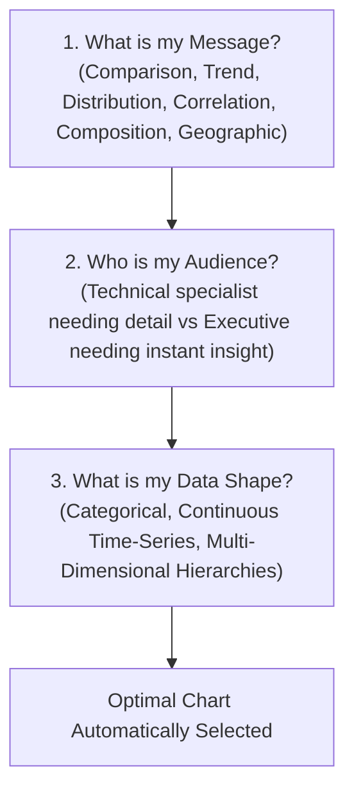

1. **What is my message?**
   - Is the core objective to highlight a disparity between categories, illustrate a continuous temporal trajectory, uncover a demographic distribution, establish a correlation, or display geographic concentration?
2. **Who is my audience?**
   - Is the visual intended for an exploratory data scientist who requires granular distributions and raw scatter points, or a Chief Operating Officer who requires an uncluttered, high-level summary highlighting anomalies?
3. **What is my data shape?**
   - Are the underlying variables discrete categories, continuous ratio measurements, temporal date-time timestamps, or nested geographic hierarchies?

When all three questions are precisely answered, the correct visualization type emerges deterministically.

[Source: Session-2, Slide 12]

---

### 5.8 Bad Chart vs Good Chart Transformation: Multi-Slice Pie Chart vs Sorted Bar Chart

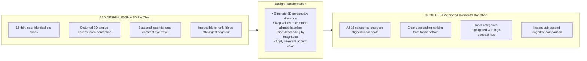

#### Detailed Cognitive Critique of the Transformation:
- **The Failure Mode of the 3D Pie Chart:**
  - *Perceptual Inaccuracy:* Human visual perception is notoriously poor at decoding angles, arc lengths, and 2D areas compared to positions along an aligned linear scale.
  - *Perspective Distortion:* Adding pseudo-3D perspective tilts the circular plane, artificially expanding the visual area of slices angled toward the foreground while foreshortening background slices, creating a mathematically fraudulent visual hierarchy.
  - *Cognitive Overload:* Squeezing 15 categorical slices into a single circular disk creates slivers of identical visual width. Placing labels in an external legend forces the human eye to saccade back and forth between color swatches and pie slices, overloading working memory.
- **The Superiority of the Sorted Horizontal Bar Chart:**
  - *Aligned Common Baseline:* Every bar begins at an identical zero-origin vertical axis line ($x = 0$), allowing the viewer’s brain to evaluate exact categorical magnitude differences solely by comparing horizontal lengths.
  - *Direct Labeling:* Category names are rendered horizontally adjacent to the bars, eliminating rotational neck strain and external legend searching.
  - *Visual Salience:* By sorting bars in descending order from highest to lowest and applying a distinct visual accent color (e.g., vibrant blue) to the top three contributors while rendering the remaining 12 in muted slate gray, the key operational insight is conveyed in under one second.

[Source: Session-2, Slide 13]

---

## 6. Architectural Features of Business Data

Enterprise business data is fundamentally distinct from academic or textbook datasets. It does not arrive neatly packaged in clean `.csv` files with pre-balanced class distributions. Business data is high-dimensional, time-stamped, heterogeneous, continuous, and inherently vulnerable to operational corruption. Analyzing and visualizing enterprise data requires an architectural understanding of its structural properties.

---

### 6.1 The 5 V's of Business Data in Modern Enterprise

The 5 V's framework provides the industry-standard taxonomy for characterizing enterprise data architectures:

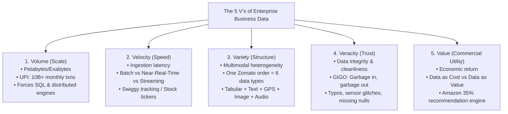

#### 1. Volume (Scale of Data Footprint)
- *Core Question:* How much physical data is being generated and stored?
- *Industrial Benchmark:* India's Unified Payments Interface (UPI), operated by the National Payments Corporation of India (NPCI), processes over 10 to 13 billion transactions per calendar month. Each atomic transaction generates a detailed operational log containing sender VPA, recipient VPA, bank IFSC codes, monetary amount, millisecond timestamp, device hardware ID, geolocation IP, and settlement clearing status.
- *Analytical & Visualization Consequences:*
  - A billion rows cannot be rendered in desktop spreadsheet software (Excel caps out at 1,048,576 rows).
  - Massive volume forces analytical architectures into distributed cloud data warehouses (Snowflake, Google BigQuery, Amazon Redshift).
  - Visualization requires pre-aggregation and statistical sampling: plotting 50,000,000 raw points on a scatter plot results in total visual occlusion (a solid black rectangle) and client-side browser crashes. Analysts must aggregate data into hexbin plots, binned heatmaps, or statistical distribution summaries before rendering.

#### 2. Velocity (Speed of Generation, Ingestion & Analysis)
- *Core Question:* How fast does incoming data arrive, and how quickly must it be processed?
- *The Three Ingestion Tiers:*
  1. **Batch Ingestion:** Data arrives periodically in discrete chunks (e.g., end-of-day bank clearing ledgers, monthly payroll runs).
  2. **Near Real-Time Ingestion:** Data arrives with short latencies ranging from seconds to several minutes (e.g., Swiggy/Zomato food delivery partner GPS tracking updates, warehouse package scan events).
  3. **Streaming / Pure Real-Time Ingestion:** Data arrives continuously in sub-second streams (e.g., algorithmic stock exchange trade feeds, Indian Premier League [IPL] live ball-by-ball scoreboards, credit card fraud authorization gateways).
- *The Ingestion-to-Insight Golden Rule:* **Match your analysis speed to your data speed.** Ingesting sub-second streaming data while analyzing it on a monthly reporting cadence constitutes wasted capital and missed operational intervention.

#### 3. Variety (Structural Heterogeneity of Data)
- *Core Question:* How many structural forms and media formats does the data embody?
- *Case Study (A Single Food Delivery Order on Zomato):*
  A single consumer order generates six distinct structural data modalities simultaneously:

  1. *Structured Data:* Order ID (`#ZM-90812`), Itemized SKUs, Bill Subtotal, Tax, Tips, Timestamp (fits into tabular RDBMS columns).
  2. *Unstructured Free-Form Text:* Customer delivery instruction string: *"Do not ring bell, infant is asleep, leave package on shoe rack outside 3rd floor door."*
  3. *Image Data:* Restaurant-uploaded high-resolution photo of the prepared dish; delivery partner photo verifying package drop-off.
  4. *Geospatial / Telematics Data:* Real-time latitude/longitude coordinates tracking the delivery partner’s motorbike along road networks.
  5. *Sentiment / Review Data:* Post-order quantitative 4-star rating combined with qualitative natural language text review: *"Butter chicken was delicious but naan was cold."*
  6. *Audio Telephony Data:* Recorded customer support voice call transcript when an item is missing from the sealed bag.
- *Analytical Challenge:* Enterprise analysts must bridge structured SQL tables with unstructured text and spatial coordinates within unified BI dashboards.

#### 4. Veracity (Trustworthiness, Accuracy & Fidelity)
- *Core Question:* Can decision-makers trust the data to reflect objective reality?
- *Common Enterprise Veracity Vulnerabilities:*
  - *Fraudulent / Inauthentic Signal:* Fabricated 5-star merchant reviews generated by click-farms distorting true product quality.
  - *Human Typographical Errors:* Categorical entry inconsistencies where a single city is recorded as `"Ahmedabad"`, `"Ahemdabad"`, and `"AMD"`.
  - *Hardware / Sensor Glitches:* A corrupted mobile GPS unit transmitting coordinates locating a food delivery driver in the middle of the Arabian Sea.
  - *Systematic Missingness:* Users deliberately skipping optional household income questions on loan applications or submitting fictitious dates of birth.
- *The Invariant Law of Analytics:* **Garbage In, Garbage Out (GIGO).** A visually stunning, beautifully typeset dashboard built upon unverified, corrupted data is merely an expensive, dangerous lie.

#### 5. Value (Commercial Utility & Economic ROI)
- *Core Question:* Does storing and analyzing this data generate a measurable return on investment?
- *Data as Cost vs Data as Value:*
  - *Data as Cost:* Petabytes of raw, unindexed log files sitting in cloud cold storage incurring compounding monthly AWS S3 storage bills, demanding dedicated data engineering teams to patch fragile pipelines, while delivering zero operational insights.
  - *Data as Value:* Extracting actionable intelligence from existing historical data to unlock incremental revenue, reduce costs, or eliminate fraud.
  - *Concrete Benchmark:* Amazon's personalized recommendation engine (*"Customers who bought this item also bought..."*) was historically reported to generate up to **35% of Amazon's total e-commerce consumer sales**. Both scenarios utilize identical raw warehouse storage; the difference lies entirely in analytical extraction and operational deployment.

[Source: Session-3, Slides 5–11]

---

### 6.2 Data Granularity & Zoom Levels

Granularity defines the semantic boundary of an individual data row. Enterprise datasets exist along a granularity continuum:

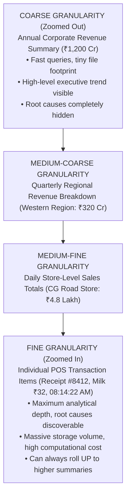

#### The Granularity Trade-Off Matrix:
| Granularity Level | Primary Advantages | Severe Disadvantages & Blindspots | Optimal Use Case |
| :--- | :--- | :--- | :--- |
| **Fine Granularity (Zoomed In)** | Maximum diagnostic capability; root causes are discoverable; can be mathematically aggregated upward into any arbitrary summary. | Massive data volume; high cloud storage and compute query costs; high visual noise; risk of cognitive overload. | Root cause engineering analysis, algorithmic fraud investigation, machine learning model training. |
| **Coarse Granularity (Zoomed Out)** | Fast computation; tiny file sizes; provides immediate, high-level strategic visibility; uncluttered executive display. | **Irreversible information loss**; impossible to drill down to investigate underlying anomalies; broad averages conceal opposing internal trends. | Board of Directors briefings, annual statutory financial reporting, high-level investor relations. |

> **🌟 Golden Rule of Data Architecture:** **Store Fine, Report Coarse.**
> Always preserve atomic, fine-grained transactional records in underlying storage engines, because you can mathematically roll up, sum, and aggregate detailed data to any arbitrary summary level. However, once data is recorded only at a coarse level, **you can never reconstruct lost atomic detail from a summary**.

[Source: Session-3, Slides 13–14]

---

### 6.3 Time-Dependence: Decomposing Temporal Patterns

Nearly all enterprise business data carries a temporal timestamp. Temporal variation resolves into three distinct mathematical components:

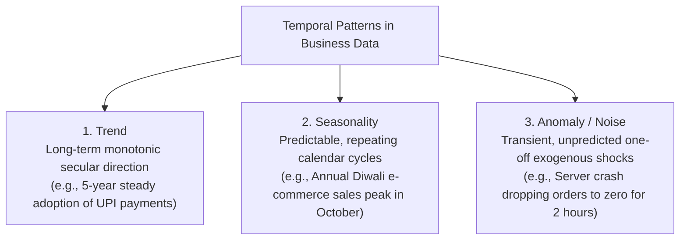

#### The Analyst's Diagnostic Test:
To construct an accurate predictive forecast, an analyst must evaluate observed historical fluctuations against the diagnostic question:
$$
\text{"Will this observed pattern repeat on a cycle, continue indefinitely, or never happen again?"}
$$

- If it **repeats on a fixed schedule** $\to$ **Seasonality** (Model with seasonal differencing and cyclic Fourier terms).
- If it **continues in a long-term direction** $\to$ **Trend** (Model with linear/polynomial regression or moving averages).
- If it was an **isolated shock that will never happen again** $\to$ **Anomaly** (Filter out or treat as a discrete categorical intervention dummy variable).

#### Case Study: All Three Temporal Patterns Inside a Single IPL Cricket Match
Consider user traffic telemetry on a live video streaming platform (e.g., JioCinema) broadcasting an Indian Premier League (IPL) cricket match:

1. **The Underlying Trend:** Total concurrent viewership climbs steadily over the course of the six-week tournament as teams battle for playoff spots, reflecting a macro upward trend.
2. **The Cyclic Seasonality:** Within a single three-hour match, traffic exhibits strict cyclic seasonality: viewer concurrent concurrency surges during every over (balls 1 to 6) and dips predictably during the 90-second ad breaks between overs, repeating 40 times per match.
3. **The Unpredicted Anomaly:** When a superstar batsman is unexpectedly dismissed on a controversial review in the 19th over, platform traffic experiences a massive, unrepeatable 10-second traffic spike followed by an immediate collapse as viewers close the app. Confusing that anomaly with a permanent structural trend would result in disastrous server provisioning mistakes.

[Source: Session-3, Slides 15–17]

---

### 6.4 Multi-Dimensional OLAP Hierarchies

Business intelligence tools structure enterprise data along qualitative **dimensions** (perspectives) that contain nested **hierarchies** (levels of abstraction). This architecture enables two foundational analytical operations:

- **Drill-Down:** Navigating from higher-level summary abstractions down into fine-grained atomic detail (zooming in).
- **Roll-Up:** Aggregating granular data upward into broader categorical or regional groupings (zooming out).

```mermaid
flowchart TD
    subgraph GEO["Geographic Hierarchy"]
        G1["Country: India"] --> G2["State: Gujarat"]
        G2 --> G3["City: Ahmedabad"]
        G3 --> G4["Store: CG Road Branch"]
    end

    subgraph PROD["Product Hierarchy"]
        P1["Category: Electronics"] --> P2["Sub-Category: Smartphones"]
        P2 --> P3["Brand: Apple"]
        P3 --> P4["SKU: iPhone 15 Pro 128GB Blue"]
    end

    subgraph TIMEH["Time Hierarchy"]
        T1["Year: 2026"] --> T2["Quarter: Q3"]
        T2 --> T3["Month: September"]
        T3 --> T4["Week: Week 36"]
        T4 --> T5["Day: September 2nd"]
        T5 --> T6["Hour: 14:00 - 15:00"]
    end
```

Every interactive dashboard filter (e.g., date-range pickers, regional drop-down menus, product category facets) represents a dynamic slicing operation executed along these predefined dimensional hierarchies.

[Source: Session-3, Slides 19–20]

---

### 6.5 Data Quality Through a Visualization Lens

Data quality is traditionally studied in database engineering as constraints and validation rules. In analytics, data quality must be evaluated through a **visualization lens**, because data errors silently corrupt graphical charts without triggering software runtime errors:

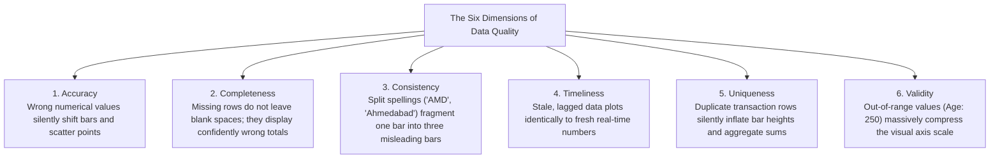

#### Detailed Breakdown of Silent Visual Corruptions:
1. **Accuracy (Semantic Truthfulness):**
   - *Database Level:* A product price is erroneously entered as ₹1,200 instead of ₹12,000.
   - *Silent Visual Corruption:* The database accepts the integer without complaint. On an executive revenue bar chart, that customer account’s bar silently shifts downward, producing an inaccurate visual comparison that misleads commercial directors.
2. **Completeness (Absence of Nulls / Missing Records):**
   - *Database Level:* 25% of retail store data pipelines fail to upload daily transactions due to a network timeout.
   - *Silent Visual Corruption:* The chart does not render an ominous blank gap or error warning. It simply plots the sum of the records it received, displaying a **confidently wrong** regional total that makes the region appear in financial distress.
3. **Consistency (Standardization Across Sources):**
   - *Database Level:* City attributes contain unnormalized variations: `"Ahmedabad"`, `"Ahemdabad"`, and `"AMD"`.
   - *Silent Visual Corruption:* In a categorical bar chart of sales by city, the visualization software treats each string as an independent category, fragmenting what should be one dominant, towering bar into three tiny, separated, highly misleading bars.
4. **Timeliness (Data Freshness & Currency):**
   - *Database Level:* A data pipeline halts at midnight; visual dashboards query an unrefreshed database.
   - *Silent Visual Corruption:* Yesterday’s stale inventory levels render with identical graphical crispness and authority as live data, leading supply chain dispatchers to commit non-existent stock to customers.
5. **Uniqueness (Absence of Duplication):**
   - *Database Level:* An API retry script accidentally commits identical order payment logs twice.
   - *Silent Visual Corruption:* The duplicate records do not produce visual distortion artifacts; they simply double the computed sum, silently inflating bar heights and executive revenue metrics by 100%.
6. **Validity (Conformity to Logical & Domain Constraints):**
   - *Database Level:* A user registers entering their age as `250` or income as `-₹50,000`.
   - *Silent Visual Corruption:* When rendering a demographic scatter plot or box plot, the visualization engine dynamically scales the vertical axis from 0 to 250 to accommodate the invalid point. Consequently, 99.9% of valid user points (aged 18–65) are squashed into an unreadable, flat baseline smudge at the bottom of the chart.

[Source: Session-3, Slide 21]

---

### 6.6 Mega Case Study: E-Commerce Festival Mega Sale (Big Billion Days / Great Indian Festival)

**Context:**
During annual Indian festive sales (e.g., Flipkart Big Billion Days, Amazon Great Indian Festival), e-commerce platforms experience a 10x to 15x operational surge, processing over 100,000,000 customer events per day. This operational environment stress-tests all architectural features of business data simultaneously:

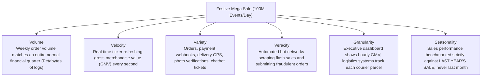

- **Architectural Stress Points & Solutions:**
  - *Volume & Compute:* Transaction logs scale into hundreds of terabytes. Query engines pre-calculate OLAP aggregates at hourly zoom levels so executive dashboards load in under 500 milliseconds.
  - *Velocity & Pacing:* Flash sales selling 50,000 smartphones in 90 seconds require sub-second inventory locking pipelines to prevent overselling.
  - *Seasonality Benchmarking:* Growth cannot be evaluated against the preceding month (September), as festive shopping creates an artificial 500% spike. Performance must be benchmarked strictly on a **Year-over-Year (YoY)** basis against Day 1 of the prior year's festive sale.
  - *Veracity Filtering:* High-speed automated classification models filter out bot traffic and scripted coupon abuse before transaction counts flow into corporate revenue dashboards.

[Source: Session-3, Slide 24]

---

---

## 7. Enterprise Business Intelligence Landscape

In commercial enterprises, visualization does not operate as an isolated desktop application. It sits atop a vast, interconnected enterprise IT ecosystem designed to capture operational throughput, uncover hidden statistical relationships, and present synthesized intelligence to human leadership. To design effective visualizations, an analyst must understand how modern enterprises structure their computing architectures.

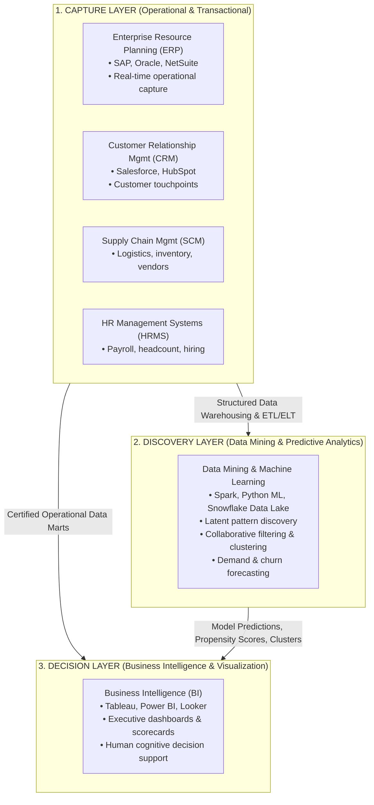

---

### 7.1 The Four Categories of Business IT Applications

Enterprise applications are categorized according to the specific operational and analytical functions they perform:

| Category | Primary System Mission | Operating Dynamic & Latency | Core Question Answered | Canonical Enterprise Example |
| :--- | :--- | :--- | :--- | :--- |
| **Operational Systems** | Driving and executing daily, continuous business workflows. | Real-time, continuous state management. | *"How do we run the day-to-day operations right now?"* | Amazon checkout, payment processing, warehouse inventory packing conveyors. |
| **Transactional Systems** | Recording individual business exchange events with strict transactional integrity. | Atomic, sub-second commit cycles (ACID compliant). | *"Did this specific financial or operational event happen accurately?"* | Core banking system recording a ₹50,000 ATM cash withdrawal; airline seat booking. |
| **Analytical Systems** | Mining historical data repositories to identify non-obvious patterns, correlations, and clusters. | Batch, multi-threaded analytical queries over terabytes/petabytes. | *"What hidden patterns exist across our historical records?"* | Netflix recommendation engine discovering viewer taste clusters; fraud detection models. |
| **Decision Support Systems (DSS)** | Augmenting human cognitive capacity through interactive scenarios, dashboards, and visual models. | Interactive, low-latency visual queries and what-if simulations. | *"What should a human manager decide based on what we know?"* | Hospital triage bed-allocation dashboard; airline flight schedule disruption recovery panel. |

[Source: Session-4, Slide 6]

---

### 7.2 Two Ways to Look at the Same System: Technical View vs Business View

When evaluating enterprise IT applications, software engineers and business analysts look through fundamentally different lenses:

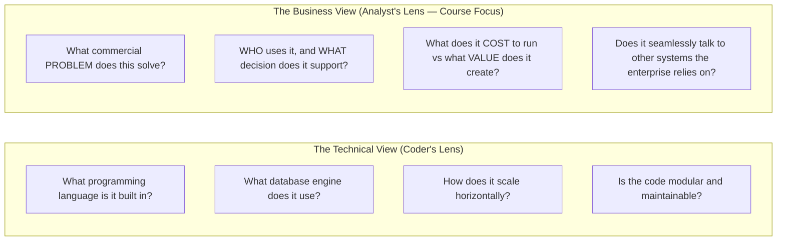

> **📌 Course Philosophy:** This course—and the professional role of the Business Analyst and BI Developer—lives strictly on the **Business View**. You do not need to memorize how Amazon’s warehouse robotic control system is compiled in C++. You need to know what business problem it solves, how its telemetry flows into executive dashboards, and what commercial decisions it enables.

[Source: Session-4, Slide 5]

---

### 7.3 The Enterprise IT Triad: ERP vs Data Mining vs BI

Three enterprise computing concepts are constantly confused in industry job postings and academic discussions: Enterprise Resource Planning (ERP), Data Mining, and Business Intelligence (BI). They are not competing technologies; they represent three consecutive stages of a single data lifecycle:

$$
\mathbf{ERP\text{ (Capture)}} \longrightarrow \mathbf{Data\text{ }Mining\text{ (Discover)}} \longrightarrow \mathbf{BI\text{ (Decide)}}
$$

#### Side-by-Side Comparison Matrix:
| Architectural Attribute | Enterprise Resource Planning (ERP) | Data Mining | Business Intelligence (BI) |
| :--- | :--- | :--- | :--- |
| **Primary Core Focus** | Running daily operational workflows across all business units. | Discovering unknown, hidden patterns within historical data. | Packaging operational data and model outputs for human decision-making. |
| **Core Question Answered** | *"Is the business running correctly and stably right now?"* | *"What non-obvious patterns exist that nobody explicitly programmed in?"* | *"What strategic decision should we execute based on what we know?"* |
| **Data Flow Direction** | **Captures** atomic data in real-time as events occur. | **Digs backward** through years of accumulated historical data. | **Packages forward** into actionable visual interfaces to guide future action. |
| **Primary System Class** | Operational / Transactional System. | Advanced Analytical / Machine Learning System. | Decision Support System (DSS). |
| **Target End-User** | Operational staff (warehouse pickers, cashiers, accountants). | Data scientists, machine learning engineers, quantitative researchers. | Executive leadership, department directors, regional operational managers. |
| **Canonical Example** | Amazon’s fulfillment backbone reserving inventory across warehouses. | Netflix’s recommendation engine uncovering viewer taste clusters. | Spotify’s internal artist & record label dashboards tracking playlist streams. |

#### The Disaster Scenario: What Happens When Enterprises Confuse These Roles
- **The Realistic Corporate Mistake:** A mid-sized retail department store chain experienced declining same-store profitability. Regional store managers urgently needed a live operational dashboard showing daily sales velocity by department so they could reallocate floor staff and identify fast-selling stock (a textbook **BI Decision Support need**).
- **The Misguided Technical Response:** Enterprise IT leadership, enamored by industry buzzwords, allocated \$1,500,000 and spent 14 months commissioning a complex **Data Mining system** using deep neural networks to "automatically discover customer purchasing insights."
- **The Failure Outcome:** After 14 months, the machine learning system proudly reported obscure statistical associations (e.g., *"Customers who purchase blue umbrellas on rainy Tuesdays frequently buy imported coffee"*), while retail store managers still could not answer the basic morning operational question: *"How did my store perform yesterday?"* without filing an IT support ticket.
- **The Engineering Lesson:** Matching the **correct system type** to the **specific business question** matters far more than choosing the most algorithmically sophisticated tool.

[Source: Session-4, Slides 7–11, 17–18]

---

### 7.4 Beyond ERP: The Extended Enterprise Ecosystem

While ERP manages core financial and manufacturing ledgers, large enterprises deploy three specialized operational systems that continuously feed the Business Intelligence layer:

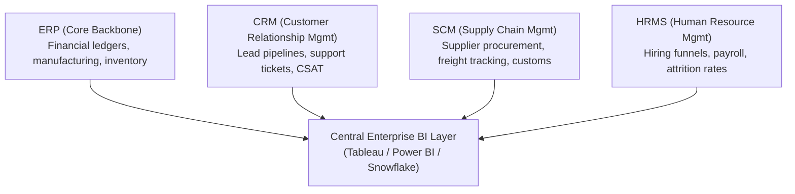

1. **Customer Relationship Management (CRM):**
   - *Core Mission:* Tracks every commercial and qualitative interaction an organization has with prospective and existing customers.
   - *Typical Data:* Sales pipeline stages, customer email exchanges, support ticket resolution histories, customer satisfaction (CSAT) scores.
   - *Enterprise Example:* Salesforce tracking an enterprise software deal from initial demo to contract signature.
2. **Supply Chain Management (SCM):**
   - *Core Mission:* Coordinates and optimizes the flow of physical goods, vendor procurement, manufacturing schedules, and global logistics.
   - *Typical Data:* Supplier purchase orders, freight vessel GPS coordinates, warehouse stock turnover, lead times.
   - *Enterprise Example:* Amazon tracking thousands of third-party merchants and shipping containers arriving at port facilities.
3. **Human Resource Management Systems (HRMS):**
   - *Core Mission:* Manages employee onboarding, compensation, benefits, payroll, performance evaluations, and workforce retention.
   - *Typical Data:* Employee turnover rates, internal promotion velocities, headcount diversity metrics, salary bands.
   - *Enterprise Example:* Workday managing global workforce compensation across 40 countries.

[Source: Session-4, Slide 16]

---

### 7.5 Six Real-World Industrial Visualization Domains

Visualization is not a monolithic discipline; it bends its conventions, visual densities, and latencies around the specific operational stakes of each industry:

| Visualization Domain | Lead Industrial Archetype | Primary Visual Encodings & Interface Demands | Operational Stakes & Cognitive Constraints |
| :--- | :--- | :--- | :--- |
| **1. Business Intelligence (Media & Entertainment)** | **Netflix Content Dashboards** | Horizontal bar charts of show completion rates, time-series line charts of time-to-second-episode binge velocity, geographical heatmaps of regional adoption, A/B test split-run bar plots of promotional thumbnails. | Commercial viability; deciding whether to renew a \$100M television series or cancel production. |
| **2. Healthcare Visualization** | **Emergency Room (ER) & Intensive Care Unit (ICU) Monitors** | Large, high-contrast, wall-mounted displays; dynamic color-coding (Red/Yellow/Green); vital sign waveform line charts; bed availability capacity meters. | **Zero tolerance for ambiguity.** A misread chart or ambiguous color palette has life-or-death consequences, not just financial loss. Must be legible from 10 feet away mid-task. |
| **3. Financial Visualization** | **The Bloomberg Terminal** | High-density multi-window layouts; sub-second real-time candlestick charts; depth-of-market order book charts; functional green/red color encoding. | Maximum data density over minimalist design. Traders demand dozens of live data streams on a single screen; sub-second latency is vital where a 100ms delay costs millions. |
| **4. Sports Analytics** | **Moneyball MLB & Premier League Soccer (xG)** | Spatial pitch shot maps; radar / spider charts comparing player skill profiles; passing network graph visualizations; expected goals (xG) distribution plots. | Serves two distinct audiences: tactical coaching staff making in-game player substitutions vs fans wanting engaging broadcast graphics. |
| **5. Geospatial Visualization** | **COVID-19 Outbreak Maps & Google Maps Fleet Routing** | Interactive choropleth map layers; proportional bubble circles; dynamic vector flow paths; traffic congestion heatmaps. | Spatial coordinates are not metadata; **location IS the primary dimension**. Instantly reveals regional clusters and physical contagion diffusion pathways. |
| **6. Scientific Visualization** | **NASA & NOAA Climate Simulation Engines** | 3D volumetric rendering; vector field streamlines; multi-spectral satellite imagery; continuous isobaric contour plots. | Modeling physical reality; communicating high-dimensional fluid dynamics, atmospheric carbon distributions, and thermodynamic equations. |

[Source: Session-4, Slides 12–13, 19–22]

---

### 7.6 Amazon End-to-End Enterprise Data Flow Case Study

To observe how all these systems operate concurrently within a single enterprise, trace the lifecycle of a single customer transaction on Amazon:

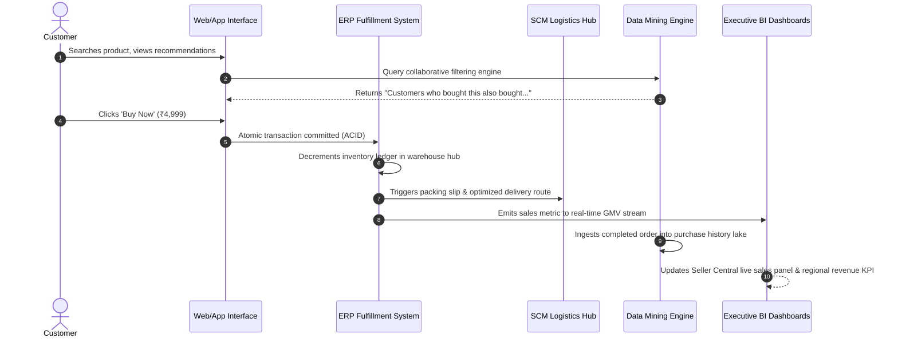

- **Architectural Coexistence:** In this single lifecycle:
  - The **ERP layer** maintained perfect transactional inventory consistency across hundreds of warehouses.
  - The **Data Mining layer** drove the initial purchase via collaborative filtering and subsequently retrained demand-forecasting models.
  - The **SCM layer** coordinated route optimization across regional third-party delivery partners.
  - The **BI layer** updated executive revenue scorecards, category manager stock alerts, and vendor seller panels simultaneously.

[Source: Session-4, Slide 15]

---

### 7.7 Career Corner: Decoding Job Titles & 60-Second Interview Framework

Students frequently struggle with overlapping data analytics job titles:

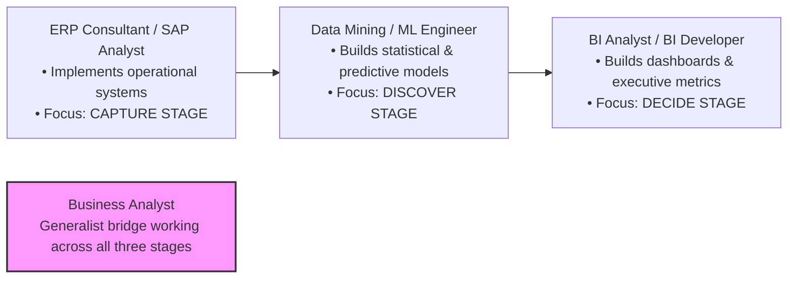

#### How to Answer: *"Can you explain the difference between ERP, Data Mining, and BI?"* in 60 Seconds
> *"They are not competing systems; they are three consecutive stages of a single data lifecycle:*
> *1. **ERP captures operational reality** as it happens—think of Amazon's warehouse fulfillment system recording orders and stock in real time.*
> *2. **Data Mining looks backward** through years of accumulated historical data to uncover non-obvious patterns nobody explicitly programmed—like Netflix’s recommendation algorithm discovering viewer taste clusters.*
> *3. **Business Intelligence packages insights forward** into visual dashboards and scorecards that a human executive can understand in seconds to make a strategic capital or operational decision.*
> *In short: ERP captures it, Data Mining discovers it, and BI decides on it."*

[Source: Session-4, Slides 23–24]

---

## 8. Performance Management, KPIs & Ethics

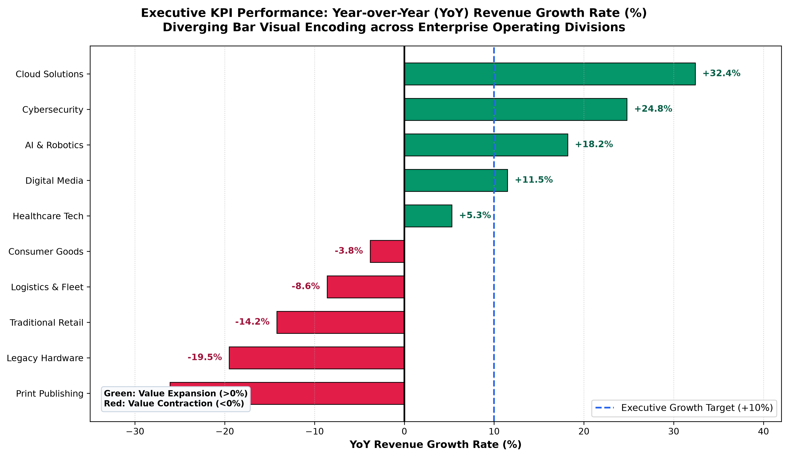


Data collection and visualization are fundamentally incomplete without performance management. An organization cannot manage what it does not measure, but measuring the wrong metrics can drive toxic operational behaviors, destroy corporate trust, and trigger catastrophic legal liability.

---

### 8.1 The Refinement Hierarchy: Measure $\longrightarrow$ Metric $\longrightarrow$ KPI

A primary source of organizational dysfunction is treating all numbers equally. Business intelligence enforces a strict three-tier refinement hierarchy:

```mermaid
flowchart TD
    M["1. MEASURE (Raw Operational Count)<br/>A single uncontextualized number with zero judgment attached.<br/>Amazon Logistics: '2,400,000 packages delivered today'"]

    ME["2. METRIC (Calculated Ratio or Rate)<br/>A mathematical ratio combining measures to provide context and comparability.<br/>Amazon Logistics: '2.4M delivered ÷ 2.45M promised = 98.0% On-Time Delivery Rate'"]

    K["3. KEY PERFORMANCE INDICATOR (KPI — Strategically Weighted Metric)<br/>A metric formally tied to executive goals, tracked regularly, with bonuses tied to it.<br/>Amazon Leadership: 'Maintain ≥ 98.5% On-Time Rate weekly; executive reviews held every Monday'"]

    M --> ME --> K
```

#### Side-by-Side Comparison:
| Evaluation Dimension | Measure | Metric | Key Performance Indicator (KPI) |
| :--- | :--- | :--- | :--- |
| **Formal Definition** | A single raw, atomic count of business activity. | A calculated mathematical ratio, rate, or percentage combining two or more measures. | A high-priority metric formally selected by leadership to steer strategic execution. |
| **Context & Comparability** | None. Cannot evaluate if performance is good or bad. | Yes. Enables meaningful comparisons across time, cohorts, and competitors. | Yes, plus **organizational weight**, formal targets, and executive accountability. |
| **Amazon Logistics Example** | 2,400,000 packages delivered today. | 98.0% On-Time Delivery Rate ($2.4\text{M} / 2.45\text{M}$). | On-Time Delivery Rate with a target of $\ge 98.5\%$, monitored weekly by the Senior VP of Logistics. |
| **Primary Stakeholder** | Operations Database Analyst. | Regional Logistics Operations Manager. | Chief Operating Officer / Executive Leadership. |

[Source: Session-5, Slides 5–9]

---

### 8.2 What Makes a Good KPI: The SMART Evaluation Framework

Not every metric deserves to be elevated to a KPI. A metric must be evaluated against the five SMART criteria:

```mermaid
flowchart LR
    S["S: Specific<br/>Unambiguously defined; not 'improve satisfaction'"]
    M["M: Measurable<br/>Quantifiable from verifiable digital telemetry"]
    A["A: Achievable<br/>Realistic under operational constraints"]
    R["R: Relevant<br/>Directly aligned with top-level strategic vision"]
    T["T: Time-bound<br/>Governed by clear deadlines & reporting cadence"]

    S --- M --- A --- R --- T
```

1. **Specific:** Unambiguously articulated so that all employees interpret it identically (e.g., *"Reduce Tier-1 technical support first-response time to under 15 minutes"*, not *"improve customer experience"*).
2. **Measurable:** Derived from automated, verifiable data feeds rather than subjective self-reporting.
3. **Achievable:** Calibrated to push organizational boundaries without setting impossible thresholds that demoralize teams or incentivize data falsification.
4. **Relevant:** Directly linked to core corporate survival and commercial profitability, not merely selected because the data was easy to extract.
5. **Time-Bound:** Explicitly tied to a measurement cadence and milestone deadline (e.g., *"Achieve 95% compliance by the end of Q3"*).

[Source: Session-5, Slide 10]

---

### 8.3 Leading vs Lagging Indicators

High-performance organizations distinguish between indicators that predict the future and indicators that audit the past:

```mermaid
flowchart LR
    subgraph LEAD["Leading Indicators (Predictive Inputs)"]
        L1["Website unique visitors this week"]
        L2["Outbound sales prospect calls made today"]
        L3["New mobile app downloads this month"]
        L4["Customer support ticket backlog volume"]
    end

    subgraph ENGINE["Operational Engine"]
        OP["Business Operations & Conversions"]
    end

    subgraph LAG["Lagging Indicators (Historical Outcomes)"]
        G1["Quarterly Net Revenue"]
        G2["Annual Customer Churn Rate"]
        G3["Annual Statutory Net Profit Margin"]
        G4["Quarterly Return on Equity (ROE)"]
    end

    LEAD -->|"Drives Future Results"| ENGINE -->|"Produces Final Output"| LAG
```

| Dimension | Leading Indicators | Lagging Indicators |
| :--- | :--- | :--- |
| **Temporal Nature** | Predictive inputs; provides early signal before final outcome occurs. | Historical outcomes; confirms what has already transpired. |
| **Actionability** | **High.** Provides management with an active window to course-correct. | **Zero.** Cannot alter past outcomes; used for audit, accountability, and governance. |
| **Ease of Measurement** | Often harder to measure and calibrate against final outcomes. | Easy to measure precisely (financial statements, churn logs). |
| **The Management Rule** | **Use Leading Indicators to steer the organization.** | **Use Lagging Indicators to confirm you steered correctly.** |

[Source: Session-5, Slide 11]

---

### 8.4 The Vanity Metric Trap

A **Vanity Metric** is a number that looks superficially impressive when displayed on an executive slide deck or press release, but does not correlate with commercial profitability, customer retention, or operational health:

```mermaid
flowchart TD
    subgraph VANITY["The Vanity Metric Trap (Superficial Numbers)"]
        V1["Cumulative Total App Downloads (1,000,000 downloads)"]
        V2["Social Media Follower Count (250,000 followers)"]
        V3["Total Registered User Signups (500,000 accounts)"]
        V4["Gross Page Views (5,000,000 hits)"]
    end

    subgraph REAL["Actionable Health Metrics (Commercial Reality)"]
        R1["Monthly Active Users (MAU) & 30-Day Cohort Retention Rate"]
        R2["Conversion Rate & Revenue Attributable to Social Traffic"]
        R3["Daily Engaged Users & Paid Subscription Renewal Rate"]
        R4["Goal Completion Rate, Average Session Duration, Bounce Rate"]
    end

    V1 -.->|"Misleads Leadership"| R1
    V2 -.->|"Misleads Leadership"| R2
    V3 -.->|"Misleads Leadership"| R3
    V4 -.->|"Misleads Leadership"| R4
```

#### Unit Economics: The Golden Ratio ($LTV / CAC$)
The most critical defense against vanity metrics in subscription and e-commerce models is monitoring the ratio between **Customer Lifetime Value (LTV)** and **Customer Acquisition Cost (CAC)**:
$$
\text{LTV : CAC Ratio} = \frac{\text{LTV}}{\text{CAC}}
$$

- If $\text{Ratio} < 1.0$: The business is actively destroying capital (spending more to acquire users than they ever pay back).
- If $\text{Ratio} \approx 3.0$: The healthy benchmark for sustainable, high-growth commercial enterprises.
- If $\text{Ratio} > 5.0$: The business is under-investing in marketing and leaving market share to competitors.

[Source: Session-5, Slide 12]

---

### 8.5 Enterprise Performance Frameworks: Balanced Scorecard vs OKRs

Enterprises manage performance using two dominant structural frameworks:

```mermaid
flowchart TD
    subgraph BSC["Kaplan & Norton Balanced Scorecard (BSC)"]
        BSC_FIN["1. Financial Perspective<br/>'How do we look to shareholders?'<br/>(ROI, Net Margin, Cash Flow)"]
        BSC_CUST["2. Customer Perspective<br/>'How do customers see us?'<br/>(NPS, CSAT, Retention Rate)"]
        BSC_PROC["3. Internal Business Processes<br/>'What operations must we excel at?'<br/>(Cycle Time, Defect Rate, OTIF)"]
        BSC_LEARN["4. Learning & Growth<br/>'Can we continue to improve and innovate?'<br/>(Training Hours, Employee Retention)"]
    end
```

#### Balanced Scorecard vs Objectives and Key Results (OKRs):
| Dimension | Balanced Scorecard (BSC) | Objectives and Key Results (OKRs) |
| :--- | :--- | :--- |
| **Origin & Provenance** | Robert Kaplan & David Norton (Harvard Business School, 1992). | Andy Grove (Intel); popularized by John Doerr and Google. |
| **Primary Architecture** | Four interconnected perspectives ensuring financial metrics do not cannibalize organizational health. | An inspiring qualitative **Objective** coupled with 3–5 quantitatively measurable **Key Results**. |
| **Cadence & Horizon** | Continuous, always-on steady-state enterprise operations. | Agile, time-boxed cycles (typically quarterly sprints). |
| **Organizational Tone** | Comprehensive, balanced, risk-mitigating, holistic. | Highly focused, aggressive, aspirational "big bets". |
| **Best Suited For** | Large, mature, complex enterprises (e.g., Siemens, GE). | Fast-moving technology startups, product engineering teams. |

#### Real-World OKR Example (University Placement Cell):
- **Objective:** *"Make the 2026 placement season the most successful and prestigious in university history."*
  - **Key Result 1:** Achieve a verified 92% student placement rate across all engineering departments by March 31st.
  - **Key Result 2:** Increase the median campus compensation package by 18% compared to the prior academic year.
  - **Key Result 3:** Onboard 15 new Fortune 500 recruiting corporations that have never previously hired from campus.

[Source: Session-5, Slides 13–15]

---

### 8.6 Social, Legal & Ethical Challenges of Modern Data

Data is not an abstract mathematical artifact; behind nearly every recorded row sits a real human being. The misuse, breach, or biased algorithmic manipulation of personal telemetry poses catastrophic commercial, societal, and legal risks.

```mermaid
flowchart TD
    ETHICS["Ethical, Legal & Social Challenges of Business Data"]

    ETHICS --> E1["1. Data Ownership Spectrum<br/>Clear PII vs Murky Derived Inferences vs Very Murky Contact Scraping"]
    ETHICS --> E2["2. Regulatory Governance<br/>EU GDPR (Right to be Forgotten) vs India DPDP Act 2023 (Fiduciary Obligations)"]
    ETHICS --> E3["3. Cybersecurity Breaches<br/>Equifax 2017: Unpatched vulnerability exposes 147M credit records"]
    ETHICS --> E4["4. Algorithmic Discrimination<br/>Amazon AI Recruiting Tool: Machine learning penalizing female applicants"]
    ETHICS --> E5["5. Surveillance & Consent<br/>Cambridge Analytica 2018: 87M harvested profiles without explicit consent"]
```

#### 1. The Data Ownership Spectrum
When an individual uses a mobile application, who owns the resulting data?

- **Clear Case (User-Owned / Direct PII):** Personal data explicitly provided by the user (legal name, national ID, phone number, primary billing address). The user retains sovereign rights over this information.
- **Murky Case (Enterprise-Derived Behavioral Inferences):** Data points algorithmically calculated from user behavior (e.g., credit risk scores, churn probabilities, purchase intent indices). Does the user own their raw clicks, or does the enterprise own the algorithmic inference?
- **Very Murky Case (Relational Third-Party Inferences):** Data collected about an individual through *other people's* actions (e.g., a friend installing an app and granting permission to upload their smartphone contact address book, uploading your private phone number without your knowledge or consent).

#### 2. Statutory Regulatory Frameworks: GDPR vs India DPDP Act 2023
- **General Data Protection Regulation (GDPR - European Union):**
  - *Right to be Forgotten:* Individuals maintain the enforceable legal right to demand complete deletion of their personal records from enterprise databases.
  - *Strict Explicit Consent:* Requires unbundled, affirmative opt-in consent before collecting or processing personal telemetry.
  - *Extraterritorial Financial Penalties:* Regulatory fines can reach **€20,000,000 or up to 4% of a company’s total worldwide annual turnover**, whichever is higher.
- **Digital Personal Data Protection (DPDP) Act, 2023 (India):**
  - Establishes comprehensive statutory duties for **Data Fiduciaries** collecting personal information.
  - Enforces explicit, notice-backed consent mechanisms and creates the **Data Protection Board of India** to adjudicate consumer grievances.
  - Mandates severe financial penalties (up to ₹250 Crore per incident) for significant data security safeguards failures.

#### 3. Real-World Case Studies in Data Failure:
1. **The Equifax Cybersecurity Breach (2017):**
   - *Failure Mechanism:* Equifax, a major US consumer credit bureau, failed to apply a publicly disclosed software patch to a known Apache Struts vulnerability in their web portal for over two months.
   - *Impact:* Malicious actors breached servers, compromising sensitive personal and financial data (Social Security numbers, birth dates, driver's licenses) for **147,000,000 citizens**.
   - *Business Consequence:* Over \$700,000,000 in legal settlement fines, congressional hearings, executive resignations, and catastrophic reputational collapse.
2. **Algorithmic Bias: Amazon's Experimental AI Recruiting Tool:**
   - *Failure Mechanism:* An internal machine learning system was trained to screen job applicant resumes by analyzing successful resumes submitted to Amazon over the prior 10-year period.
   - *Bias Replication:* Because the technology industry had historically been male-dominated, the algorithm identified maleness as a predictive feature of success. The model autonomously learned to penalize candidate resumes containing the word *"women's"* (e.g., *"Captain of women's soccer team"*) or graduates of all-female universities.
   - *Outcome:* The system was scrapped internally before production deployment, serving as a cautionary benchmark: **algorithms do not eliminate human bias; they codify and automate historical injustice at scale**.
3. **The Cambridge Analytica Scandal (2018):**
   - *Failure Mechanism:* A digital personality quiz app harvested personal psychographic profiles from 270,000 consenting participants—and exploited Facebook's API permissions to silently vacuum up the private profile data of **87,000,000 friends** who never consented.
   - *Impact:* The harvested data was weaponized for micro-targeted political advertising during major elections, triggering international regulatory sanctions, a \$5,000,000,000 FTC fine against Facebook, and the commercial dissolution of Cambridge Analytica.

#### 4. The 5-Question Visual & Data Ethics Checklist
Before publishing any dashboard, predictive metric, or visualization, an analyst must evaluate these five questions:

1. **Would the human being whose data this represents feel surprised, violated, or uncomfortable if they saw how it is being used?**
2. **Did we secure clear, unambiguous, specific consent—or are we hiding behind opaque legal terms of service?**
3. **Could this metric, visualization, or predictive model unfairly disadvantage or discriminate against a vulnerable population, even unintentionally?**
4. **If this entire database were breached and leaked publicly tomorrow, what is the tangible human harm to real people?**
5. **Are we collecting and visualizing this data because it serves a genuine operational need, or merely because it was technically effortless to harvest?**

[Source: Session-5, Slides 16–23]

---

---

## 9. Consolidated Abbreviation & Acronym Index

Every abbreviation utilized throughout Unit 2 is formally cataloged below with its full expansion, operational meaning, and contextual domain:

| Abbreviation | Full Form | Operational Meaning & Contextual Domain |
| :--- | :--- | :--- |
| **ACID** | Atomicity, Consistency, Isolation, Durability | Foundational transactional integrity guarantees enforced by relational database engines. |
| **AdTech** | Advertising Technology | Software platforms managing automated digital ad delivery, bidding, and attribution. |
| **AI** | Artificial Intelligence | Computational systems capable of performing cognitive tasks typically requiring human intelligence. |
| **API** | Application Programming Interface | Standardized software interface enabling distinct systems to exchange data programmatically. |
| **BI** | Business Intelligence | Architectural stack and processes converting operational data into executive decision artifacts. |
| **BSC** | Balanced Scorecard | Strategic performance framework balancing Financial, Customer, Process, and Learning perspectives. |
| **CAC** | Customer Acquisition Cost | Total sales and marketing capital expended to acquire a single net-new paying customer. |
| **CDC** | Change Data Capture | Software design pattern that identifies and tracks changes made to database tables in real time. |
| **COGS** | Cost of Goods Sold | Direct monetary cost attributable to the production or procurement of goods sold by an enterprise. |
| **CPA** | Cost Per Acquisition | Aggregate advertising expense incurred per individual conversion or qualified sales action. |
| **CPC** | Cost Per Click | Pricing model where an advertiser pays an ad exchange fee only when a user clicks an ad. |
| **CRM** | Customer Relationship Management | Enterprise software platform managing all external customer, prospect, and support interactions. |
| **CSAT** | Customer Satisfaction Score | Quantitative survey metric measuring customer satisfaction with a specific transaction or service. |
| **DAX** | Data Analysis Expressions | Formula expression language used to define custom calculations in Microsoft Power BI and SSAS. |
| **DPDP** | Digital Personal Data Protection Act | India's comprehensive 2023 statutory privacy law governing personal data fiduciary obligations. |
| **DSS** | Decision Support System | Interactive analytical system augmenting human cognitive capacity during complex decisions. |
| **EBITDA** | Earnings Before Interest, Taxes, Depreciation, and Amortization | Universal accounting metric evaluating pure operational profitability before capital financing. |
| **ER** | Emergency Room | Acute hospital trauma and urgent care clinical department requiring high-speed visual triage. |
| **ERP** | Enterprise Resource Planning | Integrated core operational software suite managing finance, HR, inventory, and supply chain. |
| **ETL / ELT** | Extract, Transform, Load / Extract, Load, Transform | Data engineering pipelines extracting data from source systems into analytical warehouses. |
| **GDPR** | General Data Protection Regulation | European Union data privacy law granting user data rights and imposing heavy non-compliance fines. |
| **GIGO** | Garbage In, Garbage Out | Invariant computing principle asserting that flawed input data produces mathematically flawed output. |
| **GMV** | Gross Merchandise Value | Total monetary sales volume transacted across an e-commerce platform over a defined duration. |
| **HRIS / HRMS** | Human Resource Information System / HR Management System | Enterprise software managing employee records, payroll, benefits, hiring, and attrition. |
| **ICU** | Intensive Care Unit | Specialized critical care hospital ward requiring real-time patient physiological waveform monitoring. |
| **IFRS** | International Financial Reporting Standards | Global standard accounting rules ensuring transparency and comparability of financial reports. |
| **IoT** | Internet of Things | Network of physical objects embedded with sensors and software communicating over the internet. |
| **IPL** | Indian Premier League | Professional twenty20 cricket tournament generating massive streaming concurrency telemetry. |
| **KDE** | Kernel Density Estimation | Non-parametric statistical technique used to estimate the probability density function of a variable. |
| **KPI** | Key Performance Indicator | Contextualized quantitative metric formally aligned with an organization’s strategic goals. |
| **LTV** | Lifetime Value (Customer Lifetime Value) | Projected net gross margin contribution generated by a customer over their entire commercial lifespan. |
| **MAU** | Monthly Active Users | Primary product metric tracking the count of unique individuals engaging with an app over 30 days. |
| **ML** | Machine Learning | Subfield of AI focusing on statistical algorithms that improve performance through data experience. |
| **MRR** | Monthly Recurring Revenue | Predictable monetary revenue an enterprise expects to receive every 30 days (SaaS benchmark). |
| **NLP** | Natural Language Processing | Machine learning techniques focused on processing, analyzing, and synthesizing human language text. |
| **NPCI** | National Payments Corporation of India | Umbrella organization operating retail payment and settlement systems (UPI, RuPay, IMPS). |
| **NPS** | Net Promoter Score | Loyalty metric measuring customer willingness to recommend a company's products to peers. |
| **OKR** | Objectives and Key Results | Agile goal-setting framework coupling qualitative objectives with quantitative key results. |
| **OLAP** | Online Analytical Processing | Multi-dimensional database computing architecture optimized for complex analytical aggregations. |
| **OLTP** | Online Transaction Processing | Database architecture optimized for high-throughput, low-latency, atomic insert/update transactions. |
| **OTD / OTIF** | On-Time Delivery / On-Time In-Full | Supply chain logistics metric measuring orders delivered on time and with 100% item completeness. |
| **PII** | Personally Identifiable Information | Any data that can be used to distinguish or trace an individual's specific identity. |
| **POS** | Point of Sale | Hardware and software checkout system where retail store customer transactions are completed. |
| **QBR** | Quarterly Business Review | Formal executive presentation evaluating corporate performance against targets over the prior 90 days. |
| **RDBMS** | Relational Database Management System | Database management software organizing data into structured relational tables (SQL). |
| **RFID** | Radio Frequency Identification | Wireless electromagnetic telemetry tags used for tracking inventory and physical assets. |
| **ROAS** | Return On Ad Spend | Quantitative ratio of gross revenue generated directly per dollar of digital advertising spent. |
| **ROE** | Return on Equity | Financial performance ratio measuring net corporate income divided by shareholders' equity. |
| **ROI** | Return on Investment | Foundational commercial ratio evaluating financial return relative to capital invested. |
| **SCM** | Supply Chain Management | Oversight of materials, information, and finances as they move from supplier to end consumer. |
| **SFTP** | Secure File Transfer Protocol | Encrypted network protocol utilized for transferring bulk enterprise data batches. |
| **SKU** | Stock Keeping Unit | Unique alphanumeric identifier used to track individual retail products and variants. |
| **SLA** | Service Level Agreement | Legally binding contractual commitment establishing guaranteed minimum service standards. |
| **SMART** | Specific, Measurable, Achievable, Relevant, Time-bound | Industry-standard evaluation framework governing the validity and efficacy of selected KPIs. |
| **SPLOM** | Scatterplot Matrix | Multi-panel visual grid displaying all pairwise 2D scatter plots across high-dimensional datasets. |
| **SQL** | Structured Query Language | Standardized programming language utilized for managing and querying relational databases. |
| **UPI** | Unified Payments Interface | Real-time instant payment architecture facilitating inter-bank peer-to-peer mobile transactions. |
| **VC** | Venture Capital | Private equity financing provided to early-stage startups demonstrating high growth potential. |
| **VPA** | Virtual Payment Address | Unique identifier used in UPI payment rails routing funds directly to a user's bank account. |
| **xG** | Expected Goals | Advanced statistical metric in soccer calculating the probability of a shot resulting in a goal. |
| **YoY / MoM** | Year-over-Year / Month-over-Month | Comparative temporal calculations evaluating current metrics against the exact prior annual or monthly period. |

---

## 10. Comprehensive Formula Sheet & Worked Numerical Benchmarks

```markdown
Every formula below is presented with its formal mathematical expression, Symbol Definitions table, operational interpretation, assumptions, and a fully worked numerical example with complete step-by-step arithmetic.
```

---

### Formula 1: Return on Investment (ROI)

$$
\text{ROI} = \left( \frac{\text{Net Financial Return}}{\text{Total Capital Invested}} \right) \times 100\% = \left( \frac{\text{Gross Revenue Attributable} - \text{Total Cost of Investment}}{\text{Total Cost of Investment}} \right) \times 100\%
$$

#### Symbol Definitions
| Symbol | Meaning | Units / Range |
| :--- | :--- | :--- |
| $\text{ROI}$ | Return on Investment | Percentage ($\%$) |
| $\text{Gross Revenue Attributable}$ | Total monetary revenue directly generated by the deployed campaign/system | Currency ($\$, \text{₹}$) |
| $\text{Total Cost of Investment}$ | Total capital expended (software, compute, labor, advertising spend) | Currency ($\$, \text{₹}$) |
| $\text{Net Financial Return}$ | Net profit generated above the capital expenditure | Currency ($\$, \text{₹}$) |

#### What It Represents
Quantifies the economic efficiency and financial profitability generated per unit of enterprise capital expended. Used by leadership to evaluate whether analytics, marketing, or IT infrastructure investments created net commercial value.

#### Assumptions & Constraints
- Assumes financial returns can be causally isolated and attributed to the specific project.
- Excludes broader unquantified brand equity unless formally valued.

#### Worked Numerical Example (Media Campaign Budget Reallocation)
- **Problem Statement:** An enterprise data team invested \$500,000 into a real-time BI pacing pipeline and AdTech channel reallocation initiative. The resulting operational changes drove \$1,850,000 in gross attributable revenue across the fiscal period. Calculate the net financial return and total Return on Investment ($\text{ROI}$).
- **Given Values:**
  - $\text{Total Cost of Investment} = \$500,000$
  - $\text{Gross Revenue Attributable} = \$1,850,000$
- **Target:** Find $\text{Net Financial Return}$ and $\text{ROI}$.
- **Step-by-Step Mathematical Calculation:**

$$
\begin{aligned}
\text{Net Financial Return} &= \text{Gross Revenue Attributable} - \text{Total Cost of Investment} \\
&= \$1,850,000 - \$500,000 \\
&= \$1,350,000
\end{aligned}
$$

$$
\begin{aligned}
\text{ROI} &= \left( \frac{\$1,350,000}{\$500,000} \right) \times 100\% \\
&= 2.70 \times 100\% \\
&= 270.0\%
\end{aligned}
$$

- **Final Interpretation:** The enterprise achieved an $\text{ROI}$ of **270.0%**, generating \$2.70 of net profit for every \$1.00 of capital deployed.

---

### Formula 2: Customer Acquisition Cost (CAC)

$$
\text{CAC} = \frac{\sum \text{Total Sales and Marketing Expenses}}{\text{Total Number of New Customers Acquired}}
$$

#### Symbol Definitions
| Symbol | Meaning | Units / Range |
| :--- | :--- | :--- |
| $\text{CAC}$ | Customer Acquisition Cost | Currency per Customer ($\$ / \text{cust}$, $\text{₹} / \text{cust}$) |
| $\sum \text{Total S\&M Expenses}$ | Sum of all ad spend, marketing salaries, agency fees, and sales commissions | Currency ($\$, \text{₹}$) |
| $\text{Total New Customers}$ | Count of unique, net-new paying customers onboarded in the period | Dimensionless Integer |

#### What It Represents
Calculates the average commercial expenditure required to convince an individual consumer or enterprise to purchase a product or subscription.

#### Worked Numerical Example (Subscription SaaS Platform)
- **Given:**
  - Digital programmatic ad spend: \$180,000
  - Marketing team payroll & agency commissions: \$120,000
  - Net-new paying customers onboarded during the quarter: 2,500
- **Step-by-Step Calculation:**

$$
\begin{aligned}
\sum \text{Total S\&M Expenses} &= \$180,000 + \$120,000 = \$300,000 \\
\text{CAC} &= \frac{\$300,000}{2,500} = \$120.00 \text{ per customer}
\end{aligned}
$$

- **Result:** The enterprise spent exactly **\$120.00** to acquire each paying customer.

---

### Formula 3: Customer Lifetime Value (LTV)

$$
\text{LTV} = \frac{\text{Average Revenue Per User (ARPU)} \times \text{Gross Margin \%}}{\text{Customer Churn Rate}}
$$

#### Symbol Definitions
| Symbol | Meaning | Units / Range |
| :--- | :--- | :--- |
| $\text{LTV}$ | Customer Lifetime Value | Currency per Customer ($\$, \text{₹}$) |
| $\text{ARPU}$ | Average recurring revenue generated per active customer per period | Currency per Period ($\$ / \text{month}$) |
| $\text{Gross Margin \%}$ | Proportion of revenue retained after subtracting direct COGS | Fraction ($0.0 \text{ to } 1.0$) |
| $\text{Customer Churn Rate}$ | Percentage of customers canceling or abandoning service per period | Fraction ($0.0 \text{ to } 1.0$) |

#### Worked Numerical Example & Unit Economics Evaluation
- **Given:**
  - $\text{ARPU} = \$40.00 \text{ per month}$
  - $\text{Gross Margin} = 75.0\% = 0.75$
  - $\text{Monthly Churn Rate} = 5.0\% = 0.05$
  - Prior calculated $\text{CAC} = \$120.00$
- **Step-by-Step Calculation:**

$$
\begin{aligned}
\text{LTV} &= \frac{\$40.00 \times 0.75}{0.05} \\
&= \frac{\$30.00}{0.05} \\
&= \$600.00
\end{aligned}
$$

$$
\begin{aligned}
\text{LTV : CAC Ratio} &= \frac{\$600.00}{\$120.00} = 5.0
\end{aligned}
$$

- **Final Interpretation:** Each customer contributes **\$600.00** in lifetime gross margin. The resulting $\text{LTV:CAC}$ ratio of **5.0x** exceeds the 3.0x industry benchmark, validating that the business model is highly profitable and can safely increase marketing expenditure to accelerate customer acquisition.

---

### Formula 4: Year-over-Year (YoY) and Month-over-Month (MoM) Growth Rates

$$
\text{Growth Rate \%} = \left( \frac{\text{Value}_{\text{Current Period}} - \text{Value}_{\text{Prior Period}}}{\text{Value}_{\text{Prior Period}}} \right) \times 100\%
$$

#### Symbol Definitions
| Symbol | Meaning | Units / Range |
| :--- | :--- | :--- |
| $\text{Growth Rate \%}$ | Relative percentage change between two matching periods | Percentage ($\%$) |
| $\text{Value}_{\text{Current Period}}$ | Quantitative metric magnitude in current reporting timeframe | Measured units |
| $\text{Value}_{\text{Prior Period}}$ | Baseline metric magnitude in corresponding prior timeframe | Measured units |

#### Worked Numerical Example (Festive Sale YoY Benchmarking)
- **Problem Statement:** During Day 1 of Flipkart's Big Billion Days festival sale in 2026, platform Gross Merchandise Value (GMV) reached ₹4,800 Crore. During Day 1 of the 2025 festive sale, GMV was ₹3,750 Crore. In August 2026 (the non-festive month preceding the sale), average daily GMV was ₹800 Crore. Demonstrate why benchmarking against the prior month (MoM) creates a misleading seasonal distortion, and compute true Year-over-Year (YoY) growth.
- **Calculations:**

$$
\begin{aligned}
\text{MoM Distortion} &= \left( \frac{₹4,800\text{ Cr} - ₹800\text{ Cr}}{₹800\text{ Cr}} \right) \times 100\% = \left( \frac{₹4,000}{₹800} \right) \times 100\% = +500.0\% \\
\text{True YoY Growth} &= \left( \frac{₹4,800\text{ Cr} - ₹3,750\text{ Cr}}{₹3,750\text{ Cr}} \right) \times 100\% = \left( \frac{₹1,050}{₹3,750} \right) \times 100\% = +28.0\%
\end{aligned}
$$

- **Interpretation:** Reporting $+500.0\%$ MoM growth is an artifact of cyclic seasonality. The true structural growth of the business is **$+28.0\%$ YoY**, reflecting genuine annual customer adoption.

---

### Formula 5: Customer Churn Rate

$$
\text{Churn Rate} = \left( \frac{\text{Customers Lost During Period}}{\text{Customers at Start of Period}} \right) \times 100\%
$$

#### Symbol Definitions
| Symbol | Meaning | Units / Range |
| :--- | :--- | :--- |
| $\text{Churn Rate}$ | Proportion of active user base abandoning service | Percentage ($\%$) |
| $\text{Customers Lost}$ | Total active subscribers who canceled or lapsed in the period | Dimensionless Integer |
| $\text{Customers at Start}$ | Total active paying subscriber count at timestamp $t_0$ | Dimensionless Integer |

#### Worked Numerical Example
- **Given:** A streaming entertainment platform starts the month with 800,000 active subscribers. Over the course of the month, 32,000 users cancel their subscriptions.
- **Calculation:**

$$
\text{Churn Rate} = \left( \frac{32,000}{800,000} \right) \times 100\% = 0.04 \times 100\% = 4.0\%
$$

---

### Formula 6: Edward Tufte’s Data-Ink Ratio

$$
\text{Data-Ink Ratio} = \frac{\text{Data-Ink}}{\text{Total Ink Used to Print the Graphic}} = 1.0 - \text{Proportion of Graphic Devoted to Non-Data-Ink}
$$

#### Symbol Definitions
| Symbol | Meaning | Units / Range |
| :--- | :--- | :--- |
| $\text{Data-Ink Ratio}$ | Proportion of graphical output carrying non-redundant information | Ratio ($0.0 \text{ to } 1.0$) |
| $\text{Data-Ink}$ | The non-erasable core of a graphic; pixels displaying data points | Pixel / Ink units |
| $\text{Total Ink}$ | Total graphical pixels utilized across the entire visualization canvas | Pixel / Ink units |

#### What It Represents
Formulated by Edward Tufte, this principle asserts that every pixel of ink in a chart should convey new, non-redundant data information. Decorative 3D drop-shadows, saturated background fills, heavy gridlines, and ornate border frames represent **"chartjunk"** that must be ruthlessly eliminated.

---

## 11. Consolidated Definition Sheet

- **Business Data:** Recorded factual operational, financial, or behavioral observations captured by an organization to enable measurement, comparison, and evidence-based decision-making.
- **Analytics Pipeline:** The 5-stage engineering lifecycle ($\text{Collect} \to \text{Clean} \to \text{Analyse} \to \text{Visualise} \to \text{Decide}$) converting raw multi-source telemetry into strategic executive action.
- **Exploratory Visualization:** Rapid, unpolished, iterative visual data analysis conducted by data analysts to search for unknown patterns, correlations, and anomalies without a predefined narrative.
- **Explanatory Visualization:** Curated, highly polished visual communication designed for executive decision-makers to convey a single validated conclusion with minimal cognitive friction.
- **Dashboard:** A dynamic graphical interface providing live, real-time or near-real-time monitoring of operational workflows, status alerts, and tactical throughput.
- **Scorecard:** A strategic management tool tracking historical performance against predetermined quantitative targets and strategic milestones across fixed review cycles.
- **Static Report:** A fixed, point-in-time analytical document published at scheduled intervals capturing comprehensive historical records that are not dynamically updated.
- **Data Granularity:** The level of physical detail or zoom depth embedded within a dataset, ranging from atomic transaction rows (fine) to annual corporate summaries (coarse).
- **The Granularity Golden Rule:** Store fine, report coarse; you can always aggregate detailed atomic data upward, but you can never recover lost detail from a summary.
- **Trend:** A long-term, secular directional movement in a metric across an extended temporal baseline.
- **Seasonality:** A predictable, cyclic pattern of peaks and troughs recurring at regular calendar intervals.
- **Anomaly:** An isolated, transient, unpredicted operational deviation or shock that does not represent a repeatable pattern.
- **Dimension:** A qualitative categorical attribute or perspective along which quantitative business measures are sliced, filtered, and aggregated.
- **Hierarchy:** An ordered parent-child sequence of nested categories within a dimension enabling drill-down and roll-up operations.
- **Enterprise Resource Planning (ERP):** Integrated transactional operational software suites managing core business processes (finance, HR, inventory) through a unified relational database.
- **Data Mining:** Algorithmic exploration of massive historical datasets to uncover non-obvious patterns, correlations, and predictive models.
- **Business Intelligence (BI):** The technology stack and analytical processes transforming operational data into executive dashboards, KPIs, and actionable insights.
- **Measure:** A single raw, uncontextualized quantitative count of business activity with zero judgment attached.
- **Metric:** A calculated mathematical ratio, rate, or percentage combining two or more measures to enable comparison across time or cohorts.
- **Key Performance Indicator (KPI):** A high-priority metric formally selected by leadership, tied to strategic business goals, and monitored at executive levels to steer organizational performance.
- **Leading Indicator:** A predictive operational metric that reflects future performance and provides an early window for preemptive course-correction.
- **Lagging Indicator:** An outcome-oriented historical metric confirming past results, essential for audit, accountability, and governance.
- **Vanity Metric:** A metric that appears superficially impressive on slides (e.g., cumulative downloads) but lacks correlation with commercial viability or user retention.
- **Balanced Scorecard (BSC):** A strategic performance management methodology tracking organizational health across four balanced perspectives: Financial, Customer, Internal Process, and Learning & Growth.
- **Objectives and Key Results (OKRs):** An agile goal-setting framework coupling an inspiring qualitative Objective with 3–5 quantitatively measurable Key Results evaluated quarterly.
- **General Data Protection Regulation (GDPR):** European Union statutory data privacy regulation granting individuals data sovereignty, rights of access and erasure ("right to be forgotten"), and imposing heavy financial penalties for non-compliance.
- **Digital Personal Data Protection (DPDP) Act 2023:** India's statutory privacy framework establishing strict consent mandates, fiduciary obligations, and enforcement mechanisms through the Data Protection Board.

---

## 12. University Exam-Oriented Review & Question Bank

### Part A: 2-Mark Short Answer Questions (Definitions & Critical Distinctions)

#### Q1. Define "Business Data" and state how it fundamentally differs from abstract statistical data.
**Model Answer:**
Business data is any recorded fact concerning an organization’s operations, customer engagements, or market dynamics, captured systematically so it can be measured, compared, and acted upon. Unlike abstract statistical data (which studies mathematical properties of theoretical distributions), business data is defined strictly by its **operational utility** and its direct link to commercial decision-making and economic value. [Source: Session-1, Slide 4]

#### Q2. What is the fundamental difference between a Measure, a Metric, and a KPI?
**Model Answer:**
A **Measure** is an uncontextualized raw count (e.g., 2.4 million packages delivered). A **Metric** is a calculated mathematical ratio or rate combining measures to provide context and comparability (e.g., 98% on-time delivery rate). A **KPI** is a high-priority metric formally elevated by leadership, tied to a core strategic business objective, and monitored at executive reviews to steer organizational execution. [Source: Session-5, Slides 5–9]

#### Q3. Explain the architectural principle: "Store fine, report coarse." Why is the reverse impossible?
**Model Answer:**
"Store fine, report coarse" dictates that enterprises must record atomic, low-level transactional data in underlying databases while presenting aggregated, high-level summaries on executive dashboards. This principle is vital because mathematical aggregation (sum, mean, count) can easily roll detailed data upward into summaries, but **lost atomic detail can never be reconstructed from an aggregated summary**. [Source: Session-3, Slide 14]

#### Q4. Differentiate between Exploratory Visualization and Explanatory Visualization across audience and objective.
**Model Answer:**

- **Exploratory Visualization** is analyst-facing, rapid, and iterative; its objective is searching through unfamiliar data to discover unknown patterns, hypotheses, and outliers without a predefined narrative.
- **Explanatory Visualization** is stakeholder-facing, highly polished, and structured; its objective is communicating a single, pre-validated conclusion to non-technical executives to drive immediate commercial action. [Source: Session-2, Slide 10]

#### Q5. State the "Vanity Metric Trap" and provide two concrete business examples.
**Model Answer:**
The Vanity Metric trap occurs when an organization tracks numbers that look superficially impressive on executive slides but fail to correlate with commercial health, customer retention, or revenue.

1. Tracking **Total Cumulative App Downloads** instead of **30-Day Cohort Retention Rate**.
2. Tracking **Gross Social Media Followers** instead of **Conversion Rate and Attributable Gross Revenue**. [Source: Session-5, Slide 12]

#### Q6. What is the difference between a Dashboard and a Static Report?
**Model Answer:**
A **Dashboard** is a live, dynamic visual interface refreshing continuously in real time or near real time, designed for immediate at-a-glance tactical monitoring. A **Static Report** is a fixed, comprehensive document published at scheduled calendar intervals (e.g., quarterly reviews) capturing historical snapshot metrics that are never dynamically updated. [Source: Session-2, Slide 11; Session-4, Slide 14]

#### Q7. Name the six dimensions of data quality and explain how "Completeness" silently corrupts a visualization.
**Model Answer:**
The six dimensions are Accuracy, Completeness, Consistency, Timeliness, Uniqueness, and Validity. A completeness failure (missing rows/nulls) does not leave a visible blank hole or trigger a software crash on a chart; the visualization engine simply sums the available records, displaying a **confidently wrong** total that misleads leadership into believing demand has collapsed. [Source: Session-3, Slide 21]

---

### Part B: 5-Mark Conceptual Questions (Mechanisms & Comparisons)

#### Q8. Describe the 5-Stage Analytics Pipeline and explain why Unit 2 of this course focuses heavily on the "Visualise" stage.
**Model Answer:**
The analytics pipeline comprises five sequential engineering stages:

1. **Collect:** Ingesting raw, heterogeneous operational telemetry from source platforms (POS, CRM, Web, IoT).
2. **Clean:** Resolving nulls, deduplicating primary keys, standardizing strings, and reconciling cross-system schemas (consumes ~70–80% of data engineering time).
3. **Analyse:** Applying statistical formulas, regression equations, and machine learning models to identify patterns and variance.
4. **Visualise (Course Focus):** Mapping mathematical outputs into spatial, geometric, and chromatic channels (position, length, hue) using visual cognitive design.
5. **Decide:** Stakeholders executing strategic interventions, capital reallocations, or workflow redesigns based on visual insight.
- *Why the Visualise Stage is Critical:*
  Human working memory can hold only $4 \pm 1$ chunks of unorganized information simultaneously. Even if data collection, cleaning, and statistical modeling are mathematically flawless, presenting findings as raw multi-column tabular spreadsheets creates severe cognitive friction. The "Visualise" stage acts as a high-bandwidth cognitive impedance matcher between digital databases and the human visual cortex, enabling decision-makers to comprehend complex multi-dimensional patterns in under two seconds. [Source: Session-1, Slide 11]

#### Q9. Untangle the Enterprise IT Triad: ERP vs Data Mining vs BI. Provide a canonical enterprise example of each within Amazon.
**Model Answer:**
ERP, Data Mining, and BI represent three consecutive stages of the enterprise data lifecycle:

1. **ERP (Enterprise Resource Planning — Capture Stage):**
   - *Function:* Operates the real-time core operations of the enterprise across finance, inventory, and supply chain using a unified relational database.
   - *Amazon Example:* The warehouse fulfillment backbone that reserves physical stock across fulfillment centers the instant a customer clicks "Buy Now".
2. **Data Mining (Discovery Stage):**
   - *Function:* Uses statistical algorithms and machine learning to dig backward through historical data lakes to uncover latent patterns humans never programmed.
   - *Amazon Example:* Collaborative filtering algorithms parsing billions of historic shopping baskets to discover that buyers of camping tents frequently purchase LED headlamps.
3. **Business Intelligence (BI — Decision Stage):**
   - *Function:* Packages operational data and mined model outputs into visual dashboards, scorecards, and alerts for human decision-makers.
   - *Amazon Example:* The Seller Central dashboard displaying live sales velocity and fulfillment latency so third-party merchants can adjust inventory levels.
- *The Lifecycle Journey:* **ERP captures reality, Data Mining discovers hidden patterns, and BI packages decisions.** [Source: Session-4, Slides 7–11, 15]

#### Q10. Explain the SMART KPI Evaluation Framework and apply it to define an effective customer support KPI.
**Model Answer:**
The SMART framework evaluates whether a proposed metric is viable and strategically effective:

- **S — Specific:** The operational scope must be clear and unambiguous.
- **M — Measurable:** Quantifiable directly from verifiable digital data feeds.
- **A — Achievable:** Realistic under operational constraints without incentivizing gaming.
- **R — Relevant:** Directly aligned with core corporate strategy and commercial health.
- **T — Time-bound:** Governed by clear reporting cadences and deadline milestones.
- *Application (Customer Support KPI):*
  - *Bad Metric:* "Improve customer support experience" (Vague, unmeasurable).
  - *SMART KPI Formulation:* *"Achieve an average First-Response Time (FRT) of less than 15 minutes for 95% of incoming Tier-1 customer support chat tickets, evaluated weekly throughout Q3 2026."*
    - Specific: Tier-1 customer support chat tickets.
    - Measurable: Automated CRM ticket timestamps (First Response Time).
    - Achievable: Benchmarked against current 18-minute baseline performance.
    - Relevant: Directly drives customer retention and reduces subscription churn.
    - Time-bound: Evaluated on a weekly cadence throughout Q3 2026. [Source: Session-5, Slide 10]

#### Q11. Compare Kaplan & Norton's Balanced Scorecard with Objectives and Key Results (OKRs). When should an enterprise deploy each?
**Model Answer:**

- **The Balanced Scorecard (BSC):**
  Created by Robert Kaplan and David Norton, the BSC forces organizations to evaluate operational execution across four balanced perspectives: Financial, Customer, Internal Business Processes, and Learning & Growth. It prevents leadership from maximizing short-term financial quarterly earnings at the expense of employee burnout or customer dissatisfaction. It is always-on, comprehensive, and best suited for steady-state governance in large, mature enterprises.

- **Objectives and Key Results (OKRs):**
  Pioneered by Intel and popularized by Google, OKRs couple an ambitious, inspiring qualitative Objective with 3–5 quantitatively measurable Key Results. Evaluated across agile, time-boxed quarterly cycles, OKRs establish aggressive focus on a small number of strategic "big bets."

- **When to Use Which:**
  Large corporations frequently run both frameworks simultaneously: deploying the **Balanced Scorecard for steady-state enterprise operational governance**, while deploying **OKRs within product engineering and sales divisions for rapid, quarterly milestone execution**. [Source: Session-5, Slides 13–15]

---

### Part C: 10-to-15 Mark Comprehensive Enterprise Case Studies

#### Q12. Enterprise Case Study: Designing a Full Business Intelligence Architecture & KPI Framework for an E-Commerce Festive Mega Sale (15 Marks)

**Problem Scenario:**
You are appointed as the Lead Business Intelligence Architect for a major Indian e-commerce conglomerate preparing for its annual 7-day festive mega sale (e.g., Big Billion Days / Great Indian Festival). The platform anticipates over 100,000,000 customer events per day, generating peak concurrency of 50,000 transactions per minute.

**Required Deliverables:**

1. **Architectural 5 V's Analysis:** Analyze how Volume, Velocity, Variety, Veracity, and Value present operational risks during the sale, and specify concrete architectural mitigations for each (4 Marks).
2. **Enterprise IT Triad Alignment:** Map how the ERP, Data Mining, and BI layers will interact to ensure inventory integrity and executive situational awareness (3 Marks).
3. **KPI & Metrics Taxonomy:** Formulate an executive performance scorecard defining two Leading Indicators, two Lagging Indicators, and explicitly exposing one common Vanity Metric to avoid (4 Marks).
4. **Visual Dashboard Design & Cognitive Transformation:** Design the visual layout of the executive command dashboard. Apply the 3-Question Framework, select appropriate chart families, and explain why traditional circular pie charts are strictly prohibited (4 Marks).

---

#### Comprehensive Worked Solution:

##### 1. Architectural 5 V's Analysis & Mitigations
- **Volume (Scale Risk):** Generating petabytes of raw clickstreams and checkout logs will exhaust desktop computing memory and degrade SQL warehouse query performance.
  *Mitigation:* Deploy distributed cloud data warehousing (Snowflake/BigQuery). Enforce the "Store fine, report coarse" principle by maintaining raw transaction logs in distributed object storage while writing automated hourly roll-up aggregates into low-latency memory caches for dashboard consumption.

- **Velocity (Latency Risk):** Flash sales exhaust promotional stock in under 90 seconds. Utilizing batch ETL pipelines running every 2 hours would result in severe inventory overselling.
  *Mitigation:* Deploy real-time Apache Kafka streaming message ingestion coupled with distributed in-memory caching (Redis) to lock inventory ledgers in sub-seconds.

- **Variety (Structural Heterogeneity):** Orders generate structured financial tables, delivery partner GPS tracks, customer delivery text instructions, and product photos simultaneously.
  *Mitigation:* Ingest heterogeneous data into a unified cloud data lakehouse, decoupling raw JSON/unstructured media storage from structured relational dimensional models.

- **Veracity (Data Trustworthiness Risk):** Malicious automated bot networks attempt to exploit promotional coupon codes and hoard discounted inventory.
  *Mitigation:* Deploy automated bot classification models at the API gateway layer to filter out fraudulent traffic before transactions are committed to relational tables.

- **Value (Commercial Return):** Capitalizing on real-time consumer intent to maximize Gross Merchandise Value (GMV).
  *Mitigation:* Power dynamic recommendation carousels (*"Frequently bought together"*) using real-time collaborative filtering models, proven to drive significant incremental basket revenue.

##### 2. Enterprise IT Triad Interaction
- **ERP Layer (Capture):** The moment a customer clicks "Buy Now", the ERP system executes an atomic, ACID-compliant database commit, decrementing stock in the specific fulfillment center, creating an accounts receivable invoice, and alerting the automated warehouse conveyor.
- **Data Mining Layer (Discover):** The data mining engine continuously parses incoming transaction streams to detect emerging flash trends, feeding real-time recommendations back into the user interface and forecasting hourly regional logistics demands.
- **BI Layer (Decide):** Certified data pipelines extract aggregated GMV, fulfillment latencies, and regional demand every 15 seconds, rendering interactive command center Tableau dashboards that allow executive directors to reallocate regional delivery fleet trucks and dynamically reprice promotional campaigns.

##### 3. Executive KPI & Metrics Framework

```mermaid
flowchart TD
    subgraph SCORECARD["Festive Sale Executive Scorecard"]
        direction TB
        L1["Leading Indicator 1: Active Cart Abandonment Rate (Hourly)<br/>Target: < 22%<br/>Action: Triggers automated SMS push discounts if cart drop-off surges"]
        L2["Leading Indicator 2: Payment Gateway API Success Rate<br/>Target: ≥ 99.2%<br/>Action: Automatically shifts payment routing traffic away from failing bank nodes"]
        G1["Lagging Indicator 1: Cumulative Hourly Gross Merchandise Value (GMV)<br/>Target: ₹1,200 Cr / Day<br/>Action: Benchmarked YoY against Day 1 of prior year festive sale"]
        G2["Lagging Indicator 2: On-Time In-Full (OTIF) Fulfillment Rate<br/>Target: ≥ 96.5%<br/>Action: Determines third-party courier contractual penalty fees"]
        V1["VANITY METRIC TRAP: Total Cumulative App Installs<br/>Why Excluded: Measures marketing download spend; does not reflect active buyers or GMV"]
    end
```

- **Leading Indicator 1:** *Active Cart Abandonment Rate (Hourly).* Enables immediate intervention before the user exits the app.
- **Leading Indicator 2:** *Payment Gateway API Success Rate.* Sub-second indicator of clearing bank server health.
- **Lagging Indicator 1:** *Cumulative Hourly Gross Merchandise Value (GMV).* Audits total revenue against historical seasonal baselines.
- **Lagging Indicator 2:** *On-Time In-Full (OTIF) Fulfillment Rate.* Confirms operational fulfillment integrity.
- **Vanity Metric Excluded:** *Total Cumulative App Installs.* Superficial download counts provide zero indication of whether users possess purchasing power or will complete checkouts.

##### 4. Executive Dashboard Visual Layout & Perception Design
- **3-Question Design Framework Application:**
  1. *What is the message?* Real-time monitoring of revenue velocity, gateway stability, and regional delivery capacity.
  2. *Who is the audience?* Executive C-suite directors requiring immediate situational awareness to allocate capital and fleet resources.
  3. *What is the data shape?* High-velocity continuous time series, regional geographic coordinates, and discrete categorical product hierarchies.
- **Visual Encodings Deployed:**
  - *Top KPI Strip:* High-visibility single-value metric cards showing Real-Time GMV, Payment Success Rate, and Active Orders with sparklines.
  - *Primary Main Panel:* Dual-axis line chart plotting Current GMV vs Prior Year Festive Sale GMV (YoY baseline) across the 24-hour timeline.
  - *Lower-Left Panel:* Horizontal bar chart ranking the top 10 selling product sub-categories, sorted descending, with the top 3 highlighted in blue.
  - *Lower-Right Panel:* Interactive choropleth map of India shaded by delivery hub transit latency (Green $\le 24\text{h}$, Yellow $24–48\text{h}$, Red $> 48\text{h}$).
- **Why Circular Pie Charts are Strictly Forbidden:**
  A 15-slice pie chart encoding product sales distribution is forbidden because human perception cannot accurately compare non-aligned arc angles and 2D slice areas. Slices representing 4% and 7% look indistinguishable, and external color legends induce severe working memory fatigue. A sorted horizontal bar chart allows instant, sub-second cognitive ranking along an aligned linear scale.

[Source: Session-1, Slides 6, 11; Session-2, Slides 6, 8, 12, 13; Session-3, Slides 5–24; Session-4, Slides 6–18; Session-5, Slides 5–15]

---
