# Chapter 4 — Data Reduction and Feature Enhancement

---

## Document Metadata & Academic Mapping

- **Course Code**: 3CS103ME24
- **Course Title**: Data Analysis and Visualization (DAV)
- **Unit Number**: Unit 4
- **Unit Title**: Data Reduction and Feature Enhancement
- **Target Audience**: 3rd-Year B.Tech Computer Science and Engineering
- **Curriculum Alignment**: University Examination Reference, Viva Voce Preparation, Laboratory Practical Execution
- **Primary Source Slide Decks**:
  1. `Unit 4_Data reduction and Sampling.pdf` (22 Slides) — Data Reduction Concepts, Goals, Taxonomy, and Statistical Sampling Techniques.
  2. `Unit_4_PCA.pdf` (45 Slides) — Principal Component Analysis (PCA) Foundations, Mathematical Derivations, Eigendecomposition, and Worked Numerical Case Study.
- **Supporting Technical References**:
  - `DAV_Comprehensive_Lab_Manual_and_Notes.md` (Practical 6: KNIME Fundamentals, PCA & Feature Selection)
  - `DAV_KNIME.md` (Module 3: Complete Flow 4 — PCA & Feature Selection Pipeline)
  - `DAV_Python.md` (Module 1: Practical 6 — Standalone Scratch Implementation & Scikit-Learn Library Code)

---

### Master Topic Mapping & Learning Objectives

| Slide Deck / File Reference | Slide Range | Core Syllabus Topics Covered | Academic Depth & Exam Focus |
| :--- | :--- | :--- | :--- |
| `Unit 4_Data reduction and Sampling.pdf` | Slides 1–5 | Definition of Data Reduction; 4 Core Reduction Goals; Motivating Big Data Scenario (10M Records); Master Taxonomy of Reduction Techniques (Dimensionality, Numerosity, Compression, Aggregation, Discretization). | 2-Mark Definitions, 5-Mark Comparative Analysis of Reduction Strategies. |
| `Unit 4_Data reduction and Sampling.pdf` | Slides 6–15 | Statistical Sampling Principles; Population vs. Sample; Element, Sampling Unit, Subject; Parameters ($\mu, \sigma, \sigma^2$) vs. Statistics ($\bar{X}, s, s^2$); Skewness Failure Warning; Database I/O Disk Block Bottleneck Caveat; Characteristics of a Good Sample (Accuracy vs. Precision); Sampling Error Bias. | 2-Mark & 5-Mark Conceptual Questions; Architectural Database Query Optimization. |
| `Unit 4_Data reduction and Sampling.pdf` | Slides 16–22 | 5-Step Sampling Process Lifecycle; Probability Sampling (SRSWOR, SRSWR, Systematic, Stratified, Cluster, Multistage, Multiphase); Non-Probability Sampling (Convenience, Judgmental/Purposive, Quota, Snowball); Sample Design Decision Factors. | 5-Mark Sampling Taxonomy & Classification; Design Strategy Analysis. |
| `Unit_4_PCA.pdf` | Slides 1–10 | PCA Concept & Purpose; Exploratory 2D/3D Dimensionality Reduction; Curse of Dimensionality Mitigation; Unsupervised Feature Transformation; Geometric Interpretation of Orthogonal Maximal Variance Axes; First vs. Second Principal Components ($PC_1$ vs. $PC_2$). | 5-Mark Conceptual Derivation; Geometric Orthogonality Properties. |
| `Unit_4_PCA.pdf` | Slides 11–19 | Mathematical Foundations: Univariate Variance, Sample Covariance, Directional Covariance Sign Interpretation, Covariance Matrix $S \in \mathbb{R}^{d \times d}$; Eigendecomposition Formulation ($Sx = \lambda x \iff (S - \lambda I)x = 0$); Characteristic Equation ($\det(S - \lambda I) = 0$). | 5-Mark Linear Algebra Derivation; Characteristic Polynomial Roots. |
| `Unit_4_PCA.pdf` | Slides 20–45 | 4-Step Algorithmic PCA Pipeline; Master 10-15 Marker Worked Numerical Case Study: 6-Patient Blood Pressure ($BP$) & Oxygen Saturation ($Oxy$) Dataset; Mean Centering; Sample Covariance Matrix Calculation; Eigenvalues $\lambda_1, \lambda_2$; Normalized Eigenvectors $v_1, v_2$; Explained Variance Ratio (EVR); Transformed PC Scores ($D \times V$); Total Variance Preservation Proof. | 10–15 Mark University Exam Numerical Problem; Full Intermediate Calculations. |
| `DAV_Comprehensive_Lab_Manual_and_Notes.md` | Practical 6 | Standalone Python Algorithmic Implementation (`numpy.linalg.eig`); Scikit-Learn `PCA` Pipeline; KNIME Analytics Platform End-to-End Workflow (`Normalizer`, `PCA Compute`, `PCA Apply`, `Low Variance Filter`, `Correlation Filter`). | Laboratory Practical Examination & Viva Voce Defense. |

---

## 1. Section Narrative Spines: Conceptual Flow and Logical Architecture

Modern data analysis pipelines are confronted with massive data collections characterized by millions of records (massive row volumes) and hundreds or thousands of attributes (high dimensionality). When submitted directly to analytical algorithms or visualization engines, such raw datasets introduce severe computational bottlenecks, algorithm convergence failures, storage strain, and cognitive overload for human analysts.

Unit 4 establishes the formal engineering paradigm of **Data Reduction and Feature Enhancement**. The logical progression of this unit is structured into three interconnected conceptual pillars:

1. **Foundations of Data Reduction**: Establishing why data volume must be reduced while preserving underlying information content, exploring the 4 fundamental engineering goals, and organizing all known reduction methods into a structured master taxonomy.
2. **Statistical Sampling Principles**: Developing the theoretical and mathematical framework for selecting representative row subsets (numerosity reduction) from massive populations, differentiating probability from non-probability paradigms, analyzing critical caveats such as database physical page I/O constraints and distribution skewness, and tracing the 5-step sampling lifecycle.
3. **Principal Component Analysis (PCA) & Feature Enhancement**: Addressing the column dimension (dimensionality reduction) through linear algebra and eigendecomposition, discovering optimal orthogonal axes that maximize preserved variance, executing a complete 10–15 mark numerical exam calculation, and mapping the theory to Python and KNIME software toolchains.

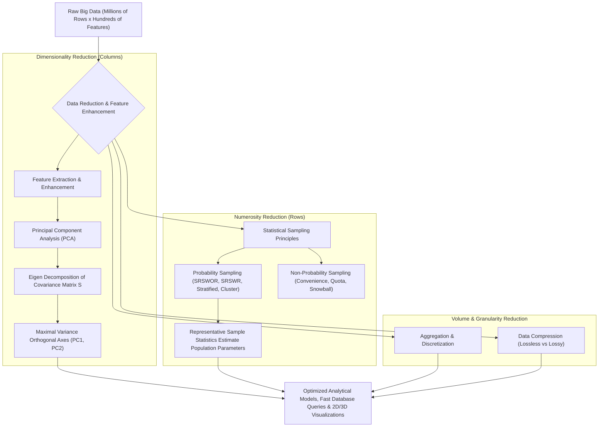

---

## 2. Core Terminology Dictionary & Formal Definitions

### 2.1 Tier 1: Core Terminology Quick-Reference Dictionary

| Term | Category | Formal Definition | Operational Context / Exam Significance |
| :--- | :--- | :--- | :--- |
| **Data Reduction** | Foundational | The systematic transformation of a dataset to obtain a reduced representation that is substantially smaller in volume yet closely maintains the integrity and analytical conclusions of the original data. | Foundational engineering requirement for big data scalability and visualization. |
| **Dimensionality Reduction** | Taxonomy | The process of mapping data from a high-dimensional attribute space into a lower-dimensional feature space while retaining critical structural information. | Mitigates the curse of dimensionality; executed via PCA, LDA, t-SNE, UMAP. |
| **Numerosity Reduction** | Taxonomy | The replacement of the original raw data volume with alternative, smaller representations of data (e.g., clusters, samples, parametric models). | Accelerates queries; includes histograms, clustering, sampling, regression. |
| **Population** | Sampling | The well-defined, complete collection of all individual elements, items, or observations under statistical investigation. | Denoted by size $N$; characterized by true fixed parameters ($\mu, \sigma$). |
| **Element** | Sampling | A single, distinct individual member or observation belonging to a population. | The ultimate atomic unit from which data properties are observed. |
| **Sample** | Sampling | A scientifically selected subset of population elements gathered to observe characteristics and infer population properties. | Denoted by size $n$ ($n \le N$); characterized by sample statistics ($\bar{X}, s$). |
| **Sampling Unit** | Sampling | The specific operational entity or container that is available for selection at a given stage of the sampling process. | May be an individual element or an aggregate container (e.g., a household or student database record). |
| **Sampling Frame** | Sampling | The comprehensive physical or electronic list, register, or directory of all sampling units from which a sample is drawn. | Critical prerequisite; frame omissions introduce severe selection bias. |
| **Subject** | Sampling | The actual physical individual, object, or entity from which an empirical measurement or response is recorded. | The participant completing a survey or the specimen undergoing testing. |
| **Parameter** | Sampling | A fixed, numerical summary measure that describes a specific characteristic of the entire population. | Greek symbols ($\mu, \sigma, \sigma^2, P$); typically unknown in practice. |
| **Statistic** | Sampling | A variable, numerical summary measure computed directly from the observed sample data to estimate a population parameter. | Roman symbols ($\bar{X}, s, s^2, p$); subject to sampling variation. |
| **Sampling Error** | Sampling | The mathematical difference or deviation between a sample statistic and the true population parameter attributable to chance selection or design flaws. | Controlled by increasing sample size $n$ and applying stratified designs. |
| **SRSWOR** | Probability Sampling | Simple Random Sampling Without Replacement; every item has an equal probability of selection, and once selected, is removed from the pool. | Ensures distinct elements; joint selection probabilities change across draws. |
| **SRSWR** | Probability Sampling | Simple Random Sampling With Replacement; selected items are returned to the population pool before the next draw. | Independent draws; allows duplicate selections; population size remains constant. |
| **Stratified Sampling** | Probability Sampling | A design where the population is partitioned into mutually exclusive, homogeneous subgroups (strata) and independent samples are drawn from each stratum. | Essential for skewed or imbalanced populations; ensures minority class representation. |
| **Cluster Sampling** | Probability Sampling | A design where the population is partitioned into internally heterogeneous clusters, a random sample of clusters is chosen, and all/some elements within chosen clusters are surveyed. | Economically optimal when geographic dispersion makes individual sampling prohibitive. |
| **Systematic Sampling** | Probability Sampling | Selecting elements from an ordered sampling frame at regular numerical intervals using a constant step size $k = N/n$ after a random starting point. | Rapid and simple; vulnerable to hidden periodicity in frame ordering. |
| **Principal Component Analysis (PCA)** | Feature Extraction | An unsupervised, linear, orthogonal mathematical transformation that converts a set of correlated variables into a set of linearly uncorrelated variables called principal components. | Solves multicollinearity; condenses variance into top orthogonal axes. |
| **Covariance Matrix** | Linear Algebra | A symmetric square matrix $S \in \mathbb{R}^{d \times d}$ whose diagonal elements represent variances and whose off-diagonal elements represent pairwise covariances. | Captures full second-order joint linear relationships among all attributes. |
| **Eigenvalue ($\lambda$)** | Linear Algebra | A scalar representing the variance of the data points projected along the direction of its corresponding eigenvector. | Dictates the ranking of principal components; larger $\lambda \implies$ higher information content. |
| **Eigenvector ($v$)** | Linear Algebra | A non-zero directional vector whose spatial orientation remains invariant under linear transformation by matrix $S$, scaled only by $\lambda$. | Defines the coordinate axes of the new principal component feature space. |
| **Explained Variance Ratio (EVR)** | Validation | The proportion of the total dataset variance captured by a specific principal component $k$, calculated as $\lambda_k / \sum \lambda_j$. | Criteria for component truncation (e.g., retaining components explaining $\ge 90\%$ or $95\%$). |
| **Principal Component Scores** | Projection | The transformed coordinates of the original centered observations projected onto the new orthogonal eigenvector basis ($D \times V$). | Represents the decorrelated low-dimensional dataset used in downstream analytics. |

---

### 2.2 Tier 2: Comprehensive Formal Definition Blocks

#### Definition: Data Reduction
- **Meaning**: The computational process of decreasing the physical size, storage footprint, or complexity of a dataset while strictly preserving its information integrity and analytical conclusions.
- **Formal Definition**: Let a dataset be represented as a matrix $D \in \mathbb{R}^{N \times d}$ containing $N$ records across $d$ attributes. Data reduction is a mapping function $\Phi: D \to D'$ where $D' \in \mathbb{R}^{n \times k}$ such that $n \le N$, $k \le d$, and $n \cdot k < N \cdot d$, subject to the optimization condition that an analytical query or learning algorithm $f(D')$ produces an outcome $\hat{Y}$ that approximates $f(D)$ within an error tolerance $\epsilon$: $\|f(D) - f(D')\| \le \epsilon$.
- **Intuition**: Think of data reduction as summarizing a 500-page encyclopedia into a 20-page executive brief. You eliminate repetitive details, drop irrelevant background noise, and consolidate related chapters, allowing an executive to make the exact same business decisions in minutes rather than weeks.
- **Example**: In a financial database with 10 million individual point-of-sale transactions, storing raw second-by-second timestamps is reduced by aggregating daily customer expenditure totals, compressing storage by 99% while retaining complete utility for quarterly revenue forecasting.

[Source: `Unit 4_Data reduction and Sampling.pdf`, Slide 2]

---

#### Definition: Dimensionality Reduction
- **Meaning**: Reducing the number of input attributes (columns/features) under consideration in a dataset.
- **Formal Definition**: Given an input feature vector $\mathbf{x} = [x_1, x_2, \dots, x_d]^T \in \mathbb{R}^d$, dimensionality reduction constructs a mapping function $g: \mathbb{R}^d \to \mathbb{R}^k$ (where $k \ll d$) yielding a compressed vector $\mathbf{z} = [z_1, z_2, \dots, z_k]^T \in \mathbb{R}^k$ such that information loss is minimized under a metric objective (e.g., reconstruction error or variance preservation).
- **Intuition**: If you describe a person using both height in inches and height in centimeters, one feature is completely redundant. Dimensionality reduction collapses collinear, highly correlated, or irrelevant measurements into a compact set of informative feature axes.
- **Example**: Projecting a 50-variable biometric dataset (heart rate, blood pressure, oxygen saturation, glucose, body mass index, etc.) onto 3 uncorrelated principal components using Principal Component Analysis (PCA).

[Source: `Unit 4_Data reduction and Sampling.pdf`, Slide 4; `Unit_4_PCA.pdf`, Slide 2]

---

#### Definition: Numerosity Reduction
- **Meaning**: Replacing the massive volume of raw records (rows) with alternative, much smaller representations of the data.
- **Formal Definition**: An algorithmic compression strategy that replaces the original instance set $S = \{x_1, x_2, \dots, x_N\}$ with a compact proxy set $S^* = \{\tilde{x}_1, \tilde{x}_2, \dots, \tilde{x}_n\}$ (where $n \ll N$) or a parametric mathematical model $\Theta$, such that queries over $S^*$ approximate queries over $S$.
- **Intuition**: Instead of saving the test score of every single student across an entire country, an educational board might store a histogram of grade brackets or representative cluster centroids representing typical performance profiles.
- **Example**: Grouping 1,000,000 customer purchase vectors into 10 distinct $k$-means cluster centroids, storing only the centroid coordinates and cluster sizes.

[Source: `Unit 4_Data reduction and Sampling.pdf`, Slide 4]

---

#### Definition: Statistical Sampling
- **Meaning**: The scientific procedure of selecting a representative subset of observations from a larger target population to infer characteristics about the entire population.
- **Formal Definition**: The selection of an $n$-element subset $s = \{e_1, e_2, \dots, e_n\}$ from a finite population $U = \{1, 2, \dots, N\}$ according to a well-defined probability distribution $P(s)$, such that sample statistics computed on $s$ serve as unbiased or minimum-variance estimators of unknown population parameters $\theta \in \mathbb{R}$.
- **Intuition**: A chef does not consume an entire 10-liter pot of soup to check whether it needs salt; stirring the pot thoroughly (ensuring homogeneity) and tasting a single spoonful provides an accurate assessment of the entire batch.
- **Example**: Extracting 200 randomly selected student academic records from a university enrollment database of 2,000 students to estimate the campus-wide average Grade Point Average (GPA).

[Source: `Unit 4_Data reduction and Sampling.pdf`, Slides 6, 7]

---

#### Definition: Population vs. Sample
- **Meaning**: The population represents the entirety of elements under study, whereas the sample is the observed fraction extracted from it.
- **Formal Definition**:
  - **Population ($U$)**: The universe set of all $N$ elements: $U = \{u_1, u_2, \dots, u_N\}$.
  - **Sample ($s$)**: A proper subset $s \subset U$ consisting of $n$ elements ($n \le N$).
- **Intuition**: The population is the full reality you wish to understand; the sample is the practical window through which you observe that reality due to resource, time, and budget limitations.
- **Example**: All 15,000 enrolled undergraduate students at a state university form the **Population** ($N = 15,000$); an extracted group of 300 students chosen to complete a course evaluation survey forms the **Sample** ($n = 300$).

[Source: `Unit 4_Data reduction and Sampling.pdf`, Slide 12]

---

#### Definition: Parameter vs. Statistic
- **Meaning**: A parameter is a true numerical characteristic of the population, while a statistic is an empirical estimate computed from sample data.
- **Formal Definition**:
  - **Parameter ($\theta$)**: A measurable functional of the population distribution, $\theta = g(U)$, such as the true population mean $\mu = \frac{1}{N}\sum_{i=1}^N X_i$ or population variance $\sigma^2 = \frac{1}{N}\sum_{i=1}^N (X_i - \mu)^2$.
  - **Statistic ($T$)**: A function of the observable random sample observations, $T = h(X_1, X_2, \dots, X_n)$, such as the sample mean $\bar{X} = \frac{1}{n}\sum_{i=1}^n X_i$ or sample variance $s^2 = \frac{1}{n-1}\sum_{i=1}^n (X_i - \bar{X})^2$.
- **Intuition**: The parameter is the hidden ground truth you wish you knew; the statistic is the calculated guess you make using the data points in your hand.
- **Example**: The true average height of all 15,000 university students is a **Parameter** ($\mu = 171.5\text{ cm}$); the average height computed from 200 surveyed students is a **Statistic** ($\bar{X} = 171.8\text{ cm}$).

[Source: `Unit 4_Data reduction and Sampling.pdf`, Slides 13, 14]

---

#### Definition: Sampling Error
- **Meaning**: The discrepancy between a sample statistic and the true population parameter caused by observing only a fraction of the population.
- **Formal Definition**: For a population parameter $\theta$ and its sample estimator $\hat{\theta}$, the sampling error is defined as $e = \hat{\theta} - \theta$. It is governed by sampling variance $\text{Var}(\hat{\theta})$ and potential design bias $\text{Bias}(\hat{\theta}) = \mathbb{E}[\hat{\theta}] - \theta$, with Mean Squared Error given by $\text{MSE}(\hat{\theta}) = \text{Var}(\hat{\theta}) + [\text{Bias}(\hat{\theta})]^2$.
- **Intuition**: Even with a fair coin, flipping it 10 times might yield 6 heads ($60\%$) instead of the theoretical $50\%$. The $10\%$ gap is random sampling variation.
- **Example**: If the true campus voter support for a student council proposal is $65.0\%$ ($\theta = 0.65$), but a random sample of 100 students indicates $61.0\%$ support ($\hat{\theta} = 0.61$), the sampling error is $-4.0\%$.

[Source: `Unit 4_Data reduction and Sampling.pdf`, Slide 15]

---

#### Definition: Principal Component Analysis (PCA)
- **Meaning**: An unsupervised linear transformation technique that identifies orthogonal directions (principal components) along which data variance is maximized.
- **Formal Definition**: Given a centered data matrix $X_c \in \mathbb{R}^{n \times d}$ with sample covariance matrix $S = \frac{1}{n-1} X_c^T X_c \in \mathbb{R}^{d \times d}$, PCA solves the sequence of constrained optimization problems:

$$
w_1 = \arg\max_{\|w\|=1} w^T S w
$$

$$
w_k = \arg\max_{\|w\|=1, w \perp w_1, \dots, w \perp w_{k-1}} w^T S w
$$

  where each vector $w_k$ is the $k$-th orthonormal eigenvector of $S$ associated with the $k$-th largest eigenvalue $\lambda_k$.

- **Intuition**: Imagine looking at an elongated, tilted football hovering in a 3D room. If you take a photo from the side showing its longest axis, you capture almost all of its shape in a flat 2D shadow. PCA finds the exact angle that captures the maximum spread of the data cloud.
- **Example**: Rotating a correlated 2-variable health record (Blood Pressure and Oxygen Saturation) into two orthogonal axes ($PC_1, PC_2$), where $PC_1$ captures $97.44\%$ of all biological variability.

[Source: `Unit_4_PCA.pdf`, Slides 2, 4, 14, 15]

---

## 3. Data Reduction Foundations & Master Taxonomy

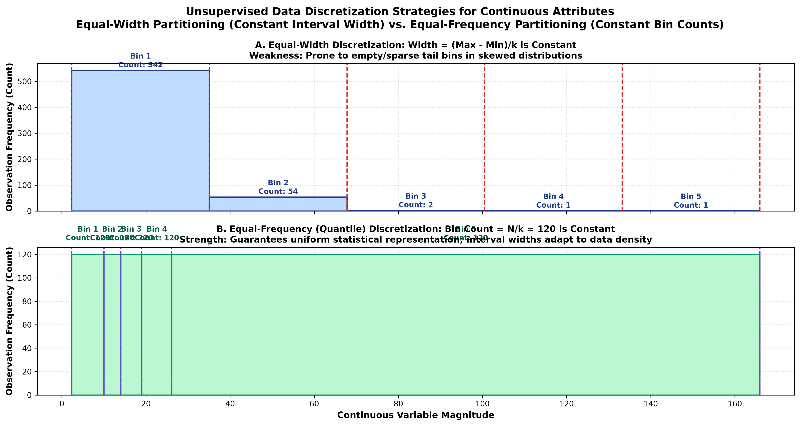


### 3.1 The Imperative for Data Reduction

In real-world data mining and analytical engineering, datasets routinely scale into gigabytes and terabytes, containing tens of millions of rows and hundreds of attributes. Analyzing such raw datasets directly creates severe operational difficulties:

- **Exhaustion of Working Memory**: In-memory algorithms (such as matrix inversion, distance calculations in KNN, and hierarchical clustering) experience memory crashes ($O(N^2)$ space complexity).
- **Prohibitive Time Complexity**: Training complex machine learning models or executing exploratory queries requires hours or days on massive datasets.
- **The Curse of Dimensionality**: As the attribute dimension $d$ grows, the volume of feature space expands exponentially, causing data points to become equidistant and sparse. Distance metrics become meaningless, leading to severe model overfitting.
- **Human Cognitive Limits**: Human analysts cannot visually inspect or comprehend relationships across 50 simultaneous dimensions without dimensional projection to 2D or 3D scatter plots.

---

### 3.2 The Four Core Goals of Data Reduction

Data reduction is governed by four engineering and analytical objectives:

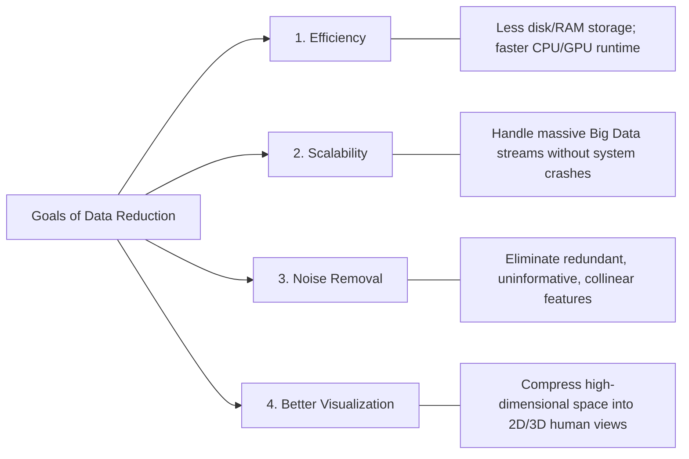

1. **Efficiency**: Decreasing memory requirements and accelerating analytical processing. A reduced dataset requires significantly less cache, RAM, and persistent storage, speeding up downstream machine learning training and iterative SQL queries.
2. **Scalability**: Enabling standard algorithms to process big data without performance degradation. By replacing raw data with compact proxies, algorithms that scale poorly (e.g., $O(N^2)$ or $O(N^3)$) can run smoothly on modern hardware.
3. **Noise Removal**: Eliminating spurious, irrelevant, or highly correlated features allows predictive models to focus exclusively on underlying structural patterns, improving generalization accuracy on unseen test data.
4. **Better Visualization**: Projecting high-dimensional feature spaces into 2D or 3D scatter plots enables analysts to identify natural clusters, detect extreme anomalies, and discover non-linear trends visually.

[Source: `Unit 4_Data reduction and Sampling.pdf`, Slide 3]

---

### 3.3 Concrete Motivating Scenario: The 10-Million Transaction Benchmark

Consider an enterprise e-commerce platform processing credit card transactions:

- **Raw Volume**: $N = 10,000,000$ individual purchase logs per month.
- **Feature Width**: $d = 50$ recorded variables (timestamps, merchant IDs, transaction amounts, user demographics, IP locations, terminal device codes, etc.).
- **Physical Size**: Approximately 5 gigabytes of uncompressed relational records per month.

Attempting to train an exploratory customer segmentation algorithm directly on this raw log table results in severe latency and database lockups. Applying the core data reduction paradigms transforms the data efficiently:

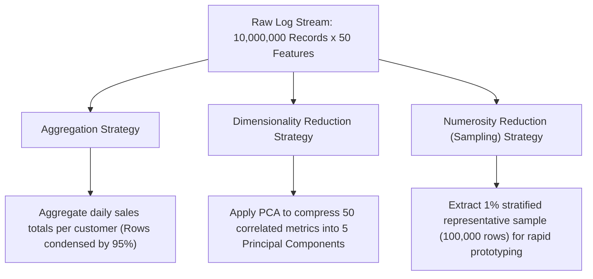

- **Aggregation Strategy**: Instead of tracking millisecond-level transaction timestamps, aggregate transactions into daily or weekly total expenditures per customer account. This reduces row volume from $10,000,000$ to $500,000$ records while preserving trend dynamics.
- **Dimensionality Reduction Strategy**: Instead of processing 50 distinct behavioral and demographic indicators—many of which are highly correlated (e.g., gross income, net income, credit limit, total spending)—Principal Component Analysis (PCA) condenses the 50 original attributes into 5 uncorrelated principal components capturing $>95\%$ of all variance.
- **Sampling Strategy**: Instead of training initial machine learning prototypes on all 10 million rows, extract a statistically representative $1\%$ sample ($n = 100,000$ rows) using stratified sampling. Exploratory model hyperparameter tuning executes in seconds rather than hours, converging on near-identical optimal parameters.

[Source: `Unit 4_Data reduction and Sampling.pdf`, Slide 2]

---

### 3.4 Master Taxonomy of Data Reduction Techniques

Data reduction strategies are broadly classified into five primary technical families:

```mermaid
graph TD
    MDR["Master Taxonomy of Data Reduction"]

    MDR --> DR["1. Dimensionality Reduction"]
    DR --> PCA["PCA (Principal Component Analysis)"]
    DR --> LDA["LDA (Linear Discriminant Analysis)"]
    DR --> TSNE["t-SNE (t-Distributed Stochastic Neighbor Embedding)"]
    DR --> UMAP["UMAP (Uniform Manifold Approximation & Projection)"]

    MDR --> NR["2. Numerosity Reduction"]
    NR --> HIST["Histograms (Binning & Frequency)"]
    NR --> CLUST["Clustering (k-Means Centroid Summaries)"]
    NR --> SAMP["Sampling (Random, Stratified, Systematic)"]
    NR --> REGM["Regression Models (Parametric Functions)"]

    MDR --> DC["3. Data Compression"]
    DC --> LOSSLESS["Lossless Compression (ZIP, Huffman, Run-Length)"]
    DC --> LOSSY["Lossy Compression (JPEG, MP3, Wavelet Transform)"]

    MDR --> AGG["4. Aggregation"]
    AGG --> TIME["Temporal Roll-up (Hourly -> Daily -> Monthly)"]
    AGG --> SPAT["Spatial Roll-up (Store -> City -> State -> Country)"]

    MDR --> DISC["5. Discretization"]
    DISC --> DISC_BIN["Interval Binning: Continuous Age -> {Young, Middle, Senior}"]
```

1. **Dimensionality Reduction**: Eliminating attribute columns through feature extraction or feature selection.
   - *Principal Component Analysis (PCA)*: Unsupervised orthogonal linear projection maximizing variance.
   - *Linear Discriminant Analysis (LDA)*: Supervised linear projection maximizing class separability ($\max S_B / S_W$).
   - *t-SNE & UMAP*: Non-linear manifold learning techniques designed for low-dimensional exploratory visualization.
2. **Numerosity Reduction**: Replacing large instance collections with smaller proxy representations.
   - *Histograms*: Partitioning continuous attribute domains into discrete bins and recording frequency counts.
   - *Clustering*: Replacing instance clusters with their mathematical centroids and cluster dispersion parameters.
   - *Sampling*: Extracting statistically sound subsets of instances (random, stratified, systematic).
   - *Regression Models*: Fitting parametric curves ($y = \beta_0 + \beta_1 x$) to approximate data clouds with a handful of coefficients.
3. **Data Compression**: Applying encoding transformations to reduce physical bit storage.
   - *Lossless Compression*: Exact mathematical reconstruction of original bit sequences without data loss (e.g., Huffman coding, Lempel-Ziv-Welch, ZIP).
   - *Lossy Compression*: Irreversible reconstruction discarding imperceptible information to achieve higher compression ratios (e.g., JPEG for imagery, MP3 for acoustics, Discrete Wavelet Transforms).
4. **Aggregation**: Combining multiple detailed observations into single higher-level summary metrics (e.g., summing hourly transaction logs into monthly store revenue figures).
5. **Discretization**: Transforming continuous infinite numeric domains into discrete, finite categorical intervals or nominal codes (e.g., mapping continuous age measurements into discrete life-stage categories: `Young [0-25]`, `Middle-aged [26-55]`, `Senior [56+]`).

[Source: `Unit 4_Data reduction and Sampling.pdf`, Slides 4, 5]

---

### 3.5 Comparative Analysis of Data Reduction Families

| Reduction Family | Target Dimension | Core Mechanism | Information Loss Profile | Reconstruction Feasibility | Primary Use Case in Analytics |
| :--- | :--- | :--- | :--- | :--- | :--- |
| **Dimensionality Reduction (e.g., PCA)** | Columns (Attributes) | Linear/non-linear projection onto lower-dimensional orthogonal bases. | Low to Moderate (discards low-variance residual noise). | Approximate (linear inverse transform $X \approx Z W^T$). | Eliminating multicollinearity; 2D/3D visualization; ML feature compression. |
| **Numerosity Reduction (Sampling)** | Rows (Instances) | Probabilistic extraction of a representative subset. | Low for macro statistics; High for rare edge-case records. | None (unsampled rows are permanently omitted from model fitting). | Rapid prototyping; Big Data model training; exploratory hypothesis testing. |
| **Numerosity Reduction (Clustering)** | Rows (Instances) | Replacing instance groups with centroid vectors and radii. | Moderate (individual row variance within clusters is averaged out). | Approximate (all records mapped to cluster centroid coordinates). | Customer segmentation; vector quantization; anomaly filtering. |
| **Data Compression (Lossless)** | Physical Bits | Entropy encoding, dictionary substitutions (ZIP, Huffman). | Zero loss (100% exact bit reconstruction). | Full exact reconstruction. | Archival data storage; network data transmission. |
| **Data Compression (Lossy)** | Physical Bits | Frequency domain truncation (Wavelets, DCT, JPEG). | Controlled loss of high-frequency components. | Approximate reconstruction. | Image, video, and audio streaming; multimedia analytics. |
| **Aggregation** | Rows & Granularity | Mathematical roll-up (SUM, AVG, MIN, MAX) over grouping keys. | High for micro-level detail; Zero for grouped aggregate totals. | Irreversible (individual transaction timestamps cannot be recovered). | Data warehousing; OLAP cubes; executive dashboard reporting. |
| **Discretization** | Column Domains | Binning continuous values into categorical intervals. | Minor loss of local continuous numeric precision. | Irreversible (mapped to categorical interval label). | Decision tree splits; rule-based classifiers; Bayesian networks. |

---

## 4. Statistical Sampling Principles

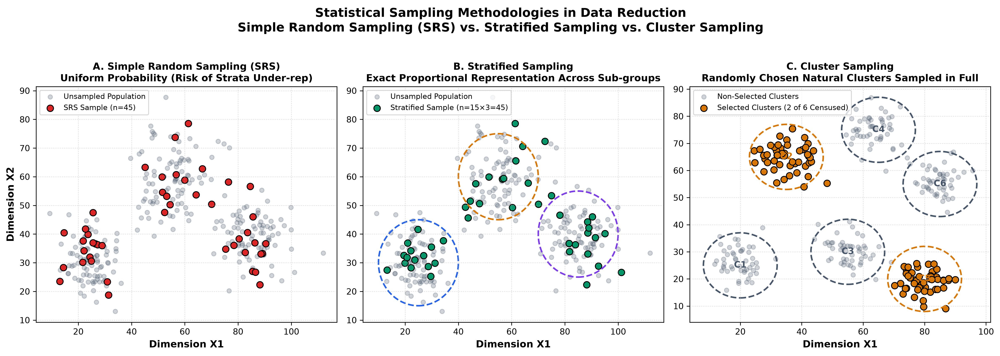


### 4.1 Foundations: Population, Sample, and Statistical Inference

The fundamental goal of statistical sampling is to draw reliable, generalizable conclusions about an entire target population by directly observing only a small, representative fraction of that population.

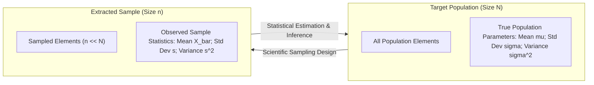

- **Population ($N$)**: The complete universe of elements, individuals, items, or records under study. Characterized by true, fixed parameters: population mean $\mu$, population standard deviation $\sigma$, and population variance $\sigma^2$.
- **Sample ($n$)**: The observed subset selected from the population ($n \ll N$). Characterized by sample statistics: sample mean $\bar{X}$, sample standard deviation $s$, and sample variance $s^2$.
- **Statistical Inference**: The formal mathematical induction process whereby sample statistics ($\bar{X}, s$) serve as empirical estimators to predict unknown population parameters ($\mu, \sigma$). When the sample is selected in an unbiased, scientific manner, the sample statistics are guaranteed to converge closely to the true population parameters.

[Source: `Unit 4_Data reduction and Sampling.pdf`, Slides 6, 7, 14]

---

### 4.2 Critical Architectural Caveats in Data Science Sampling

#### The Skewness Warning: Why Simple Random Sampling Fails on Imbalanced Data
In real-world data science, datasets rarely follow perfectly balanced, symmetric Gaussian distributions. They frequently exhibit extreme class skewness or long-tailed Pareto distributions:

- **The Problem**: In fraud detection, network intrusion monitoring, rare medical diagnosis, or catastrophic equipment failure, the target class of interest may represent less than $0.1\%$ or $0.01\%$ of all records.
- **The Failure Mechanism**: If an analyst applies Simple Random Sampling (SRS) to extract a $1\%$ sample from a database containing 1,000,000 normal transactions and 100 fraudulent transactions, the expected number of fraud cases captured is only $100 \times 0.01 = 1$. Due to random sampling variation, the sample may capture zero fraud cases. A model trained on this sample will fail entirely to learn fraud patterns.
- **The Solution**: Adaptive, stratified sampling must be employed. The population is explicitly partitioned into majority and minority strata. The rare stratum is oversampled (or sampled at 100%), ensuring adequate representation of the minority class in the analytical subset.

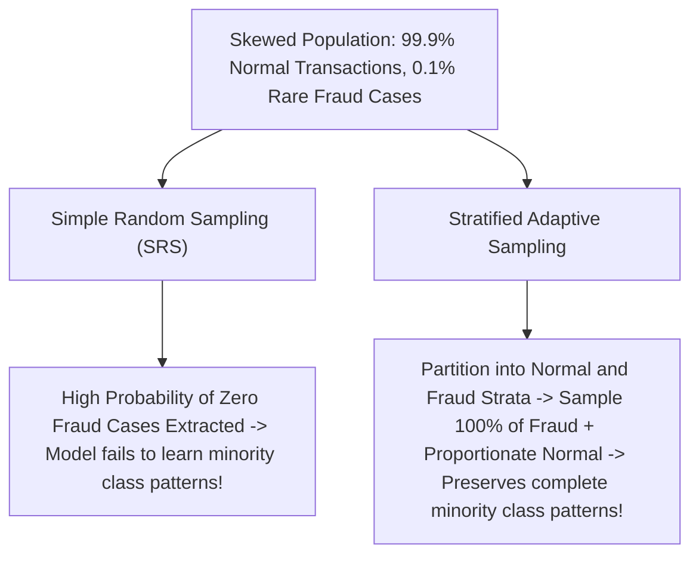

[Source: `Unit 4_Data reduction and Sampling.pdf`, Slide 6, 9]

---

#### The Database I/O Caveat: Why Record-Level Sampling Fails to Reduce Disk Block Reads
In database management systems (DBMS), relational data is stored on disk in fixed-size physical storage pages (blocks), typically 4 KB, 8 KB, or 16 KB in size. Each disk page contains dozens or hundreds of individual records.

- **The Database Storage Mechanism**: Disk drive read operations operate at the page level, not the individual record level. Reading a single byte requires reading the entire 8 KB page into database buffer RAM.
- **The Sampling Bottleneck**: When a naive SQL query executes random row-level sampling (e.g., `SELECT * FROM table WHERE RAND() < 0.01`), the randomly selected rows are scattered uniformly across virtually every physical storage page on the disk.
- **The Consequence**: Even though only $1\%$ of the records are retrieved, the database engine must physically read $100\%$ of the disk blocks off persistent storage into RAM. Consequently, **record-level sampling achieves zero reduction in physical disk I/O operations** and offers no query speedup on I/O-bound systems!
- **Engineering Remedy**: High-performance database engines implement **block-level sampling** (e.g., Oracle `SAMPLE BLOCK`, PostgreSQL system sampling), where entire physical disk pages are sampled randomly rather than individual scattered rows, reducing physical disk I/O in direct proportion to the sampling rate.

```text
Physical Disk Storage (Pages containing clustered records):
+-------------------------------------------------------------------------------+
| Page 1 [R1, R2, R3, R4] | Page 2 [R5, R6, R7, R8] | Page 3 [R9, R10, R11, R12] |
+-------------------------------------------------------------------------------+
        ^                         ^                          ^
Naive Row Sampling (1% Sample):
Picks R2                   Picks R7                   Picks R11
=> The database engine MUST fetch Page 1, Page 2, AND Page 3!
=> 100% of Physical Disk Pages are read into RAM (ZERO I/O Reduction!).

Block-Level Sampling (33% Sample):
Fetches Page 1 ONLY        [Page 2 Skipped]           [Page 3 Skipped]
=> Reads all records in Page 1 (R1, R2, R3, R4).
=> 66% Reduction in Physical Disk Page I/O!
```

[Source: `Unit 4_Data reduction and Sampling.pdf`, Slide 6]

---

### 4.3 The Six Core Justifications for Sampling

Conducting a complete census of an entire population is rarely feasible or desirable. Six primary factors justify sampling:

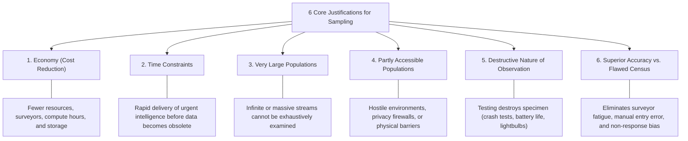

1. **Economy (Resource Efficiency)**: Surveying or processing an entire population demands immense financial, hardware, and administrative expenditure. Sampling achieves valid analytical answers with a fraction of the budget.
2. **Time Factor**: Modern decision-making demands rapid turnaround. A comprehensive census may take months or years to collect and clean, rendering the conclusions obsolete before publication. A sample provides actionable intelligence quickly.
3. **Very Large Populations**: Many populations are practically infinite (e.g., industrial sensor telemetry streams, web clickstream events, daily global internet packet traffic). Exhaustive examination is mathematically impossible.
4. **Partly Accessible Populations**: Certain subsets of a population are physically, legally, or technologically inaccessible (e.g., wildlife tracking in dense rainforests, medical patient populations protected by privacy laws, deep subterranean geological formations). Only accessible sample pockets can be gathered.
5. **Destructive Nature of Observation**: In quality assurance and reliability engineering, observing a unit's ultimate characteristic requires destroying it. Examples include measuring the crash-impact resistance of automobiles, determining the burn-out life of light bulbs, or testing the explosive pressure of artillery shells. Conducting a census would destroy the entire inventory.
6. **Superior Accuracy**: Counterintuitively, a scientifically drawn sample often yields **more accurate data than a complete census**. A census requires massive field operations, leading to enumerator fatigue, poorly trained survey staff, inconsistent data entry, and missing records. A sample allows researchers to train a small team thoroughly, use precision instruments, and audit every record meticulously, resulting in lower total error.

[Source: `Unit 4_Data reduction and Sampling.pdf`, Slide 8]

---

### 4.4 Characteristics of a High-Quality Sample

A scientifically sound sample must satisfy two foundational statistical criteria:

```text
+-------------------------------------------------------------------------------+
|                      QUALITIES OF A HIGH-QUALITY SAMPLE                       |
+-------------------------------------------------------------------------------+
| 1. ACCURACY (Absence of Systematic Bias):                                     |
|    - The expected value of the sample statistic equals the true parameter:    |
|      E[hat(theta)] = theta  =>  Bias = 0.                                     |
|    - Systematic bias occurs when specific population subgroups are            |
|      systematically favored or excluded (e.g., voluntary response bias).      |
+-------------------------------------------------------------------------------+
| 2. PRECISION (Low Sampling Variance / Narrow Confidence Interval):            |
|    - The sample estimates cluster tightly around their expected value:        |
|      Var(hat(theta)) = sigma^2 / n  ->  0 as n increases.                     |
|    - Governed by sample size and variance; maximized via stratified designs.  |
+-------------------------------------------------------------------------------+
```

#### Sampling Error vs. Non-Sampling Error
- **Sampling Error**: The inherent random statistical variability that arises because a sample is observed rather than the full census. It can be mathematically quantified and reduced by increasing sample size $n$ ($SE \propto 1/\sqrt{n}$).
- **Non-Sampling Error (Bias)**: Systematic distortion introduced by procedural failures:
  - *Sampling Frame Defects*: Under-coverage where eligible elements are missing from the list.
  - *Non-Response Bias*: When individuals who decline to participate hold systematically different opinions than respondents.
  - *Measurement / Instrument Bias*: Poorly phrased survey questions or miscalibrated sensors.

[Source: `Unit 4_Data reduction and Sampling.pdf`, Slide 15]

---

### 4.5 The Five-Step Sampling Lifecycle

Executing a sound statistical sampling study requires adhering to a structured 5-stage engineering lifecycle:

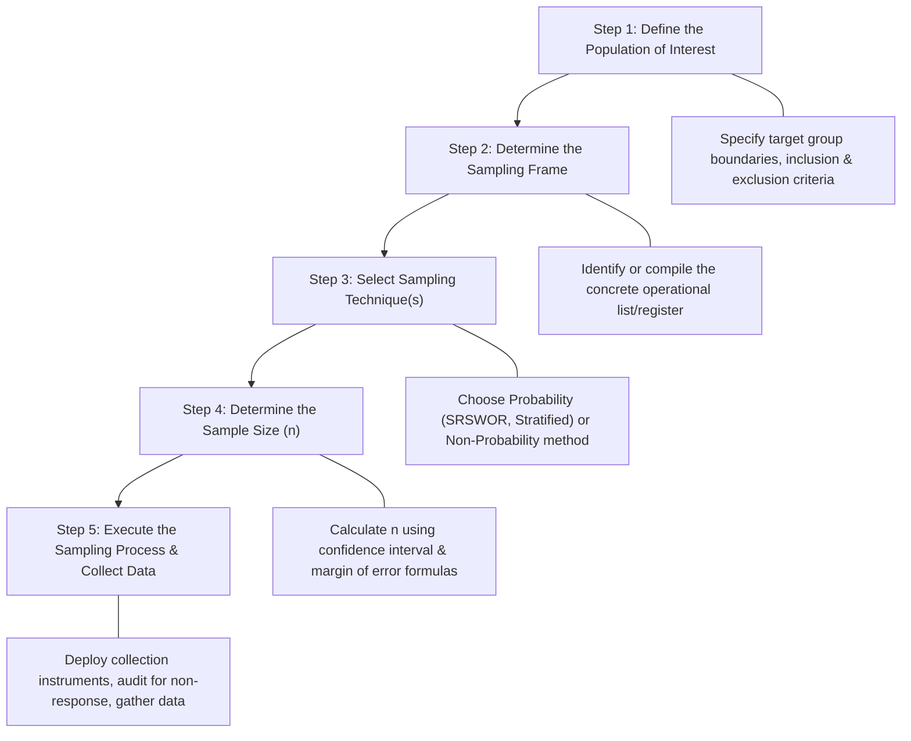

1. **Step 1: Define the Population of Interest**: Clearly establish the boundaries, inclusion criteria, and exclusion rules for the target group.
   - *Example*: All undergraduate students currently registered at an engineering college for the Autumn 2026 academic term ($N = 2,000$).
2. **Step 2: Determine the Sampling Frame**: Identify or construct the physical or electronic master register from which sample units are selected.
   - *Example*: The centralized Registrar's database enrollment roster containing student IDs, majors, and contact details.
3. **Step 3: Select Sampling Technique(s)**: Decide on the mathematical selection mechanism based on research goals, population homogeneity, and budget constraints.
   - *Example*: Choosing stratified random sampling based on academic department to ensure balanced representation across majors.
4. **Step 4: Determine the Sample Size ($n$)**: Apply statistical sample size determination formulas balancing acceptable margin of error ($E$), confidence level ($Z_{\alpha/2}$), and estimated population variance ($\sigma^2$):

$$
n = \frac{Z^2 \cdot \sigma^2}{E^2}
$$

   - *Example*: Selecting $n = 200$ students out of $N = 2,000$ to achieve a $95\%$ confidence level with a $\pm 5\%$ margin of error.
5. **Step 5: Execute the Sampling Process & Collect Data**: Implement the randomized draw, deploy measurement protocols, track non-responses, and assemble the final dataset.
   - *Example*: Sending customized digital survey links to the 200 selected student IDs and monitoring response rates with follow-up reminders.

[Source: `Unit 4_Data reduction and Sampling.pdf`, Slides 16, 17]

---

## 5. Comprehensive Taxonomy of Sampling Techniques

Sampling methods are split into two broad categories: **Probability (Random) Sampling** and **Non-Probability Sampling**.

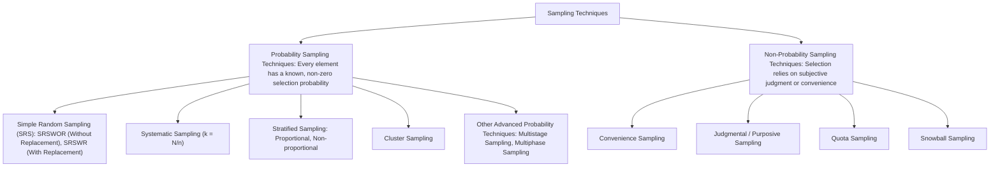

[Source: `Unit 4_Data reduction and Sampling.pdf`, Slides 18, 19, 20]

---

### 5.1 Probability Sampling Methodologies

Probability sampling requires that every element in the sampling frame has a known, mathematically non-zero probability of being selected. It eliminates researcher bias and provides the theoretical foundation for calculating confidence intervals and hypothesis tests.

#### 1. Simple Random Sampling (SRS)
Every individual element in the population has an identical probability of selection: $P(e_i) = \frac{1}{N}$.

- **Simple Random Sampling Without Replacement (SRSWOR)**:
  - *Mechanism*: Once an element is selected, it is removed from the population pool and cannot be selected again.
  - *Properties*: Generates $n$ distinct observations. The total number of possible distinct samples is given by the combination formula:

$$
\binom{N}{n} = \frac{N!}{n!(N - n)!}
$$

  - *Probability Dynamics*: The probability of an element being selected on the first draw is $1/N$. On the second draw, it is $1/(N-1)$. However, the unconditional overall inclusion probability for every element remains exactly $n/N$.
- **Simple Random Sampling With Replacement (SRSWR)**:
  - *Mechanism*: An extracted element is recorded and returned to the population pool before the next draw.
  - *Properties*: Elements can appear multiple times in the sample. The total number of possible ordered samples is $N^n$.
  - *Probability Dynamics*: The probability of selection on every draw remains constant at $1/N$. The draws are completely independent.

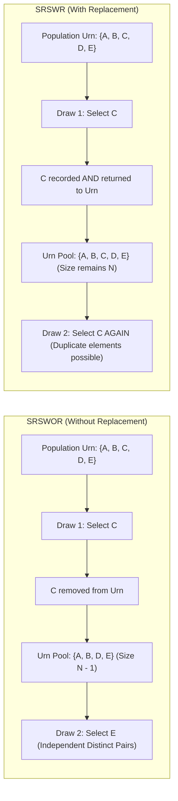

[Source: `Unit 4_Data reduction and Sampling.pdf`, Slides 9, 11]

---

#### 2. Systematic Sampling
Elements are selected at fixed, regular intervals along an ordered sampling frame.

- **Mechanism**:
  1. Determine the sampling skip interval $k$:

$$
k = \left\lfloor \frac{N}{n} \right\rfloor
$$

  2. Select a random starting integer $r$ uniformly distributed such that $1 \le r \le k$.
  3. Extract elements at positions:

$$
r, \; r + k, \; r + 2k, \; r + 3k, \; \dots, \; r + (n - 1)k
$$

- **Advantages**: Extremely simple and rapid execution; ensures even dispersion across physical records or time intervals without managing complex randomization tables.
- **Caveat (Periodicity Hazard)**: If the sampling frame contains a hidden cyclic periodicity that coincides with the interval $k$ (e.g., sampling daily sales data every 7th day, thus selecting only Mondays), severe systematic bias occurs.

[Source: `Unit 4_Data reduction and Sampling.pdf`, Slides 18, 19]

---

#### 3. Stratified Sampling
The population is partitioned into non-overlapping, mutually exclusive, internally homogeneous subgroups called **strata**. Independent random samples are then extracted from each stratum.

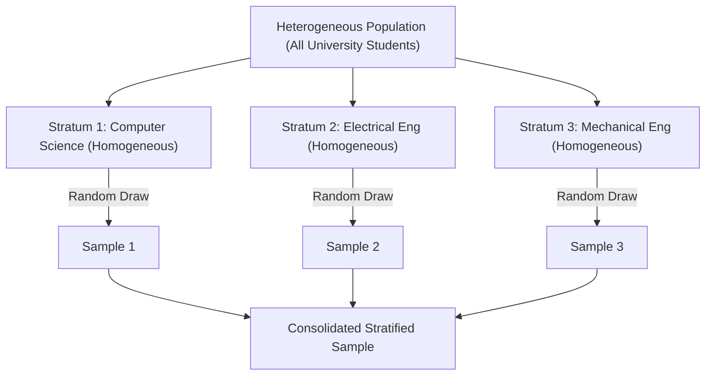

- **Stratum Principle**: **Homogeneity within strata, Heterogeneity between strata**.
- **Allocation Strategies**:
  - *Proportional Stratified Sampling*: Sample size per stratum $n_h$ is directly proportional to its stratum size $N_h$:

$$
n_h = n \cdot \left(\frac{N_h}{N}\right)
$$

  - *Disproportional (Optimal) Stratified Sampling (Neyman Allocation)*: Strata with higher variance $\sigma_h$ or lower collection cost $c_h$ are allocated larger sample shares:

$$
n_h \propto \frac{N_h \sigma_h}{\sqrt{c_h}}
$$

- **Significance**: Guarantees adequate representation of small or minority sub-populations (solving the skewness dilemma) and yields lower sampling variance than simple random sampling.

[Source: `Unit 4_Data reduction and Sampling.pdf`, Slides 9, 10, 18, 19]

---

#### 4. Cluster Sampling
The population is divided into naturally occurring, heterogeneous groups called **clusters**. A random sample of clusters is selected; then, either all elements in selected clusters are evaluated (**Single-Stage Cluster Sampling**) or a subsample is drawn (**Two-Stage Cluster Sampling**).

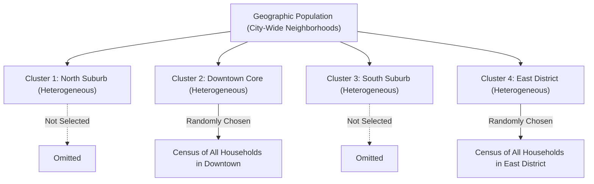

- **Cluster Principle**: **Heterogeneity within clusters, Homogeneity between clusters**. Each cluster serves as a mini-replica of the overall population.
- **Key Difference vs. Stratified Sampling**:
  - *Stratified*: Every stratum is sampled; individuals within a stratum are homogeneous. Maximizes statistical precision.
  - *Cluster*: Only selected clusters are sampled; individuals within a cluster are heterogeneous. Minimizes geographical data collection cost.

[Source: `Unit 4_Data reduction and Sampling.pdf`, Slides 10, 18, 19]

---

#### 5. Multistage and Multiphase Sampling
- **Multistage Sampling**: Extends cluster sampling across hierarchical administrative tiers. For instance, a national survey randomly selects states (Stage 1), districts within chosen states (Stage 2), schools within chosen districts (Stage 3), and finally students within chosen schools (Stage 4).
- **Multiphase Sampling**: The same sample elements are examined in successive phases of increasing measurement depth. In Phase 1, basic screening demographic data is collected from a large sample ($n_1 = 10,000$). In Phase 2, an expensive clinical diagnostic test is conducted on a targeted subsample of at-risk individuals ($n_2 = 250$).

[Source: `Unit 4_Data reduction and Sampling.pdf`, Slides 18, 19]

---

### 5.2 Non-Probability Sampling Methodologies

Non-probability sampling selects elements through non-random procedures (such as subjective judgment, geographic availability, or referral networks). Selection probabilities are unknown, precluding formal calculation of margins of error or confidence intervals. They remain popular for pilot studies, exploratory UX research, and qualitative interviews.

1. **Convenience Sampling**:
   - *Mechanism*: Selecting whatever population elements are most easily accessible to the researcher.
   - *Example*: An analyst surveying coworkers in their company cafeteria or stopping students at a campus library entrance.
   - *Evaluation*: Fast and virtually cost-free; highly vulnerable to severe self-selection and accessibility bias.
2. **Judgmental / Purposive Sampling**:
   - *Mechanism*: Selecting specific units based on expert judgment that they represent authoritative or typical prototypes.
   - *Example*: Interviewing 10 senior cloud security architects to evaluate enterprise zero-trust firewall configurations.
   - *Evaluation*: Highly efficient for niche domain expertise; depends entirely on researcher objectivity.
3. **Quota Sampling**:
   - *Mechanism*: Establishing demographic quotas (e.g., $50\%$ female, $30\%$ under 25, $20\%$ over 50) and filling each quota bucket via convenience methods until full.
   - *Example*: A street market researcher intercepting pedestrians until exactly 50 male and 50 female consumer surveys are completed.
   - *Evaluation*: Guarantees demographic proportions match target benchmarks without the logistical overhead of probabilistic randomization.
4. **Snowball Sampling (Network / Chain-Referral Sampling)**:
   - *Mechanism*: Identifying initial target participants who subsequently refer acquaintances from their peer networks.
   - *Example*: Conducting studies on rare hidden populations, such as underground cybersecurity malware authors or patients with ultra-rare genetic diseases.
   - *Evaluation*: The only feasible technique for hard-to-reach, stigmatized, or private groups; samples are non-independent and clustered within social circles.

[Source: `Unit 4_Data reduction and Sampling.pdf`, Slides 18, 19, 20]

---

### 5.3 Master Comparative Analysis of Sampling Techniques

| Technique | Category | Selection Mechanism | Key Strengths | Critical Limitations | Optimal Practical Application |
| :--- | :--- | :--- | :--- | :--- | :--- |
| **SRSWOR** | Probability | Equal chance $P = 1/N$; removed upon selection. | Simple theory; completely unbiased estimators. | Requires complete sampling frame; poor on skewed data. | Small, homogeneous populations with clean electronic rosters. |
| **SRSWR** | Probability | Equal chance $P = 1/N$; replaced upon selection. | Mathematical independence across draws; simple simulation. | Duplicate entries; slightly higher estimator variance. | Monte Carlo bootstrap simulations; algorithmic resamplers. |
| **Systematic** | Probability | Fixed interval $k = N/n$ after random start $r$. | Rapid physical execution; guaranteed spatial spread. | Highly vulnerable to hidden cyclical periodicity. | Assembly line quality control; systematically listed files. |
| **Stratified** | Probability | Random sampling within homogeneous strata. | High statistical precision; protects minority classes. | Requires prior knowledge of stratum variables; complex frame. | Skewed populations; demographic surveys; customer tier analysis. |
| **Cluster** | Probability | Random selection of heterogeneous clusters. | Minimizes travel and logistics costs; no full roster needed. | Higher sampling error (intracluster correlation design effect). | Broad geographic surveys; nationwide school/hospital audits. |
| **Multistage** | Probability | Successive hierarchical cluster sampling stages. | Highly practical for continental scale studies. | Complex variance estimation requiring survey weights. | National population censuses; large epidemiological studies. |
| **Convenience**| Non-Prob | Selecting nearby, readily available units. | Fastest; lowest cost; minimal administration. | Highest bias; results cannot be generalized to population. | Early pilot studies; questionnaire validation; UI prototyping. |
| **Judgmental** | Non-Prob | Deliberate selection based on expert discretion. | Focuses directly on rare, high-value experts. | Subjective bias; cannot calculate margin of error. | Qualitative field studies; elite stakeholder interviews. |
| **Quota** | Non-Prob | Convenience sampling matching demographic quotas. | Ensures representation of specific categories without frames. | Selection within quotas remains biased by interviewer habits. | Commercial market research; retail shopping feedback. |
| **Snowball** | Non-Prob | Existing subjects recruit future subjects. | Accesses hidden, hard-to-reach, or illicit groups. | Samples restricted to connected social networks. | Rare diseases; hacker communities; specialized subcultures. |

[Source: `Unit 4_Data reduction and Sampling.pdf`, Slides 18, 19, 20]

---

### 5.4 Key Strategic Factors in Sample Design

When designing an operational sampling strategy, researchers must balance six core constraints:

1. **Research Objectives**: Exploratory pilot work permits convenience sampling, whereas regulatory submissions demand rigorous stratified probability designs.
2. **Degree of Accuracy Required**: High-stakes decisions (e.g., medical device defect testing) require tight margins of error ($E \le 1\%$) and large sample sizes, whereas trend sensing tolerates $E = 5\%$.
3. **Resource Availability**: Financial budget, computing hardware, and field staffing determine whether single-stage or cluster sampling is feasible.
4. **Time Frame**: Urgent project deadlines favor systematic or quota methods over multi-month stratified field surveys.
5. **Knowledge of Target Population**: When subgroup variances and demographic distributions are known, stratified sampling is optimal. When the population structure is unknown, simple random sampling is the default.
6. **Research Scope**: A single-site university study utilizes SRS; a nationwide audit mandates multi-stage cluster sampling.

[Source: `Unit 4_Data reduction and Sampling.pdf`, Slide 21]

---

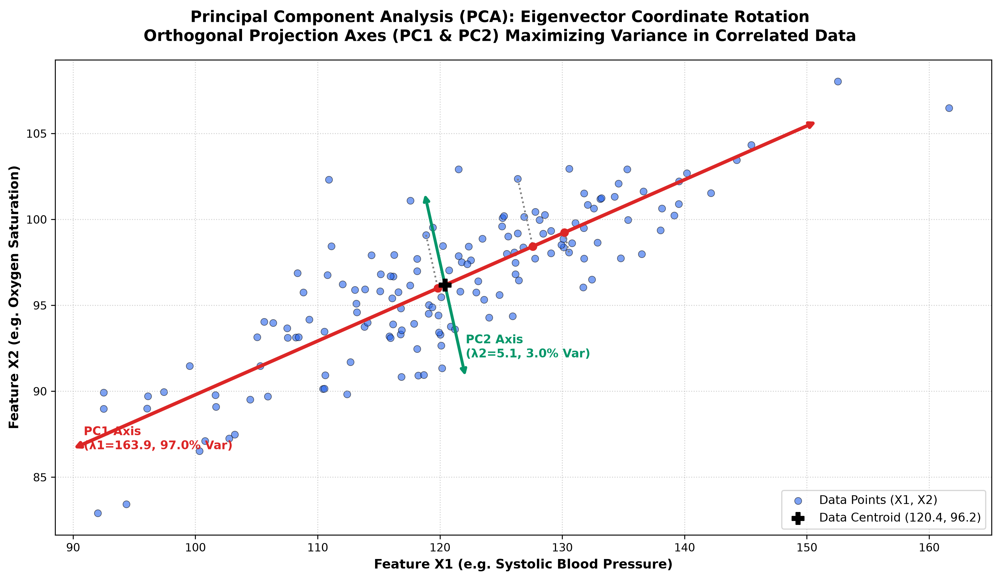

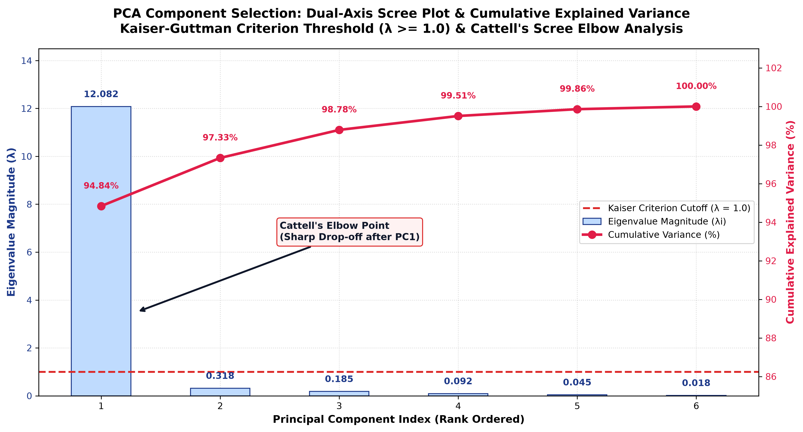

## 6. Principal Component Analysis (PCA) — Comprehensive Theory & Derivations

### 6.1 What is Principal Component Analysis?

Principal Component Analysis (PCA) is an **unsupervised, linear, non-parametric mathematical transformation technique** used to reduce the dimensionality of large datasets while preserving as much statistical variability (information content) as possible.

- **The Multicollinearity Dilemma**: In real-world feature spaces, multiple attributes measure overlapping facets of the same underlying physical or behavioral phenomena (e.g., Blood Pressure and Oxygen Saturation, or a customer's monthly income and credit limit). When attributes are correlated, storing all of them introduces computational redundancy, causes numerical instability in regression (multicollinearity), and exhausts graphical capabilities beyond three spatial dimensions.
- **The PCA Solution**: PCA rotates the original coordinate axes into a new, orthogonal coordinate system. The new axes—called **Principal Components ($PC$)**—are linear combinations of the original variables configured such that:
  1. The first principal component ($PC_1$) accounts for the largest possible variance in the data.
  2. Each succeeding component ($PC_2, PC_3, \dots$) accounts for the highest remaining variance under the strict constraint that it is **orthogonal (perpendicular and uncorrelated)** to all preceding components.

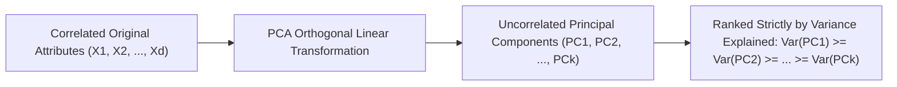

[Source: `Unit_4_PCA.pdf`, Slides 2, 4]

---

### 6.2 Key Operational Capabilities & Applications of PCA

1. **Dimensionality Reduction to 2D/3D for Human Visualization**: A dataset with 50 or 100 features cannot be plotted directly. By projecting the data onto its top two or three principal components ($PC_1, PC_2, PC_3$), analysts generate scatter plots that reveal natural clusters, categorical separation, and extreme anomalies in human-interpretable space.
2. **Mitigating the Curse of Dimensionality**: High-dimensional spaces lead to sparse data distributions and overfitting. Condensing 100 dimensions into 10 dominant components preserves structural variance while drastically speeding up classification and regression model training.
3. **Face Recognition (Eigenfaces)**: Facial images of size $100 \times 100$ pixels reside in a $10,000$-dimensional space. PCA discovers the dominant spatial eigenvectors (dubbed "Eigenfaces") representing structural facial variations (jawlines, eye distances, lighting angles). Any facial image can then be represented as a compact vector of just 20 to 50 principal component weights.
4. **Image & Signal Compression**: High-resolution imagery contains massive spatial autocorrelation among adjacent pixels. Retaining only the top eigenvalues allows image reconstruction with minimal visual distortion at a fraction of the raw byte size.
5. **Gene Expression Analysis**: DNA microarray experiments record expression levels for tens of thousands of genes across a small cohort of patients ($d \gg N$). PCA extracts dominant transcriptional profiles, revealing distinct disease phenotypes.

[Source: `Unit_4_PCA.pdf`, Slide 3]

---

### 6.3 Geometric Interpretation: Orthogonal Axes of Maximal Variance

Geometrically, consider a 2D scatter plot of data points forming an elongated elliptical cloud in the $(X, Y)$ coordinate space:

```text
                  Y (Attribute 2)
                  ^             . : * * *  PC1 (Direction of Maximal Variance)
                  |          . : * * *    ^
                  |       . : * * *      /
                  |    . : * * *        /
  PC2             | . : * * *          /
   ^             . : * * *            /
    \         . : * * *              /
     \     . : * * *                /
      \ . : * * *                  /
       +---------------------------------------------> X (Attribute 1)
        \                         /
         \                       /
          \                     /
           v                   v
      Orthogonal (90 deg) Angle between PC1 and PC2
```

- **Orientation of $PC_1$**: The first principal component axis aligns precisely with the major axis of the ellipse—the spatial line along which the data points are most widely scattered. It captures the maximum possible variability present in the data cloud.
- **Orientation of $PC_2$**: The second principal component axis aligns with the minor axis of the ellipse. It is constrained to be strictly perpendicular (orthogonal at $90^\circ$) to $PC_1$. Because the axes are orthogonal, the statistical correlation between $PC_1$ and $PC_2$ is mathematically zero:

$$
\text{Cov}(PC_1, PC_2) = 0
$$

- **Variance Ranking**: By definition, no other direction in the feature space can capture more variance than $PC_1$:

$$
\text{Var}(PC_1) > \text{Var}(PC_2) \ge \dots \ge \text{Var}(PC_d)
$$

[Source: `Unit_4_PCA.pdf`, Slides 6, 7, 8, 9, 10]

---

### 6.4 Mathematical Foundations of PCA

#### 1. Univariate Sample Variance
For a single attribute $X$ with $n$ observations, the spread or dispersion of data points around their sample mean $\bar{X}$ is measured by the sample variance $s^2$:

$$
s^2 = \text{Var}(X) = \frac{1}{n - 1} \sum_{i=1}^n (X_i - \bar{X})^2
$$

The denominator uses Bessel's correction ($n - 1$) to provide an unbiased estimator of the true population variance $\sigma^2$.

[Source: `Unit_4_PCA.pdf`, Slide 11]

---

#### 2. Sample Covariance
To quantify the joint linear association between two distinct continuous attributes $X$ and $Y$, we calculate the sample covariance:

$$
\text{Cov}(X, Y) = \frac{1}{n - 1} \sum_{i=1}^n (X_i - \bar{X})(Y_i - \bar{Y})
$$

##### Directional Interpretation of Covariance:
- **$\text{Cov}(X, Y) > 0$ (Positive Covariance)**: Both variables move in the same direction. When $X$ exceeds its mean, $Y$ tends to exceed its mean (e.g., Temperature and Ice Cream sales).
- **$\text{Cov}(X, Y) < 0$ (Negative Covariance)**: The variables move in opposite directions. When $X$ increases, $Y$ decreases (e.g., Outside Temperature and Heating Fuel usage).
- **$\text{Cov}(X, Y) = 0$ (Zero Covariance)**: There is no linear relationship between $X$ and $Y$; the variables are linearly independent.

[Source: `Unit_4_PCA.pdf`, Slide 12]

---

#### 3. The Covariance Matrix ($S \in \mathbb{R}^{d \times d}$)
For a dataset characterized by $d$ attributes, pairwise relationships are organized into a square, symmetric matrix $S \in \mathbb{R}^{d \times d}$:

$$
S = \begin{pmatrix}
\text{Cov}(X_1, X_1) & \text{Cov}(X_1, X_2) & \cdots & \text{Cov}(X_1, X_d) \\
\text{Cov}(X_2, X_1) & \text{Cov}(X_2, X_2) & \cdots & \text{Cov}(X_2, X_d) \\
\vdots & \vdots & \ddots & \vdots \\
\text{Cov}(X_d, X_1) & \text{Cov}(X_d, X_2) & \cdots & \text{Cov}(X_d, X_d)
\end{pmatrix}
$$

- **Diagonal Elements**: Represent the univariate variances of each individual attribute: $\text{Cov}(X_j, X_j) = \text{Var}(X_j) = S_{jj}$.
- **Off-Diagonal Elements**: Represent the pairwise covariances between distinct attributes: $S_{jk} = \text{Cov}(X_j, X_k)$. Because $\text{Cov}(X_j, X_k) = \text{Cov}(X_k, X_j)$, the matrix is symmetric ($S = S^T$).

For a 3-attribute feature space $(X, Y, Z)$:

$$
S = \begin{pmatrix}
\text{Cov}(X, X) & \text{Cov}(X, Y) & \text{Cov}(X, Z) \\
\text{Cov}(Y, X) & \text{Cov}(Y, Y) & \text{Cov}(Y, Z) \\
\text{Cov}(Z, X) & \text{Cov}(Z, Y) & \text{Cov}(Z, Z)
\end{pmatrix}
$$

[Source: `Unit_4_PCA.pdf`, Slide 13]

---

#### 4. The Eigendecomposition Formulation
The mathematical engine driving PCA is the eigendecomposition of the real, symmetric covariance matrix $S$.

##### Formal Definitions of Eigenvalues and Eigenvectors:
- **Eigenvector ($x$)**: A non-zero vector $x \in \mathbb{R}^d$ ($x \neq \mathbf{0}$) whose spatial orientation remains invariant under linear transformation by matrix $S$. Multiplying $S$ by $x$ merely scales the vector by a factor $\lambda$ without altering its line of direction:

$$
S x = \lambda x
$$

- **Eigenvalue ($\lambda$)**: The scalar factor that dictates how much the corresponding eigenvector $x$ is stretched, shrunk, or flipped during the transformation.

##### Derivation of the Characteristic Equation:
To solve for non-trivial eigenvectors ($x \neq \mathbf{0}$):

$$
\begin{aligned}
S x &= \lambda x \\
S x - \lambda I x &= \mathbf{0} \\
(S - \lambda I)x &= \mathbf{0}
\end{aligned}
$$

where $I \in \mathbb{R}^{d \times d}$ is the identity matrix. For this homogeneous linear system to possess non-zero solutions for $x$, the coefficient matrix $(S - \lambda I)$ must be singular (non-invertible), which requires its determinant to vanish:

$$
\det(S - \lambda I) = 0
$$

This determinant expansion yields an $n$-th degree characteristic polynomial in $\lambda$. The roots of this polynomial are the **eigenvalues** ($\lambda_1, \lambda_2, \dots, \lambda_d$). Substituting each root back into $(S - \lambda_i I)x = \mathbf{0}$ yields the corresponding **eigenvectors** $x_i$.

[Source: `Unit_4_PCA.pdf`, Slides 14, 15, 16, 17, 18, 19]

---

### 6.5 The Four-Step PCA Algorithmic Procedure

```mermaid
flowchart TD
    STEP1["Step 1: Center the Data Matrix - Subtract feature means: X_c = X - mu"] --> STEP2["Step 2: Calculate Sample Covariance Matrix S - S = (1 / (n - 1)) * X_c^T * X_c"]
    STEP2 --> STEP3["Step 3: Compute Eigenvalues & Eigenvectors - Solve det(S - lambda * I) = 0 and (S - lambda * I)x = 0"]
    STEP3 --> STEP4["Step 4: Normalize, Sort & Project Data - Form matrix V = &#91;v1, v2, ..., vk&#93;; Compute Scores = X_c * V"]
```

1. **Step 1: Center the Data**: Subtract the arithmetic mean of each attribute from all its respective observations. This shifts the centroid of the data cloud to the origin $(0, 0, \dots, 0)$, eliminating the constant offset and simplifying all subsequent variance computations.
2. **Step 2: Calculate the Covariance Matrix**: Compute the $d \times d$ sample covariance matrix $S$ from the centered data.
3. **Step 3: Compute Eigenvalues and Eigenvectors**: Solve the characteristic equation $\det(S - \lambda I) = 0$ for all roots $\lambda$, and solve the linear system $(S - \lambda_i I)v_i = \mathbf{0}$ to find the corresponding directional eigenvectors. Normalize each eigenvector to unit length ($\|v_i\| = 1$).
4. **Step 4: Order Eigenvectors and Project the Data**: Sort the eigenvalues in descending numerical order: $\lambda_1 \ge \lambda_2 \ge \dots \ge \lambda_d$. Construct the projection matrix $V \in \mathbb{R}^{d \times k}$ containing the top $k$ normalized eigenvectors as its columns. Multiply the centered data matrix by $V$ to compute the transformed **Principal Component Scores**:

$$
D_{\text{transformed}} = D_{\text{centered}} \times V
$$

[Source: `Unit_4_PCA.pdf`, Slide 20]

---

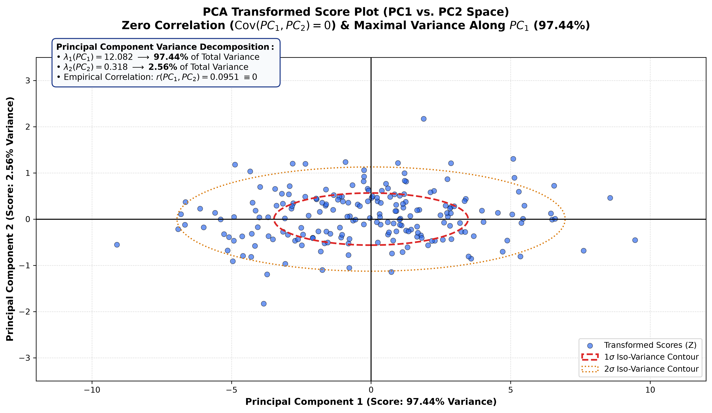

## 7. Master 10–15 Marker Worked Numerical Problem: Complete Step-by-Step PCA Calculation

### 7.1 Problem Statement & Given Dataset

In a clinical health assessment study, six patients ($n = 6$) had their Blood Pressure ($BP$, denoted as $X$) and Blood Oxygen Saturation ($Oxy$, denoted as $Y$) measured:

| Patient ($i$) | Blood Pressure ($BP$, $X$) [mmHg] | Oxygen Saturation ($Oxy$, $Y$) [%] |
| :---: | :---: | :---: |
| **P1** | 126 | 78 |
| **P2** | 128 | 80 |
| **P3** | 128 | 82 |
| **P4** | 130 | 82 |
| **P5** | 130 | 84 |
| **P6** | 132 | 86 |

#### Objectives to Solve (Full University Examination Calibration):
1. Compute the sample means $\bar{X}_{BP}$ and $\bar{Y}_{Oxy}$, and construct the zero-mean centered data matrix.
2. Calculate the complete $2 \times 2$ sample covariance matrix $S$.
3. Formulate the characteristic polynomial equation and solve for the eigenvalues ($\lambda_1, \lambda_2$).
4. Determine the raw eigenvectors, normalize them to unit length ($v_1, v_2$), and prove their mathematical orthogonality.
5. Compute the Explained Variance Ratio (EVR) for each principal component.
6. Calculate the exact Principal Component Scores ($PC_1, PC_2$) for all six patients.
7. Prove that total system variance is conserved and quantify the dimensionality reduction efficiency.

[Source: `Unit_4_PCA.pdf`, Slide 21]

---

### 7.2 Step 1: Mean Centering the Dataset

Centering repositions the data cloud around the origin $(0, 0)$:

#### Mean Calculations:

$$
\bar{X}_{BP} = \frac{126 + 128 + 128 + 130 + 130 + 132}{6} = \frac{774}{6} = 129
$$

$$
\bar{Y}_{Oxy} = \frac{78 + 80 + 82 + 82 + 84 + 86}{6} = \frac{492}{6} = 82
$$

#### Centered Data Table:

| Patient ($i$) | Raw $X$ ($BP$) | Raw $Y$ ($Oxy$) | Centered $x = X - \bar{X}$ | Centered $y = Y - \bar{Y}$ |
| :---: | :---: | :---: | :---: | :---: |
| **P1** | 126 | 78 | $126 - 129 = \mathbf{-3}$ | $78 - 82 = \mathbf{-4}$ |
| **P2** | 128 | 80 | $128 - 129 = \mathbf{-1}$ | $80 - 82 = \mathbf{-2}$ |
| **P3** | 128 | 82 | $128 - 129 = \mathbf{-1}$ | $82 - 82 = \mathbf{0}$ |
| **P4** | 130 | 82 | $130 - 129 = \mathbf{+1}$ | $82 - 82 = \mathbf{0}$ |
| **P5** | 130 | 84 | $130 - 129 = \mathbf{+1}$ | $84 - 82 = \mathbf{+2}$ |
| **P6** | 132 | 86 | $132 - 129 = \mathbf{+3}$ | $86 - 82 = \mathbf{+4}$ |

[Source: `Unit_4_PCA.pdf`, Slides 23, 24]

---

### 7.3 Step 2: Covariance Matrix Calculation

Using the sample size $n = 6$, degrees of freedom $n - 1 = 5$:

#### 1. Variance of Blood Pressure ($S_{11} = \text{Var}(BP)$):

$$
\begin{aligned}
S_{11} &= \frac{\sum_{i=1}^6 (X_i - \bar{X})^2}{n - 1} \\
       &= \frac{(-3)^2 + (-1)^2 + (-1)^2 + (1)^2 + (1)^2 + (3)^2}{5} \\
       &= \frac{9 + 1 + 1 + 1 + 1 + 9}{5} \\
       &= \frac{22}{5} = \mathbf{4.4}
\end{aligned}
$$

#### 2. Variance of Oxygen Saturation ($S_{22} = \text{Var}(Oxy)$):

$$
\begin{aligned}
S_{22} &= \frac{\sum_{i=1}^6 (Y_i - \bar{Y})^2}{n - 1} \\
       &= \frac{(-4)^2 + (-2)^2 + (0)^2 + (0)^2 + (2)^2 + (4)^2}{5} \\
       &= \frac{16 + 4 + 0 + 0 + 4 + 16}{5} \\
       &= \frac{40}{5} = \mathbf{8.0}
\end{aligned}
$$

#### 3. Covariance between $BP$ and $Oxy$ ($S_{12} = S_{21} = \text{Cov}(BP, Oxy)$):

$$
\begin{aligned}
S_{12} = S_{21} &= \frac{\sum_{i=1}^6 (X_i - \bar{X})(Y_i - \bar{Y})}{n - 1} \\
                &= \frac{(-3)(-4) + (-1)(-2) + (-1)(0) + (1)(0) + (1)(2) + (3)(4)}{5} \\
                &= \frac{12 + 2 + 0 + 0 + 2 + 12}{5} \\
                &= \frac{28}{5} = \mathbf{5.6}
\end{aligned}
$$

#### Complete Sample Covariance Matrix:

$$
S = \begin{pmatrix}
4.4 & 5.6 \\
5.6 & 8.0
\end{pmatrix}
$$

[Source: `Unit_4_PCA.pdf`, Slides 25, 26]

---

### 7.4 Step 3: Characteristic Equation & Solving for Eigenvalues

The characteristic equation requires $\det(S - \lambda I) = 0$:

$$
S - \lambda I = \begin{pmatrix}
4.4 & 5.6 \\
5.6 & 8.0
\end{pmatrix} - \begin{pmatrix}
\lambda & 0 \\
0 & \lambda
\end{pmatrix} = \begin{pmatrix}
4.4 - \lambda & 5.6 \\
5.6 & 8.0 - \lambda
\end{pmatrix}
$$

#### Evaluating the Determinant:

$$
\begin{aligned}
\det(S - \lambda I) &= (4.4 - \lambda)(8.0 - \lambda) - (5.6 \times 5.6) = 0 \\
35.2 - 4.4\lambda - 8.0\lambda + \lambda^2 - 31.36 &= 0 \\
\lambda^2 - 12.4\lambda + 3.84 &= 0
\end{aligned}
$$

#### Solving the Quadratic Equation:
Using the quadratic formula for $a = 1$, $b = -12.4$, $c = 3.84$:

$$
\lambda = \frac{-b \pm \sqrt{b^2 - 4ac}}{2a}
$$

$$
\begin{aligned}
\lambda &= \frac{12.4 \pm \sqrt{(-12.4)^2 - 4(1)(3.84)}}{2(1)} \\
        &= \frac{12.4 \pm \sqrt{153.76 - 15.36}}{2} \\
        &= \frac{12.4 \pm \sqrt{138.4}}{2} \\
        &\approx \frac{12.4 \pm 11.76435}{2}
\end{aligned}
$$

- **First Eigenvalue ($\lambda_1$)**:

$$
  \lambda_1 = \frac{12.4 + 11.76435}{2} = \frac{24.16435}{2} \approx \mathbf{12.082}
$$

- **Second Eigenvalue ($\lambda_2$)**:

$$
  \lambda_2 = \frac{12.4 - 11.76435}{2} = \frac{0.63565}{2} \approx \mathbf{0.318}
$$

[Source: `Unit_4_PCA.pdf`, Slides 27, 28, 29, 30]

---

### 7.5 Step 4: Eigenvector Calculation, Normalization & Orthogonality Proof

For each eigenvalue $\lambda_i$, we solve $(S - \lambda_i I)x = \mathbf{0}$ where $x = \begin{pmatrix} a \\ b \end{pmatrix}$.

#### A. Eigenvector for $\lambda_1 = 12.082$
Substitute $\lambda_1$ into the matrix equation:

$$
\begin{pmatrix}
4.4 - 12.082 & 5.6 \\
5.6 & 8.0 - 12.082
\end{pmatrix} \begin{pmatrix} a \\ b \end{pmatrix} = \begin{pmatrix} 0 \\ 0 \end{pmatrix}
$$

$$
\begin{pmatrix}
-7.682 & 5.6 \\
5.6 & -4.082
\end{pmatrix} \begin{pmatrix} a \\ b \end{pmatrix} = \begin{pmatrix} 0 \\ 0 \end{pmatrix}
$$

From Row 1:

$$
\begin{aligned}
-7.682a + 5.6b &= 0 \\
5.6b &= 7.682a \\
b &= \frac{7.682}{5.6}a \approx 1.371786a \approx 1.3725a
\end{aligned}
$$

Setting arbitrary scalar $a = 1$:

$$
b \approx 1.3725 \implies v_1^{\text{raw}} = \begin{pmatrix} 1 \\ 1.3725 \end{pmatrix}
$$

#### Unit Normalization of $v_1$:

$$
\|v_1^{\text{raw}}\| = \sqrt{1^2 + (1.3725)^2} = \sqrt{1 + 1.883756} = \sqrt{2.883756} \approx 1.6976
$$

$$
v_1 = \frac{1}{1.6976} \begin{pmatrix} 1 \\ 1.3725 \end{pmatrix} \approx \begin{pmatrix} \mathbf{0.5891} \\ \mathbf{0.8081} \end{pmatrix}
$$

[Source: `Unit_4_PCA.pdf`, Slides 31, 32, 33]

---

#### B. Eigenvector for $\lambda_2 = 0.318$
Substitute $\lambda_2$ into the matrix equation:

$$
\begin{pmatrix}
4.4 - 0.318 & 5.6 \\
5.6 & 8.0 - 0.318
\end{pmatrix} \begin{pmatrix} a \\ b \end{pmatrix} = \begin{pmatrix} 0 \\ 0 \end{pmatrix}
$$

$$
\begin{pmatrix}
4.082 & 5.6 \\
5.6 & 7.682
\end{pmatrix} \begin{pmatrix} a \\ b \end{pmatrix} = \begin{pmatrix} 0 \\ 0 \end{pmatrix}
$$

From Row 1:

$$
\begin{aligned}
4.082a + 5.6b &= 0 \\
5.6b &= -4.082a \\
b &= -\frac{4.082}{5.6}a \approx -0.72893a \approx -0.7290a
\end{aligned}
$$

Setting arbitrary scalar $a = 1$:

$$
b \approx -0.7290 \implies v_2^{\text{raw}} = \begin{pmatrix} 1 \\ -0.7290 \end{pmatrix}
$$

#### Unit Normalization of $v_2$:

$$
\|v_2^{\text{raw}}\| = \sqrt{1^2 + (-0.7290)^2} = \sqrt{1 + 0.53144} = \sqrt{1.53144} \approx 1.2370
$$

$$
v_2 = \frac{1}{1.2370} \begin{pmatrix} 1 \\ -0.7290 \end{pmatrix} \approx \begin{pmatrix} \mathbf{0.8081} \\ \mathbf{-0.5891} \end{pmatrix}
$$

[Source: `Unit_4_PCA.pdf`, Slides 34, 35, 36]

---

#### C. Proof of Orthogonality
To verify that $v_1$ and $v_2$ are orthogonal, compute their inner product (dot product):

$$
\begin{aligned}
v_1 \cdot v_2 &= (0.5891 \times 0.8081) + (0.8081 \times (-0.5891)) \\
              &= 0.47605 - 0.47605 \\
              &= \mathbf{0.0000}
\end{aligned}
$$

Because the dot product equals zero, $v_1$ and $v_2$ are mathematically perpendicular ($90^\circ$ spatial angle).

[Source: `Unit_4_PCA.pdf`, Slide 36]

---

### 7.6 Step 5: Explained Variance Ratio (EVR)

The total variance of the dataset is given by the sum of all eigenvalues:

$$
\text{Total Variance} = \lambda_1 + \lambda_2 = 12.082 + 0.318 = \mathbf{12.400}
$$

Notice that the sum of original diagonal variances is:

$$
S_{11} + S_{22} = 4.4 + 8.0 = \mathbf{12.400}
$$

Total system variance is conserved under the orthogonal transformation!

#### Individual Component Proportions:

$$
\text{EVR}_1 = \frac{\lambda_1}{\text{Total Variance}} = \frac{12.082}{12.400} \approx 0.97435 \approx \mathbf{97.44\%}
$$

$$
\text{EVR}_2 = \frac{\lambda_2}{\text{Total Variance}} = \frac{0.318}{12.400} \approx 0.02565 \approx \mathbf{2.56\%}
$$

**Analytical Conclusion**: The first principal component alone captures **$97.44\%$** of all empirical variance. Discarding $PC_2$ achieves a **$50\%$ dimensionality reduction** (from 2 features to 1) with an information loss of only **$2.56\%$**.

[Source: `Unit_4_PCA.pdf`, Slides 37, 43, 45]

---

### 7.7 Step 6: Calculation of Principal Component Scores

The projection of centered observation matrix $D$ onto the ordered eigenvector basis $V = [v_1, v_2]$ is given by:

$$
\text{Transformed Scores} = D \times V
$$

Using the transformation formulas:

$$
PC_1 = 0.5891(BP - 129) + 0.8081(Oxy - 82)
$$

$$
PC_2 = 0.8081(BP - 129) - 0.5891(Oxy - 82)
$$

#### Detailed Calculations for Each Patient:
- **Patient P1**: Centered coordinates $(-3, -4)$:

$$
PC_1 = (-3)(0.5891) + (-4)(0.8081) = -1.7673 - 3.2324 = -4.9997 \approx \mathbf{-5.00}
$$

$$
PC_2 = (-3)(0.8081) + (-4)(-0.5891) = -2.4243 + 2.3564 = -0.0679 \approx \mathbf{-0.068}
$$

- **Patient P2**: Centered coordinates $(-1, -2)$:

$$
PC_1 = (-1)(0.5891) + (-2)(0.8081) = -0.5891 - 1.6162 = -2.2053 \approx \mathbf{-2.21}
$$

$$
PC_2 = (-1)(0.8081) + (-2)(-0.5891) = -0.8081 + 1.1782 = +0.3701 \approx \mathbf{+0.37}
$$

- **Patient P3**: Centered coordinates $(-1, 0)$:

$$
PC_1 = (-1)(0.5891) + (0)(0.8081) = -0.5891 + 0 = \mathbf{-0.59}
$$

$$
PC_2 = (-1)(0.8081) + (0)(-0.5891) = -0.8081 + 0 = \mathbf{-0.81}
$$

- **Patient P4**: Centered coordinates $(+1, 0)$:

$$
PC_1 = (+1)(0.5891) + (0)(0.8081) = +0.5891 + 0 = \mathbf{+0.59}
$$

$$
PC_2 = (+1)(0.8081) + (0)(-0.5891) = +0.8081 + 0 = \mathbf{+0.81}
$$

- **Patient P5**: Centered coordinates $(+1, +2)$:

$$
PC_1 = (+1)(0.5891) + (+2)(0.8081) = +0.5891 + 1.6162 = +2.2053 \approx \mathbf{+2.21}
$$

$$
PC_2 = (+1)(0.8081) + (+2)(-0.5891) = +0.8081 - 1.1782 = -0.3701 \approx \mathbf{-0.37}
$$

- **Patient P6**: Centered coordinates $(+3, +4)$:

$$
PC_1 = (+3)(0.5891) + (+4)(0.8081) = +1.7673 + 3.2324 = +4.9997 \approx \mathbf{+5.00}
$$

$$
PC_2 = (+3)(0.8081) + (+4)(-0.5891) = +2.4243 - 2.3564 = +0.0679 \approx \mathbf{+0.068}
$$

#### Master Transformed Principal Component Scores Table:

| Patient ($i$) | Raw $BP$ | Raw $Oxy$ | Centered $x$ | Centered $y$ | Principal Component 1 ($PC_1$) | Principal Component 2 ($PC_2$) |
| :---: | :---: | :---: | :---: | :---: | :---: | :---: |
| **P1** | 126 | 78 | $-3$ | $-4$ | **$-5.00$** | **$-0.068$** |
| **P2** | 128 | 80 | $-1$ | $-2$ | **$-2.21$** | **$+0.370$** |
| **P3** | 128 | 82 | $-1$ | $0$ | **$-0.59$** | **$-0.810$** |
| **P4** | 130 | 82 | $+1$ | $0$ | **$+0.59$** | **$+0.810$** |
| **P5** | 130 | 84 | $+1$ | $+2$ | **$+2.21$** | **$-0.370$** |
| **P6** | 132 | 86 | $+3$ | $+4$ | **$+5.00$** | **$+0.068$** |

[Source: `Unit_4_PCA.pdf`, Slides 38, 39, 40, 41]

---

### 7.8 Step 7: Proof of Variance Preservation and Orthogonal Decorrelation

To prove that PCA preserved and redistributed the variance correctly:

#### 1. Sample Variance of $PC_1$:

$$
\begin{aligned}
\text{Var}(PC_1) &= \frac{(-5.00)^2 + (-2.21)^2 + (-0.59)^2 + (0.59)^2 + (2.21)^2 + (5.00)^2}{5} \\
                 &= \frac{25.000 + 4.8841 + 0.3481 + 0.3481 + 4.8841 + 25.000}{5} \\
                 &= \frac{60.4644}{5} \approx \mathbf{12.082} \quad (=\lambda_1)
\end{aligned}
$$

#### 2. Sample Variance of $PC_2$:

$$
\begin{aligned}
\text{Var}(PC_2) &= \frac{(-0.068)^2 + (0.37)^2 + (-0.81)^2 + (0.81)^2 + (-0.37)^2 + (0.068)^2}{5} \\
                 &= \frac{0.004624 + 0.1369 + 0.6561 + 0.6561 + 0.1369 + 0.004624}{5} \\
                 &= \frac{1.595248}{5} \approx \mathbf{0.318} \quad (=\lambda_2)
\end{aligned}
$$

#### 3. Sample Covariance of Transformed Scores:

$$
\begin{aligned}
\text{Cov}(PC_1, PC_2) &= \frac{(-5.00)(-0.068) + (-2.21)(0.37) + (-0.59)(-0.81) + (0.59)(0.81) + (2.21)(-0.37) + (5.00)(0.068)}{5} \\
                       &= \frac{0.340 - 0.8177 + 0.4779 + 0.4779 - 0.8177 + 0.340}{5} \\
                       &= \frac{1.6358 - 1.6354}{5} \approx \mathbf{0.000}
\end{aligned}
$$

#### Master Transformation Validation Summary:

| Statistical Metric | Original Dataset Space | Transformed Principal Component Space |
| :--- | :---: | :---: |
| **Dimension 1 Variance** | $\text{Var}(BP) = 4.40$ | $\text{Var}(PC_1) = 12.082$ ($\lambda_1$) |
| **Dimension 2 Variance** | $\text{Var}(Oxy) = 8.00$ | $\text{Var}(PC_2) = 0.318$ ($\lambda_2$) |
| **Pairwise Covariance** | $\text{Cov}(BP, Oxy) = 5.60$ (Strongly Correlated) | $\text{Cov}(PC_1, PC_2) = 0.000$ (Completely Uncorrelated) |
| **Total System Variance** | $4.40 + 8.00 = \mathbf{12.400}$ | $12.082 + 0.318 = \mathbf{12.400}$ |

Total variance is conserved ($12.400$), but redistributed so that $97.44\%$ is packed into a single dimension ($PC_1$), enabling a 2D to 1D compression with minimal information loss.

[Source: `Unit_4_PCA.pdf`, Slides 42, 44]

---

## 8. Toolchain Implementations: Python and KNIME Analytics Platform

### 8.1 Standalone Python Algorithmic Implementation (Student Exam Scratch Workflow)

The following Python script implements the full PCA algorithmic pipeline from scratch using basic `numpy` linear algebra routines (`np.linalg.eig`), matching the requirements of university practical examination Practical 6:

```python
import numpy as np

def pca_from_scratch(data_matrix, n_components=1):
    """
    Executes complete Principal Component Analysis from first mathematical principles.

    Parameters:
        data_matrix (list or np.ndarray): Raw 2D array of shape (n_samples, n_features)
        n_components (int): Target number of orthogonal dimensions to extract

    Returns:
        dict: Mean vector, Covariance matrix, Eigenvalues, Eigenvectors, EVR, and Transformed Scores
    """
    X = np.array(data_matrix, dtype=float)
    n_samples, n_features = X.shape

    # Step 1: Zero-mean centering
    mean_vector = np.mean(X, axis=0)
    X_centered = X - mean_vector

    # Step 2: Compute sample covariance matrix S (using n - 1 degrees of freedom)
    covariance_matrix = np.dot(X_centered.T, X_centered) / (n_samples - 1)

    # Step 3: Eigendecomposition of S
    eigenvalues, eigenvectors = np.linalg.eig(covariance_matrix)

    # Step 4: Sort eigenvalues and eigenvectors in descending order of variance
    sort_indices = np.argsort(eigenvalues)[::-1]
    sorted_evals = eigenvalues[sort_indices]
    sorted_evecs = eigenvectors[:, sort_indices]

    # Step 5: Compute Explained Variance Ratio (EVR)
    total_variance = np.sum(sorted_evals)
    evr = sorted_evals / total_variance

    # Step 6: Select top k components and project centered data
    projection_basis = sorted_evecs[:, :n_components]
    transformed_scores = np.dot(X_centered, projection_basis)

    return {
        "Mean_Vector": mean_vector,
        "Covariance_Matrix": covariance_matrix,
        "Eigenvalues": sorted_evals,
        "Eigenvectors": sorted_evecs,
        "Explained_Variance_Ratio": evr,
        "Selected_Basis": projection_basis,
        "Transformed_Scores": transformed_scores
    }

# Execution on the Slide Clinical Dataset
if __name__ == "__main__":
    clinical_data = [
        [126, 78],  # P1
        [128, 80],  # P2
        [128, 82],  # P3
        [130, 82],  # P4
        [130, 84],  # P5
        [132, 86]   # P6
    ]

    results = pca_from_scratch(clinical_data, n_components=2)

    print("=== PCA SCRATCH EXECUTION RESULTS ===")
    print("Feature Means (BP, Oxy):", results["Mean_Vector"])
    print("\nSample Covariance Matrix S:\n", results["Covariance_Matrix"])
    print("\nEigenvalues:", results["Eigenvalues"])
    print("EVR (Variance Ratio):", results["Explained_Variance_Ratio"] * 100)
    print("\nNormalized Eigenvectors (Columns):\n", results["Eigenvectors"])
    print("\nPrincipal Component Scores (PC1, PC2):\n", results["Transformed_Scores"])
```

[Source: `DAV_Comprehensive_Lab_Manual_and_Notes.md`, Practical 6; `DAV_Python.md`]

---

### 8.2 Production Python Implementation via Scikit-Learn

In production environments, `sklearn.decomposition.PCA` executes dimensionality reduction using Singular Value Decomposition (SVD):

```python
import numpy as np
import pandas as pd
from sklearn.decomposition import PCA
from sklearn.preprocessing import StandardScaler

# Define raw clinical dataset
data = np.array([
    [126, 78],
    [128, 80],
    [128, 82],
    [130, 82],
    [130, 84],
    [132, 86]
])

# Initialize PCA retaining both orthogonal components
pca_model = PCA(n_components=2)

# Fit model and compute scores directly
# Note: sklearn centers data automatically during fit
pc_scores = pca_model.fit_transform(data)

print("=== SCIKIT-LEARN PCA PIPELINE ===")
print("Mean Vector:", pca_model.mean_)
print("Covariance Matrix:\n", pca_model.get_covariance())
print("Explained Variance (Eigenvalues):", pca_model.explained_variance_)
print("Explained Variance Ratio:", pca_model.explained_variance_ratio_ * 100)
print("Principal Components (Rows are Eigenvectors):\n", pca_model.components_)
print("Transformed PC Scores:\n", pc_scores)
```

[Source: `DAV_Comprehensive_Lab_Manual_and_Notes.md`, Practical 6; `DAV_Python.md`]

---

### 8.3 KNIME Analytics Platform End-to-End Workflow (Practical 6)

In the KNIME Analytics Platform, PCA and feature selection workflows follow a standardized node pipeline:

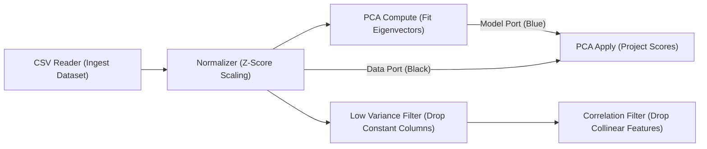

#### Step-by-Step KNIME Node Configuration Guide:
1. **Node 1: `CSV Reader`**:
   - Locate in Node Repository $\to$ *IO* $\to$ *Read* $\to$ `CSV Reader`.
   - Point to `clinical_patient_records.csv`. Ensure **"Has column header"** is checked.
   - Execute (**F7**). Output turns Green $\bullet$.
2. **Node 2: `Normalizer`**:
   - Connect `CSV Reader` output to `Normalizer`.
   - *Rationale*: PCA is scale-dependent. If one variable has large units (e.g., Annual Income in thousands) while another has small units (e.g., Age in decades), the high-magnitude variable dominates variance spuriously.
   - Configuration: Select **Z-Score Normalization (Gaussian)** ($\mu = 0, \sigma = 1$). Move all numeric columns to the **Include** box. Execute.
3. **Node 3: `PCA Compute`**:
   - Connect normalized data to `PCA Compute`.
   - Configuration:
     - Dimension selection: Choose **Fixed number of components** ($k = 2$) or **Quality (Variance preserved)** set to $95\%$.
   - Output Port 1 (Black triangle): Transformed table of principal component scores.
   - Output Port 2 (Blue square): Trained PCA transformation model.
4. **Node 4: `PCA Apply`**:
   - Drag `PCA Apply` onto canvas.
   - Connect the Blue model port from `PCA Compute` to the model input of `PCA Apply`.
   - Connect incoming test partitions to the data input to project unseen records onto established eigenvector axes.
5. **Node 5: `Low Variance Filter` & `Correlation Filter`**:
   - To perform feature selection alongside feature extraction, attach `Low Variance Filter` (threshold $= 0.01$) to drop near-constant columns.
   - Attach `Correlation Filter` (threshold $= 0.85$) to eliminate redundant collinear variables.

[Source: `DAV_Comprehensive_Lab_Manual_and_Notes.md`, Practical 6; `DAV_KNIME.md`, Flow 4]

---

## 9. Comprehensive Diagrams and Visual Models

### Figure 4.1: Master Taxonomy of Data Reduction Techniques
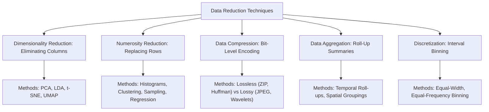
- **What it shows**: The five distinct architectural families that comprise modern data reduction.
- **Component Breakdown**:
  - *Dimensionality Reduction*: Operates along the horizontal feature axis.
  - *Numerosity Reduction*: Operates along the vertical row axis.
  - *Compression*: Operates on underlying binary encodings.
  - *Aggregation*: Operates on granular record sets.
  - *Discretization*: Operates on continuous feature values.
- **Flow / Relationship**: An enterprise pipeline typically combines these methods in sequence: raw sensor records are first aggregated into hourly bins, compressed losslessly, sampled for quick analysis, and projected via PCA for 2D visualization.

---

### Figure 4.2: Population vs. Sample Statistical Inference Loop
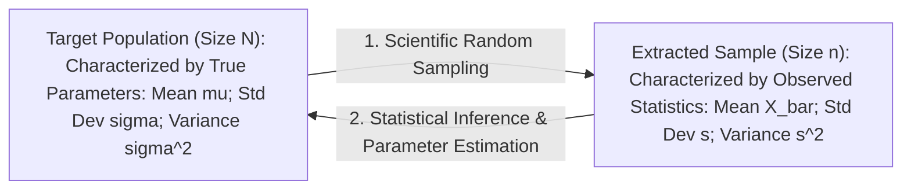
- **What it shows**: The statistical inference loop connecting finite samples to unobservable population parameters.
- **Component Breakdown**:
  - *Population*: Complete universe containing fixed, unknown Greek parameters ($\mu, \sigma, \sigma^2$).
  - *Sample*: Observed subset containing variable Roman statistics ($\bar{X}, s, s^2$).
- **Flow / Relationship**: Arrow 1 represents physical sample selection. Arrow 2 represents inductive mathematical estimation.

[Source: `Unit 4_Data reduction and Sampling.pdf`, Slide 14]

---

### Figure 4.3: Sampling Models: With vs. Without Replacement
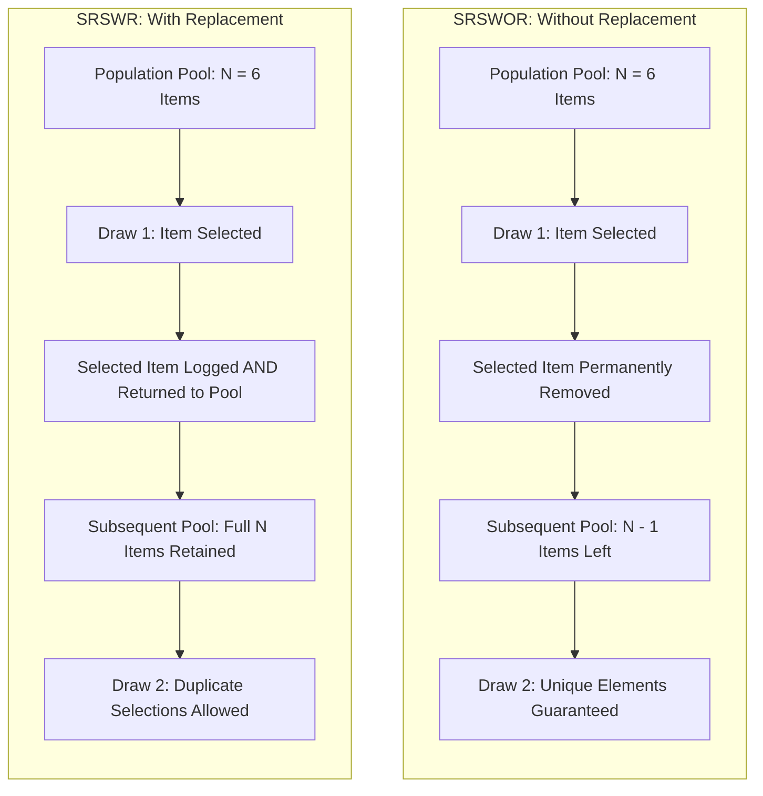
- **What it shows**: Urn sampling mechanics distinguishing SRSWOR from SRSWR.
- **Component Breakdown**:
  - *SRSWOR*: Guarantees distinct units; successive draws are dependent.
  - *SRSWR*: Allows repeated selection; draws are independent.

[Source: `Unit 4_Data reduction and Sampling.pdf`, Slide 11]

---

### Figure 4.4: Comparative Structure: Stratified vs. Cluster Sampling
```text
STRATIFIED SAMPLING:
Population: [AAA] [BBB] [CCC]  <-- Mutually exclusive, homogeneous strata
               |     |     |
Sampled:      [A]   [B]   [C]   <-- Draw samples from EVERY stratum
Result: Guaranteed representation of all subgroups; minimal variance.

CLUSTER SAMPLING:
Population: [ABC] [ABC] [ABC] [ABC] <-- Heterogeneous, naturally occurring clusters
              |           |
Sampled:    [ABC]       [ABC]       <-- Randomly select SOME clusters, audit all units
Result: Significant reduction in travel/administrative cost; higher design error.
```
- **What it shows**: Visual contrast between the internal homogeneity of strata versus the internal heterogeneity of clusters.
- **Key Observation**: Stratified sampling samples *some* units from *all* groups; Cluster sampling samples *all* units from *some* groups.

[Source: `Unit 4_Data reduction and Sampling.pdf`, Slide 10]

---

### Figure 4.5: Five-Step Sampling Lifecycle
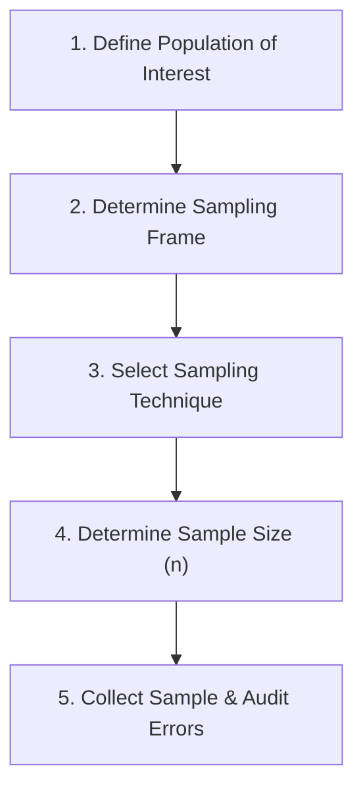
- **What it shows**: The standard 5-step operational workflow for empirical sample collection.

[Source: `Unit 4_Data reduction and Sampling.pdf`, Slide 16]

---

### Figure 4.6: Master Classification Tree of Sampling Techniques
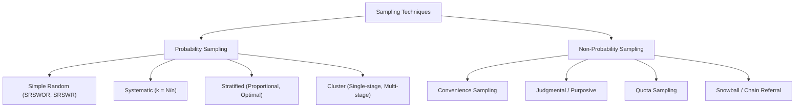
- **What it shows**: Master taxonomy mapping all 8 probability and non-probability sampling methods.

[Source: `Unit 4_Data reduction and Sampling.pdf`, Slide 19]

---

### Figure 4.7: PCA Geometric Rotation & Orthogonal Axes
```text
           Y (Oxygen Saturation)
           ^                     / PC1 (Eigenvector v1 = [0.5891, 0.8081]^T)
           |                    /      Direction of Maximal Variance (EVR = 97.44%)
           |                   /
           |        P3(128,82)*   * P6(132,86)
           |                 / * P5(130,84)
           |     P2(128,80) * * P4(130,82)
           |               /
           |   P1(126,78) *
           |             /
           |            /
           |           /
           |          +-----------------------------------> X (Blood Pressure)
           |         /
           |        /
           |       /
           |      v
          PC2 (Eigenvector v2 = [0.8081, -0.5891]^T)
          Orthogonal Axis (90 deg); EVR = 2.56% (Noise/Residual Variance)
```
- **What it shows**: Orthogonal rotation of Blood Pressure ($X$) and Oxygen Saturation ($Y$) onto principal components $PC_1$ and $PC_2$.
- **Components**:
  - $PC_1$: Captures the joint positive correlation ($BP$ and $Oxy$ rising together).
  - $PC_2$: Captures minor perpendicular deviations.
- **Observation**: Points cluster tightly along $PC_1$, allowing the second dimension to be dropped with minimal information loss.

[Source: `Unit_4_PCA.pdf`, Slides 9, 10, 22, 24, 42]

---

## 10. Unit-End Essentials: Reference Sheets & Exam Preparation

### 10.1 Comprehensive Abbreviation & Acronym Index

| Abbreviation | Full Term / Expansion | Mathematical / Operational Context |
| :--- | :--- | :--- |
| **PCA** | Principal Component Analysis | Unsupervised linear orthogonal dimensionality reduction technique. |
| **LDA** | Linear Discriminant Analysis | Supervised linear dimensionality reduction maximizing class separation. |
| **t-SNE** | t-Distributed Stochastic Neighbor Embedding | Non-linear probabilistic technique for high-dimensional 2D/3D visualization. |
| **UMAP** | Uniform Manifold Approximation and Projection | Fast non-linear manifold learning technique preserving global data structure. |
| **SRSWOR** | Simple Random Sampling Without Replacement | Random draw without returning elements; produces distinct selections. |
| **SRSWR** | Simple Random Sampling With Replacement | Random draw with replacement; allows duplicate selections. |
| **EVR** | Explained Variance Ratio | Ratio $\lambda_k / \sum \lambda_j$ measuring proportion of variance explained by component $k$. |
| **PC1** | First Principal Component | Orthogonal axis accounting for the largest share of dataset variance. |
| **PC2** | Second Principal Component | Orthogonal axis accounting for the second-largest share of dataset variance. |
| **SVD** | Singular Value Decomposition | Matrix factorization technique ($X = U \Sigma V^T$) used to implement PCA numerically. |
| **IQR** | Interquartile Range | Spread metric $Q_3 - Q_1$ used in outlier detection fences ($1.5 \times IQR$). |
| **OLS** | Ordinary Least Squares | Linear regression parameter estimation minimizing sum of squared residuals. |
| **DBMS** | Database Management System | Relational database software managing physical disk pages and query plans. |
| **I/O** | Input / Output | Physical read/write operations between storage disks and system RAM. |
| **KPI** | Key Performance Indicator | High-level summary metrics displayed on executive dashboards. |
| **BAN** | Big Ass Number | Large, prominent single-value KPI summary card on analytical dashboards. |

---

### 10.2 Master Formula Sheet & Symbol Definitions

#### 1. Univariate Sample Variance

$$
s^2 = \text{Var}(X) = \frac{1}{n - 1} \sum_{i=1}^n (X_i - \bar{X})^2
$$

| Symbol | Mathematical Meaning | Units / Range |
| :---: | :--- | :--- |
| $s^2$ | Sample variance | Squared units of attribute $X$ ($[0, \infty)$) |
| $X_i$ | Observation value of element $i$ | Metric domain of feature $X$ |
| $\bar{X}$ | Arithmetic sample mean of attribute $X$ | Same units as $X$ |
| $n$ | Total sample size | Positive integer ($n \ge 2$) |
| $n - 1$ | Degrees of freedom (Bessel's correction) | Positive integer |

---

#### 2. Sample Covariance

$$
\text{Cov}(X, Y) = \frac{1}{n - 1} \sum_{i=1}^n (X_i - \bar{X})(Y_i - \bar{Y})
$$

| Symbol | Mathematical Meaning | Units / Range |
| :---: | :--- | :--- |
| $\text{Cov}(X, Y)$ | Sample covariance between variables $X$ and $Y$ | Product units: $[X] \times [Y]$ ($(-\infty, \infty)$) |
| $X_i, Y_i$ | Paired observations for element $i$ | Respective feature domains |
| $\bar{X}, \bar{Y}$ | Sample means of $X$ and $Y$ | Respective feature domains |

---

#### 3. Eigendecomposition of Covariance Matrix

$$
S v = \lambda v \iff (S - \lambda I)v = \mathbf{0}
$$

| Symbol | Mathematical Meaning | Units / Range |
| :---: | :--- | :--- |
| $S$ | Sample covariance matrix | Square matrix: $S \in \mathbb{R}^{d \times d}$ |
| $v$ | Spatial eigenvector | Non-zero directional vector: $v \in \mathbb{R}^d, \|v\| = 1$ |
| $\lambda$ | Characteristic eigenvalue (variance along $v$) | Non-negative real scalar: $\lambda \ge 0$ |
| $I$ | Identity matrix | Dimension: $I \in \mathbb{R}^{d \times d}$ |

---

#### 4. Characteristic Equation for Eigenvalues

$$
\det(S - \lambda I) = 0
$$

For a $2 \times 2$ covariance matrix $S = \begin{pmatrix} S_{11} & S_{12} \\ S_{12} & S_{22} \end{pmatrix}$:

$$
\lambda^2 - (S_{11} + S_{22})\lambda + (S_{11}S_{22} - S_{12}^2) = 0
$$

---

#### 5. Explained Variance Ratio (EVR)

$$
\text{EVR}_k = \frac{\lambda_k}{\sum_{j=1}^d \lambda_j} = \frac{\lambda_k}{\text{Tr}(S)}
$$

| Symbol | Mathematical Meaning | Units / Range |
| :---: | :--- | :--- |
| $\text{EVR}_k$ | Proportion of variance captured by component $k$ | Dimensionless proportion: $[0.0, 1.0]$ or $[0\%, 100\%]$ |
| $\lambda_k$ | Eigenvalue of $k$-th principal component | Real scalar: $\lambda_k \ge 0$ |
| $\text{Tr}(S)$ | Trace of covariance matrix (sum of diagonal variances) | Real scalar: $\sum S_{jj} = \sum \lambda_j$ |

---

#### 6. Principal Component Score Transformation

$$
D_{\text{transformed}} = D_{\text{centered}} \times V
$$

$$
PC_k = \sum_{j=1}^d v_{jk} (X_j - \bar{X}_j)
$$

| Symbol | Mathematical Meaning | Units / Range |
| :---: | :--- | :--- |
| $PC_k$ | Coordinate score of an observation on component $k$ | Real scalar |
| $v_{jk}$ | $j$-th element of $k$-th normalized eigenvector | Dimensionless loading: $[-1.0, 1.0]$ |
| $X_j - \bar{X}_j$ | Zero-mean centered observation on attribute $j$ | Same units as $X_j$ |

---

#### 7. Systematic Sampling Step Size

$$
k = \left\lfloor \frac{N}{n} \right\rfloor
$$

| Symbol | Mathematical Meaning | Units / Range |
| :---: | :--- | :--- |
| $k$ | Sampling skip interval | Positive integer ($k \ge 1$) |
| $N$ | Total population size | Positive integer |
| $n$ | Desired sample size | Positive integer ($n \le N$) |

---

### 10.3 Master Definition Sheet

- **Data Reduction**: The systematic transformation of a dataset to obtain a reduced representation that is substantially smaller in volume while preserving the integrity and analytical conclusions of the original data.
- **Dimensionality Reduction**: The reduction of input feature attributes via feature extraction (e.g., PCA) or feature selection (e.g., Correlation Filter) to address the curse of dimensionality and facilitate visualization.
- **Numerosity Reduction**: The replacement of raw data rows with alternative, smaller representations (e.g., cluster centroids, frequency histograms, parametric regression equations, or representative samples).
- **Lossless Compression**: Data compression algorithms (e.g., ZIP, Huffman) that allow exact, bit-for-bit mathematical reconstruction of original data without information loss.
- **Lossy Compression**: Data compression algorithms (e.g., JPEG, MP3) that achieve high compression ratios by permanently discarding imperceptible, high-frequency components.
- **Stratified Sampling**: A probability sampling design that partitions the population into mutually exclusive, homogeneous strata and draws independent random samples from each stratum to protect minority classes.
- **Cluster Sampling**: A probability sampling design that partitions the population into naturally occurring, heterogeneous clusters and evaluates all elements within a random selection of clusters to minimize logistical costs.
- **Principal Component Analysis (PCA)**: An unsupervised linear transformation that converts a set of correlated variables into a set of linearly uncorrelated, orthogonal variables (principal components) ranked by variance explained.
- **Eigenvalue**: A scalar $\lambda$ associated with an eigenvector indicating the total variance captured along that component's direction.
- **Eigenvector**: A normalized directional vector $v$ specifying the orientation of a principal component axis in the original feature space.

---

### 10.4 Exam-Oriented Review: University Questions & Model Solutions

#### Section A: 2-Mark Short Answer Questions

##### Q1. Define data reduction and state its four primary goals.
**Model Answer**: Data reduction is the process of reducing the physical volume and complexity of a dataset while preserving its analytical integrity. Its four primary goals are:
1. *Efficiency*: Minimizing RAM/disk storage and accelerating computation.
2. *Scalability*: Permitting big data processing without system crashes.
3. *Noise Removal*: Eliminating irrelevant and redundant collinear features.
4. *Better Visualization*: Projecting high-dimensional spaces to 2D/3D for human interpretation.
[Source: `Unit 4_Data reduction and Sampling.pdf`, Slides 2, 3]

##### Q2. Differentiate between SRSWOR and SRSWR.
**Model Answer**:
- In **Simple Random Sampling Without Replacement (SRSWOR)**, an element is removed from the population upon selection and cannot appear again, generating $n$ distinct elements with $\binom{N}{n}$ possible sample configurations.
- In **Simple Random Sampling With Replacement (SRSWR)**, an element is returned to the pool after selection, allowing duplicate selections with $N^n$ possible sample configurations and independent draws.
[Source: `Unit 4_Data reduction and Sampling.pdf`, Slides 9, 11]

##### Q3. Explain why naive row-level sampling may fail to reduce disk I/O in relational databases.
**Model Answer**: Relational databases read and write data in physical disk pages (e.g., 8 KB blocks). Naive row-level sampling selects rows uniformly scattered across virtually every disk block. Because the database engine must fetch entire pages into RAM to read single records, 100% of the physical disk pages are still read, resulting in zero reduction in disk I/O operations.
[Source: `Unit 4_Data reduction and Sampling.pdf`, Slide 6]

##### Q4. Define the Explained Variance Ratio (EVR) in PCA.
**Model Answer**: The Explained Variance Ratio is the fraction of total dataset variance captured by a given principal component $k$:

$$
\text{EVR}_k = \frac{\lambda_k}{\sum_{j=1}^d \lambda_j}
$$

It quantifies the information preserved by each component and serves as the criterion for component truncation.
[Source: `Unit_4_PCA.pdf`, Slide 37]

##### Q5. Why is feature normalization mandatory prior to executing PCA?
**Model Answer**: PCA is scale-sensitive. If features have vastly different measurement units or numerical magnitudes (e.g., Salary in thousands vs. Age in decades), high-magnitude variables artificially dominate the variance calculations. Normalizing (via Z-score standardization) scales all features to equal variance ($\sigma^2 = 1$), ensuring all attributes contribute fairly to principal component directions.
[Source: `DAV_Comprehensive_Lab_Manual_and_Notes.md`, Practical 6]

---

#### Section B: 5-Mark Conceptual & Analytical Questions

##### Q6. Classify statistical sampling techniques into a structured taxonomy and contrast probability vs. non-probability sampling.
**Model Answer**:
Statistical sampling is partitioned into two major classes:
1. **Probability Sampling**: Every element has a known, non-zero probability of selection. Eliminates subjective bias and allows rigorous calculation of confidence intervals and margins of error:
   - *Simple Random Sampling (SRS)*: Equal probability ($P = 1/N$) via SRSWOR or SRSWR.
   - *Systematic Sampling*: Elements selected at fixed step intervals $k = N/n$ after a random start.
   - *Stratified Sampling*: Population split into homogeneous strata; samples drawn from each stratum.
   - *Cluster Sampling*: Population split into heterogeneous clusters; random clusters sampled entirely.
2. **Non-Probability Sampling**: Selection relies on subjective judgment, geographic availability, or network referrals. Margins of error cannot be calculated:
   - *Convenience Sampling*: Selecting readily accessible subjects.
   - *Judgmental / Purposive Sampling*: Deliberately selecting experts.
   - *Quota Sampling*: Filling demographic quotas via convenience methods.
   - *Snowball Sampling*: Existing participants recruit acquaintances from hidden groups.

```mermaid
flowchart TD
    ST["Sampling Techniques"] --> P["Probability (Known non-zero P)"]
    ST --> NP["Non-Probability (Subjective / Unknown P)"]
    P --> P_EX["SRSWOR, SRSWR, Systematic, Stratified, Cluster"]
    NP --> NP_EX["Convenience, Judgmental, Quota, Snowball"]
```

[Source: `Unit 4_Data reduction and Sampling.pdf`, Slides 18, 19, 20]

---

##### Q7. Compare Stratified Sampling with Cluster Sampling across four structural dimensions.
**Model Answer**:

| Dimension | Stratified Sampling | Cluster Sampling |
| :--- | :--- | :--- |
| **Subgroup Homogeneity** | **Homogeneous within strata**: Elements in a stratum are similar. | **Heterogeneous within clusters**: Each cluster is a diverse mini-population. |
| **Between-Group Variation** | **Heterogeneous between strata**: Strata differ substantially from one another. | **Homogeneous between clusters**: Different clusters have similar aggregate profiles. |
| **Selection Mechanism** | Random samples are drawn from **every single stratum**. | A random selection of **clusters** is chosen; unchosen clusters are omitted. |
| **Primary Objective** | **Maximizes statistical precision** and guarantees representation of minority classes. | **Minimizes logistical data collection costs** across dispersed geographic regions. |

[Source: `Unit 4_Data reduction and Sampling.pdf`, Slide 10]

---

##### Q8. Derive the characteristic equation for PCA eigenvalues and state the geometric role of eigenvectors.
**Model Answer**:
Given a centered data matrix with sample covariance matrix $S \in \mathbb{R}^{d \times d}$, PCA seeks directional vectors $x$ whose orientation remains invariant under transformation by $S$:

$$
S x = \lambda x
$$

Rearranging the linear system:

$$
\begin{aligned}
S x - \lambda I x &= \mathbf{0} \\
(S - \lambda I)x &= \mathbf{0}
\end{aligned}
$$

For non-zero eigenvector solutions ($x \neq \mathbf{0}$) to exist, the matrix $(S - \lambda I)$ must be singular, requiring its determinant to vanish:

$$
\det(S - \lambda I) = 0
$$

- **Eigenvalues ($\lambda$)**: The roots of this characteristic polynomial. Each eigenvalue equals the statistical variance of the data projected along its corresponding eigenvector.
- **Eigenvectors ($x$ / $v$)**: Orthonormal vectors ($v_i \cdot v_j = 0$ for $i \neq j$; $\|v_i\| = 1$) that define the physical directions of the new orthogonal principal component coordinate axes.
[Source: `Unit_4_PCA.pdf`, Slides 14, 15, 16, 19]

---

#### Section C: 10–15 Mark University Exam Numerical Problem

##### Q9. Complete Numerical Problem Statement:
A healthcare biometric study recorded Blood Pressure ($BP$) and Oxygen Saturation ($Oxy$) across six individuals ($n = 6$):
- $P_1(126, 78)$, $P_2(128, 80)$, $P_3(128, 82)$, $P_4(130, 82)$, $P_5(130, 84)$, $P_6(132, 86)$.

**Required**:
1. Zero-mean center the dataset.
2. Compute the sample covariance matrix $S$.
3. Calculate the eigenvalues $\lambda_1, \lambda_2$ using the characteristic equation.
4. Derive the unit-normalized eigenvectors $v_1, v_2$ and prove their orthogonality.
5. Compute the Explained Variance Ratio (EVR) for each component.
6. Calculate the transformed Principal Component Scores for all six patients.
7. Prove total variance preservation and discuss the dimensionality reduction outcome.

**Model Solution**:
*(See Section 7 of this document for the complete, step-by-step mathematical derivation, including intermediate substitutions, quadratic root calculations, dot-product orthogonality verification, and final variance conservation proofs).*

