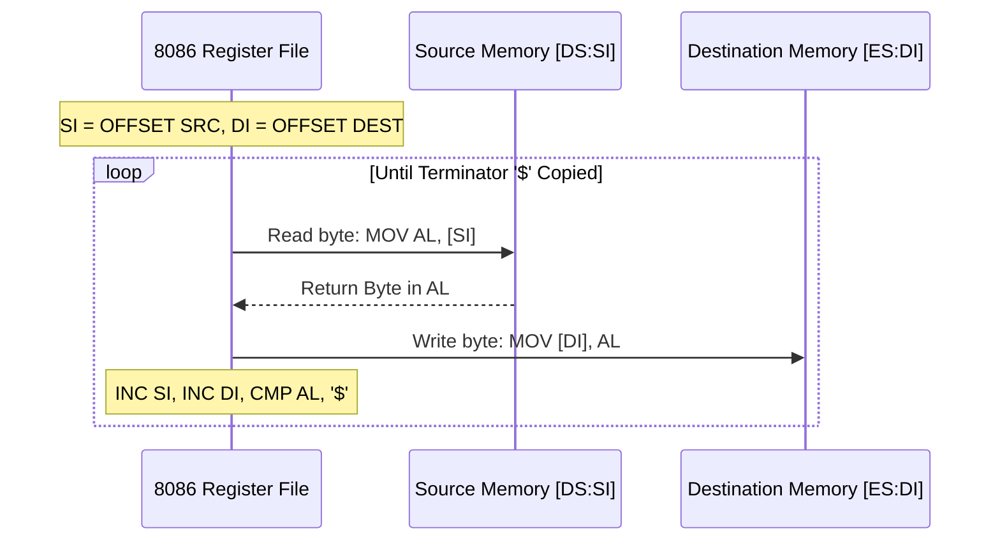
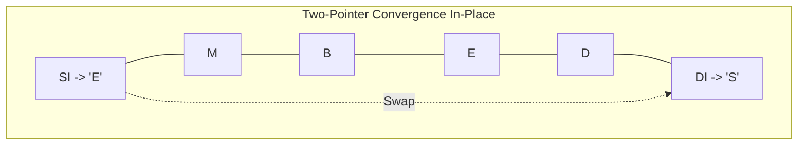

# 09 — 8086 Solved Laboratory Questions & Practical Programs

> **Course Code:** 3CS526CC23  
> **Course Title:** Microprocessor and Interfacing [3 0 2 4]  
> **Governing Standard:** Comprehensive Chapter Notes & MkDocs Material Specifications  
> **Primary Platform:** Intel 8086 Microprocessor (MASM / TASM / EMU8086 Compatible)  
> **Memory Model:** Small (`.MODEL SMALL`), 16-bit Real Mode DOS Execution (`INT 21H`)  

---

## 1. Chapter Overview & Problem Catalog

This document delivers production-grade, textbook-quality solutions for the 11 essential 8086 assembly language laboratory and examination problems. Each solution includes full architectural motivation, register allocations, flowchart logic, fully commented source code adhering to MASM/TASM conventions, and execution traces.

### Problem Catalog Summary

| # | Problem Title | Primary Registers | Addressing Modes Utilized | Key Instructions / Mechanisms |
|:---:|:---|:---:|:---|:---|
| **1** | [Count Positive, Negative, and Zero Elements](#2-problem-1--count-positive-negative-and-zero-elements-in-an-array) | `AX, SI, CX` | Direct, Register Indirect | `CMP`, `JE`, `JL`, `JG`, `LOOP` |
| **2** | [Copy String Without String Instructions](#3-problem-2--copy-string-without-string-instructions) | `SI, DI, AL` | Register Indirect | `MOV AL, [SI]`, `MOV [DI], AL`, `CMP`, `INC` |
| **3** | [Find Maximum of Three Numbers](#4-problem-3--find-maximum-of-three-numbers) | `AX, BX, DX` | Direct, Register | `CMP`, `JAE`, `MOV` |
| **4** | [Clear Condition Flags Except Overflow](#5-problem-4--clear-condition-flags-except-overflow-flag) | `AX, FLAGS` | Stack-based | `PUSHF`, `POPF`, `AND AX, 0FF2AH` |
| **5** | [Reverse String Using String Instructions](#6-problem-5--reverse-a-string-using-string-instructions) | `SI, DI, CX, AL`| Segment-based String | `STD`, `CLD`, `LODSB`, `STOSB`, `LOOP` |
| **6** | [Reverse String In-Place](#7-problem-6--reverse-a-string-in-place) | `SI, DI, AL, AH`| Register Indirect | Two-pointer convergence, `XCHG` / `MOV` |
| **7** | [Nirma University Alphabet Grade Generator](#8-problem-7--alphabet-grade-generation-nirma-university-grading-scale) | `AL, DX` | Direct, Immediate | Cascading relational jumps (`JAE`) |
| **8** | [Linear Search Operation on Array](#9-problem-8--linear-search-operation-on-an-array) | `SI, BX, AX, CX`| Based / Indexed | Sequential scan, `CMP [ARRAY+SI], AX`, `JE` |
| **9** | [Count Occurrences of a Character](#10-problem-9--count-occurrences-of-a-character-in-a-string) | `SI, AL, BL` | Register Indirect | Character traversal, accumulator counter |
| **10**| [Multiplication Table for User-Specified Number](#11-problem-10--display-multiplication-table-for-user-specified-number) | `AL, BL, CX, DX`| Direct, Register | DOS `INT 21H (01H, 02H, 09H)`, `MUL` |
| **11**| [Count Odd and Even Elements in Array](#12-problem-11--count-odd-and-even-elements-in-an-array) | `AX, SI, CX` | Register Indirect | Bitwise LSB test (`TEST AX, 0001H`), `JZ` |

---

## 2. Problem 1 — Count Positive, Negative, and Zero Elements in an Array

### 2.1 Problem Specification
Write an 8086 assembly language program to initialize an array of 10 signed 16-bit integers and count the number of positive, negative, and zero elements in the array.

### 2.2 Architectural & Algorithmic Principles
In signed binary arithmetic (two's complement):
- **Positive:** Value $> 0$ (Bit 15 is `0`, and result is non-zero).
- **Negative:** Value $< 0$ (Bit 15 is `1`, meaning Sign Flag $\text{SF} \ne \text{OF}$).
- **Zero:** Value $= 0$ (Zero Flag $\text{ZF} = 1$).

```mermaid
flowchart TD
    Start([Start]) --> Init[Initialize DS, SI = OFFSET ARRAY, CX = 10]
    Init --> Read[Read AX = [SI]]
    Read --> ChkZero{AX == 0?}
    ChkZero -- Yes (ZF=1) --> IncZero[ZERO_COUNT++]
    ChkZero -- No --> ChkNeg{AX < 0? (Signed JL)}
    ChkNeg -- Yes (SF!=OF) --> IncNeg[NEG_COUNT++]
    ChkNeg -- No (JG) --> IncPos[POS_COUNT++]
    IncZero --> NextElem[SI = SI + 2, DEC CX]
    IncNeg --> NextElem
    IncPos --> NextElem
    NextElem --> ChkLoop{CX > 0?}
    ChkLoop -- Yes --> Read
    ChkLoop -- No --> Display[Display Counts & Terminate]
    Display --> End([End])
```

### 2.3 Complete Assembly Code

```assembly
; =====================================================================
; File: PROG01.ASM
; Title: Count Positive, Negative, and Zero Elements in Array of 10 Words
; Target: Intel 8086 (MASM / TASM / EMU8086)
; =====================================================================

.MODEL SMALL
.STACK 100H

.DATA
    ; Array of 10 signed 16-bit words
    ARRAY       DW  12, -45, 0, 89, -3, 0, -100, 250, 0, 77
    ARRAY_LEN   EQU 10

    POS_COUNT   DW  0
    NEG_COUNT   DW  0
    ZERO_COUNT  DW  0

    MSG_HEADER  DB  '=== Array Element Classifier (10 Words) ===', 0DH, 0AH, '$'
    MSG_POS     DB  0DH, 0AH, 'Positive Count : $'
    MSG_NEG     DB  0DH, 0AH, 'Negative Count : $'
    MSG_ZERO    DB  0DH, 0AH, 'Zero Count     : $'

.CODE
MAIN PROC
    MOV AX, @DATA
    MOV DS, AX

    ; Print title header
    LEA DX, MSG_HEADER
    MOV AH, 09H
    INT 21H

    LEA SI, ARRAY           ; SI points to start of 16-bit array
    MOV CX, ARRAY_LEN       ; Loop counter = 10

CLASSIFY_LOOP:
    MOV AX, [SI]            ; Read 16-bit signed integer
    CMP AX, 0               ; Evaluate flags against zero
    JE  IS_ZERO             ; If ZF = 1 -> element is zero
    JL  IS_NEG              ; If SF != OF -> element is negative

IS_POS:
    INC POS_COUNT           ; Greater than zero -> Positive
    JMP ADVANCE_PTR

IS_NEG:
    INC NEG_COUNT           ; Less than zero -> Negative
    JMP ADVANCE_PTR

IS_ZERO:
    INC ZERO_COUNT          ; Equal to zero

ADVANCE_PTR:
    ADD SI, 2               ; Word step (+2 bytes)
    LOOP CLASSIFY_LOOP      ; Decrement CX and branch if non-zero

    ; --- Print Results ---
    LEA DX, MSG_POS
    MOV AH, 09H
    INT 21H
    MOV AX, POS_COUNT
    CALL PRINT_DECIMAL_WORD

    LEA DX, MSG_NEG
    MOV AH, 09H
    INT 21H
    MOV AX, NEG_COUNT
    CALL PRINT_DECIMAL_WORD

    LEA DX, MSG_ZERO
    MOV AH, 09H
    INT 21H
    MOV AX, ZERO_COUNT
    CALL PRINT_DECIMAL_WORD

    ; Terminate via DOS service
    MOV AH, 4CH
    INT 21H
MAIN ENDP

; ---------------------------------------------------------------------
; Subroutine: PRINT_DECIMAL_WORD
; Purpose: Prints 16-bit unsigned integer in AX to console
; Modifies: AX, BX, CX, DX
; ---------------------------------------------------------------------
PRINT_DECIMAL_WORD PROC
    PUSH AX
    PUSH BX
    PUSH CX
    PUSH DX

    XOR CX, CX              ; Digit counter
    MOV BX, 10              ; Decimal radix divisor

DIV_LOOP:
    XOR DX, DX
    DIV BX                  ; AX = Quotient, DX = Remainder
    PUSH DX                 ; Save remainder on stack
    INC CX
    CMP AX, 0
    JNE DIV_LOOP

PRINT_LOOP:
    POP DX
    ADD DL, '0'             ; Convert binary digit to ASCII
    MOV AH, 02H
    INT 21H
    LOOP PRINT_LOOP

    POP DX
    POP CX
    POP BX
    POP AX
    RET
PRINT_DECIMAL_WORD ENDP

END MAIN
```

### 2.4 Trace & Execution Output
Given `ARRAY = [12, -45, 0, 89, -3, 0, -100, 250, 0, 77]`:

```
=== Array Element Classifier (10 Words) ===
Positive Count : 4
Negative Count : 3
Zero Count     : 3
```

---

## 3. Problem 2 — Copy String Without String Instructions

### 3.1 Problem Specification
Write an 8086 assembly program to copy the contents of one string into another string **without using string instructions** (`MOVSB`, `MOVSW`, `LODSB`, `STOSB`).

### 3.2 Architectural & Algorithmic Principles
String instructions automatically handle segment overrides (`DS:SI` to `ES:DI`) and pointer stepping. When forbidden from using them:
- Source pointer `SI` and destination pointer `DI` are maintained manually in software.
- Register indirect addressing `MOV AL, [SI]` reads each byte, and `MOV [DI], AL` writes each byte.
- Explicit pointer incrementation `INC SI` and `INC DI` simulates hardware auto-indexing.



### 3.3 Complete Assembly Code

```assembly
; =====================================================================
; File: PROG02.ASM
; Title: Copy String Without Using String Primitives
; Target: Intel 8086 (MASM / TASM / EMU8086)
; =====================================================================

.MODEL SMALL
.STACK 100H

.DATA
    SOURCE_STR  DB  'Computer Architecture and Microprocessors 8086', '$'
    DEST_STR    DB  60 DUP(?)   ; Allocate destination buffer

    MSG_SRC     DB  'Original String    : $'
    MSG_DEST    DB  0DH, 0AH, 'Transferred String : $'

.CODE
MAIN PROC
    MOV AX, @DATA
    MOV DS, AX
    MOV ES, AX                  ; Align ES with DS

    LEA SI, SOURCE_STR          ; SI = Source base offset
    LEA DI, DEST_STR            ; DI = Destination base offset

COPY_BYTE_BY_BYTE:
    MOV AL, [SI]                ; Fetch character from source
    MOV [DI], AL                ; Store character into destination
    CMP AL, '$'                 ; Check for DOS string terminator
    JE  TERMINATION_REACHED     ; If terminator reached, copy is complete

    INC SI                      ; Advance source index
    INC DI                      ; Advance destination index
    JMP COPY_BYTE_BY_BYTE

TERMINATION_REACHED:
    ; Display Source
    LEA DX, MSG_SRC
    MOV AH, 09H
    INT 21H
    LEA DX, SOURCE_STR
    MOV AH, 09H
    INT 21H

    ; Display Copied Destination
    LEA DX, MSG_DEST
    MOV AH, 09H
    INT 21H
    LEA DX, DEST_STR
    MOV AH, 09H
    INT 21H

    ; Exit
    MOV AH, 4CH
    INT 21H
MAIN ENDP
END MAIN
```

---

## 4. Problem 3 — Find Maximum of Three Numbers

### 4.1 Problem Specification
Write an 8086 assembly program to evaluate three numbers and determine the maximum value.

### 4.2 Architectural & Algorithmic Principles
Let the three numbers be $N_1, N_2, N_3$:
1. Load $N_1$ into accumulator `AX`.
2. Compare `AX` with $N_2$ via `CMP AX, N2`.
   - If $AX \ge N_2$ (`JAE` for unsigned, `JGE` for signed), retain `AX`.
   - Else, update $AX \leftarrow N_2$.
3. Compare current `AX` with $N_3$ via `CMP AX, N3`.
   - If $AX \ge N_3$, retain `AX`.
   - Else, update $AX \leftarrow N_3$.
4. Store `AX` into `MAX_VAL`.

### 4.3 Complete Assembly Code

```assembly
; =====================================================================
; File: PROG03.ASM
; Title: Find Maximum of Three Numbers (16-Bit Hex Output)
; Target: Intel 8086 (MASM / TASM / EMU8086)
; =====================================================================

.MODEL SMALL
.STACK 100H

.DATA
    NUM1        DW  4A20H
    NUM2        DW  9BF0H
    NUM3        DW  6134H
    MAX_VAL     DW  ?

    MSG_RESULT  DB  'The maximum of the three numbers is: 0x$'

.CODE
MAIN PROC
    MOV AX, @DATA
    MOV DS, AX

    MOV AX, NUM1            ; Seed accumulator with NUM1

    ; Compare AX with NUM2
    CMP AX, NUM2
    JAE CHECK_THIRD         ; If AX >= NUM2, skip update
    MOV AX, NUM2            ; Update current max: AX = NUM2

CHECK_THIRD:
    ; Compare AX with NUM3
    CMP AX, NUM3
    JAE STORE_RESULT        ; If AX >= NUM3, skip update
    MOV AX, NUM3            ; Update current max: AX = NUM3

STORE_RESULT:
    MOV MAX_VAL, AX         ; Store maximum value in memory

    ; Print output message
    LEA DX, MSG_RESULT
    MOV AH, 09H
    INT 21H

    ; Display 16-bit hex representation
    MOV BX, MAX_VAL
    CALL PRINT_HEX_WORD

    ; DOS Exit
    MOV AH, 4CH
    INT 21H
MAIN ENDP

; ---------------------------------------------------------------------
; Subroutine: PRINT_HEX_WORD
; Prints the 16-bit value in BX as 4 hex characters
; ---------------------------------------------------------------------
PRINT_HEX_WORD PROC
    PUSH CX
    PUSH DX

    MOV CX, 4               ; 4 nibbles in a word
HEX_ROTATE_LOOP:
    ROL BX, 4               ; Rotate top nibble into lowest 4 bits
    MOV DL, BL
    AND DL, 0FH             ; Mask upper nibble
    CMP DL, 9
    JBE CONV_NUM
    ADD DL, 7               ; Convert 0AH-0FH to 'A'-'F'
CONV_NUM:
    ADD DL, '0'             ; Convert to ASCII
    MOV AH, 02H
    INT 21H
    LOOP HEX_ROTATE_LOOP

    POP DX
    POP CX
    RET
PRINT_HEX_WORD ENDP

END MAIN
```

---

## 5. Problem 4 — Clear Condition Flags Except Overflow Flag

### 5.1 Problem Specification
Write an 8086 assembly program to clear all condition flags (CF, PF, AF, ZF, SF) while preserving the Overflow Flag (OF).

### 5.2 Architectural & Bitmask Analysis
The 8086 FLAGS register (16 bits) is arranged as follows:

```
┌────┬────┬────┬────┬────┬────┬────┬────┬────┬────┬────┬────┬────┬────┬────┬────┐
│ 15 │ 14 │ 13 │ 12 │ 11 │ 10 │  9 │  8 │  7 │  6 │  5 │  4 │  3 │  2 │  1 │  0 │
├────┴────┴────┴────┼────┼────┼────┼────┼────┼────┼────┼────┼────┼────┼────┼────┤
│     Reserved      │ OF │ DF │ IF │ TF │ SF │ ZF │ 0  │ AF │ 0  │ PF │ 1  │ CF │
└───────────────────┴────┴────┴────┴────┴────┴────┴────┴────┴────┴────┴────┴────┘
```

- **Target condition flags to clear (set to 0):**
  - Bit 0: **CF** (Carry Flag)
  - Bit 2: **PF** (Parity Flag)
  - Bit 4: **AF** (Auxiliary Carry Flag)
  - Bit 6: **ZF** (Zero Flag)
  - Bit 7: **SF** (Sign Flag)
- **Flag to retain:**
  - Bit 11: **OF** (Overflow Flag)
- **Control flags to retain:** TF (Bit 8), IF (Bit 9), DF (Bit 10).

$$\text{Clear Bitmask} = \sim(0000\ 0000\ 1101\ 0101_2) = 1111\ 1111\ 0010\ 1010_2 = \mathbf{FF2A_{16}}$$

When `AND AX, 0FF2AH` is applied to the flags read off the stack, bits `0, 2, 4, 6, 7` are forced to zero, leaving **OF, DF, IF, and TF** intact.

### 5.3 Complete Assembly Code

```assembly
; =====================================================================
; File: PROG04.ASM
; Title: Clear All Condition Flags Except OF via Stack Manipulation
; Target: Intel 8086 (MASM / TASM / EMU8086)
; =====================================================================

.MODEL SMALL
.STACK 100H

.DATA
    MSG_INIT    DB  'Initial FLAGS Register : 0x$'
    MSG_MASKED  DB  0DH, 0AH, 'Masked FLAGS Register  : 0x$'

.CODE
MAIN PROC
    MOV AX, @DATA
    MOV DS, AX

    ; --- Setup test conditions: Stimulate flags ---
    MOV AX, 7FFFH
    ADD AX, 0001H           ; OF = 1 (overflow), SF = 1 (sign)
    STC                     ; CF = 1 (carry)

    ; Read initial flags register
    PUSHF
    POP BX                  ; BX holds initial flag state

    LEA DX, MSG_INIT
    MOV AH, 09H
    INT 21H
    CALL PRINT_HEX_WORD

    ; --- CORE MANIPULATION: Clear CF, PF, AF, ZF, SF ---
    PUSHF                   ; Push FLAGS register to stack
    POP AX                  ; Retrieve FLAGS word into AX

    ; Bitwise AND with FF2AH clears bits 0 (CF), 2 (PF), 4 (AF), 6 (ZF), 7 (SF)
    ; while preserving Bit 11 (OF), Bit 10 (DF), Bit 9 (IF), Bit 8 (TF)
    AND AX, 0FF2AH

    PUSH AX                 ; Push modified word to stack
    POPF                    ; Restore FLAGS from stack

    ; Verify result
    PUSHF
    POP BX                  ; BX holds updated flag state

    LEA DX, MSG_MASKED
    MOV AH, 09H
    INT 21H
    CALL PRINT_HEX_WORD

    ; DOS Exit
    MOV AH, 4CH
    INT 21H
MAIN ENDP

; ---------------------------------------------------------------------
; Subroutine: PRINT_HEX_WORD
; Prints the 16-bit word in BX as 4 hex digits
; ---------------------------------------------------------------------
PRINT_HEX_WORD PROC
    PUSH CX
    PUSH DX
    MOV CX, 4
HEX_OUT:
    ROL BX, 4
    MOV DL, BL
    AND DL, 0FH
    CMP DL, 9
    JBE IS_DEC
    ADD DL, 7
IS_DEC:
    ADD DL, '0'
    MOV AH, 02H
    INT 21H
    LOOP HEX_OUT
    POP DX
    POP CX
    RET
PRINT_HEX_WORD ENDP

END MAIN
```

---

## 6. Problem 5 — Reverse a String Using String Instructions

### 6.1 Problem Specification
Write an 8086 assembly language program to reverse a string **using string instructions** (`LODSB`, `STOSB`, `STD`, `CLD`).

### 6.2 Architectural & Algorithmic Principles
- String instructions implicitly associate pointers:
  - `LODSB`: reads byte from `DS:SI`, updates `SI` according to `DF`.
  - `STOSB`: writes byte to `ES:DI`, updates `DI` according to `DF`.
- **Direction Flag Switching Scheme:**
  - `SI` is initialized to the **last byte** of the source string (`OFFSET STR + LEN - 1`).
  - `DI` is initialized to the **first byte** of the destination string (`OFFSET REV_STR`).
  - During each loop iteration:
    - Execute `STD` ($\text{DF} = 1$): `LODSB` pulls a character and decrements `SI`.
    - Execute `CLD` ($\text{DF} = 0$): `STOSB` writes the character and increments `DI`.
    - Loop for `LEN` cycles.

### 6.3 Complete Assembly Code

```assembly
; =====================================================================
; File: PROG05.ASM
; Title: Reverse String Using String Instructions (LODSB / STOSB)
; Target: Intel 8086 (MASM / TASM / EMU8086)
; =====================================================================

.MODEL SMALL
.STACK 100H

.DATA
    SOURCE_STR  DB  'INTEL_8086_MICROPROCESSOR'
    STR_LEN     EQU ($ - SOURCE_STR)
    DEST_STR    DB  STR_LEN DUP(?), '$'

    MSG_ORIG    DB  'Original String: $'
    MSG_REV     DB  0DH, 0AH, 'Reversed String: $'

.CODE
MAIN PROC
    MOV AX, @DATA
    MOV DS, AX
    MOV ES, AX                  ; String instructions require ES = DS

    ; SI points to the tail of the source string
    LEA SI, SOURCE_STR
    ADD SI, STR_LEN - 1

    ; DI points to the head of destination buffer
    LEA DI, DEST_STR

    MOV CX, STR_LEN             ; Loop counter

REVERSE_CYCLE:
    STD                         ; DF = 1: Backward traversal for LODSB
    LODSB                       ; AL = [DS:SI], SI = SI - 1

    CLD                         ; DF = 0: Forward traversal for STOSB
    STOSB                       ; [ES:DI] = AL, DI = DI + 1

    LOOP REVERSE_CYCLE

    ; Always leave Direction Flag cleared (DOS convention)
    CLD

    ; --- Print Original String ---
    LEA DX, MSG_ORIG
    MOV AH, 09H
    INT 21H

    MOV CX, STR_LEN
    LEA SI, SOURCE_STR
PRINT_ORIG_LOOP:
    MOV DL, [SI]
    MOV AH, 02H
    INT 21H
    INC SI
    LOOP PRINT_ORIG_LOOP

    ; --- Print Reversed String ---
    LEA DX, MSG_REV
    MOV AH, 09H
    INT 21H
    LEA DX, DEST_STR
    MOV AH, 09H
    INT 21H

    ; DOS Exit
    MOV AH, 4CH
    INT 21H
MAIN ENDP
END MAIN
```

---

## 7. Problem 6 — Reverse a String In-Place

### 7.1 Problem Specification
Write an 8086 assembly language program to reverse a string **in-place** without using any auxiliary buffer or second string array.

### 7.2 Architectural & Algorithmic Principles
In-place reversal mirrors characters about the central median index:
- **Pointers:** Left index `SI` points to the start (`STR[0]`), and right index `DI` points to the end (`STR[LEN - 1]`).
- **Convergence Condition:** While $SI < DI$:
  1. Read `AL = [SI]` and `AH = [DI]`.
  2. Write `[SI] = AH` and `[DI] = AL`.
  3. Increment $SI \leftarrow SI + 1$.
  4. Decrement $DI \leftarrow DI - 1$.
- **Complexity:** Auxiliary space $\mathcal{O}(1)$, runtime $\mathcal{O}(N/2)$.



### 7.3 Complete Assembly Code

```assembly
; =====================================================================
; File: PROG06.ASM
; Title: In-Place String Reversal Using Converging Pointers
; Target: Intel 8086 (MASM / TASM / EMU8086)
; =====================================================================

.MODEL SMALL
.STACK 100H

.DATA
    TARGET_STR  DB  'NIRMA_UNIVERSITY_AHMEDABAD'
    STR_LEN     EQU ($ - TARGET_STR)
    TERMINATOR  DB  '$'

    MSG_BEFORE  DB  'Before In-Place Reversal : $'
    MSG_AFTER   DB  0DH, 0AH, 'After In-Place Reversal  : $'

.CODE
MAIN PROC
    MOV AX, @DATA
    MOV DS, AX

    ; Display original string
    LEA DX, MSG_BEFORE
    MOV AH, 09H
    INT 21H
    LEA DX, TARGET_STR
    MOV AH, 09H
    INT 21H

    ; --- IN-PLACE REVERSAL ALGORITHM ---
    LEA SI, TARGET_STR          ; Left pointer
    LEA DI, TARGET_STR
    ADD DI, STR_LEN - 1         ; Right pointer

CONVERGE_LOOP:
    CMP SI, DI                  ; Compare pointer addresses
    JAE IN_PLACE_DONE           ; When SI >= DI, middle reached

    ; Atomic swap between [SI] and [DI]
    MOV AL, [SI]
    MOV AH, [DI]
    MOV [SI], AH
    MOV [DI], AL

    INC SI                      ; Step forward from left
    DEC DI                      ; Step backward from right
    JMP CONVERGE_LOOP

IN_PLACE_DONE:
    ; Display reversed string
    LEA DX, MSG_AFTER
    MOV AH, 09H
    INT 21H
    LEA DX, TARGET_STR
    MOV AH, 09H
    INT 21H

    ; DOS Exit
    MOV AH, 4CH
    INT 21H
MAIN ENDP
END MAIN
```

---

## 8. Problem 7 — Alphabet Grade Generation (Nirma University Grading Scale)

### 8.1 Problem Specification
Write an 8086 assembly program to generate the alphabet grade from total marks according to the **Nirma University Academic Grading Scale**.

### 8.2 Grading Scale
Per Nirma University Academic Regulations:

| Marks Range (Total $\le 100$) | Grade Point | Letter Grade | Evaluation Status |
|:---:|:---:|:---:|:---|
| $85 \le \text{Marks} \le 100$ | 10 | **A+** | Outstanding |
| $75 \le \text{Marks} < 85$ | 9 | **A** | Excellent |
| $65 \le \text{Marks} < 75$ | 8 | **B+** | Very Good |
| $55 \le \text{Marks} < 65$ | 7 | **B** | Good |
| $45 \le \text{Marks} < 55$ | 6 | **C+** | Fair |
| $40 \le \text{Marks} < 45$ | 5 | **C** | Pass |
| $\text{Marks} < 40$ | 0 | **IF** | Initial Fail |

### 8.3 Complete Assembly Code

```assembly
; =====================================================================
; File: PROG07.ASM
; Title: Generate Letter Grade from Marks (Nirma University Policy)
; Target: Intel 8086 (MASM / TASM / EMU8086)
; =====================================================================

.MODEL SMALL
.STACK 100H

.DATA
    MARKS       DB  82          ; Test marks input (0 to 100)

    MSG_MARKS   DB  'Student Marks   : $'
    MSG_GRADE   DB  0DH, 0AH, 'Assigned Grade  : $'

    STR_APLUS   DB  'A+ (Outstanding, Grade Point: 10)$'
    STR_A       DB  'A  (Excellent, Grade Point: 9)$'
    STR_BPLUS   DB  'B+ (Very Good, Grade Point: 8)$'
    STR_B       DB  'B  (Good, Grade Point: 7)$'
    STR_CPLUS   DB  'C+ (Fair, Grade Point: 6)$'
    STR_C       DB  'C  (Pass, Grade Point: 5)$'
    STR_IF      DB  'IF (Fail, Grade Point: 0)$'

.CODE
MAIN PROC
    MOV AX, @DATA
    MOV DS, AX

    ; Display Marks
    LEA DX, MSG_MARKS
    MOV AH, 09H
    INT 21H

    XOR AX, AX
    MOV AL, MARKS
    CALL PRINT_DECIMAL_BYTE

    ; Display Grade Header
    LEA DX, MSG_GRADE
    MOV AH, 09H
    INT 21H

    ; Cascading comparison chain
    MOV AL, MARKS
    CMP AL, 85
    JAE GRADE_APLUS
    CMP AL, 75
    JAE GRADE_A
    CMP AL, 65
    JAE GRADE_BPLUS
    CMP AL, 55
    JAE GRADE_B
    CMP AL, 45
    JAE GRADE_CPLUS
    CMP AL, 40
    JAE GRADE_C

GRADE_IF:
    LEA DX, STR_IF
    JMP SHOW_GRADE

GRADE_APLUS:
    LEA DX, STR_APLUS
    JMP SHOW_GRADE

GRADE_A:
    LEA DX, STR_A
    JMP SHOW_GRADE

GRADE_BPLUS:
    LEA DX, STR_BPLUS
    JMP SHOW_GRADE

GRADE_B:
    LEA DX, STR_B
    JMP SHOW_GRADE

GRADE_CPLUS:
    LEA DX, STR_CPLUS
    JMP SHOW_GRADE

GRADE_C:
    LEA DX, STR_C

SHOW_GRADE:
    MOV AH, 09H
    INT 21H

    ; DOS Exit
    MOV AH, 4CH
    INT 21H
MAIN ENDP

; ---------------------------------------------------------------------
; Subroutine: PRINT_DECIMAL_BYTE
; Prints value in AL (0-255) to console
; ---------------------------------------------------------------------
PRINT_DECIMAL_BYTE PROC
    PUSH AX
    PUSH BX
    PUSH CX
    PUSH DX

    XOR AH, AH
    MOV BL, 10
    XOR CX, CX
DECDIGIT_LOOP:
    XOR AH, AH
    DIV BL
    PUSH AX
    INC CX
    CMP AL, 0
    JNE DECDIGIT_LOOP

PRINT_DIGS:
    POP AX
    MOV DL, AH
    ADD DL, '0'
    MOV AH, 02H
    INT 21H
    LOOP PRINT_DIGS

    POP DX
    POP CX
    POP BX
    POP AX
    RET
PRINT_DECIMAL_BYTE ENDP

END MAIN
```

---

## 9. Problem 8 — Linear Search Operation on an Array

### 9.1 Problem Specification
Perform a linear search operation on an array of 16-bit elements in 8086 assembly language.

### 9.2 Architectural & Algorithmic Principles
- Array initialized in `.DATA` as consecutive words.
- Index register `SI` tracks physical memory byte offsets ($0, 2, 4, \dots$).
- Register `BX` tracks logical zero-based indices ($0, 1, 2, \dots$).
- Target key loaded into `AX`.
- Sequential comparison `CMP [ARRAY + SI], AX`:
  - If equal (`JE`), branch to match handler.
  - If counter `CX` exhausts without branch, declare element absent.

### 9.3 Complete Assembly Code

```assembly
; =====================================================================
; File: PROG08.ASM
; Title: Linear Search on 16-Bit Word Array
; Target: Intel 8086 (MASM / TASM / EMU8086)
; =====================================================================

.MODEL SMALL
.STACK 100H

.DATA
    ARRAY       DW  1020H, 2030H, 3040H, 4050H, 5060H, 6070H, 7080H
    ARRAY_SIZE  EQU 7
    SEARCH_KEY  DW  4050H       ; Element to find

    MSG_KEY     DB  'Search Target Key  : 0x$'
    MSG_FOUND   DB  0DH, 0AH, 'Search Result      : FOUND at array index $'
    MSG_NOTFND  DB  0DH, 0AH, 'Search Result      : NOT FOUND in array.$'

.CODE
MAIN PROC
    MOV AX, @DATA
    MOV DS, AX

    ; Display Target Key
    LEA DX, MSG_KEY
    MOV AH, 09H
    INT 21H
    MOV BX, SEARCH_KEY
    CALL PRINT_HEX_WORD

    ; --- LINEAR SEARCH ROUTINE ---
    MOV SI, 0                   ; Byte offset in array
    MOV BX, 0                   ; Logical element index
    MOV CX, ARRAY_SIZE          ; Loop limit
    MOV AX, SEARCH_KEY          ; AX = Key

SEARCH_STEP:
    CMP [ARRAY + SI], AX        ; Compare current element with search key
    JE  MATCH_FOUND             ; ZF = 1 -> Match!

    ADD SI, 2                   ; Advance byte pointer (+2 for DW)
    INC BX                      ; Advance logical index (+1)
    LOOP SEARCH_STEP

    ; Exhausted without match
    LEA DX, MSG_NOTFND
    MOV AH, 09H
    INT 21H
    JMP EXIT_PROGRAM

MATCH_FOUND:
    LEA DX, MSG_FOUND
    MOV AH, 09H
    INT 21H

    ; Print zero-based index in BX
    MOV DL, BL
    ADD DL, '0'
    MOV AH, 02H
    INT 21H

EXIT_PROGRAM:
    MOV AH, 4CH
    INT 21H
MAIN ENDP

; ---------------------------------------------------------------------
; Subroutine: PRINT_HEX_WORD
; Prints the 16-bit word in BX as 4 hex digits
; ---------------------------------------------------------------------
PRINT_HEX_WORD PROC
    PUSH CX
    PUSH DX
    MOV CX, 4
HEX_OUT_SEARCH:
    ROL BX, 4
    MOV DL, BL
    AND DL, 0FH
    CMP DL, 9
    JBE CONV_DEC
    ADD DL, 7
CONV_DEC:
    ADD DL, '0'
    MOV AH, 02H
    INT 21H
    LOOP HEX_OUT_SEARCH
    POP DX
    POP CX
    RET
PRINT_HEX_WORD ENDP

END MAIN
```

---

## 10. Problem 9 — Count Occurrences of a Character in a String

### 10.1 Problem Specification
Write an 8086 assembly language program to find the number of occurrences of a particular character in a given input string.

### 10.2 Architectural & Algorithmic Principles
- String traversed byte-by-byte using source index pointer `SI`.
- Register `AL` holds the comparison target character.
- Counter accumulator `BL` initialized to `0`.
- End-of-string check detects delimiter `$` and terminates scan loop.

### 10.3 Complete Assembly Code

```assembly
; =====================================================================
; File: PROG09.ASM
; Title: Count Character Frequency in Given String
; Target: Intel 8086 (MASM / TASM / EMU8086)
; =====================================================================

.MODEL SMALL
.STACK 100H

.DATA
    TEST_STR    DB  'MICROPROCESSORS AND INTERFACING LABORATORY EXPERIMENTS', '$'
    TARGET_CHAR DB  'E'

    MSG_STR     DB  'Input String        : $'
    MSG_CHAR    DB  0DH, 0AH, 'Target Character    : $'
    MSG_COUNT   DB  0DH, 0AH, 'Occurrence Frequency: $'

.CODE
MAIN PROC
    MOV AX, @DATA
    MOV DS, AX

    ; Print input string
    LEA DX, MSG_STR
    MOV AH, 09H
    INT 21H
    LEA DX, TEST_STR
    MOV AH, 09H
    INT 21H

    ; Print target character
    LEA DX, MSG_CHAR
    MOV AH, 09H
    INT 21H
    MOV DL, TARGET_CHAR
    MOV AH, 02H
    INT 21H

    ; --- CHARACTER OCCURRENCE COUNT ---
    LEA SI, TEST_STR            ; SI = string offset
    MOV AL, TARGET_CHAR         ; AL = character to match
    XOR BL, BL                  ; BL = counter accumulator (0)

SCAN_CHAR_LOOP:
    MOV DL, [SI]
    CMP DL, '$'                 ; String termination test
    JE  SCAN_COMPLETE

    CMP DL, AL                  ; Match test
    JNE ADVANCE_CHAR
    INC BL                      ; Match found -> increment count

ADVANCE_CHAR:
    INC SI
    JMP SCAN_CHAR_LOOP

SCAN_COMPLETE:
    ; Print result message
    LEA DX, MSG_COUNT
    MOV AH, 09H
    INT 21H

    ; Print frequency in BL (as 2 decimal digits)
    MOV AL, BL
    AAM                         ; AH = Tens, AL = Units
    PUSH AX

    MOV DL, AH
    ADD DL, '0'
    MOV AH, 02H
    INT 21H

    POP AX
    MOV DL, AL
    ADD DL, '0'
    MOV AH, 02H
    INT 21H

    ; DOS Exit
    MOV AH, 4CH
    INT 21H
MAIN ENDP
END MAIN
```

---

## 11. Problem 10 — Display Multiplication Table for User-Specified Number

### 11.1 Problem Specification
Write an 8086 assembly program to display the multiplication table ($1 \times N$ to $10 \times N$) for a number specified by the user through the keyboard.

### 11.2 Architectural & Algorithmic Principles
1. Read user input character using DOS service `INT 21H, AH = 01H`.
2. Convert ASCII character to numeric value: $\text{NUM} = \text{AL} - 30\text{H}$.
3. Loop variable $M = 1$ to $10$:
   - Multiply $N \times M$ using 8-bit `MUL`.
   - Print formatted output line: `N x M = Product` followed by CR (`0DH`) and LF (`0AH`).

### 11.3 Complete Assembly Code

```assembly
; =====================================================================
; File: PROG10.ASM
; Title: Display Multiplication Table for Keyboard-Specified Digit
; Target: Intel 8086 (MASM / TASM / EMU8086)
; =====================================================================

.MODEL SMALL
.STACK 100H

.DATA
    PROMPT_MSG  DB  'Enter single-digit integer (1 - 9): $'
    NEWLINE     DB  0DH, 0AH, '$'
    STR_TIMES   DB  ' x $'
    STR_EQUAL   DB  ' = $'

    INPUT_NUM   DB  ?
    MULTIPLIER  DB  1

.CODE
MAIN PROC
    MOV AX, @DATA
    MOV DS, AX

    ; Prompt user
    LEA DX, PROMPT_MSG
    MOV AH, 09H
    INT 21H

    ; Read keyboard input with echo
    MOV AH, 01H
    INT 21H
    SUB AL, '0'                 ; Convert ASCII to binary value
    MOV INPUT_NUM, AL

    ; Print newline
    LEA DX, NEWLINE
    MOV AH, 09H
    INT 21H

    MOV MULTIPLIER, 1           ; Start iteration at 1

TABLE_LOOP:
    ; 1. Print base number
    MOV DL, INPUT_NUM
    ADD DL, '0'
    MOV AH, 02H
    INT 21H

    ; 2. Print ' x '
    LEA DX, STR_TIMES
    MOV AH, 09H
    INT 21H

    ; 3. Print current multiplier (1 to 10)
    MOV AL, MULTIPLIER
    CALL PRINT_DECIMAL_2DIGIT

    ; 4. Print ' = '
    LEA DX, STR_EQUAL
    MOV AH, 09H
    INT 21H

    ; 5. Calculate and print Product
    MOV AL, INPUT_NUM
    MUL MULTIPLIER              ; AX = AL * MULTIPLIER
    CALL PRINT_DECIMAL_2DIGIT

    ; 6. Print newline
    LEA DX, NEWLINE
    MOV AH, 09H
    INT 21H

    INC MULTIPLIER
    CMP MULTIPLIER, 10
    JBE TABLE_LOOP

    ; DOS Exit
    MOV AH, 4CH
    INT 21H
MAIN ENDP

; ---------------------------------------------------------------------
; Subroutine: PRINT_DECIMAL_2DIGIT
; Purpose: Prints binary value in AL (0 to 99) as two decimal digits
; ---------------------------------------------------------------------
PRINT_DECIMAL_2DIGIT PROC
    PUSH AX
    PUSH DX

    XOR AH, AH
    MOV DL, 10
    DIV DL                      ; AL = Quotient (Tens), AH = Remainder (Units)

    PUSH AX                     ; Save both digits

    ; Print tens digit (suppress leading zero if 0)
    CMP AL, 0
    JE  PRINT_UNITS_ONLY

    MOV DL, AL
    ADD DL, '0'
    MOV AH, 02H
    INT 21H

PRINT_UNITS_ONLY:
    POP AX                      ; Restore units digit from AH
    MOV DL, AH
    ADD DL, '0'
    MOV AH, 02H
    INT 21H

    POP DX
    POP AX
    RET
PRINT_DECIMAL_2DIGIT ENDP

END MAIN
```

---

## 12. Problem 11 — Count Odd and Even Elements in an Array

### 12.1 Problem Specification
Write an 8086 assembly program to display the count of odd and even elements in a given array of 16-bit integers.

### 12.2 Architectural & Algorithmic Principles
In the binary representation of any integer:
- **Bit 0 (LSB)** strictly determines parity:
  - If $\text{Bit } 0 = 0 \implies \text{Even}$.
  - If $\text{Bit } 0 = 1 \implies \text{Odd}$.
- The non-destructive `TEST` instruction performs bitwise logical `AND` without modifying the operand:
  - `TEST AX, 0001H`
  - If $\text{ZF} = 1$ (result is 0), the number is **Even**.
  - If $\text{ZF} = 0$ (result is 1), the number is **Odd**.

### 12.3 Complete Assembly Code

```assembly
; =====================================================================
; File: PROG11.ASM
; Title: Count Odd and Even Elements in 16-Bit Word Array
; Target: Intel 8086 (MASM / TASM / EMU8086)
; =====================================================================

.MODEL SMALL
.STACK 100H

.DATA
    NUM_ARRAY   DW  14, 27, 32, 45, 50, 63, 78, 81, 92, 105
    ARRAY_COUNT EQU 10

    EVEN_TOTAL  DW  0
    ODD_TOTAL   DW  0

    MSG_BANNER  DB  '=== Odd / Even Array Elements Counter ===', 0DH, 0AH, '$'
    MSG_EVEN    DB  'Even Numbers Count : $'
    MSG_ODD     DB  0DH, 0AH, 'Odd Numbers Count  : $'

.CODE
MAIN PROC
    MOV AX, @DATA
    MOV DS, AX

    ; Print Banner
    LEA DX, MSG_BANNER
    MOV AH, 09H
    INT 21H

    LEA SI, NUM_ARRAY           ; SI = base pointer of array
    MOV CX, ARRAY_COUNT         ; Loop counter = 10

PARITY_SCAN:
    MOV AX, [SI]                ; Fetch 16-bit array element
    TEST AX, 0001H              ; Test LSB (Bit 0)
    JZ  DETECTED_EVEN           ; If ZF = 1 -> Bit 0 was 0 (Even)

DETECTED_ODD:
    INC ODD_TOTAL               ; Bit 0 was 1 (Odd)
    JMP STEP_NEXT_ELEM

DETECTED_EVEN:
    INC EVEN_TOTAL

STEP_NEXT_ELEM:
    ADD SI, 2                   ; Step to next 16-bit word
    LOOP PARITY_SCAN

    ; --- Print Even Count ---
    LEA DX, MSG_EVEN
    MOV AH, 09H
    INT 21H
    MOV AX, EVEN_TOTAL
    CALL PRINT_DECIMAL_WORD

    ; --- Print Odd Count ---
    LEA DX, MSG_ODD
    MOV AH, 09H
    INT 21H
    MOV AX, ODD_TOTAL
    CALL PRINT_DECIMAL_WORD

    ; DOS Exit
    MOV AH, 4CH
    INT 21H
MAIN ENDP

; ---------------------------------------------------------------------
; Subroutine: PRINT_DECIMAL_WORD
; Prints unsigned word in AX to console
; ---------------------------------------------------------------------
PRINT_DECIMAL_WORD PROC
    PUSH AX
    PUSH BX
    PUSH CX
    PUSH DX

    XOR CX, CX
    MOV BX, 10
EXTRACT_DEC:
    XOR DX, DX
    DIV BX
    PUSH DX
    INC CX
    CMP AX, 0
    JNE EXTRACT_DEC

PRINT_DEC:
    POP DX
    ADD DL, '0'
    MOV AH, 02H
    INT 21H
    LOOP PRINT_DEC

    POP DX
    POP CX
    POP BX
    POP AX
    RET
PRINT_DECIMAL_WORD ENDP

END MAIN
```

---

## 13. Summary Matrix of Solved Lab Questions

| # | Program Title | Input Data Format | Primary Logic / Flag Test | Termination / Loop Condition |
|:---:|:---|:---:|:---|:---|
| **1** | Positive / Negative / Zero Count | 10 Signed 16-bit Words | `CMP AX, 0` $\rightarrow$ `JE`, `JL`, `JG` | `LOOP` over array length |
| **2** | Copy String Without Primitives | Byte String (`$`-terminated) | Byte move `[DI] = [SI]`, `CMP AL, '$'` | Terminator `$` match |
| **3** | Maximum of Three Numbers | 3 Unsigned 16-bit Words | Cascading `CMP`, `JAE` | Linear sequence completion |
| **4** | Clear Condition Flags Except OF | 16-bit FLAGS via stack | `AND AX, 0FF2AH` | `PUSHF` / `POPF` cycle |
| **5** | Reverse String with Primitives | Byte String in `DS` & `ES` | Alternating `STD` + `LODSB` and `CLD` + `STOSB` | `LOOP` over string length |
| **6** | Reverse String In-Place | Single Buffer in `DS` | Two-pointer convergence (`SI` from left, `DI` from right) | `CMP SI, DI` $\rightarrow$ `JAE` |
| **7** | Nirma University Letter Grade | Unsigned Byte (0–100) | Cascading `CMP AL, Cutoff` $\rightarrow$ `JAE` | Direct jump to print handler |
| **8** | Linear Search on Array | 16-bit Word Array + Key | Sequential `CMP [ARRAY+SI], AX` | `JE` match or `LOOP` exhaustion |
| **9** | Count Character Occurrences | Byte String + Target Char | Character comparison `CMP DL, AL` $\rightarrow$ `INC BL` | End-of-string delimiter `$` |
| **10**| Multiplication Table | User Key Input (1–9) | `MUL MULTIPLIER`, 2-digit decimal format | `CMP MULTIPLIER, 10` $\rightarrow$ `JBE` |
| **11**| Count Odd and Even Numbers | 16-bit Word Array | Parity test `TEST AX, 0001H` $\rightarrow$ `JZ` | `LOOP` over array length |
