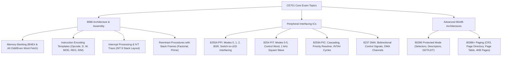

# 10 — Comprehensive CE701 Past Years Question Papers (PYQ) Master Solutions & Concepts Guide

> **Course Code:** CE701 / 3CS526CC23  
> **Course Title:** Interfacing with Microprocessors / Microprocessors and Interfacing  
> **Governing Standards:** Nirma University B.Tech Semester-VII Examination Catalog  
> **Target Processor:** Intel 8086 (with 80286/80386+ Protected Mode & Paging Extensions)  
> **Peripheral ICs Covered:** Intel 8255A (PPI), Intel 8254/8253 (PIT), Intel 8259A (PIC), Intel 8237 (DMAC)  
> **Synthesized Papers:** December 2016, May 2017 (RPR), December 2017, December 2018, December 2019, December 2021, February 2022 (SPE/RPR)  

---

## Executive Overview & Master Examination Blueprint

This guide delivers complete, production-grade solutions for all questions appearing across the CE701 examination papers. Each solution provides:

1. **Underlying Concept & Architectural Foundation:** Rigorous theoretical justification.
2. **Standard Reference Tables:** Master tables for instruction templates, addressing modes, memory banking, interrupt vectors, and peripheral control words.
3. **Mathematical Step-by-Step Traces:** Address computations, stack layout frames, and timing states.
4. **Tested Assembly Programs:** Standard MASM/TASM 8086 source programs adhering to strict memory models and calling conventions.
5. **High-Yield Marked Problem Highlights:** Specific notes on recurring examination favorites marked across the question papers.

### Direct Links to Individual Verbatim Solved Exam Papers:

- [CE701 Exam Paper Solutions — December 2016 (100 Marks)](file:///R:/DeepWorks/DeepCollege/DeepSkills/notes/hardware_and_microprocessors/09_PYQ_CE701_December_2016.md)
- [CE701 Exam Paper Solutions — May 2017 RPR (100 Marks)](file:///R:/DeepWorks/DeepCollege/DeepSkills/notes/hardware_and_microprocessors/09_PYQ_CE701_May_2017.md)
- [CE701 Exam Paper Solutions — December 2017 (100 Marks)](file:///R:/DeepWorks/DeepCollege/DeepSkills/notes/hardware_and_microprocessors/09_PYQ_CE701_December_2017.md)
- [CE701 Exam Paper Solutions — December 2018 (100 Marks)](file:///R:/DeepWorks/DeepCollege/DeepSkills/notes/hardware_and_microprocessors/09_PYQ_CE701_December_2018.md)
- [CE701 Exam Paper Solutions — December 2019 (100 Marks)](file:///R:/DeepWorks/DeepCollege/DeepSkills/notes/hardware_and_microprocessors/09_PYQ_CE701_December_2019.md)
- [CE701 Exam Paper Solutions — December 2021 (50 Marks)](file:///R:/DeepWorks/DeepCollege/DeepSkills/notes/hardware_and_microprocessors/09_PYQ_CE701_December_2021.md)
- [CE701 Exam Paper Solutions — February 2022 (50 Marks)](file:///R:/DeepWorks/DeepCollege/DeepSkills/notes/hardware_and_microprocessors/09_PYQ_CE701_February_2022.md)

---

## PART I: Master Reference Tables Catalog

### 1. 8086 Instruction Machine Code Encoding Template

The Intel 8086 instruction encoding template varies from 1 to 6 bytes:

```
+-------------------+-------------------+-------------------+-------------------+-------------------+-------------------+
|      Byte 1       |      Byte 2       |      Byte 3       |      Byte 4       |      Byte 5       |      Byte 6       |
+-------------------+-------------------+-------------------+-------------------+-------------------+-------------------+
|  Opcode   | D | W | MOD |  REG  | R/M |   Disp-Low /      |    Disp-High /    |    Data-Low /     |    Data-High      |
|  (6 bits) |(1)|(1)|(2)  | (3)   | (3) |   Data-Low        |    Data-High      |                   |                   |
+-------------------+-------------------+-------------------+-------------------+-------------------+-------------------+
```

#### Field Definitions

- **Opcode (Operation Code):** 6 bits defining the basic machine instruction (e.g., `MOV = 100010b`).
- **D-bit (Direction):**
    - `D = 0`: Direction is `FROM` register (`REG` is the Source operand; Destination is encoded in `R/M`).
    - `D = 1`: Direction is `TO` register (`REG` is the Destination operand; Source is encoded in `R/M`).
- **W-bit (Word / Byte operation):**
    - `W = 0`: Byte instruction (8-bit operation).
    - `W = 1`: Word instruction (16-bit operation).
- **MOD Field (Addressing Mode):**
    - `00`: Memory Mode, No displacement (Except when `R/M = 110`, which triggers 16-bit Direct Addressing).
    - `01`: Memory Mode, 8-bit sign-extended displacement follows in Byte 3.
    - `10`: Memory Mode, 16-bit displacement follows in Bytes 3 and 4 (Low byte first).
    - `11`: Register Mode (no memory displacement; `R/M` specifies the second register).

#### REG & R/M Bit Encoding Table

| Bit Pattern | `W = 0` (Byte Register) | `W = 1` (Word Register) | `MOD = 00` (Memory R/M) | `MOD = 01` / `10` (Disp + R/M) | `MOD = 11` (Register R/M) |
|:---:|:---:|:---:|:---|:---|:---|
| **000** | `AL` | `AX` | `[BX + SI]` | `[BX + SI] + Disp` | `AL` / `AX` |
| **001** | `CL` | `CX` | `[BX + DI]` | `[BX + DI] + Disp` | `CL` / `CX` |
| **010** | `DL` | `DX` | `[BP + SI]` | `[BP + SI] + Disp` | `DL` / `DX` |
| **011** | `BL` | `BX` | `[BP + DI]` | `[BP + DI] + Disp` | `BL` / `BX` |
| **100** | `AH` | `SP` | `[SI]` | `[SI] + Disp` | `AH` / `SP` |
| **101** | `CH` | `BP` | `[DI]` | `[DI] + Disp` | `CH` / `BP` |
| **110** | `DH` | `SI` | Direct `[Disp16]` | `[BP] + Disp` | `DH` / `SI` |
| **111** | `BH` | `DI` | `[BX]` | `[BX] + Disp` | `BH` / `DI` |

#### Segment Override Prefix (SOP) Table
When an instruction accesses a memory segment other than its hardware default, a 1-byte prefix precedes Byte 1:

$$\text{Prefix Byte} = \mathbf{001}\;[\text{REG}]\;\mathbf{110b}$$

| Segment Register | `REG` Field | Binary Prefix | Hex Code | Default Segment Overridden |
|:---|:---:|:---:|:---:|:---|
| **ES (Extra Segment)** | `00` | `00100110b` | **`26H`** | Overrides DS / SS to ES |
| **CS (Code Segment)** | `01` | `00101110b` | **`2EH`** | Accesses lookup tables in CS |
| **SS (Stack Segment)** | `10` | `00110110b` | **`36H`** | Overrides DS to SS |
| **DS (Data Segment)** | `11` | `00111110b` | **`3EH`** | Overrides SS (e.g. BP) to DS |

---

### 2. 8086 Memory Bank Selection & Alignment Control Table

The 8086 physical 1 MB address space ($00000\text{H} - \text{FFFFF}\text{H}$) is partitioned into two 512 KB banks:

1. **Even Bank (Lower Bank / Bank 0):** Connected to data bus $D_0 - D_7$. Enabled by $A_0 = 0$. Contains all even physical addresses ($00000\text{H}, 00002\text{H}, \dots$).
2. **Odd Bank (Upper Bank / Bank 1):** Connected to data bus $D_8 - D_{15}$. Enabled by $\overline{\text{BHE}} = 0$ (Bus High Enable). Contains all odd physical addresses ($00001\text{H}, 00003\text{H}, \dots$).

| $\overline{\text{BHE}}$ | $A_0$ | Operation Type | Data Bus Active | Machine Cycles Required | Description |
|:---:|:---:|:---|:---:|:---:|:---|
| **0** | **0** | **16-bit Word at Even Address** | $D_0 - D_{15}$ (Full 16-bit) | **1** | Aligned Word transfer in a single bus cycle. |
| **1** | **0** | **8-bit Byte at Even Address** | $D_0 - D_7$ (Lower byte) | **1** | Even byte read/write from Lower Bank. |
| **0** | **1** | **8-bit Byte at Odd Address** | $D_8 - D_{15}$ (Upper byte) | **1** | Odd byte read/write from Upper Bank. |
| **1** | **1** | **None / Illegal** | None | — | No bank selected; Bus idle. |
| **Two-Cycle Transfer** | | **16-bit Word at Odd Address (Misaligned)** | | **2** | **Cycle 1:** $\overline{\text{BHE}}=0, A_0=1 \to$ Fetches byte at odd address into higher byte register.<br>**Cycle 2:** $\overline{\text{BHE}}=1, A_0=0 \to$ Address incremented ($A+1$), fetches byte at even address into lower byte register. |

---

### 3. Processor Status Word (PSW) Flag Mapping Table

The 8086 Flag register is 16 bits wide, containing 9 active flags (6 conditional status flags and 3 control flags):

```
+----+----+----+----+----+----+----+----+----+----+----+----+----+----+----+----+
| 15 | 14 | 13 | 12 | 11 | 10 |  9 |  8 |  7 |  6 |  5 |  4 |  3 |  2 |  1 |  0 |
+----+----+----+----+----+----+----+----+----+----+----+----+----+----+----+----+
| U  | U  | U  | U  | OF | DF | IF | TF | SF | ZF | U  | AF | U  | PF | U  | CF |
+----+----+----+----+----+----+----+----+----+----+----+----+----+----+----+----+
  * U = Undefined / Reserved (Bits 1, 3, 5, 12, 13, 14, 15)
```

| Bit | Flag Symbol | Name | Type | Hardware Significance & Set Condition |
|:---:|:---:|:---|:---:|:---|
| **0** | **CF** | Carry Flag | Status | Set if an addition generates a carry out of MSB (bit 7 for byte, bit 15 for word), or if subtraction generates a borrow. |
| **2** | **PF** | Parity Flag | Status | Set if the lowest 8 bits of the result contain an **even** number of 1s (Even Parity); cleared for odd parity. |
| **4** | **AF** | Auxiliary Carry | Status | Set if a carry/borrow occurs out of bit 3 into bit 4 (nibble boundary). Used strictly by `DAA` and `DAS` for BCD arithmetic. |
| **6** | **ZF** | Zero Flag | Status | Set if the result of an arithmetic, logical, or comparison operation is zero ($00\text{H}$ or $0000\text{H}$). |
| **7** | **SF** | Sign Flag | Status | Copies the most significant bit (MSB) of the result (bit 7 or bit 15). $1 = \text{Negative}$, $0 = \text{Positive}$. |
| **8** | **TF** | Trap / Single-Step | Control | When set ($1$), the CPU automatically generates an internal Type 1 interrupt after executing each instruction, enabling single-step debugging. |
| **9** | **IF** | Interrupt Flag | Control | When set ($1$), maskable external hardware interrupts on the `INTR` pin are enabled. When cleared ($0$), `INTR` is ignored. Controlled via `STI` and `CLI`. |
| **10**| **DF** | Direction Flag | Control | Controls string instruction autoincrement/autodecrement. $0 = \text{Autoincrement}$ (`CLD`), $1 = \text{Autodecrement}$ (`STD`). |
| **11**| **OF** | Overflow Flag | Status | Set if signed arithmetic produces an out-of-range magnitude exceeding two's complement capacity (i.e. Carry-in to MSB $\ne$ Carry-out from MSB). |

---

### 4. Complete Interrupt Vector Table (IVT) Allocation Table

The 8086 IVT occupies the lowest 1024 bytes of physical memory ($00000\text{H} - 003\text{FF}\text{H}$). It contains 256 vector pointers ($4 \text{ bytes per vector} = 256 \times 4 = 1024 \text{ bytes}$).

- **Vector Base Address:** $\text{Address} = \text{Type Number} \times 4$.
- **Storage Layout:** 
    - Word at $\text{Base} + 0$: Offset Address (`IP`)
    - Word at $\text{Base} + 2$: Segment Address (`CS`)

| Interrupt Type | Physical Memory Range | Dedicated / Shared Function | Priority / Trigger |
|:---:|:---:|:---|:---|
| **Type 0** | $00000\text{H} - 00003\text{H}$ | **Divide by Zero / Divide Overflow Error** | Dedicated (Internal hardware exception upon `DIV` / `IDIV` quotient overflow) |
| **Type 1** | $00004\text{H} - 00007\text{H}$ | **Single-Step (Trap) Flag Interrupt** | Dedicated (Triggered after every instruction when $\text{TF} = 1$) |
| **Type 2** | $00008\text{H} - 0000\text{B}\text{H}$ | **Non-Maskable Interrupt (NMI)** | Dedicated (External hardware pin `NMI`, edge-triggered, power failure/parity) |
| **Type 3** | $0000\text{C}\text{H} - 0000\text{F}\text{H}$ | **Breakpoint Interrupt (`INT 3`)** | Dedicated (1-byte opcode `0CCH` used by debuggers) |
| **Type 4** | $00010\text{H} - 00013\text{H}$ | **Overflow Trap (`INTO`)** | Dedicated (Software interrupt triggered by `INTO` instruction if $\text{OF} = 1$) |
| **Type 5 - 31** | $00014\text{H} - 0007\text{F}\text{H}$ | **Reserved by Intel** | Reserved for processor exceptions (e.g., BOUND, Coprocessor, Protected Mode) |
| **Type 32 - 255** | $00080\text{H} - 003\text{FF}\text{H}$ | **User / Hardware Maskable Interrupts** | Available for 8259A PIC, DOS `INT 21H`, BIOS services (`INT 10H`, `INT 16H`) |

---

### 5. Peripheral Interface Control Word Formats

#### A. Intel 8255A Programmable Peripheral Interface (PPI)
The 8255 control register resides at the highest I/O address ($A_1 = 1, A_0 = 1$).

**I/O Mode Control Word ($D_7 = 1$):**
```
+----+----+----+----+----+----+----+----+
| D7 | D6 | D5 | D4 | D3 | D2 | D1 | D0 |
+----+----+----+----+----+----+----+----+
| 1  |   Group A   |Port|Port|GrpB|Port|Port|
|Mode|     Mode    | A  | CU |Mode| B  | CL |
+----+----+----+----+----+----+----+----+
```

- **$D_7 = 1$:** Mode Definition active.
- **$D_6, D_5$ (Group A Mode):**
    - `00` = Mode 0 (Basic I/O)
    - `01` = Mode 1 (Strobed I/O)
    - `1X` = Mode 2 (Strobed Bidirectional Bus)
- **$D_4$ (Port A Direction):** $1 = \text{Input}$, $0 = \text{Output}$.
- **$D_3$ (Port C Upper, $PC_7 - PC_4$):** $1 = \text{Input}$, $0 = \text{Output}$.
- **$D_2$ (Group B Mode):** $0 = \text{Mode 0}$, $1 = \text{Mode 1}$.
- **$D_1$ (Port B Direction):** $1 = \text{Input}$, $0 = \text{Output}$.
- **$D_0$ (Port C Lower, $PC_3 - PC_0$):** $1 = \text{Input}$, $0 = \text{Output}$.

**Bit Set/Reset (BSR) Mode Control Word ($D_7 = 0$):**

- Strictly affects individual bits of Port C without disturbing other bits.
- $D_3, D_2, D_1$: Select bit number ($000 = \text{Bit 0}$ through $111 = \text{Bit 7}$).
- $D_0$: $1 = \text{Set bit to 1}$, $0 = \text{Reset bit to 0}$.

---

#### B. Intel 8254/8253 Programmable Interval Timer (PIT)
The Control Word is written to the control register ($A_1 = 1, A_0 = 1$):

```
+----+----+----+----+----+----+----+----+
| D7 | D6 | D5 | D4 | D3 | D2 | D1 | D0 |
+----+----+----+----+----+----+----+----+
|  SC1 |  SC0 |  RW1 |  RW0 |  M2  |  M1  |  M0  | BCD|
+----+----+----+----+----+----+----+----+
```

- **$SC_1, SC_0$ (Select Counter):**
    - `00` = Counter 0
    - `01` = Counter 1
    - `10` = Counter 2
    - `11` = Read-Back Command (8254 only)
- **$RW_1, RW_0$ (Read/Write Mode):**
    - `00` = Counter Latch command
    - `01` = Read/Write Least Significant Byte (LSB) only
    - `10` = Read/Write Most Significant Byte (MSB) only
    - `11` = Read/Write LSB first, followed by MSB
- **$M_2, M_1, M_0$ (Operating Mode):**
    - `000` = Mode 0: Interrupt on Terminal Count
    - `001` = Mode 1: Hardware Retriggerable One-Shot
    - `X10` = Mode 2: Rate Generator (Divide-by-N counter)
    - `X11` = Mode 3: Square Wave Generator (Standard symmetric square wave)
    - `100` = Mode 4: Software Triggered Strobe
    - `101` = Mode 5: Hardware Triggered Strobe
- **$\text{BCD}$:** $0 = \text{Binary counter (16-bit, count } 0000\text{H} - \text{FFFF}\text{H})$, $1 = \text{Binary Coded Decimal (4 decades, } 0000 - 9999)$.

---

### 6. Protected Mode Segment Descriptor & Selector Format

In 80286 and 80386+ protected mode, addresses are no longer computed by shifting a segment register left 4 bits. Instead, segment registers contain a **16-bit Segment Selector** that indexes into an in-memory descriptor table (GDT or LDT).

#### Segment Selector Format (16 bits)
```
+----+----+----+----+----+----+----+----+----+----+----+----+----+----+----+----+
| 15 | 14 | 13 | 12 | 11 | 10 |  9 |  8 |  7 |  6 |  5 |  4 |  3 |  2 |  1 |  0 |
+----+----+----+----+----+----+----+----+----+----+----+----+----+----+----+----+
|                         Descriptor Index (13 bits)              | TI |   RPL  |
+----+----+----+----+----+----+----+----+----+----+----+----+----+----+----+----+
```

- **Index (Bits 3–15):** Selects 1 of up to 8,192 ($2^{13}$) descriptors in the table.
- **TI (Table Indicator, Bit 2):** $0 = \text{Global Descriptor Table (GDT)}$, $1 = \text{Local Descriptor Table (LDT)}$.
- **RPL (Requested Privilege Level, Bits 0–1):** Privilege ring ($00 = \text{Ring 0 Kernel}$ to $11 = \text{Ring 3 User App}$).

#### 80286/80386 8-Byte Segment Descriptor Format
```
Byte 7: Base 31..24 (80386+)
Byte 6: Granularity (G), D/B, 0, AVL, Limit 19..16
Byte 5: Access Rights Byte (P, DPL (2), S, Type (4))
Byte 4: Base 23..16
Byte 3: Base 15..8
Byte 2: Base 7..0
Byte 1: Segment Limit 15..8
Byte 0: Segment Limit 7..0
```

- **Access Rights Byte (Byte 5):**
    - **P (Present, Bit 7):** $1 = \text{Segment is in physical memory}$, $0 = \text{Virtual memory fault (Type 11)}$.
    - **DPL (Descriptor Privilege Level, Bits 5–6):** Rings 0 to 3 required to access this segment.
    - **S (System/Code/Data, Bit 4):** $1 = \text{Code/Data segment}$, $0 = \text{System descriptor (Gate/TSS/LDT)}$.
    - **Type (Bits 0–3):** Executable, Read/Write, Direction (expand-down for stacks), Accessed.
- **Base Address:** 24-bit (80286, 16 MB max) or 32-bit (80386+, 4 GB max).
- **Segment Limit:** 16-bit (80286, 64 KB max) or 20-bit (80386+, up to 4 GB with $G=1$, $4\text{ KB page granularity}$).

---

## PART II: Paper-by-Paper Comprehensive Question Solutions

---

### CHAPTER 1: CE701 December 2016 Examination Solutions

#### Q1(a)(1): Purpose of Segment Registers & Physical Address Calculation

- **Purpose of Segment Registers:** The 8086 features a 20-bit physical address bus ($1\text{ MB}$ space) but uses 16-bit internal registers. Segment registers (`CS, DS, SS, ES`) establish the base location of 64 KB logical blocks (segments). This decoupling allows:
    1. **Memory Relocation:** Programs run in any memory block without recalculating branch targets.
    2. **Modular Memory Segmentation:** Clear physical division between executable instructions (`CS`), variables (`DS`), temporary subroutine frames (`SS`), and string destinations (`ES`).
- **Physical Address Calculation for `MOV CX, [BX]`:**
    - **Given:** $\text{DS} = 2500\text{H}$, $\text{BX} = 1000\text{H}$.
    - **Formula:**

    $\text{Physical Address} = (\text{Segment Register} \times 10\text{H}) + \text{Effective Address (Offset)}$

    - **Calculation:**

    $\text{Base Address} = 2500\text{H} \times 10\text{H} = 25000\text{H}$

    $\text{Offset} = \text{BX} = 1000\text{H}$

    $\text{Physical Address} = 25000\text{H} + 1000\text{H} = \mathbf{26000\text{H}}$

    - **Byte Fetch:** Since `CX` is a 16-bit word register:
    - Low byte (`CL`) is fetched from physical address $\mathbf{26000\text{H}}$.
    - High byte (`CH`) is fetched from physical address $\mathbf{26001\text{H}}$.

#### Q1(a)(2): Function of DF, IF, TF, and OF Bits

- **DF (Direction Flag, Bit 10):** Directs the index register modification in string instructions (`MOVS, LODS, STOS, CMPS, SCAS`). If $\text{DF} = 0$ (`CLD`), `SI` and `DI` auto-increment. If $\text{DF} = 1$ (`STD`), `SI` and `DI` auto-decrement.
- **IF (Interrupt Flag, Bit 9):** Masks or enables external hardware maskable interrupts arriving on the `INTR` pin. If $\text{IF} = 1$ (`STI`), CPU accepts hardware interrupts. If $\text{IF} = 0$ (`CLI`), `INTR` line is ignored.
- **TF (Trap Flag, Bit 8):** Enables hardware-assisted instruction-by-instruction debugging. When $\text{TF} = 1$, the CPU internally triggers a Type 1 interrupt immediately following the completion of each instruction.
- **OF (Overflow Flag, Bit 11):** Set when an arithmetic operation on **signed numbers** generates a result that exceeds the numerical range of the destination ($[-128, +127]$ for byte, $[-32768, +32767]$ for word). Calculated as $\text{OF} = C_{\text{in}} \oplus C_{\text{out}}$ of the MSB.

#### Q1(a)(3): Fixed vs Variable Length Architecture Justification

- **Verdict:** The 8086 microprocessor is a **Variable Length Instruction Architecture**.
- **Justification using MOV Template:**
    1. `MOV AL, BL` (Register-to-Register): 2 Bytes (`10001000 11011000b` = `88 D8H`).
    2. `MOV AX, [BX]` (Register-to-Memory, No displacement): 2 Bytes (`8B 07H`).
    3. `MOV AL, [BX + 5]` (Memory with 8-bit Displacement): 3 Bytes (`8A 47 05H`).
    4. `MOV AX, [BX + SI + 1234H]` (Memory with 16-bit Displacement): 4 Bytes (`8B 80 34 12H`).
    5. `MOV ES:[BX + SI + 1234H], AX` (Segment Override + Memory): 5 Bytes (`26 89 80 34 12H`).
    6. `MOV WORD PTR [BX + 1234H], 5678H` (Memory with 16-bit Disp + 16-bit Immediate Data): 6 Bytes (`C7 87 34 12 78 56H`).
- Because instructions scale from 1 byte (`NOP, CLD, XLAT`) up to 6 bytes depending on addressing modes, displacements, and prefixes, the 8086 is strictly variable length.

#### Q1(b): Comparison of Unconditional Jump Instructions
The 8086 supports five types of unconditional jumps (`JMP`):

| Jump Category | Mnemonic Syntax | Target Distance / Scope | Offset Encoding Size | CS Modified? | Machine Description |
|:---|:---|:---|:---:|:---:|:---|
| **Short Jump** | `JMP SHORT Label` | Relative within $-128 \text{ to } +127$ bytes | 1 Byte (Signed 8-bit) | No | `IP = IP + sign_extended(disp8)` |
| **Near Direct** | `JMP Label` | Relative within $-32768 \text{ to } +32767$ bytes | 2 Bytes (Signed 16-bit) | No | `IP = IP + disp16` |
| **Near Indirect**| `JMP BX` / `JMP [BX]` | Intra-segment via register or memory | None (Absolute value in reg/mem) | No | `IP = [BX]` |
| **Far Direct** | `JMP FAR PTR Label` | Inter-segment to any segment in 1 MB | 4 Bytes (2B IP + 2B CS) | **Yes** | `IP = Target_Offset`, `CS = Target_Segment` |
| **Far Indirect** | `JMP DWORD PTR [BX]`| Inter-segment via doubleword memory pointer | Pointer in Memory (4 Bytes) | **Yes** | `IP = [BX]`, `CS = [BX + 2]` |

#### Q1(b) OR: Stack Initialization & Significance in CALL / RET

- **Instructions to Initialize Stack:**
```assembly
MOV AX, 07000H       ; Load segment address for stack
MOV SS, AX           ; Initialize Stack Segment register
MOV SP, 02000H       ; Set Stack Pointer to top of stack (grows downwards)
```

- **Significance in CALL / RET:**
    1. **Near CALL:** Pushes the 16-bit return address (`IP` of the instruction following CALL) onto stack: `SP = SP - 2; [SS:SP] = IP`. Subroutine terminates with `RET`, which pops `IP` off stack: `IP = [SS:SP]; SP = SP + 2`.
    2. **Far CALL:** Pushes current `CS` then `IP`:
     - `SP = SP - 2; [SS:SP] = CS`
     - `SP = SP - 2; [SS:SP] = IP`
     Subroutine terminates with `RETF` (Far RET):

     - `IP = [SS:SP]; SP = SP + 2`
     - `CS = [SS:SP]; SP = SP + 2`
    3. **Stack Frames:** Enables nested and recursive subroutines by storing dynamic activation records and local variables.

#### Q2(a): Macro vs Procedure & Reading Character from Keyboard

| Parameter | Macro | Procedure |
|:---|:---|:---|
| **Assembly Handling** | Expanded inline at every invocation site by assembler preprocessor. | Assembled once into memory; invoked at runtime via `CALL`. |
| **Code Size** | Increases executable code size proportional to invocation count. | Compact single memory footprint regardless of invocation frequency. |
| **Execution Speed** | Faster (no `CALL`/`RET` stack pushing/popping overhead). | Slower (incurs bus cycles to push and pop `IP`/`CS` and parameters). |
| **Parameter Passing** | Replaced lexically during text preprocessing. | Passed via registers, memory variables, or stack frames. |
| **Directives Used** | `MACRO ... ENDM` | `PROC ... ENDP` |

- **Assembly Program to Read Character from Keyboard (DOS `INT 21H`):**
```assembly
.MODEL SMALL
.STACK 100H
.DATA
    MSG DB 'Enter any character: $'
    OUT_MSG DB 0DH, 0AH, 'ASCII Code in Hex: $'
.CODE
MAIN PROC
    MOV AX, @DATA
    MOV DS, AX

    ; Display Prompt
    LEA DX, MSG
    MOV AH, 09H
    INT 21H

    ; Read character from keyboard (with echo)
    MOV AH, 01H
    INT 21H            ; AL now contains ASCII code of input character

    MOV BL, AL         ; Preserve character in BL

    ; Terminate Program
    MOV AH, 4CH
    INT 21H
MAIN ENDP
END MAIN
```

#### Q2(b)(1): Can an 8086 Segment Begin at an Address Not Divisible by 16?

- **Answer:** **No, it is physically impossible in the 8086 architecture.**
- **Architectural Reason:** The BIU constructs the 20-bit physical address by taking the 16-bit segment register and internally appending four zeros (`0000b`) to the right (equivalent to multiplying by $16_{10}$ or $10_{16}$):

  $\text{Physical Base} = \text{Segment Register} \times 16_{10}$
  Every number multiplied by 16 ends in $0\text{H}$ in hexadecimal, which is always divisible by 16. These 16-byte boundaries are called **Paragraph Boundaries**.

#### Q2(b)(2): Can Two Segments Overlap in 8086? Why?

- **Answer:** **Yes, segments can fully or partially overlap.**
- **Reason:** Since segment starting addresses occur every 16 bytes (1 paragraph) while each segment can span up to $64\text{ KB}$ ($65,536\text{ bytes}$), if two segment registers contain values differing by less than $1000\text{H}$ ($4096\text{ paragraphs} = 64\text{ KB}$), their addressable physical memory spaces overlap. If two segment registers contain the exact same value (e.g. $\text{CS} = \text{DS} = 1000\text{H}$), they overlap 100% (Non-segmented flat real mode model).

#### Q2(b) OR: LENGTH, OFFSET, and EVEN Assembler Directives

- **`OFFSET`:** Returns the distance in bytes of a variable or label from the base of its enclosing segment.
    - *Example:* `MOV SI, OFFSET ARRAY` loads the 16-bit effective address of `ARRAY` into `SI`.
- **`LENGTH`:** Returns the number of elements defined in a single data declaration line using `DUP`. If `DUP` is not used, it returns 1.
    - *Example:* `TABLE DW 100 DUP(0)` $\to$ `MOV CX, LENGTH TABLE` loads $100$ into `CX`.
- **`EVEN`:** Forces the assembler's location counter to advance to the next even memory address (inserting a `NOP` or byte pad if currently odd).
    - *Significance:* Ensures 16-bit word variables and procedure entry points align on even addresses so the 8086 can fetch them in **one bus cycle** rather than two.

#### Q3(a): ALP: Reentrant Far Procedure for String Concatenation Across Separate Files

- **File 1 (`MAIN.ASM`):**
```assembly
; =====================================================================
; File: MAIN.ASM
; =====================================================================
.MODEL LARGE
.STACK 200H

EXTRN CONCAT_STR:FAR    ; Declare far procedure located in external file

.DATA
    STR1 DB 'Hello, ', 0
    STR2 DB 'World!$', 0
    STR_DEST DB 64 DUP(0)

.CODE
START:
    MOV AX, @DATA
    MOV DS, AX
    MOV ES, AX

    ; Push parameters onto stack: Far pointers (Segment then Offset)
    PUSH SEG STR1
    PUSH OFFSET STR1

    PUSH SEG STR2
    PUSH OFFSET STR2

    PUSH SEG STR_DEST
    PUSH OFFSET STR_DEST

    CALL CONCAT_STR     ; Far call: pushes CS then IP

    ; Display Result
    LEA DX, STR_DEST
    MOV AH, 09H
    INT 21H

    MOV AH, 4CH
    INT 21H
END START
```

- **File 2 (`CONCAT.ASM` - Reentrant Far Procedure):**
```assembly
; =====================================================================
; File: CONCAT.ASM (Reentrant Far Subroutine)
; =====================================================================
.MODEL LARGE
PUBLIC CONCAT_STR

.CODE
CONCAT_STR PROC FAR
    PUSH BP
    MOV BP, SP
    PUSHA               ; Preserve all working registers
    PUSH DS
    PUSH ES

    ; Stack layout relative to BP:
    ; [BP+00] = Old BP
    ; [BP+02] = Caller IP
    ; [BP+04] = Caller CS
    ; [BP+06] = Dest Offset
    ; [BP+08] = Dest Segment
    ; [BP+10] = Str2 Offset
    ; [BP+12] = Str2 Segment
    ; [BP+14] = Str1 Offset
    ; [BP+16] = Str1 Segment

    LES DI, [BP+06]     ; ES:DI points to Destination buffer

    ; Copy String 1
    LDS SI, [BP+14]     ; DS:SI points to STR1
COPY_S1:
    LODSB
    CMP AL, 0
    JE COPY_S2_PREP
    STOSB
    JMP COPY_S1

COPY_S2_PREP:
    ; Copy String 2
    LDS SI, [BP+10]     ; DS:SI points to STR2
COPY_S2:
    LODSB
    STOSB
    CMP AL, `'$'`
    JE CONCAT_DONE
    CMP AL, 0
    JE CONCAT_DONE
    JMP COPY_S2

CONCAT_DONE:
    POP ES
    POP DS
    POPA
    POP BP
    RET 12              ; Clean up 6 word parameters (12 bytes)
CONCAT_STR ENDP
END
```

- **Stack Content Diagram at Procedure Entry:**
```
Higher Memory (Top of stack before call)
+-----------------------+ [BP + 16] Segment of STR1
+-----------------------+ [BP + 14] Offset of STR1
+-----------------------+ [BP + 12] Segment of STR2
+-----------------------+ [BP + 10] Offset of STR2
+-----------------------+ [BP + 08] Segment of STR_DEST
+-----------------------+ [BP + 06] Offset of STR_DEST
+-----------------------+ [BP + 04] Caller CS (Pushed by Far CALL)
+-----------------------+ [BP + 02] Caller IP (Pushed by Far CALL)
+-----------------------+ [BP + 00] Old BP Saved <-- BP points here
Lower Memory (Dynamic allocation for locals / preserved regs)
```

#### Q3(b): Invalid Instruction Error Analysis

1. `LEA BX, AX`: **Invalid.** Source operand for `LEA` (Load Effective Address) must be a **memory location**, not a register.
2. `MOV BX, SUM`: **Valid.** Loads 16-bit word variable `SUM` into register `BX`.
3. `CBW AL, BL`: **Invalid.** `CBW` (Convert Byte to Word) takes **no operands**. It implicitly operates strictly on register `AL` to produce a sign-extended word in `AX`.
4. `IMUL BYTE PTR [BX]`: **Valid in 8086.** In the single-operand format, `IMUL r/m8` multiplies register `AL` by the byte operand at `[BX]`, storing the signed 16-bit product in `AX`.
5. `MOVS S1, S2`: **Invalid.** `MOVS` is a string instruction with fixed hardware operand registers (`DS:SI` to `ES:DI`). While assemblers allow `MOVS DEST, SRC` as shorthand for size deduction, hardware encoding cannot embed variable operands.
6. `ROL [BP], 3`: **Invalid.** In the 8086 instruction set, immediate shift/rotate counts greater than 1 are illegal. Any count $> 1$ must be placed in register `CL`: `MOV CL, 3; ROL BYTE PTR [BP], CL`.

#### Q4(a): Timing Diagram of Memory Read-Modify-Write for `AND [BX], AL`

- **Given Parameters:** $\text{DS} = \text{D000H}$, $\text{BX} = \text{AAAAH}$.
    - $\text{Physical Address} = \text{D0000H} + \text{AAAAH} = \mathbf{\text{DAAAAH}}$ (Even address $\to A_0 = 0, \overline{\text{BHE}} = 1$).
    - Instruction `AND [BX], AL` performs a **Read-Modify-Write** operation:
    1. Read byte from $\text{DAAAAH}$.
    2. Execute `AND` logic in ALU with `AL`.
    3. Write result byte back to $\text{DAAAAH}$.
- **Timing Diagram Cycles:** Consists of **two consecutive bus machine cycles** (Memory Read cycle followed by Memory Write cycle), each lasting 4 T-states ($T_1 - T_4$):

```
                   |<----- Memory Read Cycle ----->|<----- Memory Write Cycle ---->|
Clock (CLK)        |  T1  |  T2  |  T3  |  T4  |  T1  |  T2  |  T3  |  T4  |
                   +------+------+------+------+------+------+------+------+
ALE                |--__  |      |      |      |--__  |      |      |      |
AD0-AD15           | Addr |  Float/Data In     | Addr |   Data Out (ALU)   |
A16-A19/S3-S6      | Addr |    Status (S3-S6)  | Addr |    Status (S3-S6)  |
BHE#               | 1111 | 1111 | 1111 | 1111 | 1111 | 1111 | 1111 | 1111 | (High for byte)
RD#                | 1111 | 0000 | 0000 | 1111 | 1111 | 1111 | 1111 | 1111 | (Active Low on Read)
WR#                | 1111 | 1111 | 1111 | 1111 | 1111 | 0000 | 0000 | 1111 | (Active Low on Write)
M/IO#              | 1111 | 1111 | 1111 | 1111 | 1111 | 1111 | 1111 | 1111 | (High for Memory)
DT/R#              | 0000 | 0000 | 0000 | 0000 | 1111 | 1111 | 1111 | 1111 | (Low=Receive, High=Xmit)
DEN#               | 1111 | 0000 | 0000 | 1111 | 1111 | 0000 | 0000 | 1111 | (Active Low Data Enable)
```

#### Q4(b): Segmentation in 80286 Protected Mode vs Real Mode

- **Protected Mode Architecture:**
    1. **Segment Selector (in CS, DS, SS, ES):** 16-bit register holding an Index (13 bits), Table Indicator `TI` (1 bit, GDT vs LDT), and `RPL` (2 bits).
    2. **Descriptor Tables (GDT / LDT):** Reside in physical memory. Base addresses stored in CPU registers `GDTR` and `LDTR`.
    3. **Segment Descriptor (8 Bytes):** Contains a 24-bit physical base address ($16\text{ MB}$ space), a 16-bit limit ($64\text{ KB}$ max), and an Access Rights Byte enforcing read/write/executable permissions and privilege rings (0 to 3).
- **Physical Address Generation:**

  $\text{Descriptor Address} = \text{GDTR/LDTR Base} + (\text{Selector Index} \times 8)$

  $\text{Physical Address} = \text{Descriptor Base Address} + \text{16-bit Offset}$

- **Key Differences from Real Mode:**
    - Real Mode shifts segment by 4 bits ($\text{Base} \times 16 + \text{Offset}$) with zero protection and $1\text{ MB}$ ceiling.
    - Protected mode translates through descriptor tables, verifying whether `Offset` $\le$ `Limit` and comparing caller `CPL` with descriptor `DPL`, throwing exceptions on unauthorized access.

#### Q5(a): ISR Design for Divide Overflow (Type 0) & Vector Division ALP

- **Interrupt Vector for Type 0:** Address range $00000\text{H} - 00003\text{H}$.
- **Complete Program:**
```assembly
.MODEL SMALL
.STACK 200H

.DATA
    N           EQU 4
    V1          DW  100, 1000, 200, 300   ; 16-bit Dividends
    V2          DB  2, 2, 2, 3            ; 8-bit Divisors
    RESULT      DB  N DUP(0)
    OVERFLOW_F  DB  0                     ; Flag set by Type 0 ISR

    OLD_IP      DW  0
    OLD_CS      DW  0

.CODE
; ---------------------------------------------------------------------
; Type 0 Interrupt Service Routine: Div Overflow Handler
; ---------------------------------------------------------------------
TYPE0_ISR PROC FAR
    PUSH BP
    MOV BP, SP
    MOV CS:OVERFLOW_F, 1    ; Flag error

    ; Modify return address on stack to skip faulting DIV instruction (2 bytes)
    ; Stack: [BP+0]=Old BP, [BP+2]=IP, [BP+4]=CS, [BP+6]=Flags
    ADD WORD PTR [BP+2], 2  ; Advance IP past DIV instruction

    ; Set Carry Flag in the saved Flags image on stack
    OR WORD PTR [BP+6], 0001H

    POP BP
    IRET
TYPE0_ISR ENDP

MAIN PROC
    MOV AX, @DATA
    MOV DS, AX
    MOV ES, AX

    ; Install Type 0 ISR Hook into IVT (Vector 0 = 0000:0000)
    CLI
    XOR AX, AX
    MOV ES, AX
    MOV AX, ES:[0000H]
    MOV OLD_IP, AX
    MOV AX, ES:[0002H]
    MOV OLD_CS, AX

    MOV WORD PTR ES:[0000H], OFFSET TYPE0_ISR
    MOV WORD PTR ES:[0002H], CS
    STI

    ; Perform Vector Division
    MOV SI, 0
    MOV DI, 0
    MOV CX, N

DIV_LOOP:
    MOV AX, V1[SI]      ; Load 16-bit Dividend into AX
    MOV BL, V2[DI]      ; Load 8-bit Divisor into BL
    DIV BL              ; AL = Quotient, AH = Remainder

    ; Check if ISR tripped
    CMP OVERFLOW_F, 1
    JE SET_ALL_FF

    MOV RESULT[DI], AL
    ADD SI, 2
    INC DI
    LOOP DIV_LOOP
    JMP RESTORE_IVT

SET_ALL_FF:
    ; Fill entire result vector with FFH
    MOV CX, N
    LEA DI, RESULT
FILL_FF:
    MOV BYTE PTR [DI], 0FFH
    INC DI
    LOOP FILL_FF

RESTORE_IVT:
    ; Restore original Type 0 handler
    CLI
    XOR AX, AX
    MOV ES, AX
    MOV AX, OLD_IP
    MOV ES:[0000H], AX
    MOV AX, OLD_CS
    MOV ES:[0002H], AX
    STI

    ; Terminate Program
    MOV AH, 4CH
    INT 21H
MAIN ENDP
END MAIN
```

#### Q6(a): Functional Block Diagram of 8255A PPI
The 8255A consists of five major structural functional blocks:

1. **Data Bus Buffer (8-bit bidirectional, $D_0 - D_7$):** Interfaces the 8255 internal bus with the system data bus; transmits control words, status, and port data.
2. **Read/Write Control Logic:** Decodes incoming bus control lines:
   - $\overline{\text{CS}}$ (Chip Select): Enables the chip when low.
   - $\overline{\text{RD}}$: Reads data from port/status to CPU.
   - $\overline{\text{WR}}$: Writes data/control word from CPU to 8255.
   - $A_1, A_0$: Address lines select Port A (`00`), Port B (`01`), Port C (`10`), or Control Register (`11`).
   - $\text{RESET}$: Clears control registers and configures all ports as inputs in Mode 0.
3. **Group A Control & Ports:** Controls Port A ($PA_7 - PA_0$) and Port C Upper ($PC_7 - PC_4$). Operates in Modes 0, 1, or 2.
4. **Group B Control & Ports:** Controls Port B ($PB_7 - PB_0$) and Port C Lower ($PC_3 - PC_0$). Operates in Modes 0 or 1.

#### Q6(a) OR: 8254 Timer Counter 1 Square Wave Generator (1 kHz from 2 MHz)

- **Mathematical Count Calculation:**

  $\text{Input Clock Frequency } F_{\text{clk}} = 2\text{ MHz} = 2,000,000\text{ Hz}$

  $\text{Desired Output Frequency } F_{\text{out}} = 1\text{ kHz} = 1,000\text{ Hz}$

  $\text{Divisor Count } N = \frac{F_{\text{clk}}}{F_{\text{out}}} = \frac{2,000,000}{1,000} = \mathbf{2000_{10}} = \mathbf{07\text{D}0\text{H}}$

- **Control Word Formulation:**
    - Counter 1 $\to SC_1 SC_0 = \mathbf{01b}$
    - Read/Write LSB then MSB $\to RW_1 RW_0 = \mathbf{11b}$
    - Mode 3 (Square Wave) $\to M_2 M_1 M_0 = \mathbf{011b}$
    - Binary count $\to \text{BCD} = \mathbf{0b}$
    - **Binary Control Word:** `01110110b` = **`76H`**
- **Assembly Program:**
```assembly
.MODEL SMALL
.CODE
    ; Control Register = C003H, Counter 1 = C001H
    MOV AL, 76H         ; Counter 1, Mode 3, LSB then MSB, Binary
    MOV DX, 0C003H      ; Control Register I/O address
    OUT DX, AL

    ; Write LSB of Count (D0H)
    MOV AL, 0D0H
    MOV DX, 0C001H      ; Counter 1 I/O address
    OUT DX, AL

    ; Write MSB of Count (07H)
    MOV AL, 07H
    OUT DX, AL
.EXIT
END
```

#### Q6(b): 8259A PIC Interfacing & Interrupt Acknowledge Cycle

- **Handling Multiple I/O Devices:** The 8259 prioritizes 8 vectored interrupts ($IR_0 - IR_7$). Up to 8 slave 8259 chips can connect to a master 8259 via cascade lines ($CAS_0 - CAS_2$), expanding capacity to 64 priority interrupt inputs entering through a single `INTR` line.
- **Interrupt Acknowledge ($\overline{\text{INTA}}$) Machine Cycles:**
    1. **First $\overline{\text{INTA}}$ Cycle:** The CPU asserts $\overline{\text{INTA}}$ low. The 8259 locks the highest pending priority interrupt in its In-Service Register (`ISR`) and clears the corresponding Interrupt Request Register (`IRR`) bit. In cascade mode, the master outputs the slave's 3-bit cascade ID on lines $CAS_0 - CAS_2$.
    2. **Second $\overline{\text{INTA}}$ Cycle:** The CPU asserts $\overline{\text{INTA}}$ low again. The 8259 puts the assigned 8-bit Interrupt Vector Type ($00\text{H} - \text{FF}\text{H}$) onto the data bus ($D_0 - D_7$). The CPU reads this byte, multiplies by 4, and branches to the designated IVT vector address.

---

### CHAPTER 2: CE701 May 2017 Examination Solutions

#### Q1(b): Instruction Comparisons: (i) INTO vs JO, (ii) LOOP vs JNZ

1. **`INTO` vs `JO`:**
   - `INTO` (Interrupt on Overflow): Conditional software interrupt. If $\text{OF} = 1$, the CPU saves flags, CS, and IP onto the stack, clears IF and TF, and branches through **IVT Vector 4** ($00010\text{H}$). If $\text{OF} = 0$, execution proceeds to next instruction. No operands.
   - `JO Label` (Jump on Overflow): Conditional branch. If $\text{OF} = 1$, adds a signed 8-bit displacement to `IP`. Does not push stack or invoke an ISR.
   - *Modification to replace `INTO` with `JO`:* Must write explicit handler label and replace `INTO` with `JO OVERFLOW_HANDLER`.
2. **`LOOP` vs `JNZ`:**
   - `LOOP Label`: Automatically decrements register `CX` by 1 ($CX = CX - 1$) **without modifying any condition flags**. If $CX \ne 0$, jumps to target label.
   - `JNZ Label`: Evaluates the Zero Flag ($\text{ZF} = 0$). Does not modify or decrement any register.
   - *Modification to replace `LOOP` with `JNZ`:* Must insert explicit decrement before `JNZ`:
     ```assembly
     ; LOOP NEXT is replaced by:
     DEC CX
     JNZ NEXT
     ```

#### Q1(c): Push Offset of Variables X and Y & Clear All Internal Flags
```assembly
LEA AX, X            ; Get 16-bit offset of variable X
PUSH AX              ; Push Offset X onto stack

LEA AX, Y            ; Get 16-bit offset of variable Y
PUSH AX              ; Push Offset Y onto stack

; Clear all internal flags to 0000H using stack
PUSH 0000H           ; Push word 0000H
POPF                 ; Pop into Flag Register (clears CF, PF, AF, ZF, SF, TF, IF, DF, OF)
```

#### Q2(a): Reentrant & Recursive Procedure to Test Prime Number

- **Definitions:**
    - **Reentrant Procedure:** A subroutine that can be concurrently interrupted and re-invoked by another process or interrupt service routine without corrupting execution state. Achieved by allocating all parameters and variables on the **stack frame** rather than static global memory.
    - **Recursive Procedure:** A procedure that calls itself directly or indirectly, requiring dynamic stack frames to maintain each recursion level's state.
- **Prime Number Reentrant Far Procedure:**
```assembly
.MODEL LARGE
.CODE
PUBLIC IS_PRIME

IS_PRIME PROC FAR
    PUSH BP
    MOV BP, SP
    PUSH BX
    PUSH CX
    PUSH DX

    ; Parameter passed on stack:
    ; [BP+6] = Number to test (16-bit word)
    MOV AX, [BP+6]

    CMP AX, 2
    JL NOT_PRIME        ; Numbers < 2 are not prime
    JE PRIME_YES        ; 2 is prime

    ; Check if even
    TEST AX, 1
    JZ NOT_PRIME

    ; Trial division loop: Divisors D = 3, 5, 7 ... up to sqrt(N)
    MOV CX, 3           ; Divisor starting at 3
CHECK_DIV:
    MOV BX, CX
    IMUL BX, BX         ; BX = D * D
    CMP BX, [BP+6]
    JA PRIME_YES        ; If D^2 > N, then N is prime

    XOR DX, DX
    MOV AX, [BP+6]
    DIV CX              ; DX = Remainder, AX = Quotient
    CMP DX, 0
    JE NOT_PRIME        ; Divisible -> Not Prime

    ADD CX, 2           ; Next odd divisor
    JMP CHECK_DIV

PRIME_YES:
    MOV AX, 1           ; Return 1 (Prime)
    JMP EXIT_PRIME

NOT_PRIME:
    MOV AX, 0           ; Return 0 (Not Prime)

EXIT_PRIME:
    POP DX
    POP CX
    POP BX
    POP BP
    RET 2               ; Clean 1 parameter word
IS_PRIME ENDP
END
```

#### Q2(b): Packed BCD Arithmetic: $A = (B - C) + D$
```assembly
.MODEL SMALL
.DATA
    B_VAL DB 85H         ; Packed BCD: 85
    C_VAL DB 38H         ; Packed BCD: 38
    D_VAL DB 24H         ; Packed BCD: 24
    A_VAL DB ?           ; Expected: (85 - 38) + 24 = 47 + 24 = 71H
.CODE
MAIN PROC
    MOV AX, @DATA
    MOV DS, AX

    ; Step 1: Subtraction (B - C)
    MOV AL, B_VAL
    SUB AL, C_VAL
    DAS                  ; Decimal Adjust for Subtraction (AL = 47H)

    ; Step 2: Addition + D
    ADD AL, D_VAL
    DAA                  ; Decimal Adjust for Addition (AL = 71H)

    MOV A_VAL, AL

    MOV AH, 4CH
    INT 21H
MAIN ENDP
END MAIN
```

#### Q2(b) OR: CMPS vs CMP Instructions & String Comparison

- **Comparison:**
    - `CMP Dest, Src`: General comparison between registers/memory. Computes `Dest - Src`, sets flags, and discards result. Does not modify pointer registers.
    - `CMPS Dest, Src` (`CMPSB / CMPSW`): String comparison. Computes `[DS:SI] - [ES:DI]`, updates flags, and **automatically increments or decrements both `SI` and `DI`** based on `DF`. Supports the `REPE / REPNE` prefix.
- **Code Snippet Comparison:**
```assembly
; Method A: Using CMP (Manual pointer management)
COMPARE_WITH_CMP:
    MOV AL, [SI]
    CMP AL, ES:[DI]
    JNE MISMATCH
    INC SI
    INC DI
    LOOP COMPARE_WITH_CMP

; Method B: Using CMPSB (Hardware string primitive)
COMPARE_WITH_CMPSB:
    CLD                  ; Auto-increment SI and DI
    REPE CMPSB          ; Repeat while bytes match and CX > 0
    JNE MISMATCH
```

#### Q3(a): Caesar Cipher Program using LODS and STOS
```assembly
.MODEL SMALL
.STACK 100H
.DATA
    PLAINTEXT  DB 'attackatdawn', 0
    CIPHERTEXT DB 64 DUP(0)
    KEY        EQU 3
.CODE
MAIN PROC
    MOV AX, @DATA
    MOV DS, AX
    MOV ES, AX

    LEA SI, PLAINTEXT
    LEA DI, CIPHERTEXT
    CLD

ENCRYPT_LOOP:
    LODSB               ; Load AL = [DS:SI], SI = SI + 1
    CMP AL, 0
    JE ENCRYPT_END

    ; Shift lowercase character: (char - 'a' + KEY) % 26 + 'a'
    SUB AL, 'a'
    ADD AL, KEY
    CMP AL, 26
    JB STORE_CHAR
    SUB AL, 26          ; Wrap around modulo 26

STORE_CHAR:
    ADD AL, 'a'
    STOSB               ; Store [ES:DI] = AL, DI = DI + 1
    JMP ENCRYPT_LOOP

ENCRYPT_END:
    MOV AL, `'$'`
    STOSB

    ; Display Ciphertext
    LEA DX, CIPHERTEXT
    MOV AH, 09H
    INT 21H

    MOV AH, 4CH
    INT 21H
MAIN ENDP
END MAIN
```

#### Q4(a): Timing Diagram for `INC BYTE PTR [BX]` with Address Wrap

- **Given:** $\text{DS} = \text{C000H}$, $\text{BX} = \text{FFFFH}$.
    - $\text{Physical Address} = \text{C0000H} + \text{FFFFH} = \mathbf{\text{CFFFFH}}$.
    - Physical address $\text{CFFFFH}$ is an **Odd Address** ($A_0 = 1, \overline{\text{BHE}} = 0$).
    - Operates on Upper Data Bus $D_8 - D_{15}$.
    - Performs 2 bus machine cycles: Memory Read at $\text{CFFFFH}$ followed by Memory Write at $\text{CFFFFH}$ (4 T-states each).

#### Q6(a) OR: 8255A Switch-to-LED Interface ALP

- **Hardware Mapping:**
    - Switches connected to Port A ($D000\text{H}$) $\to$ Port A configured as **Input**.
    - LEDs connected to Port B ($D001\text{H}$) $\to$ Port B configured as **Output**.
    - Control Register at $D003\text{H}$.
- **Control Word Derivation:**
    - Mode 0 $\to D_6 D_5 = \mathbf{00b}$
    - Port A Input $\to D_4 = \mathbf{1b}$
    - Port C Upper Output $\to D_3 = \mathbf{0b}$
    - Mode 0 $\to D_2 = \mathbf{0b}$
    - Port B Output $\to D_1 = \mathbf{0b}$
    - Port C Lower Output $\to D_0 = \mathbf{0b}$
    - **Control Byte:** `10010000b` = **`90H`**
- **Assembly Program:**
```assembly
.MODEL SMALL
.CODE
    PORT_A      EQU 0D000H
    PORT_B      EQU 0D001H
    CTRL_REG    EQU 0D003H

    ; Step 1: Initialize 8255A
    MOV DX, CTRL_REG
    MOV AL, 90H         ; Port A Input, Port B Output, Mode 0
    OUT DX, AL

MONITOR_SWITCHES:
    ; Read Switch positions from Port A
    MOV DX, PORT_A
    IN AL, DX

    ; Mirror state to LEDs on Port B
    MOV DX, PORT_B
    OUT DX, AL

    JMP MONITOR_SWITCHES
.EXIT
END
```

---

### CHAPTER 3: CE701 December 2017 Examination Solutions

#### Q1(b): Addressing Modes & Physical Address Calculations

- **Given Parameters:** $\text{BX} = 0017\text{H}, \text{DI} = 10\text{C}5\text{H}, \text{Disp} = 1\text{C}58\text{H}, \text{DS} = 1000\text{H}$.
    - $\text{Segment Base} = 1000\text{H} \times 10\text{H} = \mathbf{10000\text{H}}$.

| # | Addressing Mode | Example Instruction | Effective Address (EA) Formula & Value | Physical Address Calculation |
|:---:|:---|:---|:---|:---|
| **1** | **Direct** | `MOV AX, [1C58H]` | $\text{EA} = \text{Disp} = \mathbf{1\text{C}58\text{H}}$ | $10000\text{H} + 1\text{C}58\text{H} = \mathbf{11\text{C}58\text{H}}$ |
| **2** | **Register Indirect (BX)** | `MOV AX, [BX]` | $\text{EA} = \text{BX} = \mathbf{0017\text{H}}$ | $10000\text{H} + 0017\text{H} = \mathbf{10017\text{H}}$ |
| **3** | **Register Relative (BX)** | `MOV AX, [BX + 1C58H]` | $\text{EA} = \text{BX} + \text{Disp} = 0017\text{H} + 1\text{C}58\text{H} = \mathbf{1\text{C}6\text{F}\text{H}}$ | $10000\text{H} + 1\text{C}6\text{F}\text{H} = \mathbf{11\text{C}6\text{F}\text{H}}$ |
| **4** | **Base Indexed** | `MOV AX, [BX + DI]` | $\text{EA} = \text{BX} + \text{DI} = 0017\text{H} + 10\text{C}5\text{H} = \mathbf{10\text{D}\text{C}\text{H}}$ | $10000\text{H} + 10\text{D}\text{C}\text{H} = \mathbf{110\text{D}\text{C}\text{H}}$ |
| **5** | **Relative Base Indexed** | `MOV AX, [BX + DI + 1C58H]`| $\text{EA} = \text{BX} + \text{DI} + \text{Disp} = 0017\text{H} + 10\text{C}5\text{H} + 1\text{C}58\text{H} = \mathbf{2\text{D}34\text{H}}$ | $10000\text{H} + 2\text{D}34\text{H} = \mathbf{12\text{D}34\text{H}}$ |

#### Q1(c): Importance of DT/R#, ALE, DEN#, INTA#, and NMI

- **$\text{DT}/\overline{\text{R}}$ (Data Transmit/Receive):** Output control signal that directs bidirectional bus transceivers (e.g. Intel 8286). When high ($1$), data travels from CPU to bus (Transmit). When low ($0$), data travels into CPU (Receive).
- **ALE (Address Latch Enable):** Strobe output asserted high by BIU during $T_1$ of every bus cycle to latch demultiplexed address bits from $AD_0 - AD_{15}$ into external transparent latches (Intel 8282).
- **$\overline{\text{DEN}}$ (Data Enable):** Active-low signal enabling the 8286 bus transceiver output drivers, preventing bus contention during address latching phases.
- **$\overline{\text{INTA}}$ (Interrupt Acknowledge):** Active-low strobe generated in response to an `INTR` request. Instructs the 8259A PIC to place its vector type byte on data bus.
- **NMI (Non-Maskable Interrupt):** Edge-triggered (low-to-high) input that cannot be disabled by `CLI`. Automatically branches through IVT Type 2 for catastrophic hardware errors.

#### Q2(c): Word Access at Odd Address Requiring Two Machine Cycles

- **Architectural Mechanics:**
    - The 8086 memory banks partition memory by physical bus lines: Even addresses connect to $D_0 - D_7$, odd addresses connect to $D_8 - D_{15}$.
    - When storing a 16-bit word at an odd physical address $N$:
    1. **Cycle 1 (Odd Byte Transfer):** Address $N$ is placed on bus with $A_0 = 1$ and $\overline{\text{BHE}} = 0$. The lower byte of the word ($D_0 - D_7$) is transferred across the upper data bus lines $D_8 - D_{15}$ into Odd Bank at address $N$.
    2. **Cycle 2 (Even Byte Transfer):** The BIU internally increments the address bus to $N + 1$ (which is even). It asserts $A_0 = 0$ and $\overline{\text{BHE}} = 1$. The higher byte of the word is transferred across lower data bus lines $D_0 - D_7$ into Even Bank at address $N + 1$.
    - Therefore, non-aligned word accesses strictly consume **two full 4-state bus machine cycles (8 T-states)** instead of one cycle (4 T-states).

#### Q3(a): Recursive Factorial Program with Stack Trace ($n = 3$)
```assembly
.MODEL SMALL
.STACK 200H
.DATA
    N_VAL DW 3
    FACT  DW ?
.CODE
MAIN PROC
    MOV AX, @DATA
    MOV DS, AX

    ; Initialize stack of 120 words (240 bytes)
    MOV AX, 07000H
    MOV SS, AX
    MOV SP, 00F0H       ; 120 words * 2 bytes = 240 bytes (F0H)

    PUSH N_VAL          ; Push n = 3
    CALL FACTORIAL
    MOV FACT, AX        ; Result returned in AX (6)

    MOV AH, 4CH
    INT 21H
MAIN ENDP

FACTORIAL PROC NEAR
    PUSH BP
    MOV BP, SP
    PUSH BX

    MOV BX, [BP+4]      ; Read parameter n
    CMP BX, 1
    JLE BASE_CASE

    ; Recursive call: compute (n - 1)
    DEC BX
    PUSH BX
    CALL FACTORIAL      ; Returns (n-1)! in AX

    ; Multiply n * (n-1)!
    MOV BX, [BP+4]
    MUL BX              ; DX:AX = AX * BX
    JMP FACT_EXIT

BASE_CASE:
    MOV AX, 1           ; 1! = 1

FACT_EXIT:
    POP BX
    POP BP
    RET 2               ; Discard parameter n
FACTORIAL ENDP
END MAIN
```

- **Stack Trace for $n = 3$ at Peak Depth (Base Case $n = 1$):**
```
Top of Stack (SP = 00F0H)
+-------------------------------+ [00EEH] n = 3 (Initial parameter)
+-------------------------------+ [00ECH] Return IP to MAIN
+-------------------------------+ [00EAH] Saved BP (Level 1)
+-------------------------------+ [00E8H] Saved BX
+-------------------------------+ [00E6H] n = 2 (Level 2 parameter)
+-------------------------------+ [00E4H] Return IP to Level 1
+-------------------------------+ [00E2H] Saved BP (Level 2)
+-------------------------------+ [00E0H] Saved BX
+-------------------------------+ [00DEH] n = 1 (Level 3 parameter)
+-------------------------------+ [00DCH] Return IP to Level 2
+-------------------------------+ [00DAH] Saved BP (Level 3) <-- SP at peak
```

#### Q3(b): 100-Entry Symbol Table Search Program
```assembly
.MODEL SMALL
.DATA
    ENTRY_COUNT EQU 100
    ENTRY_SIZE  EQU 80
    NAME_LEN    EQU 8
    INFO_LEN    EQU 72

    TABLE       DB ENTRY_COUNT * ENTRY_SIZE DUP(0) ; 8000 bytes
    SEARCH_NAME DB 'ALPHA001'                     ; 8 bytes
    NAME_INFO   DB INFO_LEN DUP(?)

.CODE
MAIN PROC
    MOV AX, @DATA
    MOV DS, AX
    MOV ES, AX

    LEA BX, TABLE       ; Base pointer to start of table
    MOV CX, ENTRY_COUNT

SEARCH_LOOP:
    ; Compare 8-byte Name field
    LEA SI, SEARCH_NAME
    MOV DI, BX          ; DI points to current entry's name field
    PUSH CX
    MOV CX, NAME_LEN
    CLD
    REPE CMPSB
    POP CX
    JE FOUND_ENTRY

    ADD BX, ENTRY_SIZE  ; Advance to next 80-byte record
    LOOP SEARCH_LOOP

    ; Not Found: Fill NAME_INFO with `'$'`
    MOV BYTE PTR NAME_INFO, `'$'`
    JMP FINISH

FOUND_ENTRY:
    ; Copy 72 bytes of info field (offset BX + 8) into NAME_INFO
    LEA SI, [BX + 8]
    LEA DI, NAME_INFO
    MOV CX, INFO_LEN
    CLD
    REP MOVSB

FINISH:
    MOV AH, 4CH
    INT 21H
MAIN ENDP
END MAIN
```

#### Q4(b): Stack Instruction Trace Problem

- **Given Initial Values:**
    - $\text{SS} = 2000\text{H}$, $\text{SP} = 6000\text{H}$
    - $\text{SI} = 1111\text{H}, \text{CX} = 2222\text{H}, \text{DX} = 3333\text{H}, \text{AX} = 4444\text{H}$
- **Step-by-Step Execution Sequence:**
    1. `PUSH SI`: $\text{SP} = 5\text{FFEH}$; $[\text{SS}:5\text{FFEH}] = 1111\text{H}$.
    2. `PUSH CX`: $\text{SP} = 5\text{FFCH}$; $[\text{SS}:5\text{FFCH}] = 2222\text{H}$.
    3. `PUSH DX`: $\text{SP} = 5\text{FFAH}$; $[\text{SS}:5\text{FFAH}] = 3333\text{H}$.
    4. `CALL SAMPLE`: Near Call pushes return address $\text{IP}_{\text{NEXT}}$ ($\text{SP} = 5\text{FF8H}$; $[\text{SS}:5\text{FF8H}] = \text{IP}_{\text{NEXT}}$).
    5. `SAMPLE PROC NEAR`:
     - `PUSHF`: Pushes Flags register ($\text{SP} = 5\text{FF6H}$; $[\text{SS}:5\text{FF6H}] = \text{PSW}$).
     - `PUSH DX`: Pushes $\text{DX} = 3333\text{H}$ ($\text{SP} = 5\text{FF4H}$; $[\text{SS}:5\text{FF4H}] = 3333\text{H}$).
     - `ADD AX, DX`: $\text{AX} = 4444\text{H} + 3333\text{H} = \mathbf{7777\text{H}}$.
     - `POP DX`: Restores $\text{DX} = 3333\text{H}$; $\text{SP} = 5\text{FF6H}$.
     - `POPF`: Restores Flags; $\text{SP} = 5\text{FF8H}$.
     - `RET 4`: Pops return IP into `IP` ($\text{SP} = 5\text{FFAH}$), then adds immediate 4 to `SP`: $\text{SP} = 5\text{FFAH} + 4 = \mathbf{5\text{FFEEH}}$.
       *(Notice: It purged `DX` and `CX` off the stack!)*

    6. Return to Caller:
     - `POP SI`: Reads from $[\text{SS}:5\text{FFEEH}]$ (which holds the original $1111\text{H}$ from step 1): $\text{SI} = 1111\text{H}$; $\text{SP} = 6000\text{H}$.
     - `JMP NEXT`: Terminates with $\mathbf{\text{SP} = 6000\text{H}}$ and $\mathbf{\text{AX} = 7777\text{H}}$.

#### Q5(b): Instruction Error Identification

1. `AAA DX`: **Error.** `AAA` (ASCII Adjust after Addition) takes **no operands**. It implicitly adjusts `AL` and `AH`.
2. `SUB AL, A`: **Error.** Size mismatch error. `AL` is 8-bit byte; `A` is declared as word (`A DW 45H`).
3. `JNZ A`: **Error.** `JNZ` target must be a **Code Label** within $-128 \text{ to } +127$ bytes, not a memory data variable in the Data Segment.
4. `ADD A, B`: **Error.** Memory-to-memory operations are illegal in the 8086 architecture. One operand must be a register: `MOV AX, B; ADD A, AX`.
5. `MOV [DX], AL`: **Error.** Register `DX` cannot be used as an index/base memory pointer. Only `BX, BP, SI, DI` are permitted inside square brackets.

---

### CHAPTER 4: CE701 December 2018 Examination Solutions

#### Q1(b): BIU vs EU Architecture

- **Bus Interface Unit (BIU):**
    - Interfaces directly with external memory and I/O buses.
    - Contains the **6-byte Instruction Prefetch Queue**.
    - Houses the 4 Segment Registers (`CS, DS, SS, ES`) and the Instruction Pointer (`IP`).
    - Contains dedicated address generation adder computing $\text{Base} \times 16 + \text{Offset}$.
- **Execution Unit (EU):**
    - Completely asynchronous from the external bus; decodes and executes instructions preloaded into the queue.
    - Contains the 16-bit **Arithmetic Logic Unit (ALU)**.
    - Houses General Purpose Registers (`AX, BX, CX, DX`), Pointer/Index Registers (`SP, BP, SI, DI`), and Flag Register.

#### Q2(a): Function of 8086 Hardware Pins

- **$\overline{\text{BHE}}$ (Bus High Enable, Pin 34):** Active-low bus control signal asserted during $T_1$ to enable the odd memory bank ($D_8 - D_{15}$).
- **$\text{MN}/\overline{\text{MX}}$ (Minimum/Maximum Mode, Pin 33):** Strapping pin. When tied to $+5\text{V}$, configures 8086 in standalone **Minimum Mode** (CPU generates all control lines like $\overline{\text{RD}}, \overline{\text{WR}}, \text{ALE}$). When grounded ($0\text{V}$), enables **Maximum Mode** for multiprocessor configurations via the Intel 8288 Bus Controller.
- **$\overline{\text{TEST}}$ (Pin 23):** Sampled by the `WAIT` instruction. If low, execution resumes; if high, CPU idles in wait state. Used for math coprocessor (8087) synchronization.
- **$\text{ALE}$ (Address Latch Enable, Pin 25):** Positive pulse that demultiplexes $AD_0 - AD_{15}$ into separate address and data lines.
- **$\overline{\text{RD}}$ (Read Control, Pin 32):** Active-low strobe signaling that the CPU is reading data from memory or I/O.

#### Q3(b): Machine Code Generation from Instruction Coding Template

1. **Instruction 1: `MOV AX, [BX][SI][1234H]`**
   - **Opcode for MOV:** `100010b`
   - **D-bit:** Direction is `TO` register `AX` $\to D = 1$.
   - **W-bit:** Word operation (`AX` is 16-bit) $\to W = 1$.
   - **Byte 1:** `10001011b` = **`8BH`**
   - **MOD:** 16-bit displacement follows $\to \text{MOD} = \mathbf{10b}$.
   - **REG:** Register `AX` $\to \text{REG} = \mathbf{000b}$.
   - **R/M:** Addressing mode `[BX + SI]` $\to \text{R/M} = \mathbf{000b}$.
   - **Byte 2:** `10000000b` = **`80H`**
   - **Byte 3 (Disp-Low):** `34H`
   - **Byte 4 (Disp-High):** `12H`
   - **Resulting Hex Machine Code:** **`8B 80 34 12H`**

2. **Instruction 2: `MOV CX, [SI][0ACDH]`**
   - **Opcode for MOV:** `100010b`
   - **D-bit:** `TO` register `CX` $\to D = 1$.
   - **W-bit:** Word operation (`CX`) $\to W = 1$.
   - **Byte 1:** `10001011b` = **`8BH`**
   - **MOD:** 16-bit displacement follows $\to \text{MOD} = \mathbf{10b}$.
   - **REG:** Register `CX` $\to \text{REG} = \mathbf{001b}$.
   - **R/M:** Addressing mode `[SI]` $\to \text{R/M} = \mathbf{100b}$.
   - **Byte 2:** `10001100b` = **`8CH`**
   - **Byte 3 (Disp-Low):** `CDH`
   - **Byte 4 (Disp-High):** `0AH`
   - **Resulting Hex Machine Code:** **`8B 8C CD 0AH`**

#### Q4(a): Read Two Digits from Keyboard & Pack into BCD in CL
```assembly
.MODEL SMALL
.CODE
MAIN PROC
    ; Read Digit 1
    MOV AH, 01H
    INT 21H
    SUB AL, 30H         ; Convert ASCII to BCD nibble
    MOV CL, 4
    SHL AL, CL          ; Shift into high nibble
    MOV BL, AL          ; Store in BL

    ; Read Digit 2
    MOV AH, 01H
    INT 21H
    SUB AL, 30H         ; Convert ASCII to BCD nibble

    ; Combine into single packed BCD byte in CL
    OR AL, BL
    MOV CL, AL          ; CL now holds packed BCD

    MOV AH, 4CH
    INT 21H
MAIN ENDP
END MAIN
```

#### Q5(b): Arithmetic Evaluation: $D = 6 \times (A + B) / (B + C)$
```assembly
.MODEL SMALL
.DATA
    A   DW 10
    B   DW 20
    C   DW 10
    D   DW ?
.CODE
MAIN PROC
    MOV AX, @DATA
    MOV DS, AX

    ; Numerator: 6 * (A + B)
    MOV AX, A
    ADD AX, B           ; AX = A + B
    MOV BX, 6
    IMUL BX             ; DX:AX = 6 * (A + B)

    ; Preserve Numerator on stack
    PUSH DX
    PUSH AX

    ; Denominator: B + C
    MOV BX, B
    ADD BX, C           ; BX = B + C

    ; Restore Numerator into DX:AX and divide by BX
    POP AX
    POP DX
    IDIV BX             ; AX = Quotient = D, DX = Remainder

    MOV D, AX

    MOV AH, 4CH
    INT 21H
MAIN ENDP
END MAIN
```

#### Q5(c): Memory Content & Physical Address Layout (`DS = 1234H`)

- **Base Physical Address:** $\text{DS} \times 10\text{H} = 1234\text{H} \times 10\text{H} = \mathbf{12340\text{H}}$.
- **Variable Allocations:**
    - `WORD_VAR DW 0ABH, 2456H, 123H`
    - `BYTE_VAR DB 'B', 56`
    - `DWORD_VAR EQU $ - BYTE_VAR`

| Variable Name | Offset | Physical Address | Stored Hex Value | Description |
|:---|:---:|:---:|:---:|:---|
| `WORD_VAR[0]` (Low) | `0000H` | `12340H` | **`ABH`** | Low byte of `00ABH` |
| `WORD_VAR[0]` (High)| `0001H` | `12341H` | **`00H`** | High byte of `00ABH` |
| `WORD_VAR[1]` (Low) | `0002H` | `12342H` | **`56H`** | Low byte of `2456H` |
| `WORD_VAR[1]` (High)| `0003H` | `12343H` | **`24H`** | High byte of `2456H` |
| `WORD_VAR[2]` (Low) | `0004H` | `12344H` | **`23H`** | Low byte of `0123H` |
| `WORD_VAR[2]` (High)| `0005H` | `12345H` | **`01H`** | High byte of `0123H` |
| `BYTE_VAR[0]` | `0006H` | `12346H` | **`42H`** | ASCII code of `'B'` |
| `BYTE_VAR[1]` | `0007H` | `12347H` | **`38H`** | Decimal $56 = 38\text{H}$ |
| `DWORD_VAR` | Constant | — | **`02H`** | Assembler symbol equated to current location ($0008\text{H}$) minus $0006\text{H} = \mathbf{2}$. |

---

### CHAPTER 5: CE701 December 2019 Examination Solutions

#### Q3(a): Segment Override Prefix Encoding for MOV Instructions

1. **Instruction 1: `MOV ES:[BX], AX`**
   - Base Instruction: `MOV [BX], AX`
     - Opcode: `100010b`, $D = 0$ (From REG `AX`), $W = 1$ (Word) $\to$ **`89H`**
     - $\text{MOD} = 00b$, $\text{REG} = 000b$ (`AX`), $\text{R/M} = 111b$ (`[BX]`) $\to$ **`07H`**
   - Segment Override Prefix for `ES`: `00100110b` = **`26H`**
   - **Complete Machine Code:** **`26 89 07H`**

2. **Instruction 2: `MOV CX, [7534H][SI]`**
   - Opcode: `100010b`, $D = 1$ (To REG `CX`), $W = 1$ (Word) $\to$ **`8BH`**
   - $\text{MOD} = 10b$ (16-bit Disp), $\text{REG} = 001b$ (`CX`), $\text{R/M} = 100b$ (`[SI]`) $\to$ **`8CH`**
   - Disp-Low: `34H`, Disp-High: `75H`
   - **Complete Machine Code:** **`8B 8C 34 75H`**

#### Q5(a): Bitwise Register Bit Manipulation Sequence on AX
```assembly
; Requirement 1: Set rightmost four bits of AX (Bits 0..3)
OR AX, 000FH

; Requirement 2: Clear leftmost three bits of AX (Bits 13..15)
; Mask = 0001 1111 1111 1111b = 1FFFH
AND AX, 1FFFH

; Requirement 3: Invert bits 7, 8, and 9 of AX
; Mask = 0000 0011 1000 0000b = 0380H
XOR AX, 0380H
```

#### Q5(b): Shift & Rotate Execution Trace

- **Initial Values:** $\text{DL} = 93\text{H} = \mathbf{10010011b}$, $\text{CL} = 4$, $\text{CF} = 1$.
1. **`SHL DL, CL` (Logical Shift Left by 4):**
   - Shifts bits left, filling zeros into LSB.
   - Bit 4 shifted out through CF:
     - Shift 1: `00100110b`, $\text{CF} = 1$
     - Shift 2: `01001100b`, $\text{CF} = 0$
     - Shift 3: `10011000b`, $\text{CF} = 0$
     - Shift 4: `00110000b`, $\text{CF} = 1$
   - **Result:** $\mathbf{\text{DL} = 30\text{H}}$, $\mathbf{\text{CF} = 1}$.
2. **`SAL DL, CL` (Arithmetic Shift Left by 4):**
   - Bitwise identical to `SHL`.
   - **Result:** $\mathbf{\text{DL} = 30\text{H}}$, $\mathbf{\text{CF} = 1}$.
3. **`ROL DL, CL` (Rotate Left by 4):**
   - Rotates circular 8 bits without passing through carry.
   - Initial: `1001 0011b`. Swapping high and low nibbles after 4 rotations:
   - **Result:** $\mathbf{\text{DL} = 39\text{H}}$, $\mathbf{\text{CF} = 0}$ (last bit rotated was bit 3 = 0).
4. **`RCL DL, CL` (Rotate Left through Carry by 4):**
   - 9-bit circular rotation: $\{CF, DL\}$:
     - Start: $\text{CF}=1$, $\text{DL} = 10010011b$
     - Rot 1: $\text{CF}=1, \text{DL}=00100111b$
     - Rot 2: $\text{CF}=0, \text{DL}=01001111b$
     - Rot 3: $\text{CF}=0, \text{DL}=10011110b$
     - Rot 4: $\text{CF}=1, \text{DL}=00111100b$
   - **Result:** $\mathbf{\text{DL} = 3\text{C}\text{H}}$, $\mathbf{\text{CF} = 1}$.

#### Q6(b): INT 8 Execution Stack & Register Trace Problem

- **Given Initial System Parameters:**
    - $\text{SP} = 0100\text{H}, \text{SS} = 0300\text{H}, \text{PSW} = 0240\text{H}$
    - Current Instruction: `INT 8` at $\text{CS}:\text{IP} = 0900\text{H}:00\text{A}0\text{H}$.
    - Instruction size of `INT 8` is 2 bytes (`CD 08H`). Next instruction address is $\text{IP} = 00\text{A}2\text{H}$.
    - **IVT Contents for Type 8:**
    - $\text{Vector Base} = 8 \times 4 = 32_{10} = 00020\text{H}$.
    - Memory location $00020\text{H} = 0040\text{H}$ (New `IP`).
    - Memory location $00022\text{H} = 0100\text{H}$ (New `CS`).
- **Hardware Interrupt Sequence for `INT 8`:**
    1. Decrement SP by 2, push current Flags (`PSW`):
     - $\text{SP} = 0100\text{H} - 2 = 00\text{FE}\text{H}$
     - $[\text{SS}:00\text{FE}\text{H}] = 0240\text{H}$
    2. Clear IF and TF flags:
     - $\text{PSW} = 0240\text{H} \text{ with IF cleared } (0040\text{H})$.
    3. Decrement SP by 2, push return Segment (`CS`):
     - $\text{SP} = 00\text{FE}\text{H} - 2 = 00\text{FC}\text{H}$
     - $[\text{SS}:00\text{FC}\text{H}] = 0900\text{H}$
    4. Decrement SP by 2, push return Offset (`IP` of next instruction):
     - $\text{SP} = 00\text{FC}\text{H} - 2 = 00\text{FA}\text{H}$
     - $[\text{SS}:00\text{FA}\text{H}] = 00\text{A}2\text{H}$
    5. Load new `CS` and `IP` from IVT:
     - $\text{IP} = [00020\text{H}] = \mathbf{0040\text{H}}$
     - $\text{CS} = [00022\text{H}] = \mathbf{0100\text{H}}$
- **Summary of Final State:**
    - $\mathbf{\text{SP} = 00\text{FA}\text{H}}$
    - $\mathbf{\text{SS} = 0300\text{H}}$ (Unchanged)
    - $\mathbf{\text{IP} = 0040\text{H}}$
    - $\mathbf{\text{CS} = 0100\text{H}}$
    - $\mathbf{\text{PSW} = 0040\text{H}}$
    - **Top Three Words on Stack:**
    1. $[\text{SS}:00\text{FA}\text{H}] = \mathbf{00\text{A}2\text{H}}$ (Return IP)
    2. $[\text{SS}:00\text{FC}\text{H}] = \mathbf{0900\text{H}}$ (Return CS)
    3. $[\text{SS}:00\text{FE}\text{H}] = \mathbf{0240\text{H}}$ (Old Flags / PSW)

---

### CHAPTER 6: CE701 December 2021 & February 2022 Solutions

#### 2021 Q2(a): Single Assembly Instruction Formulations

1. Load 10H at address specified by BX:

   $\mathbf{\text{MOV BYTE PTR [BX], 10H}}$

2. Increment content of memory location specified by DI:

   $\mathbf{\text{INC BYTE PTR [DI]}}$

3. Clear LSB of AX register:

   $\mathbf{\text{AND AX, 0FFFEH}}$

4. Add content of AX, BX, and previous carry:

   $\mathbf{\text{ADC AX, BX}}$

5. Clear the direction flag:

   $\mathbf{\text{CLD}}$

6. Logical shift right of AX register by count 3:

   $\mathbf{\text{MOV CL, 3}}\quad\text{then}\quad\mathbf{\text{SHR AX, CL}}$

#### 2022 Q2(a): Find Errors in Instructions

1. `AAA DX`: **Error.** `AAA` takes no operands.
2. `XOR AL, VAR1`: **Error.** Size mismatch: `AL` is 8-bit, `VAR1` is word. Correct: `XOR AX, VAR1`.
3. `ADD VAR1, VAR2`: **Error.** Both operands cannot be memory locations simultaneously.
4. `DIV 2`: **Error.** Immediate operand illegal in `DIV`. Divisor must be in a register or memory: `MOV BL, 2; DIV BL`.
5. `INC [BX]`: **Error.** Ambiguous operand size. Must explicitly qualify: `INC BYTE PTR [BX]`.
6. `MUL AX, VAR2`: **Error.** In 8086, `MUL` takes only 1 operand. Destination `AX` is implicit: `MUL VAR2`.

#### 2022 Q2(c): ALP to Count Blank Spaces in a String
```assembly
.MODEL SMALL
.STACK 100H
.DATA
    STRING      DB 'Computer Engineering Nirma University 2022', `'$'`
    SPACE_COUNT DW 0
.CODE
MAIN PROC
    MOV AX, @DATA
    MOV DS, AX

    LEA SI, STRING
    XOR CX, CX          ; Space counter = 0

COUNT_LOOP:
    MOV AL, [SI]
    CMP AL, `'$'`         ; End of string marker
    JE DONE
    CMP AL, ' '         ; Check for blank space (20H)
    JNE SKIP
    INC CX              ; Increment count

SKIP:
    INC SI
    JMP COUNT_LOOP

DONE:
    MOV SPACE_COUNT, CX

    MOV AH, 4CH
    INT 21H
MAIN ENDP
END MAIN
```

#### 2022 Q3(a) OR: ALP to Add 10 Packed BCD Numbers
```assembly
.MODEL SMALL
.DATA
    BCD_ARRAY   DB 12H, 34H, 56H, 78H, 90H, 23H, 45H, 67H, 89H, 11H
    ARRAY_LEN   EQU 10
    SUM_LOW     DB 0
    SUM_HIGH    DB 0
.CODE
MAIN PROC
    MOV AX, @DATA
    MOV DS, AX

    LEA SI, BCD_ARRAY
    MOV CX, ARRAY_LEN
    XOR AL, AL          ; Running BCD sum lower byte
    XOR BL, BL          ; Running BCD sum carry/high byte

ADD_BCD_LOOP:
    ADD AL, [SI]
    DAA                 ; Decimal Adjust after Addition
    JNC NO_BCD_CARRY
    ; Increment high byte with decimal adjust
    INC BL
    MOV BH, AL
    MOV AL, BL
    DAA
    MOV BL, AL
    MOV AL, BH

NO_BCD_CARRY:
    INC SI
    LOOP ADD_BCD_LOOP

    MOV SUM_LOW, AL
    MOV SUM_HIGH, BL

    MOV AH, 4CH
    INT 21H
MAIN ENDP
END MAIN
```

---

## PART III: High-Yield Marked Examination Topics Summary

Based on historical question recurrence across all 7 semesters, the following topics represent the highest-weight concepts:



### Quick Revision Checklist

1. **Odd vs Even Memory Bank Operations:** Always mention $\overline{\text{BHE}}$ and $A_0$. Explain that an odd-aligned word requires **Cycle 1 (Odd byte via Upper Bus)** + **Cycle 2 (Even byte via Lower Bus)**.
2. **Instruction Template Encoding:** Remember $D=1 \implies \text{TO REG}$, $W=1 \implies \text{Word}$. SOP format is `001[REG]110b` (`26H` for ES, `36H` for SS).
3. **Interrupt Sequence (`INT n`):** Push Flags, Clear IF and TF, Push CS, Push IP, fetch vector from $\text{Address} = n \times 4$.
4. **8254 Control Word:** $\text{Control} = \text{SC}(2) + \text{RW}(2) + \text{Mode}(3) + \text{BCD}(1)$. Mode 3 is Square Wave.
5. **8255 Control Word:** $\text{Control} = 1 + \text{ModeA}(2) + \text{PortA}(1) + \text{CU}(1) + \text{ModeB}(1) + \text{PortB}(1) + \text{CL}(1)$.
