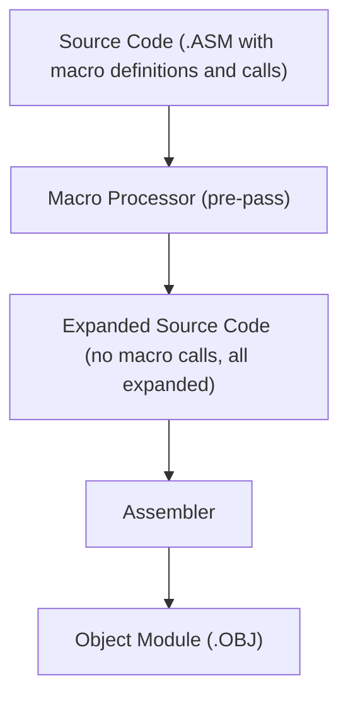
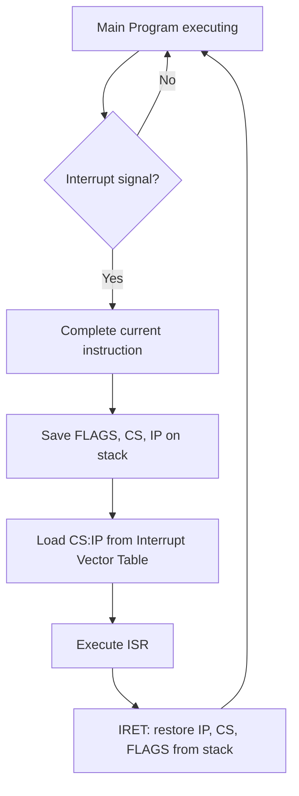
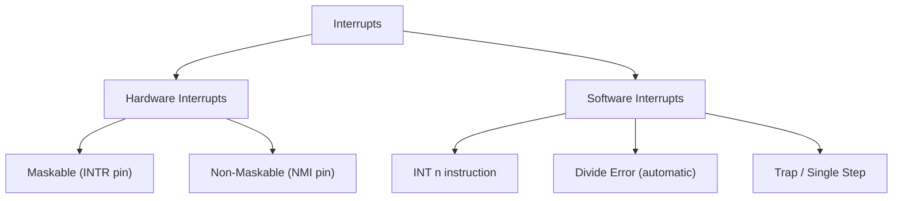
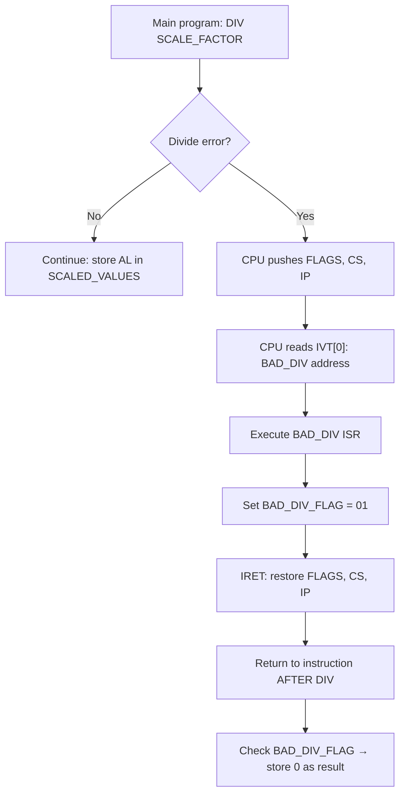

# Chapter: 8086 Macros and Interrupts

> **Course:** Microprocessors (MI) — Semester 5
> **Primary Source:** `8086_Macros and Interrupt.pdf` (31 slides)
> **Files Integrated:** `8086_Macros and Interrupt.pdf`

---

## 1. Chapter Overview

This chapter covers two major topics:

1. **Macros in ASM-86** — a text-substitution mechanism that allows blocks of code to be written once and expanded inline at each point of use, without the overhead of procedure call linkage.
2. **8086 Interrupts** — the hardware and software mechanism by which normal program execution is temporarily suspended to handle a special event (divide-by-zero, keypress, timer tick, etc.), after which execution resumes.

Additionally, the `XLAT` (Table Translation) instruction is introduced as a useful data-lookup mechanism.

---

## 2. Macros in ASM-86

### 2.1 Why Use Macros?

Procedures and macros both promote code reuse, but they work differently:

| Feature | Procedure | Macro |
| :------ | :-------- | :---- |
| Reuse mechanism | CALL/RET linkage | Inline text substitution |
| Memory for code | Written once in memory | Code repeated at each expansion point |
| Execution overhead | PUSH return address, POP, JMP | None (no linkage) |
| Best for | Long, frequently called code | Short code repeated at several places |
| Parameters | Registers, stack, memory | Dummy parameter substitution |

**Key idea:** Macros save **programmer effort** (write once). The **expanded code is repeated** in memory and the binary — unlike procedures where code exists only once.

> **📝 Exam Note:** A macro does NOT generate a CALL/RET. The assembler (or macro pre-processor) replaces each macro call with a copy of the expanded code. This is called **inline expansion**.

[Source: 8086_Macros and Interrupt.pdf, Slide 2]

---

### 2.2 Macro Terminology

| Term | Definition |
| :--- | :--------- |
| **Prototype code** | The code that is to be repeated (the body of the macro) |
| **Macro definition** | Prototype code plus the `%*DEFINE` header and terminator |
| **Macro call** | A statement using the macro name (preceded by `%`) at the point where the code is needed |
| **Macro expansion** | The assembler's (or pre-processor's) act of replacing the macro call with the prototype code, substituting actual parameters |

[Source: 8086_Macros and Interrupt.pdf, Slide 3]

---

### 2.3 ASM-86 Macro Syntax

ASM-86 uses the `%*DEFINE` directive for macro definitions. This syntax is specific to Intel's ASM-86 assembler (and PLM-86 environments).

#### Definition Syntax

```asm
%*DEFINE (MacroName (DummyParam1, DummyParam2, ...))
(
    ; Prototype code
    ; Each dummy parameter is prefixed with % in the body
)
```

#### Call Syntax

```asm
%MacroName (ActualParam1, ActualParam2, ...)
```

**Rules:**

- The macro name must be an identifier beginning with a letter, containing letters, numbers, and underscores.
- Dummy parameters in the **definition** are listed in the `DummyParameterList`.
- Inside the prototype code, each dummy parameter is referenced with a `%` prefix: `%OPR1`, `%RESULT`.
- Actual parameters in the **call** are character strings that replace the dummy parameters positionally (first actual → first dummy, etc.).

[Source: 8086_Macros and Interrupt.pdf, Slide 4]

---

### 2.4 Dummy and Actual Parameters — How Substitution Works

During macro expansion, the assembler performs **textual substitution**:

- The 1st actual parameter replaces every occurrence of the 1st dummy parameter in the prototype code.
- The 2nd actual parameter replaces every occurrence of the 2nd dummy parameter, and so on.
- The substitution is purely textual — the resulting code must be syntactically valid assembly.

#### Example: MSGGEN Macro (String Generation)

```asm
; Definition
%*DEFINE (MSGGEN (LAB, NUM, XYZ))
(
    %LAB%NUM   DB   'HELLO MR. %XYZ'
)

; Call
%MSGGEN (MSG, 1, TAYLOR)

; Expansion
MSG1   DB   'HELLO MR. TAYLOR'
```

The actual parameters are: `LAB='MSG'`, `NUM='1'`, `XYZ='TAYLOR'`. The prototype code concatenates `%LAB` and `%NUM` to produce the label `MSG1`, and substitutes `%XYZ` inside the string literal.

> **📝 Exam Note:** Concatenation of dummy parameters (as in `%LAB%NUM`) is a key ASM-86 feature. The `%` prefix is **not** a modulo operator here — it is the parameter-reference prefix in the macro language.

[Source: 8086_Macros and Interrupt.pdf, Slide 5]

---

### 2.5 MULTIPLY Macro — Full Example

**Goal:** Multiply two word operands and store the result. Pushes/pops AX and DX to preserve them.

```asm
; Definition
%*DEFINE (MULTIPLY (OPR1, OPR2, RESULT))
(
    PUSH DX
    PUSH AX
    MOV  AX, %OPR1       ; load first operand
    IMUL %OPR2           ; signed multiply: DX:AX = AX × OPR2
    MOV  %RESULT, AX     ; store low word of result
    POP  AX
    POP  DX
)

; Call
%MULTIPLY (CX, VAR, XYZ[BX])

; Expansion
PUSH DX
PUSH AX
MOV  AX, CX             ; OPR1 = CX
IMUL VAR                ; OPR2 = VAR
MOV  XYZ[BX], AX        ; RESULT = XYZ[BX]
POP  AX
POP  DX
```

**Important constraint:** The actual parameters must produce syntactically **valid instructions** after substitution. An invalid operand form (e.g., `%MULTIPLY (5, 10, [5])` — immediate as destination) causes an assembler error.

[Source: 8086_Macros and Interrupt.pdf, Slide 6]

---

### 2.6 Macros Without Parameters

A macro can be defined with no dummy parameters. In this case, the call must also include no parameters. The call form `%SAVEREG` (no parentheses) is used.

```asm
; Definition — no parameters
%*DEFINE (SAVEREG)
(
    PUSH AX
    PUSH BX
    PUSH CX
    PUSH DX
    PUSH SI
    PUSH DI
)

; Call
%SAVEREG

; Expansion
PUSH AX
PUSH BX
PUSH CX
PUSH DX
PUSH SI
PUSH DI
```

**Usage:** Write `%SAVEREG` at the start of any procedure to save all general-purpose registers in one line.

[Source: 8086_Macros and Interrupt.pdf, Slide 7]

---

### 2.7 Macro Processor Architecture

The assembler can handle macros in two ways:

**Approach 1:** Include macro expansion in the **first pass** of the assembler itself.

**Approach 2:** Use a **separate pre-pass** (macro processor) before normal assembly:



**What the macro processor does:**

1. Scans the source for `%*DEFINE` directives → stores each in a **macro-definition table**.
2. Scans for `%MacroName` calls → retrieves definition from table, substitutes actual parameters, emits the expanded code.
3. Produces an expanded source file ready for normal assembly.

[Source: 8086_Macros and Interrupt.pdf, Slide 8]

---

### 2.8 Local Labels — Preventing Name Conflicts

**Problem:** If a macro contains a label (e.g., `NEXT`), the first expansion defines `NEXT` as a label. A second expansion would redefine `NEXT` — causing an **assembly error** ("duplicate label").

```asm
; PROBLEM: no local labels
%*DEFINE (ABSOL (OPER))
(
    CMP  %OPER, 0
    JGE  %NEXT         ; uses label NEXT
    NEG  %OPER
%NEXT: NOP
)

%ABSOL(VAR)   ; defines label NEXT
%ABSOL(BX)    ; ERROR: NEXT already defined!
```

**Solution:** Declare labels as **LOCAL** in the macro definition. ASM-86 auto-appends a two-digit numeric suffix (starting at `00`, incrementing by 1 for each expansion).

#### LOCAL Syntax

```asm
%*DEFINE (ABSOL (OPER)) LOCAL NEXT
(
    CMP  %OPER, 0
    JGE  %NEXT
    NEG  %OPER
%NEXT: NOP
)
```

`LOCAL NEXT` is attached at the **end of the first statement** of the macro definition.

#### Two Expansions of ABSOL

```asm
; First call: %ABSOL(VAR)          ; Second call: %ABSOL(BX)
CMP  VAR, 0                        CMP  BX, 0
JGE  NEXT00                        JGE  NEXT01
NEG  VAR                           NEG  BX
NEXT00: NOP                        NEXT01: NOP
```

Each expansion gets a distinct suffix (`NEXT00`, `NEXT01`), eliminating collisions.

[Source: 8086_Macros and Interrupt.pdf, Slides 9–10]

---

### 2.9 Nested Macros — Calling One Macro from Another

A macro call can appear inside another macro's prototype code. This is **nested macro expansion**.

**Rule:** All macros used inside a macro definition must be **defined before** the macro that calls them.

#### Nested Macro Example

```asm
; First, define DIF (computes X - Y, result in AX)
%*DEFINE (DIF (X, Y))
(
    MOV AX, %X
    SUB AX, %Y
)

; Then define DIFSQR (computes (OPR1 - OPR2)^2)
%*DEFINE (DIFSQR (OPR1, OPR2, RESULT))
(
    PUSH DX
    PUSH AX
    %DIF (%OPR1, %OPR2)   ; nested call: expands DIF with OPR1 and OPR2
    IMUL AX               ; AX × AX = AX^2  (DX:AX = result)
    MOV  %RESULT, AX
    POP  AX
    POP  DX
)

; Usage
%DIFSQR (V1, V2, ERROR)

; Expands to:
PUSH DX
PUSH AX
MOV  AX, V1
SUB  AX, V2
IMUL AX
MOV  ERROR, AX
POP  AX
POP  DX
```

[Source: 8086_Macros and Interrupt.pdf, Slide 11]

---

### 2.10 Macros That Define Other Macros

A macro can be parameterized to generate **new macro definitions** as its output. This is an advanced technique for creating families of similar operations.

```asm
; DEFMAC: generates a macro for a binary operation
%*DEFINE (DEFMAC (MACNAM, OPERATOR))
(
    %*DEFINE (%MACNAM (X, Y, Z))
    (
        PUSH AX
        MOV  AX, %X
        %OPERATOR AX, %Y     ; actual instruction (e.g., SUB, OR)
        MOV  %Z, AX
        POP  AX
    )
)

; Generate two new macros using DEFMAC
%DEFMAC (SUBTRACT, SUB)    ; creates %SUBTRACT macro using SUB instruction
%DEFMAC (LOGOR, OR)        ; creates %LOGOR macro using OR instruction

; Using the generated macro
%SUBTRACT (V1, V2, V3)    ; expands to: PUSH AX; MOV AX,V1; SUB AX,V2; MOV V3,AX; POP AX
```

**Benefit:** One `DEFMAC` call generates an entire family of operation macros (add, sub, and, or, xor, etc.) without writing each one individually.

[Source: 8086_Macros and Interrupt.pdf, Slide 12]

---

## 3. XLAT — Table Translation Instruction

The `XLAT` instruction provides fast byte-to-byte translation using a **lookup table** in memory. It is commonly used for character code conversion (e.g., BCD digit → 7-segment display code, ASCII code → custom encoding).

### Definition: XLAT

**Mnemonic:** `XLAT` (or `XLATB`)

**Operation:**

$$
AL \leftarrow [BX + AL]
$$

**Meaning:** The byte at memory address `BX + AL` (in the data segment) is loaded into `AL`. `BX` points to the base of the translation table; `AL` is the **index** into that table; `AL` receives the **translated value**.

**Requirements:**

- `BX` must contain the **base address** of the translation table.
- `AL` must contain the **index** (0-based) of the byte to translate.
- The table is in the data segment.

#### XLAT Application: BCD to 7-Segment Display

The table maps decimal digits (0–9) to their 7-segment LED codes:

```asm
TABLE   DB  3FH    ; 0 → 7-seg code
        DB  06H    ; 1
        DB  5BH    ; 2
        DB  4FH    ; 3
        DB  66H    ; 4
        DB  6DH    ; 5
        DB  7DH    ; 6
        DB  07H    ; 7
        DB  7FH    ; 8
        DB  6FH    ; 9
```

**Usage:**

```asm
        LEA       BX, TABLE         ; BX = base of lookup table
        LEA       SI, STG_BCD       ; SI → BCD digit string
        LEA       DI, STG_DISP      ; DI → output display buffer
        CLD
        MOV       CX, LENGTH STG_BCD  ; CX = number of digits
CONVERT:
        LODS      STG_BCD           ; AL = next BCD digit, SI++
        CMP       AL, 9
        JA        INVALID           ; digit > 9 → error
        XLAT      TABLE             ; AL = TABLE[BX + AL] = 7-seg code
        STOS      STG_DISP          ; store display code, DI++
        LOOP      CONVERT
```

**Flow:**

1. `LODS` reads the next BCD digit into AL.
2. Validate: if AL > 9, handle as invalid.
3. `XLAT` replaces AL with `TABLE[AL]` — the corresponding 7-segment code.
4. `STOS` writes the translated code to the output buffer.

[Source: 8086_Macros and Interrupt.pdf, Slides 14–15]

---

## 4. 8086 Interrupts

### 4.1 What Is an Interrupt?

### Definition: Interrupt

**Meaning:** An interrupt is a signal that causes the CPU to temporarily suspend normal program execution, save its state, and execute a special routine (the Interrupt Service Routine or ISR) to handle the event. After the ISR completes, execution resumes from where it was interrupted.

**Formal definition:** An interrupt is a mechanism for breaking the normal sequential execution of a program in response to an internal or external event, causing the CPU to vector to the appropriate Interrupt Service Routine (ISR) and return to the main program via `IRET`.

**Intuition:** Think of it as an emergency signal. The CPU finishes its current instruction, handles the emergency (ISR), and then resumes whatever it was doing — the main program never "knows" it was paused.



[Source: 8086_Macros and Interrupt.pdf, Slides 16–17]

---

### 4.2 Types of Interrupts



| Type | Trigger Source | Can be disabled? |
| :--- | :------------- | :--------------- |
| **Hardware — Maskable** | External signal on INTR pin | Yes (by clearing IF flag with CLI) |
| **Hardware — Non-Maskable** | External signal on NMI pin | No |
| **Software** | `INT n` instruction | No |
| **Internal/Exception** | Divide by zero, INTO overflow | No |
| **Single-step (Trap)** | TF flag set | Cleared by hardware on ISR entry |

[Source: 8086_Macros and Interrupt.pdf, Slides 18–20]

---

### 4.3 Sources of Interrupts

The 8086 can be interrupted in four ways:

1. **External signal on NMI or INTR pin** — hardware interrupts from external devices (keyboard, timer, disk).
2. **`INT n` instruction** — software-initiated; `n` is the interrupt type number (0–255).
3. **Error conditions** — divide-by-zero or quotient overflow triggers automatic Type 0 interrupt.
4. **Trap interrupt** — when the Trap Flag (TF) is set, the CPU generates a Type 1 interrupt after every instruction (used for single-step debugging).

[Source: 8086_Macros and Interrupt.pdf, Slide 19]

---

### 4.4 The 256 Interrupt Types

The 8086 supports **256 interrupt types** (numbered 0–255, or 00H–FFH). They are divided into three groups:

| Group | Type Numbers | Count | Description |
| :---- | :----------- | :---- | :---------- |
| **Dedicated** | 0–4 | 5 | Fixed purposes (divide error, single-step, NMI, breakpoint, overflow) |
| **Reserved** | 5–32 | 27 | Reserved by Intel for future use |
| **User-available** | 33–255 | 223 | Available for DOS services, user ISRs, device drivers |

**Dedicated Interrupt Details:**

| Type | Name | Description |
| :--- | :--- | :---------- |
| **0** | Divide Error | Generated when `DIV`/`IDIV` causes divide-by-zero or quotient overflow |
| **1** | Single-Step / Trap | Generated after **every** instruction when TF = 1; used by debuggers |
| **2** | NMI | Non-Maskable hardware interrupt; used for power failure, critical events |
| **3** | Breakpoint | Generated by `INT 3` (single-byte opcode); used by debuggers to set breakpoints |
| **4** | Overflow | Generated by `INTO` instruction when OF = 1 |

> **📝 Exam Note:** INT 21H (Type 33 = 21H) is the primary DOS service interrupt. INT 21H AH=09H prints a string; INT 21H AH=4CH exits to DOS.

[Source: 8086_Macros and Interrupt.pdf, Slides 20, 27–28]

---

### 4.5 Interrupt Processing Sequence

When the 8086 acknowledges an interrupt, it performs the following **exactly**:

**Step 1:** Finish executing the current instruction.

**Step 2:** `SP ← SP − 2` ; push **FLAGS** (PSW) onto stack.

**Step 3:** Clear **IF** (Interrupt Flag) — disables further maskable interrupts (so no interrupt-within-interrupt for INTR).

**Step 4:** Clear **TF** (Trap Flag) — disables single-step mode during ISR.

**Step 5:** `SP ← SP − 2` ; push **CS** onto stack.

**Step 6:** `SP ← SP − 2` ; push **IP** onto stack.

**Step 7:** Read the **Interrupt Vector Table** at address `Type × 4` to get the new CS:IP of the ISR.

**Step 8:** Load new **IP** (from `Type×4`) and new **CS** (from `Type×4 + 2`) → jump to ISR.

**Summary of stack state at ISR entry:**

```
Stack (growing down):
[SP+4]  FLAGS (original)
[SP+2]  CS (return segment)
[SP+0]  IP (return offset)    ← SP points here
```

**IRET** restores the state:
```
IP ← pop stack
CS ← pop stack
FLAGS ← pop stack
SP ← SP + 6
```

[Source: 8086_Macros and Interrupt.pdf, Slides 22–23]

---

### 4.6 Interrupt Vector Table (IVT)

### Definition: Interrupt Vector Table (IVT)

**Meaning:** A table in the first 1 KB of physical memory (addresses `00000H` to `003FFH`) that stores the starting address (CS:IP) of every ISR. Each entry is 4 bytes: IP (2 bytes) followed by CS (2 bytes).

**Formula for IVT entry address:**

$$
\text{IVT entry address} = \text{Interrupt Type} \times 4
$$

**Example:** For Type 02H (NMI):

$$
\text{Address} = 02H \times 4 = 00008H
$$

Memory layout at address `00008H`:

| Address | Content | Meaning |
| :------ | :------ | :------ |
| `00008H` | IP Low byte | Return IP (low) of NMI ISR |
| `00009H` | IP High byte | Return IP (high) of NMI ISR |
| `0000AH` | CS Low byte | CS (low) of NMI ISR |
| `0000BH` | CS High byte | CS (high) of NMI ISR |

**IVT Layout:**

| Address Range | Interrupt Types | Group |
| :------------ | :-------------- | :---- |
| `00000H`–`0000FH` | Types 0–3 | Dedicated (4 × 4 bytes) |
| `00010H`–`00013H` | Type 4 | Dedicated |
| `00014H`–`0007FH` | Types 5–31 | Reserved |
| `00080H`–`003FFH` | Types 32–255 | User-available |

> **📝 Exam Note:** The entire IVT occupies exactly $256 \times 4 = 1024$ bytes = 1 KB.

[Source: 8086_Macros and Interrupt.pdf, Slides 24–27]

---

### 4.7 Interrupt Priority

When multiple interrupt sources compete simultaneously, the 8086 handles them in the following priority order (highest to lowest):

| Priority | Source |
| :------- | :----- |
| Highest | Divide error / `INT n` / `INTO` (software/internal) |
| ↓ | NMI (Non-Maskable Interrupt) |
| ↓ | INTR (Maskable hardware interrupt) |
| Lowest | Single-step / Trap (TF) |

[Source: 8086_Macros and Interrupt.pdf, Slide 29]

---

### 4.8 Complete Example: Divide Error ISR

The following two-module example installs a custom ISR for Type 0 (divide error) and uses it to gracefully handle division-by-zero cases in a scaling loop.

#### Main Module

```asm
DATA SEGMENT WORD PUBLIC
    INPUT_VALUES  DW  0035H, 0855H, 2011H, 1359H  ; 4 values to scale
    SCALED_VALUES DB  4 DUP(0)                     ; results
    SCALE_FACTOR  DB  09                           ; divisor
    BAD_DIV_FLAG  DB  0                            ; flag set by ISR on error
DATA ENDS

STACK_SEG SEGMENT STACK
    DW 100 DUP (0)
    TOP_STACK LABEL WORD
STACK_SEG ENDS

PUBLIC BAD_DIV_FLAG                ; make flag accessible to other modules

INT_PROC SEGMENT WORD PUBLIC
    EXTRN BAD_DIV:FAR              ; ISR defined in another module
INT_PROC ENDS

CODE SEGMENT WORD PUBLIC
    ASSUME CS:CODE, DS:DATA, SS:STACK_SEG
START:
    MOV AX, STACK_SEG
    MOV SS, AX
    MOV SP, OFFSET TOP_STACK

    MOV AX, DATA
    MOV DS, AX

    ; Install the divide-error ISR into IVT (Type 0 = address 00000H)
    MOV AX, 0000H
    MOV ES, AX
    MOV WORD PTR ES:0002H, SEG BAD_DIV    ; store CS of ISR at IVT+2
    MOV WORD PTR ES:0000H, OFFSET BAD_DIV ; store IP of ISR at IVT+0

    MOV SI, OFFSET INPUT_VALUES
    MOV BX, OFFSET SCALED_VALUES
    MOV CX, 0004H                         ; process 4 values
NEXT:
    MOV AX, [SI]
    DIV SCALE_FACTOR                      ; AX / SCALE_FACTOR → if div error, ISR runs
    CMP BAD_DIV_FLAG, 01
    JNE OK                                ; no error → use quotient
    MOV BYTE PTR [BX], 00                 ; error → store 0 as result
    JMP SKIP
OK:
    MOV [BX], AL                          ; store quotient (byte result)
SKIP:
    MOV BAD_DIV_FLAG, 0                   ; reset flag for next iteration
    ADD SI, 02
    INC BX
    LOOP NEXT

STOP: NOP
CODE ENDS
END START
```

#### ISR Module (Divide Error Handler)

```asm
DATA SEGMENT WORD PUBLIC
    EXTRN BAD_DIV_FLAG:BYTE         ; flag defined in main module
DATA ENDS

PUBLIC BAD_DIV
INT_PROC SEGMENT WORD PUBLIC
BAD_DIV PROC FAR
    ASSUME CS:INT_PROC, DS:DATA
    PUSH AX                          ; preserve all used registers
    PUSH DS
    MOV AX, DATA
    MOV DS, AX
    MOV BAD_DIV_FLAG, 01             ; signal that divide error occurred
    POP DS
    POP AX
    IRET                             ; restore FLAGS, CS, IP → return to main
BAD_DIV ENDP
INT_PROC ENDS
END
```

**How it works:**



> **📝 Exam Note:** The ISR must end with `IRET`, not `RET`. `IRET` restores FLAGS in addition to CS and IP, re-enabling interrupts (IF) and restoring the original processor state.

[Source: 8086_Macros and Interrupt.pdf, Slides 30–31]

---

## 5. Abbreviation / Acronym Index

| Abbr. | Full Form | Brief Meaning |
| :---- | :-------- | :------------ |
| ISR | Interrupt Service Routine | Code that executes in response to an interrupt |
| IVT | Interrupt Vector Table | Table at 00000H–003FFH storing ISR addresses |
| IF | Interrupt Flag | Flag bit; IF=1 enables maskable interrupts |
| TF | Trap Flag | Flag bit; TF=1 causes single-step (Type 1) interrupt after each instruction |
| NMI | Non-Maskable Interrupt | Hardware interrupt that cannot be disabled |
| INTR | Interrupt Request | Maskable hardware interrupt pin |
| PSW | Program Status Word | Synonym for the FLAGS register |
| BCD | Binary Coded Decimal | Representation where each decimal digit is encoded in 4 bits |
| IRET | Interrupt Return | Instruction to return from ISR (pops IP, CS, FLAGS) |
| XLAT | Translate | Instruction: AL ← [BX + AL] (table lookup) |
| ASM | Assembler / Assembly | The assembler tool or the assembly language |
| OF | Overflow Flag | Set when signed arithmetic overflows |
| CLI | Clear Interrupt Flag | Instruction: IF ← 0 (disable maskable interrupts) |
| STI | Set Interrupt Flag | Instruction: IF ← 1 (enable maskable interrupts) |
| INTO | Interrupt on Overflow | Software interrupt instruction; generates Type 4 if OF=1 |

---

## 6. Formula Sheet

### IVT Entry Address Formula

$$
\text{IVT Address} = \text{Type Number} \times 4
$$

### IVT Size

$$
256 \text{ types} \times 4 \text{ bytes/type} = 1024 \text{ bytes} = 1 \text{ KB}
$$

### XLAT Operation

$$
AL \leftarrow DS:[BX + AL]
$$

### Macro Expansion (No Parameters)

```
%MacroName  →  (Prototype code, verbatim copy)
```

### Macro Expansion (With Parameters)

```
%MacroName(a1, a2, ..., an)  →  (Prototype code with dummy1→a1, dummy2→a2, ..., dummyn→an)
```

---

## 7. Definition Sheet

- **Macro:** A named block of prototype code that the assembler (or pre-processor) expands inline at each call site; no CALL/RET linkage overhead.
- **Macro Definition:** The `%*DEFINE` block specifying the macro name, dummy parameters, and prototype code.
- **Macro Call:** A `%MacroName(actuals)` statement that triggers expansion.
- **Macro Expansion:** The textual substitution of actual parameters for dummy parameters, producing inline assembly code.
- **Local Label:** A label in a macro definition declared with `LOCAL`; ASM-86 appends a unique numeric suffix to each expansion to prevent duplicate-label errors.
- **Nested Macro:** A macro whose prototype code contains a call to another macro.
- **Interrupt:** A CPU mechanism that temporarily suspends normal execution to handle an event, saving FLAGS, CS, and IP on the stack before vectoring to the ISR.
- **ISR (Interrupt Service Routine):** The routine that handles an interrupt; must end with `IRET`.
- **IVT (Interrupt Vector Table):** The 1 KB table at physical addresses `00000H`–`003FFH` storing the CS:IP pairs of all 256 ISRs.
- **IRET:** Instruction that ends an ISR; restores IP, CS, and FLAGS from the stack.
- **NMI (Non-Maskable Interrupt):** Hardware interrupt on NMI pin; cannot be disabled by clearing IF.
- **Maskable Interrupt (INTR):** Hardware interrupt that can be disabled by clearing IF (CLI).
- **Divide Error (Type 0):** Automatically generated when `DIV`/`IDIV` results in quotient too large to fit in the destination register or divides by zero.
- **Single-Step (Type 1):** Interrupt generated after each instruction when TF = 1; used by debuggers.
- **XLAT:** Table translation instruction; replaces AL with the byte at address `[BX + AL]`.

---

## 8. Exam-Oriented Review

### Important Concepts
- Macro vs procedure: code expansion vs CALL/RET linkage
- How dummy/actual parameter substitution works (first→first, second→second, textual)
- Local labels in macros: why needed, how ASM-86 implements them (auto-suffix)
- The macro processor pre-pass approach
- Nested and macro-generating macros
- Interrupt processing sequence (7 steps): push FLAGS, clear IF, clear TF, push CS, push IP, read IVT, jump to ISR
- IRET vs RET: IRET also restores FLAGS
- IVT address calculation: `Type × 4`
- The 3 groups of interrupts (dedicated 0–4, reserved 5–32, user 33–255)
- Dedicated interrupts and their types (0=divide, 1=single-step, 2=NMI, 3=breakpoint, 4=overflow)
- XLAT operation: AL ← [BX + AL]

### Important Definitions
- **Macro expansion:** inline substitution of prototype code with actual parameters for dummy parameters; no linkage overhead
- **IVT:** 1 KB table at 00000H–003FFH; each entry is 4 bytes (IP, CS) for the ISR of one interrupt type
- **IRET:** pops IP, CS, FLAGS — restoring full CPU state at the point of interruption

### Important Comparisons

| Feature | Macro | Procedure |
| :------ | :---- | :-------- |
| Code in memory | Repeated at each call site | Written once |
| Execution overhead | None | CALL + RET |
| Parameter mechanism | Textual substitution | Registers / stack |
| Label conflicts | Possible (use LOCAL) | No (scope is proc) |
| Best for | Short, repeated code | Long, frequently reused code |

| Feature | INT n | CALL |
| :------ | :---- | :--- |
| Saves to stack | FLAGS + CS + IP | IP (NEAR) or CS+IP (FAR) |
| Vector lookup | IVT at Type×4 | Direct address |
| Return instruction | IRET | RET |
| Can be masked | No (software INT always runs) | N/A |

### Potential Exam Questions

1. What is the difference between a macro and a procedure? When would you use each?
2. Write an ASM-86 macro `PUSH_ALL` that pushes AX, BX, CX, DX, SI, DI onto the stack.
3. Define the macro `ADD_OP(A, B, C)` that computes C = A + B using the ADD instruction.
4. What is a local label in a macro? Why is it needed? Show an example of two expansions with LOCAL labels.
5. What is the purpose of the macro pre-processor? Draw the flow from source to machine code with a macro pre-processor.
6. Write a nested macro example: define `NEG_OP(X)` and use it inside `ABS_OP(X)`.
7. Explain the complete 8086 interrupt processing sequence step-by-step.
8. What is the Interrupt Vector Table? Where is it located? How is the ISR address found for interrupt Type N?
9. Calculate the IVT address for interrupt Type 21H (DOS). What are the four bytes stored there?
10. What is the difference between INTR and NMI? How can you disable INTR?
11. What is the difference between `IRET` and `RET`? Why must an ISR use `IRET`?
12. List the five dedicated interrupt types (0–4) with their names and trigger conditions.
13. Explain the XLAT instruction. Write a code fragment that uses XLAT to convert a single BCD digit to a 7-segment code.
14. Write a complete ISR for a divide-error handler that sets a flag variable and returns with IRET.
15. What is the difference between maskable and non-maskable interrupts?
