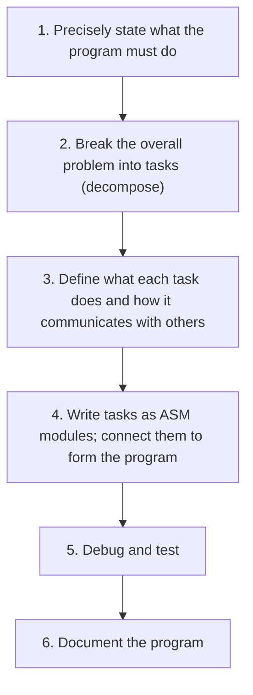
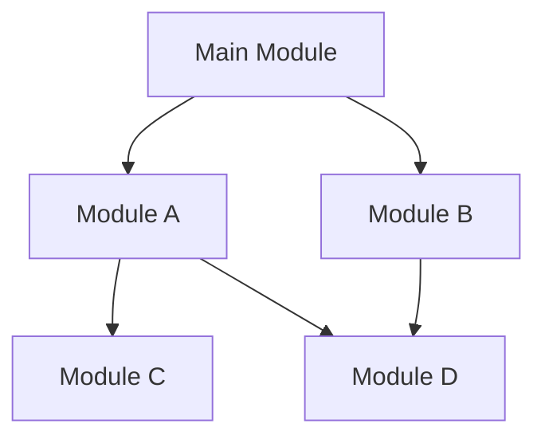
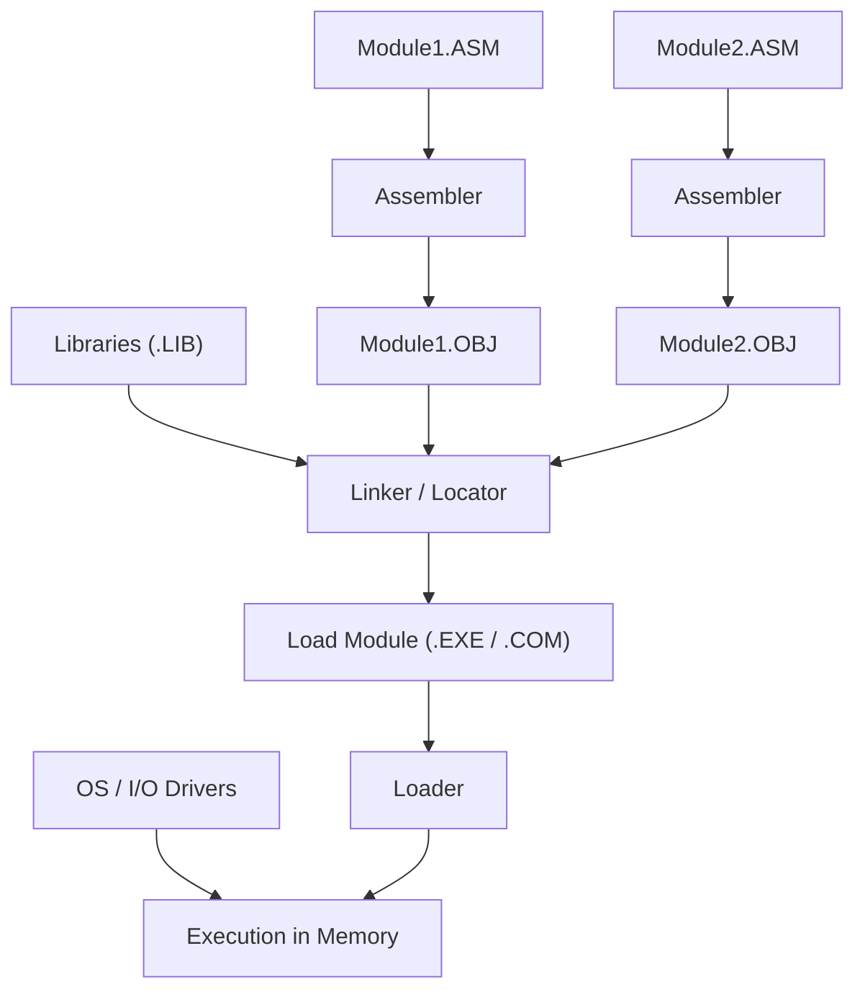
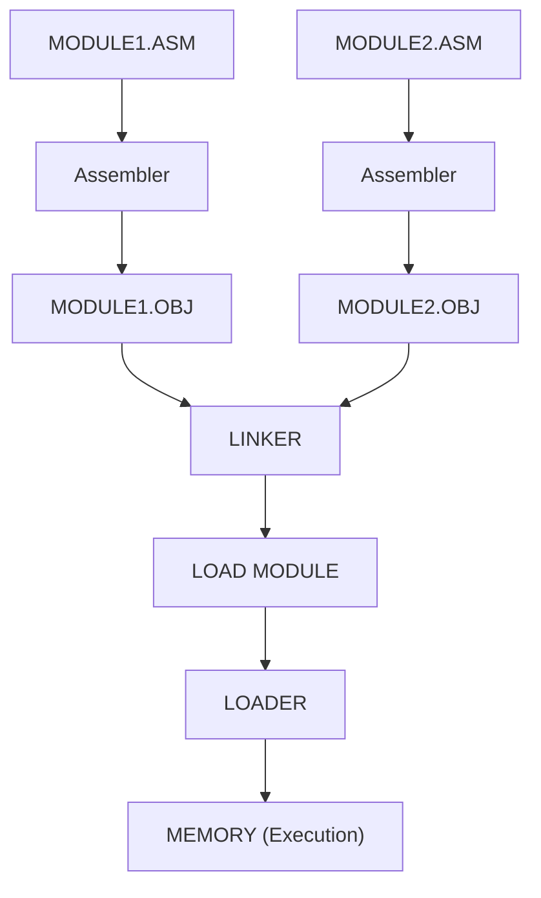
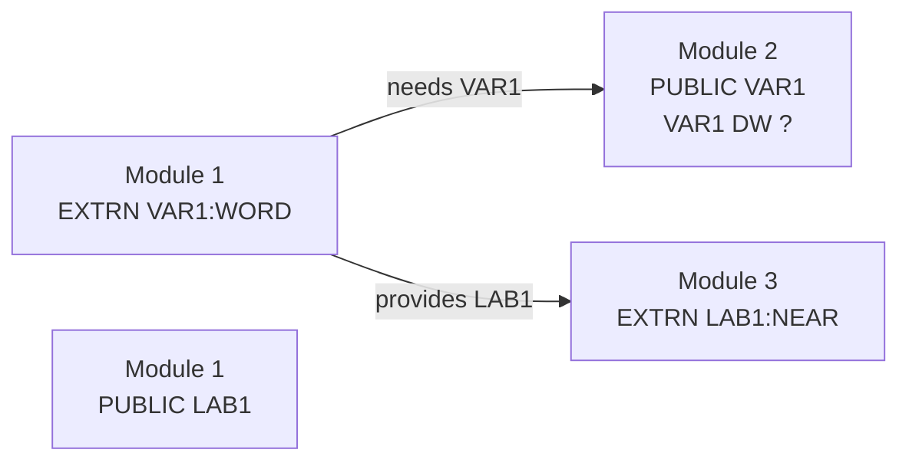
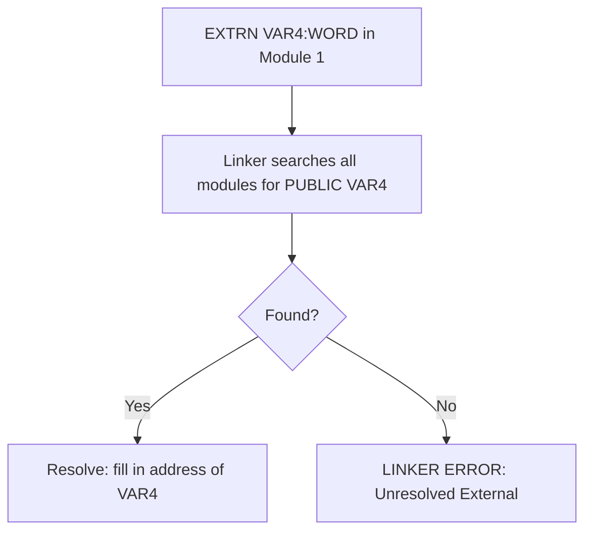

# Chapter: 8086 Modular Programming, Linking, Relocation & Segment Combination

> **Course:** Microprocessors (MI) — Semester 5
> **Primary Source:** `8086_Modular_Programming_Segment_Combination.pdf` (48 slides, Dr. Pimal Khanpara)
> **Files Integrated:** `8086_Modular_Programming_Segment_Combination.pdf`

---

## 1. Chapter Overview

As programs grow in complexity, writing everything in a single source file becomes unmanageable. **Modular programming** divides the program into smaller, independently understandable and testable **modules**, each performing one well-defined task.

Once modules are written and assembled separately, they must be **linked** together to form an executable. This chapter covers:

- Why modular programming matters and the six-step development process
- How separately assembled object modules are linked into a load module
- **Segment combination types**: `PUBLIC`, `COMMON`, `STACK`, `AT`, `MEMORY`
- Alignment directives: `EVEN`, `ALIGN`
- Naming directives: `LABEL`, `NAME`, `TITLE`
- **External identifier resolution**: `EXTRN` and `PUBLIC` declarations
- How and when offsets and segment addresses are inserted (assembler vs linker vs loader)
- **Relocation** — assigning final segment addresses
- Complete multi-module example with FAR jumps and segment register setup

---

## 2. Why Modular Programming?

Real programs are too large and complex to write as a single monolithic source file. Modular programming breaks the problem into pieces:

| Benefit | Explanation |
| :------ | :---------- |
| **Comprehensibility** | Each module is small enough to understand independently |
| **Parallel development** | Different modules assigned to different programmers |
| **Orderly testing** | Each module can be tested in isolation |
| **Documentation** | Smaller units are easier to document |
| **Localized modifications** | A bug fix or change affects only one module |
| **Library reuse** | Common tasks stored in libraries and reused by multiple programs |

**Analogy to hardware design:** Break a large circuit into sub-modules (ALU, registers, bus controller), implement each, then integrate — the same philosophy applies to software modules.

[Source: 8086_Modular_Programming_Segment_Combination.pdf, Slides 2, 6]

---

## 3. Six-Step Program Development Process



> **Key point:** Step 3 is critical — defining the **interface** (what data a module expects, what it produces, and how it communicates) before writing any code prevents integration problems later.

[Source: 8086_Modular_Programming_Segment_Combination.pdf, Slide 3]

---

## 4. Module Hierarchy and Structure

A modular program is organized as a **hierarchy** with a single main module at the top:



- **A submodule may be subordinate to more than one module** (Module D is shared by A and B).
- The **main module** contains the program's entry point (the first instruction to execute).

### Simple Example: INPUT / PROCESS / OUTPUT

```
            MAIN
          /       \
       INPUT     PROCESS
                    |
                  OUTPUT
```

- `INPUT` — obtains data from user or memory
- `PROCESS` — performs computation
- `OUTPUT` — displays or stores result

Each module has exactly **one** well-defined responsibility.

[Source: 8086_Modular_Programming_Segment_Combination.pdf, Slides 4–5]

---

## 5. Module Design: Control and Data Coupling

When designing modules:

- **Control coupling** should be kept **simple** — ideally, a module is entered at one point and exited at one point (no messy jumps in/out).
- **Data coupling** should be **minimized** — modules should share only the data they absolutely need; hidden dependencies between modules cause maintenance nightmares.

**Three ways ASM-86 supports modularization:**

1. **Data structuring** — data can be organized so multiple modules can access it.
2. **Subroutines** — sections of code exposed as procedures callable from other modules.
3. **Macros** — code that appears as a single statement and accepts programmer-supplied arguments.

[Source: 8086_Modular_Programming_Segment_Combination.pdf, Slide 7]

---

## 6. Linking and Relocation — Why Needed?

When modules are assembled **separately**, each object module contains machine code with **incomplete addresses** — the assembler cannot fill in addresses that depend on where other modules will be placed in memory. The linker and loader complete this process.

### Definition: Object Module

**Meaning:** The output of the assembler for one source module. Contains machine code with **unresolved** (placeholder) addresses for external references and segment addresses.

### Definition: Load Module

**Meaning:** The output of the linker. Contains machine code with **all addresses resolved** and all object modules combined, ready to be loaded into memory and executed.

### Definition: Relocation

**Meaning:** The process of assigning final physical segment addresses to relocatable segments. Performed by the linker/locator after it determines where each segment will be placed in memory.

[Source: 8086_Modular_Programming_Segment_Combination.pdf, Slides 8, 36]

---

## 7. Creation and Execution Pipeline

The complete journey from source code to execution:



**Pipeline stages explained:**

| Stage | Tool | Input | Output |
| :---- | :--- | :---- | :----- |
| **Assembly** | Assembler (ASM-86) | Source `.ASM` files | Object `.OBJ` files |
| **Linking** | Linker (LINK-86) | `.OBJ` files + libraries | Partially resolved load module |
| **Location/Relocation** | Locator (LOC-86) | Linked module | Final load module with absolute addresses |
| **Loading** | Loader (OS) | Load module | Program in memory, ready to run |

> **Note:** In practice on DOS systems, the linker and locator are combined. The assembler cannot fill in segment addresses because those depend on where all modules are placed — only the linker knows the final layout.

[Source: 8086_Modular_Programming_Segment_Combination.pdf, Slides 8–10]

---

## 8. What the Linker/Loader Must Do

The linker must:

1. **Find** all object modules named in the linker command.
2. **Assign positions** to all segments from all object modules (determine the load layout).
3. **Fill in offsets** that could not be determined by the assembler (e.g., offsets of external symbols).
4. **Fill in segment addresses** (relocation — load all segment-address references).
5. **Load** the program into memory for execution.

The linker also produces a **memory map** showing the starting address and length of each combined segment in the load module.

[Source: 8086_Modular_Programming_Segment_Combination.pdf, Slide 11]

---

## 9. Two-Module Program: Assembly → Linking → Loading



**Key rule:** The **main module** (containing the entry point) ends with `END <entry_label>`. All other modules end with just `END` (no entry label operand).

[Source: 8086_Modular_Programming_Segment_Combination.pdf, Slides 12–13]

---

## 10. Segment Combination

ASM-86 provides **combine types** as modifiers on the `SEGMENT` directive that control how the linker handles segments with the **same name** from different object modules.

### Syntax

```asm
SegmentName  SEGMENT  [alignment]  [combine-type]  [class]
    ; segment contents
SegmentName  ENDS
```

**Rules:**

- Segments with **different names** cannot be combined.
- Same-named segments with **no combine-type** cause a **linker error**.
- The combine-type determines the linkage behavior.

---

### 10.1 PUBLIC — Concatenate Segments

**Behaviour:** Same-named `PUBLIC` segments from different modules are **joined end-to-end** (concatenated) into one larger segment. The total size is the **sum** of all individual sizes.

```asm
; Module 1
CODE SEGMENT PUBLIC
    ; 20 words of code
CODE ENDS

; Module 2
CODE SEGMENT PUBLIC
    ; 30 words of code
CODE ENDS

; After linking:
; ONE CODE SEGMENT of 50 words (20 + 30)
```

**Benefit of PUBLIC for code:** When multiple code sections are concatenated into one CODE segment, `CS` does not need to change as execution passes between instruction groups. Intersegment (FAR) branches become intrasegment (NEAR) branches — more efficient.

**Benefit of PUBLIC for data:** Multiple data sections are concatenated into one larger DATA segment.

[Source: 8086_Modular_Programming_Segment_Combination.pdf, Slides 15–16, 18]

---

### 10.2 COMMON — Overlay Segments

**Behaviour:** Same-named `COMMON` segments all **start at the same address** — they overlay each other. The combined size is the size of the **longest** segment.

```asm
; Module 1
DATA SEGMENT COMMON
    ; 100 bytes
DATA ENDS

; Module 2
DATA SEGMENT COMMON
    ; 150 bytes
DATA ENDS

; After linking:
; ONE DATA region at the SAME start address
; Combined size = 150 bytes (longest)
; NOT 100 + 150 = 250 bytes
```

**Use case:** COMMON creates a **shared memory pool** accessible by multiple modules simultaneously. Variables defined at the same offset in two COMMON segments of the same name will **overlap** (occupy the same memory location).

[Source: 8086_Modular_Programming_Segment_Combination.pdf, Slides 15, 17]

---

### 10.3 STACK — Add Lengths

**Behaviour:** Same-named `STACK` segments are concatenated like PUBLIC, but each module contributes to a shared stack. Total stack size = **sum of all** individual stack sizes.

```asm
; Module 1
STACK_SEG SEGMENT STACK
    DW 20 DUP(?)     ; 20 words = 40 bytes
STACK_SEG ENDS

; Module 2
STACK_SEG SEGMENT STACK
    DW 30 DUP(?)     ; 30 words = 60 bytes
STACK_SEG ENDS

; After linking:
; Total stack = 50 words = 100 bytes
```

**Purpose:** Allows each module to specify how much stack it needs, and the linker builds one unified stack of the combined size.

[Source: 8086_Modular_Programming_Segment_Combination.pdf, Slides 15, 19]

---

### 10.4 AT — Absolute Segment Address

**Behaviour:** `AT expression` fixes the segment at a **specific physical address** specified by the programmer. Variables and labels in `AT` segments have **absolute addresses** (set by programmer/assembler, not relocated by linker).

```asm
IOBUF SEGMENT AT 0B800H      ; fixed at video memory address
    ; ... screen buffer data ...
IOBUF ENDS
```

**Use cases:**

- I/O port buffers at known fixed addresses
- Special memory-mapped hardware registers
- BIOS data area at fixed locations

> **Contrast:** Variables in non-AT segments are **relocatable** — their final segment address is determined by the linker. AT segments are **absolute** — the programmer specifies the exact location.

[Source: 8086_Modular_Programming_Segment_Combination.pdf, Slides 15, 21]

---

### 10.5 MEMORY — Highest Address Segment

**Behaviour:** The `MEMORY` segment is placed at the **highest address** in the load module (at the end). If multiple `MEMORY` segments are linked, only the first gets true MEMORY treatment; subsequent ones are treated as `COMMON`.

**Use case:** Placing an overlay area or a data buffer at the top of the program's memory space.

[Source: 8086_Modular_Programming_Segment_Combination.pdf, Slides 15, 21]

---

### 10.6 Combine-Type Comparison Table

| Combine-Type | Combined Size | Address Relationship | Use Case |
| :----------- | :------------ | :------------------- | :------- |
| `PUBLIC` | Sum of all sizes | Concatenated end-to-end | Shared code or data, one segment |
| `COMMON` | Largest individual size | All start at same address | Shared variable pool (overlapping) |
| `STACK` | Sum of all sizes | Concatenated (like PUBLIC) | Shared stack; each module contributes |
| `AT expr` | As declared | Fixed at `expr` (absolute) | Hardware-mapped I/O, BIOS areas |
| `MEMORY` | As declared | At highest address | Overlay area, top-of-memory buffer |

**Quick numerical comparison:**

| Scenario | Module 1 | Module 2 | PUBLIC result | COMMON result | STACK result |
| :------- | :------- | :------- | :------------ | :------------ | :----------- |
| Size | 20 units | 30 units | 50 units | 30 units | 50 units |

> **📝 Exam Note:** STACK behaves the same as PUBLIC in terms of size (sum), but it specifically forms the unified stack segment.

[Source: 8086_Modular_Programming_Segment_Combination.pdf, Slides 15, 20]

---

## 11. Segment Alignment

**Alignment** controls the **boundary** at which a segment begins in memory.

- The **default alignment** places a segment at an address **divisible by 16** (paragraph boundary).
  - Example boundaries: `1000H`, `1010H`, `1020H`, `1030H`, …
- The alignment is specified before the combine-type in the `SEGMENT` directive.

> **Do not confuse** segment alignment with item alignment (`EVEN`/`ALIGN` — see next section). Segment alignment applies to where the whole segment starts; item alignment applies to where a variable within a segment starts.

[Source: 8086_Modular_Programming_Segment_Combination.pdf, Slides 18, 23]

---

## 12. Assembly Directives for Item Alignment

### 12.1 EVEN Directive

`EVEN` ensures that the **next item** in the segment starts at an **even byte address** (a 2-byte boundary). If the current address is already even, no padding is needed. If odd, one padding byte is inserted.

```asm
A  DB  11H       ; A starts at offset 1000H (1 byte)
EVEN             ; next item must be at even address → 1001H is odd → insert 1 byte padding
B  DW  1234H     ; B starts at offset 1002H (word-aligned)
```

**Memory layout:**

| Offset | Content | Label |
| :----- | :------ | :---- |
| 1000H | `11H` | A |
| 1001H | padding (e.g., NOP or 00H) | — |
| 1002H | `34H` | B (low byte) |
| 1003H | `12H` | B (high byte) |

**Why important:** The 8086 accesses words faster at even addresses (one bus cycle instead of two for odd-addressed words).

[Source: 8086_Modular_Programming_Segment_Combination.pdf, Slide 24]

---

### 12.2 ALIGN Directive

`ALIGN n` ensures the next item starts at an address that is a multiple of `n` bytes (where n is typically 2, 4, or 16). The assembler inserts padding bytes as needed.

```asm
ALIGN 2          ; next item on 2-byte boundary
```

`EVEN` and `ALIGN 2` are equivalent.

> **Note:** `EVEN` and `ALIGN` are **assembler directives** — they generate padding in the object file but are not executed as 8086 instructions.

[Source: 8086_Modular_Programming_Segment_Combination.pdf, Slide 25]

---

## 13. Other Important Directives

### 13.1 LABEL Directive

`LABEL` gives a symbolic name and type to the **current location** in a segment **without allocating any new memory**.

```asm
VALUE   DW   1234H      ; allocates 2 bytes at current offset
NEXT    LABEL WORD      ; NEXT = name for the next address after VALUE; no memory allocated
```

**LABEL:**

- Gives a name and type to a position
- Does **not** allocate new memory

**Use cases:**

- Referencing a stack position (e.g., `TOS LABEL WORD` at the end of a stack segment)
- Providing alternative types to the same memory location

[Source: 8086_Modular_Programming_Segment_Combination.pdf, Slide 26]

---

### 13.2 NAME Directive

```asm
NAME MYPROGRAM
```

Assigns a name to the **object module**. Used for linker identification. Not an executed instruction.

### 13.3 TITLE Directive

```asm
TITLE 8086 Modular Programming
```

Sets the title string printed at the top of each page of the assembler's listing output. Useful for documentation. Not an executed instruction.

[Source: 8086_Modular_Programming_Segment_Combination.pdf, Slide 27]

---

## 14. External Identifiers: EXTRN and PUBLIC

When multiple modules are linked together, one module may need to access a variable or procedure defined in a **different module**. ASM-86 provides two directives to manage this:

| Directive | Meaning | Used in module that… |
| :-------- | :------ | :------------------- |
| `EXTRN Identifier:Type` | "I need this identifier from another module" | **References** the identifier but does not define it |
| `PUBLIC Identifier` | "I provide this identifier to other modules" | **Defines** the identifier and makes it visible externally |

**Symmetry rule:** For each `EXTRN X` in one module, there must be a `PUBLIC X` in exactly one other module. The linker matches them.



[Source: 8086_Modular_Programming_Segment_Combination.pdf, Slides 28–29]

---

### 14.1 EXTRN and PUBLIC Syntax

```asm
EXTRN  Identifier:Type, Identifier:Type, ...
PUBLIC Identifier, Identifier, ...
```

**External type specifiers:**

| Category | Type keywords |
| :------- | :------------ |
| **Variable** | `BYTE`, `WORD`, `DWORD` |
| **Label / Procedure** | `NEAR`, `FAR` |

**Examples:**

```asm
; Declaring external variables
EXTRN VAR1:WORD, VAR2:BYTE, PTR3:DWORD

; Declaring external labels
EXTRN SUBROUTINE:NEAR, FARPROC:FAR

; Making local identifiers public
PUBLIC VAR1, LAB1, MYFUNC
```

> **📝 Exam Note:** The assembler needs the **type** of each external identifier to generate correct machine code (e.g., a BYTE access generates an 8-bit instruction; a WORD access generates a 16-bit instruction). `EXTRN` is purely a declaration — it does **not** create or allocate the identifier.

[Source: 8086_Modular_Programming_Segment_Combination.pdf, Slides 30–32]

---

### 14.2 Linker External Reference Resolution

The linker matches each `EXTRN` declaration with a `PUBLIC` declaration. If no match is found, the linker reports an **Unresolved External** error.

**Example of linker error:**

```asm
; Module 1
EXTRN VAR4:WORD          ; declares need for VAR4

; Module 2
VAR4 DW ?                ; defines VAR4 in memory
; BUT: no PUBLIC VAR4   → LINKER ERROR: unresolved external VAR4
```

**Fix:**

```asm
; Module 2
PUBLIC VAR4
VAR4 DW ?
```

**Important note:** A `PUBLIC` symbol that is never referenced by any `EXTRN` does **not** cause an error — it is simply unused.



[Source: 8086_Modular_Programming_Segment_Combination.pdf, Slides 33–35]

---

## 15. Address Insertion: What Is Known When?

Different parts of an address (offset and segment address) become available at different stages of the build pipeline:

| Address component | Determined by | When |
| :---------------- | :------------ | :--- |
| Offset of a **local** variable/label | Assembler | During assembly of its module |
| Offset of an **external** variable/label | Linker | During linking |
| **Segment address** of any segment | Linker/Locator | During relocation |

### Example: Address Analysis

```asm
DATA_SEG SEGMENT
    POINTER  DD  VAR2         ; 4-byte far pointer to VAR2 (external)
    VAR1     DW  2            ; local variable
DATA_SEG ENDS

EXTRA SEGMENT
    VAR2  DW  2               ; another variable (may be external)
EXTRA ENDS

CODE_SEG SEGMENT
    ASSUME CS:CODE_SEG, DS:DATA_SEG, ES:EXTRA
    MOV AX, DATA_SEG          ; segment address → must be filled by linker
    MOV DS, AX
    DEC VAR1                  ; VAR1 is local → offset inserted by assembler
    LES DI, POINTER           ; POINTER is local → offset by assembler; VAR2's address in linker
    ADD BX, ES:[DI]
    JMP FAR PTR LAB           ; FAR jump → both segment and offset of LAB from linker
CODE_SEG ENDS
```

**What the assembler CAN fill:** The offset of local `VAR1` and the offset of local `POINTER`.
**What the linker MUST fill:** The segment address of `DATA_SEG` in `MOV AX, DATA_SEG`; the segment and offset of external `VAR2` in `POINTER DD VAR2`; the target of `JMP FAR PTR LAB` if LAB is external.

[Source: 8086_Modular_Programming_Segment_Combination.pdf, Slides 37, 40–41]

---

## 16. Physical Address Calculation

The 8086 uses a **segmented memory model**. Every logical address consists of a **Segment** (16-bit) and an **Offset** (16-bit). The physical address is:

$$
\text{Physical Address} = \text{Segment} \times 10H + \text{Offset}
$$

$$
= \text{Segment} \times 16 + \text{Offset}
$$

### Worked Example

Given:

- Segment = `1234H`
- Offset = `0050H`

$$
\text{Physical Address} = 1234H \times 10H + 0050H = 12340H + 0050H = 12390H
$$

[Source: 8086_Modular_Programming_Segment_Combination.pdf, Slide 38]

---

## 17. Relocation — Assigning Final Segment Addresses

During assembly, the assembler does not know the final segment addresses. It uses a placeholder offset (e.g., `VAR1` offset = `0010H`) and notes that the segment address is unknown. The linker/locator performs **relocation**:

1. Linker determines the layout of all segments in memory.
2. Assigns each segment's final base address.
3. Updates all segment-address references in the code.

### Relocation Example

| Stage | VAR1 knowledge |
| :---- | :------------- |
| Assembly | Offset = `0010H`; segment = unknown |
| After linking / locating | DATA segment placed at `2500H` |
| Final logical address | `VAR1 = 2500H:0010H` |
| Physical address | $2500H \times 10H + 0010H = 25010H$ |

[Source: 8086_Modular_Programming_Segment_Combination.pdf, Slide 39]

---

## 18. Accessing External Variables: Segment Register Setup

Knowing that a variable is external (`EXTRN`) is **not enough** at runtime. The appropriate segment register must be loaded with the variable's segment address **before** the variable is accessed.

```asm
; Correct: load ES before accessing external VAR
MOV AX, SEG VAR       ; SEG operator → segment address of VAR (filled by linker)
MOV ES, AX            ; ES now holds the segment where VAR lives
ADD DX, ES:VAR        ; access VAR through ES
```

> **Critical distinction:**
> - `ASSUME ES:EXTDATA` tells the **assembler** to associate ES with the EXTDATA segment — it is a **declaration**, not an instruction.
> - `MOV AX, SEG VAR; MOV ES, AX` is the **runtime** code that actually loads ES.
> - `EXTRN` does **not** automatically load any segment register.

[Source: 8086_Modular_Programming_Segment_Combination.pdf, Slides 42–43, 47]

---

## 19. Complete Multi-Module Example

This example shows three modules linked together: Module 1 (main), Module 2 (provides VAR1), Module 3 (provides VAR2 and OUTPUT).

### Module 1 — Main Program

```asm
EXTRN VAR1:WORD, VAR2:WORD, OUTPUT:FAR   ; declare external needs

LOCAL_DATA SEGMENT
    VAR3  DW  ?                          ; local variable
LOCAL_DATA ENDS

CODE SEGMENT
    ASSUME CS:CODE, DS:LOCAL_DATA
START:
    MOV AX, LOCAL_DATA
    MOV DS, AX                           ; DS → local data segment

    MOV BX, VAR3                         ; access local variable (DS:VAR3)

    MOV AX, SEG VAR2                     ; get segment address of external VAR2
    MOV ES, AX                           ; ES → segment containing VAR2
    MOV BX, ES:VAR2                      ; access external VAR2 through ES

    JMP OUTPUT                           ; FAR jump to external routine
CODE ENDS
END START
```

### Module 2 — Provides VAR1

```asm
PUBLIC VAR1                    ; make VAR1 available to other modules

EXTDATA1 SEGMENT
    VAR1  DW  ?                ; the actual storage for VAR1
EXTDATA1 ENDS
END
```

### Module 3 — Provides VAR2 and OUTPUT routine

```asm
PUBLIC VAR2                    ; make VAR2 available
EXTDATA2 SEGMENT
    VAR2  DW  ?
EXTDATA2 ENDS

PUBLIC OUTPUT                  ; make OUTPUT label available
ROUTINE SEGMENT
OUTPUT LABEL FAR               ; FAR label = entry point for far jumps
    ; ... output code ...
ROUTINE ENDS
END
```

### Cross-Reference Table

| EXTRN in Module 1 | Matched PUBLIC | Defined in |
| :---------------- | :------------- | :--------- |
| `EXTRN VAR1:WORD` | `PUBLIC VAR1` | Module 2 |
| `EXTRN VAR2:WORD` | `PUBLIC VAR2` | Module 3 |
| `EXTRN OUTPUT:FAR` | `PUBLIC OUTPUT` | Module 3 |

**Key points:**

- `DS` is loaded for `LOCAL_DATA` (local segment).
- Before accessing `VAR2`, `ES` is explicitly loaded using `SEG VAR2`.
- `JMP OUTPUT` is a FAR jump; both CS and IP are provided by the linker.

[Source: 8086_Modular_Programming_Segment_Combination.pdf, Slides 44–46, 48]

---

## 20. Abbreviation / Acronym Index

| Abbr. | Full Form | Brief Meaning |
| :---- | :-------- | :------------ |
| ASM | Assembler / Assembly Language | Tool that translates assembly source to object code |
| OBJ | Object Module | Output of assembler; machine code with unresolved references |
| EXE | Executable | Load module ready for execution |
| DS | Data Segment | Segment register for data |
| ES | Extra Segment | Extra segment register (for additional data segments) |
| CS | Code Segment | Segment register for code |
| SS | Stack Segment | Segment register for stack |
| SP | Stack Pointer | Points to top of stack |
| BP | Base Pointer | Used to access stack frame |
| NEAR | Near (same segment) | Call/jump within the same segment |
| FAR | Far (different segment) | Call/jump across segments |
| EXTRN | External | Directive declaring an identifier defined in another module |
| PUBLIC | Public | Directive making an identifier available to other modules |
| IVT | Interrupt Vector Table | Table of ISR addresses (for interrupt chapter context) |
| LOC | Locator | Tool that assigns final physical addresses (relocation) |

---

## 21. Formula Sheet

### Physical Address Calculation

$$
\text{Physical Address} = \text{Segment Register} \times 10H + \text{Offset}
$$

$$
= \text{Segment} \times 16_{10} + \text{Offset}
$$

### IVT Entry (for context)

$$
\text{IVT entry address for type } N = N \times 4
$$

### Combine-Type Size Rules

$$
\text{PUBLIC size} = \sum \text{all individual sizes (sum)}
$$

$$
\text{COMMON size} = \max(\text{all individual sizes (largest)})
$$

$$
\text{STACK size} = \sum \text{all individual sizes (sum)}
$$

---

## 22. Definition Sheet

- **Modular programming:** Dividing a complex program into smaller, independently developed and testable modules, each performing one well-defined task.
- **Object module:** Output of the assembler for one source file; contains machine code with placeholder (unresolved) addresses for external references and segment addresses.
- **Load module:** Output of the linker; all object modules combined with all addresses resolved; ready for execution.
- **Linker:** Tool that combines object modules, resolves external references, and assigns relative positions to all segments.
- **Locator/Loader:** Assigns final physical (absolute) addresses to segments (relocation) and loads the program into memory.
- **Relocation:** The process of updating segment-address references in the object code after the linker determines the final memory layout.
- **PUBLIC (directive):** Declares that the following identifiers (variables or labels) in this module are visible to other linked modules.
- **EXTRN (directive):** Declares that the following identifiers (with their types) are defined in another linked module; the linker will resolve them.
- **Unresolved external:** A linker error when an `EXTRN` identifier has no matching `PUBLIC` declaration in any of the linked modules.
- **Segment combine type:** A modifier (`PUBLIC`, `COMMON`, `STACK`, `AT`, `MEMORY`) on the `SEGMENT` directive that controls how same-named segments from different modules are merged by the linker.
- **PUBLIC (combine type):** Join same-named segments end-to-end; combined size = sum.
- **COMMON (combine type):** Overlay same-named segments at the same start address; combined size = largest.
- **STACK (combine type):** Join same-named stack segments; combined size = sum (forms one unified stack).
- **AT (combine type):** Fix segment at a specific absolute address; variables are not relocatable.
- **MEMORY (combine type):** Place segment at the highest address in the load module.
- **EVEN directive:** Insert padding to align the next item to an even (2-byte) boundary; no new memory allocated for the EVEN itself.
- **ALIGN n directive:** Insert padding to align the next item to an n-byte boundary.
- **LABEL directive:** Give a symbolic name and type to the current location; no memory allocated.
- **NAME directive:** Assign a name to the object module (for linker identification); not executable.
- **SEG operator:** In assembly, `SEG identifier` returns the segment address of the identifier; inserted by the linker/locator.
- **Relocatable:** Address determined at link/load time; can be placed anywhere in memory.
- **Absolute:** Address fixed at assembly time (using `AT`); cannot be relocated.

---

## 23. Exam-Oriented Review

### Important Concepts
- The six-step program development process
- Creation/execution pipeline: ASM → OBJ → LINKER → LOAD MODULE → LOADER → EXECUTION
- What the linker/locator does and why it is needed
- Segment combine types: PUBLIC, COMMON, STACK, AT, MEMORY — how each behaves, size formula
- EXTRN/PUBLIC: syntax, type specifiers (BYTE/WORD/DWORD for variables; NEAR/FAR for labels), unresolved external error
- When offsets are known (assembler) vs when segment addresses are filled (linker)
- Physical address calculation: Segment × 10H + Offset
- Why ES must be loaded explicitly before accessing an external variable
- EVEN/ALIGN: word alignment for performance
- LABEL: symbolic name, no memory allocated

### Important Comparisons

| Combine-Type | Size Result | Memory Layout | Use Case |
| :----------- | :---------- | :------------ | :------- |
| PUBLIC | Sum | End-to-end | Shared code/data |
| COMMON | Largest | Overlapping (same address) | Shared pool |
| STACK | Sum | End-to-end | Unified stack |
| AT | As declared | Fixed absolute | Hardware I/O |
| MEMORY | As declared | At top of load module | Overlay buffer |

| Stage | What is resolved |
| :---- | :--------------- |
| Assembly | Offsets of local variables/labels |
| Linking | Offsets of external symbols; segment placements |
| Relocation | Segment addresses (final physical addresses) |

### Potential Exam Questions

1. What is modular programming? List any four advantages.
2. Draw and explain the complete build pipeline from source code to execution.
3. What is the difference between an object module and a load module?
4. Explain the five segment combine types with examples and size formulas.
5. What is the difference between PUBLIC and COMMON segment combination? Give a numerical example.
6. Two modules each define a `STACK_SEG SEGMENT STACK` of 20 words. What is the total stack size after linking?
7. What is the purpose of `EXTRN` and `PUBLIC` directives? What causes an "unresolved external" linker error?
8. What type specifiers can be used with `EXTRN`? When would you use `NEAR` vs `FAR`?
9. What information can the assembler insert, and what must be deferred to the linker?
10. Calculate the physical address for logical address `2500H:0050H`.
11. What is relocation? Who performs it (assembler, linker, or loader)?
12. Write a two-module program in 8086 assembly where Module 1 defines a variable `COUNT:WORD` and Module 2 increments it using `EXTRN` and `PUBLIC`.
13. What is the `EVEN` directive? Why is word alignment important on the 8086?
14. What is the difference between the `LABEL` directive and a normal variable declaration (`DW`, `DB`)?
15. What is the `SEG` operator? Why must you load a segment register before accessing an external variable, even after declaring it with `EXTRN`?
16. Explain `ASSUME` vs actually loading a segment register at runtime. Why is `ASSUME` not sufficient?
