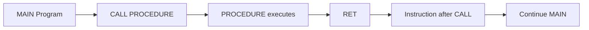
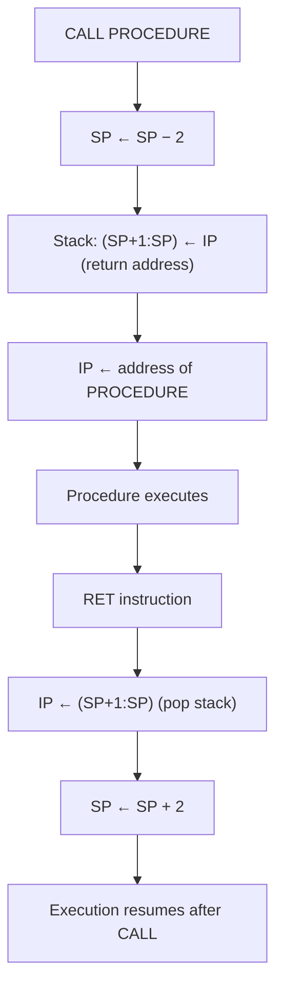
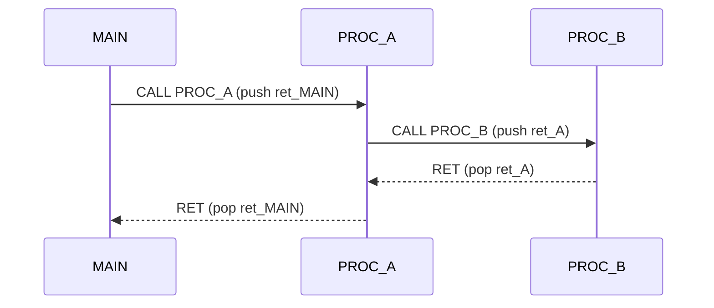
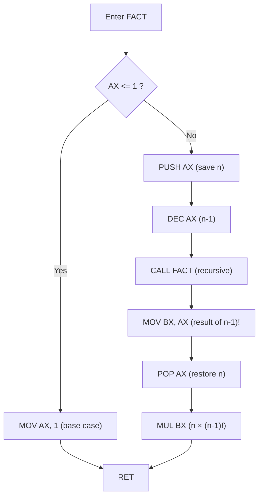

# Chapter: 8086 Procedures (Subroutines)

> **Course:** Microprocessors (MI) — Semester 5
> **Primary Source:** `8086 procedures.pdf` (35 slides, Dr. Pimal Khanpara)
> **Files Integrated:** `8086 procedures.pdf`

---

## 1. Chapter Overview

A **procedure** (also called a subroutine) is a named, reusable block of assembly instructions that performs a specific task. Instead of repeating the same code at multiple points in a program, the program issues a `CALL` instruction; the procedure executes and returns control to the next instruction after the `CALL` using `RET`.

This chapter covers:
- Stack fundamentals (`PUSH`, `POP`) needed for procedure linkage
- Defining and calling procedures (`PROC`/`ENDP`, `CALL`, `RET`)
- What happens at the hardware level during `CALL` and `RET`
- Saving and restoring registers (PUSH/POP convention, LIFO discipline)
- Three parameter-passing methods: registers, memory variables, stack
- The `BP` register and the standard stack frame (prologue/epilogue)
- `RET n` for callee stack cleanup
- Caller-saved vs callee-saved register conventions
- Nested and recursive procedure calls
- FAR vs NEAR procedures

---

## 2. Stack Review

The **stack** is a Last-In-First-Out (LIFO) data structure in memory, used by the 8086 for procedure call linkage, register saving, and parameter passing. The Stack Segment Register (`SS`) holds the segment base, and `SP` (Stack Pointer) holds the current top-of-stack offset.

### Stack Instructions

| Instruction | Effect on SP | Data Movement |
| :---------- | :----------- | :------------ |
| `PUSH SRC` | SP ← SP − 2 | `(SP+1 : SP)` ← SRC (stores high byte at SP+1, low byte at SP) |
| `POP DST` | SP ← SP + 2 | DST ← `(SP+1 : SP)` |
| `PUSHF` | SP ← SP − 2 | FLAGS register pushed onto stack |
| `POPF` | SP ← SP + 2 | FLAGS register restored from stack |

> **Key rule:** The 8086 stack grows **downward** — PUSH decrements SP, POP increments SP. The stack always operates on 16-bit (word) quantities.

### Stack Initialization Example

```asm
STACK_SEG SEGMENT
    DW 30 DUP(?)          ; reserve 30 words = 60 bytes for stack
    TOS LABEL WORD        ; TOS = Top of Stack label (points just past stack)
STACK_SEG ENDS

CODE SEGMENT
    ASSUME CS:CODE, DS:DATA, SS:STACK_SEG
    START:
        MOV AX, STACK_SEG
        MOV SS, AX             ; load stack segment
        MOV SP, OFFSET TOS     ; SP points to top of reserved stack area
```

[Source: 8086 procedures.pdf, Slides 2–3]

---

## 3. What Is a Procedure?

### Definition: Procedure (NEAR)

**Meaning:** A named block of assembly instructions enclosed between `PROC` and `ENDP` directives, callable from anywhere in the same code segment.

**Formal definition:** A procedure is a contiguous sequence of instructions beginning at a named entry point and ending with a `RET` instruction. It is invoked by `CALL <name>` and returns to the caller via `RET`.

**Intuition:** Procedures are assembly's equivalent of functions in high-level languages. They encapsulate a task so it can be reused without code duplication.

**Basic control flow:**



### Why Use Procedures?

| Without Procedures | With Procedures |
| :----------------- | :-------------- |
| Repeated code at every use site | Write once, `CALL` many times |
| Longer programs | Better modularity |
| Harder debugging | Each task tested independently |
| More duplication | Common operations centralized |
| Difficult maintenance | Changes made in one place |

[Source: 8086 procedures.pdf, Slides 4–5]

---

## 4. Procedure Definition Syntax

```asm
procedure_name  PROC  NEAR      ; NEAR = same code segment
    ; procedure instructions
    RET                          ; return to caller
procedure_name  ENDP             ; end of procedure
```

- `PROC` marks the beginning of the procedure.
- `NEAR` means the procedure is in the same code segment as the caller.
- `ENDP` marks the logical end (the assembler directive — execution reaches `RET` before `ENDP`).
- `RET` is the actual runtime instruction that pops the return address and resumes execution at the caller.

[Source: 8086 procedures.pdf, Slide 6]

---

## 5. Complete CALL/RET Example

### Example 1 — Simplified (segment-based syntax)

```asm
STACK_SEG SEGMENT
    DW 30 DUP(?)
    TOS LABEL WORD
STACK_SEG ENDS

DATA SEGMENT
    MSG DB "hello$"
DATA ENDS

CODE SEGMENT
    ASSUME CS:CODE, DS:DATA, SS:STACK_SEG
    START:
        MOV AX, STACK_SEG
        MOV SS, AX
        MOV SP, OFFSET TOS          ; initialize stack
        MOV AX, DATA
        MOV DS, AX
        CALL DISPLAY                ; push IP of next instruction, jump to DISPLAY
        MOV AH, 4CH
        INT 21H

    DISPLAY PROC NEAR               ; procedure begins here
        MOV AH, 09H
        LEA DX, MSG
        INT 21H                     ; print MSG
        RET                         ; pop saved IP, return to instruction after CALL
    DISPLAY ENDP
CODE ENDS
END START
```

### Example 2 — Simplified model syntax (.MODEL SMALL)

```asm
.MODEL SMALL
.STACK 100H
.DATA
    MSG DB 'Hello from procedure!$'
.CODE
MAIN PROC
    MOV AX, @DATA
    MOV DS, AX
    CALL DISPLAY_MSG           ; call the procedure
    MOV AH, 4CH
    INT 21H
MAIN ENDP

DISPLAY_MSG PROC NEAR
    LEA DX, MSG
    MOV AH, 09H
    INT 21H
    RET
DISPLAY_MSG ENDP
END MAIN
```

[Source: 8086 procedures.pdf, Slides 7–8]

---

## 6. What Happens During CALL and RET

Understanding the hardware-level sequence is critical for stack debugging and for writing correct procedures.

### NEAR CALL — Step by Step

```
CALL <procedure_name>
```

1. `SP ← SP − 2` (make room on stack)
2. `(SP+1 : SP) ← IP` (push return address — the IP of the instruction **after** the CALL)
3. `IP ← address of procedure` (jump to procedure)

### RET — Step by Step

```
RET
```

1. `IP ← (SP+1 : SP)` (pop saved return address from stack)
2. `SP ← SP + 2` (restore SP)
3. Execution resumes at the restored IP (the instruction after the original CALL)

### Hardware Flow Diagram



### Intrasegment (NEAR) vs Intersegment (FAR) CALL

**Intrasegment CALL (NEAR):**
```
CALL DST
; SP = SP − 2
; (SP+1 : SP) = IP
; IP = IP + displacement (D16)
```

**Intersegment CALL (FAR):**
```
CALL DST
; SP = SP − 2 ; (SP+1 : SP) = CS   ← CS saved first
; SP = SP − 2 ; (SP+1 : SP) = IP   ← then IP saved
; CS = segment address of target
; IP = D16 (offset of target)
```

**RET variants:**

| Instruction | Effect |
| :---------- | :----- |
| `RET` | `IP ← (SP+1:SP)` ; `SP ← SP + 2` |
| `RET exp` | Pop IP, then `SP ← SP + exp` (removes `exp` argument bytes) |

> **📝 Exam Note:** A NEAR CALL saves only IP (2 bytes); a FAR CALL saves CS and IP (4 bytes). The matching RET/RETF must match the CALL type.

[Source: 8086 procedures.pdf, Slides 9–11]

---

## 7. Stack During CALL/RET — Memory Layout

After `MAIN` executes `CALL ADD_TWO`:

```
Stack (growing downward):
┌──────────────┐ ← higher address
│  ...         │
│  Return IP   │ ← (SP points here after CALL, before PUSH BP)
└──────────────┘ ← lower address
```

When `ADD_TWO` executes `RET`, it pops the saved IP and SP returns to its pre-CALL value.

### Critical Stack Rule

**A CALL and its matching RET must leave the stack in exactly the same state.**

- If a procedure PUSHes data during execution, it must POP that data **before** RET (unless using `RET n`).

**Correct:**
```asm
MYPROC PROC NEAR
    PUSH AX        ; save AX
    ; ... use AX ...
    POP AX         ; restore AX
    RET            ; stack is clean
MYPROC ENDP
```

**Incorrect:**
```asm
MYPROC PROC NEAR
    PUSH AX        ; pushed AX
    ; ... use AX ...
    RET            ; ERROR: RET pops AX as return address → wrong IP!
MYPROC ENDP
```

[Source: 8086 procedures.pdf, Slides 12–13]

---

## 8. Saving and Restoring Registers

A procedure may use registers that the **caller** still needs after the call returns. The procedure is responsible for preserving such registers using `PUSH`/`POP`.

### Standard Register-Save Pattern

```asm
MYPROC PROC NEAR
    PUSH AX           ; save caller's registers
    PUSH BX
    PUSH CX
    ; --- procedure body ---
    POP CX            ; restore in REVERSE order (LIFO)
    POP BX
    POP AX
    RET
MYPROC ENDP
```

### PUSH/POP LIFO Discipline

The stack is Last-In-First-Out. If you push `AX → BX → CX`, you must pop `CX → BX → AX`.

```
PUSH AX  →  PUSH BX  →  PUSH CX
                         Stack top = CX

POP CX   →  POP BX   →  POP AX
```

> **📝 Exam Note:** Reversing the POP order is a common mistake. Always POP in the exact reverse order of PUSH.

[Source: 8086 procedures.pdf, Slides 14–15]

---

## 9. Parameter Passing Methods

The 8086 does not enforce one parameter-passing convention. Three common methods are used:

### 9.1 Method 1 — Through Registers

Fastest method; limited to a small number of parameters (limited register set).

- **Input parameters:** loaded into registers before the CALL.
- **Output:** returned in a designated register (typically AX).

#### Example: Add Two 16-bit Numbers

```asm
; -----------------------------------------
; ADD_TWO: adds AX and BX, result in AX
; Input : AX = first number, BX = second
; Output: AX = sum
; Preserves: BX, CX, DX
; Modifies : AX, Flags
; -----------------------------------------
ADD_TWO PROC NEAR
    ADD AX, BX         ; AX = AX + BX
    RET
ADD_TWO ENDP

; Caller:
MOV AX, 25
MOV BX, 17
CALL ADD_TWO
; After: AX = 42
```

> Note: AX is **not** preserved here because it intentionally carries the return value.

[Source: 8086 procedures.pdf, Slides 16–17]

---

### 9.2 Method 2 — Through Memory Variables

Useful when many parameters are needed or when parameters are large data structures.

- **Input:** procedure reads named variables from the DATA segment.
- **Output:** procedure writes to a named result variable.

```asm
; DATA segment
NUM1   DW 25
NUM2   DW 17
RESULT DW ?

; Procedure
ADD_MEMORY PROC NEAR
    MOV AX, NUM1       ; load first operand
    ADD AX, NUM2       ; add second operand
    MOV RESULT, AX     ; store result
    RET
ADD_MEMORY ENDP

; Caller:
CALL ADD_MEMORY
; RESULT now contains 42
```

[Source: 8086 procedures.pdf, Slide 18]

---

### 9.3 Method 3 — Through the Stack

Most flexible method; supports any number of parameters; essential for recursion.

**Protocol:**
1. Caller PUSHes arguments onto the stack.
2. Caller issues `CALL`.
3. Procedure uses `BP` to access the stacked arguments.
4. Procedure returns result (typically in AX).
5. Caller or procedure cleans up the stack (see `RET n`).

#### The BP Register — Stable Stack Frame Reference

`SP` changes with every PUSH/POP. `BP` is used as a **stable base pointer** that doesn't change during the procedure body, giving reliable access to arguments.

**Standard prologue:**
```asm
PUSH BP           ; save caller's BP
MOV BP, SP        ; BP now points to top of stack
```

**Stack layout after prologue (NEAR call):**

```
Address     Content
[BP+6]      second argument  (pushed first by caller)
[BP+4]      first argument   (pushed second by caller)
[BP+2]      return IP        (saved by CALL)
[BP+0]      saved old BP     (saved by PUSH BP)
[BP-2]      local variable 1 (if SUB SP, 2 was done)
[BP-4]      local variable 2
↓ lower addresses (stack grows down)
```

#### Complete Stack-Based Add Example

```asm
; Procedure: add two numbers passed on stack
ADD_STACK PROC NEAR
    PUSH BP
    MOV BP, SP             ; establish stack frame
    MOV AX, [BP+4]         ; first argument
    ADD AX, [BP+6]         ; second argument (add to first)
    POP BP                 ; restore caller's BP
    RET 4                  ; return and remove 4 bytes of arguments (2 args × 2 bytes)
ADD_STACK ENDP

; Caller:
MOV AX, 25
PUSH AX                   ; push first argument
MOV AX, 17
PUSH AX                   ; push second argument
CALL ADD_STACK
; AX = 42; stack is clean (RET 4 removed both args)
```

**Stack trace:**

```
Before CALL:
SP → [17]   ← last pushed argument
     [25]   ← first pushed argument

After CALL (return IP pushed):
SP → [ret IP]
     [17]
     [25]

After PUSH BP:
SP → [old BP]  ← BP (and SP) now point here
     [ret IP]
     [25]   = [BP+4]
     [17]   = [BP+6]

Wait — the push order matters:
Caller pushes 25 first, then 17.
Stack (top = lowest address):
[BP+0] = saved BP
[BP+2] = return IP
[BP+4] = 17 (last pushed = at lower offset)
[BP+6] = 25 (first pushed = at higher offset)
```

[Source: 8086 procedures.pdf, Slides 19–21]

---

## 10. Procedure Prologue and Epilogue

```asm
MYPROC PROC NEAR
    ; --- PROLOGUE ---
    PUSH BP            ; save old BP
    MOV BP, SP         ; set frame pointer

    ; --- BODY ---
    ; access [BP+4], [BP+6] for parameters
    ; use [BP-2], [BP-4] for local variables

    ; --- EPILOGUE ---
    MOV SP, BP         ; restore SP (collapse local variables)
    POP BP             ; restore caller's BP
    RET
MYPROC ENDP
```

- **Prologue:** establishes the stack frame for the procedure.
- **Epilogue:** tears down the stack frame, restores BP, and returns.

[Source: 8086 procedures.pdf, Slide 22]

---

## 11. RET vs RET n

| Instruction | Meaning |
| :---------- | :------ |
| `RET` | Pop return IP; continue at caller |
| `RET 2` | Pop return IP; additionally `SP ← SP + 2` (remove 1 word argument) |
| `RET 4` | Pop return IP; additionally `SP ← SP + 4` (remove 2 word arguments) |

`RET n` is the **callee-cleans-stack** convention (common in Pascal/Windows API style). The caller pushes arguments; the procedure removes them via `RET n`.

> **📝 Exam Note:** If `RET n` is used, `n` must exactly equal the total bytes of arguments pushed by the caller. Too small → leftover bytes on stack; too large → SP points past valid data.

[Source: 8086 procedures.pdf, Slide 23]

---

## 12. Caller-Saved vs Callee-Saved Registers

A **calling convention** defines which registers a procedure may freely destroy and which it must preserve.

| Convention | Responsibility | Typical Rule |
| :--------- | :------------- | :----------- |
| **Caller-saved** | Caller saves the register before CALL if it needs the value after RET | Procedure may freely modify it |
| **Callee-saved** | Procedure saves/restores the register if it uses it | Caller can rely on finding it unchanged after RET |

**Good documentation practice:**

```asm
; ------------------------------------------------
; ADD_TWO
; Input : AX = first number, BX = second number
; Output: AX = sum
; Preserves: BX, CX, DX
; Modifies : AX, Flags
; ------------------------------------------------
ADD_TWO PROC NEAR
    ADD AX, BX
    RET
ADD_TWO ENDP
```

Every procedure should have a header comment stating inputs, outputs, preserved registers, and modified registers.

[Source: 8086 procedures.pdf, Slides 24–25]

---

## 13. Practical Examples

### 13.1 Find Maximum of Two Numbers

```asm
; Input : AX = first number, BX = second number
; Output: AX = larger of AX and BX
MAX_TWO PROC NEAR
    CMP AX, BX         ; compare AX with BX
    JAE MAX_DONE       ; if AX >= BX, AX is already max
    MOV AX, BX         ; else BX is larger, put in AX
MAX_DONE:
    RET
MAX_TWO ENDP

; Caller:
MOV AX, 45
MOV BX, 72
CALL MAX_TWO
; After: AX = 72
```

[Source: 8086 procedures.pdf, Slide 26]

---

### 13.2 Sum of an Array

```asm
; Input : SI = address of word array, CX = number of elements
; Output: AX = sum of all elements
; Preserves: SI, CX
SUM_ARRAY PROC NEAR
    PUSH SI            ; save SI (callee-saved)
    PUSH CX            ; save CX
    XOR AX, AX         ; AX = 0 (sum accumulator)
SUM_LOOP:
    ADD AX, [SI]       ; add current word to sum
    ADD SI, 2          ; advance SI to next word
    LOOP SUM_LOOP      ; CX--; repeat if CX ≠ 0
    POP CX             ; restore CX
    POP SI             ; restore SI
    RET
SUM_ARRAY ENDP
```

[Source: 8086 procedures.pdf, Slide 27]

---

### 13.3 Common Mistake: Restoring the Result Register

```asm
; WRONG — destroys the calculated sum
WRONG_SUM PROC NEAR
    PUSH AX            ; save old AX value
    XOR AX, AX
    ; ... calculate sum into AX ...
    POP AX             ; BUG: restores old AX, discards the sum!
    RET
WRONG_SUM ENDP
```

**Rule:** Do **not** PUSH/POP the register that carries the return value.

[Source: 8086 procedures.pdf, Slide 28]

---

## 14. Nested Procedure Calls

A procedure can call another procedure. The 8086 handles this naturally because each CALL pushes its own return address, and RETs pop them in LIFO order.

**Example chain:**
```
MAIN → CALL PROC_A → CALL PROC_B → RET (to PROC_A) → RET (to MAIN)
```

**Stack state after MAIN calls A, and A calls B:**

```
Stack (growing down):
[MAIN's return addr]   ← pushed when MAIN called A
[A's return addr]      ← pushed when A called B
                       ← SP points here (top of stack)
```

B executes `RET` → pops A's return address → returns to A.
A executes `RET` → pops MAIN's return address → returns to MAIN.



[Source: 8086 procedures.pdf, Slides 29–30]

---

## 15. Recursive Procedures

A **recursive procedure** calls itself. Each recursive call creates a new stack frame with its own copy of local data and the return address. The stack naturally provides this storage.

### Structure of a Recursive Procedure



### Factorial Example

```asm
; Input : AX = n (non-negative integer)
; Output: AX = n!
; Uses stack to preserve n across recursive calls
FACT PROC NEAR
    CMP AX, 1
    JBE FACT_BASE          ; if AX <= 1, base case
    PUSH AX                ; save current n on stack
    DEC AX                 ; AX = n - 1
    CALL FACT              ; recursive call: AX = (n-1)!
    MOV BX, AX             ; BX = (n-1)!
    POP AX                 ; restore n
    MUL BX                 ; DX:AX = AX × BX = n × (n-1)!
    RET
FACT_BASE:
    MOV AX, 1              ; 0! = 1! = 1
    RET
FACT ENDP
```

### Factorial Trace for n = 3

```
CALL FACT(3)
  AX=3; PUSH 3; AX←2; CALL FACT(2)
    AX=2; PUSH 2; AX←1; CALL FACT(1)
      AX=1 ≤ 1 → base case → AX=1; RET
    POP AX→2; MUL 1 → AX=2; RET
  POP AX→3; MUL 2 → AX=6; RET
Return: AX = 6
```

### Recursion Warning

> A recursive procedure **must** have a correct base case. Without one, each call pushes a new frame; the stack eventually fills and the program crashes (**stack overflow**). Ensure `AX = 0` or `AX = 1` is handled before the recursive call.

[Source: 8086 procedures.pdf, Slides 31–34]

---

## 16. FAR Procedures

| Type | Description | Return Information Saved | Return Instruction |
| :--- | :---------- | :----------------------- | :----------------- |
| `NEAR` | Procedure in the **same code segment** | IP only (2 bytes) | `RET` |
| `FAR` | Procedure in a **different code segment** | CS and IP (4 bytes) | `RETF` |

```asm
MYFAR PROC FAR
    ; ... body ...
    RETF               ; pop IP then CS from stack
MYFAR ENDP
```

For a FAR CALL:
1. `SP ← SP − 2` ; push CS
2. `SP ← SP − 2` ; push IP
3. Load CS and IP with target procedure's segment:offset

[Source: 8086 procedures.pdf, Slide 35]

---

## 17. Abbreviation / Acronym Index

| Abbr. | Full Form | Brief Meaning |
| :---- | :-------- | :------------ |
| SP | Stack Pointer | Register pointing to top of stack |
| BP | Base Pointer | Register used as stable stack frame reference |
| IP | Instruction Pointer | Holds address of next instruction to execute |
| CS | Code Segment | Segment register for code |
| SS | Stack Segment | Segment register for stack |
| DS | Data Segment | Segment register for data |
| LIFO | Last-In-First-Out | Stack access order |
| PROC | Procedure | Assembler directive marking start of procedure |
| ENDP | End Procedure | Assembler directive marking end of procedure |
| NEAR | Near (same segment) | Procedure in the same code segment |
| FAR | Far (different segment) | Procedure in a different code segment |
| RET | Return | Instruction to return from a procedure |
| RETF | Return Far | Return from a FAR procedure |
| AX | Accumulator | 16-bit general-purpose register |
| BX | Base Register | 16-bit general-purpose register |
| CX | Count Register | 16-bit general-purpose register |
| DX | Data Register | 16-bit general-purpose register |
| SI | Source Index | 16-bit index register |
| DI | Destination Index | 16-bit index register |

---

## 18. Formula Sheet

### PUSH / POP Effects on SP

$$
\text{PUSH: } SP \leftarrow SP - 2, \quad [SP+1:SP] \leftarrow \text{SRC}
$$

$$
\text{POP: } \text{DST} \leftarrow [SP+1:SP], \quad SP \leftarrow SP + 2
$$

### NEAR CALL Effect

$$
SP \leftarrow SP - 2, \quad [SP+1:SP] \leftarrow IP_{\text{next}}, \quad IP \leftarrow \text{target}
$$

### RET n Effect

$$
IP \leftarrow [SP+1:SP], \quad SP \leftarrow SP + 2 + n
$$

### Stack Frame (NEAR Procedure with 2 Word Arguments)

| Offset from BP | Content |
| :------------- | :------ |
| `[BP+6]` | 2nd argument (pushed first) |
| `[BP+4]` | 1st argument (pushed second) |
| `[BP+2]` | Return IP (saved by CALL) |
| `[BP+0]` | Saved old BP |
| `[BP-2]` | Local variable 1 (if allocated) |
| `[BP-4]` | Local variable 2 (if allocated) |

---

## 19. Definition Sheet

- **Procedure:** A named, reusable block of instructions enclosed in `PROC`/`ENDP`, called via `CALL` and returning via `RET`.
- **CALL:** Instruction that saves the return address (IP for NEAR, CS:IP for FAR) onto the stack and transfers control to the named procedure.
- **RET:** Instruction that pops the saved return address from the stack and resumes execution at that address.
- **RET n:** Like RET but also increments SP by n (removes n bytes of stack-passed arguments).
- **Stack Frame:** The region of the stack between BP and SP that holds the return address, saved registers, arguments, and local variables for one procedure invocation.
- **Prologue:** Setup code at procedure entry: `PUSH BP` / `MOV BP, SP`.
- **Epilogue:** Cleanup code before RET: `MOV SP, BP` / `POP BP`.
- **BP (Base Pointer):** Register used as a stable reference point for accessing stack-frame contents; does not change during the procedure body.
- **Caller-saved register:** A register the caller must save before CALL if it needs the value afterward; the procedure may freely modify it.
- **Callee-saved register:** A register the procedure must save (PUSH) and restore (POP) if it uses it; the caller can rely on it being unchanged.
- **NEAR procedure:** Procedure in the same code segment as the caller; CALL saves only IP.
- **FAR procedure:** Procedure in a different code segment; CALL saves both CS and IP; returns with RETF.
- **Recursive procedure:** A procedure that calls itself; each call has its own stack frame.
- **Base case:** The condition in a recursive procedure under which no further recursive call is made; prevents infinite recursion.
- **Nested procedure call:** A procedure calling another procedure; each CALL/RET pair is handled independently by the LIFO stack.

---

## 20. Exam-Oriented Review

### Important Concepts
- LIFO nature of the stack and its role in CALL/RET
- Exact sequence of events during NEAR CALL and RET
- Stack frame layout with BP: which offset holds what
- When to use RET vs RET n
- Register save/restore discipline (PUSH before body, POP in reverse order before RET)
- Common bug: POPing the return-value register
- Recursion: base case, stack growth, and stack overflow risk
- NEAR vs FAR: what gets saved, which RET to use

### Important Definitions
- **CALL:** saves return address on stack, jumps to procedure
- **RET:** pops return address from stack, resumes caller
- **BP:** stable base pointer for stack frame; access parameters as [BP+offset]
- **Prologue:** `PUSH BP; MOV BP, SP`
- **Epilogue:** `MOV SP, BP; POP BP; RET`

### Important Comparisons

| Feature | NEAR CALL | FAR CALL |
| :------ | :-------- | :------- |
| Saves to stack | IP (2 bytes) | CS, then IP (4 bytes) |
| Same segment? | Yes | No |
| Return instruction | `RET` | `RETF` |

| Feature | Register Passing | Stack Passing |
| :------ | :--------------- | :------------ |
| Speed | Faster | Slower |
| Parameter count | Limited by registers | Unlimited |
| Supports recursion | No | Yes |
| Typical use | Simple operations | Complex / recursive |

### Potential Exam Questions

1. What happens step by step when `CALL MYFUNC` is executed? What is saved on the stack?
2. Explain the role of BP in a procedure that receives parameters on the stack. Draw the stack layout for a NEAR call with two word arguments.
3. What is the difference between `RET` and `RET 4`? When would you use `RET 4`?
4. Write a complete 8086 procedure `MULTIPLY` that takes two numbers via registers and returns their product.
5. Explain the concept of caller-saved vs callee-saved registers with an example.
6. Why is the LIFO order important when saving and restoring registers in a procedure?
7. Write a recursive assembly procedure to compute factorial. Trace it for n = 4.
8. What is the difference between a NEAR and FAR procedure? What does each CALL save on the stack?
9. What is a stack frame? Why is BP preferred over SP for accessing procedure arguments?
10. A student writes a procedure that PUSHes AX at the start and POPs AX at the end, but AX is the return value. What is wrong, and how should it be fixed?
11. Draw and trace the stack contents as MAIN calls PROC_A, which calls PROC_B.
12. What is stack overflow in the context of recursive procedures, and how can it be prevented?
