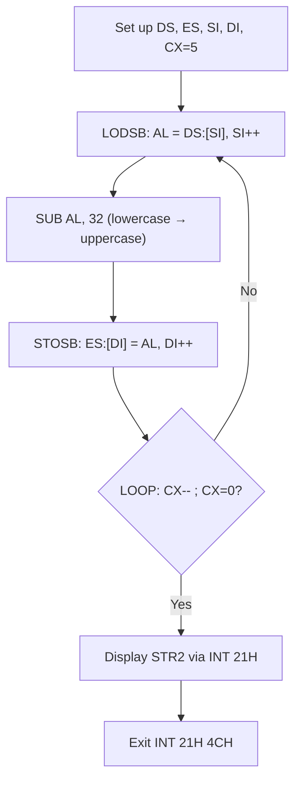

# Chapter: 8086 String Instructions

> **Course:** Microprocessors (MI) — Semester 5
> **Primary Source:** `String Instructions.pdf` (18 slides)
> **Files Integrated:** `String Instructions.pdf`

---

## 1. Chapter Overview

The 8086 provides a dedicated set of **String Manipulation Instructions** that operate on blocks of memory, one byte or word at a time, using a fixed pair of registers (`SI` for source, `DI` for destination). Their real power comes from **REP prefixes** that allow an entire block operation — copy, compare, search, fill — to be expressed in just two or three lines of assembly, replacing explicit loops.

This chapter covers:
- The five core string instructions: `MOVSB/W`, `LODSB/W`, `STOSB/W`, `CMPSB/W`, `SCASB/W`
- The three repeat prefixes: `REP`, `REPE/REPZ`, `REPNE/REPNZ`
- The Direction Flag (`DF`) and its role in auto-incrementing/decrementing pointer registers
- Four complete worked programs: copy, compare, uppercase conversion, and character counting

---

## 2. Register Conventions for String Instructions

Before any string operation can work correctly, four registers must be set up. These are **mandatory** — the 8086 hardware uses them implicitly; you cannot substitute other registers.

| Register | Role | Segment Association |
| :------- | :--- | :------------------ |
| `SI` (Source Index) | Points to the **source** byte/word | `DS:SI` (Data Segment) |
| `DI` (Destination Index) | Points to the **destination** byte/word | `ES:DI` (Extra Segment) |
| `CX` (Count register) | Number of repetitions when using `REP` prefix | — |
| `DF` (Direction Flag) | Controls whether `SI`/`DI` **increment** or **decrement** after each operation | — |

### Direction Flag Control

The **Direction Flag (DF)** in the FLAGS register determines the traversal direction through memory:

| Instruction | Effect on DF | SI/DI change after each byte op | SI/DI change after each word op |
| :---------- | :----------- | :------------------------------- | :------------------------------- |
| `CLD` | DF = 0 (cleared) | +1 (forward, low→high address) | +2 |
| `STD` | DF = 1 (set) | −1 (backward, high→low address) | −2 |

> **📝 Exam Note:** `CLD` must be executed before any forward string operation. Forgetting it is a classic bug — DF retains its previous value.

[Source: String Instructions.pdf, Slide 4]

---

## 3. The Five String Instructions

The five string instructions come in byte (`B`) and word (`W`) variants. The byte variant operates on 8-bit data; the word variant on 16-bit data.

---

### 3.1 MOVSB / MOVSW — Move String (Memory → Memory Copy)

`MOVSB` and `MOVSW` copy one byte or one word from the source address to the destination address, then automatically update the pointer registers.

**Operation (MOVSB):**

```
ES:[DI]  ←  DS:[SI]         ; copy one byte
SI  ←  SI ± 1               ; DF=0: +1, DF=1: −1
DI  ←  DI ± 1
```

**Operation (MOVSW):**

```
ES:[DI]  ←  DS:[SI]         ; copy one word (2 bytes)
SI  ←  SI ± 2
DI  ←  DI ± 2
```

**No flags are affected** by MOVS.

#### Worked Example — Single-byte copy

```asm
CLD                  ; DF = 0, forward direction
MOV SI, 1000H        ; source address
MOV DI, 2000H        ; destination address
MOVSB                ; ES:[2000H] = DS:[1000H], SI→1001H, DI→2001H
```

After execution:
- `ES:[2000H]` = old `DS:[1000H]`
- `SI` = `1001H`, `DI` = `2001H`

[Source: String Instructions.pdf, Slides 5–6]

---

### 3.2 LODSB / LODSW — Load String (Memory → AL/AX)

`LODSB` reads one byte from `DS:[SI]` into `AL`, then adjusts `SI`. `LODSW` reads a word into `AX`.

**Operation (LODSB):**

```
AL  ←  DS:[SI]
SI  ←  SI ± 1
```

**Operation (LODSW):**

```
AX  ←  DS:[SI]
SI  ←  SI ± 2
```

> **Key point:** LODS uses **only SI**, not DI. It is used to load individual elements from a source array into AL/AX for processing (e.g., case conversion, arithmetic), then STOS stores the result.

**Typical usage pattern:**

```asm
CLD
LODSB           ; AL = DS:[SI], SI++
; ... process AL ...
STOSB           ; ES:[DI] = AL, DI++
```

[Source: String Instructions.pdf, Slide 7]

---

### 3.3 STOSB / STOSW — Store String (AL/AX → Memory)

`STOSB` writes the byte in `AL` to `ES:[DI]`, then adjusts `DI`. `STOSW` writes the word in `AX`.

**Operation (STOSB):**

```
ES:[DI]  ←  AL
DI  ←  DI ± 1
```

**Operation (STOSW):**

```
ES:[DI]  ←  AX
DI  ←  DI ± 2
```

> **Key point:** STOS uses **only DI**, not SI. It is used to fill a destination buffer (e.g., initialize memory with a value, or store processed bytes).

#### Worked Example — Fill a byte

```asm
MOV AL, 'A'        ; value to store = ASCII 'A' (41H)
MOV DI, 2000H      ; destination
CLD                ; forward direction
STOSB              ; ES:[2000H] = 'A', DI→2001H
```

After execution: `ES:[2000H]` = `41H`, `DI` = `2001H`

[Source: String Instructions.pdf, Slide 8]

---

### 3.4 CMPSB / CMPSW — Compare String (Memory vs Memory)

`CMPSB` compares the byte at `DS:[SI]` with the byte at `ES:[DI]` by performing a **subtraction** (`DS:[SI] − ES:[DI]`). The result is **not stored**; only the **FLAGS** are updated. Both SI and DI are then adjusted.

**Operation (CMPSB):**

```
DS:[SI] − ES:[DI]       ; sets FLAGS (ZF, SF, CF, OF, PF, AF)
SI  ←  SI ± 1
DI  ←  DI ± 1
```

**Flags updated:** ZF, SF, CF, OF, PF, AF (same as SUB).

**Usage:** Compare two strings byte by byte. Used with `REPE` prefix to compare until a mismatch.

```asm
CLD
CMPSB              ; compare DS:[SI] with ES:[DI], update flags, SI++, DI++
JNZ not_equal      ; jump if bytes differ (ZF = 0)
```

[Source: String Instructions.pdf, Slide 9]

---

### 3.5 SCASB / SCASW — Scan String (AL/AX vs Memory)

`SCASB` compares `AL` with the byte at `ES:[DI]` by performing `AL − ES:[DI]`, updates FLAGS, then adjusts DI. It does **not** modify SI.

**Operation (SCASB):**

```
AL − ES:[DI]         ; sets FLAGS
DI  ←  DI ± 1
```

**SCASW** compares `AX` with `ES:[DI]` (word), adjusts DI by ±2.

**Usage:** Search for a specific byte/word in a string/array. Used with `REPNE` to scan until a match is found.

```asm
MOV AL, 'A'       ; byte to search for
SCASB             ; AL − ES:[DI]; if ZF=1, found; DI++
```

> **📝 Exam Note:** SCAS scans `ES:[DI]` (Extra Segment). The search value is in `AL` (byte) or `AX` (word). CMPS compares two memory locations; SCAS compares a register against memory.

[Source: String Instructions.pdf, Slide 10]

---

### 3.6 Summary Table — String Instructions

| Mnemonic | Operation | Source Reg | Dest Reg | Flags Changed |
| :------- | :-------- | :--------- | :------- | :------------ |
| `MOVSB` | `ES:[DI] ← DS:[SI]` | SI | DI | None |
| `MOVSW` | `ES:[DI] ← DS:[SI]` (word) | SI | DI | None |
| `LODSB` | `AL ← DS:[SI]` | SI | — | None |
| `LODSW` | `AX ← DS:[SI]` (word) | SI | — | None |
| `STOSB` | `ES:[DI] ← AL` | — | DI | None |
| `STOSW` | `ES:[DI] ← AX` (word) | — | DI | None |
| `CMPSB` | `DS:[SI] − ES:[DI]` (flags only) | SI | DI | ZF, SF, CF, OF, PF, AF |
| `CMPSW` | same, word | SI | DI | ZF, SF, CF, OF, PF, AF |
| `SCASB` | `AL − ES:[DI]` (flags only) | — | DI | ZF, SF, CF, OF, PF, AF |
| `SCASW` | `AX − ES:[DI]` (flags only) | — | DI | ZF, SF, CF, OF, PF, AF |

[Source: String Instructions.pdf, Slides 5–10]

---

## 4. REP Prefixes — Repeat String Operations

The REP family of prefixes turns a single string instruction into a loop, automatically decrementing `CX` after each iteration. This eliminates the need for explicit `LOOP` instructions in block operations.

---

### 4.1 REP — Repeat While CX ≠ 0

**Used with:** `MOVSB`, `MOVSW`, `STOSB`, `STOSW`, `LODSB`, `LODSW`

**Behaviour:**

```
while CX ≠ 0:
    execute string instruction
    CX ← CX − 1
```

After completion: `CX = 0`.

> **📝 Exam Note:** `REP` does **not** check flags — it only checks `CX`. Use `REPE`/`REPNE` for flag-sensitive operations like CMPS and SCAS.

#### Worked Example — Copy 10 bytes

```asm
CLD                  ; forward direction
MOV CX, 10          ; repeat 10 times
MOV SI, 1000H        ; source: DS:1000H
MOV DI, 2000H        ; destination: ES:2000H
REP MOVSB            ; copy 10 bytes, one at a time
```

**Step-by-step trace:**

| Iteration | Action | SI after | DI after | CX after |
| :-------- | :----- | :------- | :------- | :------- |
| 1 | `ES:[2000H] = DS:[1000H]` | 1001H | 2001H | 9 |
| 2 | `ES:[2001H] = DS:[1001H]` | 1002H | 2002H | 8 |
| … | … | … | … | … |
| 10 | `ES:[2009H] = DS:[1009H]` | 100AH | 200AH | 0 |

After: `CX = 0`, `SI = 100AH`, `DI = 200AH`

[Source: String Instructions.pdf, Slide 11]

---

### 4.2 REPE / REPZ — Repeat While Equal (ZF = 1) and CX ≠ 0

**Used with:** `CMPSB`, `CMPSW`, `SCASB`, `SCASW`

**Full name:** REPE = Repeat While Equal; REPZ = Repeat While Zero (same instruction, two mnemonics).

**Behaviour:**

```
while (CX ≠ 0) AND (ZF = 1):
    execute string instruction
    CX ← CX − 1
```

Stops when either:
1. `CX` reaches 0 (all elements compared, all equal), **or**
2. `ZF = 0` (a mismatch was found)

**Usage:** Compare two strings. If `ZF = 0` after termination, strings differ at the current position.

```asm
CLD
MOV CX, 5             ; compare up to 5 bytes
LEA SI, STR1          ; DS:SI → first string
LEA DI, STR2          ; ES:DI → second string
REPE CMPSB            ; compare while equal
JNZ not_equal         ; if ZF=0: strings differ
; strings are equal
```

[Source: String Instructions.pdf, Slide 12]

---

### 4.3 REPNE / REPNZ — Repeat While Not Equal (ZF = 0) and CX ≠ 0

**Full name:** REPNE = Repeat While Not Equal; REPNZ = Repeat While Not Zero (same instruction).

**Behaviour:**

```
while (CX ≠ 0) AND (ZF = 0):
    execute string instruction
    CX ← CX − 1
```

Stops when either:
1. `CX` reaches 0 (searched entire buffer, not found), **or**
2. `ZF = 1` (a match was found)

**Usage:** Scan a string searching for a specific character.

```asm
MOV AL, 'A'            ; character to search for
MOV CX, 10            ; search up to 10 bytes
CLD
REPNE SCASB            ; scan until 'A' found or CX = 0
JZ found               ; if ZF=1: 'A' was found at ES:[DI−1]
; not found
```

[Source: String Instructions.pdf, Slide 13]

---

### 4.4 REP Prefix Summary Table

| Prefix | Condition to Continue | Terminates When | Used With |
| :----- | :-------------------- | :-------------- | :-------- |
| `REP` | `CX ≠ 0` | `CX = 0` | MOVS, STOS, LODS |
| `REPE` / `REPZ` | `CX ≠ 0` AND `ZF = 1` | `CX = 0` or `ZF = 0` | CMPS, SCAS |
| `REPNE` / `REPNZ` | `CX ≠ 0` AND `ZF = 0` | `CX = 0` or `ZF = 1` | CMPS, SCAS |

[Source: String Instructions.pdf, Slides 11–13]

---

## 5. Complete Program Examples

### 5.1 Program: Copy String (MOVSB with LOOP)

**Task:** Copy the string `'ABCDE$'` from `STR1` to `STR2`.

**Two approaches are shown:** explicit LOOP and REP prefix.

```asm
DATA SEGMENT
    STR1 DB 'ABCDE$'          ; source string, 6 bytes
    STR2 DB 10 DUP('$')       ; destination buffer, pre-filled with '$'
DATA ENDS

CODE SEGMENT
    ASSUME CS:CODE, DS:DATA, ES:DATA
START:
    MOV AX, DATA
    MOV DS, AX
    MOV ES, AX                ; ES = DS (same data segment)

    LEA SI, STR1              ; DS:SI → source
    LEA DI, STR2              ; ES:DI → destination
    MOV CX, 5                 ; copy 5 bytes

    ; Method 1: explicit loop
AGAIN:
    MOVSB                     ; copy byte, SI++, DI++
    LOOP AGAIN                ; CX-- ; if CX≠0 repeat

    ; Method 2 (alternative, replace above 3 lines with):
    ; CLD
    ; MOV CX, 5
    ; REP MOVSB

    MOV AH, 09H               ; DOS: display string
    LEA DX, STR2
    INT 21H
    MOV AH, 4CH
    INT 21H
CODE ENDS
END START
```

**Flow:**
1. Both DS and ES point to the same DATA segment.
2. SI → `STR1`, DI → `STR2`.
3. Each `MOVSB` copies one byte and advances both pointers.
4. After 5 iterations, `STR2` contains `'ABCDE'`.

[Source: String Instructions.pdf, Slide 14]

---

### 5.2 Program: Compare Two Strings (REPE CMPSB)

**Task:** Compare `'their$'` and `'there$'` and print `"equal"` or `"not equal"`.

```asm
DATA SEGMENT
    STR1    DB 'their$'
    STR2    DB 'there$'
    OUTPUT1 DB 'not equal$'
    OUTPUT2 DB 'equal$'
DATA ENDS

CODE SEGMENT
    ASSUME CS:CODE, DS:DATA, ES:DATA
START:
    MOV AX, DATA
    MOV DS, AX
    MOV ES, AX

    MOV CX, 05                ; compare 5 characters
    LEA SI, STR1
    LEA DI, STR2

    REPE CMPSB                ; compare while equal and CX ≠ 0
    JNZ NOT_EQ                ; ZF=0 → mismatch found
    LEA DX, OUTPUT2           ; equal
    JMP DISPLAY
NOT_EQ:
    LEA DX, OUTPUT1           ; not equal
DISPLAY:
    MOV AH, 09H
    INT 21H
    MOV AH, 4CH
    INT 21H
CODE ENDS
END START
```

**Trace on `'their'` vs `'there'`:**

| Byte # | STR1 char | STR2 char | Equal? | ZF |
| :----- | :-------- | :-------- | :----- | :- |
| 1 | `t` | `t` | Yes | 1 |
| 2 | `h` | `h` | Yes | 1 |
| 3 | `e` | `e` | Yes | 1 |
| 4 | `i` | `r` | **No** | **0** |

`REPE CMPSB` stops at byte 4. `ZF = 0` → jumps to `NOT_EQ` → prints `"not equal"`.

An alternate implementation using an explicit `CMPSB` loop (without REPE) is also valid:

```asm
    MOV CX, 05
    LEA SI, STR1
    LEA DI, STR2
AGAIN:
    CMPSB                ; compare one byte
    JNZ NOT_EQ           ; mismatch → branch
    LOOP AGAIN           ; CX-- ; continue
    LEA DX, OUTPUT2
    JMP DISPLAY
```

[Source: String Instructions.pdf, Slides 15–16]

---

### 5.3 Program: Convert String to Uppercase (LODSB + STOSB)

**Task:** Convert the lowercase string `'their'` to uppercase `'THEIR'` using `LODSB` and `STOSB`.

**Key principle:** In ASCII, the difference between a lowercase letter and its uppercase equivalent is `32` (decimal) = `20H`. Subtracting 32 from a lowercase letter gives the uppercase.

| Char | ASCII (decimal) | Uppercase | After − 32 |
| :--- | :-------------- | :-------- | :--------- |
| `'t'` | 116 | `'T'` | 84 |
| `'h'` | 104 | `'H'` | 72 |
| `'e'` | 101 | `'E'` | 69 |

```asm
DATA SEGMENT
    STR1 DB 'their$'
    STR2 DB 10 DUP ('$')      ; output buffer
DATA ENDS

CODE SEGMENT
    ASSUME CS:CODE, DS:DATA, ES:DATA
START:
    MOV AX, DATA
    MOV DS, AX
    MOV ES, AX

    MOV CX, 05                ; 5 characters to convert
    LEA SI, STR1              ; source: lowercase string
    LEA DI, STR2              ; destination: output buffer

AGAIN:
    LODSB                     ; AL = DS:[SI],  SI++
    SUB AL, 32                ; AL = AL - 32  (lowercase → uppercase)
    STOSB                     ; ES:[DI] = AL,  DI++
    LOOP AGAIN                ; CX--; repeat if CX ≠ 0

    LEA DX, STR2
    MOV AH, 09H
    INT 21H
    MOV AH, 4CH
    INT 21H
CODE ENDS
END START
```

**Flow diagram:**



[Source: String Instructions.pdf, Slide 17]

---

### 5.4 Program: Count Occurrences of a Character (SCASB)

**Task:** Count how many times the character `'e'` appears in the string `'theree$'` (answer: 3).

```asm
DATA SEGMENT
    STR1 DB 'theree$'
DATA ENDS

CODE SEGMENT
    ASSUME CS:CODE, DS:DATA, ES:DATA
START:
    MOV AX, DATA
    MOV DS, AX
    MOV ES, AX

    MOV CX, 06                ; search 6 characters (excluding '$')
    LEA SI, STR1              ; NOTE: SCASB uses DI, not SI
                              ; The source loads DI implicitly through ES:DI
    MOV AL, 'e'               ; character to search for
    MOV BL, 0                 ; BL = counter

AGAIN:
    SCASB                     ; AL − ES:[DI]; DI++; flags updated
    JNE SKIP                  ; ZF=0 → not 'e', skip increment
    INC BL                    ; ZF=1 → found 'e', count++
SKIP:
    LOOP AGAIN                ; CX--; repeat

    MOV AH, 4CH
    INT 21H
CODE ENDS
END START
```

> **Note:** The slide uses `LEA SI, STR1` but the actual scan register for `SCASB` is `DI`. In the full working program, `LEA DI, STR1` (with `ES:DI` pointing to the string) would be correct. The slide shows the conceptual setup.

**Result:** `BL = 3` (three occurrences of `'e'` in `'theree'`).

[Source: String Instructions.pdf, Slide 18]

---

## 6. Abbreviation / Acronym Index

| Abbr. | Full Form | Brief Meaning |
| :---- | :-------- | :------------ |
| SI | Source Index | Register pointing to source string address |
| DI | Destination Index | Register pointing to destination string address |
| CX | Count Register | Holds repetition count for REP prefix |
| DF | Direction Flag | 0 = forward (increment); 1 = backward (decrement) |
| ZF | Zero Flag | Set when result of operation is zero |
| DS | Data Segment | Default segment for string source (DS:SI) |
| ES | Extra Segment | Default segment for string destination (ES:DI) |
| REP | Repeat | Prefix: repeat while CX ≠ 0 |
| REPE | Repeat While Equal | Prefix: repeat while CX ≠ 0 AND ZF = 1 |
| REPZ | Repeat While Zero | Synonym for REPE |
| REPNE | Repeat While Not Equal | Prefix: repeat while CX ≠ 0 AND ZF = 0 |
| REPNZ | Repeat While Not Zero | Synonym for REPNE |
| ASCII | American Standard Code for Information Interchange | 7-bit character encoding standard |
| MOVS | Move String | Copy memory to memory using SI/DI |
| LODS | Load String | Load DS:[SI] into AL/AX |
| STOS | Store String | Store AL/AX into ES:[DI] |
| CMPS | Compare String | Compare DS:[SI] with ES:[DI] |
| SCAS | Scan String | Compare AL/AX with ES:[DI] |

---

## 7. Formula Sheet

### REP Prefix Loop Equivalents

**REP MOVSB** is equivalent to:
```asm
while CX ≠ 0:
    ES:[DI] ← DS:[SI]
    SI ← SI + 1 (or −1 if DF=1)
    DI ← DI + 1 (or −1 if DF=1)
    CX ← CX − 1
```

**REPE CMPSB** is equivalent to:
```asm
while (CX ≠ 0) AND (ZF = 1):
    compare DS:[SI] with ES:[DI]  ; update flags
    SI ← SI ± 1
    DI ← DI ± 1
    CX ← CX − 1
```

**REPNE SCASB** is equivalent to:
```asm
while (CX ≠ 0) AND (ZF = 0):
    compare AL with ES:[DI]  ; update flags
    DI ← DI ± 1
    CX ← CX − 1
```

### ASCII Case Conversion

$$
\text{Uppercase ASCII} = \text{Lowercase ASCII} - 32
$$

Example: `'a'` = 97 − 32 = 65 = `'A'`

---

## 8. Definition Sheet

- **String Instruction:** A class of 8086 instructions that operate on bytes/words in memory using implicit SI, DI, CX registers, with automatic pointer adjustment controlled by the Direction Flag.
- **MOVSB/MOVSW:** Copies one byte/word from `DS:[SI]` to `ES:[DI]`; adjusts both pointers; used with `REP` for block memory copies.
- **LODSB/LODSW:** Loads one byte/word from `DS:[SI]` into `AL`/`AX`; adjusts SI; used to read from source array element by element.
- **STOSB/STOSW:** Stores `AL`/`AX` into `ES:[DI]`; adjusts DI; used to write to destination array or fill memory.
- **CMPSB/CMPSW:** Compares `DS:[SI]` with `ES:[DI]` (subtraction, result discarded); sets FLAGS; adjusts both pointers; used with `REPE` to compare strings.
- **SCASB/SCASW:** Compares `AL`/`AX` with `ES:[DI]` (subtraction, result discarded); sets FLAGS; adjusts DI; used with `REPNE` to scan/search.
- **REP:** Repeat prefix — execute next string instruction while `CX ≠ 0`, decrement CX each iteration.
- **REPE/REPZ:** Repeat while `CX ≠ 0` AND `ZF = 1` (equal); stops on first mismatch.
- **REPNE/REPNZ:** Repeat while `CX ≠ 0` AND `ZF = 0` (not equal); stops on first match.
- **CLD:** Clear Direction Flag — SI/DI increment after each operation (forward traversal).
- **STD:** Set Direction Flag — SI/DI decrement after each operation (backward traversal).
- **Direction Flag (DF):** Bit in FLAGS register; controls auto-adjust direction of SI/DI in string operations.

---

## 9. Exam-Oriented Review

### Important Concepts
- Role of `DS:SI`, `ES:DI`, `CX`, and `DF` in all string operations
- Difference between `CMPSB` (two memory operands) and `SCASB` (register vs memory)
- When to use `REP` vs `REPE` vs `REPNE` — which flag each checks
- How `CLD`/`STD` affect pointer direction
- SI and DI pointer adjustment amounts: ±1 for byte, ±2 for word

### Important Definitions
- **MOVSB:** Copy one byte from `DS:[SI]` to `ES:[DI]`, auto-adjust SI and DI
- **SCASB:** Compare `AL` with `ES:[DI]`, auto-adjust DI, update FLAGS
- **REPE:** Repeat while CX ≠ 0 AND ZF = 1

### Important Comparisons

| Feature | CMPSB | SCASB |
| :------ | :---- | :---- |
| Compares | `DS:[SI]` vs `ES:[DI]` | `AL` vs `ES:[DI]` |
| Registers used | SI and DI | DI only |
| Typical prefix | REPE | REPNE |
| Use case | String comparison | Character search |

| Feature | LODSB | STOSB |
| :------ | :---- | :---- |
| Direction | Memory → Register | Register → Memory |
| Register | AL | AL |
| Pointer adjusted | SI | DI |

### Potential Exam Questions

1. What registers does the 8086 use implicitly for string operations? State the segment association for each.
2. Write an 8086 assembly program to copy 20 bytes from address `1000H` to address `3000H`.
3. Explain the difference between `REPE CMPSB` and `REPNE SCASB`. When would you use each?
4. What is the role of the Direction Flag? How is it set/cleared?
5. Write a program using `LODSB` and `STOSB` to convert a 5-character string from lowercase to uppercase.
6. What happens to `CX`, `SI`, and `DI` after `REP MOVSB` completes?
7. Write a program to count the number of occurrences of the character `'A'` in a 10-byte string.
8. Trace `REPE CMPSB` for strings `'hello'` and `'help'` — at which byte does it stop, and what is the value of ZF?
9. Can `REP CMPSB` be used to compare strings? Why or why not? Which prefix should be used instead?
10. Draw and explain the memory layout used by string instructions, showing DS:SI and ES:DI.
