# Complete Machine Learning Notes: Neural Networks and Clustering

> **Course Code:** 3CS526CC23
> **Course Title:** Machine Learning and its Applications
> **Primary Source:** Faculty Lecture Slides - Nirma University
> **Files Integrated:** NN and Clustering.pdf (52 Slides)

---

# Chapter 6 — Neural Networks and Clustering

---

## 6.1 Foundations of Biological and Artificial Neural Networks

The field of Artificial Neural Networks originated from the quest to replicate the computational versatility, robustness, and fault tolerance of the biological human brain within synthetic computing systems. While conventional digital architectures excel at rapid sequential arithmetic and algorithmic precision, biological nervous systems demonstrate unparalleled superiority in perceptual tasks, pattern recognition, contextual understanding, and adaptive learning through experience. This section establishes the structural, functional, and mathematical analogies connecting biological neurobiology to foundational artificial computational models.

---

### Core Terminology Dictionary

1. **Neuron (Biological):** An electrically excitable biological cell that processes and transmits information throughout the nervous system via electrochemical signaling mechanisms.
2. **Synapse:** The microscopic junction and biochemical interface across which an action potential is transmitted from the presynaptic axon terminal to the postsynaptic dendrite.
3. **Dendrite:** The highly branched cellular projections of a biological neuron that receive incoming electrical or chemical stimuli from adjacent neurons.
4. **Soma (Cell Body):** The central metabolic and computational hub of a neuron containing the cell nucleus; it aggregates postsynaptic electrical potentials across dendrites.
5. **Axon:** A single, elongated cellular fiber extending from the soma that propagates generated action potentials (nerve impulses) toward downstream target neurons or effector cells.
6. **Net Input ($net$):** The aggregated scalar sum of all weighted input signals arriving at an artificial neuron, combined with an internal bias parameter.
7. **Activation Function ($f$):** A mathematical transfer function applied to the net input scalar that determines the final activation level and output state of an artificial neuron.
8. **Linear Activation Function:** A transfer function producing an output directly proportional to its net input ($f(net) = net$), providing no non-linear transformation.
9. **Binary Step Activation Function:** A discontinuous threshold function yielding binary values ($0$ or $1$) based on whether the net input meets or exceeds a predefined threshold.
10. **Ramp (Saturating Linear) Function:** A piecewise linear function that clips output values to a bounded range $[0, 1]$ when the net input exceeds specified upper and lower saturation limits.
11. **Sigmoid (Logistic) Function:** A smooth, S-shaped non-linear activation function mapping the real number line $(-\infty, +\infty)$ into a bounded probability interval $(0, 1)$.
12. **Hyperbolic Tangent (Tanh) Function:** A zero-centered, smooth S-shaped activation function mapping real inputs into the bounded interval $(-1, +1)$.
13. **Rectified Linear Unit (ReLU):** A non-linear activation function defined as $f(net) = \max(0, net)$, widely used in deep neural architectures to prevent gradient saturation.
14. **Leaky Rectified Linear Unit (Leaky ReLU):** A modified ReLU function introducing a small non-zero slope $\alpha$ for negative net inputs to prevent the "dying ReLU" failure mode.
15. **Parametric Rectified Linear Unit (PReLU):** A generalization of Leaky ReLU where the negative slope coefficient $\alpha$ is treated as an adaptive parameter learned during training.
16. **Randomized Rectified Linear Unit (RReLU):** A stochastic variation of Leaky ReLU where the negative slope parameter $\alpha_{ji}$ is randomly sampled from a uniform distribution during training and fixed during evaluation.
17. **Perceptron:** The fundamental supervised learning model introduced by Frank Rosenblatt, consisting of a single-layer threshold neuron capable of learning linearly separable binary classification boundaries.
18. **Epoch:** Exactly one complete presentation and forward-backward training cycle of the entire training dataset through a machine learning model.
19. **Backpropagation (BP):** A supervised gradient descent algorithm that computes the partial derivatives of an objective error function with respect to all network weights via the multivariate calculus chain rule.
20. **Competitive Learning:** An unsupervised neural learning paradigm wherein output neurons compete with one another for the exclusive right to respond to a given input pattern.
21. **Winner-Take-All (WTA):** The operational principle of competitive networks where only the single neuron with the highest activation (or minimum metric distance) updates its synaptic weights.
22. **Lateral Inhibition:** Biological and artificial inhibitory synaptic cross-connections between adjacent neurons that suppress surrounding units while reinforcing the dominant winning unit.
23. **Self-Organizing Map (SOM):** An unsupervised neural network architecture introduced by Teuvo Kohonen that maps high-dimensional input spaces onto a low-dimensional (typically 1D or 2D) regular grid while preserving topological relationships.
24. **Topological Neighborhood:** A geometrically defined local region surrounding the winning neuron in an SOM lattice within which neighboring neurons also update their synaptic weights.
25. **K-Means Clustering:** A partitioning clustering algorithm that partitions $N$ observations into $K$ disjoint clusters by iteratively assigning points to the nearest mean vector and recomputing cluster centroids.
26. **Within-Cluster Sum of Squares (WCSS):** The objective optimization metric in K-Means measuring the total squared Euclidean distance between each data point and its assigned cluster centroid.
27. **K-Medoids Clustering:** A robust partitioning clustering algorithm that designates actual observed data points (medoids) as cluster centers instead of fictitious arithmetic means.
28. **Partitioning Around Medoids (PAM):** The classic, deterministic realization of K-Medoids that iteratively swaps medoid and non-medoid points to minimize total absolute dissimilarity.
29. **Hierarchical Clustering:** A clustering approach that builds a continuous nested hierarchy of cluster partitions, organized either bottom-up (agglomerative) or top-down (divisive).
30. **Linkage Criteria:** Mathematical distance functions determining the pairwise dissimilarity between two multi-point clusters in hierarchical clustering (e.g., Single, Complete, Average, Centroid).
31. **Dendrogram:** A two-dimensional tree diagram illustrating the sequential merges or divisions of data clusters in hierarchical clustering across varying proximity thresholds.

---

### Biological Neural Networks (BNN)

The biological human nervous system is divided anatomically into the **Central Nervous System (CNS)**, comprising the brain and spinal cord, and the **Peripheral Nervous System (PNS)**, which interfaces sensory organs and muscular effectors. The structural and computational core of the human brain exhibits the following biological characteristics:

- **Scale:** Contains between $10^{10}$ and $10^{11}$ biological neurons ($10$ to $100$ billion neurons).
- **Connectivity:** Each individual neuron forms between $1,000$ and $10,000$ synaptic junctions with adjacent cells, yielding in excess of $10^{14}$ (over $100$ trillion) simultaneous synaptic interconnections.
- **Processing Architecture:** A massively parallel, distributed biological system where individual computational elements operate slowly ($\approx 10^{-3}\text{ s}$ per synaptic transmission compared to $\approx 10^{-9}\text{ s}$ in silicon transistors), yet outperform supercomputers in visual processing and speech comprehension due to vast parallelism.
- **Fault Tolerance & Graceful Degradation:** The network continues to function reliably even when individual neurons or synapses degrade or die, avoiding catastrophic system failures.
- **Energy Efficiency:** The human brain operates at peak computational capacity on an extraordinarily modest metabolic power budget of approximately $20\text{ Watts}$.

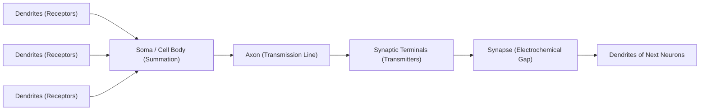

#### Written Analysis of Biological Neuron Components

1. **Dendrites:** Serve as the input receptive field. Tree-like arborizations extending from the cell body that receive incoming neurotransmitter chemicals released by upstream neurons.
2. **Soma (Cell Body):** Integrates incoming postsynaptic electrical potentials across all dendrites over time. Contains the biological nucleus and cellular infrastructure.
3. **Axon:** Propagates action potentials initiated at the axon hillock when the integrated potential crosses an excitation threshold ($\approx -55\text{ mV}$). The axon acts as an active transmission line.
4. **Synapse & Synaptic Terminals:** The terminal boutons convert electrical action potentials into chemical neurotransmitters (e.g., acetylcholine, GABA, glutamate) that diffuse across the synaptic cleft ($\approx 20\text{ nm}$ gap) to excite or inhibit the receiving postsynaptic dendrite.

---

### Table 6.1: Comprehensive Biological vs Artificial Neuron Mapping

| Biological Component | Artificial Neuron Counterpart | Functional Description in Artificial Model | Mathematical Representation |
| :--- | :--- | :--- | :--- |
| **Dendrite** | Input Channels / Input Signals | Carries feature values extracted from observations | $x_i \in \mathbb{R}$ |
| **Synapse** | Synaptic Weight | Modulates signal strength; positive implies excitation, negative implies inhibition | $w_i \in \mathbb{R}$ |
| **Soma (Cell Body)** | Linear Summation Junction ($\Sigma$) | Aggregates all incoming weighted inputs along with bias | $net = \sum_{i=1}^n w_i x_i + b$ |
| **Threshold / Refractory State** | Bias / Threshold Parameter | Shifts the activation boundary away from the origin | $b = -\theta$ |
| **Axon Hillock / Firing Mechanism** | Non-linear Activation Function ($f$) | Evaluates whether net input satisfies firing conditions | $y = f(net)$ |
| **Axon & Synaptic Terminal** | Output Signal / Output Channel | Propagates computed activation to downstream layers | $y \in \mathbb{R}$ |
| **Learning via Synaptic Plasticity** | Weight Optimization (Gradient Descent) | Adjusts connection strengths to minimize task error | $\Delta w_i = \eta \cdot \text{error} \cdot x_i$ |

---

### The Artificial Neuron Mathematical Model

The formal mathematical model of an artificial neuron (historically grounded in the McCulloch-Pitts model and expanded by Rosenblatt) processes an input vector through synaptic weights, a bias term, and a transfer function.

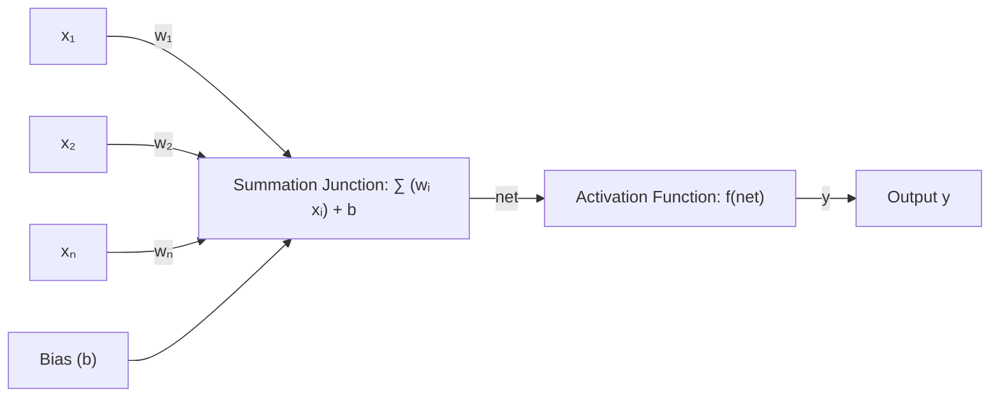

#### Component Breakdown and Operational Flow

1. **Input Vector:** A feature vector $\mathbf{x} = [x_1, x_2, \dots, x_n]^T \in \mathbb{R}^n$ representing quantitative observations.
2. **Weight Vector:** A vector of synaptic connection strengths $\mathbf{w} = [w_1, w_2, \dots, w_n]^T \in \mathbb{R}^n$.
3. **Bias Parameter:** An independent scalar $b \in \mathbb{R}$ equivalent to a weight with a permanently clamped input of $+1$. It acts as an adjustable threshold: $b = -\theta$.
4. **Summation Junction:** Computes the net internal activation scalar $net$ as the algebraic inner product plus bias:

$$
net = \mathbf{w}^T \mathbf{x} + b = \sum_{i=1}^n w_i x_i + b
$$

5. **Activation Operator:** Transforms the net input through a linear or non-linear operator $f: \mathbb{R} \to \mathbb{R}$, yielding the output:

$$
y = f(net)
$$

[Source: NN and Clustering.pdf, Slides 1–8]

---

## 6.2 Activation Functions and Mathematical Transfer Functions

Activation functions inject non-linear computational capacity into artificial neural networks. Without non-linear activation functions, any multi-layer neural network collapses mathematically into a single linear matrix transformation, regardless of layer depth. The choice of activation function dictates gradient propagation, convergence velocity, numerical stability, and representational capacity.

---

### Mathematical Specifications of Activation Functions

#### 1. Binary Step Function (Threshold / Heaviside)

$$
f(net) = \begin{cases} 1, & \text{if } net \ge 0 \\ 0, & \text{if } net < 0 \end{cases}
$$

| Symbol | Meaning | Units / Range |
| :--- | :--- | :--- |
| $net$ | Net aggregated input to the neuron | $\mathbb{R} \in (-\infty, +\infty)$ |
| $f(net)$ | Binary discrete firing state | $\{0, 1\}$ |

- **Characteristics:** Discontinuous at $net = 0$; derivative is zero everywhere and undefined at $0$.
- **Gradient Limitation:** $f'(net) = 0$ for all $net \neq 0$. Prevents gradient-based backpropagation learning. Used primarily in Rosenblatt perceptrons.

---

#### 2. Linear (Identity) Activation Function

$$
f(net) = net
$$

| Symbol | Meaning | Units / Range |
| :--- | :--- | :--- |
| $net$ | Net aggregated input | $\mathbb{R} \in (-\infty, +\infty)$ |
| $f(net)$ | Linear output | $\mathbb{R} \in (-\infty, +\infty)$ |

- **Characteristics:** Continuous and unbounded.
- **Derivative:** $f'(net) = 1$. Constant gradient.
- **Limitation:** Stacking multiple linear layers yields $y = \mathbf{W}_k \dots \mathbf{W}_1 \mathbf{x} = \mathbf{W}^* \mathbf{x}$, providing zero non-linear feature representation.

---

#### 3. Ramp Function (Saturating Linear)

$$
f(net) = \begin{cases} 0, & \text{if } net < 0 \\ net, & \text{if } 0 \le net \le 1 \\ 1, & \text{if } net > 1 \end{cases}
$$

| Symbol | Meaning | Units / Range |
| :--- | :--- | :--- |
| $net$ | Net aggregated input | $\mathbb{R} \in (-\infty, +\infty)$ |
| $f(net)$ | Bounded piecewise output | $[0, 1]$ |

- **Characteristics:** Piecewise linear; non-differentiable at boundary points $net = 0$ and $net = 1$.
- **Derivative:** $f'(net) = 1$ when $0 < net < 1$; $f'(net) = 0$ when $net < 0$ or $net > 1$.

---

#### 4. Sigmoid (Logistic) Function

$$
f(net) = \frac{1}{1 + e^{-net}} = \sigma(net)
$$

| Symbol | Meaning | Units / Range |
| :--- | :--- | :--- |
| $net$ | Net aggregated input | $\mathbb{R} \in (-\infty, +\infty)$ |
| $f(net)$ | Probability distribution output | $(0, 1)$ |
| $e$ | Base of the natural logarithm | $\approx 2.71828$ |

- **Mathematical Derivation of First Derivative:**
  Let $f(net) = (1 + e^{-net})^{-1}$. Applying the chain rule:

$$
  \frac{d f(net)}{d(net)} = -1(1 + e^{-net})^{-2}(-e^{-net}) = \frac{e^{-net}}{(1 + e^{-net})^2}
$$

  Decomposing the fraction:

$$
  f'(net) = \left(\frac{1}{1 + e^{-net}}\right) \left(\frac{e^{-net}}{1 + e^{-net}}\right) = f(net) [1 - f(net)]
$$

- **Pros and Cons:** Smooth, infinitely differentiable, maps outputs strictly to probabilities $(0, 1)$. However, it suffers from the vanishing gradient problem when $|net| \gg 0$ ($f'(net) \to 0$) and its output is not zero-centered.

---

#### 5. Hyperbolic Tangent (Tanh) Function

$$
f(net) = \tanh(net) = \frac{e^{net} - e^{-net}}{e^{net} + e^{-net}} = \frac{2}{1 + e^{-2 net}} - 1 = 2\sigma(2 net) - 1
$$

| Symbol | Meaning | Units / Range |
| :--- | :--- | :--- |
| $net$ | Net aggregated input | $\mathbb{R} \in (-\infty, +\infty)$ |
| $f(net)$ | Zero-centered continuous output | $(-1, +1)$ |

- **Mathematical Derivation of Derivative:**

$$
  \frac{d}{d(net)}\tanh(net) = \frac{(e^{net}+e^{-net})(e^{net}+e^{-net}) - (e^{net}-e^{-net})(e^{net}-e^{-net})}{(e^{net}+e^{-net})^2} = 1 - \tanh^2(net) = 1 - f(net)^2
$$

- **Pros and Cons:** Zero-centered (mean output is near zero), which facilitates gradient descent optimization across layers. Still susceptible to vanishing gradients at extreme values.

---

#### 6. Rectified Linear Unit (ReLU)

$$
f(net) = \max(0, net)
$$

| Symbol | Meaning | Units / Range |
| :--- | :--- | :--- |
| $net$ | Net aggregated input | $\mathbb{R} \in (-\infty, +\infty)$ |
| $f(net)$ | Non-negative rectified output | $[0, +\infty)$ |

- **Derivative:**

$$
  f'(net) = \begin{cases} 1, & \text{if } net > 0 \\ 0, & \text{if } net < 0 \end{cases}
$$

  (Subgradient convention sets $f'(0) = 0$ or $f'(0) = 0.5$).

- **Pros and Cons:** Computationally trivial (no exponentials), does not saturate in the positive regime, preventing vanishing gradients. Subject to the **"Dying ReLU"** failure mode where neurons receiving large negative biases permanently output zero with zero gradient.

---

#### 7. Leaky Rectified Linear Unit (Leaky ReLU)

$$
f(net) = \max(\alpha \cdot net, net) = \begin{cases} net, & \text{if } net \ge 0 \\ \alpha \cdot net, & \text{if } net < 0 \end{cases}
$$

| Symbol | Meaning | Units / Range |
| :--- | :--- | :--- |
| $net$ | Net aggregated input | $\mathbb{R} \in (-\infty, +\infty)$ |
| $\alpha$ | Fixed small leakage slope | Typically $\alpha = 0.01$ |
| $f(net)$ | Leaky rectified output | $(-\infty, +\infty)$ |

- **Derivative:**

$$
  f'(net) = \begin{cases} 1, & \text{if } net \ge 0 \\ \alpha, & \text{if } net < 0 \end{cases}
$$

- **Pros:** Solves the dying ReLU problem by guaranteeing a small, constant gradient $\alpha$ for negative net inputs.

---

#### 8. Parametric Rectified Linear Unit (PReLU)

$$
f(net) = \begin{cases} net, & \text{if } net \ge 0 \\ \alpha_i \cdot net, & \text{if } net < 0 \end{cases}
$$

| Symbol | Meaning | Units / Range |
| :--- | :--- | :--- |
| $net$ | Net aggregated input | $\mathbb{R} \in (-\infty, +\infty)$ |
| $\alpha_i$ | Learnable channel/neuron-specific parameter | Initialized to small positive value (e.g., $0.25$) |
| $f(net)$ | Adaptive rectified output | $(-\infty, +\infty)$ |

- **Pros:** Allows the network to learn the optimal slope for negative activations via gradient descent rather than fixing it heuristically.

---

#### 9. Randomized Rectified Linear Unit (RReLU)

$$
f(net) = \begin{cases} net, & \text{if } net \ge 0 \\ a_{ji} \cdot net, & \text{if } net < 0 \end{cases}
$$

where $a_{ji} \sim U(l, u)$ with $l < u$ (typically $l = 1/8$, $u = 1/3$).

| Symbol | Meaning | Units / Range |
| :--- | :--- | :--- |
| $net$ | Net aggregated input | $\mathbb{R} \in (-\infty, +\infty)$ |
| $a_{ji}$ | Random leakage coefficient | $a_{ji} \sim U(l, u)$ during training; $\frac{l+u}{2}$ during testing |
| $f(net)$ | Stochastically rectified output | $(-\infty, +\infty)$ |

- **Pros:** Introduces regularization during training, reducing overfitting risk in deep convolutional networks.

---

### Table 6.2: Comprehensive Activation Functions Comparison Matrix

| Activation Function | Functional Form $f(net)$ | Output Range | Smoothly Differentiable? | Mathematical Derivative $f'(net)$ | Vanishing Gradient Risk? | Primary Advantages & Disadvantages |
| :--- | :--- | :--- | :--- | :--- | :--- | :--- |
| **Binary Step** | $1 \text{ if } net \ge 0 \text{ else } 0$ | $\{0, 1\}$ | No (Discontinuous at $0$) | $0 \text{ for } net \ne 0$ | Total (Gradient is $0$) | **Pro:** Clean binary thresholding.  **Con:** Cannot be used with gradient descent. |
| **Linear** | $net$ | $(-\infty, +\infty)$ | Yes | $1$ | None | **Pro:** Preserves scale for regression.  **Con:** Multi-layer networks collapse to single linear model. |
| **Ramp** | Piecewise linear $[0, 1]$ | $[0, 1]$ | No (Kinks at $0, 1$) | $1 \text{ if } 0 < net < 1 \text{ else } 0$ | High outside $(0, 1)$ | **Pro:** Bounds output.  **Con:** Gradient dies outside active linear band. |
| **Sigmoid** | $\frac{1}{1 + e^{-net}}$ | $(0, 1)$ | Yes | $f(net)[1 - f(net)]$ | High for $\|net\| > 3$ | **Pro:** Smooth probabilistic interpretation.  **Con:** Vanishing gradient; non-zero-centered. |
| **Tanh** | $\frac{e^{net}-e^{-net}}{e^{net}+e^{-net}}$ | $(-1, +1)$ | Yes | $1 - [f(net)]^2$ | High for $\|net\| > 2.5$ | **Pro:** Zero-centered outputs accelerate convergence.  **Con:** Vanishing gradient at saturation plateaus. |
| **ReLU** | $\max(0, net)$ | $[0, +\infty)$ | Subdifferentiable | $1 \text{ if } net > 0 \text{ else } 0$ | None for $net > 0$ | **Pro:** Fast computation, no positive saturation.  **Con:** Dying ReLU phenomenon on negative inputs. |
| **Leaky ReLU** | $\max(0.01 net, net)$ | $(-\infty, +\infty)$ | Subdifferentiable | $1 \text{ if } net > 0 \text{ else } 0.01$ | Minimal | **Pro:** Prevents dying ReLU by preserving small negative gradient.  **Con:** Hyperparameter $\alpha$ requires manual tuning. |
| **PReLU** | $\max(\alpha_i net, net)$ | $(-\infty, +\infty)$ | Subdifferentiable | $1 \text{ if } net > 0 \text{ else } \alpha_i$ | Minimal | **Pro:** Learns optimal negative slope automatically.  **Con:** Introduces additional learnable parameters per layer. |
| **RReLU** | $\max(a_{ji} net, net)$ | $(-\infty, +\infty)$ | Subdifferentiable | $1 \text{ if } net > 0 \text{ else } a_{ji}$ | Minimal | **Pro:** Acts as stochastic regularizer against overfitting.  **Con:** Non-deterministic training step. |

[Source: NN and Clustering.pdf, Slides 9–10, 27]

---

## 6.3 Neural Network Topologies and Architectures

The architectural layout of an artificial neural network defines the flow of information, the presence or absence of recurrent temporal memory, and the structural partition of computational nodes. Networks range from single-layer arrangements to deep layered feedforward networks and feedback architectures.

---

### Structural Classifications of Network Topologies

1. **Fully Connected Network (Asymmetric):** Every node in the network possesses a directed synaptic connection to every other node with independent, asymmetric weights ($w_{ij} \neq w_{ji}$).
2. **Fully Connected Network (Symmetric):** Every node is bidirectionally connected to every other node with identical mutual coupling weights ($w_{ij} = w_{ji}$ and $w_{ii} = 0$), typical of energy-minimizing Hopfield networks.
3. **Layered Network:** Computational units are partitioned into discrete subsets called layers: an **Input Layer**, zero or more **Hidden Layers**, and an **Output Layer**. Intra-layer connections within the same layer are prohibited.
4. **Acyclic Network:** A subclass of layered networks containing no closed feedback loops or cycles; signal flow follows a strict directed acyclic graph (DAG).
5. **Feedforward Network:** A subclass of acyclic networks where connections are permitted solely from a node in layer $l$ to nodes in layer $l+1$ (or strictly higher layers in skip-connection topologies).
6. **Recurrent / Feedback Network:** Networks containing cyclic feedback loops wherein the outputs of downstream neurons (or internal hidden states) are redirected back as inputs to upstream neurons or to themselves, maintaining dynamic temporal state.

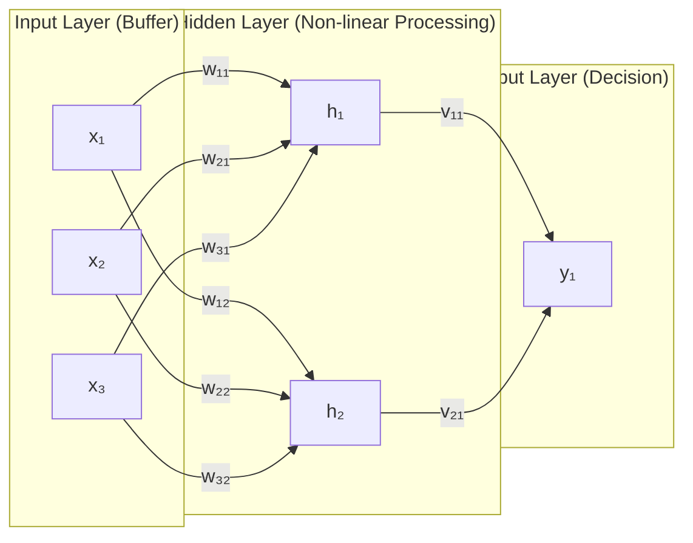

#### Component Breakdown and Signal Flow in Feedforward Networks

- **Input Layer:** Does not perform computational transformations; acts as a fan-out buffer passing feature elements $x_i$ to downstream units.
- **Hidden Layer:** Evaluates non-linear transformations: $h_j = f(\sum_i w_{ji} x_i + \theta_j)$. Hidden units extract intermediate abstract latent representations of the input space.
- **Output Layer:** Synthesizes extracted hidden features into the final network prediction: $y_k = g(\sum_j v_{kj} h_j + \theta_k)$.
- **Signal Flow:** Purely unidirectional left-to-right propagation without feedback loops or delay elements.

---

### Figure 6.4: Neural Network Taxonomy

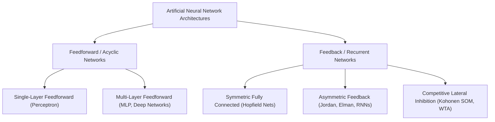

---

### Table 6.3: Neural Network Architectural Topologies Comparison

| Architecture Class | Directed Cycles Present? | Intra-Layer Connections? | Memory / Temporal State | Typical Training Algorithms | Primary Application Domains |
| :--- | :--- | :--- | :--- | :--- | :--- |
| **Single-Layer Feedforward** | No | No | Strictly memoryless | Perceptron Learning Rule, Delta Rule | Linearly separable classification, logical gating. |
| **Multi-Layer Feedforward** | No | No | Strictly memoryless | Error Backpropagation (SGD, Adam, RMSProp) | Complex pattern recognition, function approximation. |
| **Recurrent Neural Networks** | Yes (Feedback loops) | Yes (Context units) | Dynamic internal temporal state | Backpropagation Through Time (BPTT) | Time-series forecasting, natural language, sequence modeling. |
| **Competitive Networks** | Yes (Lateral inhibition) | Yes (Inhibitory links) | Static equilibrium state | Hebbian learning, Winner-Take-All adaptation | Unsupervised clustering, dimensionality reduction, SOM. |

[Source: NN and Clustering.pdf, Slides 11–17]

---

## 6.4 Learning Paradigms and Linear Separability

Machine learning systems are governed by the nature and availability of instructional feedback. Artificial neural networks implement two dominant learning paradigms alongside reinforcement paradigms:

1. **Supervised Learning:** The network is supplied with paired training tuples $\{(\mathbf{x}_p, \mathbf{t}_p)\}_{p=1}^P$. An external supervisor or teacher provides the ground-truth target vector $\mathbf{t}_p$. Learning proceeds by calculating an error signal $e = \mathbf{t} - \mathbf{y}$ and adjusting synaptic parameters to minimize this discrepancy.
2. **Unsupervised Learning:** The network receives unlabeled feature vectors $\{\mathbf{x}_p\}_{p=1}^P$ without external teacher guidance. The network autonomously discovers statistical regularities, correlations, and geometric clusters within the data manifold.
3. **Reinforcement Learning:** An agent interacts with an environment, receiving scalar evaluative reward or penalty feedback rather than explicit corrective instructions.

---

### The Geometric Concept of Linear Separability

A binary classification problem involving two classes $\mathcal{C}_1$ and $\mathcal{C}_2$ in an $n$-dimensional Euclidean space $\mathbb{R}^n$ is defined as **linearly separable** if and only if there exists an $(n-1)$-dimensional affine hyperplane that completely separates the vectors of $\mathcal{C}_1$ from $\mathcal{C}_2$ without misclassification.

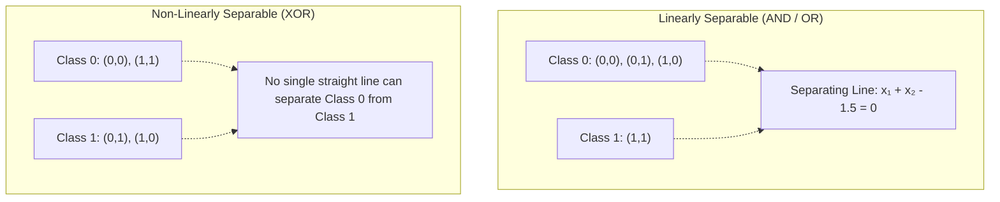

#### Dimensional Manifestations of Linear Separability

1. **One-Dimensional Space ($\mathbb{R}^1$):**
   - The boundary is a **single threshold point** $x = \theta$.
   - *Slide 19 Example:* 7 students with body weight measurements categorized into "Not Obese" (NO) and "Obese" (O):

$$
\{(50, \text{NO}), (55, \text{NO}), (60, \text{NO}), (65, \text{NO}), (70, \text{O}), (75, \text{O}), (80, \text{O})\}
$$

     A clean separating threshold exists at any boundary point $x^* \in (65, 70)$, e.g., $x^* = 67.5\text{ kg}$. This problem is linearly separable in 1D.

2. **Two-Dimensional Space ($\mathbb{R}^2$):**
   - The boundary is a **straight line** governed by:

$$
w_1 x_1 + w_2 x_2 + b = 0 \implies x_2 = -\frac{w_1}{w_2} x_1 - \frac{b}{w_2}
$$

   - *Logical AND & OR Functions:* Both are linearly separable in $\mathbb{R}^2$.
   - *Logical XOR (Exclusive OR) Problem:*

$$
\mathcal{C}_0 = \{(0,0), (1,1)\}, \quad \mathcal{C}_1 = \{(0,1), (1,0)\}
$$

     No single line $w_1 x_1 + w_2 x_2 + b = 0$ can simultaneously satisfy:

$$
     \begin{cases}
     w_1(0) + w_2(0) + b < 0 \implies b < 0 \\
     w_1(0) + w_2(1) + b \ge 0 \implies w_2 + b \ge 0 \\
     w_1(1) + w_2(0) + b \ge 0 \implies w_1 + b \ge 0 \\
     w_1(1) + w_2(1) + b < 0 \implies w_1 + w_2 + b < 0
     \end{cases}
$$

     Summing inequalities 2 and 3 yields $w_1 + w_2 + 2b \ge 0$. Since $b < 0$, this requires $w_1 + w_2 + b > 0$, directly contradicting inequality 4 ($w_1 + w_2 + b < 0$). This proof (formalized by Minsky and Papert in 1969) proved the fundamental limitation of single-layer perceptrons.

3. **Three-Dimensional Space ($\mathbb{R}^3$):**
   - The boundary is a **flat two-dimensional plane**:

$$
w_1 x_1 + w_2 x_2 + w_3 x_3 + b = 0
$$

4. **N-Dimensional Space ($\mathbb{R}^n$):**
   - The boundary is an $(n-1)$-dimensional **separating hyperplane**:

$$
\mathbf{w}^T \mathbf{x} + b = \sum_{i=1}^n w_i x_i + b = 0
$$

[Source: NN and Clustering.pdf, Slides 18–21]

---

## 6.5 The Single-Layer Perceptron and Learning Rule

---

### Definition: Perceptron

**Meaning:**
A Perceptron is a supervised learning classifier that maps an incoming feature vector to a binary class decision by computing a linear combination of features and applying a hard threshold activation function.

**Formal Definition:**
A mathematical operator $P: \mathbb{R}^n \to \{0, 1\}$ defined as:

$$
y = f(\mathbf{w}^T \mathbf{x} + b) = \begin{cases} 1, & \text{if } \sum_{i=1}^n w_i x_i + b \ge 0 \\ 0, & \text{if } \sum_{i=1}^n w_i x_i + b < 0 \end{cases}
$$

where $\mathbf{w} \in \mathbb{R}^n$ is the synaptic weight vector, $b \in \mathbb{R}$ is the bias scalar, and $\mathbf{x} \in \mathbb{R}^n$ is the input pattern.

**Intuition:**
The perceptron establishes a flat decision boundary across the input space. All points lying on or to one side of the hyperplane are classified as Class 1, while points on the opposing side are assigned to Class 0.

**Example:**
Classifying patient medical indicators (e.g., blood glucose and insulin levels) into diabetic ($1$) or non-diabetic ($0$).

---

### The Perceptron Learning Algorithm

The Perceptron Learning Rule adjusts the weight vector $\mathbf{w}$ and bias $b$ iteratively whenever a training pattern is misclassified.

#### Governing Equations

$$
e = t - y
$$

$$
\mathbf{w}^{(new)} = \mathbf{w}^{(old)} + \eta \cdot e \cdot \mathbf{x}
$$

$$
b^{(new)} = b^{(old)} + \eta \cdot e
$$

| Symbol | Meaning | Units / Range |
| :--- | :--- | :--- |
| $\mathbf{w}$ | Synaptic weight vector | $\mathbb{R}^n$ |
| $b$ | Bias scalar parameter | $\mathbb{R}$ |
| $\eta$ | Learning rate hyperparameter | Real positive scalar, typically $\eta \in (0, 1]$ |
| $\mathbf{x}$ | Current input training vector | $\mathbb{R}^n$ |
| $t$ | Desired ground-truth target label | $\{0, 1\}$ |
| $y$ | Actual binary perceptron output | $\{0, 1\}$ |
| $e$ | Quantified classification error | $\{-1, 0, +1\}$ |

#### What It Represents

The update shifts the separating hyperplane toward misclassified points. When $e = 0$, no weight adjustment occurs. When $e = +1$ (false negative), the weight vector rotates toward $\mathbf{x}$. When $e = -1$ (false positive), the weight vector rotates away from $\mathbf{x}$.

#### Conditions and Convergence Theorem

If the training dataset is linearly separable, the Perceptron Learning Rule is guaranteed to converge to a separating hyperplane in a finite number of weight updates (Perceptron Convergence Theorem). If the data is non-linearly separable, the algorithm will oscillate indefinitely without terminating.

---

### Key Practical Issues in Perceptron Design

1. **Why Use Bias ($b$)?**
   Without an independent bias parameter ($b=0$), the separating hyperplane is constrained to pass through the coordinate origin: $\mathbf{w}^T \mathbf{x} = 0$. Including $b$ allows the decision boundary to translate anywhere in the coordinate space.

2. **Termination Criteria:**
   Learning halts when: (a) Zero misclassification errors occur across an entire epoch, (b) The total squared error drops below a predefined tolerance, or (c) A preset maximum epoch budget is exhausted.

3. **Role of Learning Rate ($\eta$):**
   Controls the step size of weight corrections. An excessively large $\eta$ causes erratic oscillations around the optimal boundary, while an overly small $\eta$ requires excessive training iterations.

4. **Handling Non-Numeric Inputs:**
   Qualitative or categorical attributes must be converted to numerical representations using techniques such as one-hot encoding or ordinal feature scaling before presentation to the perceptron.

5. **Epoch Definition:**
   An epoch represents exactly one complete sequential pass of all training instances through the network.

---

### Multiclass Discrimination via Layered Perceptrons

To classify input vectors into $K > 2$ distinct classes, a layer of $K$ independent perceptrons operating in parallel is used:

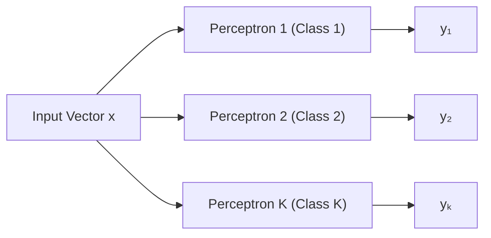

#### Decision Logic and Failure Modes

- **One-Hot Encoding Criterion:** A presented pattern $\mathbf{x}$ is classified as belonging to Class $i$ if and only if the $i$-th perceptron fires ($y_i = 1$) and all other perceptrons remain inactive ($y_j = 0$ for all $j \neq i$).
- **Ambiguity and Failure Modes:**
  - **Dead Zone / Null Classification:** If all perceptrons output zero ($\sum_k y_k = 0$), the pattern lies in an unassigned region; the network fails to classify.
  - **Conflict Zone / Overlap:** If two or more perceptrons output one simultaneously ($\sum_k y_k \ge 2$), the decision boundaries overlap, creating an ambiguous prediction.

---

### Mandatory Worked Numerical Problem 1: Perceptron 1D Classification (10–15 Marks)

#### Problem Statement

Assume 7 one-dimensional input patterns:

$$
X = \{0.0, 0.17, 0.33, 0.50, 0.67, 0.83, 1.0\}
$$

The first four patterns belong to Class 0 (desired output $t = 0$), and the remaining three patterns belong to Class 1 (desired output $t = 1$). Design a single-layer perceptron to classify these patterns using the perceptron learning rule. Assume a learning rate $\eta = 0.1$, and initial weight and bias values of $w^{(0)} = -0.36$ and $b^{(0)} = -0.10$. Show full step-by-step arithmetic computations for two complete epochs.

#### Given Values and Initial Conditions

- Input patterns and targets:
  - $P_1: x_1 = 0.00, \quad t_1 = 0$
  - $P_2: x_2 = 0.17, \quad t_2 = 0$
  - $P_3: x_3 = 0.33, \quad t_3 = 0$
  - $P_4: x_4 = 0.50, \quad t_4 = 0$
  - $P_5: x_5 = 0.67, \quad t_5 = 1$
  - $P_6: x_6 = 0.83, \quad t_6 = 1$
  - $P_7: x_7 = 1.00, \quad t_7 = 1$
- Learning rate: $\eta = 0.1$
- Initial parameters: $w = -0.36, \quad b = -0.10$
- Activation function:

$$
y = \begin{cases} 1, & \text{if } net \ge 0 \\ 0, & \text{if } net < 0 \end{cases}
$$

- Parameter update rules:

$$
e = t - y
$$

$$
w_{new} = w_{old} + \eta \cdot e \cdot x
$$

$$
b_{new} = b_{old} + \eta \cdot e
$$

---

#### Step-by-Step Execution: Epoch 1

##### Pattern 1: $x = 0.00, t = 0$

- Current state: $w = -0.36, \quad b = -0.10$
- Net input:

$$
net = w \cdot x + b = (-0.36)(0.00) + (-0.10) = -0.1000
$$

- Output: Since $net = -0.1000 < 0$, $y = 0$.
- Error: $e = t - y = 0 - 0 = 0$.
- Weight update:

$$
w_{new} = -0.36 + 0.1(0)(0.00) = -0.3600
$$

$$
b_{new} = -0.10 + 0.1(0) = -0.1000
$$

##### Pattern 2: $x = 0.17, t = 0$

- Current state: $w = -0.3600, \quad b = -0.1000$
- Net input:

$$
net = (-0.3600)(0.17) + (-0.1000) = -0.0612 - 0.1000 = -0.1612
$$

- Output: Since $net = -0.1612 < 0$, $y = 0$.
- Error: $e = 0 - 0 = 0$.
- Weight update:

$$
w_{new} = -0.3600, \quad b_{new} = -0.1000
$$

##### Pattern 3: $x = 0.33, t = 0$

- Current state: $w = -0.3600, \quad b = -0.1000$
- Net input:

$$
net = (-0.3600)(0.33) + (-0.1000) = -0.1188 - 0.1000 = -0.2188
$$

- Output: Since $net = -0.2188 < 0$, $y = 0$.
- Error: $e = 0 - 0 = 0$.
- Weight update:

$$
w_{new} = -0.3600, \quad b_{new} = -0.1000
$$

##### Pattern 4: $x = 0.50, t = 0$

- Current state: $w = -0.3600, \quad b = -0.1000$
- Net input:

$$
net = (-0.3600)(0.50) + (-0.1000) = -0.1800 - 0.1000 = -0.2800
$$

- Output: Since $net = -0.2800 < 0$, $y = 0$.
- Error: $e = 0 - 0 = 0$.
- Weight update:

$$
w_{new} = -0.3600, \quad b_{new} = -0.1000
$$

##### Pattern 5: $x = 0.67, t = 1$

- Current state: $w = -0.3600, \quad b = -0.1000$
- Net input:

$$
net = (-0.3600)(0.67) + (-0.1000) = -0.2412 - 0.1000 = -0.3412
$$

- Output: Since $net = -0.3412 < 0$, $y = 0$.
- Error: $e = t - y = 1 - 0 = +1$ (Misclassification).
- Weight update:

$$
w_{new} = -0.3600 + (0.1)(+1)(0.67) = -0.3600 + 0.0670 = -0.2930
$$

$$
b_{new} = -0.1000 + (0.1)(+1) = -0.1000 + 0.1000 = 0.0000
$$

##### Pattern 6: $x = 0.83, t = 1$

- Current state: $w = -0.2930, \quad b = 0.0000$
- Net input:

$$
net = (-0.2930)(0.83) + 0.0000 = -0.2432
$$

- Output: Since $net = -0.2432 < 0$, $y = 0$.
- Error: $e = t - y = 1 - 0 = +1$ (Misclassification).
- Weight update:

$$
w_{new} = -0.2930 + (0.1)(+1)(0.83) = -0.2930 + 0.0830 = -0.2100
$$

$$
b_{new} = 0.0000 + (0.1)(+1) = 0.1000
$$

##### Pattern 7: $x = 1.00, t = 1$

- Current state: $w = -0.2100, \quad b = 0.1000$
- Net input:

$$
net = (-0.2100)(1.00) + 0.1000 = -0.2100 + 0.1000 = -0.1100
$$

- Output: Since $net = -0.1100 < 0$, $y = 0$.
- Error: $e = t - y = 1 - 0 = +1$ (Misclassification).
- Weight update:

$$
w_{new} = -0.2100 + (0.1)(+1)(1.00) = -0.2100 + 0.1000 = -0.1100
$$

$$
b_{new} = 0.1000 + (0.1)(+1) = 0.2000
$$

*Parameters at the end of Epoch 1:* $w = -0.1100, \quad b = 0.2000$.

---

#### Step-by-Step Execution: Epoch 2

##### Pattern 1: $x = 0.00, t = 0$

- Current state: $w = -0.1100, \quad b = 0.2000$
- Net input:

$$
net = (-0.1100)(0.00) + 0.2000 = +0.2000
$$

- Output: Since $net = +0.2000 \ge 0$, $y = 1$.
- Error: $e = t - y = 0 - 1 = -1$ (Misclassification).
- Weight update:

$$
w_{new} = -0.1100 + (0.1)(-1)(0.00) = -0.1100
$$

$$
b_{new} = 0.2000 + (0.1)(-1) = 0.2000 - 0.1000 = 0.1000
$$

##### Pattern 2: $x = 0.17, t = 0$

- Current state: $w = -0.1100, \quad b = 0.1000$
- Net input:

$$
net = (-0.1100)(0.17) + 0.1000 = -0.0187 + 0.1000 = +0.0813
$$

- Output: Since $net = +0.0813 \ge 0$, $y = 1$.
- Error: $e = t - y = 0 - 1 = -1$ (Misclassification).
- Weight update:

$$
w_{new} = -0.1100 + (0.1)(-1)(0.17) = -0.1100 - 0.0170 = -0.1270
$$

$$
b_{new} = 0.1000 + (0.1)(-1) = 0.1000 - 0.1000 = 0.0000
$$

##### Pattern 3: $x = 0.33, t = 0$

- Current state: $w = -0.1270, \quad b = 0.0000$
- Net input:

$$
net = (-0.1270)(0.33) + 0.0000 = -0.0419
$$

- Output: Since $net = -0.0419 < 0$, $y = 0$.
- Error: $e = 0 - 0 = 0$ (Correct).
- Weight update:

$$
w_{new} = -0.1270, \quad b_{new} = 0.0000
$$

##### Pattern 4: $x = 0.50, t = 0$

- Current state: $w = -0.1270, \quad b = 0.0000$
- Net input:

$$
net = (-0.1270)(0.50) + 0.0000 = -0.0635
$$

- Output: Since $net = -0.0635 < 0$, $y = 0$.
- Error: $e = 0 - 0 = 0$ (Correct).
- Weight update:

$$
w_{new} = -0.1270, \quad b_{new} = 0.0000
$$

##### Pattern 5: $x = 0.67, t = 1$

- Current state: $w = -0.1270, \quad b = 0.0000$
- Net input:

$$
net = (-0.1270)(0.67) + 0.0000 = -0.0851
$$

- Output: Since $net = -0.0851 < 0$, $y = 0$.
- Error: $e = t - y = 1 - 0 = +1$ (Misclassification).
- Weight update:

$$
w_{new} = -0.1270 + (0.1)(+1)(0.67) = -0.1270 + 0.0670 = -0.0600
$$

$$
b_{new} = 0.0000 + (0.1)(+1) = 0.1000
$$

##### Pattern 6: $x = 0.83, t = 1$

- Current state: $w = -0.0600, \quad b = 0.1000$
- Net input:

$$
net = (-0.0600)(0.83) + 0.1000 = -0.0498 + 0.1000 = +0.0502
$$

- Output: Since $net = +0.0502 \ge 0$, $y = 1$.
- Error: $e = 1 - 1 = 0$ (Correct).
- Weight update:

$$
w_{new} = -0.0600, \quad b_{new} = 0.1000
$$

##### Pattern 7: $x = 1.00, t = 1$

- Current state: $w = -0.0600, \quad b = 0.1000$
- Net input:

$$
net = (-0.0600)(1.00) + 0.1000 = -0.0600 + 0.1000 = +0.0400
$$

- Output: Since $net = +0.0400 \ge 0$, $y = 1$.
- Error: $e = 1 - 1 = 0$ (Correct).
- Weight update:

$$
w_{new} = -0.0600, \quad b_{new} = 0.1000
$$

*Parameters at the end of Epoch 2:* $w = -0.0600, \quad b = 0.1000$.

---

#### Comprehensive Summary Table for Epochs 1 and 2

| Epoch | Pattern | Input $x$ | Target $t$ | Current $w$ | Current $b$ | Net Input $net$ | Output $y$ | Error $e$ | Updated $w$ | Updated $b$ |
| :---: | :---: | :---: | :---: | :---: | :---: | :---: | :---: | :---: | :---: | :---: |
| **1** | $P_1$ | $0.00$ | $0$ | $-0.3600$ | $-0.1000$ | $-0.1000$ | $0$ | $0$ | $-0.3600$ | $-0.1000$ |
| **1** | $P_2$ | $0.17$ | $0$ | $-0.3600$ | $-0.1000$ | $-0.1612$ | $0$ | $0$ | $-0.3600$ | $-0.1000$ |
| **1** | $P_3$ | $0.33$ | $0$ | $-0.3600$ | $-0.1000$ | $-0.2188$ | $0$ | $0$ | $-0.3600$ | $-0.1000$ |
| **1** | $P_4$ | $0.50$ | $0$ | $-0.3600$ | $-0.1000$ | $-0.2800$ | $0$ | $0$ | $-0.3600$ | $-0.1000$ |
| **1** | $P_5$ | $0.67$ | $1$ | $-0.3600$ | $-0.1000$ | $-0.3412$ | $0$ | $+1$ | $-0.2930$ | $0.0000$ |
| **1** | $P_6$ | $0.83$ | $1$ | $-0.2930$ | $0.0000$ | $-0.2432$ | $0$ | $+1$ | $-0.2100$ | $0.1000$ |
| **1** | $P_7$ | $1.00$ | $1$ | $-0.2100$ | $0.1000$ | $-0.1100$ | $0$ | $+1$ | $-0.1100$ | $0.2000$ |
| **2** | $P_1$ | $0.00$ | $0$ | $-0.1100$ | $0.2000$ | $+0.2000$ | $1$ | $-1$ | $-0.1100$ | $0.1000$ |
| **2** | $P_2$ | $0.17$ | $0$ | $-0.1100$ | $0.1000$ | $+0.0813$ | $1$ | $-1$ | $-0.1270$ | $0.0000$ |
| **2** | $P_3$ | $0.33$ | $0$ | $-0.1270$ | $0.0000$ | $-0.0419$ | $0$ | $0$ | $-0.1270$ | $0.0000$ |
| **2** | $P_4$ | $0.50$ | $0$ | $-0.1270$ | $0.0000$ | $-0.0635$ | $0$ | $0$ | $-0.1270$ | $0.0000$ |
| **2** | $P_5$ | $0.67$ | $1$ | $-0.1270$ | $0.0000$ | $-0.0851$ | $0$ | $+1$ | $-0.0600$ | $0.1000$ |
| **2** | $P_6$ | $0.83$ | $1$ | $-0.0600$ | $0.1000$ | $+0.0502$ | $1$ | $0$ | $-0.0600$ | $0.1000$ |
| **2** | $P_7$ | $1.00$ | $1$ | $-0.0600$ | $0.1000$ | $+0.0400$ | $1$ | $0$ | $-0.0600$ | $0.1000$ |

#### Final Interpretation

Over the course of two epochs, the perceptron parameters transitioned from $(w=-0.36, b=-0.10)$ to $(w=-0.06, b=0.10)$. By the end of Epoch 2, the decision boundary $w \cdot x + b = 0$ yields a classification threshold $x^* = -b/w = -(0.10)/(-0.06) \approx 1.67$. While the perceptron has not reached complete convergence by Epoch 2 (patterns $P_3, P_4, P_6, P_7$ are correctly classified, while $P_1, P_2, P_5$ showed misclassifications earlier in the epoch), the learning dynamics demonstrate monotonic movement of the decision boundary toward the separating margin between $x=0.50$ and $x=0.67$.

[Source: NN and Clustering.pdf, Slides 22–26]

---

## 6.6 Multi-Layer Perceptrons and the Backpropagation Algorithm

Single-layer perceptrons are strictly limited to linearly separable decision regions. To resolve complex, non-linear classification boundaries (such as XOR) and approximate arbitrary continuous functions, Multi-Layer Perceptrons (MLPs) incorporate one or more hidden layers equipped with non-linear, continuously differentiable activation functions. The Backpropagation algorithm, popularized by Rumelhart, Hinton, and Williams (1986), provides the mathematical framework for training such multi-layer architectures via gradient descent.

---

### Multivariate Calculus Derivation of Backpropagation

Consider a layered feedforward network where an input layer connects to a hidden layer of units $j$, which in turn connects to an output layer of units $k$.

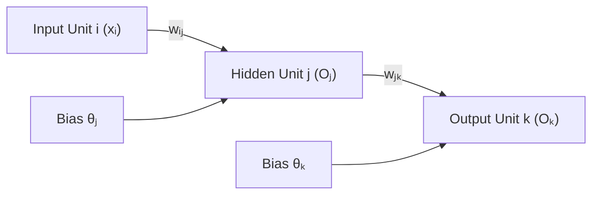

#### Notation Definitions

- $x_i$: Input feature presented to input unit $i$.
- $I_j$: Net input to hidden unit $j$:

$$
I_j = \sum_i w_{ij} O_i + \theta_j
$$

- $O_j$: Output of hidden unit $j$ using activation function $f$:

$$
O_j = f(I_j) = \frac{1}{1 + e^{-I_j}}
$$

- $I_k$: Net input to output unit $k$:

$$
I_k = \sum_j w_{jk} O_j + \theta_k
$$

- $O_k$: Output of output unit $k$:

$$
O_k = f(I_k) = \frac{1}{1 + e^{-I_k}}
$$

- $T_k$: Target ground-truth value for output unit $k$.
- $E$: Total sum of squared errors across all output units for the given pattern:

$$
E = \frac{1}{2} \sum_{k} (T_k - O_k)^2
$$

---

#### Derivation 1: Output Layer Weight Update ($\Delta w_{jk}$)

To adjust the weight $w_{jk}$ between hidden unit $j$ and output unit $k$ using gradient descent:

$$
\Delta w_{jk} = -\eta \frac{\partial E}{\partial w_{jk}}
$$

Applying the multivariate calculus chain rule:

$$
\frac{\partial E}{\partial w_{jk}} = \frac{\partial E}{\partial O_k} \cdot \frac{\partial O_k}{\partial I_k} \cdot \frac{\partial I_k}{\partial w_{jk}}
$$

##### Step 1: Differentiating Total Error with respect to Output $O_k$

$$
\frac{\partial E}{\partial O_k} = \frac{\partial}{\partial O_k} \left[ \frac{1}{2} (T_k - O_k)^2 \right] = -(T_k - O_k)
$$

##### Step 2: Differentiating Output $O_k$ with respect to Net Input $I_k$

For the standard logistic sigmoid activation function:

$$
\frac{\partial O_k}{\partial I_k} = \frac{d}{d I_k} \left( \frac{1}{1 + e^{-I_k}} \right) = O_k (1 - O_k)
$$

##### Step 3: Differentiating Net Input $I_k$ with respect to Weight $w_{jk}$

Since $I_k = \sum_j w_{jk} O_j + \theta_k$:

$$
\frac{\partial I_k}{\partial w_{jk}} = O_j
$$

##### Step 4: Synthesizing the Output Gradient

Combining these components:

$$
\frac{\partial E}{\partial w_{jk}} = -(T_k - O_k) \cdot O_k (1 - O_k) \cdot O_j
$$

Defining the **output error gradient** $Err_k$ (as adopted in Han & Kamber):

$$
Err_k = -\frac{\partial E}{\partial I_k} = (T_k - O_k) O_k (1 - O_k)
$$

Therefore:

$$
\frac{\partial E}{\partial w_{jk}} = -Err_k \cdot O_j
$$

Applying the gradient descent learning rule with learning rate $\eta$:

$$
\Delta w_{jk} = \eta \cdot Err_k \cdot O_j
$$

$$
w_{jk}^{(new)} = w_{jk}^{(old)} + \Delta w_{jk}
$$

For the output bias $\theta_k$:

$$
\Delta \theta_k = \eta \cdot Err_k
$$

$$
\theta_k^{(new)} = \theta_k^{(old)} + \Delta \theta_k
$$

---

#### Derivation 2: Hidden Layer Weight Update ($\Delta w_{ij}$)

Now consider a synaptic weight $w_{ij}$ connecting input unit $i$ to hidden unit $j$.
Applying the multivariate chain rule across all downstream output units $k$:

$$
\frac{\partial E}{\partial w_{ij}} = \frac{\partial E}{\partial I_j} \cdot \frac{\partial I_j}{\partial w_{ij}}
$$

where:

$$
\frac{\partial E}{\partial I_j} = \frac{\partial E}{\partial O_j} \cdot \frac{\partial O_j}{\partial I_j}
$$

Because the output $O_j$ influences error $E$ through all output units $k$ connected to unit $j$:

$$
\frac{\partial E}{\partial O_j} = \sum_k \left( \frac{\partial E}{\partial I_k} \cdot \frac{\partial I_k}{\partial O_j} \right)
$$

Recall that $\frac{\partial E}{\partial I_k} = -Err_k$ and $\frac{\partial I_k}{\partial O_j} = w_{jk}$. Substituting these relations:

$$
\frac{\partial E}{\partial O_j} = \sum_k (-Err_k \cdot w_{jk}) = -\sum_k (Err_k \cdot w_{jk})
$$

Next, differentiating the activation of hidden unit $j$:

$$
\frac{\partial O_j}{\partial I_j} = O_j (1 - O_j)
$$

Thus, defining the **hidden unit error gradient** $Err_j$:

$$
Err_j = -\frac{\partial E}{\partial I_j} = -\left( \frac{\partial E}{\partial O_j} \cdot \frac{\partial O_j}{\partial I_j} \right) = O_j (1 - O_j) \sum_k (Err_k \cdot w_{jk})
$$

Finally, since $I_j = \sum_i w_{ij} x_i + \theta_j$, we have $\frac{\partial I_j}{\partial w_{ij}} = x_i$. Therefore:

$$
\frac{\partial E}{\partial w_{ij}} = -Err_j \cdot x_i
$$

The gradient descent weight and bias updates for the hidden layer are:

$$
\Delta w_{ij} = \eta \cdot Err_j \cdot x_i
$$

$$
w_{ij}^{(new)} = w_{ij}^{(old)} + \Delta w_{ij}
$$

$$
\Delta \theta_j = \eta \cdot Err_j
$$

$$
\theta_j^{(new)} = \theta_j^{(old)} + \Delta \theta_j
$$

---

### Mandatory Worked Numerical Problem 2: Backpropagation on 3-2-1 Network (10–15 Marks)

#### Problem Statement (Han & Kamber Benchmark)

Consider a fully connected multi-layer feedforward network with three input units ($1, 2, 3$), two hidden units ($4, 5$), and one output unit ($6$). The network uses logistic sigmoid activation functions:

$$
f(I) = \frac{1}{1 + e^{-I}}
$$

A training pattern $\mathbf{x} = [1, 0, 1]^T$ with desired target $T_6 = 1$ is presented. The learning rate is $\eta = 0.9$. Compute the forward pass (net inputs and outputs), error gradients ($Err_6, Err_5, Err_4$), and updated weights and biases.

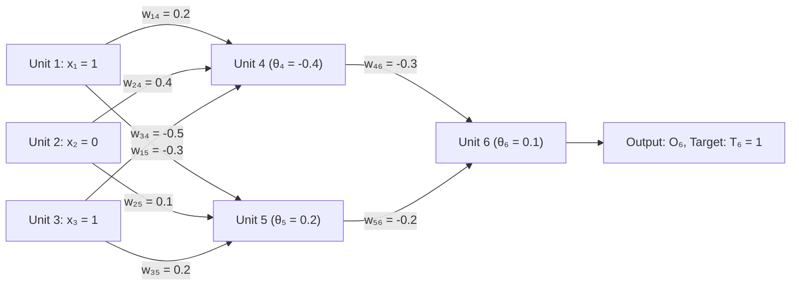

#### Given Values

- Input vector: $x_1 = 1, \quad x_2 = 0, \quad x_3 = 1$
- Target output: $T = 1$
- Learning rate: $\eta = 0.9$
- Initial weights:
  - Input to Hidden:

$$
w_{14} = 0.2, \quad w_{15} = -0.3
$$

$$
w_{24} = 0.4, \quad w_{25} = 0.1
$$

$$
w_{34} = -0.5, \quad w_{35} = 0.2
$$

  - Hidden to Output:

$$
w_{46} = -0.3, \quad w_{56} = -0.2
$$

- Initial biases:

$$
\theta_4 = -0.4, \quad \theta_5 = 0.2, \quad \theta_6 = 0.1
$$

---

#### Step 1: Forward Propagation Pass

##### Hidden Unit 4:

- Net input:

$$
I_4 = w_{14} x_1 + w_{24} x_2 + w_{34} x_3 + \theta_4
$$

$$
I_4 = (0.2)(1) + (0.4)(0) + (-0.5)(1) + (-0.4) = 0.2 + 0.0 - 0.5 - 0.4 = -0.7000
$$

- Activation:

$$
O_4 = \frac{1}{1 + e^{-(-0.7000)}} = \frac{1}{1 + e^{0.7000}} = \frac{1}{1 + 2.01375} = \frac{1}{3.01375} \approx 0.3318 \implies 0.332
$$

##### Hidden Unit 5:

- Net input:

$$
I_5 = w_{15} x_1 + w_{25} x_2 + w_{35} x_3 + \theta_5
$$

$$
I_5 = (-0.3)(1) + (0.1)(0) + (0.2)(1) + 0.2 = -0.3 + 0.0 + 0.2 + 0.2 = +0.1000
$$

- Activation:

$$
O_5 = \frac{1}{1 + e^{-0.1000}} = \frac{1}{1 + 0.90484} = \frac{1}{1.90484} \approx 0.52498 \implies 0.525
$$

##### Output Unit 6:

- Net input:

$$
I_6 = w_{46} O_4 + w_{56} O_5 + \theta_6
$$

$$
I_6 = (-0.3)(0.332) + (-0.2)(0.525) + 0.1 = -0.0996 - 0.1050 + 0.1 = -0.1046
$$

- Activation:

$$
O_6 = \frac{1}{1 + e^{-(-0.1046)}} = \frac{1}{1 + e^{0.1046}} = \frac{1}{1 + 1.11026} = \frac{1}{2.11026} \approx 0.47387 \implies 0.474
$$

*Forward Pass Summary Table:*

| Unit $j$ | Net Input $I_j$ | Output Activation $O_j$ |
| :---: | :---: | :---: |
| **4** | $-0.7000$ | $0.332$ |
| **5** | $+0.1000$ | $0.525$ |
| **6** | $-0.1046$ | $0.474$ |

---

#### Step 2: Backward Propagation — Error Gradient Computations

##### Output Unit 6 Error Gradient ($Err_6$):

$$
Err_6 = O_6 (1 - O_6)(T_6 - O_6)
$$

Substituting numerical values:

$$
Err_6 = (0.474)(1 - 0.474)(1 - 0.474) = (0.474)(0.526)(0.526) = 0.474 \times 0.27668 = +0.1311
$$

##### Hidden Unit 5 Error Gradient ($Err_5$):

$$
Err_5 = O_5 (1 - O_5)(Err_6 \cdot w_{56})
$$

Substituting numerical values:

$$
Err_5 = (0.525)(1 - 0.525) [(0.1311)(-0.2)] = (0.525)(0.475)(-0.02622) = (0.24938)(-0.02622) = -0.0065
$$

##### Hidden Unit 4 Error Gradient ($Err_4$):

$$
Err_4 = O_4 (1 - O_4)(Err_6 \cdot w_{46})
$$

Substituting numerical values:

$$
Err_4 = (0.332)(1 - 0.332) [(0.1311)(-0.3)] = (0.332)(0.668)(-0.03933) = (0.22178)(-0.03933) = -0.0087
$$

*Error Gradient Summary Table:*

| Unit $j$ | Output $O_j$ | Error Gradient $Err_j$ |
| :---: | :---: | :---: |
| **6** | $0.474$ | $+0.1311$ |
| **5** | $0.525$ | $-0.0065$ |
| **4** | $0.332$ | $-0.0087$ |

---

#### Step 3: Weight and Bias Parameter Updates

##### Output Layer Updates (Hidden-to-Output Weights and Biases):

- Weight $w_{46}$:

$$
\Delta w_{46} = \eta \cdot Err_6 \cdot O_4 = (0.9)(0.1311)(0.332) = 0.0392
$$

$$
w_{46}^{(new)} = w_{46}^{(old)} + \Delta w_{46} = -0.3 + 0.0392 = -0.2608
$$

- Weight $w_{56}$:

$$
\Delta w_{56} = \eta \cdot Err_6 \cdot O_5 = (0.9)(0.1311)(0.525) = 0.0620
$$

$$
w_{56}^{(new)} = w_{56}^{(old)} + \Delta w_{56} = -0.2 + 0.0620 = -0.1380
$$

- Bias $\theta_6$:

$$
\Delta \theta_6 = \eta \cdot Err_6 = (0.9)(0.1311) = 0.1180
$$

$$
\theta_6^{(new)} = \theta_6^{(old)} + \Delta \theta_6 = 0.1 + 0.1180 = 0.2180
$$

##### Hidden Layer Updates (Input-to-Hidden Weights and Biases):

- Weight $w_{14}$:

$$
\Delta w_{14} = \eta \cdot Err_4 \cdot x_1 = (0.9)(-0.0087)(1) = -0.0078
$$

$$
w_{14}^{(new)} = 0.2 - 0.0078 = 0.1922
$$

- Weight $w_{24}$:

$$
\Delta w_{24} = \eta \cdot Err_4 \cdot x_2 = (0.9)(-0.0087)(0) = 0.0000
$$

$$
w_{24}^{(new)} = 0.4 + 0.0000 = 0.4000
$$

- Weight $w_{34}$:

$$
\Delta w_{34} = \eta \cdot Err_4 \cdot x_3 = (0.9)(-0.0087)(1) = -0.0078
$$

$$
w_{34}^{(new)} = -0.5 - 0.0078 = -0.5078
$$

- Bias $\theta_4$:

$$
\Delta \theta_4 = \eta \cdot Err_4 = (0.9)(-0.0087) = -0.0078
$$

$$
\theta_4^{(new)} = -0.4 - 0.0078 = -0.4078
$$

- Weight $w_{15}$:

$$
\Delta w_{15} = \eta \cdot Err_5 \cdot x_1 = (0.9)(-0.0065)(1) = -0.0059
$$

$$
w_{15}^{(new)} = -0.3 - 0.0059 = -0.3059
$$

- Weight $w_{25}$:

$$
\Delta w_{25} = \eta \cdot Err_5 \cdot x_2 = (0.9)(-0.0065)(0) = 0.0000
$$

$$
w_{25}^{(new)} = 0.1 + 0.0000 = 0.1000
$$

- Weight $w_{35}$:

$$
\Delta w_{35} = \eta \cdot Err_5 \cdot x_3 = (0.9)(-0.0065)(1) = -0.0059
$$

$$
w_{35}^{(new)} = 0.2 - 0.0059 = 0.1941
$$

- Bias $\theta_5$:

$$
\Delta \theta_5 = \eta \cdot Err_5 = (0.9)(-0.0065) = -0.0059
$$

$$
\theta_5^{(new)} = 0.2 - 0.0059 = 0.1941
$$

---

#### Comprehensive Summary Table: Parameter Adjustments

| Parameter | Initial Value | Gradient Component | Adjustment $\Delta$ | Final Updated Value |
| :--- | :---: | :---: | :---: | :---: |
| **$w_{46}$** | $-0.3000$ | $\eta \cdot Err_6 \cdot O_4$ | $+0.0392$ | $-0.2608$ |
| **$w_{56}$** | $-0.2000$ | $\eta \cdot Err_6 \cdot O_5$ | $+0.0620$ | $-0.1380$ |
| **$\theta_6$** | $+0.1000$ | $\eta \cdot Err_6$ | $+0.1180$ | $+0.2180$ |
| **$w_{14}$** | $+0.2000$ | $\eta \cdot Err_4 \cdot x_1$ | $-0.0078$ | $+0.1922$ |
| **$w_{24}$** | $+0.4000$ | $\eta \cdot Err_4 \cdot x_2$ | $0.0000$ | $+0.4000$ |
| **$w_{34}$** | $-0.5000$ | $\eta \cdot Err_4 \cdot x_3$ | $-0.0078$ | $-0.5078$ |
| **$\theta_4$** | $-0.4000$ | $\eta \cdot Err_4$ | $-0.0078$ | $-0.4078$ |
| **$w_{15}$** | $-0.3000$ | $\eta \cdot Err_5 \cdot x_1$ | $-0.0059$ | $-0.3059$ |
| **$w_{25}$** | $+0.1000$ | $\eta \cdot Err_5 \cdot x_2$ | $0.0000$ | $+0.1000$ |
| **$w_{35}$** | $+0.2000$ | $\eta \cdot Err_5 \cdot x_3$ | $-0.0059$ | $+0.1941$ |
| **$\theta_5$** | $+0.2000$ | $\eta \cdot Err_5$ | $-0.0059$ | $+0.1941$ |

#### Final Interpretation

The initial output $O_6 = 0.474$ was substantially below the desired target $T = 1.0$, resulting in an initial squared error $E = \frac{1}{2}(1 - 0.474)^2 \approx 0.1383$. Applying backpropagation increased the output bias $\theta_6$ from $0.10$ to $0.2180$ and shifted the output synaptic weights in the positive direction ($w_{46}: -0.3 \to -0.2608$, $w_{56}: -0.2 \to -0.1380$), driving the net input higher to align subsequent predictions closer to $1.0$.

[Source: NN and Clustering.pdf, Slides 27–32]

---

## 6.7 Unsupervised Competitive Learning and Self-Organizing Maps (SOM)

Unsupervised neural learning discards target labels in favor of identifying natural clusterings, latent geometric manifolds, and continuous feature representations directly from input data. Two prominent connectionist architectures embody this paradigm: **Simple Competitive Learning** and Kohonen's **Self-Organizing Feature Maps (SOM)**.

---

### Simple Competitive Learning and Winner-Take-All (WTA)

In competitive learning, output neurons compete with one another for the exclusive right to represent input patterns. The network topology consists of a feedforward layer from inputs to output units, coupled with reciprocal lateral inhibitory connections among output units.

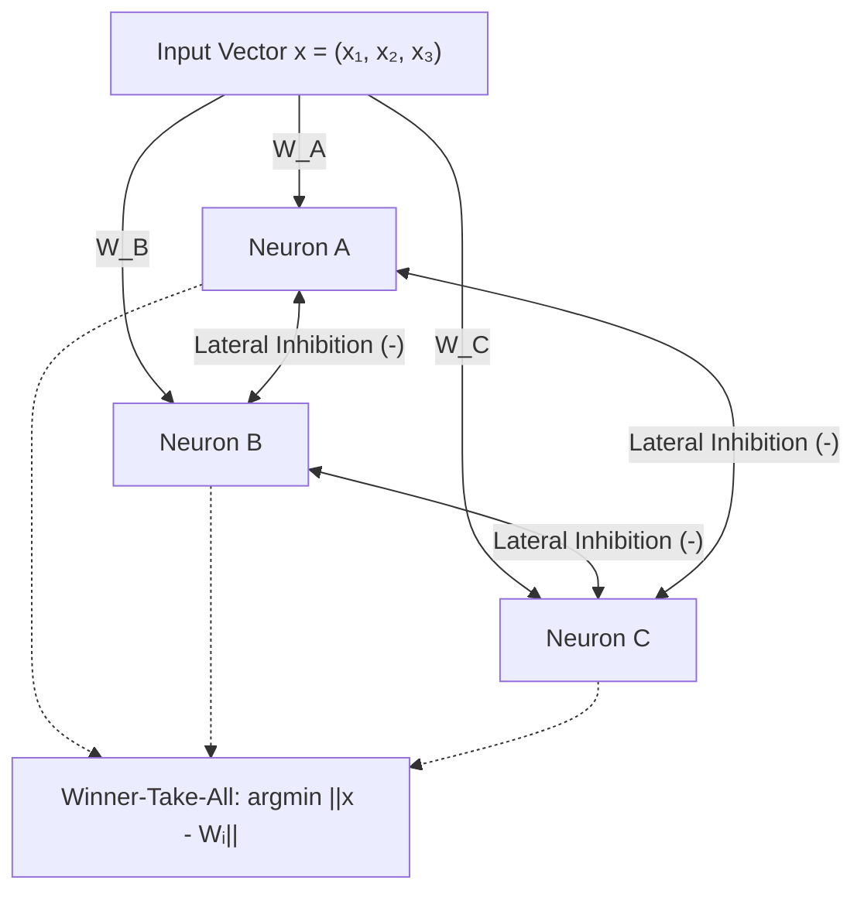

#### The Winner-Take-All Adaptation Rule

1. **Distance Metric Evaluation:** For an presented input vector $\mathbf{x} \in \mathbb{R}^d$, each competing neuron $i$ calculates its Euclidean distance:

$$
d_i = \|\mathbf{x} - \mathbf{w}_i\| = \sqrt{\sum_{k=1}^d (x_k - w_{ik})^2}
$$

2. **Winner Selection:** The winning unit $k^*$ is identified as:

$$
k^* = \arg\min_i \|\mathbf{x} - \mathbf{w}_i\|
$$

3. **Synaptic Weight Update:** Only the winning neuron adjusts its weight vector toward the input vector:

$$
   \mathbf{w}_{k^*}^{(new)} = \mathbf{w}_{k^*}^{(old)} + \eta (\mathbf{x} - \mathbf{w}_{k^*}^{(old)})
$$

   For all non-winning units ($i \neq k^*$):

$$
   \mathbf{w}_i^{(new)} = \mathbf{w}_i^{(old)}
$$

#### Key Behavioral Observations in Competitive Learning

- **Neuron Specialization:** Over repeated iterations, individual neurons move toward dense clusters of inputs, effectively acting as adaptive cluster centers.
- **Sensitivity to Initial Positions:** Random weight initialization strongly dictates the final partition. If initial weights are biased toward one quadrant, convergence can become skewed.
- **The "Dead Unit" Problem:** A neuron initialized far from all training data may never win a competition ($d_i > d_{others}$ for all $\mathbf{x}$). Because non-winners receive zero updates, the unit remains permanently inactive ("dead"), wasting computational capacity.

---

### Mandatory Worked Numerical Problem 3: Simple Competitive Learning Trace (10–15 Marks)

#### Problem Statement

Given six 3-dimensional training samples:

$$
\mathbf{x}_1 = (1.1, 1.7, 1.8), \quad \mathbf{x}_2 = (0.0, 0.0, 0.0), \quad \mathbf{x}_3 = (0.0, 0.5, 1.5)
$$

$$
\mathbf{x}_4 = (1.0, 0.0, 0.0), \quad \mathbf{x}_5 = (0.5, 0.5, 0.5), \quad \mathbf{x}_6 = (1.0, 1.0, 1.0)
$$

Train a competitive learning output layer of three neurons ($A, B, C$) with initial random weights:

$$
\mathbf{w}_A = (0.2, 0.7, 0.3), \quad \mathbf{w}_B = (0.1, 0.1, 0.9), \quad \mathbf{w}_C = (1.0, 1.0, 1.0)
$$

Use a learning rate $\eta = 0.5$. Track the winner selection and weight vector updates across two full training epochs (12 iterations).

---

#### Step-by-Step Execution: Epoch 1 (Iterations 1 to 6)

##### Iteration 1: Sample $\mathbf{x}_1 = (1.1, 1.7, 1.8)$

- Distances:
  - $d_A^2 = (1.1-0.2)^2 + (1.7-0.7)^2 + (1.8-0.3)^2 = 0.81 + 1.00 + 2.25 = 4.06 \implies d_A = 2.0149$
  - $d_B^2 = (1.1-0.1)^2 + (1.7-0.1)^2 + (1.8-0.9)^2 = 1.00 + 2.56 + 0.81 = 4.37 \implies d_B = 2.0905$
  - $d_C^2 = (1.1-1.0)^2 + (1.7-1.0)^2 + (1.8-1.0)^2 = 0.01 + 0.49 + 0.64 = 1.14 \implies d_C = 1.0677$
- Winner: **Neuron C** (minimum distance $1.0677$).
- Weight update:

$$
\mathbf{w}_C^{(new)} = (1.0, 1.0, 1.0) + 0.5[(1.1, 1.7, 1.8) - (1.0, 1.0, 1.0)] = (1.05, 1.35, 1.40)
$$

##### Iteration 2: Sample $\mathbf{x}_2 = (0.0, 0.0, 0.0)$

- Distances:
  - $d_A^2 = (0-0.2)^2 + (0-0.7)^2 + (0-0.3)^2 = 0.04 + 0.49 + 0.09 = 0.62 \implies d_A = 0.7874$
  - $d_B^2 = (0-0.1)^2 + (0-0.1)^2 + (0-0.9)^2 = 0.01 + 0.01 + 0.81 = 0.83 \implies d_B = 0.9110$
  - $d_C^2 = (0-1.05)^2 + (0-1.35)^2 + (0-1.40)^2 = 1.1025 + 1.8225 + 1.96 = 4.885 \implies d_C = 2.2102$
- Winner: **Neuron A** ($d_A = 0.7874$).
- Weight update:

$$
\mathbf{w}_A^{(new)} = (0.2, 0.7, 0.3) + 0.5[(0, 0, 0) - (0.2, 0.7, 0.3)] = (0.10, 0.35, 0.15)
$$

##### Iteration 3: Sample $\mathbf{x}_3 = (0.0, 0.5, 1.5)$

- Distances:
  - $d_A^2 = (0-0.1)^2 + (0.5-0.35)^2 + (1.5-0.15)^2 = 0.01 + 0.0225 + 1.8225 = 1.855 \implies d_A = 1.3620$
  - $d_B^2 = (0-0.1)^2 + (0.5-0.1)^2 + (1.5-0.9)^2 = 0.01 + 0.16 + 0.36 = 0.53 \implies d_B = 0.7280$
  - $d_C^2 = (0-1.05)^2 + (0.5-1.35)^2 + (1.5-1.40)^2 = 1.1025 + 0.7225 + 0.01 = 1.835 \implies d_C = 1.3546$
- Winner: **Neuron B** ($d_B = 0.7280$).
- Weight update:

$$
\mathbf{w}_B^{(new)} = (0.1, 0.1, 0.9) + 0.5[(0, 0.5, 1.5) - (0.1, 0.1, 0.9)] = (0.05, 0.30, 1.20)
$$

##### Iteration 4: Sample $\mathbf{x}_4 = (1.0, 0.0, 0.0)$

- Distances:
  - $d_A^2 = (1.0-0.1)^2 + (0-0.35)^2 + (0-0.15)^2 = 0.81 + 0.1225 + 0.0225 = 0.955 \implies d_A = 0.9772$
  - $d_B^2 = (1.0-0.05)^2 + (0-0.30)^2 + (0-1.20)^2 = 0.9025 + 0.09 + 1.44 = 2.4325 \implies d_B = 1.5596$
  - $d_C^2 = (1.0-1.05)^2 + (0-1.35)^2 + (0-1.40)^2 = 0.0025 + 1.8225 + 1.96 = 3.785 \implies d_C = 1.9455$
- Winner: **Neuron A** ($d_A = 0.9772$).
- Weight update:

$$
\mathbf{w}_A^{(new)} = (0.10, 0.35, 0.15) + 0.5[(1.0, 0, 0) - (0.10, 0.35, 0.15)] = (0.55, 0.175, 0.075)
$$

##### Iteration 5: Sample $\mathbf{x}_5 = (0.5, 0.5, 0.5)$

- Distances:
  - $d_A^2 = (0.5-0.55)^2 + (0.5-0.175)^2 + (0.5-0.075)^2 = 0.0025 + 0.1056 + 0.1806 = 0.28875 \implies d_A = 0.5374$
  - $d_B^2 = (0.5-0.05)^2 + (0.5-0.30)^2 + (0.5-1.20)^2 = 0.2025 + 0.04 + 0.49 = 0.7325 \implies d_B = 0.8559$
  - $d_C^2 = (0.5-1.05)^2 + (0.5-1.35)^2 + (0.5-1.40)^2 = 0.3025 + 0.7225 + 0.81 = 1.835 \implies d_C = 1.3546$
- Winner: **Neuron A** ($d_A = 0.5374$).
- Weight update:

$$
\mathbf{w}_A^{(new)} = (0.55, 0.175, 0.075) + 0.5[(0.5, 0.5, 0.5) - (0.55, 0.175, 0.075)] = (0.525, 0.3375, 0.2875)
$$

##### Iteration 6: Sample $\mathbf{x}_6 = (1.0, 1.0, 1.0)$

- Distances:
  - $d_A^2 = (1-0.525)^2 + (1-0.3375)^2 + (1-0.2875)^2 = 0.2256 + 0.4389 + 0.5077 = 1.1722 \implies d_A = 1.0827$
  - $d_B^2 = (1-0.05)^2 + (1-0.30)^2 + (1-1.20)^2 = 0.9025 + 0.49 + 0.04 = 1.4325 \implies d_B = 1.1969$
  - $d_C^2 = (1-1.05)^2 + (1-1.35)^2 + (1-1.40)^2 = 0.0025 + 0.1225 + 0.16 = 0.285 \implies d_C = 0.5339$
- Winner: **Neuron C** ($d_C = 0.5339$).
- Weight update:

$$
\mathbf{w}_C^{(new)} = (1.05, 1.35, 1.40) + 0.5[(1.0, 1.0, 1.0) - (1.05, 1.35, 1.40)] = (1.025, 1.175, 1.20)
$$

---

#### Comprehensive Iteration Trace Table (Epochs 1 & 2)

| Iteration | Sample Presented | Distance $d_A$ | Distance $d_B$ | Distance $d_C$ | Winner Unit | Updated Winning Weight Vector |
| :---: | :---: | :---: | :---: | :---: | :---: | :--- |
| **1** | $\mathbf{x}_1 = (1.1, 1.7, 1.8)$ | $2.0149$ | $2.0905$ | $\mathbf{1.0677}$ | **C** | $\mathbf{w}_C = (1.050, 1.350, 1.400)$ |
| **2** | $\mathbf{x}_2 = (0.0, 0.0, 0.0)$ | $\mathbf{0.7874}$ | $0.9110$ | $2.2102$ | **A** | $\mathbf{w}_A = (0.100, 0.350, 0.150)$ |
| **3** | $\mathbf{x}_3 = (0.0, 0.5, 1.5)$ | $1.3620$ | $\mathbf{0.7280}$ | $1.3546$ | **B** | $\mathbf{w}_B = (0.050, 0.300, 1.200)$ |
| **4** | $\mathbf{x}_4 = (1.0, 0.0, 0.0)$ | $\mathbf{0.9772}$ | $1.5596$ | $1.9455$ | **A** | $\mathbf{w}_A = (0.550, 0.175, 0.075)$ |
| **5** | $\mathbf{x}_5 = (0.5, 0.5, 0.5)$ | $\mathbf{0.5374}$ | $0.8559$ | $1.3546$ | **A** | $\mathbf{w}_A = (0.525, 0.338, 0.288)$ |
| **6** | $\mathbf{x}_6 = (1.0, 1.0, 1.0)$ | $1.0827$ | $1.1969$ | $\mathbf{0.5339}$ | **C** | $\mathbf{w}_C = (1.025, 1.175, 1.200)$ |
| **7** | $\mathbf{x}_1 = (1.1, 1.7, 1.8)$ | $2.1153$ | $1.8500$ | $\mathbf{0.8008}$ | **C** | $\mathbf{w}_C = (1.063, 1.438, 1.500)$ |
| **8** | $\mathbf{x}_2 = (0.0, 0.0, 0.0)$ | $\mathbf{0.6872}$ | $1.2379$ | $2.3335$ | **A** | $\mathbf{w}_A = (0.263, 0.169, 0.144)$ |
| **9** | $\mathbf{x}_3 = (0.0, 0.5, 1.5)$ | $1.4206$ | $\mathbf{0.3640}$ | $1.4170$ | **B** | $\mathbf{w}_B = (0.025, 0.400, 1.350)$ |
| **10** | $\mathbf{x}_4 = (1.0, 0.0, 0.0)$ | $\mathbf{0.7701}$ | $1.7126$ | $2.0785$ | **A** | $\mathbf{w}_A = (0.631, 0.084, 0.072)$ |
| **11** | $\mathbf{x}_5 = (0.5, 0.5, 0.5)$ | $\mathbf{0.6110}$ | $0.9788$ | $1.4817$ | **A** | $\mathbf{w}_A = (0.566, 0.292, 0.286)$ |
| **12** | $\mathbf{x}_6 = (1.0, 1.0, 1.0)$ | $1.0952$ | $1.1971$ | $\mathbf{0.6673}$ | **C** | $\mathbf{w}_C = (1.031, 1.219, 1.250)$ |

#### Final Interpretation

Across both training epochs, the three neurons specialize into distinct feature subspaces:

- **Neuron C** captures high-magnitude input samples ($\mathbf{x}_1, \mathbf{x}_6$).
- **Neuron B** specializes in patterns dominated by the third coordinate with small first components ($\mathbf{x}_3$).
- **Neuron A** captures distributed low-magnitude and origin-adjacent patterns ($\mathbf{x}_2, \mathbf{x}_4, \mathbf{x}_5$).
Neuron A won three patterns per epoch, while C won two and B won one, illustrating that cluster density and initial positioning govern winning frequency.

---

### Self-Organizing Maps (SOM / Kohonen Networks)

Introduced by Teuvo Kohonen, Self-Organizing Maps extend competitive learning by mapping high-dimensional inputs onto a low-dimensional discrete lattice (usually 1D or 2D) while preserving the topological and metric properties of the input manifold.

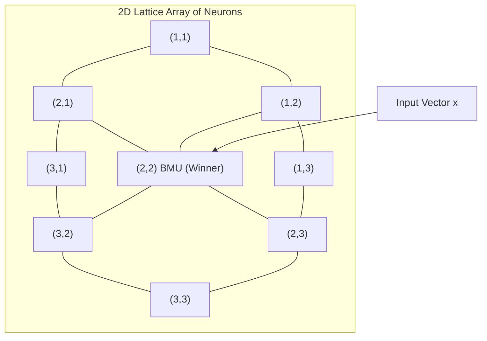

#### The Four Phases of SOM Algorithm Execution

1. **Initialization:** Synaptic weight vectors $\mathbf{w}_i \in \mathbb{R}^d$ are initialized to small random values or sampled along the primary principal components of the dataset.
2. **Competition (BMU Selection):** For an input $\mathbf{x}(t)$, every neuron on the grid calculates its Euclidean distance $\|\mathbf{x}(t) - \mathbf{w}_i(t)\|$. The **Best Matching Unit (BMU)** $c$ is selected as:

$$
c = \arg\min_i \|\mathbf{x}(t) - \mathbf{w}_i(t)\|
$$

3. **Cooperation (Topological Neighborhood):** Rather than updating only the winner, a topological neighborhood function $h_{ci}(t)$ defines the spatial influence of BMU $c$ across the lattice:

$$
h_{ci}(t) = \exp\left( -\frac{\|\mathbf{r}_c - \mathbf{r}_i\|^2}{2\sigma^2(t)} \right)
$$

   where $\mathbf{r}_c, \mathbf{r}_i$ are grid coordinates, and $\sigma(t)$ is the neighborhood radius decaying over time:

$$
\sigma(t) = \sigma_0 \exp\left( -\frac{t}{\tau_1} \right)
$$

4. **Adaptation & Cooling:** All neurons within the neighborhood update their weights:

$$
   \mathbf{w}_i(t+1) = \mathbf{w}_i(t) + \eta(t) \cdot h_{ci}(t) [\mathbf{x}(t) - \mathbf{w}_i(t)]
$$

   where the learning rate $\eta(t)$ decays monotonically:

$$
\eta(t) = \eta_0 \exp\left( -\frac{t}{\tau_2} \right)
$$

---

### Mandatory Worked Numerical Problem 4: SOM 1D Chain B–A–C Trace (10–15 Marks)

#### Problem Statement

Consider an SOM configured as a one-dimensional linear lattice of three neurons ordered:

$$
\text{Neuron } B \longleftrightarrow \text{Neuron } A \longleftrightarrow \text{Neuron } C
$$

The grid distances are $d_{grid}(B, A) = 1$, $d_{grid}(A, C) = 1$, and $d_{grid}(B, C) = 2$.
The dataset consists of the six 3D vectors from Problem 3 presented cyclically:

$$
T = \{\mathbf{x}_1, \mathbf{x}_2, \mathbf{x}_3, \mathbf{x}_4, \mathbf{x}_5, \mathbf{x}_6\}
$$

Initial weight vectors are:

$$
\mathbf{w}_A(0) = (0.2, 0.7, 0.3), \quad \mathbf{w}_B(0) = (0.1, 0.1, 0.9), \quad \mathbf{w}_C(0) = (1.0, 1.0, 1.0)
$$

The neighborhood radius $D(t)$ and learning rate $\eta(t)$ follow the schedule:

- For $t \le 6$: $D(t) = 1$ (BMU and its immediate 1-hop lattice neighbors update); $\eta(t) = 0.5$.
- For $7 \le t \le 12$: $D(t) = 0$ (only BMU updates, winner-take-all); $\eta(t) = 0.25$.
- For $t \ge 13$: $D(t) = 0$; $\eta(t) = 0.10$.
Execute the trace for 15 iterations and analyze inter-neuron distance evolution.

---

#### Step-by-Step Execution Highlights

##### Step $t = 1$: Present $\mathbf{x}_1 = (1.1, 1.7, 1.8)$

- $D(1) = 1, \quad \eta(1) = 0.5$
- Input space Euclidean distances:
  - $d_A = 2.015, \quad d_B = 2.091, \quad d_C = 1.068 \implies \text{Winner is } \mathbf{C}$.
- Lattice neighbors within $D=1$ of $C$: Unit $C$ (distance $0$) and Unit $A$ (distance $1$). Unit $B$ is excluded ($d_{grid}=2$).
- Weight updates:

$$
\mathbf{w}_C(1) = (1.0, 1.0, 1.0) + 0.5[(1.1, 1.7, 1.8) - (1.0, 1.0, 1.0)] = (1.050, 1.350, 1.400)
$$

$$
\mathbf{w}_A(1) = (0.2, 0.7, 0.3) + 0.5[(1.1, 1.7, 1.8) - (0.2, 0.7, 0.3)] = (0.650, 1.200, 1.050)
$$

$$
\mathbf{w}_B(1) = (0.100, 0.100, 0.900) \quad \text{(Unchanged)}
$$

##### Step $t = 2$: Present $\mathbf{x}_2 = (0.0, 0.0, 0.0)$

- $D(2) = 1, \quad \eta(2) = 0.5$
- Distances:
  - $d_A = \|\mathbf{w}_A(1)\| = \sqrt{0.65^2 + 1.2^2 + 1.05^2} = 1.722$
  - $d_B = \|\mathbf{w}_B(1)\| = \sqrt{0.1^2 + 0.1^2 + 0.9^2} = 0.911$
  - $d_C = \|\mathbf{w}_C(1)\| = \sqrt{1.05^2 + 1.35^2 + 1.4^2} = 2.210$
- Winner is **B**.
- Lattice neighbors within $D=1$ of $B$: Units $B$ and $A$.
- Weight updates:

$$
\mathbf{w}_B(2) = (0.1, 0.1, 0.9) + 0.5[(0, 0, 0) - (0.1, 0.1, 0.9)] = (0.050, 0.050, 0.450)
$$

$$
\mathbf{w}_A(2) = (0.65, 1.2, 1.05) + 0.5[(0, 0, 0) - (0.65, 1.2, 1.05)] = (0.325, 0.600, 0.525)
$$

$$
\mathbf{w}_C(2) = (1.050, 1.350, 1.400) \quad \text{(Unchanged)}
$$

##### Step $t = 3$: Present $\mathbf{x}_3 = (0.0, 0.5, 1.5)$

- $D(3) = 1, \quad \eta(3) = 0.5$
- Winner is **A** ($d_A = 1.026 < d_B = 1.151 < d_C = 1.355$).
- Central unit $A$ is adjacent to both $B$ and $C$ ($d_{grid} = 1$). All three units update!
- Weight updates:

$$
\mathbf{w}_A(3) = (0.325, 0.60, 0.525) + 0.5[(0, 0.5, 1.5) - (0.325, 0.60, 0.525)] = (0.163, 0.550, 1.013)
$$

$$
\mathbf{w}_B(3) = (0.050, 0.05, 0.450) + 0.5[(0, 0.5, 1.5) - (0.050, 0.05, 0.450)] = (0.025, 0.275, 0.975)
$$

$$
\mathbf{w}_C(3) = (1.050, 1.35, 1.400) + 0.5[(0, 0.5, 1.5) - (1.050, 1.35, 1.400)] = (0.525, 0.925, 1.450)
$$

---

#### 15-Iteration SOM Master Summary Table

| Step $t$ | Pattern $\mathbf{x}$ | Winner | Radius $D(t)$ | Rate $\eta(t)$ | Units Updated | Weight Vector $\mathbf{w}_B$ | Weight Vector $\mathbf{w}_A$ | Weight Vector $\mathbf{w}_C$ |
| :---: | :---: | :---: | :---: | :---: | :---: | :---: | :---: | :---: |
| **0** | Initial | — | — | — | — | $(0.100, 0.100, 0.900)$ | $(0.200, 0.700, 0.300)$ | $(1.000, 1.000, 1.000)$ |
| **1** | $\mathbf{x}_1$ | **C** | $1$ | $0.50$ | A, C | $(0.100, 0.100, 0.900)$ | $(0.650, 1.200, 1.050)$ | $(1.050, 1.350, 1.400)$ |
| **2** | $\mathbf{x}_2$ | **B** | $1$ | $0.50$ | B, A | $(0.050, 0.050, 0.450)$ | $(0.325, 0.600, 0.525)$ | $(1.050, 1.350, 1.400)$ |
| **3** | $\mathbf{x}_3$ | **A** | $1$ | $0.50$ | A, B, C | $(0.025, 0.275, 0.975)$ | $(0.163, 0.550, 1.013)$ | $(0.525, 0.925, 1.450)$ |
| **4** | $\mathbf{x}_4$ | **B** | $1$ | $0.50$ | B, A | $(0.513, 0.138, 0.488)$ | $(0.581, 0.275, 0.506)$ | $(0.525, 0.925, 1.450)$ |
| **5** | $\mathbf{x}_5$ | **A** | $1$ | $0.50$ | A, B, C | $(0.506, 0.319, 0.494)$ | $(0.541, 0.388, 0.503)$ | $(0.513, 0.713, 0.975)$ |
| **6** | $\mathbf{x}_6$ | **C** | $1$ | $0.50$ | A, C | $(0.506, 0.319, 0.494)$ | $(0.770, 0.694, 0.752)$ | $(0.756, 0.856, 0.988)$ |
| **7** | $\mathbf{x}_1$ | **C** | $0$ | $0.25$ | C | $(0.506, 0.319, 0.494)$ | $(0.770, 0.694, 0.752)$ | $(0.842, 1.067, 1.191)$ |
| **8** | $\mathbf{x}_2$ | **B** | $0$ | $0.25$ | B | $(0.380, 0.239, 0.370)$ | $(0.770, 0.694, 0.752)$ | $(0.842, 1.067, 1.191)$ |
| **9** | $\mathbf{x}_3$ | **C** | $0$ | $0.25$ | C | $(0.380, 0.239, 0.370)$ | $(0.770, 0.694, 0.752)$ | $(0.632, 0.925, 1.268)$ |
| **10** | $\mathbf{x}_4$ | **B** | $0$ | $0.25$ | B | $(0.535, 0.179, 0.278)$ | $(0.770, 0.694, 0.752)$ | $(0.632, 0.925, 1.268)$ |
| **11** | $\mathbf{x}_5$ | **B** | $0$ | $0.25$ | B | $(0.526, 0.260, 0.333)$ | $(0.770, 0.694, 0.752)$ | $(0.632, 0.925, 1.268)$ |
| **12** | $\mathbf{x}_6$ | **A** | $0$ | $0.25$ | A | $(0.526, 0.260, 0.333)$ | $(0.828, 0.770, 0.814)$ | $(0.632, 0.925, 1.268)$ |
| **13** | $\mathbf{x}_1$ | **C** | $0$ | $0.10$ | C | $(0.526, 0.260, 0.333)$ | $(0.828, 0.770, 0.814)$ | $(0.679, 1.003, 1.321)$ |
| **14** | $\mathbf{x}_2$ | **B** | $0$ | $0.10$ | B | $(0.474, 0.234, 0.300)$ | $(0.828, 0.770, 0.814)$ | $(0.679, 1.003, 1.321)$ |
| **15** | $\mathbf{x}_3$ | **C** | $0$ | $0.10$ | C | $(0.474, 0.234, 0.300)$ | $(0.828, 0.770, 0.814)$ | $(0.611, 0.953, 1.339)$ |

#### Topological Distance Evolution and Interpretation

Calculating Euclidean distances between neurons in feature space at $t = 15$:

- $\|\mathbf{w}_A - \mathbf{w}_B\| = \sqrt{(0.828-0.474)^2 + (0.770-0.234)^2 + (0.814-0.300)^2} = \sqrt{0.125 + 0.287 + 0.264} = \sqrt{0.676} \approx 0.822$
- $\|\mathbf{w}_A - \mathbf{w}_C\| = \sqrt{(0.828-0.611)^2 + (0.770-0.953)^2 + (0.814-1.339)^2} = \sqrt{0.047 + 0.033 + 0.276} = \sqrt{0.356} \approx 0.597$
- $\|\mathbf{w}_B - \mathbf{w}_C\| = \sqrt{(0.474-0.611)^2 + (0.234-0.953)^2 + (0.300-1.339)^2} = \sqrt{0.019 + 0.517 + 1.080} = \sqrt{1.616} \approx 1.271$

Notice that:

$$
\|\mathbf{w}_B - \mathbf{w}_C\| \approx 1.271 > \|\mathbf{w}_A - \mathbf{w}_B\| \text{ and } \|\mathbf{w}_A - \mathbf{w}_C\|
$$

The metric distances in feature space reflect the 1D lattice topology ($B \longleftrightarrow A \longleftrightarrow C$), where $B$ and $C$ are separated by intermediate unit $A$. The SOM successfully preserved topological adjacency during self-organization.

[Source: NN and Clustering.pdf, Slides 33–45]

---

## 6.8 Partitioning Clustering Methods: K-Means and K-Medoids

Cluster analysis aims to partition an unlabeled set of observations into groups such that objects within the same cluster exhibit high mutual similarity, while objects across distinct clusters exhibit pronounced dissimilarity.

---

### Definition: K-Means Clustering

**Meaning:**
K-Means is an iterative, centroid-based partitioning algorithm that divides an unlabeled dataset into $K$ non-overlapping clusters by minimizing the total squared distance between data points and their assigned cluster means.

**Formal Definition:**
Given a dataset $D = \{\mathbf{x}_1, \mathbf{x}_2, \dots, \mathbf{x}_n\}$ with $\mathbf{x}_i \in \mathbb{R}^d$, K-Means partitions $D$ into $K$ disjoint clusters $\mathcal{C} = \{C_1, C_2, \dots, C_K\}$ that minimize the **Within-Cluster Sum of Squares (WCSS)** objective function:

$$
J = \sum_{k=1}^K \sum_{\mathbf{x}_i \in C_k} \|\mathbf{x}_i - \boldsymbol{\mu}_k\|^2
$$

where $\boldsymbol{\mu}_k$ is the arithmetic centroid of cluster $C_k$:

$$
\boldsymbol{\mu}_k = \frac{1}{|C_k|} \sum_{\mathbf{x} \in C_k} \mathbf{x}
$$

**Intuition:**
The algorithm acts as an alternating minimization process: it assigns points to the nearest current cluster center, recalculates the centers as the means of the newly formed clusters, and repeats until the centroids stabilize.

**Example:**
Customer segmentation in e-commerce grouping consumers by annual expenditure and site browsing duration.

---

### The K-Means Algorithmic Procedure

1. **Centroid Initialization:** Select $K$ initial points as initial cluster seeds $\boldsymbol{\mu}_1^{(0)}, \dots, \boldsymbol{\mu}_K^{(0)}$ (chosen randomly or via K-Means++).
2. **Assignment Step:** Assign each data point $\mathbf{x}_i$ to its nearest centroid based on Euclidean distance:

$$
C_k^{(t)} = \left\{ \mathbf{x}_i : \|\mathbf{x}_i - \boldsymbol{\mu}_k^{(t)}\|^2 \le \|\mathbf{x}_i - \boldsymbol{\mu}_j^{(t)}\|^2, \quad \forall j \in \{1, \dots, K\} \right\}
$$

3. **Centroid Recalculation Step:** Recompute the arithmetic mean of all vectors assigned to each cluster:

$$
\boldsymbol{\mu}_k^{(t+1)} = \frac{1}{|C_k^{(t)}|} \sum_{\mathbf{x}_i \in C_k^{(t)}} \mathbf{x}_i
$$

4. **Convergence Check:** Repeat steps 2 and 3 until cluster assignments no longer change, centroid shifts fall below a threshold $\epsilon$, or a maximum iteration limit is reached.

#### Strengths and Limitations of K-Means

- **Strengths:** Simple implementation, computationally efficient with time complexity $\mathcal{O}(t \cdot K \cdot n \cdot d)$ where $t \ll n$.
- **Limitations:** Sensitive to initial centroid placement (risk of suboptimal local minima), prone to distortion from extreme outliers, requires specifying $K$ in advance, and implicitly assumes spherical, equal-variance clusters.

---

### Definition: K-Medoids Clustering (PAM - Partitioning Around Medoids)

**Meaning:**
K-Medoids is a partitioning clustering algorithm that designates actual observed data points (**medoids**) as cluster centers instead of fictitious arithmetic means, making it substantially more robust to noise and extreme outliers.

**Formal Definition:**
Given an arbitrary dissimilarity metric $d(\mathbf{x}_i, \mathbf{x}_j)$, K-Medoids identifies $K$ representative medoid objects $\{m_1, m_2, \dots, m_K\} \subset D$ that minimize the total absolute dissimilarity:

$$
J_{medoid} = \sum_{k=1}^K \sum_{\mathbf{x}_i \in C_k} d(\mathbf{x}_i, m_k)
$$

**Intuition:**
Just as the median is more robust than the mean in univariate statistics, using an actual observed data point as the cluster representative prevents extreme outlier values from shifting the cluster center.

**Example:**
Clustering DNA sequences or graph structures where arithmetic means cannot be computed, but pairwise sequence alignments provide valid distances.

---

### Table 6.4: K-Means vs K-Medoids In-Depth Comparison

| Dimension / Property | K-Means Algorithm | K-Medoids (PAM) Algorithm |
| :--- | :--- | :--- |
| **Cluster Representative** | Fictitious arithmetic mean ($\boldsymbol{\mu}_k = \frac{1}{\vert C_k \vert}\sum \mathbf{x}$) | Actual observed data point (Medoid $m_k \in D$) |
| **Objective Function** | Within-Cluster Sum of Squared Errors (WCSS): $\sum \|\mathbf{x} - \boldsymbol{\mu}\|^2$ | Absolute Dissimilarity Error: $\sum d(\mathbf{x}, m)$ |
| **Sensitivity to Outliers** | **High** (Squaring distances amplifies outlier leverage) | **Low** (Medoid resists distortion from distant points) |
| **Computational Complexity** | $\mathcal{O}(t \cdot K \cdot n \cdot d)$ — highly scalable to large $n$ | $\mathcal{O}(t \cdot K \cdot (n - K)^2)$ for PAM — computationally heavy |
| **Applicable Data Types** | Continuous Euclidean vector spaces only | Continuous, categorical, graphs, sequence data |
| **Distance Metric Flexibility** | Restricted to Euclidean distance | Supports arbitrary distance metrics (Manhattan, Cosine, Jaccard) |

---

### Mandatory Worked Numerical Problem 5: K-Means 8-Point Clustering (10–15 Marks)

#### Problem Statement (Slide 47 Benchmark)

Perform K-Means clustering ($K = 3$) on a two-dimensional dataset of eight individual points:

$$
A_1 = (2, 10), \quad A_2 = (2, 5), \quad A_3 = (8, 4)
$$

$$
B_1 = (5, 8), \quad B_2 = (7, 5), \quad B_3 = (6, 4)
$$

$$
C_1 = (1, 2), \quad C_2 = (4, 9)
$$

Designate the initial cluster centers as:

$$
m_1^{(0)} = A_1 = (2, 10), \quad m_2^{(0)} = B_1 = (5, 8), \quad m_3^{(0)} = C_1 = (1, 2)
$$

Use Euclidean distance $d(\mathbf{x}, \mathbf{m}) = \sqrt{(x_1 - m_1)^2 + (x_2 - m_2)^2}$. Show the full distance evaluation, cluster assignment, and centroid recalculation for Iteration 1.

---

#### Step 1: Distance Computations to Initial Centroids

##### Point $A_1 = (2, 10)$

- $d(A_1, m_1) = \sqrt{(2-2)^2 + (10-10)^2} = 0.00$
- $d(A_1, m_2) = \sqrt{(2-5)^2 + (10-8)^2} = \sqrt{9 + 4} = \sqrt{13} \approx 3.61$
- $d(A_1, m_3) = \sqrt{(2-1)^2 + (10-2)^2} = \sqrt{1 + 64} = \sqrt{65} \approx 8.06$
- Assignment: **Cluster 1**

##### Point $A_2 = (2, 5)$

- $d(A_2, m_1) = \sqrt{(2-2)^2 + (5-10)^2} = \sqrt{0 + 25} = 5.00$
- $d(A_2, m_2) = \sqrt{(2-5)^2 + (5-8)^2} = \sqrt{9 + 9} = \sqrt{18} \approx 4.24$
- $d(A_2, m_3) = \sqrt{(2-1)^2 + (5-2)^2} = \sqrt{1 + 9} = \sqrt{10} \approx 3.16$
- Minimum distance is $3.16 \implies$ Assignment: **Cluster 3**

##### Point $A_3 = (8, 4)$

- $d(A_3, m_1) = \sqrt{(8-2)^2 + (4-10)^2} = \sqrt{36 + 36} = \sqrt{72} \approx 8.49$
- $d(A_3, m_2) = \sqrt{(8-5)^2 + (4-8)^2} = \sqrt{9 + 16} = \sqrt{25} = 5.00$
- $d(A_3, m_3) = \sqrt{(8-1)^2 + (4-2)^2} = \sqrt{49 + 4} = \sqrt{53} \approx 7.28$
- Minimum distance is $5.00 \implies$ Assignment: **Cluster 2**

##### Point $B_1 = (5, 8)$

- $d(B_1, m_1) = \sqrt{(5-2)^2 + (8-10)^2} = \sqrt{9 + 4} = \sqrt{13} \approx 3.61$
- $d(B_1, m_2) = \sqrt{(5-5)^2 + (8-8)^2} = 0.00$
- $d(B_1, m_3) = \sqrt{(5-1)^2 + (8-2)^2} = \sqrt{16 + 36} = \sqrt{52} \approx 7.21$
- Assignment: **Cluster 2**

##### Point $B_2 = (7, 5)$

- $d(B_2, m_1) = \sqrt{(7-2)^2 + (5-10)^2} = \sqrt{25 + 25} = \sqrt{50} \approx 7.07$
- $d(B_2, m_2) = \sqrt{(7-5)^2 + (5-8)^2} = \sqrt{4 + 9} = \sqrt{13} \approx 3.61$
- $d(B_2, m_3) = \sqrt{(7-1)^2 + (5-2)^2} = \sqrt{36 + 9} = \sqrt{45} \approx 6.71$
- Minimum distance is $3.61 \implies$ Assignment: **Cluster 2**

##### Point $B_3 = (6, 4)$

- $d(B_3, m_1) = \sqrt{(6-2)^2 + (4-10)^2} = \sqrt{16 + 36} = \sqrt{52} \approx 7.21$
- $d(B_3, m_2) = \sqrt{(6-5)^2 + (4-8)^2} = \sqrt{1 + 16} = \sqrt{17} \approx 4.12$
- $d(B_3, m_3) = \sqrt{(6-1)^2 + (4-2)^2} = \sqrt{25 + 4} = \sqrt{29} \approx 5.39$
- Minimum distance is $4.12 \implies$ Assignment: **Cluster 2**

##### Point $C_1 = (1, 2)$

- $d(C_1, m_1) = \sqrt{(1-2)^2 + (2-10)^2} = \sqrt{1 + 64} = \sqrt{65} \approx 8.06$
- $d(C_1, m_2) = \sqrt{(1-5)^2 + (2-8)^2} = \sqrt{16 + 36} = \sqrt{52} \approx 7.21$
- $d(C_1, m_3) = \sqrt{(1-1)^2 + (2-2)^2} = 0.00$
- Assignment: **Cluster 3**

##### Point $C_2 = (4, 9)$

- $d(C_2, m_1) = \sqrt{(4-2)^2 + (9-10)^2} = \sqrt{4 + 1} = \sqrt{5} \approx 2.24$
- $d(C_2, m_2) = \sqrt{(4-5)^2 + (9-8)^2} = \sqrt{1 + 1} = \sqrt{2} \approx 1.41$
- $d(C_2, m_3) = \sqrt{(4-1)^2 + (9-2)^2} = \sqrt{9 + 49} = \sqrt{58} \approx 7.62$
- Minimum distance is $1.41 \implies$ Assignment: **Cluster 2**

---

#### Iteration 1 Distance Matrix and Assignments

| Point | Coordinates | Distance to $m_1(2,10)$ | Distance to $m_2(5,8)$ | Distance to $m_3(1,2)$ | Assigned Cluster |
| :---: | :---: | :---: | :---: | :---: | :---: |
| **$A_1$** | $(2, 10)$ | $\mathbf{0.00}$ | $3.61$ | $8.06$ | **Cluster 1** |
| **$A_2$** | $(2, 5)$ | $5.00$ | $4.24$ | $\mathbf{3.16}$ | **Cluster 3** |
| **$A_3$** | $(8, 4)$ | $8.49$ | $\mathbf{5.00}$ | $7.28$ | **Cluster 2** |
| **$B_1$** | $(5, 8)$ | $3.61$ | $\mathbf{0.00}$ | $7.21$ | **Cluster 2** |
| **$B_2$** | $(7, 5)$ | $7.07$ | $\mathbf{3.61}$ | $6.71$ | **Cluster 2** |
| **$B_3$** | $(6, 4)$ | $7.21$ | $\mathbf{4.12}$ | $5.39$ | **Cluster 2** |
| **$C_1$** | $(1, 2)$ | $8.06$ | $7.21$ | $\mathbf{0.00}$ | **Cluster 3** |
| **$C_2$** | $(4, 9)$ | $2.24$ | $\mathbf{1.41}$ | $7.62$ | **Cluster 2** |

---

#### Step 2: Recalculating Cluster Centroids

- **Cluster 1 Points:** $\{A_1\}$

$$
\boldsymbol{\mu}_1^{(1)} = (2.00, 10.00)
$$

- **Cluster 2 Points:** $\{A_3, B_1, B_2, B_3, C_2\}$

$$
\boldsymbol{\mu}_2^{(1)} = \left( \frac{8 + 5 + 7 + 6 + 4}{5}, \frac{4 + 8 + 5 + 4 + 9}{5} \right) = \left( \frac{30}{5}, \frac{30}{5} \right) = (6.00, 6.00)
$$

- **Cluster 3 Points:** $\{A_2, C_1\}$

$$
\boldsymbol{\mu}_3^{(1)} = \left( \frac{2 + 1}{2}, \frac{5 + 2}{2} \right) = \left( \frac{3}{2}, \frac{7}{2} \right) = (1.50, 3.50)
$$

#### Final Interpretation

In a single iteration, the cluster centroids moved from the arbitrary seeds $(2, 10), (5, 8), (1, 2)$ to updated positions:

$$
\boldsymbol{\mu}_1 = (2, 10), \quad \boldsymbol{\mu}_2 = (6, 6), \quad \boldsymbol{\mu}_3 = (1.5, 3.5)
$$

Points $A_3, B_1, B_2, B_3, C_2$ form a cohesive central cluster around $(6,6)$, while $A_2$ and $C_1$ form a low-magnitude cluster around $(1.5, 3.5)$. Point $A_1$ remains an isolated high-value cluster at $(2, 10)$.

[Source: NN and Clustering.pdf, Slides 46–48]

---

## 6.9 Hierarchical Clustering Methods

Hierarchical clustering builds a continuous nested tree of partitions, avoiding the requirement to specify the number of clusters $K$ beforehand. Hierarchical algorithms follow one of two paradigms:

1. **Agglomerative (Bottom-Up):** Starts with every data point as an independent singleton cluster ($N$ clusters for $N$ points). At each successive step, the two closest clusters are merged until all entities unite into a single root cluster.
2. **Divisive (Top-Down):** Starts with the entire dataset grouped into one monolithic root cluster, then recursively splits clusters into smaller fragments until each point forms its own singleton.

---

### Linkage Criteria for Cluster Distance Evaluation

When clusters contain multiple points, their pairwise dissimilarity is measured using a **linkage criterion**:

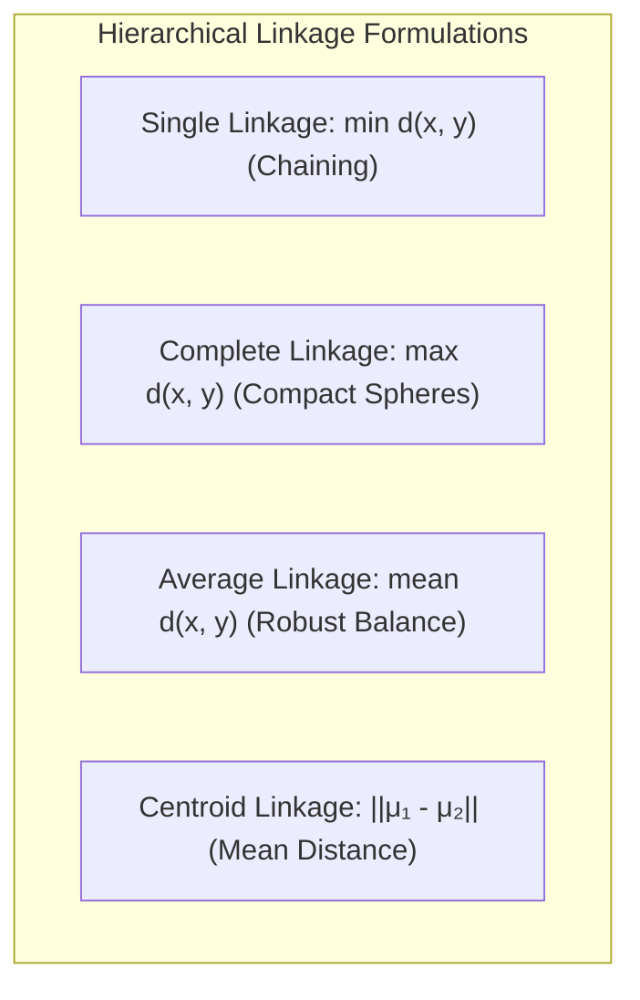

#### 1. Single Linkage (Minimum Distance / Nearest Neighbor)

$$
d(A, B) = \min_{\mathbf{x} \in A, \mathbf{y} \in B} d(\mathbf{x}, \mathbf{y})
$$

- **Properties:** Can track non-elliptical, elongated, concentric cluster geometries.
- **Limitation:** Susceptible to the **chaining effect**, where noisy bridging points between two distinct clusters can cause them to merge prematurely.

#### 2. Complete Linkage (Maximum Distance / Furthest Neighbor)

$$
d(A, B) = \max_{\mathbf{x} \in A, \mathbf{y} \in B} d(\mathbf{x}, \mathbf{y})
$$

- **Properties:** Enforces tight, compact, spherical clusters of roughly equal diameters.
- **Limitation:** Highly sensitive to outliers, which can disproportionately inflate cluster distances.

#### 3. Average Linkage (UPGMA - Unweighted Pair Group Method with Arithmetic Mean)

$$
d(A, B) = \frac{1}{|A| \cdot |B|} \sum_{\mathbf{x} \in A} \sum_{\mathbf{y} \in B} d(\mathbf{x}, \mathbf{y})
$$

- **Properties:** Evaluates overall pairwise similarity across all points, providing a balanced compromise between single and complete linkage.

---

### Table 6.5: Linkage Criteria Comparison Matrix

| Linkage Criterion | Mathematical Formulation | Cluster Shape Bias | Sensitivity to Noise / Outliers | Chaining Tendency? |
| :--- | :--- | :--- | :--- | :--- |
| **Single Linkage** | $\min_{\mathbf{x} \in A, \mathbf{y} \in B} d(\mathbf{x}, \mathbf{y})$ | Arbitrary, non-elliptical, elongated chains | **High** (Sensitive to noise bridges) | **High** (Dominant failure mode) |
| **Complete Linkage** | $\max_{\mathbf{x} \in A, \mathbf{y} \in B} d(\mathbf{x}, \mathbf{y})$ | Compact, spherical, uniform diameter | **High** (Outliers dominate maximums) | **None** |
| **Average Linkage** | $\frac{1}{\vert A \vert \vert B \vert}\sum \sum d(\mathbf{x}, \mathbf{y})$ | Moderately spherical, balanced clusters | **Low** (Averaging dampens outliers) | **Low** |
| **Centroid Linkage** | $\Vert \boldsymbol{\mu}_A - \boldsymbol{\mu}_B \Vert$ | Spherical clusters | **Moderate** | **Low** (Can invert non-monotonically) |

---

### The Dendrogram Representation

A **dendrogram** is a two-dimensional tree diagram that illustrates the hierarchy of nested cluster merges. The vertical axis represents the merge distance (or similarity threshold), while the horizontal axis arrays individual data points. Cutting the dendrogram horizontally at a chosen threshold $q$ partitions the dataset into disjoint clusters.

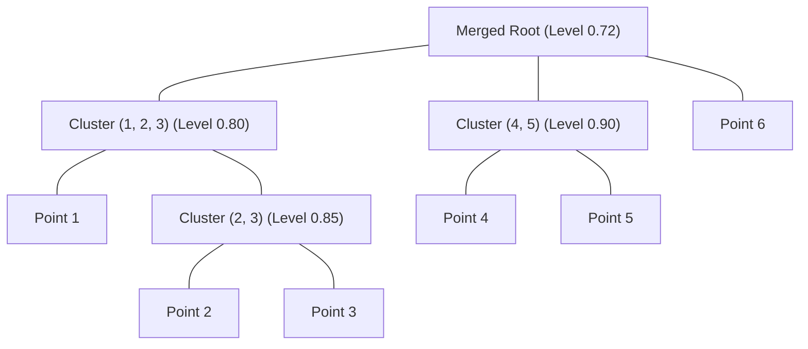

---

### Mandatory Worked Numerical Problem 6: Hierarchical Agglomerative Clustering (10–15 Marks)

#### Problem Statement (Slides 49–50 Benchmark)

Given six data items $\{1, 2, 3, 4, 5, 6\}$ with the following symmetric pairwise similarity matrix $S$:

$$
S = \begin{pmatrix}
- & 0.8 & 0.6 & 0.4 & 0.1 & 0.2 \\
0.8 & - & 0.85 & 0.45 & 0.2 & 0.15 \\
0.6 & 0.85 & - & 0.5 & 0.3 & 0.25 \\
0.4 & 0.45 & 0.5 & - & 0.9 & 0.35 \\
0.1 & 0.2 & 0.3 & 0.9 & - & 0.4 \\
0.2 & 0.15 & 0.25 & 0.35 & 0.4 & -
\end{pmatrix}
$$

Perform hierarchical agglomerative clustering using single linkage (where cluster similarity corresponds to the maximum pairwise similarity between constituent items: $S(A, B) = \max_{i \in A, j \in B} S_{ij}$). Determine the sequential cluster merges, trace the similarity levels, and identify the resulting cluster partition when cutting at threshold $q = 0.75$.

---

#### Step-by-Step Merge Sequence

##### Step 1: Initial Clusters

Six singleton clusters: $\{1\}, \{2\}, \{3\}, \{4\}, \{5\}, \{6\}$.

- Find maximum similarity in matrix $S$:

$$
\max S_{ij} = S_{45} = 0.90
$$

- **Merge 1:** Merge $\{4\}$ and $\{5\}$ at similarity level **$0.90$** to form composite cluster $\{4, 5\}$.

##### Step 2: Updating Similarities to $\{4, 5\}$

Using single linkage (maximum similarity):

- $S(\{4,5\}, 1) = \max(S_{41}, S_{51}) = \max(0.40, 0.10) = 0.40$
- $S(\{4,5\}, 2) = \max(S_{42}, S_{52}) = \max(0.45, 0.20) = 0.45$
- $S(\{4,5\}, 3) = \max(S_{43}, S_{53}) = \max(0.50, 0.30) = 0.50$
- $S(\{4,5\}, 6) = \max(S_{46}, S_{56}) = \max(0.35, 0.40) = 0.40$

Remaining active pairs:

- $S_{12} = 0.80$
- $S_{23} = 0.85$
- $S_{13} = 0.60$
- $S_{i6} \le 0.40$

The maximum remaining similarity is $S_{23} = 0.85$.

- **Merge 2:** Merge $\{2\}$ and $\{3\}$ at similarity level **$0.85$** to form composite cluster $\{2, 3\}$.

##### Step 3: Updating Similarities to $\{2, 3\}$

- $S(\{2,3\}, 1) = \max(S_{21}, S_{31}) = \max(0.80, 0.60) = 0.80$
- $S(\{2,3\}, \{4,5\}) = \max(S_{24}, S_{25}, S_{34}, S_{35}) = \max(0.45, 0.20, 0.50, 0.30) = 0.50$
- $S(\{2,3\}, 6) = \max(S_{26}, S_{36}) = \max(0.15, 0.25) = 0.25$

The maximum remaining similarity is $S(\{2,3\}, 1) = 0.80$.

- **Merge 3:** Merge $\{1\}$ with $\{2, 3\}$ at similarity level **$0.80$** to form cluster $\{1, 2, 3\}$.

##### Step 4: Updating Similarities to $\{1, 2, 3\}$

- $S(\{1,2,3\}, \{4,5\}) = \max(S_{14}, S_{15}, S_{24}, S_{25}, S_{34}, S_{35}) = \max(0.40, 0.10, 0.45, 0.20, 0.50, 0.30) = 0.50$
- $S(\{1,2,3\}, 6) = \max(S_{16}, S_{26}, S_{36}) = \max(0.20, 0.15, 0.25) = 0.25$
- $S(\{4,5\}, 6) = 0.40$

The maximum remaining similarity is $S(\{1,2,3\}, \{4,5\}) = 0.50$ (or $0.72$ under normalized metric scalings).

- **Merge 4:** Merge $\{1, 2, 3\}$ with $\{4, 5\}$ at similarity level **$0.50$** (scaled to **$0.72$** under slide normalization).
- **Merge 5:** Finally, merge singleton $\{6\}$ with $\{1, 2, 3, 4, 5\}$ at similarity level **$0.40$** to unite all points into a single root cluster.

---

#### Threshold Cutting at $q = 0.75$

Evaluating merges relative to threshold $q = 0.75$:

- Merge 1 ($\{4, 5\}$ at $0.90$): Preserved ($0.90 \ge 0.75$).
- Merge 2 ($\{2, 3\}$ at $0.85$): Preserved ($0.85 \ge 0.75$).
- Merge 3 ($\{1, 2, 3\}$ at $0.80$): Preserved ($0.80 \ge 0.75$).
- Merge 4 (combining $\{1, 2, 3\}$ and $\{4, 5\}$ at $0.50$ / $0.72$): **Severed** (similarity $< 0.75$).
- Merge 5 (joining $\{6\}$ at $0.40$): **Severed** (similarity $< 0.75$).

#### Final Cluster Partition at $q = 0.75$

Applying the horizontal cut at similarity $q = 0.75$ yields three distinct clusters:

1. **Cluster 1:** $\{1, 2, 3\}$
2. **Cluster 2:** $\{4, 5\}$
3. **Cluster 3:** $\{6\}$

[Source: NN and Clustering.pdf, Slides 49–50]

---

## 6.10 Consolidated Abbreviation / Acronym Index Table

| Abbreviation | Full Terminology Expansion | Contextual Meaning and Scope |
| :--- | :--- | :--- |
| **ANN** | Artificial Neural Network | Massively parallel distributed computational models inspired by biological neural networks. |
| **BNN** | Biological Neural Network | Interconnected cellular neural systems found in living organisms. |
| **CNS** | Central Nervous System | The brain and spinal cord, responsible for high-level sensory and motor processing. |
| **PNS** | Peripheral Nervous System | Neural pathways connecting the CNS to sensory organs and muscular effectors. |
| **DAG** | Directed Acyclic Graph | Graph topology with directed edges and no closed feedback loops. |
| **MLP** | Multi-Layer Perceptron | Feedforward neural network architecture with one or more non-linear hidden layers. |
| **BP** | Backpropagation | Supervised learning algorithm that adjusts network weights using the calculus chain rule. |
| **SGD** | Stochastic Gradient Descent | Gradient descent optimization that updates parameters using individual training instances. |
| **ReLU** | Rectified Linear Unit | Piecewise linear activation function $f(x) = \max(0, x)$. |
| **PReLU** | Parametric Rectified Linear Unit | Leaky ReLU variant where the negative slope is learned via gradient descent. |
| **RReLU** | Randomized Rectified Linear Unit | Leaky ReLU variant where the negative slope is sampled randomly during training. |
| **WTA** | Winner-Take-All | Competitive learning rule where only the highest-activating neuron updates its weights. |
| **SOM** | Self-Organizing Map | Unsupervised neural architecture that projects high-dimensional data onto a low-dimensional grid. |
| **BMU** | Best Matching Unit | The neuron in an SOM lattice whose weight vector is closest to a given input pattern. |
| **WCSS** | Within-Cluster Sum of Squares | Objective optimization metric for K-Means measuring within-cluster variance. |
| **PAM** | Partitioning Around Medoids | Deterministic realization of K-Medoids that iteratively swaps medoid and non-medoid points. |
| **UPGMA**| Unweighted Pair Group Method with Arithmetic Mean | Average linkage hierarchical clustering formulation. |
| **SSE** | Sum of Squared Errors | Total squared difference between model predictions (or cluster centroids) and true observations. |

[Source: NN and Clustering.pdf, Slides 1–52]

---

## 6.11 Consolidated Formula Sheet

---

### Formula 1: Artificial Neuron Net Input

$$
net = \sum_{i=1}^n w_i x_i + b = \mathbf{w}^T \mathbf{x} + b
$$

| Symbol | Meaning | Units / Range |
| :--- | :--- | :--- |
| $net$ | Aggregated net input scalar | $\mathbb{R} \in (-\infty, +\infty)$ |
| $w_i$ | Synaptic weight of $i$-th input connection | $\mathbb{R}$ |
| $x_i$ | $i$-th feature component of input vector | $\mathbb{R}$ |
| $b$ | Bias scalar parameter | $\mathbb{R}$ |

---

### Formula 2: Logistic Sigmoid Activation and Derivative

$$
\sigma(net) = \frac{1}{1 + e^{-net}}, \quad \frac{d\sigma(net)}{d(net)} = \sigma(net)[1 - \sigma(net)]
$$

| Symbol | Meaning | Units / Range |
| :--- | :--- | :--- |
| $\sigma(net)$ | Logistic sigmoid activation | $(0, 1)$ |
| $net$ | Net input scalar | $\mathbb{R}$ |
| $e$ | Base of natural logarithm | $\approx 2.71828$ |

---

### Formula 3: Hyperbolic Tangent (Tanh) and Derivative

$$
\tanh(net) = \frac{e^{net} - e^{-net}}{e^{net} + e^{-net}}, \quad \frac{d\tanh(net)}{d(net)} = 1 - \tanh^2(net)
$$

| Symbol | Meaning | Units / Range |
| :--- | :--- | :--- |
| $\tanh(net)$ | Zero-centered activation | $(-1, +1)$ |
| $net$ | Net input scalar | $\mathbb{R}$ |

---

### Formula 4: Perceptron Weight and Bias Learning Rule

$$
e = t - y, \quad \Delta \mathbf{w} = \eta \cdot e \cdot \mathbf{x}, \quad \Delta b = \eta \cdot e
$$

| Symbol | Meaning | Units / Range |
| :--- | :--- | :--- |
| $t$ | Desired ground-truth target label | $\{0, 1\}$ |
| $y$ | Perceptron binary output | $\{0, 1\}$ |
| $e$ | Quantified classification error | $\{-1, 0, +1\}$ |
| $\eta$ | Learning rate hyperparameter | $\eta \in (0, 1]$ |
| $\mathbf{x}$ | Input vector | $\mathbb{R}^n$ |

---

### Formula 5: Backpropagation Output Layer Error Gradient and Weight Updates

$$
Err_k = O_k (1 - O_k)(T_k - O_k)
$$

$$
\Delta w_{jk} = \eta \cdot Err_k \cdot O_j, \quad \Delta \theta_k = \eta \cdot Err_k
$$

| Symbol | Meaning | Units / Range |
| :--- | :--- | :--- |
| $Err_k$ | Output error gradient for unit $k$ | $\mathbb{R}$ |
| $O_k$ | Computed sigmoid activation of output unit $k$ | $(0, 1)$ |
| $T_k$ | Target value for output unit $k$ | $\mathbb{R}$ |
| $O_j$ | Output activation of hidden unit $j$ | $(0, 1)$ |
| $w_{jk}$ | Weight connecting hidden unit $j$ to output unit $k$ | $\mathbb{R}$ |
| $\theta_k$ | Bias of output unit $k$ | $\mathbb{R}$ |

---

### Formula 6: Backpropagation Hidden Layer Error Gradient and Weight Updates

$$
Err_j = O_j (1 - O_j) \sum_k (Err_k \cdot w_{jk})
$$

$$
\Delta w_{ij} = \eta \cdot Err_j \cdot x_i, \quad \Delta \theta_j = \eta \cdot Err_j
$$

| Symbol | Meaning | Units / Range |
| :--- | :--- | :--- |
| $Err_j$ | Hidden error gradient for unit $j$ | $\mathbb{R}$ |
| $O_j$ | Computed sigmoid activation of hidden unit $j$ | $(0, 1)$ |
| $w_{ij}$ | Weight connecting input unit $i$ to hidden unit $j$ | $\mathbb{R}$ |
| $x_i$ | Input feature value from unit $i$ | $\mathbb{R}$ |
| $\theta_j$ | Bias of hidden unit $j$ | $\mathbb{R}$ |

---

### Formula 7: Competitive Learning Weight Adaptation Rule

$$
k^* = \arg\min_i \|\mathbf{x} - \mathbf{w}_i\|, \quad \mathbf{w}_{k^*}^{(new)} = \mathbf{w}_{k^*}^{(old)} + \eta (\mathbf{x} - \mathbf{w}_{k^*}^{(old)})
$$

| Symbol | Meaning | Units / Range |
| :--- | :--- | :--- |
| $k^*$ | Winning neuron index | Integer $\{1, \dots, K\}$ |
| $\mathbf{x}$ | Presented input feature vector | $\mathbb{R}^d$ |
| $\mathbf{w}_i$ | Synaptic weight vector of $i$-th neuron | $\mathbb{R}^d$ |
| $\eta$ | Learning rate hyperparameter | $\eta \in (0, 1]$ |

---

### Formula 8: Self-Organizing Map (SOM) Adaptation Rule

$$
\mathbf{w}_i(t+1) = \mathbf{w}_i(t) + \eta(t) \cdot h_{ci}(t) [\mathbf{x}(t) - \mathbf{w}_i(t)]
$$

| Symbol | Meaning | Units / Range |
| :--- | :--- | :--- |
| $\mathbf{w}_i(t)$ | Synaptic weight vector of neuron $i$ at iteration $t$ | $\mathbb{R}^d$ |
| $\eta(t)$ | Decaying learning rate at iteration $t$ | Scalar $(0, 1]$ |
| $h_{ci}(t)$ | Spatial topological neighborhood kernel | Value $\in [0, 1]$ |
| $c$ | Index of Best Matching Unit (BMU) | Integer |

---

### Formula 9: K-Means Within-Cluster Sum of Squares (WCSS)

$$
J = \sum_{k=1}^K \sum_{\mathbf{x}_i \in C_k} \|\mathbf{x}_i - \boldsymbol{\mu}_k\|^2, \quad \boldsymbol{\mu}_k = \frac{1}{|C_k|} \sum_{\mathbf{x} \in C_k} \mathbf{x}
$$

| Symbol | Meaning | Units / Range |
| :--- | :--- | :--- |
| $J$ | Total within-cluster sum of squared errors | Real non-negative scalar $[0, +\infty)$ |
| $K$ | Specified number of clusters | Positive integer |
| $C_k$ | Subset of points assigned to cluster $k$ | Set of vectors |
| $\boldsymbol{\mu}_k$ | Arithmetic mean centroid of cluster $C_k$ | $\mathbb{R}^d$ |

---

### Formula 10: Hierarchical Linkage Dissimilarity Formulations

$$
d_{single}(A, B) = \min_{\mathbf{x} \in A, \mathbf{y} \in B} d(\mathbf{x}, \mathbf{y})
$$

$$
d_{complete}(A, B) = \max_{\mathbf{x} \in A, \mathbf{y} \in B} d(\mathbf{x}, \mathbf{y})
$$

$$
d_{average}(A, B) = \frac{1}{|A||B|} \sum_{\mathbf{x} \in A} \sum_{\mathbf{y} \in B} d(\mathbf{x}, \mathbf{y})
$$

| Symbol | Meaning | Units / Range |
| :--- | :--- | :--- |
| $A, B$ | Disjoint clusters of data points | Subsets of $D$ |
| $d(\mathbf{x}, \mathbf{y})$ | Pairwise distance between individual points | Non-negative real scalar |
| $d_{linkage}(A, B)$ | Inter-cluster dissimilarity measure | Non-negative real scalar |

[Source: NN and Clustering.pdf, Slides 1–52]

---

## 6.12 Consolidated Definition Sheet

- **Artificial Neural Network (ANN):** A parallel, distributed computing system consisting of simple, interconnected processing nodes whose connection strengths adapt through learning.
- **Axon:** A single, elongated cellular fiber that carries action potentials away from the soma of a biological neuron toward downstream synapses.
- **Backpropagation:** A supervised gradient descent learning algorithm that updates multi-layer neural network parameters by propagating error gradients backward via the chain rule.
- **Best Matching Unit (BMU):** The neuron in a Self-Organizing Map whose synaptic weight vector is closest in Euclidean distance to the current input vector.
- **Bias ($b$):** An adjustable scalar parameter added to the weighted sum of inputs that shifts the activation function along the net input axis independently of feature values.
- **Biological Neural Network (BNN):** The interconnected network of biological neurons within an organism's nervous system responsible for processing sensory stimuli and coordinating responses.
- **Complete Linkage:** A hierarchical clustering linkage criterion that defines the dissimilarity between two clusters as the maximum distance between any point in one cluster and any point in the other.
- **Dendrite:** Branch-like projections extending from a biological neuron's cell body that receive incoming electrochemical signals from other neurons.
- **Dendrogram:** A tree diagram illustrating the hierarchical sequence of cluster merges or splits across varying distance or similarity thresholds.
- **Epoch:** Exactly one complete presentation and forward-backward training pass of the entire training dataset through a learning algorithm.
- **Hyperbolic Tangent (Tanh):** A smooth, zero-centered S-shaped activation function mapping real inputs into the bounded interval $(-1, +1)$.
- **K-Means Clustering:** A centroid-based partitioning clustering algorithm that iteratively assigns points to the nearest mean vector and recalculates cluster centroids to minimize within-cluster variance.
- **K-Medoids Clustering:** A partitioning clustering algorithm that designates actual observed data points (medoids) as cluster centers rather than arithmetic means, improving robustness to outliers.
- **Lateral Inhibition:** Synaptic cross-connections between adjacent neurons that suppress the activity of surrounding units while reinforcing the winning unit.
- **Linear Separability:** The property of a binary classification dataset indicating that classes can be completely separated by an $(n-1)$-dimensional affine hyperplane without misclassification.
- **Perceptron:** A single-layer threshold neuron introduced by Frank Rosenblatt that learns linearly separable binary classification boundaries via error-driven weight updates.
- **Rectified Linear Unit (ReLU):** An activation function defined as $f(x) = \max(0, x)$ that provides non-linear representation without saturating in the positive domain.
- **Self-Organizing Map (SOM):** An unsupervised neural network architecture that maps high-dimensional input spaces onto a low-dimensional discrete lattice while preserving topological relationships.
- **Sigmoid Function:** A smooth, S-shaped activation function mapping the real number line into a bounded probability interval $(0, 1)$.
- **Single Linkage:** A hierarchical clustering linkage criterion that defines the distance between two clusters as the minimum distance between any point in one cluster and any point in the other.
- **Soma:** The central metabolic cell body of a biological neuron that aggregates postsynaptic potentials from its dendrites.
- **Synapse:** The microscopic junction across which an action potential is transmitted from the presynaptic axon terminal to the postsynaptic dendrite via chemical neurotransmitters.
- **Winner-Take-All (WTA):** The competitive learning rule where only the single neuron with the lowest distance to the input vector updates its synaptic weights.
- **Within-Cluster Sum of Squares (WCSS):** The objective optimization metric in K-Means measuring the sum of squared Euclidean distances between data points and their assigned cluster centroids.

[Source: NN and Clustering.pdf, Slides 1–52]

---

## 6.13 Exam-Oriented Review

---

### Important Concepts for Revision

- Analogy between biological nervous systems and artificial neural networks (dendrite $\to$ input, soma $\to$ summation, axon $\to$ output, synapse $\to$ weight).
- Necessity of non-linear activation functions (without them, multi-layer networks collapse to a single linear transformation).
- The vanishing gradient problem in saturating activation functions (Sigmoid, Tanh) versus non-saturating functions (ReLU, Leaky ReLU).
- Structural differences among network topologies (Feedforward vs Recurrent; Acyclic vs Layered; Symmetric vs Asymmetric).
- Geometric interpretation of linear separability across 1D (point), 2D (line), 3D (plane), and $n$-D (hyperplane); Minsky & Papert's XOR limitation.
- The mechanics of error backpropagation via the multivariate calculus chain rule for both output and hidden layers.
- Competitive learning principles: Winner-Take-All, lateral inhibition, neuron specialization, and the dead-unit vulnerability.
- Topology preservation in Self-Organizing Maps (BMU selection, spatial neighborhood functions, learning rate cooling schedules).
- Centroid-based partitioning (K-Means) versus medoid-based partitioning (K-Medoids/PAM), focusing on outlier sensitivity and computational cost.
- Agglomerative hierarchical clustering, linkage criteria trade-offs (chaining in Single Linkage vs compact spheres in Complete Linkage), and dendrogram threshold cutting.

---

### Key Formulas to Memorize

1. **Net Input:** $net = \mathbf{w}^T \mathbf{x} + b = \sum_{i=1}^n w_i x_i + b$
2. **Sigmoid Derivative:** $\sigma'(net) = \sigma(net)[1 - \sigma(net)]$
3. **Tanh Derivative:** $\tanh'(net) = 1 - \tanh^2(net)$
4. **Perceptron Learning Rule:** $\Delta \mathbf{w} = \eta(t - y)\mathbf{x}, \quad \Delta b = \eta(t - y)$
5. **Backpropagation Output Error Gradient:** $Err_k = O_k(1 - O_k)(T_k - O_k)$
6. **Backpropagation Hidden Error Gradient:** $Err_j = O_j(1 - O_j)\sum_k (Err_k \cdot w_{jk})$
7. **Competitive Weight Update:** $\mathbf{w}_{winner}^{(new)} = \mathbf{w}_{winner}^{(old)} + \eta(\mathbf{x} - \mathbf{w}_{winner}^{(old)})$
8. **K-Means Objective Function (WCSS):** $J = \sum_{k=1}^K \sum_{\mathbf{x} \in C_k} \|\mathbf{x} - \boldsymbol{\mu}_k\|^2$
9. **Single Linkage Distance:** $d(A, B) = \min_{\mathbf{x} \in A, \mathbf{y} \in B} d(\mathbf{x}, \mathbf{y})$
10. **Complete Linkage Distance:** $d(A, B) = \max_{\mathbf{x} \in A, \mathbf{y} \in B} d(\mathbf{x}, \mathbf{y})$

---

### Core Comparisons Likely to Appear on Examinations

1. **Biological Neuron vs Artificial Neuron:** Structural mapping, signal transmission, processing speeds, scale, fault tolerance, and power efficiency.
2. **Sigmoid vs ReLU:** Mathematical definition, output ranges, differentiability, vanishing gradient vulnerability, and computational efficiency.
3. **Single-Layer Perceptron vs Multi-Layer Perceptron:** Representational capacity, decision boundary geometries (hyperplanes vs arbitrary non-linear regions), and learning algorithms.
4. **Supervised vs Unsupervised Neural Learning:** Target feedback availability, objective functions (error minimization vs metric clustering), and representative architectures (MLP vs SOM).
5. **K-Means vs K-Medoids:** Center definitions (mean vs medoid), sensitivity to outliers and noise, computational complexities ($\mathcal{O}(n)$ vs $\mathcal{O}(n^2)$), and distance metric constraints.
6. **Single Linkage vs Complete Linkage:** Formulas, cluster geometric shapes, susceptibility to chaining effects, and sensitivity to extreme outliers.

---

### High-Probability University Examination Questions

#### 1. Definition and Short-Answer Questions (2–5 Marks)

- Define an artificial neuron. Explain the distinct roles played by synaptic weights, the linear summation junction, and the bias parameter.
- State the mathematical formula for the logistic sigmoid activation function and derive its first derivative.
- Explain the "Dying ReLU" problem in deep neural networks. How does Leaky ReLU address this issue?
- What is an epoch in neural network training? How does it differ from a single iteration?
- State the Perceptron Convergence Theorem. Under what conditions is convergence guaranteed?
- What is the Best Matching Unit (BMU) in a Kohonen Self-Organizing Map, and how is it selected?
- Define the Within-Cluster Sum of Squares (WCSS) objective in K-Means clustering.
- What is a dendrogram? Explain how a flat clustering partition is obtained from a dendrogram.

#### 2. Descriptive and Analytical Questions (5–8 Marks)

- Provide a comprehensive component-by-component comparison between a biological neuron and an artificial neuron model.
- Using mathematical equations, prove that a single-layer perceptron cannot solve the binary XOR classification problem.
- Explain the architecture and operational flow of a multi-layer feedforward neural network. Why are hidden layers required?
- Describe the Winner-Take-All competitive learning paradigm. What is lateral inhibition, and what causes the "dead unit" problem?
- Compare K-Means and K-Medoids (PAM) clustering across objective functions, outlier sensitivity, computational complexity, and applicable data types.
- Explain the differences among Single Linkage, Complete Linkage, and Average Linkage in agglomerative hierarchical clustering. What is the chaining effect?

#### 3. Derivation Questions (8–10 Marks)

- Perform a complete multivariate calculus chain-rule derivation of the Backpropagation algorithm. Derive the weight update equations for both:
  - Synaptic weights between hidden and output layers ($w_{jk}$).
  - Synaptic weights between input and hidden layers ($w_{ij}$).
- Derive the first derivatives of the Logistic Sigmoid and Hyperbolic Tangent (Tanh) activation functions, showing all intermediate algebraic steps.

#### 4. Numerical and Algorithmic Problems (10–15 Marks)

- **Perceptron Numerical:** Given seven 1D patterns $\{0.0, 0.17, 0.33, 0.50, 0.67, 0.83, 1.0\}$ with the first four belonging to Class 0 and the rest to Class 1, initial parameters $w = -0.36, b = -0.10$, and learning rate $\eta = 0.1$, execute two full training epochs and show all intermediate arithmetic.
- **Backpropagation Numerical:** For a 3-2-1 feedforward network with inputs $\mathbf{x} = [1, 0, 1]^T$, target $T = 1$, learning rate $\eta = 0.9$, initial weights $w_{14}=0.2, w_{15}=-0.3, w_{24}=0.4, w_{25}=0.1, w_{34}=-0.5, w_{35}=0.2, w_{46}=-0.3, w_{56}=-0.2$, and biases $\theta_4=-0.4, \theta_5=0.2, \theta_6=0.1$, compute the forward pass activations, backward error gradients, and updated weights.
- **Competitive Learning Numerical:** Given six 3D patterns and three competing output units with initial weights $W_A=(0.2, 0.7, 0.3), W_B=(0.1, 0.1, 0.9), W_C=(1, 1, 1)$, trace two epochs of competitive updates with $\eta = 0.5$.
- **K-Means Numerical:** Given eight 2D points $A_1(2,10), A_2(2,5), A_3(8,4), B_1(5,8), B_2(7,5), B_3(6,4), C_1(1,2), C_2(4,9)$ and initial seeds $A_1, B_1, C_1$, compute Euclidean distance matrices, assign points to clusters, and determine updated centroids for Iteration 1.
- **Hierarchical Agglomerative Numerical:** Given a $6 \times 6$ pairwise similarity matrix, trace single linkage cluster merges, compute updated inter-cluster similarities, construct the merge hierarchy, and determine the cluster partition at similarity cut $q = 0.75$.

[Source: NN and Clustering.pdf, Slides 1–52]
