# Complete Machine Learning Notes: Semi-Supervised Learning, Reinforcement Learning, and Introduction to Deep Learning

> **Course Code:** 3CS526CC23  
> **Course Title:** Machine Learning and its Applications  
> **Primary Source:** Faculty Lecture Slides - Nirma University  
> **Files Integrated:** SSL, RL and Intro to Deep Learning.pdf (32 Slides)  

---

# Chapter 7 — Semi-Supervised Learning, Reinforcement Learning, and Introduction to Deep Learning

## Narrative Spine & Chapter Overview

Modern machine learning systems must frequently operate under real-world constraints where fully labeled training datasets are prohibitively expensive, time-consuming, or humanly impossible to acquire. While classical supervised learning requires exhaustive ground-truth annotations and unsupervised learning discovers intrinsic data geometry without extrinsic targets, Semi-Supervised Learning (SSL) bridges this fundamental gap by leveraging small quantities of labeled data in conjunction with vast reservoirs of unlabeled observations. Concurrently, dynamic decision-making environments necessitate an entirely distinct paradigm—Reinforcement Learning (RL)—in which an autonomous agent learns optimal behavioral policies through sequential trial-and-error interactions and numerical scalar reward feedback. Finally, as data complexity expands into high-dimensional sensory domains such as computer vision, speech, and natural language processing, classical feature engineering becomes an intractable bottleneck, driving the transition to Deep Learning (DL) architectures capable of hierarchical end-to-end representation learning. This chapter provides a rigorous, textbook-style mathematical and algorithmic exposition of these three foundational pillars, spanning multi-view co-training, self-training, positive-unlabeled learning, Markov decision processes, Bellman optimality, tabular Q-learning navigation, and the taxonomy of deep network architectures.

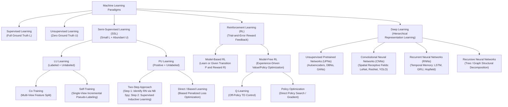

### Component Breakdown & Flow Analysis
1. **Taxonomic Hierarchy**: Machine learning branches fundamentally into data-driven static learning (Supervised, Unsupervised, Semi-Supervised) and sequential interactive learning (Reinforcement Learning). Deep Learning serves as a representation-learning engine underpinning modern implementations across all paradigms.
2. **Semi-Supervised Sub-branches**: SSL bifurcates based on label availability: Labeled-and-Unlabeled (LU) learning exploits small positive/negative sets with large unlabeled pools; Positive-and-Unlabeled (PU) learning handles scenarios where negative ground truth is entirely unobserved.
3. **Reinforcement Learning Spectrum**: RL branches into Model-Based methods (where the transition dynamics $P(s' \mid s, a)$ are known or explicitly estimated) and Model-Free methods (such as Q-Learning and Policy Gradients) that directly estimate action values from trajectory interactions.
4. **Deep Representation Learning**: Deep networks circumvent manual feature engineering by passing raw inputs through hierarchical differentiable layers categorized into generative/pre-trained (UPNs), spatial (CNNs), recurrent sequential (RNNs), and structural tree models (Recursive NNs).

---

## Core Terminology Dictionary

1. **LU Learning (Labeled and Unlabeled Data Learning)**: The standard semi-supervised learning setting in which the training dataset comprises a small set of fully labeled examples $L = \{(x_i, y_i)\}$ and a substantially larger set of unlabeled examples $U = \{x_j\}$.
2. **PU Learning (Positive and Unlabeled Data Learning)**: A specialized semi-supervised binary classification setting where the learner is provided only with confirmed positive instances $P$ and an uncurated unlabeled background set $U$ containing a mixture of hidden positives and negatives.
3. **Co-Training**: A multi-view semi-supervised learning paradigm that partitions the input attribute space into two conditionally independent, redundant feature views, iteratively training two distinct classifiers that pseudo-label confident unlabeled instances for each other.
4. **Multi-View Learning**: A machine learning framework operating on data described by multiple distinct feature subsets (views), where each view provides complementary or mutually redundant information sufficient to predict the target concept.
5. **Conditional Independence**: The mathematical property wherein two feature views $X_1$ and $X_2$ are statistically independent given the true class label $c$, expressed formally as $P(x_1, x_2 \mid c) = P(x_1 \mid c) P(x_2 \mid c)$.
6. **Compatibility Assumption**: The co-training assumption that the underlying target concept can be correctly modeled by classifiers operating over either view independently, such that $f_1(x_1) = f_2(x_2) = f(x) = c$ for almost all instances.
7. **Self-Training**: An incremental, single-view semi-supervised learning algorithm where a single base classifier is trained on $L$, makes predictions on $U$, adds its most confident predictions (pseudo-labels) into $L$, and retrains iteratively.
8. **Pseudo-Labeling**: The procedural assignment of artificial, predicted class labels to unlabeled data points whose prediction probability exceeds a defined confidence threshold.
9. **Confirmation Bias**: The systematic error propagation in self-training or co-training where initial misclassifications assigned high model confidence are added into the training pool, reinforcing and magnifying future prediction errors.
10. **Reliable Negative Set ($RN$)**: In PU learning, a curated subset of the unlabeled pool $U$ identified via statistical heuristics (such as the Spy technique or Rocchio extraction) as having a near-zero probability of belonging to the positive class.
11. **Spy Technique**: A two-step PU learning heuristic in which a small percentage of known positive instances (spies) are secretly inserted into the unlabeled pool $U$ to calibrate a dynamic negative-classification threshold based on the lowest probability assigned to any spy.
12. **Reinforcement Learning (RL)**: A goal-directed learning paradigm in which an autonomous computational agent learns a mapping from states to actions by interacting with an environment to maximize cumulative scalar reward signals.
13. **Agent**: The autonomous decision-making entity in reinforcement learning that observes the environment's state, selects actions according to a policy, and updates its behavior based on observed rewards and next states.
14. **Environment**: The external physical or simulated system with which an RL agent interacts, governed by underlying state transition probabilities and reward distributions.
15. **State ($s \in S$)**: A complete or partial specification of the environment at a specific time step $t$, containing all necessary information for the agent to make a decision.
16. **Action ($a \in A$)**: A decision or operational move executed by the agent at time $t$ that alters the state of the environment and yields a scalar reward.
17. **Reward ($r \in \mathbb{R}$)**: A scalar feedback signal emitted by the environment following an action, defining the immediate desirability of the state transition.
18. **Policy ($\pi$)**: A behavioral strategy or probabilistic mapping $\pi(a \mid s)$ defining the probability of an agent selecting action $a$ given current state $s$.
19. **State-Value Function ($V(s)$)**: The expected discounted cumulative future reward an agent will receive starting from state $s$ and following policy $\pi$ thereafter.
20. **Action-Value Function / Q-Function ($Q(s, a)$)**: The expected discounted cumulative future reward an agent will receive starting from state $s$, taking arbitrary action $a$, and subsequently following policy $\pi$.
21. **Discount Factor ($\gamma \in [0, 1)$)**: A mathematical parameter weighting immediate rewards against future delayed rewards, ensuring mathematical convergence of infinite-horizon cumulative sums.
22. **Bellman Equation**: A recursive mathematical relationship decomposing the value of a state or state-action pair into the immediate expected reward plus the discounted expected value of successor states.
23. **Exploration vs. Exploitation Dilemma**: The fundamental RL trade-off between choosing known high-reward actions (exploitation) and sampling poorly estimated actions to discover potentially superior strategies (exploration).
24. **Temporal Difference (TD) Learning**: A class of model-free reinforcement learning methods that update value estimates based on other learned estimates without waiting for the final episodic outcome (bootstrapping).
25. **Deep Learning (DL)**: A specialized subset of machine learning based on artificial neural networks with multiple processing layers, capable of extracting hierarchical, distributed representations directly from raw, unengineered data.
26. **Representation Learning**: A set of techniques allowing a machine learning system to automatically discover the representations and feature detectors needed for feature detection or classification from raw data.
27. **Autoencoder**: An unsupervised neural network architecture trained to reconstruct its input through an informational bottleneck, consisting of an encoder function $z = f(x)$ and a decoder function $\hat{x} = g(z)$.
28. **Deep Belief Network (DBN)**: A generative graphical model composed of stacked layers of stochastic latent variables (Restricted Boltzmann Machines) trained greedily in an unsupervised layer-by-layer fashion.
29. **Generative Adversarial Network (GAN)**: A minimax game-theoretic deep learning framework comprising a Generator network $G$ attempting to synthesize realistic data and a Discriminator network $D$ attempting to distinguish real samples from synthetic counterfeits.
30. **Convolutional Neural Network (CNN)**: A deep neural network architecture designed for grid-structured topological data (such as images), employing parameter-shared convolutional kernels, local receptive fields, and pooling operations.
31. **Receptive Field**: The localized spatial region of an input tensor that directly contributes to the activation of a specific neuron in a subsequent convolutional layer.
32. **Residual Connection / Skip Connection**: An identity mapping bypassing one or more convolutional layers in a deep neural network, enabling the direct propagation of gradients to combat vanishing gradient degradation.
33. **Long Short-Term Memory (LSTM)**: A specialized gated recurrent neural network architecture designed to preserve gradient flow across long sequential time lags using memory cells governed by input, forget, and output gates.
34. **Gated Recurrent Unit (GRU)**: A streamlined recurrent neural network variant combining cell state and hidden state, utilizing update and reset gates to control temporal information flow.
35. **Recursive Neural Network**: A hierarchical deep learning architecture that recursively applies the same set of weights over structured tree or graph topologies, frequently utilized in natural language syntactic parsing and scene decomposition.

---

## 1. Semi-Supervised Learning (SSL) Foundations

Semi-supervised learning addresses the critical operational reality where labeled data $L$ is scarce and expensive, but unlabeled data $U$ is vast and cost-effective to acquire. In classical biomedical image classification, text categorization, and molecular bio-activity screening, obtaining ground-truth labels requires senior medical specialists, legal analysts, or expensive biochemical assays. Conversely, raw images, documents, and chemical structures exist in near-infinite supply.

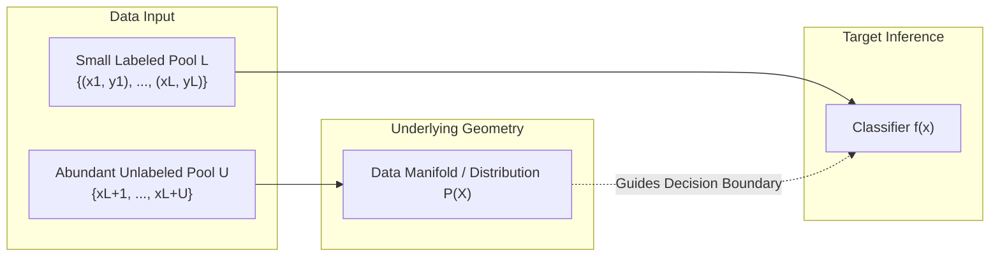

### Definition: Semi-Supervised Learning (SSL)
**Meaning:** A branch of machine learning that combines a small amount of labeled data with a large amount of unlabeled data during training to construct superior predictive models compared to using labeled data alone.  
**Formal definition:** Given an input space $\mathcal{X}$, an output label space $\mathcal{Y}$, a small labeled dataset $\mathcal{D}_L = \{(x_i, y_i)\}_{i=1}^{|L|}$ drawn i.i.d. from distribution $P(X, Y)$, and an unlabeled dataset $\mathcal{D}_U = \{x_j\}_{j=|L|+1}^{|L|+|U|}$ drawn i.i.d. from the marginal distribution $P(X)$ with $|U| \gg |L|$, the objective is to learn a hypothesis $f: \mathcal{X} \to \mathcal{Y}$ achieving lower generalization error than any hypothesis trained exclusively on $\mathcal{D}_L$.  
**Intuition:** The unlabeled data reveals the structural geometric manifold and clustering density of the input space $P(X)$. Assuming that the conditional label distribution $P(Y \mid X)$ varies smoothly over high-density regions of $P(X)$, the unlabeled points act as geometric scaffolding that pushes decision boundaries into low-density separation zones.  
**Example:** In web document classification, we may possess 50 manually classified web pages (e.g., Computer Science vs. Non-Computer Science) and 50,000 unclassified web pages. By evaluating word co-occurrence statistics across the 50,000 pages, the classifier learns vocabulary correlations that dramatically improve classification on the 50 labeled examples.

### Core Assumptions of Semi-Supervised Learning
For unlabeled data to provide informative value regarding $P(Y \mid X)$, the marginal distribution $P(X)$ must contain information about the conditional distribution $P(Y \mid X)$. This relies on three mathematical assumptions:
1. **The Smoothness Assumption**: If two points $x_1, x_2 \in \mathcal{X}$ are close in the input space in a high-density region, their corresponding labels $y_1, y_2$ should be identical. Conversely, if two points are separated by a low-density region, their labels can differ.
2. **The Cluster Assumption**: The input data points form discrete clusters, and points residing within the same cluster share the same class label. Consequently, decision boundaries must pass through low-density regions rather than cutting through dense clusters.
3. **The Manifold Assumption**: High-dimensional input data $x \in \mathbb{R}^D$ approximately lies on a lower-dimensional manifold $\mathcal{M} \subset \mathbb{R}^d$ where $d \ll D$. Unlabeled data allows the algorithm to estimate the intrinsic geodesic distances along the manifold.

### Mathematical Formulation: Graph-Based SSL and Label Propagation
A canonical mathematical framework for SSL is graph-based label propagation, which formalizes the smoothness assumption over a weighted neighborhood graph $G = (V, E)$. Let nodes $V = L \cup U$ represent all data points. Edge weights $W_{ij}$ represent pairwise affinity, typically defined via the Gaussian Radial Basis Function (RBF) kernel:

$$
W_{ij} = \exp\left( -\frac{\|x_i - x_j\|^2}{2\sigma^2} \right) \quad \text{for } i \neq j, \quad W_{ii} = 0
$$

The diagonal degree matrix $D$ is defined as $D_{ii} = \sum_{j} W_{ij}$. The transition probability matrix $P$ governing random walks on the graph is given by:

$$
P = D^{-1} W
$$

Let the label matrix $Y \in \mathbb{R}^{(|L| + |U|) \times C}$ have rows representing one-hot class indicators for labeled instances and zero vectors for unlabeled instances. Decomposing matrices into labeled ($L$) and unlabeled ($U$) sub-blocks:

$$
P = \begin{bmatrix} P_{LL} & P_{LU} \\ P_{UL} & P_{UU} \end{bmatrix}, \quad Y = \begin{bmatrix} Y_L \\ Y_U \end{bmatrix}
$$

The iterative label propagation algorithm repeats the propagation step followed by clamping labeled nodes to their ground truth:

$$
Y^{(t+1)} = P Y^{(t)}
$$

$$
Y_L^{(t+1)} = Y_L^{(0)}
$$

#### Derivation of Closed-Form Harmonic Solution
At convergence ($t \to \infty$), the unlabeled soft labels satisfy the fixed-point harmonic equation:

$$
Y_U^* = P_{UL} Y_L^{(0)} + P_{UU} Y_U^*
$$

Subtracting $P_{UU} Y_U^*$ from both sides:

$$
(I - P_{UU}) Y_U^* = P_{UL} Y_L^{(0)}
$$

Since $P$ is a stochastic matrix and the graph is connected, the spectral radius of $P_{UU}$ is strictly less than 1 ($\rho(P_{UU}) < 1$). Therefore, the matrix $(I - P_{UU})$ is strictly invertible, yielding the exact closed-form solution:

$$
Y_U^* = (I - P_{UU})^{-1} P_{UL} Y_L^{(0)}
$$

| Symbol | Meaning | Units / Range |
| :--- | :--- | :--- |
| $W_{ij}$ | Affinity edge weight between nodes $i$ and $j$ | $[0, 1]$ |
| $\sigma$ | Gaussian kernel bandwidth parameter | Real positive scalar ($\mathbb{R}^+$) |
| $D$ | Diagonal graph degree matrix | $\mathbb{R}^{(|L|+|U|) \times (|L|+|U|)}$ |
| $P$ | Row-normalized random walk transition matrix | Stochastic matrix, $\sum_j P_{ij} = 1$ |
| $P_{UU}$ | Sub-block transition probabilities among unlabeled nodes | Real values in $[0, 1)$ |
| $P_{UL}$ | Sub-block transition probabilities from unlabeled to labeled | Real values in $[0, 1]$ |
| $Y_L^{(0)}$ | Ground-truth one-hot label matrix for labeled data | $\{0, 1\}^{|L| \times C}$ |
| $Y_U^*$ | Converged soft class probability predictions for unlabeled pool | $[0, 1]^{|U| \times C}$ |
| $I$ | Identity matrix | Dimension $|U| \times |U|$ |

- **What It Represents:** The exact asymptotic distribution of continuous harmonic label potentials across all unlabeled nodes without requiring iterative simulations.
- **Conditions / Assumptions:** Graph must be fully connected with symmetric weights; labeled node potentials remain clamped; $(I - P_{UU})$ is non-singular.

[Source: SSL, RL and Intro to Deep Learning.pdf, Slide 2]

---

## 2. Learning from Labeled and Unlabeled Data (LU Learning)

LU Learning encompasses algorithms designed for scenarios where the labeled dataset contains both positive and negative class instances, alongside a larger pool of unannotated instances. The two preeminent paradigms presented in the slides are **Co-Training** and **Self-Training**.

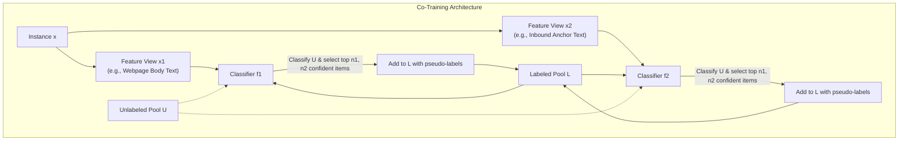

### 2.1 Co-Training (Multi-View Learning)

### Definition: Co-Training
**Meaning:** A semi-supervised multi-view learning algorithm that splits the feature representation of each instance into two conditionally independent, redundant views, trains a separate classifier on each view using labeled data, and uses each classifier's most confident predictions on unlabeled data to augment the training set of the other.  
**Formal definition:** Given instances $x \in \mathcal{X}$ partitioned into two disjoint feature representations $x = (x_1, x_2) \in \mathcal{X}_1 \times \mathcal{X}_2$, co-training learns two distinct hypotheses $f_1: \mathcal{X}_1 \to \mathcal{Y}$ and $f_2: \mathcal{X}_2 \to \mathcal{Y}$. In each iteration, $f_1$ selects a set of unlabeled instances $E_1 \subset U$ with highest confidence predictions and appends $(x, f_1(x_1))$ to $L$; simultaneously, $f_2$ selects confident instances $E_2 \subset U$ and appends $(x, f_2(x_2))$ to $L$.  
**Intuition:** Two different "experts" inspect the same phenomenon through distinct sensory channels. If Expert 1 is confident about an instance that Expert 2 finds ambiguous, Expert 1 provides a high-confidence pseudo-label, effectively teaching Expert 2, and vice-versa.  
**Example:** Classifying web pages into academic vs. non-academic. View 1 ($x_1$) consists of words appearing inside the web page text. View 2 ($x_2$) consists of words appearing in the anchor text of inbound hyperlinks pointing to that page from external sites. Either view is independently sufficient to determine the page's category.

#### Algorithmic Specification: Co-Training Algorithm
The formal procedure defined in the slides operates iteratively as follows:

```text
Algorithm co-training(L, U)
1: repeat
2:     Learn a classifier f1 using L based on only x1 portion of the examples x.
3:     Learn a classifier f2 using L based on only x2 portion of the examples x.
4:     Apply f1 to classify the examples in U; for each class c_i, pick n_i examples 
       that f1 most confidently classifies as class c_i, and add them to L.
5:     Apply f2 to classify the examples in U; for each class c_i, pick n_i examples 
       that f2 most confidently classifies as class c_i, and add them to L.
6: until U becomes empty or a fixed number of iterations are reached.
```

*Note on Class Imbalance:* In practice, the sampling parameters $n_i$ must reflect the underlying empirical class distribution of the domain. For example, if the data distribution exhibits a $1:2$ ratio between Class 1 and Class 2, the selection hyper-parameters should be set to $n_1 = 1$ and $n_2 = 2$ to prevent the expanding labeled set from drifting toward majority-class degeneracy.

[Source: SSL, RL and Intro to Deep Learning.pdf, Slides 4-5]

#### Multi-View Hypothesis Combination
When the co-training iterations terminate, the algorithm outputs two distinct models, $f_1$ and $f_2$. To classify an unseen test query $x = (x_1, x_2)$, the outputs of both classifiers are combined. For probabilistic models such as Naive Bayes, the joint posterior class probability is obtained by multiplying the independent probability scores:

$$
\Pr(c_j \mid x) = \Pr(c_j \mid x_1) \Pr(c_j \mid x_2)
$$

Normalizing across all classes $C$:

$$
\Pr(c_j \mid x) = \frac{\Pr(c_j \mid x_1) \Pr(c_j \mid x_2)}{\sum_{k=1}^{C} \Pr(c_k \mid x_1) \Pr(c_k \mid x_2)}
$$

| Symbol | Meaning | Units / Range |
| :--- | :--- | :--- |
| $x$ | Complete feature vector of instance | Space $\mathcal{X}_1 \times \mathcal{X}_2$ |
| $x_1, x_2$ | Feature sub-vectors for View 1 and View 2 | $\mathcal{X}_1 \subset \mathbb{R}^{d_1}, \mathcal{X}_2 \subset \mathbb{R}^{d_2}$ |
| $c_j$ | Target class label index | Discrete set $\{c_1, c_2, \dots, c_C\}$ |
| $\Pr(c_j \mid x_1)$ | Posterior class probability evaluated by classifier $f_1$ | $[0, 1]$ |
| $\Pr(c_j \mid x_2)$ | Posterior class probability evaluated by classifier $f_2$ | $[0, 1]$ |
| $\Pr(c_j \mid x)$ | Combined multi-view posterior class probability | $[0, 1]$ |

- **What It Represents:** The joint ensemble decision rule combining the independent predictions of the two view-specific classifiers under conditional independence.
- **Conditions / Assumptions:** Assumes feature sets $X_1$ and $X_2$ are conditionally independent given class $c_j$, and that both views have equal prior validity.

[Source: SSL, RL and Intro to Deep Learning.pdf, Slide 6]

#### Fundamental Theoretical Assumptions of Co-Training
Co-training guarantees provable PAC-style error reduction if and only if two core mathematical assumptions hold:
1. **Compatibility Assumption**: The data distribution is compatible with the target concept across both views. That is, for almost all instances $x$, the true target function $f^*(x)$ is identical to the optimal functions defined on each view:
   
   $$
   f(x) = f_1(x_1) = f_2(x_2) = c \quad \text{for most examples } x
   $$

2. **Conditional Independence Assumption**: The feature subsets $X_1$ and $X_2$ are conditionally independent given the class label $c$:
   
   $$
   P(x_1, x_2 \mid c) = P(x_1 \mid c) P(x_2 \mid c)
   $$

*Real-World Caveat (Movie Sentiment Analysis):* The slides examine a real-world case study: classifying movie sentiment (Positive vs. Negative). View 1 consists of the movie metadata/review text, while View 2 consists of user likes and dislikes. The conditional independence assumption asserts that the number of likes/dislikes is completely unrelated to the textual features of the movie review *except* through the overall sentiment/quality of the film. In practice, this assumption is often violated because reviewers frequently react directly to specific dialogue, actors, or marketing campaigns present in the metadata, introducing cross-view correlations. However, empirical co-training often exhibits strong performance even under moderate violations of conditional independence.

[Source: SSL, RL and Intro to Deep Learning.pdf, Slide 7]

---

### 2.2 Self-Training (Single-View Incremental Pseudo-Labeling)

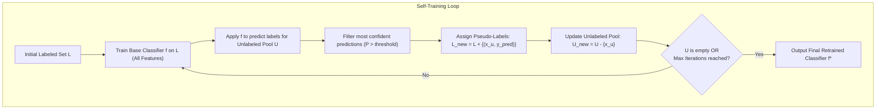

### Definition: Self-Training
**Meaning:** An incremental semi-supervised learning algorithm that trains a single classifier on the available labeled data using all features, applies the classifier to the unlabeled pool, selects the most confidently predicted instances to augment the labeled pool with their pseudo-labels, and retrains itself iteratively.  
**Formal definition:** Given labeled set $L$ and unlabeled set $U$, self-training minimizes empirical risk over an iteratively augmented set $L^{(t+1)} = L^{(t)} \cup \{(x_u, \hat{y}_u) \mid x_u \in U, \max_{c} P_f(c \mid x_u) \ge \tau\}$, where $\hat{y}_u = \arg\max_{c} P_f(c \mid x_u)$, $\tau$ is a confidence threshold, and $f^{(t+1)}$ is refitted on $L^{(t+1)}$ until a termination criterion is met.  
**Intuition:** The classifier uses its own predictions to teach itself ("bootstrapping"). By accepting its own most certain inferences as established truth, it shifts its decision boundary away from regions of high unlabeled density.  
**Example:** In optical character recognition (OCR), a classifier trained on 100 handwritten letters classifies 10,000 unlabelled characters. The 200 characters classified as 'A' with greater than 99.5% posterior probability are formally labeled as 'A' and added to the training set for the next iteration.

[Source: SSL, RL and Intro to Deep Learning.pdf, Slide 8]

---

### 2.3 Systematic Comparison: Co-Training vs. Self-Training

| Architectural Dimension | Co-Training | Self-Training |
| :--- | :--- | :--- |
| **Feature View Architecture** | **Multi-View:** Requires features partitioned into two redundant, sufficient subsets ($X_1, X_2$). | **Single-View:** Operates over the entire unified feature space $X$ without partitioning. |
| **Number of Classifiers** | **Two distinct models** ($f_1$ on $X_1$, $f_2$ on $X_2$) trained concurrently. | **Single model** ($f$) retrained iteratively on expanded data. |
| **Information Exchange** | **Mutual Cross-Teaching:** $f_1$ labels data to teach $f_2$, and $f_2$ labels data to teach $f_1$. | **Self-Bootstrapping:** Model uses its own past predictions to update its future parameters. |
| **Susceptibility to Confirmation Bias** | **Low to Moderate:** A false prediction by $f_1$ is only reinforced if $f_2$ also agrees; conditional independence limits error cascading. | **High:** Severe vulnerability; early classification mistakes are reinforced as ground truth, leading to error drift. |
| **Theoretical Guarantees** | Strong PAC bounds under conditional independence and view compatibility. | Primarily heuristic; formal convergence guarantees require strong cluster separation assumptions. |
| **Inference Mechanism** | Multi-view combination: $\Pr(c \mid x) = \Pr(c \mid x_1)\Pr(c \mid x_2)$. | Standard forward inference using single final model $f^*(x)$. |
| **Primary Domain Suitability** | Web mining, multi-modal sensor fusion, video-audio classification. | Monolithic tabular data, single-camera computer vision, standalone document texts. |

[Source: SSL, RL and Intro to Deep Learning.pdf, Slides 3-8]

---

### 2.4 Systematic Comparison: Transductive vs. Inductive SSL

| Dimension | Transductive Semi-Supervised Learning | Inductive Semi-Supervised Learning |
| :--- | :--- | :--- |
| **Primary Objective** | Predict labels **only** for the specific, fixed unlabeled instances in $U$ present during training. | Learn a general decision function $f: \mathcal{X} \to \mathcal{Y}$ capable of classifying **unseen test queries** arriving in the future. |
| **Out-of-Sample Generalization** | **None:** Cannot evaluate an unseen point $x_{new}$ without rebuilding the graph and re-running propagation. | **Full:** Produces explicit parameter vectors (e.g., weights $W, b$) that classify arbitrary new points in $O(1)$ time. |
| **Mathematical Archetype** | Graph Laplacian Harmonic Label Propagation, Markov Random Walks, Spectral Graph Cuts. | Co-Training, Self-Training, Semi-Supervised SVMs ($S^3\text{VM}$), Ladder Networks. |
| **Computational Scalability** | Requires storing and inverting matrices of size $(|L|+|U|) \times (|L|+|U|)$, scaling $O((|L|+|U|)^3)$. | Training scales with epoch count; evaluation scales linearly with network depth or parameter dimension. |

[Source: SSL, RL and Intro to Deep Learning.pdf, Slides 2, 8]

---

## 3. Learning from Positive and Unlabeled Data (PU Learning)

In many real-world diagnostic, security, and recommendation scenarios, true negative labels are impossible to certify. For instance, in fraud detection, confirmed fraudulent transactions are known ($P$), but unflagged transactions ($U$) consist of both legitimate transactions and undiscovered fraud. Similarly, in medical databases, patients diagnosed with a rare disease form $P$, while unexamined individuals in $U$ may either be healthy or asymptomatic carriers.

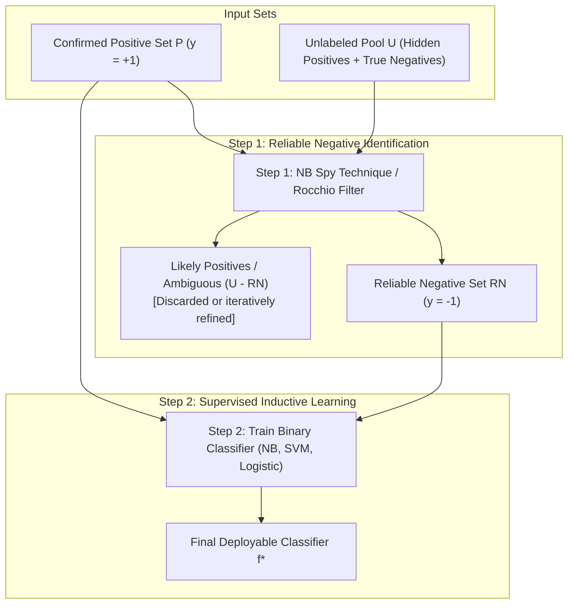

### Definition: Positive and Unlabeled Learning (PU Learning)
**Meaning:** A form of semi-supervised binary classification in which the training dataset consists exclusively of labeled positive instances and unlabeled instances, with no confirmed negative instances provided.  
**Formal definition:** Given a training corpus $\mathcal{D} = P \cup U$, where $P = \{x_i \mid y_i = +1\}$ and $U = \{x_j \mid y_j \in \{+1, -1\}\}$, the goal is to induce a binary classification rule $f: \mathcal{X} \to \{+1, -1\}$ that accurately recovers true positive and true negative states for all instances.  
**Intuition:** Rather than treating the unlabeled set as negative (which introduces severe label noise), PU learning treats $U$ as an uncurated mixture. By extracting instances from $U$ that are maximally distant from $P$, the algorithm synthesizes an artificial negative training set.  
**Example:** In landmine detection, satellite imagery confirms known landmine locations ($P$). The remainder of the country ($U$) is unmined territory mixed with hidden, undiscovered mines.

[Source: SSL, RL and Intro to Deep Learning.pdf, Slide 9]

### 3.1 The Two-Step Approach to PU Learning
As defined in the slides, the predominant methodology for PU learning is the **Two-Step Approach**:
1. **Step 1: Identifying a set of Reliable Negative documents ($RN$) from the unlabeled set $U$.**
2. **Step 2: Building a classifier using $P$ and $RN$.** This step applies a standard supervised learning algorithm (e.g., Naive Bayes or Support Vector Machines) once or iteratively, depending on the quality and cardinality of $RN$. The ambiguous set $U \setminus RN$ is discarded.

[Source: SSL, RL and Intro to Deep Learning.pdf, Slide 10]

#### Step 1: Naive Bayes Spy Technique
To identify reliable negatives without manual intervention, the **Naive Bayes Technique for Step 1** operates via the following protocol:

```text
Algorithm NB-Technique-Step-1(P, U)
1: Assign each document in P the class label +1.
2: Assign each document in U the temporary class label -1.
3: Build a Naive Bayes (NB) classifier using P and U.
4: Use the classifier to evaluate all documents in U.
5: Those documents in U that are classified as negative form the reliable negative set RN.
```

In the formal literature, this is generalized by the **Spy Technique**: a small random sample of positive instances $S \subset P$ (the "spies") are mixed into $U$ before training. Because the true class of the spies is positive (+1), their predicted probabilities under the initial model provide an empirical threshold: any document in $U$ scoring lower than the minimum spy probability can be reliably certified as negative.

[Source: SSL, RL and Intro to Deep Learning.pdf, Slide 11]

#### Step 2: Classifier Building and Iterative Refinement
In the second step:
- A supervised learning algorithm (such as Naive Bayes, Support Vector Machines, or Logistic Regression) is trained exclusively on $P$ (labeled +1) and $RN$ (labeled -1).
- The residual ambiguous set $U \setminus RN$ is discarded to eliminate positive false-negative label noise.
- *Condition for Success:* This two-step method achieves high classification accuracy if the extracted set $RN$ is sufficiently large and contains a high concentration of true negative documents with minimal false-negative contamination.

[Source: SSL, RL and Intro to Deep Learning.pdf, Slide 12]

---

## 4. Reinforcement Learning (RL) Foundations

Reinforcement Learning formalizes how an autonomous agent learns to achieve goals within an uncertain, dynamic environment through trial-and-error interactions. Unlike supervised learning (which provides instructive directional gradients towards target outputs) and unsupervised learning (which discovers latent patterns), reinforcement learning provides purely **evaluative scalar feedback** (rewards).

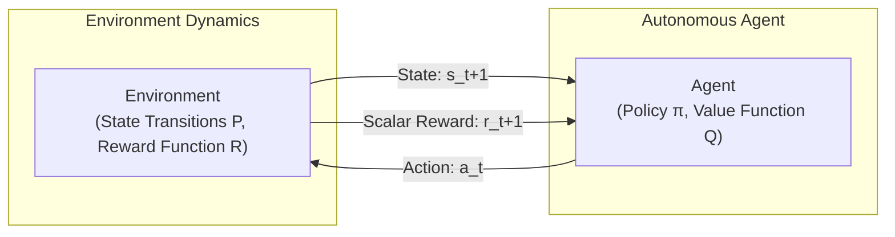

### Definition: Reinforcement Learning (RL)
**Meaning:** A computational paradigm wherein an agent learns optimal decision-making rules by executing actions in an environment and observing resulting scalar reward signals, aiming to maximize long-term cumulative return.  
**Formal definition:** RL is formalized as a Markov Decision Process (MDP) defined by a 5-tuple $\langle \mathcal{S}, \mathcal{A}, \mathcal{P}, \mathcal{R}, \gamma \rangle$, where $\mathcal{S}$ is the state space, $\mathcal{A}$ is the action space, $\mathcal{P}(s' \mid s, a) = \mathbb{P}(S_{t+1} = s' \mid S_t = s, A_t = a)$ is the transition probability distribution, $\mathcal{R}(s, a) = \mathbb{E}[R_{t+1} \mid S_t = s, A_t = a]$ is the reward function, and $\gamma \in [0, 1)$ is the temporal discount factor. The objective is to find an optimal policy $\pi^* = \arg\max_\pi \mathbb{E}_\pi [\sum_{t=0}^\infty \gamma^t R_{t+1}]$.  
**Intuition:** Similar to training a dog with treats: the dog is not told how to contract its muscles, but when its actions lead to a desirable outcome, the behavior is reinforced via positive feedback.  
**Example:** An automated warehouse robot navigating corridors. Entering an obstacle results in a large negative penalty ($-100$); moving closer to the charging dock yields neutral feedback ($0$); docking successfully yields a high positive reward ($+100$).

[Source: SSL, RL and Intro to Deep Learning.pdf, Slide 13]

---

### 4.1 Mathematical Formulations: Value Functions and the Bellman Equations

The expected discounted return from time step $t$ onward is defined as:

$$
G_t = \sum_{k=0}^{\infty} \gamma^k R_{t+k+1} = R_{t+1} + \gamma G_{t+1}
$$

The value of state $s$ under policy $\pi$, denoted $V^\pi(s)$, is:

$$
V^\pi(s) = \mathbb{E}_\pi \left[ G_t \mid S_t = s \right]
$$

Similarly, the action-value function (Q-function) under policy $\pi$, denoted $Q^\pi(s, a)$, is:

$$
Q^\pi(s, a) = \mathbb{E}_\pi \left[ G_t \mid S_t = s, A_t = a \right]
$$

#### Derivation of the Bellman Expectation Equation for $Q^\pi(s, a)$
Expanding the return $G_t$ recursively:

$$
Q^\pi(s, a) = \mathbb{E}_\pi \left[ R_{t+1} + \gamma G_{t+1} \mid S_t = s, A_t = a \right]
$$

Applying the law of total expectation across all possible next states $s'$ and subsequent actions $a'$:

$$
Q^\pi(s, a) = \mathcal{R}(s, a) + \gamma \sum_{s' \in \mathcal{S}} \mathcal{P}(s' \mid s, a) \sum_{a' \in \mathcal{A}} \pi(a' \mid s') Q^\pi(s', a')
$$

#### Derivation of the Bellman Optimality Equation
Under an optimal policy $\pi^*$, the agent selects the action that maximizes expected future return at every step: $\pi^*(a \mid s) = 1$ for $a = \arg\max_{a'} Q^*(s, a')$. Therefore:

$$
V^*(s) = \max_{a \in \mathcal{A}} Q^*(s, a)
$$

Substituting this into the recursive expectation yields the fundamental **Bellman Optimality Equation for $Q^*(s, a)$**:

$$
Q^*(s, a) = \mathcal{R}(s, a) + \gamma \sum_{s' \in \mathcal{S}} \mathcal{P}(s' \mid s, a) \max_{a' \in \mathcal{A}} Q^*(s', a')
$$

In a deterministic environment where taking action $a$ in state $s$ transitions with probability 1 to a unique successor state $s' = \delta(s, a)$, the summation collapses, yielding the exact formulation stated on Slide 14:

$$
Q(\text{state}, \text{action}) = R(\text{state}, \text{action}) + \gamma \max_{a'} Q(\text{next state}, a')
$$

| Symbol | Meaning | Units / Range |
| :--- | :--- | :--- |
| $s \in \mathcal{S}$ | Current environment state | Discrete index $\{0, 1, \dots, N-1\}$ |
| $a \in \mathcal{A}$ | Action chosen by agent | Discrete set of admissible actions |
| $R(s, a)$ | Immediate scalar reward for executing action $a$ in state $s$ | Real scalar ($\mathbb{R}$) |
| $\gamma$ | Temporal discount factor | Real scalar in $[0, 1)$ |
| $s'$ | Successor state resulting from transition $\delta(s, a)$ | State index in $\mathcal{S}$ |
| $a'$ | Hypothetical action executed in successor state $s'$ | Action index in $\mathcal{A}(s')$ |
| $Q(s, a)$ | Expected cumulative discounted return for pair $(s, a)$ | Real scalar ($\mathbb{R}$) |
| $\max_{a'} Q(s', a')$ | Maximum expected return available from successor state $s'$ | Real scalar ($\mathbb{R}$) |

- **What It Represents:** The recursive dynamic programming equation establishing the value of an action as the sum of immediate reward plus discounted optimal future value.
- **Conditions / Assumptions:** Environment satisfies the Markov property; transitions are deterministic; rewards are bounded.

[Source: SSL, RL and Intro to Deep Learning.pdf, Slide 14]

---

### 4.2 Taxonomy of Reinforcement Learning Algorithms

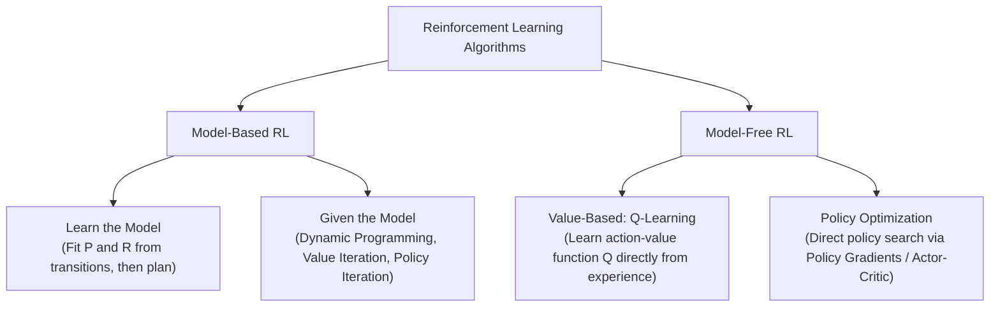

The slides categorize RL algorithms into two foundational archetypes:
1. **Model-Based RL**:
   - **Given the Model**: The agent possesses full prior knowledge of the transition probabilities $\mathcal{P}(s' \mid s, a)$ and reward function $\mathcal{R}(s, a)$ (e.g., Chess, AlphaZero's tree search engine, Classical Dynamic Programming).
   - **Learn the Model**: The agent interacts with an unknown environment to construct an empirical statistical model $\hat{\mathcal{P}}$ and $\hat{\mathcal{R}}$, subsequently executing planning algorithms (e.g., Dyna-Q, Model Predictive Control) on its learned model.
2. **Model-Free RL**:
   - The agent does not estimate transition dynamics or environmental physics. Instead, it directly maps observed experiences $(s, a, r, s')$ to values or policies.
   - **Q-Learning**: Focuses on learning the optimal action-value function $Q^*(s, a)$. Once learned, the optimal policy is extracted greedily via $\pi^*(s) = \arg\max_a Q^*(s, a)$.
   - **Policy Optimization**: Directly parametrizes policy $\pi_\theta(a \mid s)$ and updates parameters $\theta$ via gradient ascent to maximize expected return (e.g., REINFORCE, Proximal Policy Optimization).

[Source: SSL, RL and Intro to Deep Learning.pdf, Slide 13]

---

### 4.3 Systematic Comparison: Model-Based vs. Model-Free RL

| Characteristic | Model-Based RL | Model-Free RL (Q-Learning) |
| :--- | :--- | :--- |
| **Internal World Model** | Explicitly maintains transition dynamics $\mathcal{P}(s' \mid s, a)$ and reward model $\mathcal{R}(s, a)$. | Operates with zero knowledge of transition dynamics; relies entirely on trajectory samples. |
| **Sample Efficiency** | **High:** Agent can simulate thousands of imaginary rollouts in its internal model without taking physical actions. | **Low to Moderate:** Requires extensive real-world or simulator interactions to converge. |
| **Computational Overhead** | High planning overhead per step (solving dynamic programming or Monte Carlo Tree Search). | Low compute during execution; simple value update step. |
| **Model Bias Risk** | High; inaccuracies in the learned model produce catastrophic policy failures in the real environment. | Immune to model inaccuracy bias; directly reflects real trajectory outcomes. |
| **Adaptability to Policy Shifts** | High; if goal locations change, the agent re-plans paths using the unchanged physical model. | Low; value matrices must be extensively relearned via new interaction episodes. |

[Source: SSL, RL and Intro to Deep Learning.pdf, Slide 13]

---

## 5. Q-Learning Algorithm and the 6-Room Environment

### 5.1 The Q-Learning Algorithm Specification
The Q-Learning algorithm presented on Slide 14 is defined as follows:

```text
Algorithm: Tabular Q-Learning
1: Set the gamma parameter, and environment rewards in matrix R.
2: Initialize matrix Q to zero.
3: For each episode:
4:     Select a random initial state.
5:     Do While the goal state has not been reached:
6:         - Select one among all possible actions for the current state.
7:         - Using this possible action, consider going to the next state.
8:         - Get maximum Q value for this next state based on all possible actions.
9:         - Compute: Q(state, action) = R(state, action) + Gamma * Max[Q(next state, all actions)]
10:        - Set the next state as the current state.
11:    End Do
12: End For
```

[Source: SSL, RL and Intro to Deep Learning.pdf, Slide 14]

---

### 5.2 The 6-Room Building Floorplan and Initial Setup

The slides ground the Q-Learning algorithm in a concrete physical environment: a building partitioned into 5 interior rooms (Rooms 0, 1, 2, 3, 4) and an exterior yard/goal area (Room 5). Doors connecting adjacent rooms represent bidirectional state transitions, while a door leading outside represents a high-reward exit to the goal state.

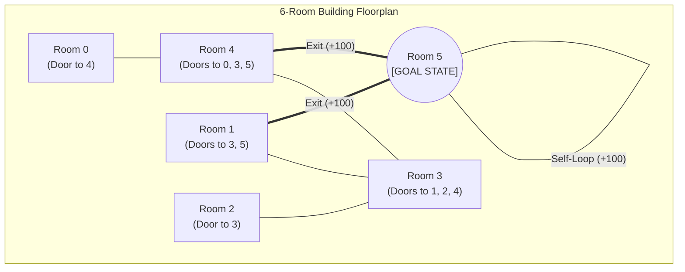

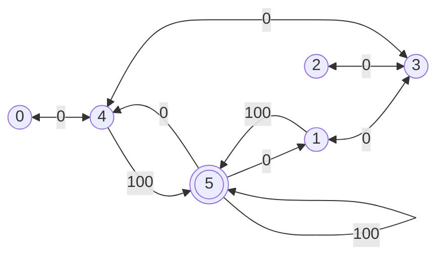

#### Graph Connectivity and State-Transition Rules
- **Room 0**: Directly connected exclusively to Room 4.
- **Room 1**: Directly connected to Room 3, and opens into Room 5 (Goal).
- **Room 2**: Directly connected exclusively to Room 3.
- **Room 3**: Central hallway connected to Room 1, Room 2, and Room 4.
- **Room 4**: Connected to Room 0, Room 3, and opens into Room 5 (Goal).
- **Room 5**: The target goal state (outside). Directly connects back to Room 1 and Room 4, and possesses an absorbing self-loop with reward 100.

#### Formal Environment Reward Matrix $R$
Actions represent moving from current state $i$ to adjacent state $j$. If no door connects Room $i$ to Room $j$, the action is physically impossible, designated by reward $-1$. Valid transitions yield reward $0$, while transitions entering the goal (Room 5) yield reward $100$:

$$
R = \begin{bmatrix}
-1 & -1 & -1 & -1 &  0 & -1 \\
-1 & -1 & -1 &  0 & -1 & 100 \\
-1 & -1 & -1 &  0 & -1 & -1 \\
-1 &  0 &  0 & -1 &  0 & -1 \\
 0 & -1 & -1 &  0 & -1 & 100 \\
-1 &  0 & -1 & -1 &  0 & 100
\end{bmatrix}
$$

The Q-matrix has identical dimensionality ($6 \times 6$, mapping States $0 \dots 5 \times$ Actions $0 \dots 5$) and is initialized to zero:

$$
Q = \begin{bmatrix}
0 & 0 & 0 & 0 & 0 & 0 \\
0 & 0 & 0 & 0 & 0 & 0 \\
0 & 0 & 0 & 0 & 0 & 0 \\
0 & 0 & 0 & 0 & 0 & 0 \\
0 & 0 & 0 & 0 & 0 & 0 \\
0 & 0 & 0 & 0 & 0 & 0
\end{bmatrix}
$$

The discount parameter is fixed across all episodes at $\gamma = 0.8$.

[Source: SSL, RL and Intro to Deep Learning.pdf, Slide 15]

---

### 5.3 Detailed Algorithmic Execution: Episodes 1 and 2

#### Episode 1 Trace (Initial State: Room 1)
1. **Current State:** $s = 1$. Target Goal: Room 5.
2. **Admissible Actions from State 1:** Examining Row 1 of matrix $R$, non-negative entries exist for columns 3 ($R(1,3) = 0$) and 5 ($R(1,5) = 100$). Thus, $\mathcal{A}(1) = \{3, 5\}$.
3. **Action Selection:** The agent selects action $a = 5$.
4. **Next State Transition:** The agent enters state $s' = 5$.
5. **Evaluate Next State Maximizer:** Inspecting row 5 of the current $Q$ matrix, all entries are zero: $\max_{a'} Q(5, a') = \max\{Q(5,1), Q(5,4), Q(5,5)\} = \max\{0, 0, 0\} = 0$.
6. **Bellman Update:**
   
   $$
   Q(1, 5) = R(1, 5) + 0.8 \times \max\left[ Q(5, 1), Q(5, 4), Q(5, 5) \right]
   $$
   
   $$
   Q(1, 5) = 100 + 0.8 \times 0 = 100
   $$

7. **State Advancement:** Current state becomes $s = 5$. Because Room 5 is the terminal goal state, Episode 1 terminates.

Updated $Q$ matrix after Episode 1:

$$
Q = \begin{bmatrix}
0 & 0 & 0 & 0 & 0 & 0 \\
0 & 0 & 0 & 0 & 0 & 100 \\
0 & 0 & 0 & 0 & 0 & 0 \\
0 & 0 & 0 & 0 & 0 & 0 \\
0 & 0 & 0 & 0 & 0 & 0 \\
0 & 0 & 0 & 0 & 0 & 0
\end{bmatrix}
$$

[Source: SSL, RL and Intro to Deep Learning.pdf, Slides 16-17]

#### Episode 2 Trace (Initial State: Room 3)
1. **Current State:** $s = 3$. Target Goal: Room 5.
2. **Admissible Actions from State 3:** Examining Row 3 of matrix $R$, non-negative entries exist for columns 1 ($R(3,1) = 0$), 2 ($R(3,2) = 0$), and 4 ($R(3,4) = 0$). Thus, $\mathcal{A}(3) = \{1, 2, 4\}$.
3. **Action Selection:** The agent selects action $a = 1$.
4. **Next State Transition:** Next state is $s' = 1$.
5. **Evaluate Next State Maximizer:** Row 1 of current $Q$ contains entries $Q(1,3) = 0$ and $Q(1,5) = 100$:
   
   $$
   \max_{a'} Q(1, a') = \max\{Q(1, 3), Q(1, 5)\} = \max\{0, 100\} = 100
   $$

6. **Bellman Update for $(3, 1)$:**
   
   $$
   Q(3, 1) = R(3, 1) + 0.8 \times \max\left[ Q(1, 3), Q(1, 5) \right]
   $$
   
   $$
   Q(3, 1) = 0 + 0.8 \times 100 = 80
   $$

7. **State Advancement:** Current state becomes $s = 1$. State 1 is not the goal; the episode continues.
8. **Step 2 from State 1:** Admissible actions are $\mathcal{A}(1) = \{3, 5\}$. Agent selects action $a = 5$.
9. **Next State Transition:** Successor state is $s' = 5$.
10. **Bellman Update for $(1, 5)$:**
    
    $$
    Q(1, 5) = R(1, 5) + 0.8 \times \max\left[ Q(5, 1), Q(5, 4), Q(5, 5) \right] = 100 + 0.8 \times 0 = 100
    $$

11. **State Advancement:** Current state becomes $s = 5$. Goal reached; Episode 2 terminates.

Updated $Q$ matrix after Episode 2:

$$
Q = \begin{bmatrix}
0 & 0 & 0 & 0 & 0 & 0 \\
0 & 0 & 0 & 0 & 0 & 100 \\
0 & 0 & 0 & 0 & 0 & 0 \\
0 & 80 & 0 & 0 & 0 & 0 \\
0 & 0 & 0 & 0 & 0 & 0 \\
0 & 0 & 0 & 0 & 0 & 0
\end{bmatrix}
$$

[Source: SSL, RL and Intro to Deep Learning.pdf, Slides 18-21]

---

### 5.4 Asymptotic Convergence, Normalization, and Optimal Policy Extraction

#### Mathematical Derivation of Converged Values
As the number of training episodes $N \to \infty$, value propagation reaches a unique fixed-point equilibrium.
1. **Self-Loop Equilibrium at Goal State 5**:
   
   $$
   Q^*(5, 5) = R(5, 5) + \gamma Q^*(5, 5) \implies Q^*(5, 5) = 100 + 0.8 Q^*(5, 5)
   $$
   
   $$
   (1 - 0.8) Q^*(5, 5) = 100 \implies 0.2 Q^*(5, 5) = 100 \implies Q^*(5, 5) = \frac{100}{0.2} = 500
   $$

2. **Immediate Successor Inflow to Goal ($1 \to 5$ and $4 \to 5$)**:
   
   $$
   Q^*(1, 5) = R(1, 5) + 0.8 \max_{a'} Q^*(5, a') = 100 + 0.8 \times 500 = 500
   $$
   
   $$
   Q^*(4, 5) = R(4, 5) + 0.8 \max_{a'} Q^*(5, a') = 100 + 0.8 \times 500 = 500
   $$

3. **Two-Step Inflow to Goal ($3 \to 1$, $3 \to 4$, $0 \to 4$)**:
   
   $$
   Q^*(3, 1) = R(3, 1) + 0.8 \max_{a'} Q^*(1, a') = 0 + 0.8 \times 500 = 400
   $$
   
   $$
   Q^*(3, 4) = R(3, 4) + 0.8 \max_{a'} Q^*(4, a') = 0 + 0.8 \times 500 = 400
   $$
   
   $$
   Q^*(0, 4) = R(0, 4) + 0.8 \max_{a'} Q^*(4, a') = 0 + 0.8 \times 500 = 400
   $$
   
   $$
   Q^*(5, 1) = R(5, 1) + 0.8 \max_{a'} Q^*(1, a') = 0 + 0.8 \times 500 = 400
   $$
   
   $$
   Q^*(5, 4) = R(5, 4) + 0.8 \max_{a'} Q^*(4, a') = 0 + 0.8 \times 500 = 400
   $$

4. **Three-Step Inflow to Goal ($2 \to 3$, $1 \to 3$, $4 \to 3$, $4 \to 0$)**:
   
   $$
   Q^*(2, 3) = R(2, 3) + 0.8 \max_{a'} Q^*(3, a') = 0 + 0.8 \times 400 = 320
   $$
   
   $$
   Q^*(1, 3) = R(1, 3) + 0.8 \times 400 = 320, \quad Q^*(4, 3) = 0 + 0.8 \times 400 = 320, \quad Q^*(4, 0) = 0 + 0.8 \times 400 = 320
   $$

5. **Four-Step Inflow ($3 \to 2$)**:
   
   $$
   Q^*(3, 2) = R(3, 2) + 0.8 \max_{a'} Q^*(2, a') = 0 + 0.8 \times 320 = 256
   $$

#### Final Converged $Q^*$ Matrix (Slide 22)

$$
Q^* = \begin{bmatrix}
  0 &   0 &   0 &   0 & 400 &   0 \\
  0 &   0 &   0 & 320 &   0 & 500 \\
  0 &   0 &   0 & 320 &   0 &   0 \\
  0 & 400 & 256 &   0 & 400 &   0 \\
320 &   0 &   0 & 320 &   0 & 500 \\
  0 & 400 &   0 &   0 & 400 & 500
\end{bmatrix}
$$

#### Normalized Percentage Matrix $Q_{norm}$ (Slide 22)
Dividing all non-zero entries by the maximum value ($500$) and scaling to 100%:

$$
Q_{\text{norm}}(s, a) = \frac{Q^*(s, a)}{500} \times 100
$$

Yielding the exact normalized percentage matrix:

$$
Q_{\text{norm}} = \begin{bmatrix}
 0 &  0 &  0 &  0 &  80 &   0 \\
 0 &  0 &  0 & 64 &   0 & 100 \\
 0 &  0 &  0 & 64 &   0 &   0 \\
 0 & 80 & 51 &  0 &  80 &   0 \\
64 &  0 &  0 & 64 &   0 & 100 \\
 0 & 80 &  0 &  0 &  80 & 100
\end{bmatrix}
$$

[Source: SSL, RL and Intro to Deep Learning.pdf, Slide 22]

#### Optimal Policy Path Extraction (Slide 23)
The optimal policy $\pi^*(s) = \arg\max_a Q^*(s, a)$ defines the shortest, highest-reward escape route from any room in the facility:
- **From Room 2:** $\arg\max_a Q^*(2, a) = 3$ (Value: 64%). Path: $2 \to 3 \to 1 \to 5$ or $2 \to 3 \to 4 \to 5$.
- **From Room 0:** $\arg\max_a Q^*(0, a) = 4$ (Value: 80%). Path: $0 \to 4 \to 5$.
- **From Room 3:** Tie between Action 1 (80%) and Action 4 (80%). Paths: $3 \to 1 \to 5$ or $3 \to 4 \to 5$.
- **From Room 1:** $\arg\max_a Q^*(1, a) = 5$ (Value: 100%). Path: $1 \to 5$.
- **From Room 4:** $\arg\max_a Q^*(4, a) = 5$ (Value: 100%). Path: $4 \to 5$.
- **From Room 5:** $\arg\max_a Q^*(5, a) = 5$ (Value: 100%). Absorbing goal state.

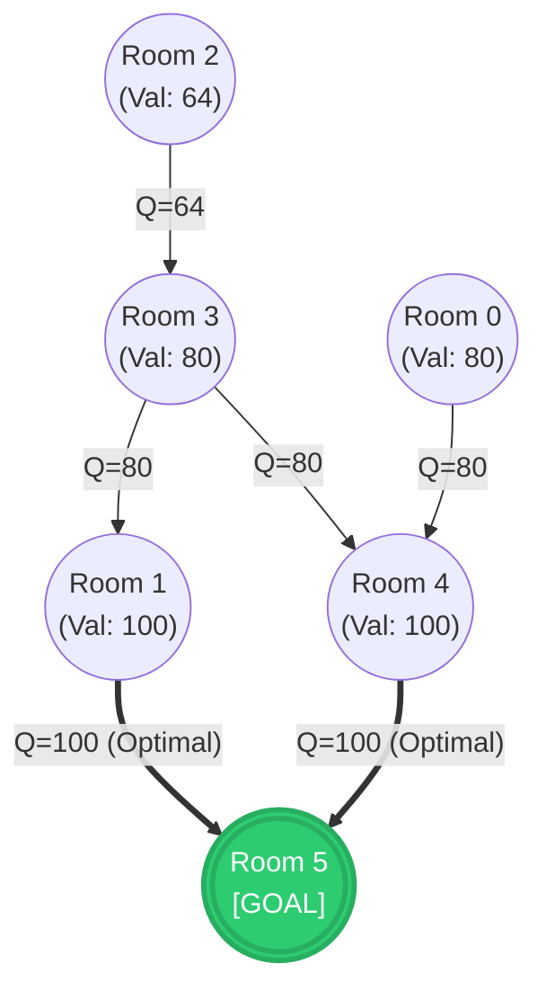

[Source: SSL, RL and Intro to Deep Learning.pdf, Slide 23]

---

## 6. Introduction to Deep Learning

As machine learning systems expanded from tabular datasets to unstructured, high-dimensional perceptual modalities (e.g., raw pixel rasters, acoustic waveforms, and textual corpora), classical algorithms encountered severe performance bottlenecks. Deep learning emerged as a specialized subclass of representation learning designed to eliminate manual feature engineering.

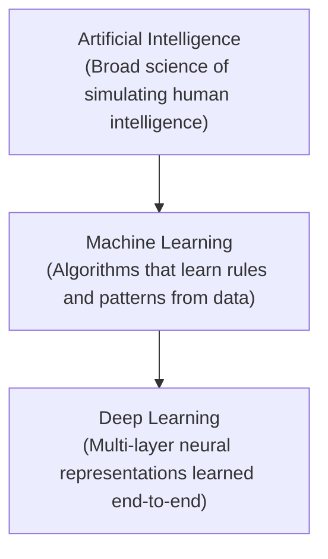

[Source: SSL, RL and Intro to Deep Learning.pdf, Slide 24]

---

### 6.1 Classical Machine Learning vs. Deep Learning

Slide 25 illustrates the architectural divergence between classical machine learning workflows and deep learning workflows:

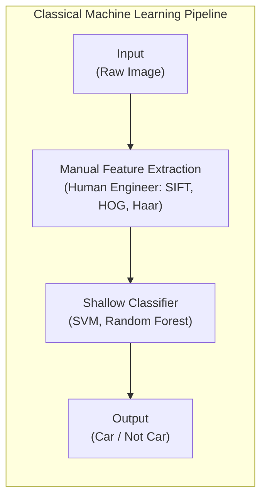

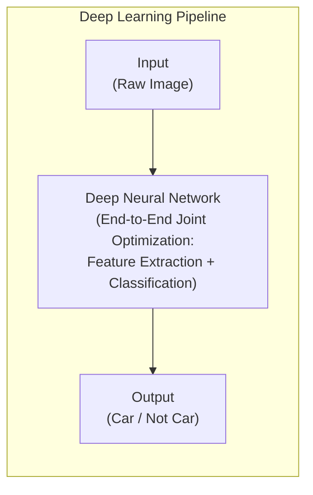

### Detailed Structural Comparison: Classical ML vs. Deep Learning

| Dimension | Classical Machine Learning | Deep Learning |
| :--- | :--- | :--- |
| **Feature Engineering** | **Manual / Handcrafted:** Relies on human domain experts to design feature extractors (e.g., SIFT, SURF, HOG, Bag-of-Words). | **Automated / End-to-End:** Learns hierarchical feature representations directly from raw inputs via backpropagation. |
| **Pipeline Modularity** | **Decoupled:** Feature extraction and classifier training are separate; errors in extraction cannot be corrected by the classifier. | **Unified / Joint:** The entire network from raw input pixels to class probabilities is optimized simultaneously against a single loss function. |
| **Data Scaling Behavior** | Performance plateaus early; adding more training data yields diminishing returns beyond modest sample sizes. | Follows empirical power-law scaling; performance continually improves as data volume and model parameterization scale. |
| **Computational Requirements** | Can run efficiently on standard multi-core central processing units (CPUs); fast training times. | Requires massive parallel compute infrastructure (GPUs, TPUs); substantial memory and training time. |
| **Model Interpretability** | High; individual features (e.g., edge counts, texture histograms) correspond to interpretable domain concepts. | Often characterized as "black box"; distributed representations across millions of parameters complicate explainability. |

[Source: SSL, RL and Intro to Deep Learning.pdf, Slide 25]

---

### 6.2 Taxonomy of Major Deep Network Architectures

Slide 26 classifies the deep learning ecosystem into four major architectural paradigms:

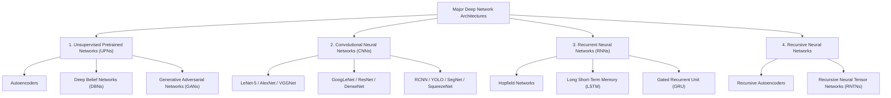

[Source: SSL, RL and Intro to Deep Learning.pdf, Slide 26]

---

### 6.3 Architecture Breakdown, Models, and Real-World Applications

#### 1. Unsupervised Pretrained Networks (UPNs)
- **Primary Concepts:** Architectures designed to learn compressed data representations, density distributions, or generative models without target supervision.
- **Representative Models:**
  - **Autoencoders:** Encoder-decoder networks forcing representations through a low-dimensional bottleneck to minimize reconstruction loss $\|x - g(f(x))\|^2$.
  - **Deep Belief Networks (DBNs):** Probabilistic generative models composed of stacked Restricted Boltzmann Machines (RBMs) trained greedily layer-by-layer.
  - **Generative Adversarial Networks (GANs):** Minimax game between Generator $G(z)$ and Discriminator $D(x)$: $\min_G \max_D \mathbb{E}[\log D(x)] + \mathbb{E}[\log(1 - D(G(z)))]$.
- **Core Use Cases:** Feature extraction for downstream classifiers, synthetic data generation, image-to-image translation, dimensionality reduction.

[Source: SSL, RL and Intro to Deep Learning.pdf, Slide 27]

#### 2. Convolutional Neural Networks (CNNs)
- **Primary Concepts:** Feedforward neural networks designed for spatially structured grid data. Employs sparse local connectivity, parameter sharing across space, and translation-invariant pooling.
- **Key Architectural Milestone Models:**
  - *LeNet-5 (1998):* Foundational document recognition CNN introducing Conv-Pool-Conv-Pool-FC staging.
  - *AlexNet (2012):* Scaled CNNs to ImageNet using GPUs, ReLU activations, and Dropout regularization.
  - *VGGNet (2014):* Demonstrated that stacking small $3 \times 3$ filters achieves deeper effective receptive fields with fewer parameters than large filters.
  - *GoogLeNet / Inception (2014):* Multi-scale processing via parallel Inception modules ($1 \times 1, 3 \times 3, 5 \times 5$ convolutions) and $1 \times 1$ dimensionality reduction.
  - *ResNet (2015):* Introduced identity skip connections ($F(x) + x$) enabling networks exceeding 150 layers without vanishing gradients.
  - *ResNeXt (2017):* Multi-branch architecture introducing "cardinality" as a primary architectural dimension alongside depth and width.
  - *DenseNet (2017):* Direct feature concatenation connecting every layer to every subsequent layer in a feed-forward block.
  - *RCNN (2014):* Region-based CNN combining selective search region proposals with CNN feature extraction for object detection.
  - *YOLO (You Only Look Once, 2016):* Real-time single-shot object detector framing detection as a direct spatial regression problem.
  - *SqueezeNet (2016):* Ultra-compact CNN utilizing "Fire modules" ($1 \times 1$ squeeze + $1 \times 1 / 3 \times 3$ expand) to match AlexNet accuracy with 50x fewer parameters.
  - *SegNet (2017):* Fully convolutional encoder-decoder architecture using pooling indices for pixel-wise semantic image segmentation.
- **Core Use Cases:** Computer Vision (image classification, bounding-box object detection, semantic segmentation, medical imaging) and Natural Language Processing (character-level and sentence-level 1D convolution).

[Source: SSL, RL and Intro to Deep Learning.pdf, Slides 28-29]

#### 3. Recurrent Neural Networks (RNNs)
- **Primary Concepts:** Neural architectures incorporating directed cyclic connections that maintain an internal hidden state vector $h_t = f(W_{hh} h_{t-1} + W_{xh} x_t + b)$, allowing them to process sequential inputs of variable length.
- **Representative Models:**
  - **Hopfield Networks:** Content-addressable recurrent associative memory networks with symmetric synaptic weights and binary threshold units.
  - **Long Short-Term Memory (LSTM):** Overcomes vanishing gradients in standard RNNs using a constant error carousel and gating mechanisms:
    
    $$
    f_t = \sigma(W_f [h_{t-1}, x_t] + b_f) \quad \text{(Forget Gate)}
    $$
    
    $$
    i_t = \sigma(W_i [h_{t-1}, x_t] + b_i) \quad \text{(Input Gate)}
    $$
    
    $$
    \tilde{C}_t = \tanh(W_c [h_{t-1}, x_t] + b_c) \quad \text{(Candidate Memory)}
    $$
    
    $$
    C_t = f_t \odot C_{t-1} + i_t \odot \tilde{C}_t \quad \text{(Cell State Update)}
    $$
    
    $$
    o_t = \sigma(W_o [h_{t-1}, x_t] + b_o) \quad \text{(Output Gate)}
    $$
    
    $$
    h_t = o_t \odot \tanh(C_t) \quad \text{(Hidden State)}
    $$

  - **Gated Recurrent Unit (GRU):** Compact recurrent variant merging cell and hidden states, using reset ($r_t$) and update ($z_t$) gates.
- **Core Use Cases:** Sentiment classification, automated image captioning (CNN visual encoder + RNN text decoder), neural machine translation, video action captioning.

[Source: SSL, RL and Intro to Deep Learning.pdf, Slide 30]

#### 4. Recursive Neural Networks
- **Primary Concepts:** Generalization of recurrent networks from linear temporal sequences to non-linear hierarchical tree structures. The network recursively combines child representations into parent representations using shared compositional weights.
- **Representative Models:**
  - **Recursive Autoencoder (RAE):** Greedily merges child node pairs in syntactic trees while minimizing local reconstruction error.
  - **Recursive Neural Tensor Network (RNTN):** Employs tensor-based bilinear composition functions to model complex linguistic interactions.
- **Core Use Cases:** Syntactic image scene decomposition, natural language tree parsing, sentiment treebank classification, audio-to-phonetic text transcription.

[Source: SSL, RL and Intro to Deep Learning.pdf, Slide 31]

---

## 7. Mandatory 10-15 Marker Worked Numerical Examples

---

### Problem 1: Co-Training Multi-View Worked Problem

#### Problem Statement
A research laboratory is building an automated system to classify academic publications into two categories: **Class $c_1$ = Artificial Intelligence (AI)** and **Class $c_2$ = Systems/Hardware (SYS)**. Each paper is represented across two distinct, redundant feature views:
- **View 1 ($x_1$):** Title/Abstract keyword features, represented by two binary indicators $w_1$ (contains *"neural"*) and $w_2$ (contains *"gradient"*).
- **View 2 ($x_2$):** Citation/Venue keyword features, represented by two binary indicators $u_1$ (contains *"conference"*) and $u_2$ (contains *"benchmark"*).

The current pool consists of 4 labeled papers ($L$) and 6 unlabeled papers ($U$):
- **Labeled Set $L$:**
  - $d_1$: $x_1 = (1, 0)$, $x_2 = (1, 0)$, True Label: $c_1$ (AI)
  - $d_2$: $x_1 = (1, 1)$, $x_2 = (1, 0)$, True Label: $c_1$ (AI)
  - $d_3$: $x_1 = (0, 1)$, $x_2 = (0, 1)$, True Label: $c_2$ (SYS)
  - $d_4$: $x_1 = (0, 0)$, $x_2 = (0, 1)$, True Label: $c_2$ (SYS)
- **Unlabeled Set $U$:**
  - $u_1$: $x_1 = (1, 0)$, $x_2 = (0, 1)$
  - $u_2$: $x_1 = (0, 1)$, $x_2 = (1, 0)$
  - $u_3$: $x_1 = (1, 1)$, $x_2 = (1, 1)$
  - $u_4$: $x_1 = (0, 0)$, $x_2 = (0, 0)$
  - $u_5$: $x_1 = (1, 0)$, $x_2 = (1, 0)$
  - $u_6$: $x_1 = (0, 1)$, $x_2 = (0, 1)$

**Task Execution Requirements:**
1. Train initial Naive Bayes classifiers $f_1$ (using View 1) and $f_2$ (using View 2) on labeled set $L$ using Laplace (add-1) smoothing.
2. Evaluate all 6 unlabeled instances in $U$ under both $f_1$ and $f_2$.
3. Execute one full co-training iteration with selection parameters $n_1 = 1$ (one paper for class $c_1$) and $n_2 = 1$ (one paper for class $c_2$):
   - Identify the most confident $c_1$ and $c_2$ predictions from $f_1$ and add them to $L$.
   - Identify the most confident $c_1$ and $c_2$ predictions from $f_2$ and add them to $L$.
4. Formulate the combined multi-view classification rule $\Pr(c_j \mid x) \propto \Pr(c_j \mid x_1) \Pr(c_j \mid x_2)$ and compute the final posterior probability for test document $u_1 = (x_1=(1,0), x_2=(0,1))$.

---

#### Step 1: Train Initial Classifiers $f_1$ and $f_2$ on Labeled Set $L$
Labeled set $L$ contains $|L| = 4$ papers: 2 from class $c_1$ ($d_1, d_2$) and 2 from class $c_2$ ($d_3, d_4$).
Class priors:

$$
P(c_1) = \frac{2}{4} = 0.5, \quad P(c_2) = \frac{2}{4} = 0.5
$$

##### View 1 Parameter Estimation ($f_1$ operating on $w_1, w_2$):
With Laplace smoothing, the probability of binary feature $w_k = 1$ given class $c$ is:

$$
P(w_k = 1 \mid c) = \frac{\text{Count}(w_k = 1, c) + 1}{\text{Total documents in class } c + 2}
$$

- For class $c_1$ ($d_1, d_2$):
  - $w_1$ values: $d_1 = 1, d_2 = 1 \implies \text{Count} = 2$.
    
    $$
    P(w_1 = 1 \mid c_1) = \frac{2 + 1}{2 + 2} = \frac{3}{4} = 0.75, \quad P(w_1 = 0 \mid c_1) = 0.25
    $$

  - $w_2$ values: $d_1 = 0, d_2 = 1 \implies \text{Count} = 1$.
    
    $$
    P(w_2 = 1 \mid c_1) = \frac{1 + 1}{2 + 2} = \frac{2}{4} = 0.50, \quad P(w_2 = 0 \mid c_1) = 0.50
    $$

- For class $c_2$ ($d_3, d_4$):
  - $w_1$ values: $d_3 = 0, d_4 = 0 \implies \text{Count} = 0$.
    
    $$
    P(w_1 = 1 \mid c_2) = \frac{0 + 1}{2 + 2} = \frac{1}{4} = 0.25, \quad P(w_1 = 0 \mid c_2) = 0.75
    $$

  - $w_2$ values: $d_3 = 1, d_4 = 0 \implies \text{Count} = 1$.
    
    $$
    P(w_2 = 1 \mid c_2) = \frac{1 + 1}{2 + 2} = \frac{2}{4} = 0.50, \quad P(w_2 = 0 \mid c_2) = 0.50
    $$

##### View 2 Parameter Estimation ($f_2$ operating on $u_1, u_2$):
- For class $c_1$ ($d_1, d_2$):
  - $u_1$ values: $d_1 = 1, d_2 = 1 \implies \text{Count} = 2$.
    
    $$
    P(u_1 = 1 \mid c_1) = \frac{2 + 1}{4} = 0.75, \quad P(u_1 = 0 \mid c_1) = 0.25
    $$

  - $u_2$ values: $d_1 = 0, d_2 = 0 \implies \text{Count} = 0$.
    
    $$
    P(u_2 = 1 \mid c_1) = \frac{0 + 1}{4} = 0.25, \quad P(u_2 = 0 \mid c_1) = 0.75
    $$

- For class $c_2$ ($d_3, d_4$):
  - $u_1$ values: $d_3 = 0, d_4 = 0 \implies \text{Count} = 0$.
    
    $$
    P(u_1 = 1 \mid c_2) = \frac{0 + 1}{4} = 0.25, \quad P(u_1 = 0 \mid c_2) = 0.75
    $$

  - $u_2$ values: $d_3 = 1, d_4 = 1 \implies \text{Count} = 2$.
    
    $$
    P(u_2 = 1 \mid c_2) = \frac{2 + 1}{4} = 0.75, \quad P(u_2 = 0 \mid c_2) = 0.25
    $$

---

#### Step 2: Posterior Probabilities on Unlabeled Set $U$
For any instance with feature vector $z$, the posterior is:

$$
P(c_1 \mid z) = \frac{P(c_1) P(z \mid c_1)}{P(c_1) P(z \mid c_1) + P(c_2) P(z \mid c_2)}
$$

Because priors are equal ($P(c_1) = P(c_2) = 0.5$), this simplifies to:

$$
P(c_1 \mid z) = \frac{P(z \mid c_1)}{P(z \mid c_1) + P(z \mid c_2)}
$$

##### Evaluating $f_1$ across View 1 ($x_1$):
- For $x_1 = (1, 1)$ ($u_3$):
  - $P(x_1 \mid c_1) = 0.75 \times 0.50 = 0.375$
  - $P(x_1 \mid c_2) = 0.25 \times 0.50 = 0.125$
  - $P(c_1 \mid x_1) = \frac{0.375}{0.375 + 0.125} = 0.750 \implies P(c_2 \mid x_1) = 0.250$
- For $x_1 = (1, 0)$ ($u_1, u_5$):
  - $P(x_1 \mid c_1) = 0.75 \times 0.50 = 0.375$
  - $P(x_1 \mid c_2) = 0.25 \times 0.50 = 0.125$
  - $P(c_1 \mid x_1) = \frac{0.375}{0.375 + 0.125} = 0.750 \implies P(c_2 \mid x_1) = 0.250$
- For $x_1 = (0, 1)$ ($u_2, u_6$):
  - $P(x_1 \mid c_1) = 0.25 \times 0.50 = 0.125$
  - $P(x_1 \mid c_2) = 0.75 \times 0.50 = 0.375$
  - $P(c_1 \mid x_1) = \frac{0.125}{0.125 + 0.375} = 0.250 \implies P(c_2 \mid x_1) = 0.750$
- For $x_1 = (0, 0)$ ($u_4$):
  - $P(x_1 \mid c_1) = 0.25 \times 0.50 = 0.125$
  - $P(x_1 \mid c_2) = 0.75 \times 0.50 = 0.375$
  - $P(c_1 \mid x_1) = 0.250 \implies P(c_2 \mid x_1) = 0.750$

##### Evaluating $f_2$ across View 2 ($x_2$):
- For $x_2 = (1, 0)$ ($u_2, u_5$):
  - $P(x_2 \mid c_1) = 0.75 \times 0.75 = 0.5625$
  - $P(x_2 \mid c_2) = 0.25 \times 0.25 = 0.0625$
  - $P(c_1 \mid x_2) = \frac{0.5625}{0.5625 + 0.0625} = \frac{0.5625}{0.6250} = 0.900 \implies P(c_2 \mid x_2) = 0.100$
- For $x_2 = (0, 1)$ ($u_1, u_6$):
  - $P(x_2 \mid c_1) = 0.25 \times 0.25 = 0.0625$
  - $P(x_2 \mid c_2) = 0.75 \times 0.75 = 0.5625$
  - $P(c_1 \mid x_2) = \frac{0.0625}{0.6250} = 0.100 \implies P(c_2 \mid x_2) = 0.900$
- For $x_2 = (1, 1)$ ($u_3$):
  - $P(x_2 \mid c_1) = 0.75 \times 0.25 = 0.1875$
  - $P(x_2 \mid c_2) = 0.25 \times 0.75 = 0.1875$
  - $P(c_1 \mid x_2) = 0.500 \implies P(c_2 \mid x_2) = 0.500$
- For $x_2 = (0, 0)$ ($u_4$):
  - $P(x_2 \mid c_1) = 0.25 \times 0.75 = 0.1875$
  - $P(x_2 \mid c_2) = 0.75 \times 0.25 = 0.1875$
  - $P(c_1 \mid x_2) = 0.500 \implies P(c_2 \mid x_2) = 0.500$

---

#### Step 3: Co-Training Selection and Pseudo-Labeling ($n_1 = 1, n_2 = 1$)
- **Classifier $f_1$ Selection:**
  - Most confident for Class $c_1$: $u_3$ and $u_5$ both have $P(c_1 \mid x_1) = 0.750$. We break the tie systematically by selecting $u_5$. Pseudo-label $(u_5, c_1)$ is added to $L$.
  - Most confident for Class $c_2$: $u_4$ and $u_6$ both have $P(c_2 \mid x_1) = 0.750$. We break the tie by selecting $u_6$. Pseudo-label $(u_6, c_2)$ is added to $L$.
- **Classifier $f_2$ Selection:**
  - Most confident for Class $c_1$: $u_2$ has $P(c_1 \mid x_2) = 0.900$. Pseudo-label $(u_2, c_1)$ is added to $L$.
  - Most confident for Class $c_2$: $u_1$ has $P(c_2 \mid x_2) = 0.900$. Pseudo-label $(u_1, c_2)$ is added to $L$.

**Updated Labeled Set $L$:**
$L$ now contains the original 4 papers plus 4 newly pseudo-labeled papers:
- $L = \{d_1, d_2, d_3, d_4\} \cup \{u_5(c_1), u_6(c_2), u_2(c_1), u_1(c_2)\}$.
- Note that $u_1$ and $u_2$, which were ambiguous under View 1 ($P = 0.75 / 0.25$), were resolved with high certainty ($P = 0.90$) by View 2, illustrating how multi-view co-training transfers information between views.

---

#### Step 4: Joint Multi-View Posterior Prediction on Query Document $u_1$
Test query $u_1$ has feature views $x_1 = (1, 0)$ and $x_2 = (0, 1)$.
Under the independent base classifiers:
- View 1: $P(c_1 \mid x_1) = 0.750, \quad P(c_2 \mid x_1) = 0.250$
- View 2: $P(c_1 \mid x_2) = 0.100, \quad P(c_2 \mid x_2) = 0.900$

Applying the co-training decision rule (Slide 6):

$$
\Pr(c_1 \mid x) \propto \Pr(c_1 \mid x_1) \times \Pr(c_1 \mid x_2) = 0.750 \times 0.100 = 0.075
$$

$$
\Pr(c_2 \mid x) \propto \Pr(c_2 \mid x_1) \times \Pr(c_2 \mid x_2) = 0.250 \times 0.900 = 0.225
$$

Normalizing the joint posterior probabilities:

$$
\Pr(c_1 \mid x) = \frac{0.075}{0.075 + 0.225} = \frac{0.075}{0.300} = 0.250 \quad (25\%)
$$

$$
\Pr(c_2 \mid x) = \frac{0.225}{0.075 + 0.225} = \frac{0.225}{0.300} = 0.750 \quad (75\%)
$$

**Final Interpretation:** The combined multi-view system classifies document $u_1$ into **Class $c_2$ (Systems/Hardware)** with 75% posterior probability. The strong evidence from View 2 ($0.900$ vs. $0.100$) correctly overrides the weaker contrary evidence from View 1 ($0.750$ vs. $0.250$).

---

### Problem 2: PU Learning Two-Step Method with Naive Bayes Spy Technique

#### Problem Statement
An information retrieval engine needs to build a binary document filter to identify **Cybersecurity Threat Reports ($y = +1$)**. The training set contains confirmed positive threat reports ($P$) and an uncurated pool of general text documents ($U$):
- Positive Set $P$: $|P| = 8$ documents.
- Unlabeled Set $U$: $|U| = 10$ documents ($u_1 \dots u_{10}$).

Each document is represented across a vocabulary of three salient keywords:
$V = \{\text{malware}, \text{exploit}, \text{firewall}\}$.

**Empirical Keyword Frequency Distributions:**
- In Positive Set $P$ (Total 8 docs):
  - $\text{Count}(\text{malware}) = 7$
  - $\text{Count}(\text{exploit}) = 6$
  - $\text{Count}(\text{firewall}) = 5$
- In Unlabeled Set $U$ (Total 10 docs):
  - $\text{Count}(\text{malware}) = 3$
  - $\text{Count}(\text{exploit}) = 2$
  - $\text{Count}(\text{firewall}) = 4$

**Four Specific Unlabeled Documents to Evaluate:**
- $u_1 = (1, 1, 0)$ [Contains *malware*, *exploit*]
- $u_2 = (0, 0, 1)$ [Contains *firewall* only]
- $u_3 = (0, 0, 0)$ [Contains none of the keywords]
- $u_4 = (1, 1, 1)$ [Contains all three keywords]

**Task Execution Requirements:**
1. Execute **Step 1 (NB Spy Technique)**:
   - Introduce a spy subset $S \subset P$ of size $|S| = 2$ with keyword profiles $s_1 = (1, 0, 1)$ and $s_2 = (0, 1, 1)$.
   - Remaining positive set is $P' = P \setminus S$ ($|P'| = 6$).
   - Form temporary training set: Assign label $+1$ to $P'$, and temporary label $-1$ to $U \cup S$.
   - Train a Bernoulli Naive Bayes classifier with Laplace smoothing.
2. Compute the posterior positive probability $P(+1 \mid d)$ for spies $s_1, s_2$ and unlabeled documents $u_1, u_2, u_3, u_4$.
3. Determine the threshold $t = \min_{s \in S} P(+1 \mid s)$ to identify the **Reliable Negative Set ($RN$)**.
4. Detail the transition to **Step 2** using $P$ and $RN$.

---

#### Step 1: Model Training on $P'$ vs. $(U \cup S)$
- Positive training pool: $P'$ ($|P'| = 6$).
- Negative training pool: $U \cup S$ ($|U \cup S| = 10 + 2 = 12$).
- Class priors:
  
  $$
  P(+1) = \frac{6}{18} = \frac{1}{3} \approx 0.3333, \quad P(-1) = \frac{12}{18} = \frac{2}{3} \approx 0.6667
  $$

##### Feature Counts in $P'$ ($|P'| = 6$):
Subtracting the two spies $s_1=(1,0,1)$ and $s_2=(0,1,1)$ from original counts:
- $\text{malware}$: $7 - 1 = 6$
- $\text{exploit}$: $6 - 1 = 5$
- $\text{firewall}$: $5 - 2 = 3$

With Laplace smoothing ($N=6$, denominator $= 6+2 = 8$):
- $P(w_1=1 \mid +1) = \frac{6+1}{8} = \frac{7}{8} = 0.875, \quad P(w_1=0 \mid +1) = 0.125$
- $P(w_2=1 \mid +1) = \frac{5+1}{8} = \frac{6}{8} = 0.750, \quad P(w_2=0 \mid +1) = 0.250$
- $P(w_3=1 \mid +1) = \frac{3+1}{8} = \frac{4}{8} = 0.500, \quad P(w_3=0 \mid +1) = 0.500$

##### Feature Counts in $U \cup S$ ($|U \cup S| = 12$):
Adding counts from $U$ and spies $s_1, s_2$:
- $\text{malware}$: $3 + 1 + 0 = 4$
- $\text{exploit}$: $2 + 0 + 1 = 3$
- $\text{firewall}$: $4 + 1 + 1 = 6$

With Laplace smoothing ($N=12$, denominator $= 12+2 = 14$):
- $P(w_1=1 \mid -1) = \frac{4+1}{14} = \frac{5}{14} \approx 0.3571, \quad P(w_1=0 \mid -1) = \frac{9}{14} \approx 0.6429$
- $P(w_2=1 \mid -1) = \frac{3+1}{14} = \frac{4}{14} \approx 0.2857, \quad P(w_2=0 \mid -1) = \frac{10}{14} \approx 0.7143$
- $P(w_3=1 \mid -1) = \frac{6+1}{14} = \frac{7}{14} = 0.5000, \quad P(w_3=0 \mid -1) = 0.5000$

---

#### Step 2: Probability Evaluation for Spies and Unlabeled Instances

The unnormalized likelihood for class $c$ is:

$$
\mathcal{L}(c \mid d) = P(c) \prod_{k=1}^3 P(w_k = d_k \mid c)
$$

##### 1. Spy $s_1 = (1, 0, 1)$:
- Positive: $\mathcal{L}(+1 \mid s_1) = \frac{1}{3} \times (0.875) \times (0.250) \times (0.500) = \frac{1}{3} \times 0.109375 \approx 0.03646$
- Negative: $\mathcal{L}(-1 \mid s_1) = \frac{2}{3} \times \left(\frac{5}{14}\right) \times \left(\frac{10}{14}\right) \times (0.500) = \frac{2}{3} \times 0.12755 \approx 0.08503$
- Posterior:
  
  $$
  P(+1 \mid s_1) = \frac{0.03646}{0.03646 + 0.08503} = \frac{0.03646}{0.12149} \approx 0.3001 \quad (30.01\%)
  $$

##### 2. Spy $s_2 = (0, 1, 1)$:
- Positive: $\mathcal{L}(+1 \mid s_2) = \frac{1}{3} \times (0.125) \times (0.750) \times (0.500) = \frac{1}{3} \times 0.046875 \approx 0.015625$
- Negative: $\mathcal{L}(-1 \mid s_2) = \frac{2}{3} \times \left(\frac{9}{14}\right) \times \left(\frac{4}{14}\right) \times (0.500) = \frac{2}{3} \times 0.09184 \approx 0.06122$
- Posterior:
  
  $$
  P(+1 \mid s_2) = \frac{0.015625}{0.015625 + 0.06122} = \frac{0.015625}{0.07685} \approx 0.2033 \quad (20.33\%)
  $$

##### 3. Document $u_1 = (1, 1, 0)$:
- Positive: $\mathcal{L}(+1 \mid u_1) = \frac{1}{3} \times (0.875) \times (0.750) \times (0.500) = \frac{1}{3} \times 0.328125 \approx 0.10938$
- Negative: $\mathcal{L}(-1 \mid u_1) = \frac{2}{3} \times \left(\frac{5}{14}\right) \times \left(\frac{4}{14}\right) \times (0.500) = \frac{2}{3} \times 0.05102 \approx 0.03401$
- Posterior:
  
  $$
  P(+1 \mid u_1) = \frac{0.10938}{0.10938 + 0.03401} = \frac{0.10938}{0.14339} \approx 0.7628 \quad (76.28\%)
  $$

##### 4. Document $u_2 = (0, 0, 1)$:
- Positive: $\mathcal{L}(+1 \mid u_2) = \frac{1}{3} \times (0.125) \times (0.250) \times (0.500) = \frac{1}{3} \times 0.015625 \approx 0.00521$
- Negative: $\mathcal{L}(-1 \mid u_2) = \frac{2}{3} \times \left(\frac{9}{14}\right) \times \left(\frac{10}{14}\right) \times (0.500) = \frac{2}{3} \times 0.22959 \approx 0.15306$
- Posterior:
  
  $$
  P(+1 \mid u_2) = \frac{0.00521}{0.00521 + 0.15306} = \frac{0.00521}{0.15827} \approx 0.0329 \quad (3.29\%)
  $$

##### 5. Document $u_3 = (0, 0, 0)$:
- Positive: $\mathcal{L}(+1 \mid u_3) = \frac{1}{3} \times (0.125) \times (0.250) \times (0.500) = 0.00521$
- Negative: $\mathcal{L}(-1 \mid u_3) = \frac{2}{3} \times \left(\frac{9}{14}\right) \times \left(\frac{10}{14}\right) \times (0.500) = 0.15306$
- Posterior:
  
  $$
  P(+1 \mid u_3) \approx 0.0329 \quad (3.29\%)
  $$

##### 6. Document $u_4 = (1, 1, 1)$:
- Positive: $\mathcal{L}(+1 \mid u_4) = \frac{1}{3} \times (0.875) \times (0.750) \times (0.500) = 0.10938$
- Negative: $\mathcal{L}(-1 \mid u_4) = \frac{2}{3} \times \left(\frac{5}{14}\right) \times \left(\frac{4}{14}\right) \times (0.500) = 0.03401$
- Posterior:
  
  $$
  P(+1 \mid u_4) \approx 0.7628 \quad (76.28\%)
  $$

---

#### Step 3: Threshold Determination and Extraction of $RN$
The spy threshold $t$ is set to the minimum posterior probability among the spies:

$$
t = \min \{ P(+1 \mid s_1), P(+1 \mid s_2) \} = \min \{ 0.3001, 0.2033 \} = 0.2033
$$

Any unlabeled instance $u \in U$ with posterior probability strictly below $t$ is designated as a reliable negative:

$$
RN = \{ u \in U \mid P(+1 \mid u) < 0.2033 \}
$$

Evaluating the candidate documents:
- $u_1: P(+1 \mid u_1) = 0.7628 \ge 0.2033 \implies \text{Not in } RN$ (Likely Positive).
- $u_2: P(+1 \mid u_2) = 0.0329 < 0.2033 \implies u_2 \in RN$.
- $u_3: P(+1 \mid u_3) = 0.0329 < 0.2033 \implies u_3 \in RN$.
- $u_4: P(+1 \mid u_4) = 0.7628 \ge 0.2033 \implies \text{Not in } RN$ (Likely Positive).

**Result:** The reliable negative set is $RN = \{u_2, u_3\}$.

---

#### Step 4: Classifier Induction in Step 2
In Step 2:
1. Recombine the full original positive set $P$ (all 8 instances, re-absorbing the spies $s_1, s_2$) with class label $+1$.
2. Pair $P$ with the newly extracted set $RN = \{u_2, u_3\}$ labeled as $-1$.
3. Discard the ambiguous instances $U \setminus RN = \{u_1, u_4, \dots\}$ from this training phase.
4. Train a final classifier (e.g., Support Vector Machine with linear or RBF kernel, or a retrained Naive Bayes model) on $P \cup RN$.

**Final Interpretation:** The Spy Technique effectively calibrated a decision boundary between positive threat reports and background noise without requiring manual ground-truth negative labels. Documents $u_2$ and $u_3$ scored substantially below the lowest spy threshold ($3.29\%$ vs. $20.33\%$), confirming with high confidence that they do not contain threat characteristics.

---

### Problem 3: Q-Learning 6-Room Environment Full Trace

#### Problem Statement
An autonomous agent navigates a 6-room building (Rooms $0, 1, 2, 3, 4, 5$). Room 5 is an outside exit designated as the goal state. The connectivity graph, reward matrix $R$, and initial zero matrix $Q$ are defined identically to Slides 14-23. The discount factor is $\gamma = 0.8$.

```
Room Connectivity:
Room 0 <--> Room 4
Room 1 <--> Room 3, Room 1 --> Room 5 (Exit)
Room 2 <--> Room 3
Room 3 <--> Room 1, Room 2, Room 4
Room 4 <--> Room 0, Room 3, Room 4 --> Room 5 (Exit)
Room 5 <--> Room 1, Room 4, Room 5 (Self-Loop Exit)
```

**Task Execution Requirements:**
1. Execute **Episode 1** starting at Room 1:
   - Detail admissible actions, action selection, and Bellman update for transition $1 \to 5$.
2. Execute **Episode 2** starting at Room 3:
   - Step 1: Detail transition $3 \to 1$, update $Q(3, 1)$.
   - Step 2: Detail transition $1 \to 5$, update $Q(1, 5)$.
3. Provide mathematical proofs for the asymptotic convergence values of the full $Q^*$ matrix (maximum value 500).
4. Compute the normalized percentage matrix $Q_{\text{norm}}$ by dividing by 500.
5. Extract the optimal policy $\pi^*(s)$ and list the optimal escape path starting from every room.

---

#### Step 1: Episode 1 Trace (Initial State: Room 1)
- **Initial Setup:** $Q = \mathbf{0}_{6 \times 6}$, $\gamma = 0.8$.
- **Admissible Actions from Room 1:** $\mathcal{A}(1) = \{3, 5\}$.
- **Action Selection:** Agent selects action $a = 5$.
- **State Transition:** Enters next state $s' = 5$.
- **Successor State Maximizer:** Inspecting Row 5 of matrix $Q$:
  
  $$
  \max_{a' \in \{1, 4, 5\}} Q(5, a') = \max\{Q(5, 1), Q(5, 4), Q(5, 5)\} = \max\{0, 0, 0\} = 0
  $$

- **Q-Value Computation:**
  
  $$
  Q(1, 5) = R(1, 5) + \gamma \times \max_{a'} Q(5, a') = 100 + 0.8 \times 0 = 100
  $$

- **State Update:** Next state is 5 (Goal). Episode 1 terminates.

Matrix $Q$ after Episode 1:

$$
Q = \begin{bmatrix}
0 & 0 & 0 & 0 & 0 & 0 \\
0 & 0 & 0 & 0 & 0 & 100 \\
0 & 0 & 0 & 0 & 0 & 0 \\
0 & 0 & 0 & 0 & 0 & 0 \\
0 & 0 & 0 & 0 & 0 & 0 \\
0 & 0 & 0 & 0 & 0 & 0
\end{bmatrix}
$$

[Matches Slide 17 verbatim]

---

#### Step 2: Episode 2 Trace (Initial State: Room 3)
- **Step 1: Current State $s = 3$.**
  - **Admissible Actions from Room 3:** $\mathcal{A}(3) = \{1, 2, 4\}$.
  - **Action Selection:** Agent selects action $a = 1$.
  - **State Transition:** Successor state is $s' = 1$.
  - **Successor State Maximizer:** Inspecting Row 1 of current $Q$:
    
    $$
    \max_{a' \in \{3, 5\}} Q(1, a') = \max\{Q(1, 3), Q(1, 5)\} = \max\{0, 100\} = 100
    $$

  - **Q-Value Computation:**
    
    $$
    Q(3, 1) = R(3, 1) + 0.8 \times \max\left[ Q(1, 3), Q(1, 5) \right] = 0 + 0.8 \times 100 = 80
    $$

  - **State Update:** Current state becomes $s = 1$. Not goal; continue episode.

- **Step 2: Current State $s = 1$.**
  - **Admissible Actions from Room 1:** $\mathcal{A}(1) = \{3, 5\}$.
  - **Action Selection:** Agent selects action $a = 5$.
  - **State Transition:** Successor state is $s' = 5$.
  - **Successor State Maximizer:** Inspecting Row 5 of current $Q$:
    
    $$
    \max_{a' \in \{1, 4, 5\}} Q(5, a') = \max\{0, 0, 0\} = 0
    $$

  - **Q-Value Computation:**
    
    $$
    Q(1, 5) = R(1, 5) + 0.8 \times \max_{a'} Q(5, a') = 100 + 0.8 \times 0 = 100
    $$

  - **State Update:** Current state becomes $s = 5$ (Goal). Episode 2 terminates.

Matrix $Q$ after Episode 2:

$$
Q = \begin{bmatrix}
0 & 0 & 0 & 0 & 0 & 0 \\
0 & 0 & 0 & 0 & 0 & 100 \\
0 & 0 & 0 & 0 & 0 & 0 \\
0 & 80 & 0 & 0 & 0 & 0 \\
0 & 0 & 0 & 0 & 0 & 0 \\
0 & 0 & 0 & 0 & 0 & 0
\end{bmatrix}
$$

[Matches Slide 21 verbatim]

---

#### Step 3: Derivation of the Fully Converged $Q^*$ Matrix
Let the system undergo infinite exploratory episodes. The values converge to the unique solution of the Bellman optimality system:
1. **Goal Self-Loop $(5, 5)$**:
   
   $$
   Q^*(5, 5) = 100 + 0.8 \max\{Q^*(5, 1), Q^*(5, 4), Q^*(5, 5)\} = 100 + 0.8 Q^*(5, 5) \implies Q^*(5, 5) = 500
   $$

2. **Actions Leading to State 5 ($1 \to 5$ and $4 \to 5$)**:
   
   $$
   Q^*(1, 5) = 100 + 0.8 Q^*(5, 5) = 100 + 0.8(500) = 500
   $$
   
   $$
   Q^*(4, 5) = 100 + 0.8 Q^*(5, 5) = 100 + 0.8(500) = 500
   $$

3. **Actions Leading to State 1 or State 4**:
   - From Room 3 to Room 1:
     
     $$
     Q^*(3, 1) = 0 + 0.8 \max_{a'} Q^*(1, a') = 0 + 0.8(500) = 400
     $$

   - From Room 3 to Room 4:
     
     $$
     Q^*(3, 4) = 0 + 0.8 \max_{a'} Q^*(4, a') = 0 + 0.8(500) = 400
     $$

   - From Room 0 to Room 4:
     
     $$
     Q^*(0, 4) = 0 + 0.8 \max_{a'} Q^*(4, a') = 0 + 0.8(500) = 400
     $$

   - From Room 5 back to Rooms 1 and 4:
     
     $$
     Q^*(5, 1) = 0 + 0.8(500) = 400, \quad Q^*(5, 4) = 0 + 0.8(500) = 400
     $$

4. **Actions Leading to State 3 or State 0**:
   - From Room 2 to Room 3:
     
     $$
     Q^*(2, 3) = 0 + 0.8 \max_{a'} Q^*(3, a') = 0 + 0.8(400) = 320
     $$

   - From Room 1 to Room 3:
     
     $$
     Q^*(1, 3) = 0 + 0.8(400) = 320
     $$

   - From Room 4 to Room 3:
     
     $$
     Q^*(4, 3) = 0 + 0.8(400) = 320
     $$

   - From Room 4 to Room 0:
     
     $$
     Q^*(4, 0) = 0 + 0.8 \max_{a'} Q^*(0, a') = 0 + 0.8(400) = 320
     $$

5. **Action from Room 3 to Room 2**:
   
   $$
   Q^*(3, 2) = 0 + 0.8 \max_{a'} Q^*(2, a') = 0 + 0.8(320) = 256
   $$

Full Converged Matrix $Q^*$:

$$
Q^* = \begin{bmatrix}
  0 &   0 &   0 &   0 & 400 &   0 \\
  0 &   0 &   0 & 320 &   0 & 500 \\
  0 &   0 &   0 & 320 &   0 &   0 \\
  0 & 400 & 256 &   0 & 400 &   0 \\
320 &   0 &   0 & 320 &   0 & 500 \\
  0 & 400 &   0 &   0 & 400 & 500
\end{bmatrix}
$$

[Matches Slide 22 verbatim]

---

#### Step 4: Normalized Percentage Matrix $Q_{\text{norm}}$
Dividing each entry by the maximum value ($500$) and multiplying by 100:
- $500 / 500 = 100\%$
- $400 / 500 = 80\%$
- $320 / 500 = 64\%$
- $256 / 500 = 51.2\% \approx 51\%$

$$
Q_{\text{norm}} = \begin{bmatrix}
 0 &  0 &  0 &  0 &  80 &   0 \\
 0 &  0 &  0 & 64 &   0 & 100 \\
 0 &  0 &  0 & 64 &   0 &   0 \\
 0 & 80 & 51 &  0 &  80 &   0 \\
64 &  0 &  0 & 64 &   0 & 100 \\
 0 & 80 &  0 &  0 &  80 & 100
\end{bmatrix}
$$

[Matches Slide 22 verbatim]

---

#### Step 5: Optimal Path Policy Navigation
Using the greedy policy $\pi^*(s) = \arg\max_a Q^*(s, a)$:
- **Start at Room 2:** $\arg\max_a Q(2, a) = 3$. From 3, agent can choose either 1 or 4 (both 80%). From 1 or 4, move directly to 5.
  - Path 1: $2 \to 3 \to 1 \to 5$
  - Path 2: $2 \to 3 \to 4 \to 5$
- **Start at Room 0:** $\arg\max_a Q(0, a) = 4$. From 4, move directly to 5.
  - Path: $0 \to 4 \to 5$
- **Start at Room 3:** Tie between 1 (80%) and 4 (80%).
  - Paths: $3 \to 1 \to 5$ or $3 \to 4 \to 5$
- **Start at Room 1:** $\arg\max_a Q(1, a) = 5$.
  - Path: $1 \to 5$
- **Start at Room 4:** $\arg\max_a Q(4, a) = 5$.
  - Path: $4 \to 5$
- **Start at Room 5:** $\arg\max_a Q(5, a) = 5$.
  - Path: $5 \to 5$ (Goal reached).

[Matches Slide 23 verbatim]

---

### Problem 4: Deep Learning CNN Output Dimension & Parameter Calculation

#### Problem Statement
An autonomous driving perception subsystem processes color road-scene images through a deep convolutional neural network. The initial processing stages consist of an input RGB image followed by a convolutional layer and a max-pooling layer:
- **Input Tensor ($\mathbf{X}$):** Width $W_{\text{in}} = 32$, Height $H_{\text{in}} = 32$, Color Channels $C_{\text{in}} = 3$ (RGB image shape: $32 \times 32 \times 3$).
- **Convolutional Layer ($\text{Conv}_1$):**
  - Number of filters: $K = 16$
  - Filter spatial dimensions: $F_w = 5, F_h = 5$
  - Stride: $S = 1$
  - Zero-padding: $P = 2$
  - Bias: 1 learnable scalar bias per filter.
- **Max-Pooling Layer ($\text{Pool}_1$):**
  - Pooling window size: $2 \times 2$ ($F_{\text{pool}} = 2$)
  - Stride: $S_{\text{pool}} = 2$
  - Zero-padding: $P_{\text{pool}} = 0$

**Task Execution Requirements:**
1. State the exact mathematical dimensional formula for convolutional layers and compute the spatial height, width, and channel depth of the output feature map produced by $\text{Conv}_1$.
2. Calculate the exact number of learnable parameters (weights and biases) in layer $\text{Conv}_1$.
3. Compute the computational cost in Multiply-Accumulate (MAC) operations required for a single forward pass through $\text{Conv}_1$.
4. Compute the output spatial dimensions and channel depth following $\text{Pool}_1$, and state the parameter count of $\text{Pool}_1$.
5. Contrast this parameter scaling against a fully connected layer operating directly on the $32 \times 32 \times 3$ input.

---

#### Step 1: Spatial Dimension Computation for $\text{Conv}_1$
The general mathematical formula determining the spatial output dimension of a convolutional layer along any axis is:

$$
O = \left\lfloor \frac{W - F + 2P}{S} \right\rfloor + 1
$$

Substituting the given values:
- $W_{\text{in}} = 32$
- Filter size $F = 5$
- Padding $P = 2$
- Stride $S = 1$

$$
W_{\text{out}} = \left\lfloor \frac{32 - 5 + 2(2)}{1} \right\rfloor + 1 = \left\lfloor \frac{32 - 5 + 4}{1} \right\rfloor + 1 = \left\lfloor \frac{31}{1} \right\rfloor + 1 = 31 + 1 = 32
$$

Because the image is square and padding/stride are isotropic:

$$
H_{\text{out}} = 32
$$

The number of output feature channels equals the number of independent filters:

$$
C_{\text{out}} = K = 16
$$

**Output Tensor Shape from $\text{Conv}_1$:** $32 \times 32 \times 16$ (Spatial resolution is preserved because $P = \frac{F-1}{2} = \frac{5-1}{2} = 2$ achieves "same" padding).

---

#### Step 2: Learnable Parameter Count for $\text{Conv}_1$
Each filter in a convolutional layer must span the entire channel depth of the input volume ($C_{\text{in}} = 3$).
1. **Weights per filter:**
   
   $$
   \text{Weights}_{\text{filter}} = F_w \times F_h \times C_{\text{in}} = 5 \times 5 \times 3 = 75 \text{ weights}
   $$

2. **Biases per filter:**
   
   $$
   \text{Biases}_{\text{filter}} = 1 \text{ bias}
   $$

3. **Total parameters per filter:**
   
   $$
   \text{Params}_{\text{filter}} = 75 + 1 = 76
   $$

4. **Total parameters across all $K = 16$ filters:**
   
   $$
   \text{Total Parameters} = K \times (F_w \times F_h \times C_{\text{in}} + 1) = 16 \times 76 = 1,216 \text{ parameters}
   $$

---

#### Step 3: Computational Cost (MAC Operations) for $\text{Conv}_1$
Computing each output activation in the $32 \times 32 \times 16$ feature map requires taking the dot product between a $5 \times 5 \times 3$ kernel and a local receptive field.
- Dot product size per activation: $5 \times 5 \times 3 = 75$ multiplications and additions.
- Total activations generated: $W_{\text{out}} \times H_{\text{out}} \times C_{\text{out}} = 32 \times 32 \times 16 = 16,384$ activations.
- Total Multiply-Accumulate (MAC) operations:
  
  $$
  \text{Total MACs} = 16,384 \times 75 = 1,228,800 \text{ MACs} \quad (\approx 1.23 \times 10^6 \text{ operations})
  $$

---

#### Step 4: Dimension and Parameter Calculation for Max-Pooling Layer $\text{Pool}_1$
The max-pooling layer operates independently across each feature channel with no cross-channel mixing.
- Pooling window: $F_{\text{pool}} = 2$
- Stride: $S_{\text{pool}} = 2$
- Padding: $P_{\text{pool}} = 0$

Output spatial dimensions:

$$
W_{\text{pool}} = \left\lfloor \frac{W_{\text{out}} - F_{\text{pool}} + 2P_{\text{pool}}}{S_{\text{pool}}} \right\rfloor + 1 = \left\lfloor \frac{32 - 2 + 0}{2} \right\rfloor + 1 = \left\lfloor \frac{30}{2} \right\rfloor + 1 = 15 + 1 = 16
$$

$$
H_{\text{pool}} = 16
$$

The channel depth remains unchanged:

$$
C_{\text{pool}} = C_{\text{out}} = 16
$$

**Output Tensor Shape from $\text{Pool}_1$:** $16 \times 16 \times 16$.

**Parameter Count for Pooling:** Pooling performs a fixed mathematical operation (selecting the maximum scalar within each $2 \times 2$ window) and has **0 learnable parameters** (no weights, no biases).

---

#### Step 5: Parameter Comparison with a Fully Connected Layer
If an equivalent fully connected layer were used to project the $32 \times 32 \times 3$ input volume ($3,072$ scalar features) into a hidden layer of identical output capacity ($32 \times 32 \times 16 = 16,384$ hidden units):
- Weight matrix dimensions: $3,072 \times 16,384 = 50,331,648$ weights.
- Bias terms: $16,384$ biases.
- Total parameters: $50,331,648 + 16,384 = 50,348,032$ parameters ($\approx 50.35 \text{ million parameters}$).

**Final Interpretation:** The convolutional layer requires only **1,216 parameters**, achieving a parameter reduction factor of over **41,000x** compared to the fully connected equivalent ($50,348,032 / 1,216 \approx 41,404$). This demonstrates why convolutional weight sharing and localized receptive fields are essential for scalable visual representation learning.

---

## 8. Consolidated Chapter-End Reference Sections

### Consolidated Abbreviation / Acronym Index

| Abbreviation | Full Form | Formal Definition / Contextual Meaning |
| :--- | :--- | :--- |
| **AI** | Artificial Intelligence | Broad scientific discipline focused on creating computational systems capable of performing tasks that typically require human cognitive intelligence. |
| **CNN** | Convolutional Neural Network | Deep neural architecture employing parameter-shared spatial kernels, local receptive fields, and pooling for grid-structured topological data. |
| **CPU** | Central Processing Unit | General-purpose microprocessor executing sequential arithmetic, control, and input/output instructions. |
| **DBN** | Deep Belief Network | Generative graphical model consisting of stacked layers of Restricted Boltzmann Machines trained greedily in an unsupervised fashion. |
| **DL** | Deep Learning | Class of machine learning algorithms based on deep artificial neural networks that learn hierarchical representations from raw data. |
| **EM** | Expectation-Maximization | Iterative optimization algorithm for finding maximum likelihood parameter estimates in models with unobserved latent variables. |
| **GAN** | Generative Adversarial Network | Minimax game-theoretic framework consisting of a Generator and a Discriminator trained concurrently. |
| **GPU** | Graphics Processing Unit | Specialized parallel processing hardware designed for high-throughput tensor operations and deep network training. |
| **GRU** | Gated Recurrent Unit | Compact recurrent neural network architecture utilizing reset and update gates to govern temporal memory flow. |
| **HOG** | Histogram of Oriented Gradients | Classical computer vision feature descriptor counting occurrences of gradient orientation in localized image portions. |
| **LSTM** | Long Short-Term Memory | Recurrent neural architecture featuring memory cells regulated by input, forget, and output gates to mitigate vanishing gradients. |
| **LU Learning** | Labeled and Unlabeled Learning | Standard semi-supervised learning paradigm utilizing a small labeled set $L$ alongside a larger unlabeled pool $U$. |
| **MAC** | Multiply-Accumulate | Basic computer arithmetic operation computing the product of two numbers and adding that product to an accumulator. |
| **MDP** | Markov Decision Process | Formal mathematical framework for modeling discrete-time stochastic control processes where outcomes are partly random and partly controlled. |
| **ML** | Machine Learning | Subfield of AI providing systems the ability to automatically learn patterns and improve performance from data without explicit procedural programming. |
| **NB** | Naive Bayes | Probabilistic classifier family applying Bayes' theorem with strong conditional independence assumptions between features given class labels. |
| **NLP** | Natural Language Processing | Intersection of computer science and linguistics focused on enabling computational systems to process human textual and spoken language. |
| **OCR** | Optical Character Recognition | Electronic conversion of images of typed, handwritten, or printed text into machine-encoded text strings. |
| **PAC** | Probably Approximately Correct | Mathematical framework in computational learning theory analyzing whether a learner can select a low-error hypothesis with high probability. |
| **PU Learning** | Positive and Unlabeled Learning | Semi-supervised binary classification paradigm where training data contains confirmed positive instances $P$ and uncurated unlabeled instances $U$. |
| **RAE** | Recursive Autoencoder | Deep hierarchical architecture recursively encoding pair-wise child nodes into parent representations while minimizing reconstruction error. |
| **RBF** | Radial Basis Function | Real-valued function whose value depends solely on Euclidean distance from an origin or center, commonly used as a kernel. |
| **RCNN** | Region-Based Convolutional Network | Object detection framework combining selective-search region proposals with CNN feature extraction. |
| **ReLU** | Rectified Linear Unit | Non-linear activation function defined as $f(x) = \max(0, x)$. |
| **RL** | Reinforcement Learning | Machine learning paradigm focused on goal-directed learning by an autonomous agent interacting with an environment via scalar rewards. |
| **RN** | Reliable Negative Set | Curated subset of unlabeled data points in PU learning identified as having near-zero probability of belonging to the positive class. |
| **RNN** | Recurrent Neural Network | Neural network architecture incorporating cyclic feedback loops that maintain internal hidden states across sequential time steps. |
| **RNTN** | Recursive Neural Tensor Network | Recursive network employing tensor-based bilinear composition functions to capture fine-grained semantic interactions. |
| **SIFT** | Scale-Invariant Feature Transform | Classical vision algorithm detecting and describing local invariant features in images. |
| **SSL** | Semi-Supervised Learning | Machine learning discipline that leverages unlabeled data in conjunction with small labeled datasets during model training. |
| **SVM** | Support Vector Machine | Supervised learning model finding the optimal maximum-margin hyperplane separating distinct classes in feature space. |
| **TD** | Temporal Difference | Class of model-free reinforcement learning methods that update value estimates using bootstrapped estimates of successor states. |
| **TPU** | Tensor Processing Unit | Application-specific integrated circuit (ASIC) accelerator developed for high-volume matrix multiplication in deep learning. |
| **UPN** | Unsupervised Pretrained Network | Category of deep architectures trained on unannotated data to learn general-purpose feature representations prior to supervised fine-tuning. |
| **VGG** | Visual Geometry Group | Deep CNN architecture family from Oxford University known for using small $3 \times 3$ convolutional filters throughout all layers. |
| **YOLO** | You Only Look Once | Real-time object detection model framing bounding box localization and class scoring as a single regression problem. |

---

### Consolidated Formula Sheet

#### 1. Label Propagation Closed-Form Harmonic Solution

$$
Y_U^* = (I - P_{UU})^{-1} P_{UL} Y_L^{(0)}
$$

| Symbol | Meaning | Units / Range |
| :--- | :--- | :--- |
| $Y_U^*$ | Asymptotic class probability matrix for unlabeled nodes | Matrix in $[0, 1]^{|U| \times C}$ |
| $I$ | Identity matrix of size $|U| \times |U|$ | Dimensionless binary matrix |
| $P_{UU}$ | Sub-block transition probability matrix among unlabeled instances | Matrix in $[0, 1]^{|U| \times |U|}$ |
| $P_{UL}$ | Sub-block transition probability matrix from unlabeled to labeled instances | Matrix in $[0, 1]^{|U| \times |L|}$ |
| $Y_L^{(0)}$ | Clamped one-hot ground-truth label matrix for labeled instances | Matrix in $\{0, 1\}^{|L| \times C}$ |

- **What It Represents:** The exact steady-state distribution of harmonic label potentials across all unlabeled nodes without requiring iterative simulation.
- **Conditions / Assumptions:** Graph must be connected; edge weights must be non-negative; spectral radius $\rho(P_{UU}) < 1$.

---

#### 2. Co-Training Multi-View Naive Bayes Posterior Rule

$$
\Pr(c_j \mid x) = \frac{\Pr(c_j \mid x_1) \Pr(c_j \mid x_2)}{\sum_{k=1}^C \Pr(c_k \mid x_1) \Pr(c_k \mid x_2)}
$$

| Symbol | Meaning | Units / Range |
| :--- | :--- | :--- |
| $x = (x_1, x_2)$ | Multi-view feature representation of instance $x$ | Spaces $\mathcal{X}_1$ and $\mathcal{X}_2$ |
| $c_j$ | Target candidate class | Class index in $\{c_1, \dots, c_C\}$ |
| $\Pr(c_j \mid x_1)$ | Posterior probability under View 1 classifier $f_1$ | Real scalar in $[0, 1]$ |
| $\Pr(c_j \mid x_2)$ | Posterior probability under View 2 classifier $f_2$ | Real scalar in $[0, 1]$ |
| $\Pr(c_j \mid x)$ | Combined ensemble posterior probability | Real scalar in $[0, 1]$ |

- **What It Represents:** The joint ensemble decision combining independent predictions from both view-specific models.
- **Conditions / Assumptions:** Feature subsets $X_1$ and $X_2$ are conditionally independent given class $c_j$.

---

#### 3. Deterministic Tabular Q-Learning Bellman Update Equation

$$
Q(s, a) = R(s, a) + \gamma \max_{a' \in \mathcal{A}(s')} Q(s', a')
$$

| Symbol | Meaning | Units / Range |
| :--- | :--- | :--- |
| $s$ | Current state index | Discrete index in $\mathcal{S}$ |
| $a$ | Selected action executed from state $s$ | Discrete index in $\mathcal{A}(s)$ |
| $R(s, a)$ | Immediate scalar reward from state-action pair $(s, a)$ | Real scalar ($\mathbb{R}$) |
| $\gamma$ | Temporal discount factor | Real scalar in $[0, 1)$ |
| $s'$ | Successor state resulting from transition $\delta(s, a)$ | Discrete index in $\mathcal{S}$ |
| $a'$ | Feasible action in successor state $s'$ | Discrete index in $\mathcal{A}(s')$ |
| $Q(s, a)$ | Expected discounted cumulative return | Real scalar ($\mathbb{R}$) |

- **What It Represents:** The recursive dynamic programming equation establishing the value of an action as immediate reward plus discounted optimal future return.
- **Conditions / Assumptions:** Environment transitions are deterministic; states and actions are discrete.

---

#### 4. Q-Matrix Percentage Normalization Formula

$$
Q_{\text{norm}}(s, a) = \frac{Q^*(s, a)}{\max_{i, j} Q^*(i, j)} \times 100
$$

| Symbol | Meaning | Units / Range |
| :--- | :--- | :--- |
| $Q^*(s, a)$ | Fully converged value in optimal Q-matrix | Real non-negative scalar |
| $\max_{i, j} Q^*(i, j)$ | Maximum value across the entire matrix (e.g., 500) | Real positive scalar |
| $Q_{\text{norm}}(s, a)$ | Scaled integer percentage value | Range $[0, 100]\%$ |

- **What It Represents:** Normalizes absolute Q-values to percentage scores to facilitate policy extraction and interpretability.
- **Conditions / Assumptions:** Matrix contains non-negative entries; maximum value is strictly non-zero.

---

#### 5. Convolutional Layer Spatial Output Dimension Formula

$$
W_{\text{out}} = \left\lfloor \frac{W_{\text{in}} - F + 2P}{S} \right\rfloor + 1
$$

| Symbol | Meaning | Units / Range |
| :--- | :--- | :--- |
| $W_{\text{in}}$ | Input spatial dimension (width or height) | Positive integer (pixels) |
| $F$ | Spatial dimension of convolutional filter kernel | Positive integer (pixels) |
| $P$ | Zero-padding applied to borders | Non-negative integer (pixels) |
| $S$ | Stride step size | Positive integer (pixels) |
| $W_{\text{out}}$ | Output spatial dimension | Positive integer (pixels) |

- **What It Represents:** Determines the discrete spatial resolution of output feature maps following convolution.
- **Conditions / Assumptions:** Stride $S \ge 1$; $(W_{\text{in}} - F + 2P) \ge 0$.

---

#### 6. Convolutional Layer Trainable Parameter Count Formula

$$
\text{Total Parameters} = K \times \left( F_w \times F_h \times C_{\text{in}} + 1 \right)
$$

| Symbol | Meaning | Units / Range |
| :--- | :--- | :--- |
| $K$ | Number of independent filters in convolutional layer | Positive integer ($C_{\text{out}}$) |
| $F_w, F_h$ | Spatial width and height of filter kernel | Positive integers (pixels) |
| $C_{\text{in}}$ | Number of input channels (feature map depth) | Positive integer |
| $+1$ | Additive learnable bias scalar per filter | 1 parameter per filter |

- **What It Represents:** The total number of learnable parameters (weights and biases) in a convolutional layer.
- **Conditions / Assumptions:** Each filter shares weights across all spatial locations and has an independent bias scalar.

---

### Consolidated Definition Sheet

### Definition: Co-Training
**Meaning:** A multi-view semi-supervised learning paradigm that trains two independent classifiers on separate, redundant feature views and uses each model's most confident predictions to expand the training data of the other.  
**Formal definition:** An algorithm that learns functions $f_1: \mathcal{X}_1 \to \mathcal{Y}$ and $f_2: \mathcal{X}_2 \to \mathcal{Y}$ over partitioned feature spaces $\mathcal{X} = \mathcal{X}_1 \times \mathcal{X}_2$, iteratively augmenting labeled set $L$ with top confident instances $E_1 \subset U$ from $f_1$ and $E_2 \subset U$ from $f_2$.  
**Intuition:** Two observers viewing the same object from different perspectives cross-validate and teach each other.  
**Example:** Classifying web pages using page text (View 1) and inbound hyperlink anchor text (View 2).

### Definition: Self-Training
**Meaning:** A single-view semi-supervised learning algorithm where a model is trained on labeled data, predicts labels for unlabeled data, adds its most confident predictions into the labeled set, and retrains iteratively.  
**Formal definition:** An incremental procedure updating labeled training set $L^{(t+1)} = L^{(t)} \cup \{(x_u, \hat{y}_u) \mid x_u \in U, P(y \mid x_u) \ge \tau\}$ and refitting a single hypothesis $f$ over all features.  
**Intuition:** A student who studies an answer key, tests themselves on unannotated exercises, assumes their highest-confidence answers are correct, and studies them as established facts.  
**Example:** Semi-supervised OCR where high-confidence letter classifications are iteratively incorporated into the training set.

### Definition: PU Learning (Positive and Unlabeled Learning)
**Meaning:** Binary classification where training data consists exclusively of confirmed positive examples and unannotated examples, with no certified negative examples.  
**Formal definition:** Inducing binary classifier $f: \mathcal{X} \to \{+1, -1\}$ from dataset $\mathcal{D} = P \cup U$, where $P = \{x \mid y = +1\}$ and $U = \{x \mid y \in \{+1, -1\}\}$.  
**Intuition:** Separating target signals from background noise when only target examples have been explicitly flagged.  
**Example:** Identifying fraudulent transactions when only known fraud cases have been confirmed, while unflagged transactions contain both legitimate transactions and undiscovered fraud.

### Definition: Q-Learning
**Meaning:** A model-free, off-policy reinforcement learning algorithm that learns the optimal action-value function directly from experience without requiring an environmental transition model.  
**Formal definition:** An algorithm that updates state-action values via Temporal Difference (TD) learning: $Q(s, a) \leftarrow Q(s, a) + \alpha [R(s, a) + \gamma \max_{a'} Q(s', a') - Q(s, a)]$, converging asymptotically to the optimal action-value function $Q^*(s, a)$.  
**Intuition:** An explorer mapping a maze by logging the quality of every path taken, gradually learning the shortest route to the exit through trial and error.  
**Example:** The 6-room navigation agent learning optimal paths to Room 5 using reward matrix $R$ and discount factor $\gamma = 0.8$.

### Definition: Deep Learning
**Meaning:** A subfield of machine learning based on multi-layered artificial neural networks capable of end-to-end representation learning directly from raw inputs.  
**Formal definition:** A class of representation learning methods with multiple levels of non-linear transformations composing simple but non-linear modules, each transforming the representation at one level into a higher, slightly more abstract level.  
**Intuition:** Instead of humans handcrafting feature detectors, the neural network learns low-level edge detectors in early layers, textural patterns in middle layers, and complete object parts in deeper layers automatically.  
**Example:** A deep CNN identifying cars from raw pixel matrices without manual feature extractors like SIFT or HOG.

---

## 9. Exam-Oriented Review

### Important Concepts & Distinctions
- **SSL Trade-off:** SSL is effective when the marginal distribution $P(X)$ contains structural information about the conditional distribution $P(Y \mid X)$ via the smoothness, cluster, or manifold assumptions. If these assumptions fail, unlabeled data can degrade generalization performance.
- **Co-Training vs. Self-Training:** Co-training requires two independent, sufficient feature views ($X_1, X_2$) and is resilient against error cascading; self-training requires only a single view but is prone to confirmation bias.
- **PU Learning Strategy:** Treating unlabeled data $U$ as negative introduces false-negative label noise. The two-step approach resolves this by using an extraction heuristic (e.g., the Naive Bayes Spy Technique) to isolate a Reliable Negative set ($RN$) before running supervised training.
- **Model-Based vs. Model-Free RL:** Model-based RL plans over known or learned transition dynamics $\mathcal{P}(s' \mid s, a)$; model-free RL (e.g., Q-learning) bypasses transition modeling and estimates value functions directly from interaction trajectories.
- **Discount Factor ($\gamma$):** $\gamma \to 0$ leads to greedy myopic behavior focusing on immediate rewards; $\gamma \to 1$ values future delayed rewards equally, requiring infinite-horizon convergence bounds.
- **Classical ML vs. DL:** Classical ML relies on handcrafted feature extraction decoupled from classification; deep learning performs automated, end-to-end joint optimization from raw inputs to predictions.

### Potential Exam Questions Across Formats

#### Short-Answer Questions (2-3 Marks)
1. **Explain the conditional independence assumption in co-training.**  
   *Answer:* The conditional independence assumption states that feature sub-views $X_1$ and $X_2$ are statistically independent given the true class label: $P(x_1, x_2 \mid c) = P(x_1 \mid c) P(x_2 \mid c)$. This ensures that high-confidence predictions made by classifier $f_1$ on View 1 provide genuinely informative, non-redundant training instances for classifier $f_2$ on View 2.
2. **Why does naive self-training suffer from confirmation bias?**  
   *Answer:* In self-training, a single model generates pseudo-labels for unlabeled data. If an early prediction is incorrect but assigned high model confidence, this mislabeled instance is incorporated into the training set, causing the model to reinforce and compound its own errors across subsequent iterations.
3. **Define the role of the discount factor $\gamma$ in reinforcement learning.**  
   *Answer:* The discount factor $\gamma \in [0, 1)$ balances immediate versus future rewards. It determines the present value of delayed rewards ($G_t = \sum \gamma^k R_{t+k+1}$) and guarantees mathematical convergence of infinite-horizon cumulative return series.
4. **State two key differences between classical machine learning and deep learning pipelines.**  
   *Answer:* Classical ML requires manual, handcrafted feature engineering separate from classifier training, and its performance plateaus on large datasets. Deep learning learns hierarchical feature representations end-to-end directly from raw data and continues to scale in accuracy as data volume grows.

#### Medium-Length Analytical Questions (5-7 Marks)
1. **Describe the Two-Step Approach to Positive and Unlabeled (PU) Learning. How does the Naive Bayes Spy technique identify the Reliable Negative ($RN$) set?**  
   *Answer:* The two-step approach handles binary classification when negative examples are unobserved. Step 1 extracts a Reliable Negative set ($RN$) from $U$, and Step 2 trains a supervised classifier (e.g., SVM or Naive Bayes) on $P$ and $RN$, discarding ambiguous instances. In the Spy technique, a small set of known positive instances (spies $S \subset P$) are inserted into $U$. A base Naive Bayes classifier is trained treating $P \setminus S$ as positive and $U \cup S$ as negative. Evaluating the model yields predicted probabilities for all instances; setting the decision threshold to the minimum probability observed among the spies ($t = \min_{s \in S} P(+1 \mid s)$) ensures that instances scoring below $t$ can be reliably identified as negatives.
2. **Derive the Bellman Optimality Equation for state-action value function $Q^*(s, a)$ starting from the recursive definition of discounted return.**  
   *Answer:* Expand $G_t = R_{t+1} + \gamma G_{t+1}$ and take the conditional expectation to obtain:  
   $Q^\pi(s, a) = \mathcal{R}(s, a) + \gamma \sum_{s'} \mathcal{P}(s' \mid s, a) \sum_{a'} \pi(a' \mid s') Q^\pi(s', a')$.  
   Under an optimal policy $\pi^*$, the agent selects the action that maximizes future expected return, so $\sum_{a'} \pi^*(a' \mid s') Q^*(s', a') = \max_{a'} Q^*(s', a')$.  
   Substituting this yields the Bellman Optimality Equation:  
   $Q^*(s, a) = \mathcal{R}(s, a) + \gamma \sum_{s'} \mathcal{P}(s' \mid s, a) \max_{a'} Q^*(s', a')$.
3. **Compare Convolutional Neural Networks (CNNs), Recurrent Neural Networks (RNNs), and Unsupervised Pretrained Networks (UPNs) in terms of architectural inductive biases, parameter sharing, and primary applications.**  
   *Answer:* Structure comparisons across:
   - *CNNs:* Inductive bias assumes spatial translation invariance and local feature locality; parameters are shared across spatial convolutional kernels; applied to computer vision and 1D signals.
   - *RNNs:* Inductive bias assumes temporal invariance across sequential steps; parameters are shared across time steps in recurrent transitions; applied to text, speech, and time-series forecasting.
   - *UPNs (Autoencoders, GANs, DBNs):* Inductive bias assumes data resides on a lower-dimensional manifold or can be generated from latent distributions; trained without labels to capture density distributions or feature representations.

#### Comprehensive Design & Numerical Problems (10-15 Marks)
1. **Complete Co-Training Multi-View System Design & Numerical Problem.**  
   *Answer Reference:* See Section 7, Problem 1 for full step-by-step arithmetic, Naive Bayes likelihood estimation with Laplace smoothing, confident sample selection ($n_1=1, n_2=1$), and multi-view posterior combination.
2. **Complete 6-Room Q-Learning Numerical Simulation.**  
   *Answer Reference:* See Section 7, Problem 3 for the complete step-by-step trace of Episode 1 ($Q(1,5)=100$), Episode 2 ($Q(3,1)=80$), mathematical convergence derivations to maximum value 500, normalized percentage matrix, and optimal policy extraction.
3. **Deep CNN Architecture Design and Dimensional Parameter Trace.**  
   *Answer Reference:* See Section 7, Problem 4 for the complete output tensor dimensional derivation ($\lfloor \frac{W - F + 2P}{S} \rfloor + 1 = 32$), parameter calculations ($1,216$ parameters), MAC operation counting ($1,228,800$ MACs), pooling transformations, and comparison against fully connected layer parameter scaling.

---
*End of Chapter 7 Notes. All core concepts, algorithms, formal definitions, and numerical examples from SSL, RL and Intro to Deep Learning.pdf (32 Slides) have been fully integrated.*
