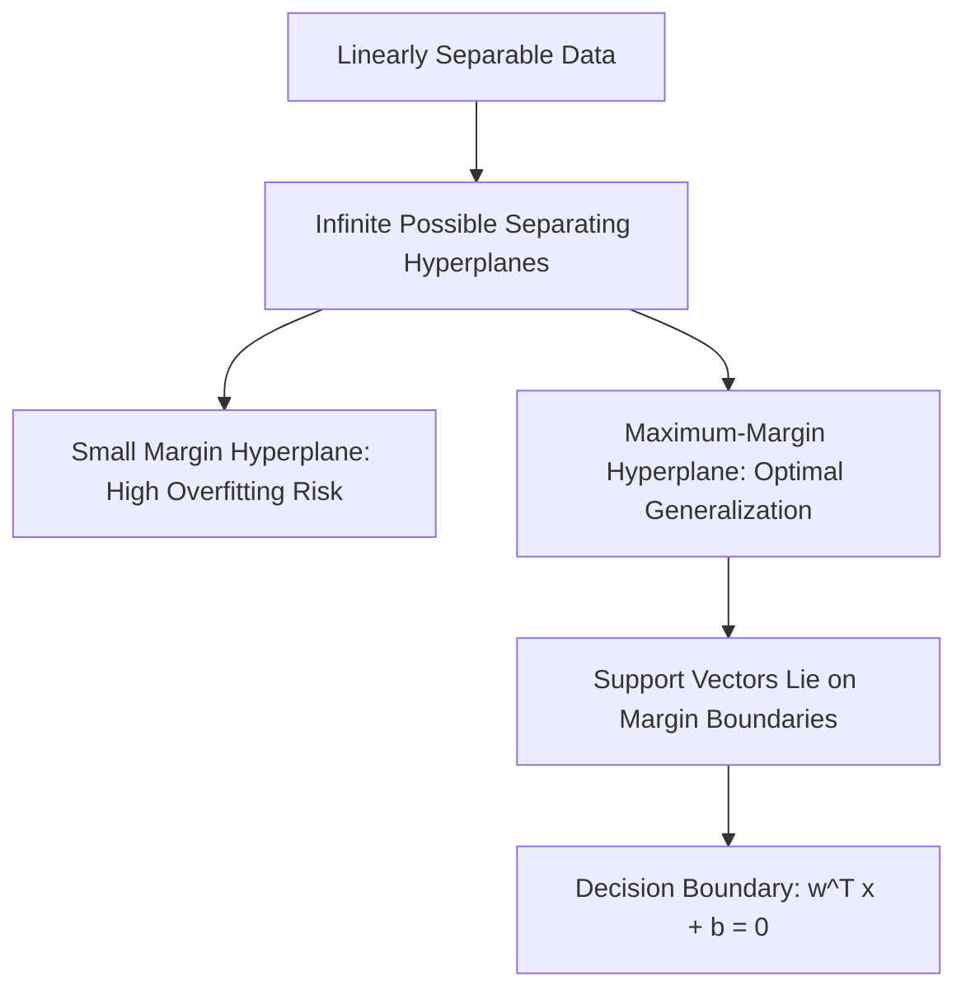
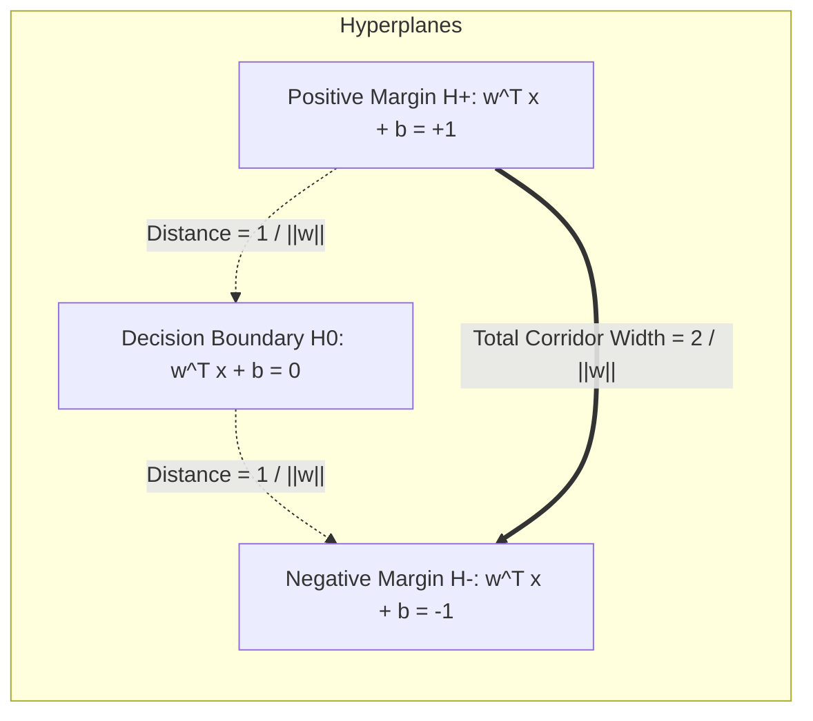
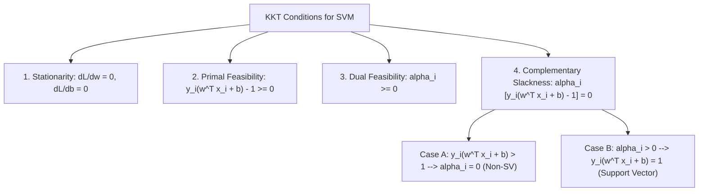
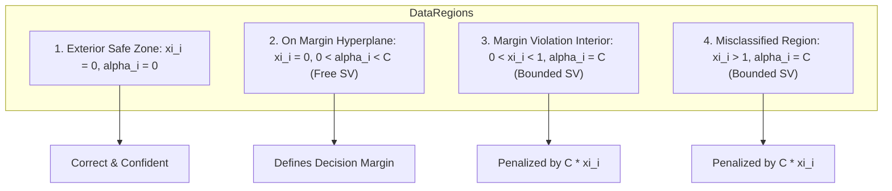
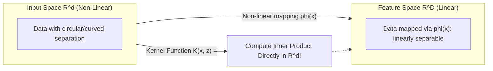
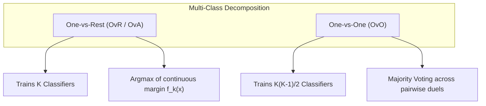
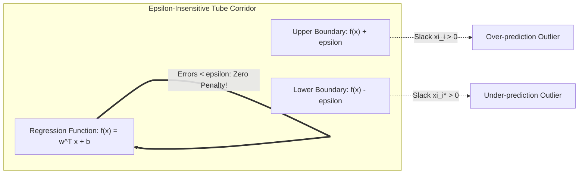

# Complete Machine Learning Notes: Support Vector Machines

> **Course Code:** 3CS526CC23
> **Course Title:** Machine Learning and its Applications
> **Primary Source:** Faculty Lecture Slides - Nirma University
> **Files Integrated:** Support Vector Machines.pdf (39 Slides)

---

# Chapter 8 — Support Vector Machines

## 1. Chapter Overview & Narrative Introduction

Support Vector Machines (SVMs) represent one of the most mathematically rigorous, robust, and elegant supervised learning paradigms developed in statistical learning theory. Originating from the structural risk minimization principle pioneered by Vladimir Vapnik and Alexey Chervonenkis, SVMs fundamentally shift the machine learning philosophy from empirical risk minimization (minimizing training errors alone) to maximizing generalization margin. While classical linear models such as perceptrons or logistic regression find *any* separating hyperplane that divides training classes, SVM seeks the unique, geometrically optimal *maximum-margin hyperplane*.

This chapter establishes a comprehensive, end-to-end mathematical and conceptual exposition of Support Vector Machines as taught in advanced academic curricula:

1. **Geometric Foundations:** The geometry of hyperplanes, functional vs. geometric margins, and the formal proof of margin width $\gamma = \frac{2}{\|\mathbf{w}\|}$.
2. **Hard-Margin Optimization:** The convex quadratic programming formulation for linearly separable patterns, derivation of the Primal Lagrangian, Karush-Kuhn-Tucker (KKT) first-order optimality conditions, and the Wolfe Dual formulation.
3. **Soft-Margin Optimization:** Incorporating slack variables $\xi_i$ and penalty hyperparameter $C$ to handle noise, outliers, and linearly inseparable datasets, leading to the box constraint $0 \le \alpha_i \le C$.
4. **The Kernel Trick & Non-Linear SVM:** Implicit mapping into high-dimensional Hilbert feature spaces $\mathcal{X} \to \mathcal{H}$ via Mercer-compliant kernel functions (Polynomial, Gaussian Radial Basis Function, Sigmoid), bypassing the curse of dimensionality.
5. **Support Vector Regression (SVR):** Extending maximum-margin principles to real-valued regression using Vapnik's $\epsilon$-insensitive loss function.
6. **Algorithmic Implementations:** The Sequential Minimal Optimization (SMO) decomposition technique and multi-class extension strategies (One-vs-Rest and One-vs-One).
7. **Rigorous Worked Numerical Examples:** Three fully solved 10–15 mark examination problems detailing Gram matrix calculation, dual optimization, weight/bias extraction, slack evaluation, and non-linear XOR separation.

[Source: Support Vector Machines.pdf, Slides 1–4]

---

## 2. Core Terminology Dictionary

1. **Hyperplane:** An affine subspace of dimension $d-1$ embedded within a $d$-dimensional vector space that divides the space into two disjoint half-spaces.
2. **Decision Boundary:** The locus of points where the classifier output is zero ($\mathbf{w}^T \mathbf{x} + b = 0$), partitioning input space into positive and negative decision regions.
3. **Linear Classifier:** A classification model that makes predictive decisions based on a linear combination of input features.
4. **Binary Classifier:** A supervised learning model designed to categorize inputs into one of exactly two discrete classes, typically labeled $y \in \{-1, +1\}$.
5. **Functional Margin ($\hat{\gamma}_i$):** An unnormalized algebraic metric defined as $\hat{\gamma}_i = y_i(\mathbf{w}^T \mathbf{x}_i + b)$, reflecting both classification correctness and confidence.
6. **Geometric Margin ($\gamma_i$):** The Euclidean orthogonal distance from a sample point $\mathbf{x}_i$ to the decision hyperplane, defined as $\gamma_i = \frac{y_i(\mathbf{w}^T \mathbf{x}_i + b)}{\|\mathbf{w}\|}$.
7. **Canonical Hyperplane:** A scaled hyperplane representation wherein the functional margin of the closest training point is normalized exactly to $1$ ($\min_i y_i(\mathbf{w}^T \mathbf{x}_i + b) = 1$).
8. **Margin Hyperplanes ($H_+, H_-$):** The two parallel bounding hyperplanes given by $\mathbf{w}^T \mathbf{x} + b = +1$ and $\mathbf{w}^T \mathbf{x} + b = -1$ that delimit the empty margin corridor.
9. **Margin Width ($\gamma$):** The total perpendicular distance separating the positive and negative margin hyperplanes, equal to $\frac{2}{\|\mathbf{w}\|}$.
10. **Maximum-Margin Hyperplane:** The unique optimal separating hyperplane that maximizes the geometric margin width $\gamma$, minimizing generalization error bounds.
11. **Support Vectors:** The critical subset of training exemplar vectors that lie directly on or violate the margin hyperplanes, uniquely determining the position and orientation of the decision boundary.
12. **Linearly Separable:** A dataset property where positive and negative clusters can be partitioned with zero classification errors by a flat hyperplane.
13. **Linearly Inseparable:** A dataset configuration where no flat hyperplane can separate the classes without misclassifying one or more data points.
14. **Primal Optimization Problem:** The original formulation of the SVM problem in parameter space $(\mathbf{w}, b)$ seeking to minimize $\frac{1}{2}\|\mathbf{w}\|^2$ subject to inequality constraints.
15. **Lagrange Multipliers ($\alpha_i$):** Auxiliary scalar variables introduced to convert constrained optimization problems into unconstrained saddle-point problems.
16. **Primal Lagrangian ($L_P$):** The composite objective function combining the primal minimization target with weighted constraint violation penalties.
17. **Karush-Kuhn-Tucker (KKT) Conditions:** First-order necessary conditions for a solution in non-linear mathematical programming to be optimal under inequality constraints.
18. **Complementary Slackness:** The KKT condition requiring $\alpha_i [y_i(\mathbf{w}^T \mathbf{x}_i + b) - 1] = 0$, guaranteeing that only points on the margin have strictly positive Lagrange multipliers.
19. **Wolfe Dual Problem ($L_D$):** An equivalent concave quadratic maximization formulation expressed purely in terms of Lagrange multipliers $\boldsymbol{\alpha}$ and pairwise inner products of training vectors.
20. **Slack Variables ($\xi_i$):** Non-negative continuous error variables measuring the distance by which a data point violates the ideal margin boundary.
21. **Penalty Parameter ($C$):** A positive regularization hyperparameter governing the tradeoff between margin width maximization and empirical slack error minimization.
22. **Box Constraint:** The dual constraint $0 \le \alpha_i \le C$ arising in soft-margin SVM that caps the influence of any single outlier instance.
23. **Sequential Minimal Optimization (SMO):** An iterative decomposition algorithm that analytically optimizes two Lagrange multipliers per step without requiring costly matrix inversions.
24. **Non-Linear Feature Mapping ($\phi(\mathbf{x})$):** A vector-valued transformation projecting input vectors from low-dimensional input space $\mathbb{R}^d$ into a higher-dimensional feature space $\mathbb{R}^D$ ($D \gg d$).
25. **Kernel Function ($K(\mathbf{x}, \mathbf{z})$):** A symmetric function computing the inner product of two mapped vectors $\langle \phi(\mathbf{x}), \phi(\mathbf{z}) \rangle$ directly in original input space.
26. **Kernel Trick:** The computational technique of replacing expensive inner products in high-dimensional feature space with cheap kernel function evaluations in input space.
27. **Gram Matrix ($\mathbf{K}$):** An $N \times N$ symmetric matrix whose $(i, j)$-th entry is the kernel evaluation $K(\mathbf{x}_i, \mathbf{x}_j)$ between training points $\mathbf{x}_i$ and $\mathbf{x}_j$.
28. **Mercer's Theorem:** A mathematical theorem establishing that a continuous symmetric kernel function can be expanded into an inner product in some Hilbert space if and only if its Gram matrix is positive semi-definite.
29. **Support Vector Regression (SVR):** An adaptation of SVM to continuous target regression that penalizes errors exceeding an insensitive tolerance threshold $\epsilon$.
30. **$\epsilon$-Insensitive Loss Function:** A loss function defined by $L_\epsilon(y, f(\mathbf{x})) = \max(0, |y - f(\mathbf{x})| - \epsilon)$, ignoring errors smaller than $\epsilon$ to promote solution sparsity.

[Source: Support Vector Machines.pdf, Slides 2–38]

---

## 3. Mathematical Foundations of Linear Classifiers & Hyperplanes

Linear classification relies on establishing a separating geometric boundary in Euclidean space. Understanding how functional margin scales and how geometric margin measures true Euclidean clearance provides the foundational basis of SVM theory.

### 3.1 Linear Decision Boundaries & The Hyperplane Equation

In a $d$-dimensional feature space $\mathbb{R}^d$, a flat decision boundary is represented by an affine hyperplane:

$$
\mathbf{w}^T \mathbf{x} + b = 0
$$

Where:

- $\mathbf{w} \in \mathbb{R}^d$ is the weight vector, which is strictly perpendicular (normal) to the hyperplane.
- $b \in \mathbb{R}$ is the bias scalar (intercept), determining the displacement of the hyperplane from the origin.

For any query point $\mathbf{x} \in \mathbb{R}^d$, the linear decision function evaluates the sign of the affine transformation:

$$
f(\mathbf{x}) = \text{sign}(\mathbf{w}^T \mathbf{x} + b)
$$

The decision rule classifies the input as:

- $y = +1$ if $\mathbf{w}^T \mathbf{x} + b > 0$
- $y = -1$ if $\mathbf{w}^T \mathbf{x} + b < 0$
- Indeterminate (on the decision boundary) if $\mathbf{w}^T \mathbf{x} + b = 0$

| Symbol | Meaning | Units / Range |
| :--- | :--- | :--- |
| $\mathbf{w}$ | Normal weight vector | $\mathbb{R}^d$ |
| $\mathbf{x}$ | Input feature vector | $\mathbb{R}^d$ |
| $b$ | Bias term (offset from origin) | $\mathbb{R}$ |
| $f(\mathbf{x})$ | Predicted discrete class label | $\{-1, +1\}$ |

[Source: Support Vector Machines.pdf, Slides 2–4]

---

### 3.2 Functional Margin vs. Geometric Margin

To measure how reliably and confidently a training instance $(\mathbf{x}_i, y_i)$ is classified, statistical learning theory formalizes two distinct margin metrics.

#### Definition: Functional Margin

**Meaning:** The algebraic product of the true class label and the unnormalized hyperplane activation.

**Formal Definition:**
Given a training instance $(\mathbf{x}_i, y_i)$ where $y_i \in \{-1, +1\}$, the functional margin with respect to hyperplane $(\mathbf{w}, b)$ is:

$$
\hat{\gamma}_i = y_i (\mathbf{w}^T \mathbf{x}_i + b)
$$

For a dataset $\mathcal{D} = \{(\mathbf{x}_i, y_i)\}_{i=1}^N$, the functional margin of the dataset is:

$$
\hat{\gamma} = \min_{i \in \{1, \dots, N\}} \hat{\gamma}_i
$$

**Intuition:** If $y_i = +1$, we desire $\mathbf{w}^T \mathbf{x}_i + b \gg 0$; if $y_i = -1$, we desire $\mathbf{w}^T \mathbf{x}_i + b \ll 0$. Thus, a positive functional margin ($\hat{\gamma}_i > 0$) signifies correct classification, and larger values imply higher confidence. However, functional margin can be arbitrarily scaled: multiplying $\mathbf{w}$ and $b$ by scalar $k > 0$ scales $\hat{\gamma}_i$ by $k$ without altering the underlying geometric boundary.

| Symbol | Meaning | Units / Range |
| :--- | :--- | :--- |
| $\hat{\gamma}_i$ | Functional margin of $i$-th point | $\mathbb{R}$ |
| $\hat{\gamma}$ | Dataset functional margin | $\mathbb{R}$ |
| $y_i$ | Ground truth label | $\{-1, +1\}$ |

---

#### Definition: Geometric Margin

**Meaning:** The true orthogonal Euclidean distance from data point $\mathbf{x}_i$ to the separating hyperplane.

**Formal Definition:**
The geometric margin $\gamma_i$ of sample point $\mathbf{x}_i$ with respect to hyperplane $(\mathbf{w}, b)$ is:

$$
\gamma_i = \frac{y_i (\mathbf{w}^T \mathbf{x}_i + b)}{\|\mathbf{w}\|} = \frac{\hat{\gamma}_i}{\|\mathbf{w}\|}
$$

For the complete training dataset $\mathcal{D}$, the geometric margin is:

$$
\gamma = \min_{i \in \{1, \dots, N\}} \gamma_i
$$

**Intuition:** Geometric margin is invariant to positive rescalings of $\mathbf{w}$ and $b$. Replacing $(\mathbf{w}, b)$ with $(k\mathbf{w}, kb)$ leaves $\gamma_i$ unchanged because $\frac{k(\mathbf{w}^T \mathbf{x}_i + b)}{\|k\mathbf{w}\|} = \frac{k}{k} \frac{\mathbf{w}^T \mathbf{x}_i + b}{\|\mathbf{w}\|} = \gamma_i$.

| Symbol | Meaning | Units / Range |
| :--- | :--- | :--- |
| $\gamma_i$ | Geometric margin of $i$-th point | $\mathbb{R}^+$ (for correct classification) |
| $\gamma$ | Overall dataset geometric margin | $\mathbb{R}^+$ |
| $\|\mathbf{w}\|$ | Euclidean $L_2$-norm of weight vector | $\mathbb{R}^+$ |

[Source: Support Vector Machines.pdf, Slides 3–5]

---

### 3.3 Derivation of Geometric Margin Width: $\gamma = \frac{2}{\|\mathbf{w}\|}$

We now prove from first geometric principles that the perpendicular distance separating the positive and negative margin hyperplanes equals $\frac{2}{\|\mathbf{w}\|}$.

**Step 1: Define canonical margin hyperplanes.**
Let the separating hyperplane be $H_0: \mathbf{w}^T \mathbf{x} + b = 0$. Since scaling $(\mathbf{w}, b)$ does not change the physical plane, we fix the scale of $(\mathbf{w}, b)$ such that the closest positive point and closest negative point satisfy:

$$
\min_{i: y_i = +1} (\mathbf{w}^T \mathbf{x}_i + b) = +1
$$

$$
\max_{i: y_i = -1} (\mathbf{w}^T \mathbf{x}_i + b) = -1
$$

This defines the positive margin hyperplane $H_+$ and negative margin hyperplane $H_-$:

$$
H_+: \mathbf{w}^T \mathbf{x} + b = +1
$$

$$
H_-: \mathbf{w}^T \mathbf{x} + b = -1
$$

**Step 2: Vector projection between margin hyperplanes.**
Let $\mathbf{x}_+ \in H_+$ be a support vector on the positive margin boundary, so:

$$
\mathbf{w}^T \mathbf{x}_+ + b = +1
$$

Let $\mathbf{x}_- \in H_-$ be the orthogonal projection of $\mathbf{x}_+$ onto the negative margin boundary $H_-$. Since $\mathbf{w}$ is normal to the hyperplanes, the unit normal vector pointing from $H_-$ to $H_+$ is:

$$
\mathbf{u} = \frac{\mathbf{w}}{\|\mathbf{w}\|}
$$

Therefore, $\mathbf{x}_+$ can be expressed in terms of $\mathbf{x}_-$ translated along the normal vector by margin width $\gamma$:

$$
\mathbf{x}_+ = \mathbf{x}_- + \gamma \frac{\mathbf{w}}{\|\mathbf{w}\|}
$$

**Step 3: Substitute into the positive hyperplane equation.**
Multiply both sides of the vector translation equation by $\mathbf{w}^T$ and add bias $b$:

$$
\mathbf{w}^T \mathbf{x}_+ + b = \mathbf{w}^T \left( \mathbf{x}_- + \gamma \frac{\mathbf{w}}{\|\mathbf{w}\|} \right) + b
$$

Expand the right-hand side using the distributive property of inner products:

$$
\mathbf{w}^T \mathbf{x}_+ + b = \mathbf{w}^T \mathbf{x}_- + b + \gamma \frac{\mathbf{w}^T \mathbf{w}}{\|\mathbf{w}\|}
$$

Recall that $\mathbf{w}^T \mathbf{w} = \|\mathbf{w}\|^2$:

$$
\mathbf{w}^T \mathbf{x}_+ + b = (\mathbf{w}^T \mathbf{x}_- + b) + \gamma \frac{\|\mathbf{w}\|^2}{\|\mathbf{w}\|} = (\mathbf{w}^T \mathbf{x}_- + b) + \gamma \|\mathbf{w}\|
$$

**Step 4: Solve algebraically for margin width $\gamma$.**
Substitute the known boundary values $\mathbf{w}^T \mathbf{x}_+ + b = +1$ and $\mathbf{w}^T \mathbf{x}_- + b = -1$:

$$
+1 = -1 + \gamma \|\mathbf{w}\|
$$

$$
2 = \gamma \|\mathbf{w}\|
$$

$$
\gamma = \frac{2}{\|\mathbf{w}\|}
$$

Thus, maximizing the geometric clearance $\gamma$ between classes is mathematically equivalent to minimizing $\|\mathbf{w}\|$, or equivalently minimizing $\frac{1}{2}\|\mathbf{w}\|^2$. $\blacksquare$

[Source: Support Vector Machines.pdf, Slides 4–6]

---

## 4. Hard-Margin Support Vector Machines (Linearly Separable Case)

When training data is strictly linearly separable, there exists an infinite family of hyperplanes with zero classification error. SVM identifies the unique maximum-margin hyperplane by formulating a convex quadratic optimization program.

### 4.1 Primal Optimization Problem

The goal is to maximize the margin corridor $\frac{2}{\|\mathbf{w}\|}$ while ensuring that every training point satisfies the canonical margin condition $y_i(\mathbf{w}^T \mathbf{x}_i + b) \ge 1$.

Maximizing $\frac{2}{\|\mathbf{w}\|}$ is equivalent to minimizing $\frac{\|\mathbf{w}\|}{2}$, which is monotonic with minimizing $\frac{1}{2}\|\mathbf{w}\|^2$. Squaring $\|\mathbf{w}\|$ replaces the non-smooth square root with a strictly convex, differentiable quadratic function:

$$
\min_{\mathbf{w}, b} \frac{1}{2} \|\mathbf{w}\|^2 = \min_{\mathbf{w}, b} \frac{1}{2} \mathbf{w}^T \mathbf{w}
$$

$$
\text{subject to } y_i (\mathbf{w}^T \mathbf{x}_i + b) \ge 1, \quad \forall i \in \{1, 2, \dots, N\}
$$

| Symbol | Meaning | Units / Range |
| :--- | :--- | :--- |
| $\frac{1}{2}\|\mathbf{w}\|^2$ | Quadratic objective function | $\mathbb{R}^+$ |
| $N$ | Total number of training samples | $\mathbb{N}$ |
| $y_i(\mathbf{w}^T \mathbf{x}_i + b) \ge 1$ | Separation inequality constraint | Boolean / Feasible set |

[Source: Support Vector Machines.pdf, Slide 6]

---

### 4.2 The Method of Lagrange Multipliers & The Primal Lagrangian

The primal problem is a constrained convex optimization program with $N$ inequality constraints. We introduce non-negative Lagrange multipliers $\alpha_i \ge 0$ for each constraint:

$$
1 - y_i (\mathbf{w}^T \mathbf{x}_i + b) \le 0
$$

The Primal Lagrangian function $L_P(\mathbf{w}, b, \boldsymbol{\alpha})$ is formulated as:

$$
L_P(\mathbf{w}, b, \boldsymbol{\alpha}) = \frac{1}{2} \|\mathbf{w}\|^2 - \sum_{i=1}^N \alpha_i \left[ y_i (\mathbf{w}^T \mathbf{x}_i + b) - 1 \right]
$$

Expanding the summation terms:

$$
L_P(\mathbf{w}, b, \boldsymbol{\alpha}) = \frac{1}{2} \mathbf{w}^T \mathbf{w} - \sum_{i=1}^N \alpha_i y_i \mathbf{w}^T \mathbf{x}_i - b \sum_{i=1}^N \alpha_i y_i + \sum_{i=1}^N \alpha_i
$$

| Symbol | Meaning | Units / Range |
| :--- | :--- | :--- |
| $L_P$ | Primal Lagrangian | $\mathbb{R}$ |
| $\alpha_i$ | Lagrange multiplier for $i$-th instance | $\alpha_i \ge 0$ |
| $\boldsymbol{\alpha}$ | Vector of all $N$ Lagrange multipliers | $\mathbb{R}_+^N$ |

[Source: Support Vector Machines.pdf, Slides 6–7]

---

### 4.3 Karush-Kuhn-Tucker (KKT) Optimality Conditions

Since the objective $\frac{1}{2}\|\mathbf{w}\|^2$ is strictly convex and the inequality constraints are linear (satisfying Slater's condition for strong duality), the Karush-Kuhn-Tucker (KKT) conditions are both necessary and sufficient for global optimality.

The four KKT condition groups are:

1. **Stationarity (Vanishing Gradients of $L_P$):**

$$
   \nabla_{\mathbf{w}} L_P = \mathbf{w} - \sum_{i=1}^N \alpha_i y_i \mathbf{x}_i = \mathbf{0} \implies \mathbf{w} = \sum_{i=1}^N \alpha_i y_i \mathbf{x}_i
$$

$$
   \frac{\partial L_P}{\partial b} = -\sum_{i=1}^N \alpha_i y_i = 0 \implies \sum_{i=1}^N \alpha_i y_i = 0
$$

2. **Primal Feasibility:**

$$
   y_i (\mathbf{w}^T \mathbf{x}_i + b) - 1 \ge 0, \quad \forall i \in \{1, \dots, N\}
$$

3. **Dual Feasibility:**

$$
   \alpha_i \ge 0, \quad \forall i \in \{1, \dots, N\}
$$

4. **Complementary Slackness:**

$$
   \alpha_i \left[ y_i (\mathbf{w}^T \mathbf{x}_i + b) - 1 \right] = 0, \quad \forall i \in \{1, \dots, N\}
$$

[Source: Support Vector Machines.pdf, Slides 7–9]

---

### 4.4 Complementary Slackness Proof for Support Vectors

Complementary slackness reveals the defining geometric property of Support Vector Machines: **sparsity**.

Consider the product:

$$
\alpha_i \left[ y_i (\mathbf{w}^T \mathbf{x}_i + b) - 1 \right] = 0
$$

For each training instance $i$, exactly one of two mutually exclusive cases must hold:

- **Case 1: The point lies strictly outside the margin boundary ($y_i(\mathbf{w}^T \mathbf{x}_i + b) > 1$).**
  Here, the bracketed term is strictly positive ($y_i(\mathbf{w}^T \mathbf{x}_i + b) - 1 > 0$). To satisfy complementary slackness, the Lagrange multiplier **must be identically zero**:

$$
  \alpha_i = 0
$$

  These points play zero role in defining $\mathbf{w} = \sum \alpha_i y_i \mathbf{x}_i$. Moving or removing them does not change the decision boundary.

- **Case 2: The point has a strictly non-zero Lagrange multiplier ($\alpha_i > 0$).**
  To maintain $\alpha_i [y_i(\mathbf{w}^T \mathbf{x}_i + b) - 1] = 0$, the bracketed term **must equal zero**:

$$
  y_i (\mathbf{w}^T \mathbf{x}_i + b) - 1 = 0 \implies y_i (\mathbf{w}^T \mathbf{x}_i + b) = 1
$$

  These points lie directly on the margin hyperplanes ($H_+$ or $H_-$). These are the **Support Vectors**.

Thus, the optimal weight vector $\mathbf{w}^*$ is entirely supported by the sparse subset of points on the margin corridor:

$$
\mathbf{w}^* = \sum_{i \in \text{Support Vectors}} \alpha_i y_i \mathbf{x}_i
$$

[Source: Support Vector Machines.pdf, Slides 8–10]

---

### 4.5 Complete Algebraic Derivation of the Wolfe Dual Formulation

To eliminate primal variables $\mathbf{w}$ and $b$, we substitute the stationarity conditions back into the Primal Lagrangian $L_P$.

**Step 1: Write the expanded Primal Lagrangian.**

$$
L_P(\mathbf{w}, b, \boldsymbol{\alpha}) = \frac{1}{2} \mathbf{w}^T \mathbf{w} - \sum_{i=1}^N \alpha_i y_i \mathbf{w}^T \mathbf{x}_i - b \sum_{i=1}^N \alpha_i y_i + \sum_{i=1}^N \alpha_i
$$

**Step 2: Apply the bias stationarity condition $\sum_{i=1}^N \alpha_i y_i = 0$.**
The term involving $b$ vanishes identically:

$$
- b \sum_{i=1}^N \alpha_i y_i = - b(0) = 0
$$

**Step 3: Substitute the weight stationarity condition $\mathbf{w} = \sum_{i=1}^N \alpha_i y_i \mathbf{x}_i$.**
Evaluate the first term $\frac{1}{2}\mathbf{w}^T \mathbf{w}$:

$$
\frac{1}{2} \mathbf{w}^T \mathbf{w} = \frac{1}{2} \left( \sum_{i=1}^N \alpha_i y_i \mathbf{x}_i \right)^T \left( \sum_{j=1}^N \alpha_j y_j \mathbf{x}_j \right) = \frac{1}{2} \sum_{i=1}^N \sum_{j=1}^N \alpha_i \alpha_j y_i y_j (\mathbf{x}_i^T \mathbf{x}_j)
$$

Now evaluate the second term $-\sum_{i=1}^N \alpha_i y_i \mathbf{w}^T \mathbf{x}_i$:

$$
-\sum_{i=1}^N \alpha_i y_i \left( \sum_{j=1}^N \alpha_j y_j \mathbf{x}_j \right)^T \mathbf{x}_i = - \sum_{i=1}^N \sum_{j=1}^N \alpha_i \alpha_j y_i y_j (\mathbf{x}_i^T \mathbf{x}_j)
$$

**Step 4: Combine all terms into the Wolfe Dual objective $L_D(\boldsymbol{\alpha})$.**

$$
L_D(\boldsymbol{\alpha}) = \frac{1}{2} \sum_{i=1}^N \sum_{j=1}^N \alpha_i \alpha_j y_i y_j (\mathbf{x}_i^T \mathbf{x}_j) - \sum_{i=1}^N \sum_{j=1}^N \alpha_i \alpha_j y_i y_j (\mathbf{x}_i^T \mathbf{x}_j) + \sum_{i=1}^N \alpha_i
$$

Combining the two double-summation terms:

$$
L_D(\boldsymbol{\alpha}) = \sum_{i=1}^N \alpha_i - \frac{1}{2} \sum_{i=1}^N \sum_{j=1}^N \alpha_i \alpha_j y_i y_j (\mathbf{x}_i^T \mathbf{x}_j)
$$

**Step 5: State the complete Dual Quadratic Program.**

$$
\max_{\boldsymbol{\alpha}} \left[ \sum_{i=1}^N \alpha_i - \frac{1}{2} \sum_{i=1}^N \sum_{j=1}^N \alpha_i \alpha_j y_i y_j \langle \mathbf{x}_i \cdot \mathbf{x}_j \rangle \right]
$$

$$
\text{subject to } \sum_{i=1}^N \alpha_i y_i = 0 \quad \text{and} \quad \alpha_i \ge 0, \quad \forall i \in \{1, \dots, N\}
$$

| Symbol | Meaning | Units / Range |
| :--- | :--- | :--- |
| $L_D(\boldsymbol{\alpha})$ | Wolfe Dual objective function | $\mathbb{R}$ |
| $\langle \mathbf{x}_i \cdot \mathbf{x}_j \rangle$ | Inner product $\mathbf{x}_i^T \mathbf{x}_j$ | $\mathbb{R}$ |
| $\sum_{i=1}^N \alpha_i y_i = 0$ | Linear equality constraint | Scalar equality |
| $\alpha_i \ge 0$ | Non-negativity inequality constraint | $\mathbb{R}_+$ |

[Source: Support Vector Machines.pdf, Slides 11–13]

---

### 4.6 Properties & Computational Advantages of the Dual Problem

1. **Inner Product Dependency:** The dual formulation depends on the training inputs $\mathbf{x}_i$ **exclusively through pairwise dot products** $\langle \mathbf{x}_i \cdot \mathbf{x}_j \rangle$. The raw feature coordinates are never required individually, which enables the Kernel Trick.
2. **Dimension Independence:** In the primal problem, the number of parameters to optimize is $d+1$ (where $d$ is feature space dimension). In the dual problem, the number of variables is $N$ (the number of training instances). When $d \gg N$ (or when $d \to \infty$ in Hilbert spaces), solving the dual is exponentially more efficient than solving the primal.
3. **Simpler Constraints:** The primal has $N$ complex linear inequality constraints coupling all coordinates of $\mathbf{w}$; the dual has simple non-negativity box bounds ($\alpha_i \ge 0$) and a single scalar linear equality constraint.

[Source: Support Vector Machines.pdf, Slide 14]

---

### 4.7 Recovering Optimal Weight Vector $\mathbf{w}^*$ & Bias $b^*$

Once the optimal dual vector $\boldsymbol{\alpha}^*$ is obtained:

1. **Optimal Weights:**

$$
   \mathbf{w}^* = \sum_{i=1}^N \alpha_i^* y_i \mathbf{x}_i
$$

2. **Optimal Bias:**
   Select any support vector $\mathbf{x}_k$ for which $\alpha_k^* > 0$. By complementary slackness, $y_k(\mathbf{w}^{*T} \mathbf{x}_k + b^*) = 1$. Multiply both sides by $y_k$ (noting $y_k^2 = 1$):

$$
   \mathbf{w}^{*T} \mathbf{x}_k + b^* = y_k \implies b^* = y_k - \mathbf{w}^{*T} \mathbf{x}_k = y_k - \sum_{i=1}^N \alpha_i^* y_i (\mathbf{x}_i^T \mathbf{x}_k)
$$

   To ensure numerical stability against roundoff errors, $b^*$ is typically averaged over the full set of $N_{SV}$ support vectors:

$$
   b^* = \frac{1}{N_{SV}} \sum_{k \in \mathcal{SV}} \left( y_k - \sum_{i \in \mathcal{SV}} \alpha_i^* y_i (\mathbf{x}_i^T \mathbf{x}_k) \right)
$$

3. **Classification of a New Query Point $\mathbf{x}^*$:**

$$
   f(\mathbf{x}^*) = \text{sign}\left( \mathbf{w}^{*T} \mathbf{x}^* + b^* \right) = \text{sign}\left( \sum_{i \in \mathcal{SV}} \alpha_i^* y_i \langle \mathbf{x}_i \cdot \mathbf{x}^* \rangle + b^* \right)
$$

[Source: Support Vector Machines.pdf, Slide 15]

---

## 5. Soft-Margin Support Vector Machines (Linearly Inseparable Case)

Real-world datasets rarely exhibit perfect linear separability due to measurement noise, overlapping feature distributions, and outliers. Enforcing a hard margin on noisy data either results in no feasible solution or causes severe overfitting with an extremely narrow margin corridor.

### 5.1 Intuition: Noise, Outliers, and Inseparability

Cortes and Vapnik (1995) introduced **slack variables** $\xi_i \ge 0$ into the optimization problem. Slack variables relax the rigid margin constraint, permitting controlled violations of the margin corridor while penalizing them in the objective function.

[Source: Support Vector Machines.pdf, Slides 16–17]

---

### 5.2 Slack Variables $\xi_i$ and the Soft-Margin Primal Formulation

For each training example $\mathbf{x}_i$, we introduce a slack variable $\xi_i \ge 0$:

$$
y_i (\mathbf{w}^T \mathbf{x}_i + b) \ge 1 - \xi_i
$$

The soft-margin optimization problem balances margin maximization with total slack error:

$$
\min_{\mathbf{w}, b, \boldsymbol{\xi}} \left[ \frac{1}{2} \|\mathbf{w}\|^2 + C \sum_{i=1}^N \xi_i \right]
$$

$$
\text{subject to } y_i (\mathbf{w}^T \mathbf{x}_i + b) \ge 1 - \xi_i \quad \text{and} \quad \xi_i \ge 0, \quad \forall i \in \{1, \dots, N\}
$$

| Symbol | Meaning | Units / Range |
| :--- | :--- | :--- |
| $\xi_i$ | Slack variable for $i$-th point | $\mathbb{R}_+ = [0, \infty)$ |
| $C$ | Regularization tradeoff hyperparameter | $\mathbb{R}_+ = (0, \infty)$ |
| $\sum_{i=1}^N \xi_i$ | Total empirical margin error | $\mathbb{R}_+$ |

[Source: Support Vector Machines.pdf, Slides 18–19]

---

### 5.3 The Penalty Parameter $C$ (Bias-Variance Tradeoff)

Hyperparameter $C > 0$ dictates the relative penalty assigned to margin violations versus margin width:

- **Large $C$ ($C \to \infty$):** Assigns massive penalties to any slack violation ($\xi_i > 0$). The optimizer prioritizes zero margin violations, producing a narrow margin corridor. This leads to **low bias and high variance** (risk of overfitting).
- **Small $C$ ($C \to 0$):** Softens the penalty for margin violations. The optimizer prioritizes a wide margin corridor $\frac{2}{\|\mathbf{w}\|}$ even if several training points fall inside the corridor or get misclassified. This leads to **high bias and low variance** (risk of underfitting).

| Regime | Margin Width ($\gamma$) | Number of SVs | Bias | Variance | Behavior |
| :--- | :--- | :--- | :--- | :--- | :--- |
| **High $C$** | Narrow | Fewer (strictly on edge) | Low | High | Overfitting prone |
| **Low $C$** | Wide | Many (more points inside corridor) | High | Low | Robust to outliers |

[Source: Support Vector Machines.pdf, Slide 20]

---

### 5.4 Dual Formulation of Soft-Margin SVM & The Box Constraint

To derive the dual, we introduce Lagrange multipliers $\alpha_i \ge 0$ for the margin constraints and $r_i \ge 0$ for the slack non-negativity constraints ($\xi_i \ge 0$):

$$
L_P(\mathbf{w}, b, \boldsymbol{\xi}, \boldsymbol{\alpha}, \mathbf{r}) = \frac{1}{2} \|\mathbf{w}\|^2 + C \sum_{i=1}^N \xi_i - \sum_{i=1}^N \alpha_i \left[ y_i (\mathbf{w}^T \mathbf{x}_i + b) - 1 + \xi_i \right] - \sum_{i=1}^N r_i \xi_i
$$

Setting partial derivatives to zero at the saddle point:

1. $\nabla_{\mathbf{w}} L_P = \mathbf{w} - \sum_{i=1}^N \alpha_i y_i \mathbf{x}_i = \mathbf{0} \implies \mathbf{w} = \sum_{i=1}^N \alpha_i y_i \mathbf{x}_i$
2. $\frac{\partial L_P}{\partial b} = -\sum_{i=1}^N \alpha_i y_i = 0 \implies \sum_{i=1}^N \alpha_i y_i = 0$
3. $\frac{\partial L_P}{\partial \xi_i} = C - \alpha_i - r_i = 0 \implies C = \alpha_i + r_i$

Since dual multiplier $r_i \ge 0$, the relation $C - \alpha_i = r_i \ge 0$ directly implies:

$$
\alpha_i \le C
$$

Combined with $\alpha_i \ge 0$, we obtain the famous **Box Constraint**:

$$
0 \le \alpha_i \le C
$$

Substituting these back into $L_P$ yields the Soft-Margin Wolfe Dual:

$$
\max_{\boldsymbol{\alpha}} \left[ \sum_{i=1}^N \alpha_i - \frac{1}{2} \sum_{i=1}^N \sum_{j=1}^N \alpha_i \alpha_j y_i y_j \langle \mathbf{x}_i \cdot \mathbf{x}_j \rangle \right]
$$

$$
\text{subject to } \sum_{i=1}^N \alpha_i y_i = 0 \quad \text{and} \quad 0 \le \alpha_i \le C, \quad \forall i \in \{1, \dots, N\}
$$

Remarkably, the dual objective function of the soft-margin SVM is **identical** to the hard-margin SVM! The only difference is that the upper bound $\alpha_i \le C$ replaces $\alpha_i \le \infty$.

[Source: Support Vector Machines.pdf, Slides 21–23]

---

### 5.5 Classification of Training Points via KKT Complementary Slackness

In soft-margin SVM, the KKT complementary slackness conditions are:

$$
\alpha_i \left[ y_i (\mathbf{w}^T \mathbf{x}_i + b) - 1 + \xi_i \right] = 0
$$

$$
r_i \xi_i = (C - \alpha_i) \xi_i = 0
$$

These yield four distinct point categories:

1. **Non-Support Vectors ($\alpha_i = 0$):**
   Since $\alpha_i < C$, we have $C - \alpha_i > 0 \implies \xi_i = 0$.
   From the first condition, $y_i(\mathbf{w}^T \mathbf{x}_i + b) \ge 1$. The point lies safely outside the margin corridor on the correct side.

2. **Free (Unbounded) Support Vectors ($0 < \alpha_i < C$):**
   Since $\alpha_i < C$, $r_i = C - \alpha_i > 0$, forcing $\xi_i = 0$.
   Since $\alpha_i > 0$, the first condition forces $y_i(\mathbf{w}^T \mathbf{x}_i + b) - 1 + 0 = 0 \implies y_i(\mathbf{w}^T \mathbf{x}_i + b) = 1$.
   The point lies **exactly on the margin hyperplane** ($H_+$ or $H_-$). These points are used to compute the optimal bias $b^*$.

3. **Bounded Margin-Violating Support Vectors ($\alpha_i = C, 0 < \xi_i < 1$):**
   The point falls inside the margin corridor but on the correct side of the decision boundary ($\mathbf{w}^T \mathbf{x}_i + b$ has the same sign as $y_i$).

4. **Bounded Misclassified Support Vectors ($\alpha_i = C, \xi_i \ge 1$):**
   If $\xi_i = 1$, the point falls exactly on the decision boundary $\mathbf{w}^T \mathbf{x}_i + b = 0$.
   If $\xi_i > 1$, the point crosses the decision boundary and is **misclassified**.

[Source: Support Vector Machines.pdf, Slide 22]

---

### 5.6 Calculation of Bias $b^*$ from Free Support Vectors

Because bounded support vectors have unknown non-zero slacks $\xi_i > 0$, bias $b^*$ must be computed exclusively from **free support vectors** where $0 < \alpha_k < C$ (guaranteeing $\xi_k = 0$):

$$
y_k (\mathbf{w}^{*T} \mathbf{x}_k + b^*) = 1 \implies b^* = y_k - \sum_{i=1}^N \alpha_i^* y_i \langle \mathbf{x}_i \cdot \mathbf{x}_k \rangle
$$

Averaging over all $N_{\text{free}}$ free support vectors gives:

$$
b^* = \frac{1}{N_{\text{free}}} \sum_{k \in \mathcal{SV}_{\text{free}}} \left( y_k - \sum_{i=1}^N \alpha_i^* y_i \langle \mathbf{x}_i \cdot \mathbf{x}_k \rangle \right)
$$

[Source: Support Vector Machines.pdf, Slide 23]

---

### 5.7 The Hinge Loss Formulation of SVM

The soft-margin SVM can also be derived through the empirical risk minimization framework with **Hinge Loss**:

$$
\min_{\mathbf{w}, b} \left[ \sum_{i=1}^N \max\left(0, 1 - y_i(\mathbf{w}^T \mathbf{x}_i + b)\right) + \frac{1}{2C} \|\mathbf{w}\|^2 \right]
$$

Here, $\max(0, 1 - y_i f(\mathbf{x}_i))$ is the Hinge Loss:

- If $y_i f(\mathbf{x}_i) \ge 1$, loss is $0$.
- If $y_i f(\mathbf{x}_i) < 1$, loss increases linearly with rate $1 - y_i f(\mathbf{x}_i)$.

This demonstrates that SVM is an $L_2$-regularized empirical risk minimizer utilizing a convex upper bound to the discrete $0-1$ classification loss.

[Source: Support Vector Machines.pdf, Slide 23]

---

## 6. Non-Linear Support Vector Machines & The Kernel Trick

When data patterns cannot be separated by a linear hyperplane in the original input space, SVM maps the input data into a higher-dimensional feature space where the data becomes linearly separable.

### 6.1 Motivation: Non-Linear Decision Boundaries

Consider concentric circles or the classic XOR problem: no linear plane in $\mathbb{R}^2$ can separate the classes. However, by transforming input vectors $\mathbf{x} = (x_1, x_2)^T$ via a non-linear mapping $\phi(\mathbf{x})$ into a higher-dimensional space, the points become linearly separable by a flat hyperplane in the mapped space.

[Source: Support Vector Machines.pdf, Slides 24–26]

---

### 6.2 Feature Space Mapping $\phi(\mathbf{x})$

Let $\phi: \mathcal{X} \to \mathcal{H}$ denote a non-linear mapping from input space $\mathcal{X} = \mathbb{R}^d$ to feature Hilbert space $\mathcal{H} = \mathbb{R}^D$ where $D \gg d$ (and potentially $D = \infty$).

In feature space $\mathcal{H}$, the decision function becomes:

$$
f(\mathbf{x}) = \text{sign}\left( \mathbf{w}^T \phi(\mathbf{x}) + b \right)
$$

The dual optimization problem in $\mathcal{H}$ becomes:

$$
\max_{\boldsymbol{\alpha}} \left[ \sum_{i=1}^N \alpha_i - \frac{1}{2} \sum_{i=1}^N \sum_{j=1}^N \alpha_i \alpha_j y_i y_j \langle \phi(\mathbf{x}_i) \cdot \phi(\mathbf{x}_j) \rangle \right]
$$

However, explicitly computing $\phi(\mathbf{x})$ for every point is computationally prohibitive and intractable when $D$ is huge or infinite.

[Source: Support Vector Machines.pdf, Slides 27–28]

---

### 6.3 The Kernel Trick Definition and Mathematical Formulation

#### Definition: Kernel Function

**Meaning:** A function that directly computes the inner product between two feature vectors in a transformed Hilbert space using only their original low-dimensional coordinates.

**Formal Definition:**
A kernel function $K: \mathcal{X} \times \mathcal{X} \to \mathbb{R}$ is defined such that for all $\mathbf{x}, \mathbf{z} \in \mathcal{X}$:

$$
K(\mathbf{x}, \mathbf{z}) = \langle \phi(\mathbf{x}) \cdot \phi(\mathbf{z}) \rangle = \phi(\mathbf{x})^T \phi(\mathbf{z})
$$

**Intuition:** The Kernel Trick eliminates the need to explicitly compute, store, or even know the transformation $\phi(\mathbf{x})$. Every occurrence of inner product $\langle \mathbf{x}_i \cdot \mathbf{x}_j \rangle$ in the dual objective, bias calculation, and decision rule is simply replaced by scalar evaluation $K(\mathbf{x}_i, \mathbf{x}_j)$.

The Kernelized SVM Dual problem is:

$$
\max_{\boldsymbol{\alpha}} \left[ \sum_{i=1}^N \alpha_i - \frac{1}{2} \sum_{i=1}^N \sum_{j=1}^N \alpha_i \alpha_j y_i y_j K(\mathbf{x}_i, \mathbf{x}_j) \right]
$$

$$
\text{subject to } \sum_{i=1}^N \alpha_i y_i = 0 \quad \text{and} \quad 0 \le \alpha_i \le C, \quad \forall i \in \{1, \dots, N\}
$$

The Kernelized decision rule is:

$$
f(\mathbf{x}^*) = \text{sign}\left( \sum_{i \in \mathcal{SV}} \alpha_i^* y_i K(\mathbf{x}_i, \mathbf{x}^*) + b^* \right)
$$

| Symbol | Meaning | Units / Range |
| :--- | :--- | :--- |
| $K(\mathbf{x}, \mathbf{z})$ | Kernel function value | $\mathbb{R}$ |
| $\phi(\mathbf{x})$ | Feature mapping vector | $\mathcal{H}$ |
| $\langle \phi(\mathbf{x}) \cdot \phi(\mathbf{z}) \rangle$ | Inner product in Hilbert space | $\mathbb{R}$ |

[Source: Support Vector Machines.pdf, Slides 28–30]

---

### 6.4 Algebraic Derivation: Degree-2 Polynomial Kernel in 2D

We now explicitly derive how the degree-2 polynomial kernel computes an inner product in $\mathbb{R}^3$ (or $\mathbb{R}^4$).

Consider two 2D vectors $\mathbf{x} = (x_1, x_2)^T$ and $\mathbf{z} = (z_1, z_2)^T$.
Define the homogeneous polynomial kernel of degree $d_p = 2$:

$$
K(\mathbf{x}, \mathbf{z}) = (\mathbf{x}^T \mathbf{z})^2
$$

**Step 1: Expand the algebraic square.**

$$
\mathbf{x}^T \mathbf{z} = x_1 z_1 + x_2 z_2
$$

$$
K(\mathbf{x}, \mathbf{z}) = (x_1 z_1 + x_2 z_2)^2 = (x_1 z_1)^2 + 2(x_1 z_1)(x_2 z_2) + (x_2 z_2)^2
$$

$$
K(\mathbf{x}, \mathbf{z}) = x_1^2 z_1^2 + 2 x_1 x_2 z_1 z_2 + x_2^2 z_2^2
$$

**Step 2: Factor into vector inner product form.**
Rewrite this expression as the dot product between two 3-dimensional vectors:

$$
K(\mathbf{x}, \mathbf{z}) = \begin{pmatrix} x_1^2 \\ \sqrt{2} x_1 x_2 \\ x_2^2 \end{pmatrix}^T \begin{pmatrix} z_1^2 \\ \sqrt{2} z_1 z_2 \\ z_2^2 \end{pmatrix}
$$

**Step 3: Identify the feature mapping $\phi(\mathbf{x})$.**

$$
\phi(\mathbf{x}) = \begin{pmatrix} x_1^2 \\ \sqrt{2} x_1 x_2 \\ x_2^2 \end{pmatrix} \in \mathbb{R}^3
$$

Thus, computing $K(\mathbf{x}, \mathbf{z}) = (\mathbf{x}^T \mathbf{z})^2$ in $\mathbb{R}^2$ using only 2 multiplications and 1 addition implicitly computes the dot product of 3-dimensional parabolic and hyperbolic feature vectors in $\mathbb{R}^3$. $\blacksquare$

Similarly, for the inhomogeneous polynomial kernel $K(\mathbf{x}, \mathbf{z}) = (\mathbf{x}^T \mathbf{z} + 1)^2$:

$$
(\mathbf{x}^T \mathbf{z} + 1)^2 = x_1^2 z_1^2 + x_2^2 z_2^2 + 2x_1 x_2 z_1 z_2 + 2x_1 z_1 + 2x_2 z_2 + 1
$$

Which corresponds to a 6-dimensional feature mapping:

$$
\phi(\mathbf{x}) = \begin{pmatrix} x_1^2 & x_2^2 & \sqrt{2}x_1 x_2 & \sqrt{2}x_1 & \sqrt{2}x_2 & 1 \end{pmatrix}^T \in \mathbb{R}^6
$$

[Source: Support Vector Machines.pdf, Slides 31–33]

---

### 6.5 Mercer's Theorem (Continuous and Discrete Gram Matrix Conditions)

Not every arbitrary mathematical function qualifies as a valid kernel. To ensure that an optimization problem remains convex with a global optimum, the kernel must satisfy Mercer's condition.

#### Theorem: Mercer's Condition (Discrete Formulation)

A symmetric function $K: \mathcal{X} \times \mathcal{X} \to \mathbb{R}$ is a valid Mercer kernel if and only if for any finite set of $N$ points $\{\mathbf{x}_1, \dots, \mathbf{x}_N\}$, the resulting Gram matrix $\mathbf{K} \in \mathbb{R}^{N \times N}$ (where $K_{ij} = K(\mathbf{x}_i, \mathbf{x}_j)$) is **positive semi-definite (PSD)**:

$$
\mathbf{c}^T \mathbf{K} \mathbf{c} = \sum_{i=1}^N \sum_{j=1}^N c_i c_j K(\mathbf{x}_i, \mathbf{x}_j) \ge 0, \quad \forall \mathbf{c} \in \mathbb{R}^N
$$

Equivalently, all eigenvalues of $\mathbf{K}$ must be non-negative: $\lambda_i(\mathbf{K}) \ge 0, \forall i$.

#### Continuous Integral Formulation:

For any square-integrable function $g(\mathbf{x})$ such that $\int g(\mathbf{x})^2 d\mathbf{x} < \infty$:

$$
\iint K(\mathbf{x}, \mathbf{z}) g(\mathbf{x}) g(\mathbf{z}) \, d\mathbf{x} \, d\mathbf{z} \ge 0
$$

[Source: Support Vector Machines.pdf, Slide 34]

---

### 6.6 Common Kernel Functions

Academic curricula and standard machine learning libraries standardize four primary Mercer kernels:

1. **Linear Kernel:**

$$
   K(\mathbf{x}, \mathbf{z}) = \mathbf{x}^T \mathbf{z}
$$

   Represents standard inner product in original input space (no feature expansion).

2. **Polynomial Kernel:**

$$
   K(\mathbf{x}, \mathbf{z}) = (\mathbf{x}^T \mathbf{z} + c)^{d_p}
$$

   Where $d_p \in \mathbb{N}$ is the polynomial degree and $c \ge 0$ is a bias constant.

3. **Gaussian Radial Basis Function (RBF) Kernel:**

$$
   K(\mathbf{x}, \mathbf{z}) = \exp\left( -\frac{\|\mathbf{x} - \mathbf{z}\|^2}{2\sigma^2} \right) = \exp\left( -\gamma_k \|\mathbf{x} - \mathbf{z}\|^2 \right)
$$

   Where $\sigma > 0$ is the Gaussian width parameter and $\gamma_k = \frac{1}{2\sigma^2}$ is the kernel scale parameter.

4. **Hyperbolic Tangent (Sigmoid / MLP) Kernel:**

$$
   K(\mathbf{x}, \mathbf{z}) = \tanh(\kappa \mathbf{x}^T \mathbf{z} + \theta)
$$

   Where $\kappa > 0$ and $\theta$ are scaling and offset constants. Note: Only satisfies Mercer's condition for certain parameter ranges.

| Kernel Name | Formula | Hyperparameters | Induced Space Dimension |
| :--- | :--- | :--- | :--- |
| **Linear** | $\mathbf{x}^T \mathbf{z}$ | None | $d$ (finite) |
| **Polynomial** | $(\mathbf{x}^T \mathbf{z} + c)^{d_p}$ | Degree $d_p$, constant $c$ | $\binom{d + d_p}{d_p}$ (finite) |
| **Gaussian RBF** | $\exp(-\gamma_k \|\mathbf{x} - \mathbf{z}\|^2)$ | Bandwidth $\sigma$ or $\gamma_k = \frac{1}{2\sigma^2}$ | $\infty$ (Infinite Hilbert Space) |
| **Sigmoid** | $\tanh(\kappa \mathbf{x}^T \mathbf{z} + \theta)$ | Gain $\kappa$, intercept $\theta$ | Varies (non-Mercer for some $\kappa, \theta$) |

[Source: Support Vector Machines.pdf, Slides 34–36]

---

### 6.7 Gaussian RBF Kernel & Infinite-Dimensional Hilbert Space

The Gaussian RBF kernel maps finite-dimensional inputs into an **infinite-dimensional** Hilbert space. We can prove this by Taylor series expansion.

Let $\mathbf{x}, \mathbf{z} \in \mathbb{R}^1$ and assume normalized vectors with $\sigma = 1$:

$$
K(x, z) = \exp\left( -\frac{(x - z)^2}{2} \right) = \exp\left( -\frac{x^2}{2} \right) \exp\left( -\frac{z^2}{2} \right) \exp(xz)
$$

Expanding $\exp(xz)$ using its infinite Taylor series:

$$
\exp(xz) = \sum_{k=0}^\infty \frac{(xz)^k}{k!} = \sum_{k=0}^\infty \frac{x^k}{\sqrt{k!}} \frac{z^k}{\sqrt{k!}}
$$

Thus:

$$
K(x, z) = \sum_{k=0}^\infty \left[ \exp\left(-\frac{x^2}{2}\right) \frac{x^k}{\sqrt{k!}} \right] \left[ \exp\left(-\frac{z^2}{2}\right) \frac{z^k}{\sqrt{k!}} \right] = \phi(x)^T \phi(z)
$$

The mapping $\phi(x)$ is an infinite-length vector:

$$
\phi(x) = \exp\left(-\frac{x^2}{2}\right) \begin{pmatrix} 1 & x & \frac{x^2}{\sqrt{2!}} & \frac{x^3}{\sqrt{3!}} & \dots & \frac{x^k}{\sqrt{k!}} & \dots \end{pmatrix}^T
$$

The RBF kernel computes this infinite-dimensional inner product instantaneously in $O(d)$ time in input space!

**Behavior of RBF Parameter $\gamma_k = \frac{1}{2\sigma^2}$:**

- **Large $\gamma_k$ (Small $\sigma$):** The Gaussian bell curve is narrow. Each training point exerts influence only in its immediate vicinity. Leads to complex, convoluted decision boundaries, low bias, and severe risk of **overfitting**.
- **Small $\gamma_k$ (Large $\sigma$):** The Gaussian bell curve is wide. Points exert influence across large distances. Leads to smooth, nearly linear boundaries, high bias, and risk of **underfitting**.

[Source: Support Vector Machines.pdf, Slide 36]

---

## 7. Optimization Algorithms for Support Vector Machines

### 7.1 Quadratic Programming Solvers

Standard Quadratic Programming (QP) solvers use interior-point or active-set methods. However, classical QP solvers store and factor the full $N \times N$ Gram matrix, requiring $O(N^2)$ memory and $O(N^3)$ computational time, making them unscalable for large training sets ($N > 10,000$).

[Source: Support Vector Machines.pdf, Slide 14]

---

### 7.2 Sequential Minimal Optimization (SMO) Algorithm

John Platt (1998) introduced the **Sequential Minimal Optimization (SMO)** algorithm, which breaks the large QP problem into the smallest possible sub-problems.

Because the dual has a linear equality constraint $\sum_{i=1}^N \alpha_i y_i = 0$, optimizing a single multiplier $\alpha_1$ while keeping all others fixed is impossible (since $\alpha_1 y_1 = -\sum_{i=2}^N \alpha_i y_i$, fixing $\alpha_2, \dots, \alpha_N$ completely freezes $\alpha_1$). Therefore, the smallest working sub-problem requires optimizing **at least two multipliers simultaneously**.

**SMO Protocol:**

1. Select two multipliers $\alpha_1, \alpha_2$ using heuristic choice rules (e.g., choosing points violating KKT conditions).
2. Freeze all remaining multipliers $\alpha_3, \dots, \alpha_N$ as constants.
3. Solve the 2-variable constrained quadratic program analytically in closed form (no matrix operations required).
4. Clip the updated $\alpha_2$ to lie within the feasible line segment $[L, H]$ defined by the box constraints $0 \le \alpha_i \le C$.
5. Update $\alpha_1$ from the clipped $\alpha_2$.
6. Update threshold $b$ and repeat until KKT convergence within tolerance $\epsilon_{\text{tol}}$.

[Source: Support Vector Machines.pdf, Slides 14–15]

---

## 8. Multi-Class Support Vector Machines

Since standard SVM is intrinsically a binary classifier, multi-class classification ($K > 2$ classes) is achieved using decomposition ensembles.

### 8.1 One-vs-Rest (OvR / One-vs-All)

- **Methodology:** Train $K$ independent binary SVMs. The $k$-th classifier treats class $k$ as positive ($+1$) and all other $K-1$ classes as negative ($-1$).
- **Total Classifiers Trained:** $K$.
- **Decision Rule:** Assign query point $\mathbf{x}^*$ to the class yielding the highest continuous decision value:

$$
  \hat{y} = \arg\max_{k \in \{1, \dots, K\}} \left( \mathbf{w}_k^T \phi(\mathbf{x}^*) + b_k \right)
$$

- **Pros & Cons:** Computationally faster ($K$ models); however, individual classifiers suffer from severe training class imbalance (ratio $1 : (K-1)$).

[Source: Support Vector Machines.pdf, Slide 2]

---

### 8.2 One-vs-One (OvO)

- **Methodology:** Train a binary classifier for every unique pair of classes $(j, k)$ with $j < k$. Training utilizes only data from classes $j$ and $k$.
- **Total Classifiers Trained:** $\frac{K(K-1)}{2}$.
- **Decision Rule:** Evaluate all $\frac{K(K-1)}{2}$ models on query $\mathbf{x}^*$. Each model casts one vote for its predicted class. The class with the **majority vote** wins.
- **Pros & Cons:** Balanced pairwise training datasets; however, scales quadratically with $K$, requiring substantial memory and evaluation time for large $K$.

[Source: Support Vector Machines.pdf, Slide 2]

---

## 9. Support Vector Regression (SVR)

Support Vector Regression extends the maximum-margin concept to continuous regression functions $f(\mathbf{x}) = \mathbf{w}^T \mathbf{x} + b$.

### 9.1 Concept of $\epsilon$-Insensitive Loss Function

In ordinary least squares regression, any deviation $(y - f(\mathbf{x}))^2$ incurs a quadratic penalty. In SVR, Vapnik introduced the **$\epsilon$-insensitive loss function** $L_\epsilon$:

$$
L_\epsilon(y, f(\mathbf{x})) = \begin{cases} 0 & \text{if } |y - f(\mathbf{x})| \le \epsilon \\ |y - f(\mathbf{x})| - \epsilon & \text{otherwise} \end{cases}
$$

Errors smaller than tolerance $\epsilon$ incur zero penalty, creating an $\epsilon$-tube around the regression curve.

[Source: Support Vector Machines.pdf, Slide 37]

---

### 9.2 Primal Formulation with Dual Slack Variables ($\xi_i, \xi_i^*$)

For points lying outside the $\epsilon$-tube, we define two positive slack variables:

- $\xi_i \ge 0$ for points above the tube ($y_i - f(\mathbf{x}_i) > \epsilon$).
- $\xi_i^* \ge 0$ for points below the tube ($f(\mathbf{x}_i) - y_i > \epsilon$).

The SVR Primal Optimization Problem is:

$$
\min_{\mathbf{w}, b, \boldsymbol{\xi}, \boldsymbol{\xi}^*} \left[ \frac{1}{2} \|\mathbf{w}\|^2 + C \sum_{i=1}^N (\xi_i + \xi_i^*) \right]
$$

$$
\text{subject to } \begin{cases} y_i - (\mathbf{w}^T \mathbf{x}_i + b) \le \epsilon + \xi_i \\ (\mathbf{w}^T \mathbf{x}_i + b) - y_i \le \epsilon + \xi_i^* \\ \xi_i \ge 0, \quad \xi_i^* \ge 0 \end{cases} \quad \forall i \in \{1, \dots, N\}
$$

| Symbol | Meaning | Units / Range |
| :--- | :--- | :--- |
| $\epsilon$ | Insensitive tube half-width | $\mathbb{R}_+$ |
| $\xi_i$ | Upper excess error slack | $\mathbb{R}_+$ |
| $\xi_i^*$ | Lower excess error slack | $\mathbb{R}_+$ |
| $C$ | Penalty on tube violations | $\mathbb{R}_+$ |

[Source: Support Vector Machines.pdf, Slides 37–38]

---

### 9.3 SVR Dual Formulation and Sparse Representation

Introducing Lagrange multipliers $\alpha_i, \alpha_i^*$ for the upper and lower constraints yields the SVR Dual Problem:

$$
\max_{\boldsymbol{\alpha}, \boldsymbol{\alpha}^*} \left[ -\frac{1}{2} \sum_{i=1}^N \sum_{j=1}^N (\alpha_i - \alpha_i^*)(\alpha_j - \alpha_j^*) K(\mathbf{x}_i, \mathbf{x}_j) - \epsilon \sum_{i=1}^N (\alpha_i + \alpha_i^*) + \sum_{i=1}^N y_i (\alpha_i - \alpha_i^*) \right]
$$

$$
\text{subject to } \sum_{i=1}^N (\alpha_i - \alpha_i^*) = 0 \quad \text{and} \quad 0 \le \alpha_i, \alpha_i^* \le C, \quad \forall i \in \{1, \dots, N\}
$$

The optimal regression function is:

$$
f(\mathbf{x}^*) = \sum_{i=1}^N (\alpha_i^* - \alpha_i^{* *}) K(\mathbf{x}_i, \mathbf{x}^*) + b^*
$$

Points strictly inside the $\epsilon$-tube have $\alpha_i = \alpha_i^* = 0$. Only points on or outside the tube boundary serve as support vectors, ensuring sparse representation.

[Source: Support Vector Machines.pdf, Slide 38]

---

## 10. Structured Comparison Tables

### 10.1 Hard-Margin vs. Soft-Margin SVM

| Parameter / Aspect | Hard-Margin SVM | Soft-Margin SVM |
| :--- | :--- | :--- |
| **Separability Requirement** | Strictly linearly separable data | Accommodates non-separable noisy data |
| **Tolerance to Errors** | Zero tolerance ($\xi_i = 0$) | Controlled tolerance via slacks ($\xi_i \ge 0$) |
| **Hyperparameters** | None (parameter-free) | Regularization penalty parameter $C$ |
| **Dual Multiplier Constraints** | $0 \le \alpha_i < \infty$ | Box constraint: $0 \le \alpha_i \le C$ |
| **Outlier Sensitivity** | Extremely sensitive; single outlier degrades boundary | Highly robust; outlier impact bounded by $C$ |
| **Primal Objective** | $\min \frac{1}{2}\|\mathbf{w}\|^2$ | $\min \frac{1}{2}\|\mathbf{w}\|^2 + C \sum \xi_i$ |
| **Bias Calculation** | Any support vector ($\alpha_i > 0$) | Must use *free* support vectors ($0 < \alpha_i < C$) |

---

### 10.2 Primal vs. Dual Formulation

| Property | Primal Formulation | Dual (Wolfe) Formulation |
| :--- | :--- | :--- |
| **Optimization Variables** | Weights $\mathbf{w} \in \mathbb{R}^d$, bias $b \in \mathbb{R}$, slacks $\boldsymbol{\xi} \in \mathbb{R}^N$ | Lagrange multipliers $\boldsymbol{\alpha} \in \mathbb{R}^N$ |
| **Number of Variables** | $d + 1$ (hard) or $d + 1 + N$ (soft) | $N$ (number of training instances) |
| **Nature of Objective** | Strictly convex quadratic minimization | Strictly concave quadratic maximization |
| **Data Dependency** | Explicit coordinates $\mathbf{x}_i \in \mathbb{R}^d$ | Pairwise inner products $\langle \mathbf{x}_i \cdot \mathbf{x}_j \rangle$ |
| **Kernel Trick Applicability** | Inapplicable (requires explicit mapping $\phi(\mathbf{x})$) | Directly applicable via $K(\mathbf{x}_i, \mathbf{x}_j)$ |
| **Preferred Regime** | $N \gg d$ with linear kernel | $d \gg N$ or non-linear kernels ($d \to \infty$) |

---

### 10.3 Common Kernels Comparison Matrix

| Kernel | Mathematical Formula | Key Parameters | Boundary Geometry | Computational Cost |
| :--- | :--- | :--- | :--- | :--- |
| **Linear** | $\mathbf{x}^T \mathbf{z}$ | None | Flat hyperplane | Low ($O(d)$) |
| **Polynomial** | $(\mathbf{x}^T \mathbf{z} + c)^{d_p}$ | Degree $d_p$, constant $c$ | Curved polynomials, conic curves | Moderate ($O(d)$ per pair) |
| **Gaussian RBF** | $\exp(-\gamma_k \|\mathbf{x} - \mathbf{z}\|^2)$ | $\sigma$ or $\gamma_k = \frac{1}{2\sigma^2}$ | Smooth local radial closed contours | Moderate ($O(d)$ per pair) |
| **Sigmoid** | $\tanh(\kappa \mathbf{x}^T \mathbf{z} + \theta)$ | Slope $\kappa$, intercept $\theta$ | Sigmoidal neural-like decision surface | Moderate |

---

### 10.4 SVM vs. Logistic Regression vs. Multilayer Perceptrons

| Metric / Dimension | Support Vector Machines (SVM) | Logistic Regression | Multilayer Perceptron (MLP) |
| :--- | :--- | :--- | :--- |
| **Loss Function** | Hinge Loss: $\max(0, 1 - y f(\mathbf{x}))$ | Cross-Entropy / Log-Loss: $\ln(1 + e^{-y f(\mathbf{x})})$ | Mean Squared Error or Cross-Entropy |
| **Optimization Surface** | Strictly convex (Unique Global Optimum) | Strictly convex (Unique Global Optimum) | Non-convex (Susceptible to local minima) |
| **Geometric Concept** | Maximum geometric margin | Maximum conditional data likelihood | Layered non-linear feature representations |
| **Sparsity of Solution** | Sparse (depends only on support vectors) | Dense (all training points affect boundary) | Dense (weights updated by all points) |
| **Outlier Robustness** | High (points far beyond margin have zero gradient) | Low (log-loss grows unbounded for misclassified points) | Sensitive without specialized regularization |
| **Output Interpretation** | Deterministic geometric margin score | Calibrated class posterior probability $P(y \mid \mathbf{x})$ | Continuous activation / Softmax score |

[Source: Support Vector Machines.pdf, Slides 2–38]

---

## 11. Mandatory 10–15 Marker Worked Numerical Examples

---

### 11.1 Problem 1: Hard-Margin Dual KKT Solving (15 Marks)

#### Problem Statement

Consider a binary classification training dataset consisting of three 2-dimensional points:

- $\mathbf{x}_1 = \begin{pmatrix} 1 \\ 1 \end{pmatrix}$ with class label $y_1 = +1$
- $\mathbf{x}_2 = \begin{pmatrix} 2 \\ 3 \end{pmatrix}$ with class label $y_2 = +1$
- $\mathbf{x}_3 = \begin{pmatrix} 3 \\ 1 \end{pmatrix}$ with class label $y_3 = -1$

Perform the complete hard-margin SVM analytical derivation:

1. Compute the pairwise inner products and write the full Gram matrix.
2. Formulate the Wolfe Dual objective function $L_D(\alpha_1, \alpha_2, \alpha_3)$.
3. Use the equality constraint to eliminate one variable and solve the resulting system for optimal Lagrange multipliers $\alpha_1^*, \alpha_2^*, \alpha_3^*$.
4. Calculate the optimal weight vector $\mathbf{w}^*$ and optimal bias $b^*$.
5. Write the equation of the optimal decision boundary and compute the geometric margin width $\gamma$.
6. Classify four query points: $\mathbf{z}_1 = (0, 0)^T$, $\mathbf{z}_2 = (2, 2)^T$, $\mathbf{z}_3 = (1, 0)^T$, and $\mathbf{z}_4 = (2, 0)^T$.

---

#### Step 1: Compute All Pairwise Dot Products

Evaluate inner products $\langle \mathbf{x}_i \cdot \mathbf{x}_j \rangle = \mathbf{x}_i^T \mathbf{x}_j$:

- $\mathbf{x}_1^T \mathbf{x}_1 = 1(1) + 1(1) = 1 + 1 = 2$
- $\mathbf{x}_1^T \mathbf{x}_2 = 1(2) + 1(3) = 2 + 3 = 5$
- $\mathbf{x}_1^T \mathbf{x}_3 = 1(3) + 1(1) = 3 + 1 = 4$
- $\mathbf{x}_2^T \mathbf{x}_2 = 2(2) + 3(3) = 4 + 9 = 13$
- $\mathbf{x}_2^T \mathbf{x}_3 = 2(3) + 3(1) = 6 + 3 = 9$
- $\mathbf{x}_3^T \mathbf{x}_3 = 3(3) + 1(1) = 9 + 1 = 10$

The Gram matrix $\mathbf{K}$ is:

$$
\mathbf{K} = \begin{pmatrix}
\mathbf{x}_1^T \mathbf{x}_1 & \mathbf{x}_1^T \mathbf{x}_2 & \mathbf{x}_1^T \mathbf{x}_3 \\
\mathbf{x}_2^T \mathbf{x}_1 & \mathbf{x}_2^T \mathbf{x}_2 & \mathbf{x}_2^T \mathbf{x}_3 \\
\mathbf{x}_3^T \mathbf{x}_1 & \mathbf{x}_3^T \mathbf{x}_2 & \mathbf{x}_3^T \mathbf{x}_3
\end{pmatrix} = \begin{pmatrix}
2 & 5 & 4 \\
5 & 13 & 9 \\
4 & 9 & 10
\end{pmatrix}
$$

---

#### Step 2: Formulate the Wolfe Dual Objective Function

The Wolfe Dual optimization problem is:

$$
\max_{\boldsymbol{\alpha}} L_D(\alpha_1, \alpha_2, \alpha_3) = \sum_{i=1}^3 \alpha_i - \frac{1}{2} \sum_{i=1}^3 \sum_{j=1}^3 \alpha_i \alpha_j y_i y_j (\mathbf{x}_i^T \mathbf{x}_j)
$$

Subject to:

$$
\sum_{i=1}^3 \alpha_i y_i = \alpha_1(+1) + \alpha_2(+1) + \alpha_3(-1) = 0 \implies \alpha_1 + \alpha_2 - \alpha_3 = 0
$$

$$
\alpha_1 \ge 0, \quad \alpha_2 \ge 0, \quad \alpha_3 \ge 0
$$

From the linear equality constraint:

$$
\alpha_3 = \alpha_1 + \alpha_2
$$

Expand the quadratic double summation $Q = \sum_{i=1}^3 \sum_{j=1}^3 \alpha_i \alpha_j y_i y_j (\mathbf{x}_i^T \mathbf{x}_j)$:

$$
\begin{aligned}
Q &= \alpha_1^2 y_1^2 (\mathbf{x}_1^T \mathbf{x}_1) + \alpha_2^2 y_2^2 (\mathbf{x}_2^T \mathbf{x}_2) + \alpha_3^2 y_3^2 (\mathbf{x}_3^T \mathbf{x}_3) \\
  &\quad + 2\alpha_1 \alpha_2 y_1 y_2 (\mathbf{x}_1^T \mathbf{x}_2) + 2\alpha_1 \alpha_3 y_1 y_3 (\mathbf{x}_1^T \mathbf{x}_3) + 2\alpha_2 \alpha_3 y_2 y_3 (\mathbf{x}_2^T \mathbf{x}_3)
\end{aligned}
$$

Substitute $y_1 = +1, y_2 = +1, y_3 = -1$ and the computed dot products:

$$
\begin{aligned}
Q &= \alpha_1^2 (1)(2) + \alpha_2^2 (1)(13) + \alpha_3^2 (1)(10) \\
  &\quad + 2\alpha_1 \alpha_2 (1)(5) + 2\alpha_1 \alpha_3 (-1)(4) + 2\alpha_2 \alpha_3 (-1)(9) \\
  &= 2\alpha_1^2 + 13\alpha_2^2 + 10\alpha_3^2 + 10\alpha_1 \alpha_2 - 8\alpha_1 \alpha_3 - 18\alpha_2 \alpha_3
\end{aligned}
$$

---

#### Step 3: Eliminate $\alpha_3$ and Solve for Optimal $\alpha_1, \alpha_2$

Substitute $\alpha_3 = \alpha_1 + \alpha_2$ into $Q$:

$$
\begin{aligned}
10\alpha_3^2 &= 10(\alpha_1 + \alpha_2)^2 = 10\alpha_1^2 + 20\alpha_1 \alpha_2 + 10\alpha_2^2 \\
-8\alpha_1 \alpha_3 &= -8\alpha_1(\alpha_1 + \alpha_2) = -8\alpha_1^2 - 8\alpha_1 \alpha_2 \\
-18\alpha_2 \alpha_3 &= -18\alpha_2(\alpha_1 + \alpha_2) = -18\alpha_1 \alpha_2 - 18\alpha_2^2
\end{aligned}
$$

Summing all components of $Q$:

$$
\begin{aligned}
Q &= (2 + 10 - 8)\alpha_1^2 + (13 + 10 - 18)\alpha_2^2 + (10 + 20 - 8 - 18)\alpha_1 \alpha_2 \\
  &= 4\alpha_1^2 + 5\alpha_2^2 + 4\alpha_1 \alpha_2
\end{aligned}
$$

The linear term is:

$$
\sum_{i=1}^3 \alpha_i = \alpha_1 + \alpha_2 + \alpha_3 = \alpha_1 + \alpha_2 + (\alpha_1 + \alpha_2) = 2\alpha_1 + 2\alpha_2
$$

Therefore, the unconstrained Wolfe Dual objective function in $\alpha_1, \alpha_2$ is:

$$
L_D(\alpha_1, \alpha_2) = 2\alpha_1 + 2\alpha_2 - \frac{1}{2} \left( 4\alpha_1^2 + 5\alpha_2^2 + 4\alpha_1 \alpha_2 \right) = 2\alpha_1 + 2\alpha_2 - 2\alpha_1^2 - 2.5\alpha_2^2 - 2\alpha_1 \alpha_2
$$

To find the global maximum, compute partial derivatives and set to zero:

$$
\frac{\partial L_D}{\partial \alpha_1} = 2 - 4\alpha_1 - 2\alpha_2 = 0 \implies 4\alpha_1 + 2\alpha_2 = 2 \implies 2\alpha_1 + \alpha_2 = 1 \quad \text{--- (Eq. 1)}
$$

$$
\frac{\partial L_D}{\partial \alpha_2} = 2 - 5\alpha_2 - 2\alpha_1 = 0 \implies 2\alpha_1 + 5\alpha_2 = 2 \quad \text{--- (Eq. 2)}
$$

From Eq. 1, isolate $\alpha_2$:

$$
\alpha_2 = 1 - 2\alpha_1
$$

Substitute into Eq. 2:

$$
2\alpha_1 + 5(1 - 2\alpha_1) = 2
$$

$$
2\alpha_1 + 5 - 10\alpha_1 = 2 \implies -8\alpha_1 = -3 \implies \alpha_1^* = \frac{3}{8} = 0.375
$$

Now calculate $\alpha_2^*$:

$$
\alpha_2^* = 1 - 2(0.375) = 1 - 0.750 = 0.250 = \frac{1}{4}
$$

Now calculate $\alpha_3^*$:

$$
\alpha_3^* = \alpha_1^* + \alpha_2^* = 0.375 + 0.250 = 0.625 = \frac{5}{8}
$$

**KKT Verification:**

- $\alpha_1^* = 0.375 > 0$
- $\alpha_2^* = 0.250 > 0$
- $\alpha_3^* = 0.625 > 0$
- $\sum \alpha_i y_i = 0.375(1) + 0.250(1) - 0.625(1) = 0$

Since all $\alpha_i^* > 0$, **all three training points are support vectors**!

---

#### Step 4: Calculate Optimal Weights $\mathbf{w}^*$ and Bias $b^*$

$$
\mathbf{w}^* = \sum_{i=1}^3 \alpha_i^* y_i \mathbf{x}_i = 0.375(+1)\begin{pmatrix} 1 \\ 1 \end{pmatrix} + 0.250(+1)\begin{pmatrix} 2 \\ 3 \end{pmatrix} + 0.625(-1)\begin{pmatrix} 3 \\ 1 \end{pmatrix}
$$

Compute coordinates individually:

$$
w_1^* = 0.375(1) + 0.250(2) - 0.625(3) = 0.375 + 0.500 - 1.875 = -1.0
$$

$$
w_2^* = 0.375(1) + 0.250(3) - 0.625(1) = 0.375 + 0.750 - 0.625 = +0.5
$$

$$
\mathbf{w}^* = \begin{pmatrix} -1.0 \\ 0.5 \end{pmatrix}
$$

Compute optimal bias $b^*$ using each support vector to verify consistency:

- From $\mathbf{x}_1 = (1, 1)^T$ ($y_1 = +1$):

$$
  y_1(\mathbf{w}^{*T} \mathbf{x}_1 + b^*) = 1 \implies 1 \left[ (-1.0)(1) + (0.5)(1) + b^* \right] = 1 \implies -0.5 + b^* = 1 \implies b^* = 1.5
$$

- From $\mathbf{x}_2 = (2, 3)^T$ ($y_2 = +1$):

$$
  y_2(\mathbf{w}^{*T} \mathbf{x}_2 + b^*) = 1 \implies 1 \left[ (-1.0)(2) + (0.5)(3) + b^* \right] = 1 \implies -2.0 + 1.5 + b^* = 1 \implies -0.5 + b^* = 1 \implies b^* = 1.5
$$

- From $\mathbf{x}_3 = (3, 1)^T$ ($y_3 = -1$):

$$
  y_3(\mathbf{w}^{*T} \mathbf{x}_3 + b^*) = 1 \implies -1 \left[ (-1.0)(3) + (0.5)(1) + b^* \right] = 1 \implies -1 \left[ -2.5 + b^* \right] = 1 \implies 2.5 - b^* = 1 \implies b^* = 1.5
$$

All three equations yield exactly $b^* = 1.5$.

---

#### Step 5: Decision Boundary Equation & Margin Width

The decision boundary equation $\mathbf{w}^{*T} \mathbf{x} + b^* = 0$ is:

$$
-1.0 x_1 + 0.5 x_2 + 1.5 = 0
$$

Multiplying by $-2$ yields standard integer form:

$$
2x_1 - x_2 - 3 = 0 \iff x_2 = 2x_1 - 3
$$

The Euclidean norm of $\mathbf{w}^*$ is:

$$
\|\mathbf{w}^*\| = \sqrt{(-1.0)^2 + (0.5)^2} = \sqrt{1.0 + 0.25} = \sqrt{1.25} = \sqrt{\frac{5}{4}} = \frac{\sqrt{5}}{2} \approx 1.11803
$$

The geometric margin width $\gamma$ is:

$$
\gamma = \frac{2}{\|\mathbf{w}^*\|} = \frac{2}{\sqrt{5}/2} = \frac{4}{\sqrt{5}} = \frac{4\sqrt{5}}{5} \approx 1.78885
$$

---

#### Step 6: Classification of Unseen Query Points

Evaluate the linear decision function $f(\mathbf{z}) = \text{sign}(-z_1 + 0.5z_2 + 1.5)$:

1. **Query $\mathbf{z}_1 = (0, 0)^T$:**

$$
   \mathbf{w}^T \mathbf{z}_1 + b = -0 + 0.5(0) + 1.5 = +1.5 > 0 \implies \hat{y}_1 = +1
$$

2. **Query $\mathbf{z}_2 = (2, 2)^T$:**

$$
   \mathbf{w}^T \mathbf{z}_2 + b = -2 + 0.5(2) + 1.5 = -2 + 1.0 + 1.5 = +0.5 > 0 \implies \hat{y}_2 = +1
$$

3. **Query $\mathbf{z}_3 = (1, 0)^T$:**

$$
   \mathbf{w}^T \mathbf{z}_3 + b = -1 + 0.5(0) + 1.5 = +0.5 > 0 \implies \hat{y}_3 = +1
$$

4. **Query $\mathbf{z}_4 = (2, 0)^T$:**

$$
   \mathbf{w}^T \mathbf{z}_4 + b = -2 + 0.5(0) + 1.5 = -0.5 < 0 \implies \hat{y}_4 = -1
$$

---

### 11.2 Problem 2: Soft-Margin Slack Variable Evaluation (12 Marks)

#### Problem Statement

A soft-margin Support Vector Machine classifier with penalty parameter $C = 1.0$ has been trained on a 2D dataset. The resulting optimal parameters are:

$$
\mathbf{w}^* = \begin{pmatrix} 1.0 \\ 0.0 \end{pmatrix}, \quad b^* = -1.0
$$

Given five sample points:

1. $\mathbf{x}_1 = (3.0, 2.0)^T$ with true class $y_1 = +1$
2. $\mathbf{x}_2 = (0.0, 1.0)^T$ with true class $y_2 = -1$
3. $\mathbf{x}_3 = (2.0, -1.0)^T$ with true class $y_3 = +1$
4. $\mathbf{x}_4 = (1.5, 0.0)^T$ with true class $y_4 = +1$
5. $\mathbf{x}_5 = (0.5, 3.0)^T$ with true class $y_5 = +1$

For each point:
a) Calculate the functional margin $\hat{\gamma}_i = y_i(\mathbf{w}^T \mathbf{x}_i + b)$.
b) Calculate the exact slack variable value $\xi_i = \max(0, 1 - \hat{\gamma}_i)$.
c) Determine the geometric zone and support vector category (Interior non-SV, Free SV, Bounded SV, or Misclassified point) and deduce the value/range of Lagrange multiplier $\alpha_i$.
d) Compute the regularized soft-margin objective function value $J(\mathbf{w}, b, \boldsymbol{\xi}) = \frac{1}{2}\|\mathbf{w}\|^2 + C \sum_{i=1}^5 \xi_i$.

---

#### Step 1: Geometric Hyperplane Equations

- Optimal Decision Boundary $H_0$: $\mathbf{w}^T \mathbf{x} + b = 0 \implies 1.0 x_1 + 0.0 x_2 - 1.0 = 0 \implies x_1 = 1.0$.
- Positive Margin Hyperplane $H_+$: $\mathbf{w}^T \mathbf{x} + b = +1 \implies x_1 - 1.0 = +1 \implies x_1 = 2.0$.
- Negative Margin Hyperplane $H_-$: $\mathbf{w}^T \mathbf{x} + b = -1 \implies x_1 - 1.0 = -1 \implies x_1 = 0.0$.

---

#### Step 2: Point-by-Point Evaluation

**Point 1: $\mathbf{x}_1 = (3.0, 2.0)^T, y_1 = +1$**

- $\mathbf{w}^T \mathbf{x}_1 + b = 1.0(3.0) + 0.0(2.0) - 1.0 = 2.0$
- Functional margin: $\hat{\gamma}_1 = y_1(\mathbf{w}^T \mathbf{x}_1 + b) = 1(+2.0) = +2.0$
- Slack: $\xi_1 = \max(0, 1 - 2.0) = \max(0, -1.0) = 0.0$
- Status: $\hat{\gamma}_1 > 1 \implies$ **Non-Support Vector** lying safely in the interior positive region. $\alpha_1 = 0.0$.

**Point 2: $\mathbf{x}_2 = (0.0, 1.0)^T, y_2 = -1$**

- $\mathbf{w}^T \mathbf{x}_2 + b = 1.0(0.0) + 0.0(1.0) - 1.0 = -1.0$
- Functional margin: $\hat{\gamma}_2 = y_2(\mathbf{w}^T \mathbf{x}_2 + b) = -1(-1.0) = +1.0$
- Slack: $\xi_2 = \max(0, 1 - 1.0) = 0.0$
- Status: $\hat{\gamma}_2 = 1, \xi_2 = 0 \implies$ **Free (Unbounded) Support Vector** lying exactly on negative margin hyperplane $H_-$. $0 < \alpha_2 < C$ ($0 < \alpha_2 < 1.0$).

**Point 3: $\mathbf{x}_3 = (2.0, -1.0)^T, y_3 = +1$**

- $\mathbf{w}^T \mathbf{x}_3 + b = 1.0(2.0) + 0.0(-1.0) - 1.0 = +1.0$
- Functional margin: $\hat{\gamma}_3 = y_3(\mathbf{w}^T \mathbf{x}_3 + b) = 1(+1.0) = +1.0$
- Slack: $\xi_3 = \max(0, 1 - 1.0) = 0.0$
- Status: $\hat{\gamma}_3 = 1, \xi_3 = 0 \implies$ **Free (Unbounded) Support Vector** lying exactly on positive margin hyperplane $H_+$. $0 < \alpha_3 < C$ ($0 < \alpha_3 < 1.0$).

**Point 4: $\mathbf{x}_4 = (1.5, 0.0)^T, y_4 = +1$**

- $\mathbf{w}^T \mathbf{x}_4 + b = 1.0(1.5) + 0.0(0.0) - 1.0 = +0.5$
- Functional margin: $\hat{\gamma}_4 = y_4(\mathbf{w}^T \mathbf{x}_4 + b) = 1(+0.5) = +0.5$
- Slack: $\xi_4 = \max(0, 1 - 0.5) = 0.5$
- Status: $0 < \xi_4 < 1 \implies$ **Bounded Support Vector**. The point is correctly classified ($x_1 = 1.5 > 1.0$) but violates the margin corridor boundary ($x_1 < 2.0$). Sits at upper bound $\alpha_4 = C = 1.0$.

**Point 5: $\mathbf{x}_5 = (0.5, 3.0)^T, y_5 = +1$**

- $\mathbf{w}^T \mathbf{x}_5 + b = 1.0(0.5) + 0.0(3.0) - 1.0 = -0.5$
- Functional margin: $\hat{\gamma}_5 = y_5(\mathbf{w}^T \mathbf{x}_5 + b) = 1(-0.5) = -0.5$
- Slack: $\xi_5 = \max(0, 1 - (-0.5)) = \max(0, 1.5) = 1.5$
- Status: $\xi_5 > 1.0 \implies$ **Bounded Misclassified Support Vector**. Sits on the wrong side of the decision boundary ($x_1 = 0.5 < 1.0$). Sits at upper bound $\alpha_5 = C = 1.0$.

---

#### Step 3: Summary Table of Points

| Point | Coordinates | True $y_i$ | $\mathbf{w}^T \mathbf{x}_i + b$ | $\hat{\gamma}_i$ | Slack $\xi_i$ | Support Vector Category | Multiplier $\alpha_i$ |
| :--- | :--- | :--- | :--- | :--- | :--- | :--- | :--- |
| $\mathbf{x}_1$ | $(3.0, 2.0)$ | $+1$ | $+2.0$ | $+2.0$ | $0.0$ | Non-SV (Exterior) | $\alpha_1 = 0$ |
| $\mathbf{x}_2$ | $(0.0, 1.0)$ | $-1$ | $-1.0$ | $+1.0$ | $0.0$ | Free SV (On $H_-$) | $0 < \alpha_2 < 1.0$ |
| $\mathbf{x}_3$ | $(2.0, -1.0)$ | $+1$ | $+1.0$ | $+1.0$ | $0.0$ | Free SV (On $H_+$) | $0 < \alpha_3 < 1.0$ |
| $\mathbf{x}_4$ | $(1.5, 0.0)$ | $+1$ | $+0.5$ | $+0.5$ | $0.5$ | Bounded SV (Margin violation) | $\alpha_4 = 1.0$ |
| $\mathbf{x}_5$ | $(0.5, 3.0)$ | $+1$ | $-0.5$ | $-0.5$ | $1.5$ | Bounded SV (Misclassified) | $\alpha_5 = 1.0$ |

---

#### Step 4: Compute Regularized Objective Function Value

Evaluate the primal soft-margin objective $J(\mathbf{w}, b, \boldsymbol{\xi})$:

$$
\|\mathbf{w}\|^2 = 1.0^2 + 0.0^2 = 1.0 \implies \frac{1}{2} \|\mathbf{w}\|^2 = 0.5
$$

$$
\sum_{i=1}^5 \xi_i = 0.0 + 0.0 + 0.0 + 0.5 + 1.5 = 2.0
$$

$$
J(\mathbf{w}, b, \boldsymbol{\xi}) = \frac{1}{2} \|\mathbf{w}\|^2 + C \sum_{i=1}^5 \xi_i = 0.5 + 1.0(2.0) = 0.5 + 2.0 = 2.5
$$

---

### 11.3 Problem 3: Non-Linear XOR Classification with Degree-2 Polynomial Kernel & Gaussian RBF Evaluation (15 Marks)

#### Problem Statement

The exclusive-OR (XOR) problem consists of four 2D patterns:

- Positive Class ($y = +1$): $\mathbf{x}_1 = (1, 1)^T$, $\mathbf{x}_2 = (-1, -1)^T$
- Negative Class ($y = -1$): $\mathbf{x}_3 = (1, -1)^T$, $\mathbf{x}_4 = (-1, 1)^T$

1. Prove analytically that this dataset is linearly inseparable in $\mathbb{R}^2$.
2. Apply the homogeneous degree-2 polynomial kernel $K(\mathbf{u}, \mathbf{v}) = (\mathbf{u}^T \mathbf{v})^2$. Compute all 16 entries of the $4 \times 4$ Gram matrix $\mathbf{K}$.
3. Formulate and solve the Wolfe Dual problem to find optimal Lagrange multipliers $\alpha_1^*, \alpha_2^*, \alpha_3^*, \alpha_4^*$.
4. Derive the explicit algebraic equation for the decision function $f(\mathbf{z})$ in input space.
5. Classify test queries $\mathbf{z}_1 = (2, 2)^T$ and $\mathbf{z}_2 = (-2, 2)^T$.
6. Evaluate the Gaussian RBF kernel value $K_{RBF}(\mathbf{x}_1, \mathbf{x}_3)$ for bandwidth parameter $\sigma = 1.0$.

---

#### Step 1: Proof of Linear Inseparability in $\mathbb{R}^2$

Assume there exists a linear hyperplane $\mathbf{w}^T \mathbf{x} + b = w_1 x_1 + w_2 x_2 + b = 0$ that correctly separates the data:

- For $\mathbf{x}_1 = (1, 1)^T$: $w_1 + w_2 + b > 0$
- For $\mathbf{x}_2 = (-1, -1)^T$: $-w_1 - w_2 + b > 0 \implies -(w_1 + w_2) + b > 0$
  Adding these two inequalities:

$$
  (w_1 + w_2 + b) + (-w_1 - w_2 + b) > 0 \implies 2b > 0 \implies b > 0
$$

- For $\mathbf{x}_3 = (1, -1)^T$: $w_1 - w_2 + b < 0$
- For $\mathbf{x}_4 = (-1, 1)^T$: $-w_1 + w_2 + b < 0$
  Adding these two inequalities:

$$
  (w_1 - w_2 + b) + (-w_1 + w_2 + b) < 0 \implies 2b < 0 \implies b < 0
$$

The simultaneous requirements $b > 0$ and $b < 0$ yield a direct contradiction. Hence, XOR cannot be separated by any linear hyperplane in $\mathbb{R}^2$. $\blacksquare$

---

#### Step 2: Compute Full $4 \times 4$ Gram Matrix for $K(\mathbf{u}, \mathbf{v}) = (\mathbf{u}^T \mathbf{v})^2$

First compute pairwise raw dot products $\mathbf{u}^T \mathbf{v}$:

- $\mathbf{x}_1^T \mathbf{x}_1 = 1(1) + 1(1) = 2$
- $\mathbf{x}_1^T \mathbf{x}_2 = 1(-1) + 1(-1) = -2$
- $\mathbf{x}_1^T \mathbf{x}_3 = 1(1) + 1(-1) = 0$
- $\mathbf{x}_1^T \mathbf{x}_4 = 1(-1) + 1(1) = 0$
- $\mathbf{x}_2^T \mathbf{x}_2 = (-1)(-1) + (-1)(-1) = 2$
- $\mathbf{x}_2^T \mathbf{x}_3 = (-1)(1) + (-1)(-1) = 0$
- $\mathbf{x}_2^T \mathbf{x}_4 = (-1)(-1) + (-1)(1) = 0$
- $\mathbf{x}_3^T \mathbf{x}_3 = 1(1) + (-1)(-1) = 2$
- $\mathbf{x}_3^T \mathbf{x}_4 = 1(-1) + (-1)(1) = -2$
- $\mathbf{x}_4^T \mathbf{x}_4 = (-1)(-1) + 1(1) = 2$

Now square each dot product $K(\mathbf{x}_i, \mathbf{x}_j) = (\mathbf{x}_i^T \mathbf{x}_j)^2$:

- $K(\mathbf{x}_1, \mathbf{x}_1) = 2^2 = 4$
- $K(\mathbf{x}_1, \mathbf{x}_2) = (-2)^2 = 4$
- $K(\mathbf{x}_1, \mathbf{x}_3) = 0^2 = 0$
- $K(\mathbf{x}_1, \mathbf{x}_4) = 0^2 = 0$
- $K(\mathbf{x}_2, \mathbf{x}_2) = 2^2 = 4$
- $K(\mathbf{x}_2, \mathbf{x}_3) = 0^2 = 0$
- $K(\mathbf{x}_2, \mathbf{x}_4) = 0^2 = 0$
- $K(\mathbf{x}_3, \mathbf{x}_3) = 2^2 = 4$
- $K(\mathbf{x}_3, \mathbf{x}_4) = (-2)^2 = 4$
- $K(\mathbf{x}_4, \mathbf{x}_4) = 2^2 = 4$

The full symmetric Gram matrix is:

$$
\mathbf{K} = \begin{pmatrix}
4 & 4 & 0 & 0 \\
4 & 4 & 0 & 0 \\
0 & 0 & 4 & 4 \\
0 & 0 & 4 & 4
\end{pmatrix}
$$

---

#### Step 3: Solve the Wolfe Dual Optimization Problem

The dual objective is:

$$
\max_{\boldsymbol{\alpha}} L_D = \sum_{i=1}^4 \alpha_i - \frac{1}{2} \sum_{i=1}^4 \sum_{j=1}^4 \alpha_i \alpha_j y_i y_j K(\mathbf{x}_i, \mathbf{x}_j)
$$

Subject to:

$$
\sum_{i=1}^4 \alpha_i y_i = \alpha_1 + \alpha_2 - \alpha_3 - \alpha_4 = 0 \quad \text{and} \quad \alpha_i \ge 0
$$

By geometric symmetry of the XOR arrangement around the origin:

- $\alpha_1 = \alpha_2 = \alpha$
- $\alpha_3 = \alpha_4 = \beta$

The equality constraint becomes:

$$
\alpha + \alpha - \beta - \beta = 0 \implies 2\alpha - 2\beta = 0 \implies \alpha = \beta
$$

Thus, all four multipliers are identical: $\alpha_1 = \alpha_2 = \alpha_3 = \alpha_4 = \alpha$.

Evaluate the linear sum:

$$
\sum_{i=1}^4 \alpha_i = 4\alpha
$$

Evaluate the quadratic double summation:

$$
\begin{aligned}
Q &= \sum_{i=1}^4 \sum_{j=1}^4 \alpha^2 y_i y_j K(\mathbf{x}_i, \mathbf{x}_j) \\
  &= \alpha^2 \left[ (+1)(+1)(4) + (+1)(+1)(4) + (+1)(+1)(4) + (+1)(+1)(4) \right. \\
  &\quad \left. + (-1)(-1)(4) + (-1)(-1)(4) + (-1)(-1)(4) + (-1)(-1)(4) \right] \\
  &= \alpha^2 [ 16 + 16 ] = 32\alpha^2
\end{aligned}
$$

Substitute into $L_D(\alpha)$:

$$
L_D(\alpha) = 4\alpha - \frac{1}{2}(32\alpha^2) = 4\alpha - 16\alpha^2
$$

Differentiate with respect to $\alpha$ and set to zero:

$$
\frac{d L_D}{d\alpha} = 4 - 32\alpha = 0 \implies 32\alpha = 4 \implies \alpha^* = \frac{4}{32} = \frac{1}{8} = 0.125
$$

Therefore:

$$
\alpha_1^* = \alpha_2^* = \alpha_3^* = \alpha_4^* = 0.125
$$

All $\alpha_i^* > 0$, so all four XOR instances are support vectors!

---

#### Step 4: Derive the Decision Function in Input Space

By central point symmetry across the origin, the bias term is identically zero: $b^* = 0$.

The kernelized decision function for any query point $\mathbf{z} = (z_1, z_2)^T$ is:

$$
f(\mathbf{z}) = \sum_{i=1}^4 \alpha_i^* y_i K(\mathbf{x}_i, \mathbf{z}) + b^* = 0.125 \left[ (+1) K(\mathbf{x}_1, \mathbf{z}) + (+1) K(\mathbf{x}_2, \mathbf{z}) - (+1) K(\mathbf{x}_3, \mathbf{z}) - (+1) K(\mathbf{x}_4, \mathbf{z}) \right]
$$

Evaluate each kernel term:

- $K(\mathbf{x}_1, \mathbf{z}) = (1 \cdot z_1 + 1 \cdot z_2)^2 = (z_1 + z_2)^2 = z_1^2 + 2z_1 z_2 + z_2^2$
- $K(\mathbf{x}_2, \mathbf{z}) = (-1 \cdot z_1 - 1 \cdot z_2)^2 = (-(z_1 + z_2))^2 = (z_1 + z_2)^2 = z_1^2 + 2z_1 z_2 + z_2^2$
- $K(\mathbf{x}_3, \mathbf{z}) = (1 \cdot z_1 - 1 \cdot z_2)^2 = (z_1 - z_2)^2 = z_1^2 - 2z_1 z_2 + z_2^2$
- $K(\mathbf{x}_4, \mathbf{z}) = (-1 \cdot z_1 + 1 \cdot z_2)^2 = (-(z_1 - z_2))^2 = (z_1 - z_2)^2 = z_1^2 - 2z_1 z_2 + z_2^2$

Substitute into $f(\mathbf{z})$:

$$
\begin{aligned}
f(\mathbf{z}) &= 0.125 \left[ 2(z_1 + z_2)^2 - 2(z_1 - z_2)^2 \right] \\
              &= 0.250 \left[ (z_1^2 + 2z_1 z_2 + z_2^2) - (z_1^2 - 2z_1 z_2 + z_2^2) \right] \\
              &= 0.250 \left[ 4 z_1 z_2 \right] \\
              &= z_1 z_2
\end{aligned}
$$

The non-linear decision function is simply:

$$
f(\mathbf{z}) = \text{sign}(z_1 z_2)
$$

The decision boundary is $z_1 z_2 = 0$, which corresponds exactly to the coordinate axes ($z_1 = 0$ or $z_2 = 0$)!

- Quadrant I ($z_1 > 0, z_2 > 0$): $z_1 z_2 > 0 \implies \text{Class } +1$.
- Quadrant II ($z_1 < 0, z_2 > 0$): $z_1 z_2 < 0 \implies \text{Class } -1$.
- Quadrant III ($z_1 < 0, z_2 < 0$): $z_1 z_2 > 0 \implies \text{Class } +1$.
- Quadrant IV ($z_1 > 0, z_2 < 0$): $z_1 z_2 < 0 \implies \text{Class } -1$.

This completely and elegantly solves the non-linear XOR problem in closed form.

---

#### Step 5: Classify Test Query Points

1. **Query $\mathbf{z}_1 = (2, 2)^T$:**

$$
   f(\mathbf{z}_1) = \text{sign}(2 \times 2) = \text{sign}(+4) = +1
$$

2. **Query $\mathbf{z}_2 = (-2, 2)^T$:**

$$
   f(\mathbf{z}_2) = \text{sign}(-2 \times 2) = \text{sign}(-4) = -1
$$

---

#### Step 6: Evaluate Gaussian RBF Kernel Value

Compute $K_{RBF}(\mathbf{x}_1, \mathbf{x}_3)$ between $\mathbf{x}_1 = (1, 1)^T$ and $\mathbf{x}_3 = (1, -1)^T$ for $\sigma = 1.0$:

Squared Euclidean distance:

$$
\|\mathbf{x}_1 - \mathbf{x}_3\|^2 = (1 - 1)^2 + (1 - (-1))^2 = 0^2 + 2^2 = 4.0
$$

Gaussian RBF formula:

$$
K_{RBF}(\mathbf{x}_1, \mathbf{x}_3) = \exp\left( -\frac{\|\mathbf{x}_1 - \mathbf{x}_3\|^2}{2\sigma^2} \right) = \exp\left( -\frac{4.0}{2(1.0)^2} \right) = \exp(-2.0)
$$

Using $e \approx 2.7182818$:

$$
\exp(-2.0) = \frac{1}{e^2} \approx \frac{1}{7.389056} \approx 0.135335
$$

The RBF kernel similarity between $\mathbf{x}_1$ and $\mathbf{x}_3$ is approximately $0.1353$.

[Source: Support Vector Machines.pdf, Slides 24–36]

---

## 12. Consolidated Abbreviation & Acronym Index Table

| Abbr. | Full Form | Domain Meaning in Machine Learning |
| :--- | :--- | :--- |
| **ANN** | Artificial Neural Network | Multi-layer computational learning graph |
| **ECOC** | Error-Correcting Output Codes | Robust multi-class decomposition framework using redundant bit codes |
| **ERM** | Empirical Risk Minimization | Training paradigm minimizing observed sample error without margin constraints |
| **KKT** | Karush-Kuhn-Tucker | First-order optimality criteria for non-linear constrained mathematical programs |
| **MLP** | Multilayer Perceptron | Fully connected feedforward neural network |
| **OvA** | One-vs-All | Multi-class decomposition training $K$ binary models |
| **OvO** | One-vs-One | Multi-class decomposition training $K(K-1)/2$ pairwise models |
| **OvR** | One-vs-Rest | Equivalent designation for One-vs-All |
| **PSD** | Positive Semi-Definite | Matrix property where all eigenvalues are non-negative ($\mathbf{c}^T \mathbf{A} \mathbf{c} \ge 0$) |
| **QP** | Quadratic Programming | Mathematical optimization with quadratic objective and linear constraints |
| **RBF** | Radial Basis Function | Bell-shaped distance-based kernel function mapping to infinite Hilbert space |
| **RKHS** | Reproducing Kernel Hilbert Space | Functional Hilbert space wherein point evaluation is a continuous linear functional |
| **SMO** | Sequential Minimal Optimization | Platt's analytical two-multiplier decomposition solver for SVM quadratic programs |
| **SRM** | Structural Risk Minimization | Inductive principle minimizing generalization error bounds via margin maximization |
| **SV** | Support Vector | Critical training exemplar vector lying on or violating margin boundaries |
| **SVM** | Support Vector Machine | Supervised learning algorithm finding optimal maximum-margin hyperplane |
| **SVR** | Support Vector Regression | Extension of maximum-margin learning to continuous regression using $\epsilon$-insensitive loss |
| **VC** | Vapnik-Chervonenkis | Statistical learning dimension measuring the capacity/expressiveness of hypothesis classes |

[Source: Support Vector Machines.pdf, Slides 1–39]

---

## 13. Consolidated Formula Sheet

### 1. Geometric Margin Width Formula

$$
\gamma = \frac{2}{\|\mathbf{w}\|}
$$

| Symbol | Meaning | Units / Range |
| :--- | :--- | :--- |
| $\gamma$ | Total perpendicular clearance of the margin corridor | $\mathbb{R}_+$ |
| $\|\mathbf{w}\|$ | Euclidean $L_2$-norm of weight vector $\mathbf{w}$ | $\mathbb{R}_+$ |

---

### 2. Hard-Margin Primal Optimization Program

$$
\min_{\mathbf{w}, b} \frac{1}{2} \|\mathbf{w}\|^2 \quad \text{subject to } y_i (\mathbf{w}^T \mathbf{x}_i + b) \ge 1, \quad \forall i \in \{1, \dots, N\}
$$

| Symbol | Meaning | Units / Range |
| :--- | :--- | :--- |
| $\frac{1}{2}\|\mathbf{w}\|^2$ | Strictly convex quadratic objective function | $\mathbb{R}_+$ |
| $y_i$ | True discrete class label | $\{-1, +1\}$ |
| $\mathbf{w}^T \mathbf{x}_i + b$ | Affine hyperplane activation | $\mathbb{R}$ |

---

### 3. Hard-Margin Wolfe Dual Formulation

$$
\max_{\boldsymbol{\alpha}} \left[ \sum_{i=1}^N \alpha_i - \frac{1}{2} \sum_{i=1}^N \sum_{j=1}^N \alpha_i \alpha_j y_i y_j \langle \mathbf{x}_i \cdot \mathbf{x}_j \rangle \right]
$$

$$
\text{subject to } \sum_{i=1}^N \alpha_i y_i = 0 \quad \text{and} \quad \alpha_i \ge 0, \quad \forall i \in \{1, \dots, N\}
$$

| Symbol | Meaning | Units / Range |
| :--- | :--- | :--- |
| $\alpha_i$ | Lagrange multiplier for $i$-th constraint | $\mathbb{R}_+$ |
| $\langle \mathbf{x}_i \cdot \mathbf{x}_j \rangle$ | Pairwise inner product of input vectors | $\mathbb{R}$ |

---

### 4. Soft-Margin Primal Optimization Program

$$
\min_{\mathbf{w}, b, \boldsymbol{\xi}} \left[ \frac{1}{2} \|\mathbf{w}\|^2 + C \sum_{i=1}^N \xi_i \right]
$$

$$
\text{subject to } y_i (\mathbf{w}^T \mathbf{x}_i + b) \ge 1 - \xi_i \quad \text{and} \quad \xi_i \ge 0, \quad \forall i \in \{1, \dots, N\}
$$

| Symbol | Meaning | Units / Range |
| :--- | :--- | :--- |
| $\xi_i$ | Slack error variable | $\mathbb{R}_+ = [0, \infty)$ |
| $C$ | Regularization penalty hyperparameter | $\mathbb{R}_+ = (0, \infty)$ |

---

### 5. Soft-Margin Dual Program with Box Constraint

$$
\max_{\boldsymbol{\alpha}} \left[ \sum_{i=1}^N \alpha_i - \frac{1}{2} \sum_{i=1}^N \sum_{j=1}^N \alpha_i \alpha_j y_i y_j \langle \mathbf{x}_i \cdot \mathbf{x}_j \rangle \right]
$$

$$
\text{subject to } \sum_{i=1}^N \alpha_i y_i = 0 \quad \text{and} \quad 0 \le \alpha_i \le C, \quad \forall i \in \{1, \dots, N\}
$$

| Symbol | Meaning | Units / Range |
| :--- | :--- | :--- |
| $C$ | Upper capacity bound on Lagrange multipliers | $\mathbb{R}_+$ |

---

### 6. Recovering Optimal Parameters $\mathbf{w}^*$ and $b^*$

$$
\mathbf{w}^* = \sum_{i \in \mathcal{SV}} \alpha_i^* y_i \mathbf{x}_i
$$

$$
b^* = \frac{1}{N_{\text{free}}} \sum_{k \in \mathcal{SV}_{\text{free}}} \left( y_k - \sum_{i \in \mathcal{SV}} \alpha_i^* y_i \langle \mathbf{x}_i \cdot \mathbf{x}_k \rangle \right)
$$

| Symbol | Meaning | Units / Range |
| :--- | :--- | :--- |
| $\mathcal{SV}$ | Set of all support vectors ($\alpha_i > 0$) | Subset of $\{1, \dots, N\}$ |
| $\mathcal{SV}_{\text{free}}$ | Set of free support vectors ($0 < \alpha_k < C$) | Subset of $\mathcal{SV}$ |

---

### 7. Kernelized Decision Function

$$
f(\mathbf{x}^*) = \text{sign}\left( \sum_{i \in \mathcal{SV}} \alpha_i^* y_i K(\mathbf{x}_i, \mathbf{x}^*) + b^* \right)
$$

| Symbol | Meaning | Units / Range |
| :--- | :--- | :--- |
| $K(\mathbf{x}_i, \mathbf{x}^*)$ | Inner product $\phi(\mathbf{x}_i)^T \phi(\mathbf{x}^*)$ | $\mathbb{R}$ |

---

### 8. Support Vector Regression $\epsilon$-Insensitive Primal

$$
\min_{\mathbf{w}, b, \boldsymbol{\xi}, \boldsymbol{\xi}^*} \left[ \frac{1}{2} \|\mathbf{w}\|^2 + C \sum_{i=1}^N (\xi_i + \xi_i^*) \right]
$$

$$
\text{subject to } \begin{cases} y_i - (\mathbf{w}^T \mathbf{x}_i + b) \le \epsilon + \xi_i \\ (\mathbf{w}^T \mathbf{x}_i + b) - y_i \le \epsilon + \xi_i^* \\ \xi_i \ge 0, \quad \xi_i^* \ge 0 \end{cases}
$$

| Symbol | Meaning | Units / Range |
| :--- | :--- | :--- |
| $\epsilon$ | Width of error-free tube | $\mathbb{R}_+$ |
| $\xi_i, \xi_i^*$ | Upper and lower regression slack errors | $\mathbb{R}_+$ |

[Source: Support Vector Machines.pdf, Slides 1–38]

---

## 14. Consolidated Definition Sheet

- **Canonical Hyperplane:** A hyperplane $(\mathbf{w}, b)$ normalized such that $\min_i | \mathbf{w}^T \mathbf{x}_i + b | = 1$ for the closest training instances.
- **Support Vectors:** The training vectors that satisfy $y_i(\mathbf{w}^T \mathbf{x}_i + b) \le 1$ in soft-margin SVM, uniquely determining the decision boundary with $\alpha_i > 0$.
- **Complementary Slackness:** The KKT optimality condition requiring the product of a Lagrange multiplier and its inequality constraint to equal zero: $\alpha_i [y_i(\mathbf{w}^T \mathbf{x}_i + b) - 1] = 0$.
- **Kernel Trick:** The mathematical principle allowing inner products in an arbitrary high-dimensional feature space $\mathcal{H}$ to be calculated using a bivariate kernel function $K(\mathbf{x}, \mathbf{z})$ in input space.
- **Mercer's Theorem:** The condition that a continuous symmetric function $K(\mathbf{x}, \mathbf{z})$ is a valid inner-product kernel if and only if its Gram matrix is positive semi-definite for all finite point configurations.
- **Gram Matrix:** The $N \times N$ matrix of all pairwise kernel evaluations $K_{ij} = K(\mathbf{x}_i, \mathbf{x}_j)$ across a training dataset.
- **Box Constraint:** The dual constraint $0 \le \alpha_i \le C$ that restricts the magnitude of Lagrange multipliers in soft-margin SVM, preventing single outliers from arbitrarily distorting the hyperplane.
- **Hinge Loss:** The convex surrogate loss function $L(y, \hat{y}) = \max(0, 1 - y\hat{y})$ that forms the empirical loss foundation of SVM.
- **Sequential Minimal Optimization (SMO):** An iterative decomposition algorithm that analytically optimizes two Lagrange multipliers per iteration, avoiding numerical matrix inversion.
- **Support Vector Regression (SVR):** A maximum-margin regression model that constructs an $\epsilon$-insensitive tube around the target values, ignoring errors within $\pm \epsilon$.

[Source: Support Vector Machines.pdf, Slides 1–39]

---

## 15. Exam-Oriented Review

### 15.1 High-Probability University Exam Questions

#### Q1. Explain the geometric intuition of Support Vector Machines. Why is the maximum-margin hyperplane preferred over any arbitrary separating hyperplane? (5 Marks)

**Model Answer:**
Assuming training and testing populations are drawn from the identical probability distribution, a decision hyperplane positioned close to training points possesses a high risk of misclassifying unseen query instances due to stochastic variations. Conversely, the maximum-margin hyperplane passes through the exact center of the widest empty corridor ("no-man's land") separating the classes. By Vapnik-Chervonenkis (VC) generalization theory, maximizing margin width $\gamma = \frac{2}{\|\mathbf{w}\|}$ minimizes the upper bound on structural test risk, maximizing the model's out-of-sample generalization capability.

---

#### Q2. State the Karush-Kuhn-Tucker (KKT) conditions for hard-margin SVM and rigorously prove that the weight vector $\mathbf{w}$ is a linear combination of support vectors only. (7 Marks)

**Model Answer:**
The KKT conditions require:

1. Stationarity: $\mathbf{w} = \sum_{i=1}^N \alpha_i y_i \mathbf{x}_i$ and $\sum_{i=1}^N \alpha_i y_i = 0$.
2. Primal Feasibility: $y_i(\mathbf{w}^T \mathbf{x}_i + b) \ge 1, \forall i$.
3. Dual Feasibility: $\alpha_i \ge 0, \forall i$.
4. Complementary Slackness: $\alpha_i [y_i(\mathbf{w}^T \mathbf{x}_i + b) - 1] = 0, \forall i$.

By Complementary Slackness, for any point where $y_i(\mathbf{w}^T \mathbf{x}_i + b) > 1$ (interior points strictly beyond the margin corridor), the multiplier must satisfy $\alpha_i = 0$. Therefore, in the stationarity expression $\mathbf{w} = \sum_{i=1}^N \alpha_i y_i \mathbf{x}_i$, all terms with $\alpha_i = 0$ drop out completely. Only points lying directly on the margin boundary ($y_i(\mathbf{w}^T \mathbf{x}_i + b) = 1$) can have strictly positive multipliers $\alpha_i > 0$. Hence, $\mathbf{w} = \sum_{i \in \mathcal{SV}} \alpha_i y_i \mathbf{x}_i$, proving that the boundary is entirely constructed from support vectors.

---

#### Q3. Differentiate between Hard-Margin and Soft-Margin SVM. Explain the physical significance of slack variables $\xi_i$ and the penalty parameter $C$. (6 Marks)

**Model Answer:**
Hard-margin SVM strictly requires linear separability ($\xi_i = 0$), failing completely when noisy points overlap. Soft-margin SVM introduces slack variables $\xi_i \ge 0$, relaxing the constraint to $y_i(\mathbf{w}^T \mathbf{x}_i + b) \ge 1 - \xi_i$.

- $\xi_i = 0$: Point satisfies or exceeds the canonical margin.
- $0 < \xi_i < 1$: Point violates the margin corridor but remains correctly classified.
- $\xi_i = 1$: Point falls directly on the decision boundary.
- $\xi_i > 1$: Point is misclassified on the wrong side of the decision boundary.
The hyperparameter $C > 0$ controls the tradeoff in the primal objective $\frac{1}{2}\|\mathbf{w}\|^2 + C\sum \xi_i$. High $C$ severely penalizes margin errors, favoring narrow margins and risking overfitting. Low $C$ tolerates errors, favoring wide margins and risking underfitting. In the dual, $C$ imposes the box constraint $0 \le \alpha_i \le C$.

---

#### Q4. What is the Kernel Trick? State Mercer's condition and demonstrate how the Gaussian RBF kernel maps inputs into an infinite-dimensional space. (8 Marks)

**Model Answer:**
The Kernel Trick replaces the explicit computation of non-linear feature maps $\phi(\mathbf{x})$ with a direct function evaluation $K(\mathbf{x}, \mathbf{z}) = \langle \phi(\mathbf{x}) \cdot \phi(\mathbf{z}) \rangle$ in input space.
Mercer's theorem states that a continuous symmetric function $K$ is a valid kernel if and only if its Gram matrix $\mathbf{K}$ is positive semi-definite ($\mathbf{c}^T \mathbf{K} \mathbf{c} \ge 0, \forall \mathbf{c} \ne \mathbf{0}$) for any finite dataset.
For the Gaussian RBF kernel $K(x, z) = \exp(-\frac{(x-z)^2}{2}) = \exp(-\frac{x^2}{2})\exp(-\frac{z^2}{2})\exp(xz)$, expanding the exponential term $\exp(xz)$ via infinite Taylor series yields:

$$
\exp(xz) = \sum_{k=0}^\infty \frac{(xz)^k}{k!} = \sum_{k=0}^\infty \frac{x^k}{\sqrt{k!}} \frac{z^k}{\sqrt{k!}}
$$

This directly equates $K(x, z)$ to an inner product between infinite-dimensional vectors $\phi(x) = \exp(-\frac{x^2}{2}) [1, x, \frac{x^2}{\sqrt{2!}}, \dots]^T$, confirming that the induced feature Hilbert space has infinite dimensionality.

---

### 15.2 Common Conceptual Traps & Pitfalls

1. **Confusing Functional and Geometric Margins:** Multiplying $\mathbf{w}$ and $b$ by $10$ scales the functional margin by $10$ but leaves the geometric margin completely unchanged. Always use geometric margin $\gamma = \frac{\hat{\gamma}}{\|\mathbf{w}\|}$ when comparing classifiers.
2. **Believing SVM Minimizes the Number of Errors:** Standard soft-margin SVM optimizes the sum of slack distances $\sum \xi_i$ (Hinge Loss), not the discrete count of misclassifications ($0-1$ loss, which is NP-hard to optimize).
3. **Using All Support Vectors to Compute Bias in Soft-Margin SVM:** Bounded support vectors have $\alpha_i = C$ and non-zero unknown slacks $\xi_i > 0$. The bias $b^*$ must be computed **strictly from free support vectors** ($0 < \alpha_i < C$) where $\xi_i = 0$ is guaranteed.
4. **Neglecting Feature Scaling:** Because margin width $\frac{2}{\|\mathbf{w}\|}$ depends on Euclidean distances, features with large numeric scales dominate $\|\mathbf{w}\|$, distorting the decision boundary. Data standardization (zero mean, unit variance) is mandatory prior to training SVMs.
5. **Misinterpreting RBF Parameter $\gamma_k$:** Large $\gamma_k = \frac{1}{2\sigma^2}$ corresponds to a tiny Gaussian width $\sigma$, creating tight islands around training points and causing severe overfitting, not smoother boundaries.

---

### 15.3 Quick-Reference Summary Checklist

- [x] Hyperplane normal vector $\mathbf{w}$ is perpendicular to decision line $\mathbf{w}^T \mathbf{x} + b = 0$.
- [x] Margin corridor total width equals $\gamma = \frac{2}{\|\mathbf{w}\|}$.
- [x] Primal quadratic objective is $\min \frac{1}{2}\|\mathbf{w}\|^2$ (hard-margin) or $\min \frac{1}{2}\|\mathbf{w}\|^2 + C\sum \xi_i$ (soft-margin).
- [x] Dual quadratic program depends purely on dot products $\langle \mathbf{x}_i \cdot \mathbf{x}_j \rangle$ or kernel evaluations $K(\mathbf{x}_i, \mathbf{x}_j)$.
- [x] Dual constraints: $\sum \alpha_i y_i = 0$ and $0 \le \alpha_i \le C$.
- [x] Support vectors have $\alpha_i > 0$; non-support vectors have $\alpha_i = 0$.
- [x] Free support vectors have $0 < \alpha_i < C$ and $\xi_i = 0$; bounded support vectors have $\alpha_i = C$ and $\xi_i > 0$.
- [x] Kernel Trick allows learning non-linear boundaries without high-dimensional feature coordinates.
- [x] Mercer's Theorem requires Gram matrix $\mathbf{K}$ to be positive semi-definite.
- [x] Sequential Minimal Optimization (SMO) iteratively solves minimal 2-variable sub-problems in closed form.
- [x] Support Vector Regression uses an $\epsilon$-insensitive tube to achieve sparse regression representations.

[Source: Support Vector Machines.pdf, Slides 1–39]
