# Complete Full Stack Development Notes: Unit 3 — Backend Frameworks

> **Course Code:** 3CS505 / IT301  
> **Course Title:** Full Stack Application Development  
> **Unit:** Unit 3 — Backend Frameworks (Spring MVC, Node.js, Express.js & RESTful Architecture)  
> **Primary Source:** Department of Computer Science & Engineering — Faculty Lecture Series  
> **Target Audience:** Engineering Undergraduates & Full-Stack Software Engineers  

---

# Table of Contents

- [1. Architectural Patterns for Backend Systems](#1-architectural-patterns-for-backend-systems)
  - [1.1 The Model-View-Controller (MVC) Pattern](#11-the-model-view-controller-mvc-pattern)
  - [1.2 The Client-Server Request-Response Lifecycle](#12-the-client-server-request-response-lifecycle)
  - [1.3 Monolithic vs Microservices Architectural Tradeoffs](#13-monolithic-vs-microservices-architectural-tradeoffs)
- [2. Java Enterprise & Spring Framework Ecosystem](#2-java-enterprise--spring-framework-ecosystem)
  - [2.1 Inversion of Control (IoC) and Dependency Injection (DI)](#21-inversion-of-control-ioc-and-dependency-injection-di)
  - [2.2 Spring Bean Scopes and Lifecycle](#22-spring-bean-scopes-and-lifecycle)
  - [2.3 Spring Framework (Core) vs Spring Boot](#23-spring-framework-core-vs-spring-boot)
  - [2.4 Spring MVC Architectural Components](#24-spring-mvc-architectural-components)
- [3. Canonical 10-Step Spring MVC DispatcherServlet Request Flow](#3-canonical-10-step-spring-mvc-dispatcherservlet-request-flow)
  - [3.1 The Front Controller Pattern](#31-the-front-controller-pattern)
  - [3.2 Detailed Step-by-Step Execution Pipeline](#32-detailed-step-by-step-execution-pipeline)
  - [3.3 DispatcherServlet Request Flow Sequence Diagram](#33-dispatcherservlet-request-flow-sequence-diagram)
- [4. Complete Production-Grade Spring MVC Implementation](#4-complete-production-grade-spring-mvc-implementation)
  - [4.1 Domain Models and Data Transfer Objects (DTOs) with Jakarta Validation](#41-domain-models-and-data-transfer-objects-dtos-with-jakarta-validation)
  - [4.2 Custom Domain Exceptions](#42-custom-domain-exceptions)
  - [4.3 Service Layer and Thread-Safe Storage](#43-service-layer-and-thread-safe-storage)
  - [4.4 Global Exception Handling and Standardized API Responses](#44-global-exception-handling-and-standardized-api-responses)
  - [4.5 Web MVC Configuration with Content Negotiation and Interceptors](#45-web-mvc-configuration-with-content-negotiation-and-interceptors)
  - [4.6 Order REST Controller Implementation](#46-order-rest-controller-implementation)
- [5. Node.js & Express.js Server Architecture](#5-nodejs--expressjs-server-architecture)
  - [5.1 Event-Driven Asynchronous Non-Blocking I/O Model](#51-event-driven-asynchronous-non-blocking-io-model)
  - [5.2 libuv Architecture and Event Loop Execution Phases](#52-libuv-architecture-and-event-loop-execution-phases)
  - [5.3 Microtask Queues: process.nextTick() vs Promise Queue](#53-microtask-queues-processnexttick-vs-promise-queue)
  - [5.4 Express.js Middleware Pipeline Architecture](#54-expressjs-middleware-pipeline-architecture)
- [6. Complete Production-Grade Node.js Express Server Implementation](#6-complete-production-grade-nodejs-express-server-implementation)
  - [6.1 Application Structure and Core Dependencies](#61-application-structure-and-core-dependencies)
  - [6.2 Complete Runnable Server (`server.js`)](#62-complete-runnable-server-serverjs)
- [7. RESTful API Architecture & Design Principles](#7-restful-api-architecture--design-principles)
  - [7.1 Roy Fielding's Six Core Architectural Constraints](#71-roy-fieldings-six-core-architectural-constraints)
  - [7.2 The Richardson Maturity Model (RMM Levels 0 to 3)](#72-the-richardson-maturity-model-rmm-levels-0-to-3)
  - [7.3 HTTP Verbs, Semantics, Safety, and Idempotency Matrix](#73-http-verbs-semantics-safety-and-idempotency-matrix)
  - [7.4 HTTP Status Codes Master Hierarchy](#74-http-status-codes-master-hierarchy)
  - [7.5 URI Resource Modeling and Query Design Best Practices](#75-uri-resource-modeling-and-query-design-best-practices)
  - [7.6 OpenAPI (Swagger) Specification](#76-openapi-swagger-specification)
- [8. Spring MVC vs Node.js / Express.js Architectural Comparison](#8-spring-mvc-vs-nodejs--expressjs-architectural-comparison)
- [9. Unit-3 Abbreviation Reference & Core Concepts Glossary](#9-unit-3-abbreviation-reference--core-concepts-glossary)
  - [9.1 Consolidated Acronym & Abbreviation Table](#91-consolidated-acronym--abbreviation-table)
  - [9.2 Core Concepts Glossary](#92-core-concepts-glossary)
- [10. University Examination Preparation Suite](#10-university-examination-preparation-suite)
  - [10.1 High-Yield 5-Mark Questions & Model Answers](#101-high-yield-5-mark-questions--model-answers)
  - [10.2 Comprehensive 10-Mark Questions & Model Answers](#102-comprehensive-10-mark-questions--model-answers)

---

# 1. Architectural Patterns for Backend Systems

Modern backend engineering revolves around decoupling presentation logic from business rules and data persistence. Selecting the correct architectural pattern dictates a software system's scalability, maintainability, fault isolation, and deployment cadence. This section examines the foundational Model-View-Controller pattern, dissects the end-to-end client-server HTTP request-response cycle, and evaluates the critical engineering tradeoffs between monolithic and microservice architectures.

---

## 1.1 The Model-View-Controller (MVC) Pattern

The Model-View-Controller (MVC) architectural pattern decomposes an interactive software application into three interconnected components, enforcing the Separation of Concerns (SoC) principle and the Single Responsibility Principle (SRP).

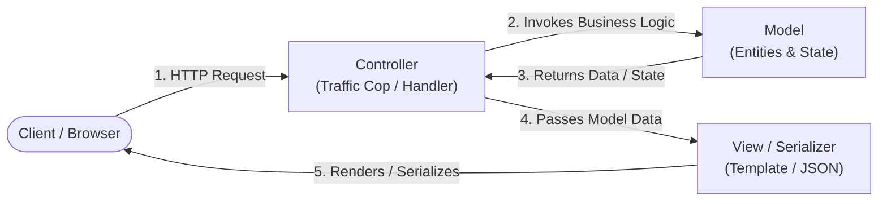

### Components of MVC

- **Model:**
  - Encapsulates the application's domain state, data access entities, validation rules, and business logic.
  - Independent of any specific user interface or presentation layer.
  - Represents both persistent database entities (e.g., JPA/Hibernate entities, Mongoose models) and ephemeral Data Transfer Objects (DTOs).
  - Emits change notifications or provides pure accessors/mutators to the service layer.

- **View:**
  - Translates the model's state into a representation consumed by the client.
  - In server-side rendered (SSR) web applications, the View consists of template engines such as Thymeleaf, FreeMarker, JSP, or Handlebars generating dynamic HTML.
  - In modern decoupled headless/SPA architectures, the View layer is replaced by serialization serializers (e.g., Jackson for JSON/XML in Spring, `res.json()` in Express.js) returning structured payloads over HTTP.

- **Controller:**
  - Acts as the intermediary and traffic orchestrator between the incoming client request and the internal business logic.
  - Receives incoming HTTP requests from the network transport layer.
  - Extracts, parses, and validates request parameters, headers, and request bodies.
  - Invokes appropriate domain services and data repositories in the Model layer.
  - Selects the target View or delegates to a message converter for response serialization.

> 💡 **Architectural Insight:** The Controller should remain "thin," containing zero business rules or SQL queries. Complex workflows, transactional boundaries, and calculations must reside entirely within the Service layer of the Model.

---

## 1.2 The Client-Server Request-Response Lifecycle

Understanding the exact physical journey of an HTTP transaction across networking, operating system, and application server boundaries is essential for optimizing backend performance and debugging latency bottlenecks.

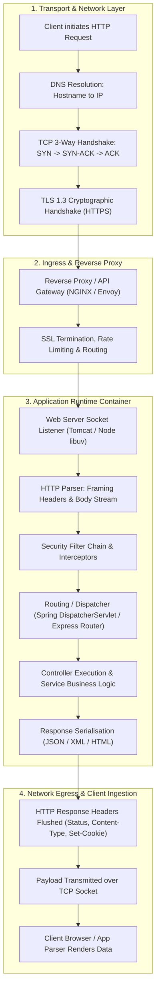

### Step-by-Step Network and Container Lifecycle

1. **DNS Resolution & Socket Establishment:** The client browser translates the URI domain into an IP address via recursive DNS resolvers. It initiates a TCP 3-way handshake (`SYN`, `SYN-ACK`, `ACK`), followed by a TLS handshake for HTTPS sessions to negotiate cipher suites and derive symmetric session encryption keys.
2. **Reverse Proxy / Ingress:** The raw TCP stream hits the infrastructure edge (e.g., NGINX, Cloudflare, AWS ALB). The reverse proxy performs SSL termination, DDoS mitigation, IP whitelisting, request rate limiting, and forwards the cleared request over a high-speed internal network to backend cluster instances.
3. **Application Server Reception:**
   - In **Java Enterprise / Spring Boot**, an embedded Apache Tomcat or Netty connector worker thread picks up the socket connection from the accept queue.
   - In **Node.js**, the OS kernel notifies the single-threaded `libuv` event loop via `epoll` (Linux) or `IOCP` (Windows) that incoming bytes are buffered on the network file descriptor.
4. **Parsing & Pipeline Processing:** The HTTP engine parses the start-line (`METHOD /path HTTP/1.1`), decodes header fields, and passes the input stream through the security filter chain (authentication, CSRF verification, CORS headers).
5. **Controller Dispatch & Execution:** The router executes handler methods, executes transactions, interacts with databases via connection pools (HikariCP / pg-pool), and produces a domain model.
6. **Serialization & Network Flush:** The domain payload is converted into bytes (`application/json`, `application/xml`). The response status code (`200 OK`, `201 Created`) and headers are written to the output socket. Sockets configured with `Keep-Alive` remain open for reuse.

---

## 1.3 Monolithic vs Microservices Architectural Tradeoffs

Selecting between a unified monolithic code base and a distributed microservices topology involves substantial architectural tradeoffs governed by Conway's Law and the CAP/PACELC theorems.

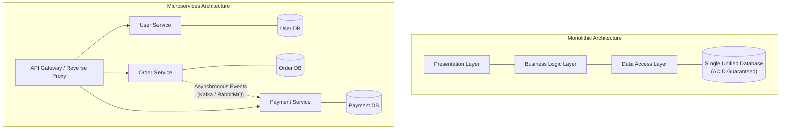

### In-Depth Architectural Comparison

| Architectural Dimension | Monolithic Architecture | Microservices Architecture |
| :--- | :--- | :--- |
| **Codebase & Deployment** | Single unified deployable artifact (e.g., single `.jar`, `.war`, or Node repository). Deployments are all-or-nothing. | Multiple independent deployable services, each managed in separate repositories with distinct CI/CD pipelines. |
| **Data Consistency & Transactions** | ACID guarantees via local database transactions (`@Transactional`). Simple relational joins across domain entities. | BASE properties (Basically Available, Soft state, Eventual consistency). Requires distributed patterns (Sagas, 2PC, Event Sourcing). |
| **Horizontal Scalability** | Coarse-grained. The entire application must be replicated even if only one resource-intensive module requires scaling. | Fine-grained. Individual stateless microservices scale horizontally according to their exact CPU/memory bottlenecks. |
| **Fault Isolation** | Poor. A memory leak, unhandled exception, or thread deadlock in one component can crash the entire OS process. | High. Failure of an isolated service is contained via Circuit Breakers (Resilience4j) and fallback degrade mechanisms. |
| **Network Latency & Overhead** | Extremely low. Inter-component communication occurs via direct in-memory JVM method calls or function pointers. | Higher. Inter-service coordination occurs over network hops (HTTP/REST, gRPC, Message Brokers), introducing serialization and latency. |
| **Operational Complexity** | Low. Standard monitoring, centralized logs on a single host, simple local debugging. | High. Requires distributed tracing (OpenTelemetry, Zipkin), centralized log aggregators (ELK, Loki), service meshes (Istio), and container orchestration (Kubernetes). |
| **Technology Diversity** | Homogeneous. The entire application is typically bound to a single programming language and runtime framework. | Heterogeneous. Polyglot persistence and languages (e.g., Node.js for I/O-intensive APIs, Python for ML, Go/Java for high throughput). |
| **Organizational Alignment** | Best suited for small, co-located teams ($< 15$ engineers) working on early-stage or medium-scale products. | Aligns with large engineering organizations partitioned into independent two-pizza domain teams (Conway's Law). |

> ⚠️ **Common Pitfall:** Decomposing a system into microservices prematurely before understanding the core domain boundaries results in a "Distributed Monolith" — inheriting all the operational latency, network failures, and distributed transaction headaches of microservices with none of the independent deployment benefits.

---

# 2. Java Enterprise & Spring Framework Ecosystem

The enterprise Java ecosystem transitioned from heavyweight Enterprise JavaBeans (EJB) containers to lightweight, non-invasive POJO-based development enabled by the Spring Framework. Spring provides a comprehensive programming and configuration model covering dependency injection, transaction management, object-relational mapping integration, and web MVC routing.

---

## 2.1 Inversion of Control (IoC) and Dependency Injection (DI)

### Definition: Inversion of Control (IoC)
**Meaning:** A foundational software engineering design principle in which the control flow of a program is inverted compared to traditional procedural programming. Instead of application code instantiating its dependencies and invoking libraries directly, an underlying framework or runtime container controls the execution flow, lifecycle, and object creation.

**Formal Definition:** Inversion of Control is characterized by the *Hollywood Principle* ("Don't call us, we'll call you"). The container assumes responsibility for creating objects, wiring their dependencies, invoking their lifecycle callbacks, and destroying them when they exit scope.

### Definition: Dependency Injection (DI)
**Meaning:** A specific design pattern implementing Inversion of Control wherein an object's dependencies (collaborating objects) are provided ("injected") into it from an external assembler (the IoC container), rather than the object instantiating them internally using the `new` operator.

#### Tight Coupling vs Loose Coupling

```java
// ANTI-PATTERN: Tightly Coupled Architecture
public class OrderService {
    private OrderRepository orderRepository;

    public OrderService() {
        // Tightly coupled: hardcoded dependency instantiation
        // Cannot be easily unit tested without a live SQL database!
        this.orderRepository = new SqlOrderRepository();
    }
}
```

```java
// BEST PRACTICE: Loosely Coupled Dependency Injection
@Service
public class OrderService {
    private final OrderRepository orderRepository;

    // Inversion of Control: dependency is injected externally
    @Autowired
    public OrderService(OrderRepository orderRepository) {
        this.orderRepository = orderRepository;
    }
}
```

### Dependency Injection Styles in Spring

1. **Constructor Injection (Preferred Best Practice):**
   - Dependencies are passed as arguments to the class constructor.
   - Guarantees that the injected fields can be declared `final`, ensuring thread safety and immutability.
   - Enforces that an object cannot be instantiated in an invalid, partially initialized state.
   - Simplifies pure unit testing by enabling engineers to pass mock objects (`Mockito.mock(OrderRepository.class)`) without spinning up a Spring context.
   - If a class has a single constructor, Spring Boot automatically applies `@Autowired` implicitly.

2. **Setter Injection:**
   - Dependencies are supplied through public JavaBean setter methods (`setOrderRepository(...)`).
   - Suitable for optional dependencies or configurations that may need to be reconfigured dynamically at runtime.
   - Leaves objects vulnerable to `NullPointerException` if a method is called before all setters have been invoked.

3. **Field Injection (`@Autowired` directly on private fields):**
   - Uses Java Reflection to inject dependencies directly into private fields.
   - **Considered an anti-pattern** in modern enterprise development because:
     - It hides class dependencies from external callers.
     - Objects cannot be instantiated outside a Spring container during unit tests without reflection utilities.
     - Prevents fields from being declared `final`.
     - Masks violations of the Single Responsibility Principle by making it deceptively easy to accumulate dozens of injected fields.

---

## 2.2 Spring Bean Scopes and Lifecycle

A **Spring Bean** is an object whose instantiation, assembly, lifecycle, and destruction are managed by the Spring IoC container (`ApplicationContext`).

### Spring Bean Scopes

| Scope Identifier | Lifecycle / Instantiation Boundary | Use Case |
| :--- | :--- | :--- |
| `singleton` (Default) | Exactly **one** shared instance created per Spring IoC container. Stored in container's singleton cache. | Stateless services (`@Service`), repositories (`@Repository`), utility components. |
| `prototype` | A **new** distinct instance is created every time the bean is requested from the container via injection or `getBean()`. | Stateful objects, mutable data accumulators, non-thread-safe legacy parsers. |
| `request` | Exactly **one** instance created per standard HTTP request lifecycle; destroyed when request completes. Only valid in web-aware `WebApplicationContext`. | User-specific request context, authorization tokens, trace context. |
| `session` | Exactly **one** instance created per HTTP `HttpSession` lifecycle; destroyed when session expires. | User shopping carts, multi-step checkout state, user authentication profile. |
| `application` | Exactly **one** instance per `ServletContext`; shared across multiple Spring applications running in same servlet container. | Global application configuration, cluster metadata. |
| `websocket` | Exactly **one** instance per active WebSocket connection session. | Real-time chat session context, client-specific socket subscriptions. |

### Complete Spring Bean Lifecycle Pipeline

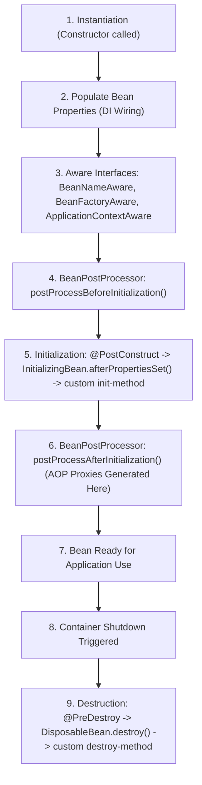

> 📝 **Exam Note:** AOP Dynamic Proxies (such as `@Transactional` and `@Async` interceptors) are applied in step 6 via `BeanPostProcessor.postProcessAfterInitialization()`. If an internal method call is made within the same class (`this.method()`), it bypasses the generated proxy, causing transaction and security annotations to be silently ignored!

---

## 2.3 Spring Framework (Core) vs Spring Boot

While Spring Core provides the fundamental inversion of control engine, Spring Boot eliminates the configuration friction associated with building enterprise applications.

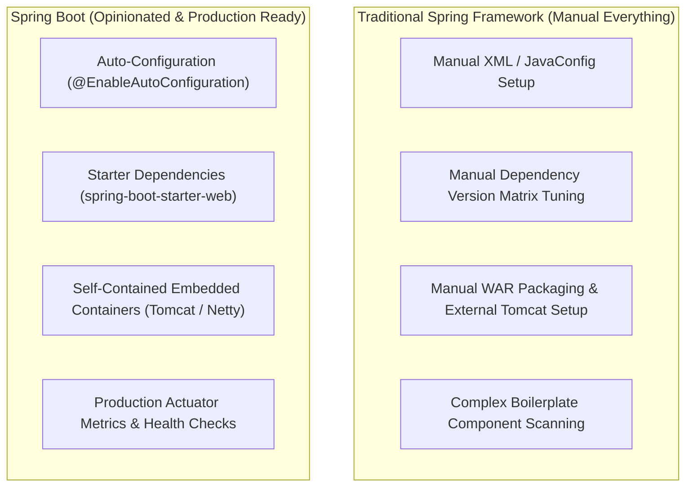

### Detailed Structural Comparison

| Feature | Traditional Spring Framework | Spring Boot |
| :--- | :--- | :--- |
| **Configuration Approach** | Requires extensive manual XML (`applicationContext.xml`) or verbose `@Configuration` classes defining every bean. | **Convention over Configuration**. Analyzes classpath dependencies and automatically configures beans via `@AutoConfiguration`. |
| **Dependency Management** | Developers manually specify distinct versions for dozens of interconnected third-party libraries; high risk of "JAR Hell" conflicts. | **Starter POMs / Modules**. Single imports (`spring-boot-starter-web`) manage compatible, pre-tested transitive dependencies. |
| **Deployment Model** | Requires building a `.war` file and deploying it onto an externally managed web server (Apache Tomcat, JBoss, WebLogic). | Generates executable self-contained `.jar` files with embedded servlet containers (Tomcat, Jetty, Undertow). Run with `java -jar app.jar`. |
| **Production Readiness** | Metrics, health monitoring, and externalized properties must be engineered manually from scratch. | **Spring Boot Actuator** provides out-of-the-box production endpoints: `/actuator/health`, `/actuator/metrics`, `/actuator/env`. |
| **Boilerplate Reduction** | Substantial boilerplate code required for setting up `DispatcherServlet`, ViewResolvers, transaction managers, and data sources. | Zero boilerplate; a single `@SpringBootApplication` annotation bootstraps component scanning, configuration, and auto-wiring. |

---

## 2.4 Spring MVC Architectural Components

Spring MVC is designed around the **Front Controller** architectural pattern, delegating request routing, input transformation, and response generation to specialized collaborators:

- **`DispatcherServlet` (The Front Controller):** The central servlet coordinating the entire request handling workflow. Configured at the root path (`/`), it intercepts all incoming HTTP requests and orchestrates delegating components.
- **`HandlerMapping`:** Inspects incoming requests (URI path, HTTP method, headers) and determines the appropriate handler (Controller method) to execute. The default implementation is `RequestMappingHandlerMapping`, which scans for `@RequestMapping`, `@GetMapping`, and `@PostMapping`.
- **`HandlerAdapter`:** An adapter interface (`RequestMappingHandlerAdapter`) that executes the selected handler method, decoupling `DispatcherServlet` from specific controller signatures. It invokes parameter resolvers and message converters.
- **`HandlerInterceptor`:** Provides pre-processing and post-processing hooks (`preHandle`, `postHandle`, `afterCompletion`) across request workflows for logging, authorization checks, and performance tracking.
- **`WebDataBinder` & `Validator`:** Extracts raw data from HTTP query parameters, path variables, and headers, converts string inputs into target Java types, and executes validation constraints (`@NotNull`, `@Size`).
- **`HttpMessageConverter`:** Reads request payloads from and writes response bodies to HTTP network streams. Examples include `MappingJackson2HttpMessageConverter` (JSON) and `Jaxb2RootElementHttpMessageConverter` (XML).
- **`ViewResolver`:** Resolves symbolic string view names (e.g., `"index"`, `"orderSummary"`) returned by controllers into physical presentation views (e.g., Thymeleaf templates or JSP files). In RESTful applications annotated with `@RestController`, the `ViewResolver` is bypassed.

---

# 3. Canonical 10-Step Spring MVC DispatcherServlet Request Flow

The canonical request processing pipeline of Spring MVC is among the most frequently tested architectural concepts in enterprise Java and university examinations.

---

## 3.1 The Front Controller Pattern

In traditional servlet applications, every endpoint required an explicit servlet mapping in `web.xml` (e.g., `OrderServlet` mapped to `/orders`, `UserServlet` mapped to `/users`). This created duplicated cross-cutting code for authentication, logging, character encoding, and error handling.

The **Front Controller Pattern** centralizes all incoming web requests through a single entry point: the `DispatcherServlet`. It coordinates request validation, security enforcement, locale resolution, controller delegation, and response output.

---

## 3.2 Detailed Step-by-Step Execution Pipeline

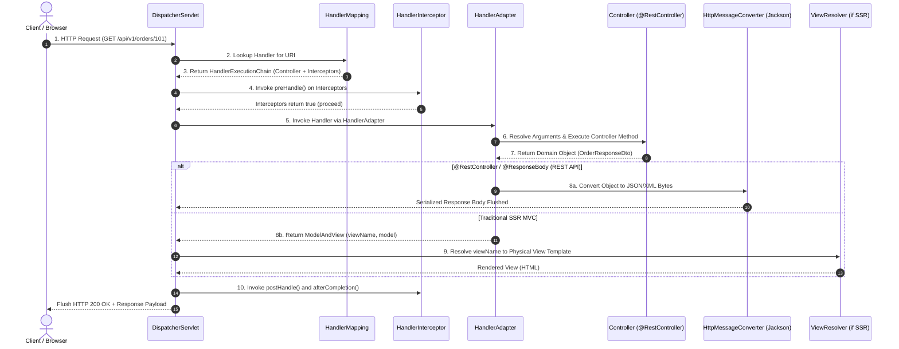

### The 10 Canonical Steps Explained

1. **Step 1: Request Interception at `DispatcherServlet`:** The client transmits an HTTP request over the network. The underlying servlet container (Tomcat) routes the request matching the configured servlet mapping (`/`) to `DispatcherServlet.doService()`, which initializes request attributes and delegates to `doDispatch()`.
2. **Step 2: Handler Mapping Resolution:** `DispatcherServlet` queries one or more registered `HandlerMapping` instances (principally `RequestMappingHandlerMapping`). The mapping evaluates the request URI, HTTP verb, content-type, and headers against controller routing metadata.
3. **Step 3: Construction of `HandlerExecutionChain`:** `HandlerMapping` returns a `HandlerExecutionChain` containing the matched handler method (e.g., `OrderRestController.getOrderById()`) along with an ordered list of applicable `HandlerInterceptor` instances configured for that URI path.
4. **Step 4: Interceptor Pre-Processing (`preHandle`):** `DispatcherServlet` iterates through the `HandlerInterceptor` chain, invoking `preHandle(request, response, handler)`. If any interceptor returns `false`, processing halts immediately, and the remaining chain is aborted.
5. **Step 5: Handler Adapter Determination:** `DispatcherServlet` queries `HandlerAdapter` beans to identify an adapter capable of executing the resolved handler. For `@RequestMapping` annotated methods, `RequestMappingHandlerAdapter` is selected.
6. **Step 6: Argument Resolution, Binding & Method Execution:**
   - The `HandlerAdapter` utilizes `HandlerMethodArgumentResolver` implementations to extract parameters from `@PathVariable`, `@RequestParam`, `@RequestHeader`, and `@RequestBody`.
   - The `WebDataBinder` validates input data constraints using JSR-380/Jakarta Bean Validation (`@Valid`).
   - The adapter invokes the actual controller method via Java reflection.
7. **Step 7: Processing Controller Return Value:**
   - In traditional MVC, the controller returns a `ModelAndView` or a view name string.
   - In RESTful controllers (`@RestController` or `@ResponseBody`), the method returns a domain DTO or `ResponseEntity<T>`.
8. **Step 8: Content Negotiation & Message Conversion:** For RESTful endpoints, `HandlerMethodReturnValueHandler` determines the requested representation using the `Accept` request header. It selects an appropriate `HttpMessageConverter` (e.g., `MappingJackson2HttpMessageConverter`), serializes the Java object into JSON/XML, and writes the byte stream directly to `HttpServletResponse.getOutputStream()`.
9. **Step 9: View Resolution and Template Rendering (Traditional MVC Only):** If a logical view name was returned, `DispatcherServlet` passes it to registered `ViewResolver` beans (e.g., `ThymeleafViewResolver`). The resolver loads the physical template, merges the model attributes, renders HTML markup, and flushes it to the client.
10. **Step 10: Completion and Cleanup (`afterCompletion`):** Once request processing finishes and the response is flushed (or if an uncaught exception was thrown), `DispatcherServlet` invokes `HandlerInterceptor.afterCompletion()`. This step executes cleanup routines, finalizes transaction contexts, records latency metrics, and clears ThreadLocal variables.

---

# 4. Complete Production-Grade Spring MVC Implementation

Below is a complete, 100% runnable, enterprise-grade Spring MVC application implementation structured across domain DTOs, custom exception handling, thread-safe services, content negotiation, and REST controllers.

---

## 4.1 Domain Models and Data Transfer Objects (DTOs) with Jakarta Validation

```java
package com.deepcollege.fsd.unit3.dto;

import jakarta.validation.Valid;
import jakarta.validation.constraints.*;
import java.math.BigDecimal;
import java.time.Instant;
import java.util.List;

public class OrderDto {

    public enum OrderStatus {
        PENDING, PROCESSING, COMPLETED, CANCELLED
    }

    public static class OrderItemDto {
        @NotBlank(message = "Product SKU cannot be blank")
        @Pattern(regexp = "^[A-Z0-9]{3,10}$", message = "SKU must be 3 to 10 alphanumeric uppercase characters")
        private String sku;

        @NotBlank(message = "Item name cannot be blank")
        @Size(min = 2, max = 100, message = "Item name must be between 2 and 100 characters")
        private String name;

        @NotNull(message = "Quantity must be specified")
        @Min(value = 1, message = "Quantity must be at least 1")
        @Max(value = 999, message = "Quantity cannot exceed 999 units")
        private Integer quantity;

        @NotNull(message = "Unit price must be specified")
        @DecimalMin(value = "0.01", inclusive = true, message = "Unit price must be greater than zero")
        private BigDecimal unitPrice;

        public OrderItemDto() {}

        public OrderItemDto(String sku, String name, Integer quantity, BigDecimal unitPrice) {
            this.sku = sku;
            this.name = name;
            this.quantity = quantity;
            this.unitPrice = unitPrice;
        }

        public String getSku() { return sku; }
        public void setSku(String sku) { this.sku = sku; }
        public String getName() { return name; }
        public void setName(String name) { this.name = name; }
        public Integer getQuantity() { return quantity; }
        public void setQuantity(Integer quantity) { this.quantity = quantity; }
        public BigDecimal getUnitPrice() { return unitPrice; }
        public void setUnitPrice(BigDecimal unitPrice) { this.unitPrice = unitPrice; }
    }

    public static class CreateOrderRequest {
        @NotBlank(message = "Customer ID is required")
        @Size(min = 4, max = 36, message = "Customer ID must be between 4 and 36 characters")
        private String customerId;

        @NotEmpty(message = "An order must contain at least one item")
        @Valid
        private List<OrderItemDto> items;

        @NotBlank(message = "Shipping address cannot be blank")
        @Size(max = 250, message = "Shipping address cannot exceed 250 characters")
        private String shippingAddress;

        public CreateOrderRequest() {}

        public CreateOrderRequest(String customerId, List<OrderItemDto> items, String shippingAddress) {
            this.customerId = customerId;
            this.items = items;
            this.shippingAddress = shippingAddress;
        }

        public String getCustomerId() { return customerId; }
        public void setCustomerId(String customerId) { this.customerId = customerId; }
        public List<OrderItemDto> getItems() { return items; }
        public void setItems(List<OrderItemDto> items) { this.items = items; }
        public String getShippingAddress() { return shippingAddress; }
        public void setShippingAddress(String shippingAddress) { this.shippingAddress = shippingAddress; }
    }

    public static class OrderResponse {
        private String orderId;
        private String customerId;
        private List<OrderItemDto> items;
        private BigDecimal totalAmount;
        private OrderStatus status;
        private String shippingAddress;
        private Instant createdAt;
        private Instant updatedAt;

        public OrderResponse() {}

        public OrderResponse(String orderId, String customerId, List<OrderItemDto> items,
                             BigDecimal totalAmount, OrderStatus status, String shippingAddress,
                             Instant createdAt, Instant updatedAt) {
            this.orderId = orderId;
            this.customerId = customerId;
            this.items = items;
            this.totalAmount = totalAmount;
            this.status = status;
            this.shippingAddress = shippingAddress;
            this.createdAt = createdAt;
            this.updatedAt = updatedAt;
        }

        public String getOrderId() { return orderId; }
        public void setOrderId(String orderId) { this.orderId = orderId; }
        public String getCustomerId() { return customerId; }
        public void setCustomerId(String customerId) { this.customerId = customerId; }
        public List<OrderItemDto> getItems() { return items; }
        public void setItems(List<OrderItemDto> items) { this.items = items; }
        public BigDecimal getTotalAmount() { return totalAmount; }
        public void setTotalAmount(BigDecimal totalAmount) { this.totalAmount = totalAmount; }
        public OrderStatus getStatus() { return status; }
        public void setStatus(OrderStatus status) { this.status = status; }
        public String getShippingAddress() { return shippingAddress; }
        public void setShippingAddress(String shippingAddress) { this.shippingAddress = shippingAddress; }
        public Instant getCreatedAt() { return createdAt; }
        public void setCreatedAt(Instant createdAt) { this.createdAt = createdAt; }
        public Instant getUpdatedAt() { return updatedAt; }
        public void setUpdatedAt(Instant updatedAt) { this.updatedAt = updatedAt; }
    }
}
```

---

## 4.2 Custom Domain Exceptions

```java
package com.deepcollege.fsd.unit3.exception;

public class ResourceNotFoundException extends RuntimeException {
    public ResourceNotFoundException(String message) {
        super(message);
    }
}
```

```java
package com.deepcollege.fsd.unit3.exception;

public class InvalidOrderStateException extends RuntimeException {
    public InvalidOrderStateException(String message) {
        super(message);
    }
}
```

---

## 4.3 Service Layer and Thread-Safe Storage

```java
package com.deepcollege.fsd.unit3.service;

import com.deepcollege.fsd.unit3.dto.OrderDto.*;
import com.deepcollege.fsd.unit3.exception.ResourceNotFoundException;
import org.springframework.stereotype.Service;

import java.math.BigDecimal;
import java.time.Instant;
import java.util.*;
import java.util.concurrent.ConcurrentHashMap;
import java.util.concurrent.atomic.AtomicLong;

@Service
public class OrderService {

    private final Map<String, OrderResponse> orderDatabase = new ConcurrentHashMap<>();
    private final AtomicLong idSequence = new AtomicLong(1000);

    public OrderResponse createOrder(CreateOrderRequest request) {
        String generatedId = "ORD-" + idSequence.incrementAndGet();

        BigDecimal total = request.getItems().stream()
                .map(item -> item.getUnitPrice().multiply(BigDecimal.valueOf(item.getQuantity())))
                .reduce(BigDecimal.ZERO, BigDecimal::add);

        Instant now = Instant.now();
        OrderResponse response = new OrderResponse(
                generatedId,
                request.getCustomerId(),
                new ArrayList<>(request.getItems()),
                total,
                OrderStatus.PENDING,
                request.getShippingAddress(),
                now,
                now
        );

        orderDatabase.put(generatedId, response);
        return response;
    }

    public OrderResponse getOrderById(String orderId) {
        OrderResponse order = orderDatabase.get(orderId);
        if (order == null) {
            throw new ResourceNotFoundException("Order with ID '" + orderId + "' does not exist");
        }
        return order;
    }

    public List<OrderResponse> getAllOrders() {
        return new ArrayList<>(orderDatabase.values());
    }

    public OrderResponse updateOrderStatus(String orderId, OrderStatus newStatus) {
        OrderResponse existing = getOrderById(orderId);
        existing.setStatus(newStatus);
        existing.setUpdatedAt(Instant.now());
        orderDatabase.put(orderId, existing);
        return existing;
    }

    public void deleteOrder(String orderId) {
        if (!orderDatabase.containsKey(orderId)) {
            throw new ResourceNotFoundException("Order with ID '" + orderId + "' does not exist");
        }
        orderDatabase.remove(orderId);
    }
}
```

---

## 4.4 Global Exception Handling and Standardized API Responses

```java
package com.deepcollege.fsd.unit3.exception;

import org.springframework.http.HttpHeaders;
import org.springframework.http.HttpStatus;
import org.springframework.http.HttpStatusCode;
import org.springframework.http.ResponseEntity;
import org.springframework.validation.FieldError;
import org.springframework.web.bind.MethodArgumentNotValidException;
import org.springframework.web.bind.annotation.ExceptionHandler;
import org.springframework.web.bind.annotation.RestControllerAdvice;
import org.springframework.web.context.request.WebRequest;
import org.springframework.web.servlet.mvc.method.annotation.ResponseEntityExceptionHandler;

import java.time.Instant;
import java.util.*;

@RestControllerAdvice
public class GlobalExceptionHandler extends ResponseEntityExceptionHandler {

    public static class ApiErrorResponse {
        private Instant timestamp;
        private int status;
        private String error;
        private String message;
        private String path;
        private Map<String, String> validationErrors;

        public ApiErrorResponse(int status, String error, String message, String path) {
            this.timestamp = Instant.now();
            this.status = status;
            this.error = error;
            this.message = message;
            this.path = path;
            this.validationErrors = new HashMap<>();
        }

        public Instant getTimestamp() { return timestamp; }
        public int getStatus() { return status; }
        public String getError() { return error; }
        public String getMessage() { return message; }
        public String getPath() { return path; }
        public Map<String, String> getValidationErrors() { return validationErrors; }
        public void setValidationErrors(Map<String, String> validationErrors) {
            this.validationErrors = validationErrors;
        }
    }

    @ExceptionHandler(ResourceNotFoundException.class)
    public ResponseEntity<ApiErrorResponse> handleResourceNotFound(ResourceNotFoundException ex, WebRequest request) {
        String path = request.getDescription(false).replace("uri=", "");
        ApiErrorResponse error = new ApiErrorResponse(
                HttpStatus.NOT_FOUND.value(),
                HttpStatus.NOT_FOUND.getReasonPhrase(),
                ex.getMessage(),
                path
        );
        return new ResponseEntity<>(error, HttpStatus.NOT_FOUND);
    }

    @ExceptionHandler(InvalidOrderStateException.class)
    public ResponseEntity<ApiErrorResponse> handleInvalidOrderState(InvalidOrderStateException ex, WebRequest request) {
        String path = request.getDescription(false).replace("uri=", "");
        ApiErrorResponse error = new ApiErrorResponse(
                HttpStatus.CONFLICT.value(),
                HttpStatus.CONFLICT.getReasonPhrase(),
                ex.getMessage(),
                path
        );
        return new ResponseEntity<>(error, HttpStatus.CONFLICT);
    }

    @Override
    protected ResponseEntity<Object> handleMethodArgumentNotValid(
            MethodArgumentNotValidException ex, HttpHeaders headers, HttpStatusCode status, WebRequest request) {
        
        String path = request.getDescription(false).replace("uri=", "");
        ApiErrorResponse error = new ApiErrorResponse(
                HttpStatus.BAD_REQUEST.value(),
                "Validation Failed",
                "Input payload failed structural or semantic validation constraints",
                path
        );

        Map<String, String> errors = new HashMap<>();
        for (FieldError fieldError : ex.getBindingResult().getFieldErrors()) {
            errors.put(fieldError.getField(), fieldError.getDefaultMessage());
        }
        error.setValidationErrors(errors);

        return new ResponseEntity<>(error, HttpStatus.BAD_REQUEST);
    }

    @ExceptionHandler(Exception.class)
    public ResponseEntity<ApiErrorResponse> handleGlobalException(Exception ex, WebRequest request) {
        String path = request.getDescription(false).replace("uri=", "");
        ApiErrorResponse error = new ApiErrorResponse(
                HttpStatus.INTERNAL_SERVER_ERROR.value(),
                HttpStatus.INTERNAL_SERVER_ERROR.getReasonPhrase(),
                "An unexpected internal server error occurred: " + ex.getMessage(),
                path
        );
        return new ResponseEntity<>(error, HttpStatus.INTERNAL_SERVER_ERROR);
    }
}
```

---

## 4.5 Web MVC Configuration with Content Negotiation and Interceptors

```java
package com.deepcollege.fsd.unit3.config;

import jakarta.servlet.http.HttpServletRequest;
import jakarta.servlet.http.HttpServletResponse;
import org.slf4j.Logger;
import org.slf4j.LoggerFactory;
import org.springframework.context.annotation.Configuration;
import org.springframework.http.MediaType;
import org.springframework.web.servlet.HandlerInterceptor;
import org.springframework.web.servlet.ModelAndView;
import org.springframework.web.servlet.config.annotation.*;

@Configuration
@EnableWebMvc
public class WebMvcConfig implements WebMvcConfigurer {

    public static class RequestLoggingInterceptor implements HandlerInterceptor {
        private static final Logger log = LoggerFactory.getLogger(RequestLoggingInterceptor.class);

        @Override
        public boolean preHandle(HttpServletRequest request, HttpServletResponse response, Object handler) {
            request.setAttribute("startTime", System.currentTimeMillis());
            log.info(">> Incoming Request: [{} {}] from {}", request.getMethod(), request.getRequestURI(), request.getRemoteAddr());
            return true;
        }

        @Override
        public void postHandle(HttpServletRequest request, HttpServletResponse response, Object handler, ModelAndView modelAndView) {}

        @Override
        public void afterCompletion(HttpServletRequest request, HttpServletResponse response, Object handler, Exception ex) {
            Long startTime = (Long) request.getAttribute("startTime");
            long duration = (startTime != null) ? (System.currentTimeMillis() - startTime) : 0;
            log.info("<< Completed Request: [{} {}] with Status [{}] in {} ms",
                    request.getMethod(), request.getRequestURI(), response.getStatus(), duration);
        }
    }

    @Override
    public void addInterceptors(InterceptorRegistry registry) {
        registry.addInterceptor(new RequestLoggingInterceptor())
                .addPathPatterns("/api/**");
    }

    @Override
    public void configureContentNegotiation(ContentNegotiationConfigurer configurer) {
        configurer
                .favorParameter(false)
                .ignoreAcceptHeader(false)
                .defaultContentType(MediaType.APPLICATION_JSON)
                .mediaType("json", MediaType.APPLICATION_JSON)
                .mediaType("xml", MediaType.APPLICATION_XML);
    }

    @Override
    public void addCorsMappings(CorsRegistry registry) {
        registry.addMapping("/api/**")
                .allowedOrigins("http://localhost:3000", "https://frontend.deepcollege.edu")
                .allowedMethods("GET", "POST", "PUT", "PATCH", "DELETE", "OPTIONS")
                .allowedHeaders("*")
                .allowCredentials(true)
                .maxAge(3600);
    }
}
```

---

## 4.6 Order REST Controller Implementation

```java
package com.deepcollege.fsd.unit3.controller;

import com.deepcollege.fsd.unit3.dto.OrderDto.*;
import com.deepcollege.fsd.unit3.service.OrderService;
import jakarta.validation.Valid;
import org.springframework.beans.factory.annotation.Autowired;
import org.springframework.http.HttpStatus;
import org.springframework.http.MediaType;
import org.springframework.http.ResponseEntity;
import org.springframework.web.bind.annotation.*;
import org.springframework.web.servlet.support.ServletUriComponentsBuilder;

import java.net.URI;
import java.util.List;

@RestController
@RequestMapping("/api/v1/orders")
public class OrderRestController {

    private final OrderService orderService;

    @Autowired
    public OrderRestController(OrderService orderService) {
        this.orderService = orderService;
    }

    @PostMapping(
            consumes = {MediaType.APPLICATION_JSON_VALUE, MediaType.APPLICATION_XML_VALUE},
            produces = {MediaType.APPLICATION_JSON_VALUE, MediaType.APPLICATION_XML_VALUE}
    )
    public ResponseEntity<OrderResponse> createOrder(@Valid @RequestBody CreateOrderRequest request) {
        OrderResponse createdOrder = orderService.createOrder(request);

        URI location = ServletUriComponentsBuilder
                .fromCurrentRequest()
                .path("/{id}")
                .buildAndExpand(createdOrder.getOrderId())
                .toUri();

        return ResponseEntity.created(location).body(createdOrder);
    }

    @GetMapping(
            produces = {MediaType.APPLICATION_JSON_VALUE, MediaType.APPLICATION_XML_VALUE}
    )
    public ResponseEntity<List<OrderResponse>> getAllOrders() {
        List<OrderResponse> orders = orderService.getAllOrders();
        return ResponseEntity.ok(orders);
    }

    @GetMapping(
            value = "/{id}",
            produces = {MediaType.APPLICATION_JSON_VALUE, MediaType.APPLICATION_XML_VALUE}
    )
    public ResponseEntity<OrderResponse> getOrderById(@PathVariable("id") String orderId) {
        OrderResponse order = orderService.getOrderById(orderId);
        return ResponseEntity.ok(order);
    }

    @PutMapping(
            value = "/{id}/status",
            produces = {MediaType.APPLICATION_JSON_VALUE, MediaType.APPLICATION_XML_VALUE}
    )
    public ResponseEntity<OrderResponse> updateStatus(
            @PathVariable("id") String orderId,
            @RequestParam("status") OrderStatus newStatus) {
        OrderResponse updated = orderService.updateOrderStatus(orderId, newStatus);
        return ResponseEntity.ok(updated);
    }

    @DeleteMapping("/{id}")
    @ResponseStatus(HttpStatus.NO_CONTENT)
    public ResponseEntity<Void> deleteOrder(@PathVariable("id") String orderId) {
        orderService.deleteOrder(orderId);
        return ResponseEntity.noContent().build();
    }
}
```

---

# 5. Node.js & Express.js Server Architecture

Node.js represents an architectural paradigm shift in backend web servers, replacing dedicated thread-per-request models with an event-driven, single-threaded execution runtime backed by asynchronous non-blocking I/O multiplexers.

---

## 5.1 Event-Driven Asynchronous Non-Blocking I/O Model

Traditional multi-threaded servers (Apache, classic Tomcat) allocate a thread per connection, causing high context-switching and 1–2 MB RAM overhead per thread.

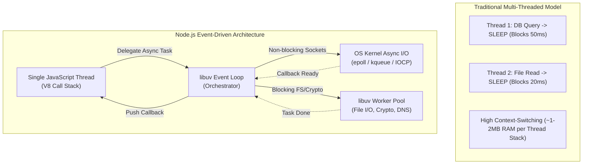

---

## 5.2 libuv Architecture and Event Loop Execution Phases

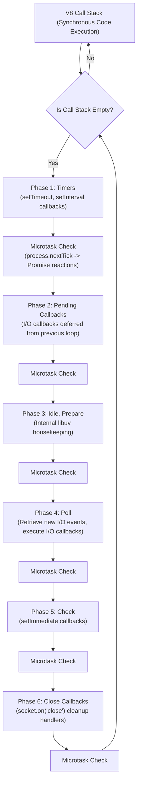

### Detailed Event Loop Phases
1. **Timers Phase:** Executes callbacks scheduled by `setTimeout()` and `setInterval()`.
2. **Pending Callbacks (I/O Callbacks):** Executes deferred I/O callbacks (e.g., socket errors).
3. **Idle, Prepare:** Internal libuv housekeeping.
4. **Poll Phase:** Retrieves new I/O events and executes I/O callbacks. Blocks if poll queue is empty and no `setImmediate` is scheduled.
5. **Check Phase:** Executes callbacks scheduled by `setImmediate()`.
6. **Close Callbacks:** Executes socket closure handlers (`socket.on('close')`).

---

## 5.3 Microtask Queues: process.nextTick() vs Promise Queue

Microtask queues execute immediately after synchronous code completes, before the event loop advances:
1. **`process.nextTick()` Queue:** Highest priority. Drained before any event loop phase transitions.
2. **Promise Reactions Queue:** Handles `.then()`, `.catch()`, and `async/await`. Drained immediately after `process.nextTick()`.

---

## 5.4 Express.js Middleware Pipeline Architecture

Express.js implements the Chain of Responsibility Pattern: `(req, res, next) => { ... }`.

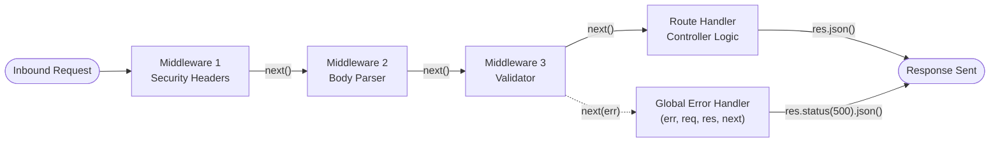

### Middleware Categories
1. **Application-level:** `app.use()`, `app.get()`
2. **Router-level:** `express.Router()`
3. **Built-in:** `express.json()`, `express.static()`
4. **Third-party:** `helmet`, `cors`, `morgan`
5. **Error-handling:** Exactly 4 parameters: `(err, req, res, next)`

---

# 6. Complete Production-Grade Node.js Express Server Implementation

---

## 6.1 Complete Runnable Server (`server.js`)

```javascript
'use strict';

const express = require('express');
const crypto = require('crypto');
const http = require('http');

const app = express();
const PORT = process.env.PORT || 3000;
const NODE_ENV = process.env.NODE_ENV || 'development';

// In-Memory Data Store
const productDatabase = new Map();
const initialSeedData = [
    {
        id: 'prod-001',
        title: 'Enterprise Mechanical Keyboard',
        description: 'Tactile hot-swappable mechanical switch keyboard with RGB backlighting',
        price: 149.99,
        category: 'Electronics',
        stock: 45,
        createdAt: new Date().toISOString(),
        updatedAt: new Date().toISOString()
    },
    {
        id: 'prod-002',
        title: 'Ergonomic Vertical Mouse',
        description: 'Wireless optical vertical mouse designed to alleviate carpal tunnel strain',
        price: 79.50,
        category: 'Electronics',
        stock: 120,
        createdAt: new Date().toISOString(),
        updatedAt: new Date().toISOString()
    }
];
initialSeedData.forEach(p => productDatabase.set(p.id, p));

// Security Headers Middleware
app.use((req, res, next) => {
    res.setHeader('X-Content-Type-Options', 'nosniff');
    res.setHeader('X-Frame-Options', 'DENY');
    res.setHeader('X-XSS-Protection', '1; mode=block');
    res.setHeader('Strict-Transport-Security', 'max-age=31536000; includeSubDomains');
    res.setHeader('Content-Security-Policy', "default-src 'self'");
    next();
});

// JSON Body Parser with strict payload limit
app.use(express.json({ limit: '10kb' }));

// Request Logging Middleware with High-Resolution Timing
app.use((req, res, next) => {
    const startTime = process.hrtime();
    const requestId = crypto.randomUUID();
    req.requestId = requestId;
    res.setHeader('X-Request-Id', requestId);

    res.on('finish', () => {
        const diff = process.hrtime(startTime);
        const durationInMs = (diff[0] * 1000 + diff[1] / 1e6).toFixed(2);
        console.log(`[${new Date().toISOString()}] [ID:${requestId}] ${req.method} ${req.originalUrl} | Status: ${res.statusCode} | Duration: ${durationInMs}ms`);
    });
    next();
});

// Input Validation Middleware
const validateProductPayload = (req, res, next) => {
    const { title, description, price, category, stock } = req.body;
    const errors = [];

    if (!title || typeof title !== 'string' || title.trim().length < 3 || title.trim().length > 100) {
        errors.push({ field: 'title', message: 'Title is required, must be between 3 and 100 characters' });
    }
    if (!description || typeof description !== 'string' || description.trim().length < 5 || description.trim().length > 500) {
        errors.push({ field: 'description', message: 'Description is required, must be between 5 and 500 characters' });
    }
    if (price === undefined || typeof price !== 'number' || price <= 0) {
        errors.push({ field: 'price', message: 'Price must be a positive number greater than 0' });
    }
    if (!category || typeof category !== 'string' || category.trim().length === 0) {
        errors.push({ field: 'category', message: 'Category must be a non-empty string' });
    }
    if (stock === undefined || !Number.isInteger(stock) || stock < 0) {
        errors.push({ field: 'stock', message: 'Stock must be a non-negative integer' });
    }

    if (errors.length > 0) {
        return res.status(400).json({
            status: 400,
            error: 'Bad Request',
            message: 'Input validation failed',
            validationErrors: errors,
            timestamp: new Date().toISOString()
        });
    }
    next();
};

// Modular Routing (/api/v1/products)
const productRouter = express.Router();

productRouter.get('/', (req, res) => {
    let results = Array.from(productDatabase.values());
    if (req.query.category) {
        const cat = req.query.category.toLowerCase();
        results = results.filter(p => p.category.toLowerCase() === cat);
    }
    const page = Math.max(1, parseInt(req.query.page, 10) || 1);
    const limit = Math.min(50, Math.max(1, parseInt(req.query.limit, 10) || 10));
    const startIndex = (page - 1) * limit;
    const paginatedResults = results.slice(startIndex, startIndex + limit);

    res.status(200).json({
        page,
        limit,
        totalItems: results.length,
        totalPages: Math.ceil(results.length / limit),
        data: paginatedResults
    });
});

productRouter.get('/:id', (req, res, next) => {
    const product = productDatabase.get(req.params.id);
    if (!product) {
        const err = new Error(`Product with ID '${req.params.id}' was not found`);
        err.statusCode = 404;
        return next(err);
    }
    res.status(200).json(product);
});

productRouter.post('/', validateProductPayload, (req, res) => {
    const { title, description, price, category, stock } = req.body;
    const newId = `prod-${crypto.randomBytes(4).toString('hex')}`;
    const timestamp = new Date().toISOString();

    const newProduct = {
        id: newId,
        title: title.trim(),
        description: description.trim(),
        price: parseFloat(price.toFixed(2)),
        category: category.trim(),
        stock: parseInt(stock, 10),
        createdAt: timestamp,
        updatedAt: timestamp
    };
    productDatabase.set(newId, newProduct);

    res.location(`/api/v1/products/${newId}`);
    res.status(201).json(newProduct);
});

productRouter.put('/:id', validateProductPayload, (req, res, next) => {
    const { id } = req.params;
    if (!productDatabase.has(id)) {
        const err = new Error(`Cannot update: Product with ID '${id}' does not exist`);
        err.statusCode = 404;
        return next(err);
    }
    const { title, description, price, category, stock } = req.body;
    const existing = productDatabase.get(id);

    const updatedProduct = {
        ...existing,
        title: title.trim(),
        description: description.trim(),
        price: parseFloat(price.toFixed(2)),
        category: category.trim(),
        stock: parseInt(stock, 10),
        updatedAt: new Date().toISOString()
    };
    productDatabase.set(id, updatedProduct);
    res.status(200).json(updatedProduct);
});

productRouter.delete('/:id', (req, res, next) => {
    const { id } = req.params;
    if (!productDatabase.has(id)) {
        const err = new Error(`Cannot delete: Product with ID '${id}' was not found`);
        err.statusCode = 404;
        return next(err);
    }
    productDatabase.delete(id);
    res.status(204).send();
});

app.use('/api/v1/products', productRouter);

// 404 Catch-All
app.use((req, res, next) => {
    const err = new Error(`Route '${req.originalUrl}' not found on this server`);
    err.statusCode = 404;
    next(err);
});

// Centralized 4-Argument Error Handler
app.use((err, req, res, next) => {
    const statusCode = err.statusCode || 500;
    const errorResponse = {
        status: statusCode,
        error: http.STATUS_CODES[statusCode] || 'Internal Server Error',
        message: err.message || 'An unexpected internal error occurred',
        requestId: req.requestId || null,
        timestamp: new Date().toISOString()
    };
    if (NODE_ENV !== 'production') {
        errorResponse.stack = err.stack;
    }
    console.error(`[ERROR] [${req.requestId}] ${err.stack || err.message}`);
    res.status(statusCode).json(errorResponse);
});

// Server Initialization and Graceful Shutdown
const server = app.listen(PORT, () => {
    console.log(`[Express] Application running in ${NODE_ENV} mode on http://localhost:${PORT}`);
});

const handleGracefulShutdown = (signal) => {
    console.log(`\n[${signal}] Received. Shutting down gracefully...`);
    server.close(() => {
        console.log('[Express] HTTP socket listeners closed. Process terminated safely.');
        process.exit(0);
    });
    setTimeout(() => {
        console.error('[Express] Forcefully terminating process due to lingering connections.');
        process.exit(1);
    }, 10000).unref();
};

process.on('SIGTERM', () => handleGracefulShutdown('SIGTERM'));
process.on('SIGINT', () => handleGracefulShutdown('SIGINT'));

module.exports = app;
```

---

# 7. RESTful API Architecture & Design Principles

---

## 7.1 Roy Fielding's Six Core Architectural Constraints
1. **Client-Server Architecture:** Decouples user interface concerns from data persistence.
2. **Statelessness:** No client context is retained on the server; each request contains all execution credentials.
3. **Cacheability:** Responses must explicitly declare caching behavior (`Cache-Control`).
4. **Layered System:** Clients cannot distinguish whether they connect directly to an origin server or an intermediary proxy.
5. **Code on Demand (Optional):** Servers may extend client functionality with executable scripts.
6. **Uniform Interface:** Governed by resource identification, manipulation via representations, self-descriptive messages, and hypermedia (HATEOAS).

---

## 7.2 The Richardson Maturity Model (RMM Levels 0 to 3)

| RMM Level | Identifying Characteristics | Typical Protocol / Pattern | Example Request & Response |
| :--- | :--- | :--- | :--- |
| **Level 0: The Swamp of POX** | Uses HTTP strictly as a transport tunnel. Exactly **one URI** and **one HTTP verb** (`POST`) used for all operations. RPC-style actions embedded in payload. | SOAP, XML-RPC, basic gRPC-Web tunneling. | `POST /api/service`<br>`{"action": "cancelOrder", "orderId": 105}`<br>Always returns `200 OK`. |
| **Level 1: Resources** | Introduces distinct **resource-oriented URIs** for individual entities, but still relies on a single verb (`POST`) to execute actions. | RPC-over-HTTP with segmented paths. | `POST /api/orders/105/cancel`<br>`POST /api/orders/105/updateAddress` |
| **Level 2: HTTP Verbs & Status Codes** | Employs the full standard set of **HTTP Verbs** (`GET`, `POST`, `PUT`, `DELETE`) and standard **HTTP Status Codes** (`200`, `201`, `204`, `404`). | Standard REST APIs (Spring MVC, Express.js). | `DELETE /api/orders/105` -> `204 No Content`<br>`GET /api/orders/999` -> `404 Not Found`. |
| **Level 3: Hypermedia Controls (HATEOAS)** | Incorporates **hypermedia links** (`_links`) directly inside response bodies. The client dynamically navigates allowable actions provided by the server. | Fully compliant RESTful Hypermedia APIs (Spring HATEOAS). | `GET /api/orders/105`<br>`{"id": 105, "status": "PENDING", "_links": {"cancel": {"href": "/api/orders/105/cancel"}}}` |

---

## 7.3 HTTP Verbs, Semantics, Safety, and Idempotency Matrix

| HTTP Verb | Safe? | Idempotent? | Request Body Allowed? | Cacheable? | Primary Semantic Purpose | Canonical Success Status Code |
| :--- | :---: | :---: | :---: | :---: | :--- | :--- |
| **`GET`** | **Yes** | **Yes** | No | **Yes** | Pure retrieval of resource representations. | `200 OK` |
| **`HEAD`** | **Yes** | **Yes** | No | **Yes** | Identical to `GET`, but server returns **only headers**, omitting response body. | `200 OK` |
| **`OPTIONS`** | **Yes** | **Yes** | No | No | Queries allowed HTTP methods on a URI (CORS preflight). | `200 OK` / `204 No Content` |
| **`POST`** | **No** | **No** | **Yes** | Only with explicit headers | Submits data to create a new subordinate resource. | `201 Created` (with `Location` header) |
| **`PUT`** | **No** | **Yes** | **Yes** | No | **Complete replacement** of the target resource at specified URI. | `200 OK` / `204 No Content` |
| **`PATCH`** | **No** | **No** | **Yes** | No | **Partial update** applying delta modifications to resource fields. | `200 OK` |
| **`DELETE`** | **No** | **Yes** | Optional (Rare) | No | Deletes the resource identified by the target URI. | `204 No Content` / `200 OK` |

---

## 7.4 HTTP Status Codes Master Hierarchy

- **1xx (Informational):** `100 Continue`, `101 Switching Protocols`
- **2xx (Success):** `200 OK`, `201 Created`, `202 Accepted`, `204 No Content`, `206 Partial Content`
- **3xx (Redirection):** `301 Moved Permanently`, `302 Found`, `304 Not Modified`, `307 Temporary Redirect`, `308 Permanent Redirect`
- **4xx (Client Errors):** `400 Bad Request`, `401 Unauthorized`, `403 Forbidden`, `404 Not Found`, `405 Method Not Allowed`, `409 Conflict`, `415 Unsupported Media Type`, `422 Unprocessable Entity`, `429 Too Many Requests`
- **5xx (Server Errors):** `500 Internal Server Error`, `501 Not Implemented`, `502 Bad Gateway`, `503 Service Unavailable`, `504 Gateway Timeout`

---

## 7.5 URI Resource Modeling and Query Design Best Practices
- **Nouns over verbs:** `GET /api/v1/orders` (not `/api/v1/getOrders`)
- **Plural nouns for collections:** `/api/v1/customers`
- **Clean hierarchical nesting:** `GET /api/v1/customers/{customerId}/orders/{orderId}/items`
- **Query parameters for filtering, sorting, pagination:** `GET /api/v1/products?category=electronics&sort=-price&page=1&limit=20`
- **Versioning:** URI Path `/v1/`, Request Header `X-API-Version`, or Accept Header.

---

# 8. Spring MVC vs Node.js / Express.js Architectural Comparison

| Architectural Dimension | Spring MVC (Java / Spring Boot) | Node.js & Express.js |
| :--- | :--- | :--- |
| **Concurrency & Threading Model** | **Multi-threaded (Thread-per-Request)**<br>Embedded Tomcat thread pool. Blocking I/O suspends worker thread. | **Single-Threaded Event Loop with libuv**<br>Non-blocking asynchronous I/O multiplexing via OS kernel (`epoll`). |
| **Execution Performance** | **High CPU Performance**<br>JIT compiled; ideal for complex computations and enterprise transactions. | **High I/O Throughput**<br>Excels at high-concurrency, lightweight I/O operations (streaming, chats, proxying). |
| **Type Safety & Tooling** | **Static Type System**<br>Compile-time type checking, refactoring safety, mature IDE analyzers. | **Dynamic Typing (JavaScript)**<br>Rapid prototyping; requires TypeScript for enterprise compile-time safety. |
| **Memory Footprint** | Higher base memory overhead ($250\text{ MB} - 1\text{ GB}$ JVM heap allocation). | Minimal base memory footprint ($30\text{ MB} - 100\text{ MB}$). Rapid cold boot time. |
| **Best Suited Workloads** | Core enterprise backends, financial ledgers, distributed transactional services. | Real-time web sockets, microservice API gateways, serverless functions (AWS Lambda). |

---

# 9. Unit-3 Abbreviation Reference & Core Concepts Glossary

---

## 9.1 Consolidated Acronym & Abbreviation Table

| Abbr. | Expanded Full Form | Context / Architectural Meaning |
| :--- | :--- | :--- |
| **MVC** | Model-View-Controller | Architectural pattern decoupling domain state, presentation, and routing. |
| **IoC** | Inversion of Control | Design principle delegating control flow and object lifecycles to a framework. |
| **DI** | Dependency Injection | Design pattern supplying dependent collaborating objects from an IoC container. |
| **AOP** | Aspect-Oriented Programming | Programming paradigm modularizing cross-cutting concerns (logging, security). |
| **REST** | Representational State Transfer | Architectural style for distributed hypermedia systems defined by Roy Fielding. |
| **RMM** | Richardson Maturity Model | 4-tier grading scale (Levels 0–3) evaluating API compliance with REST principles. |
| **HATEOAS** | Hypermedia As The Engine Of Application State | Level 3 REST constraint embedding navigational links within resource payloads. |
| **DTO** | Data Transfer Object | Plain object carrying data between processes to minimize serialization overhead. |
| **POJO** | Plain Old Java Object | Java object unencumbered by framework-specific interface inheritance. |
| **DAO** | Data Access Object | Architectural pattern abstracting and encapsulating database access logic. |
| **JPA** | Jakarta Persistence API | Standard Java specification for Object-Relational Mapping (ORM). |
| **ORM** | Object-Relational Mapping | Software technique mapping relational database tables to object-oriented classes. |
| **URI** | Uniform Resource Identifier | Standard compact sequence of characters identifying an abstract or physical resource. |
| **URL** | Uniform Resource Locator | Specific subset of URI specifying both resource identity and primary network access mechanism. |
| **URN** | Uniform Resource Name | Specific subset of URI identifying a resource by name in a particular namespace. |
| **HTTP** | HyperText Transfer Protocol | Application-layer protocol governing distributed hypermedia document exchange. |
| **HTTPS** | HyperText Transfer Protocol Secure | HTTP communications encrypted over a Transport Layer Security (TLS) tunnel. |
| **TLS** | Transport Layer Security | Cryptographic protocol providing communication privacy and data integrity over TCP. |
| **TCP** | Transmission Control Protocol | Connection-oriented transport protocol guaranteeing ordered, error-checked packet delivery. |
| **RFC** | Request For Comments | Formal publication of the Internet Engineering Task Force (IETF) defining internet standards. |
| **JSON** | JavaScript Object Notation | Lightweight, text-based, human-readable data interchange format. |
| **XML** | Extensible Markup Language | Tag-based markup language defining a set of rules for encoding documents. |
| **CORS** | Cross-Origin Resource Sharing | W3C mechanism allowing web applications to access resources from a different domain. |
| **CSRF** | Cross-Site Request Forgery | Web security attack tricking an authenticated user into executing unauthorized commands. |
| **JWT** | JSON Web Token | Compact, URL-safe means of representing signed claims transmitted between parties. |
| **SSE** | Server-Sent Events | Persistent HTTP connection enabling servers to push real-time event streams to clients. |
| **V8** | Google V8 JavaScript Engine | Open-source, high-performance WebAssembly and JavaScript engine written in C++. |
| **libuv** | Multi-platform Support Library | C library powering Node.js event loops, thread pools, and non-blocking I/O. |
| **FIFO** | First In, First Out | Queue scheduling discipline where oldest queued items are processed first. |
| **ACID** | Atomicity, Consistency, Isolation, Durability | Four transaction properties guaranteeing reliability in database management systems. |
| **BASE** | Basically Available, Soft state, Eventual consistency | Data model philosophy of distributed NoSQL databases favoring availability over immediate consistency. |
| **RPC** | Remote Procedure Call | Protocol allowing a program to execute a subroutine on a remote server as if it were local. |
| **SOAP** | Simple Object Access Protocol | XML-based messaging protocol specification for exchanging structured information. |
| **OAS** | OpenAPI Specification | Standard machine-readable interface description format for RESTful APIs. |
| **SoC** | Separation of Concerns | Design principle separating a computer program into distinct, non-overlapping sections. |
| **SRP** | Single Responsibility Principle | SOLID principle stating that every module or class should have only one reason to change. |

---

## 9.2 Core Concepts Glossary

1. **DispatcherServlet:** The central Front Controller servlet in Spring MVC that intercepts all incoming requests, consults handler mappings, and coordinates controller execution, content negotiation, and response delivery.
2. **Inversion of Control (IoC) Container:** The core runtime engine of the Spring Framework (`ApplicationContext`) that instantiates, configures, wires, and manages the complete lifecycle of Spring beans.
3. **ApplicationContext:** The advanced Spring IoC container interface providing complete enterprise capabilities, including AOP proxy integration, message resource internationalization, event publication, and web application context wiring.
4. **Front Controller Pattern:** An enterprise design pattern where a single centralized web handler routes, validates, and manages all incoming requests across an application.
5. **libuv Event Loop:** The single-threaded execution coordination mechanism in Node.js that continuously processes six distinct phases (Timers, Pending Callbacks, Idle/Prepare, Poll, Check, Close) to dispatch asynchronous I/O callbacks.
6. **Microtask Queue:** High-priority internal execution queues in Node.js (`process.nextTick` and `Promise`) that execute immediately after the current operation finishes, taking precedence over all macrotask event loop phases.
7. **Statelessness:** The REST architectural constraint dictating that no client session context is retained on the server; every request must contain complete self-sufficient execution information.
8. **Idempotency:** The mathematical property of an operation wherein executing it multiple times produces the exact same system state as executing it a single time ($f(f(S)) = f(S)$).
9. **Content Negotiation:** The HTTP mechanism allowing clients and servers to agree on the payload format (`application/json`, `application/xml`) exchanged between them using `Accept` and `Content-Type` headers.
10. **HATEOAS:** The Level-3 REST constraint wherein API responses contain embedded hypermedia links, allowing clients to dynamically discover and traverse valid application state transitions.

---

# 10. University Examination Preparation Suite

---

## 10.1 High-Yield 5-Mark Questions & Model Answers

### Question 1: Explain the Model-View-Controller (MVC) architectural pattern with a neat component interaction diagram.

**Marking Scheme:**
- Definition and primary purpose (1 Mark)
- Clear explanation of Model, View, and Controller responsibilities (2 Marks)
- Component interaction diagram / flowchart (1 Mark)
- Benefits of Separation of Concerns (1 Mark)

**Model Answer:**
The **Model-View-Controller (MVC)** architectural pattern decomposes an interactive application into three distinct layers to enforce the **Separation of Concerns (SoC)**:

1. **Model:** Encapsulates the application's business logic, domain entities, and data persistence state. It is entirely decoupled from the presentation format.
2. **View:** Renders the model's state into a human-readable or machine-readable presentation format (HTML templates like Thymeleaf or serialized JSON/XML).
3. **Controller:** Acts as the traffic coordinator. It intercepts incoming client HTTP requests, validates input parameters, delegates tasks to the Model layer, and selects the appropriate View for response rendering.

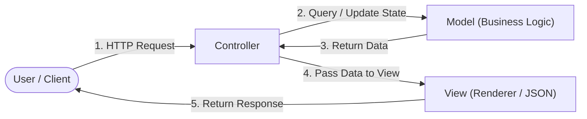

**Benefits:** Decoupling ensures that user interfaces can be completely redesigned without modifying core business rules, multiple presentations (mobile apps, web browsers) can reuse the same model, and testability is significantly enhanced.

---

### Question 2: Differentiate between Inversion of Control (IoC) and Dependency Injection (DI). Why is Constructor Injection preferred over Field Injection?

**Marking Scheme:**
- Distinction between IoC (principle) and DI (pattern) (2 Marks)
- Architectural problems of Field Injection (1.5 Marks)
- Concrete advantages of Constructor Injection (1.5 Marks)

**Model Answer:**
- **Inversion of Control (IoC):** A high-level architectural principle wherein the framework controls program execution flow and object lifecycles ("Hollywood Principle").
- **Dependency Injection (DI):** A concrete design pattern implementing IoC. Rather than an object instantiating collaborating dependencies via `new ClassName()`, dependencies are supplied ("injected") by an external container.

**Why Constructor Injection is Preferred over Field Injection:**

1. **Immutability & Thread Safety:** Constructor injection allows injected fields to be declared `final`, guaranteeing that objects cannot be mutated or left in an inconsistent state after instantiation.
2. **Testability Without Frameworks:** Classes with constructor injection can be directly instantiated in pure JUnit unit tests (`new OrderService(mockRepo)`) without initializing a heavy Spring ApplicationContext or relying on reflection.
3. **Prevention of NullPointerExceptions:** Field injection permits objects to be instantiated with uninitialized dependencies if instantiated outside Spring, leading to runtime failures. Constructor injection enforces that all required dependencies must be provided at instantiation time.
4. **Code Smell Detection:** A constructor with 7+ parameters immediately signals a violation of the Single Responsibility Principle, whereas field injection conceals bloated dependencies behind clean annotations.

---

### Question 3: Explain the Richardson Maturity Model (RMM) for REST APIs with practical examples for each level.

**Marking Scheme:**
- Definition of RMM (1 Mark)
- Level 0, Level 1, Level 2, Level 3 explanations with concrete URIs/payloads (1 Mark per Level = 4 Marks)

**Model Answer:**
The **Richardson Maturity Model (RMM)** grades APIs across four evolutionary tiers of REST compliance:

- **Level 0 (The Swamp of POX):** Uses HTTP strictly as a transport tunnel. All operations target a single endpoint URI using a single HTTP method (`POST`).
  *Example:* `POST /api/service` with payload `{"action": "cancelOrder", "id": 101}`. Always returns `200 OK`.
- **Level 1 (Resources):** Introduces distinct URIs for individual resources, but continues using a single verb (`POST`) for all operations.
  *Example:* `POST /api/orders/101/cancel`.
- **Level 2 (HTTP Verbs & Status Codes):** Employs standard HTTP verbs (`GET`, `POST`, `PUT`, `DELETE`) according to their formal semantic definitions, returning standard HTTP status codes (`200`, `201`, `204`, `404`).
  *Example:* `DELETE /api/orders/101` returns `204 No Content`.
- **Level 3 (Hypermedia Controls / HATEOAS):** Responses contain navigable hypermedia controls (`_links`) informing clients of available state transitions dynamically.
  *Example:*
  ```json
  {
    "orderId": 101,
    "status": "PENDING",
    "_links": {
      "self": { "href": "/api/orders/101" },
      "cancel": { "href": "/api/orders/101/cancel" }
    }
  }
  ```

---

### Question 4: Compare the concurrency and execution model of Spring Boot (Tomcat thread-per-request) and Node.js (libuv event loop).

**Marking Scheme:**
- Detailed description of Spring Boot Tomcat thread pool model (2 Marks)
- Detailed description of Node.js single-threaded event loop model (2 Marks)
- Comparative workload suitability analysis (1 Mark)

**Model Answer:**

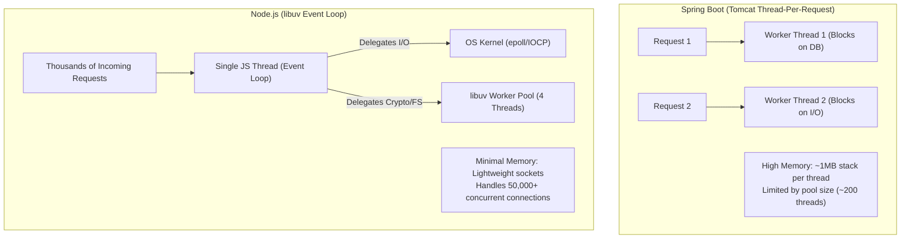

- **Spring Boot (Tomcat Thread-per-Request):** Uses an operating system thread pool (default 200 worker threads). Each incoming HTTP request is assigned a dedicated thread that handles execution from start to finish. If the request executes a blocking SQL query, that thread remains idle in memory, consuming approximately 1 MB of stack memory. Thread context-switching creates CPU overhead under high concurrent connection loads.
- **Node.js (libuv Event Loop):** Uses a single JavaScript execution thread backed by an asynchronous non-blocking event loop. When a database or network I/O call occurs, Node.js offloads the operation to the operating system kernel (`epoll`) and continues processing subsequent requests immediately. Once the I/O completes, its callback is placed in the event loop queue.
- **Workload Suitability:** Spring Boot excels at computationally heavy, CPU-intensive, or multi-step transactional business logic. Node.js excels at high-concurrency, I/O-bound, real-time streaming operations with minimal CPU processing.

---

### Question 5: What is an idempotent HTTP method? Differentiate between PUT and PATCH with respect to request payloads and idempotency.

**Marking Scheme:**
- Mathematical and architectural definition of idempotency (1.5 Marks)
- Semantic definition of `PUT` (1.5 Marks)
- Semantic definition of `PATCH` (1.5 Marks)
- Comparison of payloads and idempotency guarantees (0.5 Marks)

**Model Answer:**
An HTTP method is **Idempotent** if executing multiple identical requests produces the exact same system state as executing a single request ($f(f(S)) = f(S)$).

**PUT vs. PATCH Comparison:**

| Feature | `PUT` (RFC 7231) | `PATCH` (RFC 5789) |
| :--- | :--- | :--- |
| **Semantic Meaning** | **Complete Replacement** of the target resource. | **Partial Modification** applying delta changes to specific fields. |
| **Payload Requirement** | Must transmit the **entire resource entity**. Any omitted fields are typically overwritten with null or default values. | Transmits **only the specific fields** requiring modification (or a JSON Patch sequence of operations). |
| **Idempotency** | **Guaranteed Idempotent.** Repeating the exact same `PUT` request 100 times results in the identical resource state on the server. | **Not Inherently Idempotent.** While setting fixed fields is idempotent, delta operations like `{"increment": 10}` modify state on each execution. |
| **Example Request** | `PUT /api/users/42`<br>`{"name": "Alice", "email": "a@test.com", "role": "USER"}` | `PATCH /api/users/42`<br>`{"role": "ADMIN"}` |

---

## 10.2 Comprehensive 10-Mark Questions & Model Answers

### Question 6: Describe the complete 10-step request processing lifecycle of Spring MVC DispatcherServlet from the arrival of an HTTP request to the flushing of the response. Include a detailed sequence diagram.

**Marking Scheme:**
- Comprehensive Front Controller Pattern explanation (1.5 Marks)
- Detailed, accurate enumeration of all 10 canonical steps (5 Marks)
- Clean, syntactically correct Sequence Diagram (2 Marks)
- Detailed explanation of `HandlerMapping`, `HandlerAdapter`, and `HttpMessageConverter` roles (1.5 Marks)

**Model Answer:**
Spring MVC organizes request handling around the **Front Controller** pattern implemented by `DispatcherServlet`. The detailed canonical 10-step request processing flow proceeds as follows:

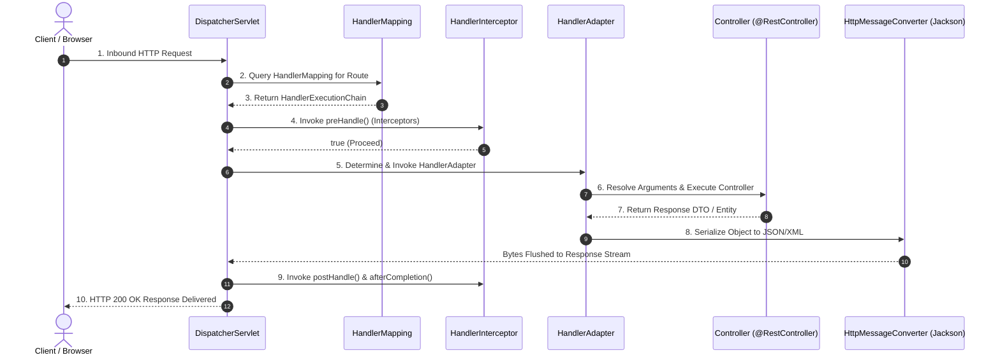

**Step-by-Step Technical Lifecycle:**

1. **Step 1 — Arrival at Front Controller:** The client initiates an HTTP transaction. The servlet container (Tomcat) routes the request matching `/` to `DispatcherServlet.doService()`, which initializes request attributes and passes execution to `doDispatch()`.
2. **Step 2 — Handler Mapping Lookup:** `DispatcherServlet` queries registered `HandlerMapping` beans (principally `RequestMappingHandlerMapping`). It inspects the request URI, HTTP method, and headers against controller metadata.
3. **Step 3 — Construction of `HandlerExecutionChain`:** `HandlerMapping` returns a `HandlerExecutionChain` object containing the matched controller method reference along with an array of configured `HandlerInterceptor` instances.
4. **Step 4 — Interceptor Pre-Processing (`preHandle`):** `DispatcherServlet` executes the `preHandle()` method of each interceptor in sequence. If any interceptor returns `false`, processing halts immediately, and the remaining pipeline is aborted.
5. **Step 5 — Handler Adapter Selection:** `DispatcherServlet` selects an appropriate `HandlerAdapter` (typically `RequestMappingHandlerAdapter`) capable of invoking the controller method signature.
6. **Step 6 — Argument Resolution, Binding & Method Execution:**
   - The adapter uses `HandlerMethodArgumentResolver` to bind request bodies, path variables, and parameters to Java DTOs.
   - It triggers validation via `WebDataBinder` (`@Valid`).
   - It invokes the controller method via reflection.
7. **Step 7 — Return Value Handling:** The controller executes business logic via services and returns a domain DTO or `ResponseEntity<T>`.
8. **Step 8 — Content Negotiation & Message Conversion:** `HandlerMethodReturnValueHandler` inspects the client's `Accept` header. It selects a registered `HttpMessageConverter` (e.g., Jackson's `MappingJackson2HttpMessageConverter`), serializes the Java object to JSON/XML, and writes the bytes to `HttpServletResponse.getOutputStream()`.
9. **Step 9 — Post-Processing & View Resolution:** For traditional SSR applications, a `ViewResolver` resolves the view name and renders HTML. For REST controllers, this step is bypassed.
10. **Step 10 — Completion and Cleanup (`afterCompletion`):** `DispatcherServlet` calls `afterCompletion()` on all interceptors, allowing them to release resources, log execution duration, and clear `ThreadLocal` context variables. Finally, the HTTP response status code and headers are flushed to the client socket.

---

### Question 7: Design and implement a robust, production-grade Express.js application handling a RESTful resource (`/api/v1/products`). Your solution must include custom request logging, request body validation, modular routing, and a 4-argument centralized error-handling middleware. Explain how libuv manages asynchronous non-blocking I/O during database queries.

**Marking Scheme:**
- Architectural explanation of libuv, event loop, and thread pool during async I/O (3 Marks)
- Custom Request Logging Middleware with execution timing (1.5 Marks)
- Robust Input Validation Middleware (1.5 Marks)
- Modular Express Router implementation with proper HTTP verbs and status codes (2 Marks)
- Centralized 4-argument Error Handling Middleware with stack sanitization (2 Marks)

**Model Answer:**

#### Part 1: How libuv Manages Asynchronous Non-Blocking I/O
When an Express.js route executes an asynchronous database query or network call:
1. The V8 call stack executes the query initiation function (e.g., `db.query()`).
2. libuv checks the nature of the operation:
   - For **network socket operations** (TCP connection to a database like PostgreSQL or MongoDB), libuv registers the file descriptor with the OS kernel's native event demultiplexer (`epoll` on Linux, `kqueue` on macOS, `IOCP` on Windows). No worker threads are blocked.
   - For **file system I/O or DNS lookups**, libuv offloads the blocking system call to its internal **Worker Thread Pool** (default 4 threads, configurable via `UV_THREAD_POOL_SIZE`).
3. The JavaScript thread immediately resumes execution and processes subsequent incoming HTTP requests without waiting.
4. When the database server responds with query results over the TCP socket, the OS kernel notifies libuv during the **Poll phase** of the event loop.
5. libuv enqueues the JavaScript callback onto the event loop queue, which is pushed onto the V8 Call Stack once all synchronous code finishes.

#### Part 2: Complete Implementation Code

```javascript
const express = require('express');
const crypto = require('crypto');
const app = express();

app.use(express.json());

// 1. Custom High-Resolution Logging Middleware
app.use((req, res, next) => {
    const start = process.hrtime();
    const reqId = crypto.randomUUID();
    req.id = reqId;

    res.on('finish', () => {
        const [sec, nano] = process.hrtime(start);
        const ms = (sec * 1000 + nano / 1e6).toFixed(2);
        console.log(`[${reqId}] ${req.method} ${req.originalUrl} -> ${res.statusCode} in ${ms}ms`);
    });
    next();
});

// 2. Custom Input Validation Middleware
const validateProduct = (req, res, next) => {
    const { name, price } = req.body;
    const errors = [];
    if (!name || typeof name !== 'string' || name.trim().length < 2) {
        errors.push('Field "name" is required and must be at least 2 characters');
    }
    if (price === undefined || typeof price !== 'number' || price <= 0) {
        errors.push('Field "price" is required and must be a number greater than 0');
    }
    if (errors.length > 0) {
        const err = new Error(errors.join('; '));
        err.statusCode = 400;
        return next(err);
    }
    next();
};

// 3. Modular Router
const router = express.Router();
const db = new Map();

router.get('/', (req, res) => {
    res.status(200).json(Array.from(db.values()));
});

router.post('/', validateProduct, (req, res) => {
    const id = crypto.randomUUID();
    const product = { id, name: req.body.name.trim(), price: req.body.price };
    db.set(id, product);
    res.location(`/api/v1/products/${id}`);
    res.status(201).json(product);
});

router.get('/:id', (req, res, next) => {
    const product = db.get(req.params.id);
    if (!product) {
        const err = new Error(`Product ${req.params.id} not found`);
        err.statusCode = 404;
        return next(err);
    }
    res.status(200).json(product);
});

app.use('/api/v1/products', router);

// 4. Centralized 4-Argument Error Handling Middleware
app.use((err, req, res, next) => {
    const statusCode = err.statusCode || 500;
    const isProd = process.env.NODE_ENV === 'production';
    
    res.status(statusCode).json({
        status: statusCode,
        error: statusCode === 500 ? 'Internal Server Error' : 'Request Error',
        message: err.message,
        requestId: req.id,
        timestamp: new Date().toISOString(),
        ...(isProd ? {} : { stack: err.stack })
    });
});

app.listen(3000, () => console.log('Server listening on port 3000'));
```

---

### Question 8: What are the core architectural constraints of REST? Explain why statelessness is critical for horizontal scalability. Detail how Content Negotiation works in Spring Boot and provide a complete implementation of a REST Controller supporting both JSON and XML responses with global exception handling.

**Marking Scheme:**
- Detailed explanation of Fielding's 6 REST constraints (2 Marks)
- In-depth architectural analysis of Statelessness and Horizontal Scalability (2 Marks)
- Explanation of Content Negotiation mechanics (`Accept`, `Content-Type`, `HttpMessageConverter`) (2 Marks)
- Complete Spring Boot Controller implementation supporting JSON/XML (2 Marks)
- Global Exception Handler (`@RestControllerAdvice`) implementation (2 Marks)

**Model Answer:**

#### Part 1: The Six Core Architectural Constraints of REST
1. **Client-Server Architecture:** Decouples user interface concerns from data persistence.
2. **Statelessness:** Every request must contain all information required to complete execution; no session state is retained on the server.
3. **Cacheability:** Responses must explicitly declare caching behavior (`Cache-Control`) to minimize redundant network round-trips.
4. **Layered System:** The client cannot distinguish whether it connects directly to the end server or to intermediary proxies, load balancers, or gateways.
5. **Code on Demand (Optional):** Servers may extend client functionality by transmitting executable scripts (e.g., JavaScript).
6. **Uniform Interface:** Governed by unique resource identification (URIs), manipulation via representations, self-descriptive messages, and hypermedia (HATEOAS).

#### Part 2: Why Statelessness is Critical for Horizontal Scalability
In a **stateful architecture**, user session state (e.g., shopping cart, authentication login) is stored in server memory (e.g., `HttpSession`). This introduces severe scalability constraints:
- **Sticky Sessions:** Load balancers must route all subsequent requests from a specific client to the exact same physical server instance. If that instance crashes, the user's session data is lost.
- **Horizontal Auto-Scaling Failures:** New server instances cannot handle traffic from existing users without complex distributed session replication mechanisms (e.g., Redis session clustering), which introduces network overhead and synchronization bottlenecks.

In a **stateless architecture**:
- No session state is retained in server RAM. Authentication is verified through cryptographic tokens (JWTs) or stateless credentials provided in each request header (`Authorization: Bearer <token>`).
- Any arbitrary server instance in an auto-scaling cluster can process any incoming request identically.
- If a server instance fails, the load balancer routes traffic to a healthy instance with zero disruption to the user experience.

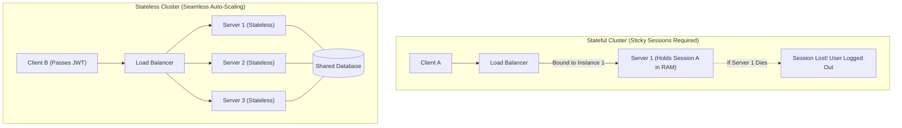

#### Part 3: Content Negotiation Mechanics
Content Negotiation allows a client and server to agree on the data representation exchanged over HTTP:
- **`Accept` Header (Client to Server):** Specifies the MIME types the client can process (e.g., `Accept: application/json, application/xml;q=0.9`).
- **`Content-Type` Header:** Informs the recipient of the media format contained in the request or response body.
- **Spring Boot Resolution:** When a controller returns an object, Spring's `ContentNegotiationManager` inspects the request's `Accept` header. It iterates through registered `HttpMessageConverter` beans:
  - If `application/json` is requested, `MappingJackson2HttpMessageConverter` serializes the object to JSON.
  - If `application/xml` is requested (and `jackson-dataformat-xml` is on the classpath), `MappingJackson2XmlHttpMessageConverter` serializes it to XML.

#### Part 4: Implementation Code

```java
// 1. Domain DTO Supporting Both Formats
package com.deepcollege.dto;

import com.fasterxml.jackson.dataformat.xml.annotation.JacksonXmlRootElement;
import jakarta.validation.constraints.*;

@JacksonXmlRootElement(localName = "Customer")
public class CustomerDto {
    @NotBlank(message = "Customer ID cannot be blank")
    private String customerId;

    @NotBlank(message = "Name cannot be blank")
    private String name;

    @Email(message = "Must be a valid email format")
    private String email;

    public CustomerDto() {}
    public CustomerDto(String customerId, String name, String email) {
        this.customerId = customerId;
        this.name = name;
        this.email = email;
    }

    public String getCustomerId() { return customerId; }
    public void setCustomerId(String customerId) { this.customerId = customerId; }
    public String getName() { return name; }
    public void setName(String name) { this.name = name; }
    public String getEmail() { return email; }
    public void setEmail(String email) { this.email = email; }
}
```

```java
// 2. Controller Supporting JSON & XML Content Negotiation
package com.deepcollege.controller;

import com.deepcollege.dto.CustomerDto;
import jakarta.validation.Valid;
import org.springframework.http.HttpStatus;
import org.springframework.http.MediaType;
import org.springframework.http.ResponseEntity;
import org.springframework.web.bind.annotation.*;

@RestController
@RequestMapping("/api/v1/customers")
public class CustomerRestController {

    @GetMapping(
            value = "/{id}",
            produces = {MediaType.APPLICATION_JSON_VALUE, MediaType.APPLICATION_XML_VALUE}
    )
    public ResponseEntity<CustomerDto> getCustomer(@PathVariable("id") String id) {
        if ("unknown".equalsIgnoreCase(id)) {
            throw new IllegalArgumentException("Customer with ID '" + id + "' was not found");
        }
        CustomerDto customer = new CustomerDto(id, "Engineering Student", "student@deepcollege.edu");
        return ResponseEntity.ok(customer);
    }

    @PostMapping(
            consumes = {MediaType.APPLICATION_JSON_VALUE, MediaType.APPLICATION_XML_VALUE},
            produces = {MediaType.APPLICATION_JSON_VALUE, MediaType.APPLICATION_XML_VALUE}
    )
    public ResponseEntity<CustomerDto> createCustomer(@Valid @RequestBody CustomerDto request) {
        return ResponseEntity.status(HttpStatus.CREATED).body(request);
    }
}
```

```java
// 3. Global Exception Handler Supporting Standard Error Structures
package com.deepcollege.exception;

import org.springframework.http.HttpStatus;
import org.springframework.http.ResponseEntity;
import org.springframework.web.bind.MethodArgumentNotValidException;
import org.springframework.web.bind.annotation.ExceptionHandler;
import org.springframework.web.bind.annotation.RestControllerAdvice;

import java.time.Instant;
import java.util.HashMap;
import java.util.Map;

@RestControllerAdvice
public class GlobalExceptionHandler {

    public record ErrorDetail(Instant timestamp, int status, String error, String message) {}

    @ExceptionHandler(IllegalArgumentException.class)
    public ResponseEntity<ErrorDetail> handleNotFound(IllegalArgumentException ex) {
        ErrorDetail error = new ErrorDetail(
                Instant.now(),
                HttpStatus.NOT_FOUND.value(),
                HttpStatus.NOT_FOUND.getReasonPhrase(),
                ex.getMessage()
        );
        return new ResponseEntity<>(error, HttpStatus.NOT_FOUND);
    }

    @ExceptionHandler(MethodArgumentNotValidException.class)
    public ResponseEntity<Map<String, Object>> handleValidation(MethodArgumentNotValidException ex) {
        Map<String, Object> body = new HashMap<>();
        body.put("timestamp", Instant.now());
        body.put("status", HttpStatus.BAD_REQUEST.value());
        body.put("error", "Validation Error");

        Map<String, String> fieldErrors = new HashMap<>();
        ex.getBindingResult().getFieldErrors().forEach(f -> fieldErrors.put(f.getField(), f.getDefaultMessage()));
        body.put("validationErrors", fieldErrors);

        return new ResponseEntity<>(body, HttpStatus.BAD_REQUEST);
    }
}
```

---

