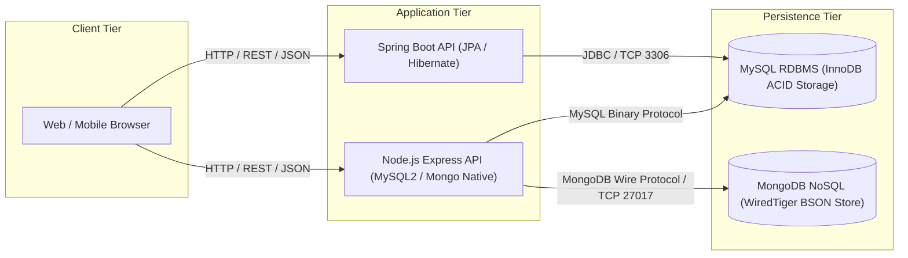
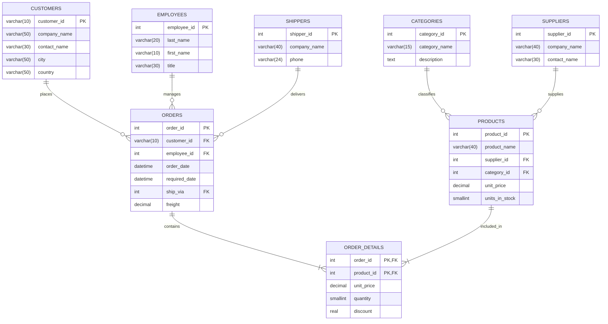
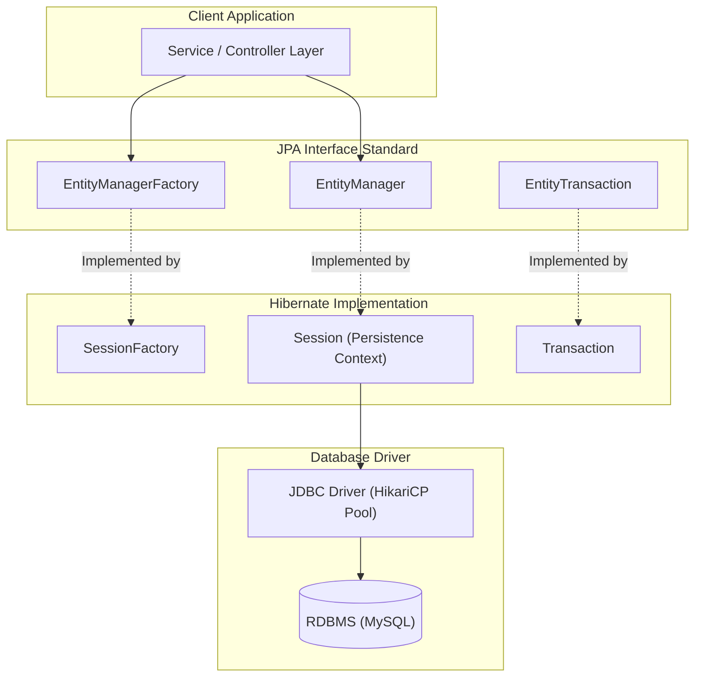
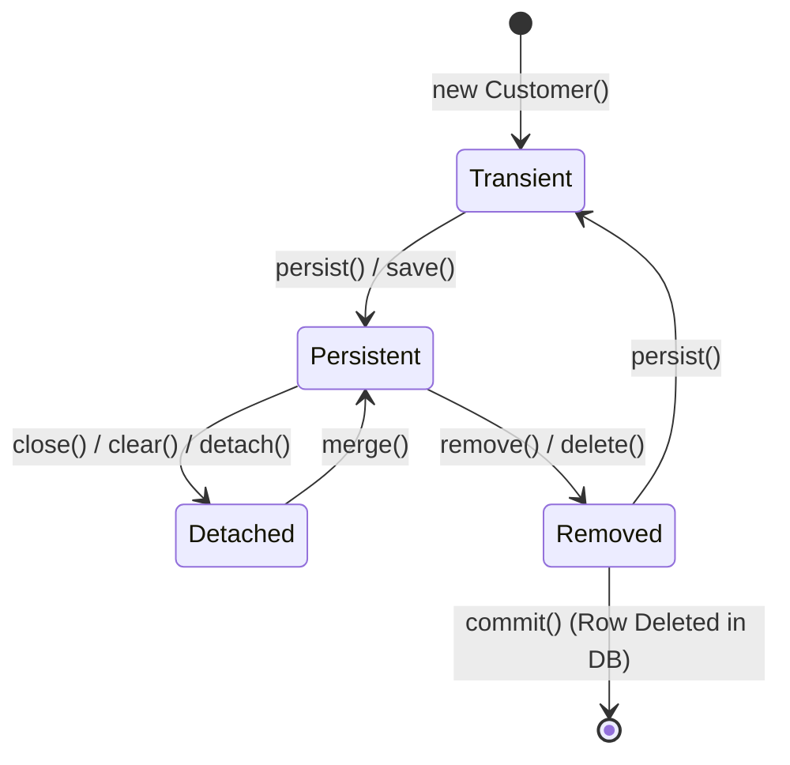
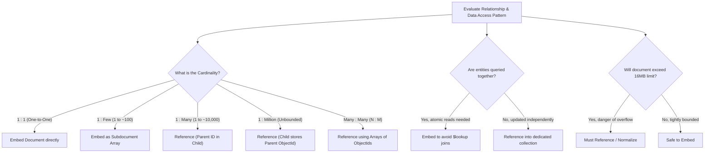

# Unit 4 — Database Integration & Persistence Architecture

> **Course:** Full Stack Web Development (FSD)  
> **Topic:** Unit 4: Database Integration, Persistence Frameworks, Transactions, and Distributed Data Architecture  
> **Prerequisites:** Fundamentals of JavaScript/Node.js, Core Java, Basic Data Structures  
> **Source Material:** Unit 4 Lecture Modules, Enterprise Systems Design Standards, and University Examination Specifications  

---

## Table of Contents
- [1. Unit 4 Overview & Learning Objectives](#1-unit-4-overview--learning-objectives)
- [2. Relational Database Fundamentals & Architecture](#2-relational-database-fundamentals--architecture)
  - [2.1 The Relational Data Model & Formal Foundations](#21-the-relational-data-model--formal-foundations)
  - [2.2 Taxonomy of Relational Keys](#22-taxonomy-of-relational-keys)
  - [2.3 Northwind Enterprise Domain Architecture (Mermaid ERD)](#23-northwind-enterprise-domain-architecture-mermaid-erd)
  - [2.4 Cardinality, Modality & Referential Integrity Rules](#24-cardinality-modality--referential-integrity-rules)
- [3. Database Normalization & Normal Forms](#3-database-normalization--normal-forms)
  - [3.1 Functional Dependency Theory & Armstrong's Axioms](#31-functional-dependency-theory--armstrongs-axioms)
  - [3.2 Modification Anomalies: Insertion, Deletion, and Update](#32-modification-anomalies-insertion-deletion-and-update)
  - [3.3 Progressive Normalization: 1NF through BCNF](#33-progressive-normalization-1nf-through-bcnf)
    - [3.3.1 First Normal Form (1NF)](#331-first-normal-form-1nf)
    - [3.3.2 Second Normal Form (2NF)](#332-second-normal-form-2nf)
    - [3.3.3 Third Normal Form (3NF)](#333-third-normal-form-3nf)
    - [3.3.4 Boyce-Codd Normal Form (BCNF)](#334-boyce-codd-normal-form-bcnf)
  - [3.4 Controlled Denormalization: Tradeoffs & Strategies](#34-controlled-denormalization-tradeoffs--strategies)
- [4. Structured Query Language (SQL) & Transaction Management](#4-structured-query-language-sql--transaction-management)
  - [4.1 Comprehensive SQL Sub-Language Taxonomy](#41-comprehensive-sql-sub-language-taxonomy)
  - [4.2 ACID Transactional Guarantees](#42-acid-transactional-guarantees)
  - [4.3 Concurrency Phenomena & Data Anomalies](#43-concurrency-phenomena--data-anomalies)
  - [4.4 ANSI SQL-92 Transaction Isolation Levels Matrix](#44-ansi-sql-92-transaction-isolation-levels-matrix)
- [5. Object-Relational Mapping (ORM) & Enterprise Drivers](#5-object-relational-mapping-orm--enterprise-drivers)
  - [5.1 The Object-Relational Impedance Mismatch](#51-the-object-relational-impedance-mismatch)
  - [5.2 The N+1 Select Problem & Mitigation Architectures](#52-the-n1-select-problem--mitigation-architectures)
  - [5.3 JPA & Hibernate Engine Architecture](#53-jpa--hibernate-engine-architecture)
  - [5.4 Entity Lifecycle States & Persistence Context](#54-entity-lifecycle-states--persistence-context)
  - [5.5 First-Level Cache, Dirty Checking & Write-Behind Engine](#55-first-level-cache-dirty-checking--write-behind-engine)
- [6. Production-Grade Spring Data JPA Implementation](#6-production-grade-spring-data-jpa-implementation)
  - [6.1 Customer & Order Domain Entity Implementation (`CustomerEntity.java`)](#61-customer--order-domain-entity-implementation-customerentityjava)
  - [6.2 Spring Data JPA Repository Implementation (`CustomerRepository.java`)](#62-spring-data-jpa-repository-implementation-customerrepositoryjava)
- [7. Enterprise Node.js MySQL2 Transactional Architecture](#7-enterprise-nodejs-mysql2-transactional-architecture)
  - [7.1 Connection Pooling & Prepared Statement Internals](#71-connection-pooling--prepared-statement-internals)
  - [7.2 Production Runnable Script: `mysql2-database-manager.js`](#72-production-runnable-script-mysql2-database-managerjs)
- [8. NoSQL Database Architecture & MongoDB](#8-nosql-database-architecture--mongodb)
  - [8.1 The Four Families of NoSQL Databases](#81-the-four-families-of-nosql-databases)
  - [8.2 BSON Wire Protocol & Document Architecture](#82-bson-wire-protocol--document-architecture)
  - [8.3 The 12-Byte ObjectId Internal Anatomy](#83-the-12-byte-objectid-internal-anatomy)
  - [8.4 Schema Design: Embedding vs. Referencing Decision Matrix](#84-schema-design-embedding-vs-referencing-decision-matrix)
- [9. Production Node.js MongoDB Native Driver CRUD Architecture](#9-production-nodejs-mongodb-native-driver-crud-architecture)
  - [9.1 Native Driver Architecture & Atomic Operators](#91-native-driver-architecture--atomic-operators)
  - [9.2 Production Runnable Script: `mongodb-native-crud.js`](#92-production-runnable-script-mongodb-native-crudjs)
- [10. MongoDB Aggregation Pipeline Architecture & Indexing](#10-mongodb-aggregation-pipeline-architecture--indexing)
  - [10.1 Pipeline Stages Execution Model](#101-pipeline-stages-execution-model)
  - [10.2 Executable Multi-Stage Analytics Aggregation Function](#102-executable-multi-stage-analytics-aggregation-function)
  - [10.3 The ESR (Equality, Sort, Range) Indexing Rule](#103-the-esr-equality-sort-range-indexing-rule)
- [11. Distributed Database Systems, CAP & PACELC Theorems](#11-distributed-database-systems-cap--pacelc-theorems)
  - [11.1 Brewer's CAP Theorem & Formal Proof](#111-brewers-cap-theorem--formal-proof)
  - [11.2 Abadi's PACELC Theorem & Latency Tradeoffs](#112-abadis-pacelc-theorem--latency-tradeoffs)
  - [11.3 Replication Topologies: Single-Leader vs. Leaderless (Quorum Consensus)](#113-replication-topologies-single-leader-vs-leaderless-quorum-consensus)
  - [11.4 Data Partitioning: Range-Based vs. Hash-Based Sharding](#114-data-partitioning-range-based-vs-hash-based-sharding)
- [12. Unit-4 Abbreviation Reference Table & Core Concepts Glossary](#12-unit-4-abbreviation-reference-table--core-concepts-glossary)
- [13. University Examination Preparation Suite](#13-university-examination-preparation-suite)
  - [13.1 5-Mark Conceptual Questions & Model Answers](#131-5-mark-conceptual-questions--model-answers)
  - [13.2 10-Mark Architectural & Analytical Questions with Marking Schemes](#132-10-mark-architectural--analytical-questions-with-marking-schemes)

---

# 1. Unit 4 Overview & Learning Objectives

Modern web applications require durable, highly available, and performant data persistence layers. In full-stack systems, application code rarely operates directly on raw disk storage; instead, it mediates data flow through Relational Database Management Systems (RDBMS) or Non-Relational (NoSQL) document stores.

This unit bridges the gap between software domain models and persistence tiers. We analyze the theoretical underpinnings of relational data modeling, database normalization, concurrency control, and transactions, followed by enterprise Object-Relational Mapping (ORM) and native driver integrations in Java and Node.js. Finally, we explore modern NoSQL architectures, aggregation pipelines, and distributed data theorems (CAP and PACELC).



### Figure 4.1: Enterprise Full-Stack Persistence Architecture

**What it shows:**  
The multi-tier architecture connecting client applications to backend execution runtimes (Java Virtual Machine and Node.js V8) and persistent storage engines across relational and non-relational boundaries.

**Components:**
- **Client Tier** — Initiates HTTP/REST requests carrying JSON payloads.
- **Application Tier** — Hosts business logic, validation, and object persistence frameworks (Spring Data JPA and Node.js drivers).
- **Persistence Tier** — Guarantees durable storage using ACID-compliant relational engines (MySQL InnoDB) and horizontally scalable document databases (MongoDB WiredTiger).

**Flow / Relationship:**  
Client requests are processed by application services, which map domain entities to tabular relational structures or hierarchical BSON documents before executing wire-level database queries over persistent socket connections.

**Key observations:**
- Relational integration relies on strongly typed schemas, relational keys, and ACID transactions.
- NoSQL integration emphasizes polymorphic JSON-like documents, dynamic aggregation pipelines, and eventual consistency.

[Source: Unit 4 Course Specification, Module 4.1]

---

# 2. Relational Database Fundamentals & Architecture

Relational Database Management Systems organize data based on the formal relational model pioneered by Edgar F. Codd in 1970. Before writing queries, developers must structure data into mathematical relations with strict key constraints and cardinalities.

## 2.1 The Relational Data Model & Formal Foundations

In relational theory, a database is a collection of relations. A **relation** corresponds to a table, a **tuple** corresponds to a row or record, and an **attribute** corresponds to a column header.

- **Relation Schema:** Represented mathematically as $R(A_1, A_2, \dots, A_n)$, where $R$ is the relation name and $A_i$ are attributes defined over specific domains.
- **Domain:** The set of atomic, indivisible values permitted for an attribute, denoted as $\text{dom}(A_i)$.
- **Relation Instance:** A finite set of tuples $r(R) \subseteq \text{dom}(A_1) \times \text{dom}(A_2) \times \dots \times \text{dom}(A_n)$.

```
+---------------------------------------------------------------------------------------+
| Formal Relational Term       | SQL / Physical Implementation Equivalent                |
+---------------------------------------------------------------------------------------+
| Relation                     | Table                                                  |
| Tuple                        | Row / Record                                           |
| Attribute                    | Column / Field                                         |
| Domain                       | Data Type & Constraints (e.g., VARCHAR(50), NOT NULL)  |
| Degree                       | Number of columns (Arity of the relation)             |
| Cardinality                  | Number of rows currently stored in the table           |
+---------------------------------------------------------------------------------------+
```

> **💡 Core Principle:** In a pure relation, tuples are unordered, attributes are unordered, and duplicate tuples are strictly prohibited. Every row must be uniquely identifiable.

## 2.2 Taxonomy of Relational Keys

Relational integrity requires keys to enforce entity identity and inter-table relationships. The relational model defines distinct key classifications:

```
[ Super Key ]  (Any attribute set guaranteeing tuple uniqueness)
      │
      ▼ (Minimal Super Key)
[ Candidate Key ]  (No extraneous attributes permitted)
   ├──► [ Primary Key ]    (Explicitly selected default table identifier; NOT NULL)
   └──► [ Alternate Key ]  (Remaining candidate keys not chosen as Primary Key)

[ Foreign Key ]    (Attribute referencing a Candidate/Primary Key in another relation)
[ Composite Key ]  (Key composed of two or more attributes)
[ Surrogate Key ]  (System-generated artificial identifier; e.g., AUTO_INCREMENT)
[ Natural Key ]    (Real-world business identifier with intrinsic domain meaning)
```

- **Super Key ($SK$):** A set of one or more attributes that collectively identifies a unique tuple in a relation. Formally, if $K$ is a super key of relation $R$, then for any two distinct tuples $t_1, t_2 \in r(R)$, $t_1[K] \neq t_2[K]$.
- **Candidate Key ($CK$):** A minimal super key. A super key $K$ is a candidate key if no proper subset $K' \subset K$ is also a super key.
- **Primary Key ($PK$):** The specific candidate key chosen by the database architect as the principal identifier for the relation. It enforces entity integrity and cannot contain null values (`NOT NULL` constraint).
- **Alternate Key ($AK$):** Any candidate key that was not chosen as the primary key. Implemented in SQL using the `UNIQUE` constraint.
- **Foreign Key ($FK$):** An attribute or collection of attributes in a referencing relation whose values must match a candidate key or primary key in a referenced relation, or be null. Enforces referential integrity.
- **Composite Key:** A primary or candidate key consisting of two or more attributes. Common in associative junction tables representing many-to-many relationships.
- **Surrogate Key:** An artificially created value assigned to a record with no business meaning (e.g., auto-incrementing integers, UUIDs). It decouples the physical database key from volatile business attributes.
- **Natural Key:** An attribute with real-world business meaning that already uniquely identifies the record (e.g., Social Security Number, International Standard Book Number, Vehicle Identification Number).

> **⚠️ Warning:** While natural keys avoid additional surrogate columns, they introduce cascading updates across foreign keys whenever business identifiers change. Modern enterprise architectures strongly favor surrogate primary keys.

## 2.3 Northwind Enterprise Domain Architecture (Mermaid ERD)

To illustrate relational architecture, we examine the standard Northwind enterprise ordering schema comprising Customers, Orders, Employees, Shippers, Products, Categories, and Suppliers.



### Figure 4.2: Northwind Relational Entity-Relationship Diagram

**What it shows:**  
The multi-table schema modeling enterprise order processing, demonstrating one-to-many (`||--o{`) relationships and many-to-many relationships resolved via an associative junction entity (`ORDER_DETAILS`).

**Components:**
- **Entity Tables:** `CUSTOMERS`, `ORDERS`, `PRODUCTS`, `EMPLOYEES`, `CATEGORIES`, `SUPPLIERS`, `SHIPPERS`.
- **Associative Junction Table:** `ORDER_DETAILS`, with composite primary key `(order_id, product_id)`.
- **Referential Integrity Constraints:** Foreign key references linking child records to parent records.

**Flow / Relationship:**  
A customer places zero or many orders. Each order is managed by an employee and fulfilled through a shipper. An order contains one or more line items (`ORDER_DETAILS`), each referencing a specific catalog product.

**Key observations:**
- `ORDER_DETAILS` contains line-item level transaction pricing (`unit_price`) to insulate historical orders against future price changes in `PRODUCTS`.
- Composite primary keys prevent duplicate product entries within a single order.

[Source: Unit 4 Course Specification, Module 4.1]

## 2.4 Cardinality, Modality & Referential Integrity Rules

Entity-Relationship relationships are governed by structural constraints:

- **Cardinality (Maximum Constraint):** Defines the maximum number of entity instances in one entity set that can be associated with an entity instance in another entity set.
  - One-to-One ($1:1$) — e.g., User to UserProfile.
  - One-to-Many ($1:N$) — e.g., Customer to Orders.
  - Many-to-Many ($M:N$) — e.g., Orders to Products (resolved via junction table).
- **Modality (Minimum Constraint / Participation):** Specifies whether the relationship is optional ($0$) or mandatory ($1$).
  - Optional participation (modality $0$): An entity can exist without participating in the relationship.
  - Mandatory participation (modality $1$): Every instance of the entity must participate in the relationship.

```
+-------------------+--------------------+-----------------------------------------------------+
| Crow's Foot Symbol| Notation           | Meaning                                             |
+-------------------+--------------------+-----------------------------------------------------+
| --||--            | Mandatory One (1,1)| Exactly one instance required                       |
| --o|--            | Optional One (0,1) | Zero or one instance permitted                      |
| --|<--            | Mandatory Many(1,N)| At least one instance required, up to unbounded     |
| --o<--            | Optional Many (0,N)| Zero or more instances permitted                    |
+-------------------+--------------------+-----------------------------------------------------+
```

### Referential Integrity Action Options

When a referenced tuple in a parent table is deleted or updated, the database engine enforces one of the following foreign key actions:

1. `ON DELETE RESTRICT / NO ACTION`: Rejects the parent modification if matching child rows exist.
2. `ON DELETE CASCADE`: Automatically deletes all corresponding child rows in the referencing table.
3. `ON DELETE SET NULL`: Sets the foreign key columns in referencing child rows to `NULL`.
4. `ON DELETE SET DEFAULT`: Replaces referencing child foreign keys with their declared default value.

> **📝 Exam Note:** In financial systems, `ON DELETE CASCADE` is prohibited on transactional data like `ORDERS` or `INVOICES`. Architects must use `ON DELETE RESTRICT` or soft deletes (`deleted_at TIMESTAMP`) to prevent accidental destruction of audit records.

---

# 3. Database Normalization & Normal Forms

Database normalization is a formal technique for organizing relational database tables to minimize data redundancy and prevent modification anomalies while preserving functional dependencies and lossless joins.

## 3.1 Functional Dependency Theory & Armstrong's Axioms

Normalization relies on the mathematical concept of functional dependencies between attribute sets.

### Definition: Functional Dependency (FD)

**Meaning:**  
A functional dependency denotes a constraint between two sets of attributes in a relation.

**Formal definition:**  
Given relation schema $R$ and subsets $X \subseteq R$ and $Y \subseteq R$, we say that $X$ functionally determines $Y$ (written as $X \to Y$) if and only if for every legal instance $r(R)$, any two tuples $t_1, t_2 \in r$ that agree on $X$ must also agree on $Y$:

$$
\forall t_1, t_2 \in r(R), \quad t_1[X] = t_2[X] \implies t_1[Y] = t_2[Y]
$$

Here, $X$ is called the **determinant** and $Y$ is called the **dependent**.

### Armstrong's Axioms

William W. Armstrong established sound and complete inference rules for deriving all functional dependencies implied by a set $F$:

- **Axiom of Reflexivity:** If $Y \subseteq X$, then $X \to Y$. (Trivial dependency)
- **Axiom of Augmentation:** If $X \to Y$, then $XZ \to YZ$ for any attribute set $Z$.
- **Axiom of Transitivity:** If $X \to Y$ and $Y \to Z$, then $X \to Z$.

Secondary derived rules frequently used in schema analysis:

- **Union Rule:** If $X \to Y$ and $X \to Z$, then $X \to YZ$.
- **Decomposition Rule:** If $X \to YZ$, then $X \to Y$ and $X \to Z$.
- **Pseudotransitivity Rule:** If $X \to Y$ and $WY \to Z$, then $WX \to Z$.

## 3.2 Modification Anomalies: Insertion, Deletion, and Update

Unnormalized schemas exhibit three destructive anomalies:

```
Unnormalized Relation: EMP_PROJECT
+--------+---------------+------------+--------------+---------------+
| Emp_ID | Emp_Name      | Project_ID | Project_Name | Project_Budget|
+--------+---------------+------------+--------------+---------------+
| E101   | Alice Smith   | P01        | Apollo       | $500,000      |
| E101   | Alice Smith   | P02        | Artemis      | $300,000      |
| E102   | Bob Johnson   | P01        | Apollo       | $500,000      |
| E103   | Carol White   | P03        | Gemini       | $150,000      |
+--------+---------------+------------+--------------+---------------+
```

- **Insertion Anomaly:** Cannot insert a newly created project (e.g., project `P04`, "Orion", budget `$400,000`) without assigning an employee, because `Emp_ID` is part of the primary key and cannot be `NULL`.
- **Deletion Anomaly:** If employee `E103` leaves the company and their record is deleted, all historical and budget information about project `P03` ("Gemini") is permanently erased.
- **Update / Modification Anomaly:** If the budget for project `P01` ("Apollo") increases to `$550,000`, every matching record must be updated. If Alice's row is updated but Bob's row is missed, the database enters an inconsistent state.

## 3.3 Progressive Normalization: 1NF through BCNF

Normalization is progressive: each subsequent normal form satisfies all constraints of the preceding forms.

```
+──────────────────────────────────────────────────────────+
| BCNF (Every determinant is a super key)                  |
|   +──────────────────────────────────────────────────────+
|   | 3NF (No transitive dependencies on candidate keys)   |
|   |   +──────────────────────────────────────────────────+
|   |   | 2NF (No partial dependencies on composite keys)  |
|   |   |   +──────────────────────────────────────────────+
|   |   |   | 1NF (Atomic domain values; no repeating grps)|
+───┴───┴───┴──────────────────────────────────────────────+
```

### 3.3.1 First Normal Form (1NF)

**Rule:** A relation is in 1NF if and only if all attribute values are atomic (indivisible) and there are no repeating groups or multivalued attributes.

#### 1NF Violation Schema

```sql
-- VIOLATION: Non-atomic multivalued column 'skills'
CREATE TABLE employee_unnormalized (
    emp_id INT PRIMARY KEY,
    emp_name VARCHAR(50),
    skills VARCHAR(200) -- Contains comma-separated values: 'Java, SQL, Docker'
);
```

#### Resolved 1NF DDL

```sql
CREATE TABLE employees (
    emp_id INT PRIMARY KEY,
    emp_name VARCHAR(50) NOT NULL
) ENGINE=InnoDB;

CREATE TABLE employee_skills (
    emp_id INT NOT NULL,
    skill VARCHAR(50) NOT NULL,
    PRIMARY KEY (emp_id, skill),
    FOREIGN KEY (emp_id) REFERENCES employees(emp_id) ON DELETE CASCADE
) ENGINE=InnoDB;
```

### 3.3.2 Second Normal Form (2NF)

**Rule:** A relation is in 2NF if and only if it is in 1NF and every non-prime attribute is **fully functionally dependent** on the entire primary key (no partial functional dependencies).

#### 2NF Violation Schema

Consider `order_items_violation(order_id, product_id, product_name, quantity)`.
- Primary Key: Composite key `(order_id, product_id)`
- Functional Dependencies:
  - $(order\_id, product\_id) \to quantity$ (Full dependency)
  - $product\_id \to product\_name$ (**Partial dependency**; `product_name` depends on a proper subset of the composite key)

#### Resolved 2NF DDL

```sql
-- Table 1: Entity containing full dependency
CREATE TABLE order_items (
    order_id INT NOT NULL,
    product_id INT NOT NULL,
    quantity INT NOT NULL,
    PRIMARY KEY (order_id, product_id),
    FOREIGN KEY (product_id) REFERENCES products(product_id)
) ENGINE=InnoDB;

-- Table 2: Entity isolating the partial dependency
CREATE TABLE products (
    product_id INT PRIMARY KEY,
    product_name VARCHAR(100) NOT NULL
) ENGINE=InnoDB;
```

### 3.3.3 Third Normal Form (3NF)

**Rule:** A relation is in 3NF if and only if it is in 2NF and no non-prime attribute is **transitively dependent** on any candidate key.

Formally, for every non-trivial functional dependency $X \to Y$, at least one of the following must hold:
1. $X$ is a super key of $R$, OR
2. $Y$ is a prime attribute (a member of some candidate key).

#### 3NF Violation Schema

Consider `orders_violation(order_id, customer_id, customer_city, order_date)`.
- Primary Key: `order_id`
- Functional Dependencies:
  - $order\_id \to customer\_id$
  - $customer\_id \to customer\_city$
  - Therefore: $order\_id \to customer\_city$ is a **transitive dependency** via `customer_id`.

#### Resolved 3NF DDL

```sql
CREATE TABLE customers (
    customer_id INT PRIMARY KEY,
    customer_city VARCHAR(50) NOT NULL
) ENGINE=InnoDB;

CREATE TABLE orders (
    order_id INT PRIMARY KEY,
    customer_id INT NOT NULL,
    order_date DATE NOT NULL,
    FOREIGN KEY (customer_id) REFERENCES customers(customer_id)
) ENGINE=InnoDB;
```

### 3.3.4 Boyce-Codd Normal Form (BCNF)

**Rule:** A relation is in BCNF (often called 3.5NF) if and only if for every non-trivial functional dependency $X \to Y$, the determinant $X$ is a **super key**.

> **💡 Difference between 3NF and BCNF:** 3NF allows $Y$ to be a prime attribute when $X$ is not a super key. BCNF strictly eliminates this exception, requiring $X$ to always be a super key.

#### BCNF Violation Schema

Consider an advising relation: `advisor_assignment(student_id, major, advisor_name)`.
- Business Rules:
  - Each student can have multiple majors, but only one advisor per major: $(student\_id, major) \to advisor\_name$.
  - Each advisor advises only one major: $advisor\_name \to major$.
- Candidate Keys: `(student_id, major)` and `(student_id, advisor_name)`.
- Analysis of $advisor\_name \to major$:
  - $advisor\_name$ is NOT a super key (an advisor has many students).
  - $major$ IS a prime attribute (part of candidate key `(student_id, major)`).
  - This schema satisfies 3NF, but **violates BCNF** because the determinant $advisor\_name$ is not a super key.

#### Resolved BCNF DDL

```sql
-- Relation 1: Isolates advisor to major mapping
CREATE TABLE advisor_department (
    advisor_name VARCHAR(100) PRIMARY KEY,
    major VARCHAR(50) NOT NULL
) ENGINE=InnoDB;

-- Relation 2: Student to advisor mapping
CREATE TABLE student_advisors (
    student_id INT NOT NULL,
    advisor_name VARCHAR(100) NOT NULL,
    PRIMARY KEY (student_id, advisor_name),
    FOREIGN KEY (advisor_name) REFERENCES advisor_department(advisor_name)
) ENGINE=InnoDB;
```

## 3.4 Controlled Denormalization: Tradeoffs & Strategies

While 3NF and BCNF eliminate anomalies, heavily normalized databases require multi-table `JOIN` operations that degrade read throughput under high concurrency.

- **Read vs. Write Tradeoff:** Normalization optimizes write latency and eliminates storage redundancy; denormalization optimizes read latency at the expense of write overhead and storage consumption.
- **Pre-computed Aggregates:** Storing `order_total` directly on `orders` prevents expensive runtime `SUM(quantity * unit_price)` calculations over millions of rows in `order_details`.
- **Replication of Stable Attributes:** Copying `customer_name` directly onto `invoices` speeds up rendering without joining `customers`. Because customer names rarely change, update anomalies are minimal.

```
+─────────────────────+─────────────────────────────+─────────────────────────────+
| Dimension           | Normalized Schema (3NF/BCNF)| Denormalized Schema         |
+─────────────────────+─────────────────────────────+─────────────────────────────+
| Write Performance   | Fast (minimal duplicate rows)| Slower (must update mirrors)|
| Read Performance    | Slower (requires multi-JOIN)| Fast (single-table reads)   |
| Storage Consumption | Minimal                     | Higher (duplicated data)    |
| Anomaly Risk        | Zero update/delete anomalies| High (requires sync triggers)|
| Cache Hit Ratio     | Moderate                    | High                        |
+─────────────────────+─────────────────────────────+─────────────────────────────+
```

---

# 4. Structured Query Language (SQL) & Transaction Management

Structured Query Language is the declarative language used to manage relational schemas and manipulate tabular data. Transactions allow multiple SQL operations to execute with robust reliability guarantees.

## 4.1 Comprehensive SQL Sub-Language Taxonomy

SQL commands are grouped into five distinct functional sub-languages:

```
                  ┌───────────────── SQL Commands ─────────────────┐
                  │                                                │
          ┌───────┴───────┬───────────────┬────────────────┬───────┴───────┐
          ▼               ▼               ▼                ▼               ▼
        [DDL]           [DML]           [DQL]            [DCL]           [TCL]
      Data Def.       Data Manip.     Data Query       Data Control   Transaction Ctrl
     - CREATE        - INSERT        - SELECT         - GRANT        - COMMIT
     - ALTER         - UPDATE                         - REVOKE       - ROLLBACK
     - DROP          - DELETE                                        - SAVEPOINT
     - TRUNCATE      - MERGE
```

- **Data Definition Language (DDL):** Defines and alters database structures and schemas. Commands implicitly execute an auto-commit in MySQL.
  - `CREATE`, `ALTER`, `DROP`, `TRUNCATE`, `RENAME`.
- **Data Manipulation Language (DML):** Modifies data instances within existing relations. Operates within active transaction boundaries.
  - `INSERT`, `UPDATE`, `DELETE`, `MERGE`.
- **Data Query Language (DQL):** Retrieves and projects data without altering table states.
  - `SELECT`.
- **Data Control Language (DCL):** Manages user privileges, security roles, and authorization schemas.
  - `GRANT`, `REVOKE`.
- **Transaction Control Language (TCL):** Controls the commit, rollback, and intermediate checkpoints of transactional execution sequences.
  - `COMMIT`, `ROLLBACK`, `SAVEPOINT`.

## 4.2 ACID Transactional Guarantees

A database transaction is a logical unit of work comprising one or more database operations. Relational database engines guarantee data integrity via the **ACID** properties:

- **Atomicity ("All-or-Nothing"):** Guarantees that all statements within a transaction boundary complete successfully. If any statement fails, the entire transaction aborts, and all modifications roll back to the pre-transaction state.
- **Consistency:** Ensures the database transitions from one valid state to another valid state, satisfying all declared schema constraints, unique keys, foreign keys, and cascade rules.
- **Isolation:** Dictates how concurrent transactions view intermediate modifications made by one another. Prevents concurrent processes from observing uncommitted state changes.
- **Durability:** Guarantees that once a transaction commits, its modifications are permanently recorded in non-volatile storage (via the Write-Ahead Log / Write-Ahead Redo Log), surviving sudden system crashes or hardware failures.

## 4.3 Concurrency Phenomena & Data Anomalies

When multiple transactions execute concurrently without strict isolation, four data anomalies can emerge:

1. **Dirty Read ($G_1$):** Transaction $T_1$ modifies a row. Transaction $T_2$ reads the uncommitted row. $T_1$ subsequently executes a `ROLLBACK`. $T_2$ has now operated on dirty data that never officially existed in the persistent store.
2. **Non-Repeatable Read ($G_{2a}$ / Fuzzy Read):** Transaction $T_1$ reads a row. Transaction $T_2$ modifies or deletes that row and executes `COMMIT`. When $T_1$ rereads the same row within its original transaction boundary, it observes altered attribute values or discovers the row has vanished.
3. **Phantom Read ($A3$):** Transaction $T_1$ queries a range of rows matching a search predicate (e.g., `WHERE status = 'Pending'`). Transaction $T_2$ executes an `INSERT` of a new row matching that predicate and commits. When $T_1$ re-executes the range query, a new "phantom" row appears.
4. **Lost Update ($P4$):** Transactions $T_1$ and $T_2$ read the same row balance simultaneously. $T_1$ updates the row and commits. Subsequently, $T_2$ writes its update based on the original read, completely overwriting and obliterating $T_1$'s modification.

## 4.4 ANSI SQL-92 Transaction Isolation Levels Matrix

The ANSI SQL-92 standard defines four isolation levels balancing concurrency throughput against anomaly prevention:

```
+──────────────────+────────────+─────────────────────+──────────────+─────────────+
| Isolation Level  | Dirty Read | Non-Repeatable Read | Phantom Read | Lost Update |
+──────────────────+────────────+─────────────────────+──────────────+─────────────+
| READ UNCOMMITTED | Allowed    | Allowed             | Allowed      | Allowed     |
| READ COMMITTED   | Prevented  | Allowed             | Allowed      | Prevented   |
| REPEATABLE READ  | Prevented  | Prevented           | Allowed*     | Prevented   |
| SERIALIZABLE     | Prevented  | Prevented           | Prevented    | Prevented   |
+──────────────────+────────────+─────────────────────+──────────────+─────────────+
```

*\*Note on MySQL InnoDB:* MySQL's default isolation level is `REPEATABLE READ`. Unlike standard ANSI SQL-92, InnoDB prevents phantom reads under `REPEATABLE READ` for snapshot reads using **Multi-Version Concurrency Control (MVCC)**, and for locking reads using **Next-Key Locks** (index-record locks combined with gap locks).

---

# 5. Object-Relational Mapping (ORM) & Enterprise Drivers

Modern object-oriented languages (Java, TypeScript, Python) represent domain models as graph networks of rich objects with inheritance, polymorphism, and encapsulation. Relational databases represent models as two-dimensional tables governed by set theory and mathematical relations.

## 5.1 The Object-Relational Impedance Mismatch

The technical friction between object and relational paradigms is known as the **Object-Relational Impedance Mismatch**. It manifests across five primary dimensions:

```
+────────────────────+────────────────────────────────+─────────────────────────────────+
| Mismatch Dimension | Object-Oriented Domain (Java)  | Relational Database (RDBMS/SQL) |
+────────────────────+────────────────────────────────+─────────────────────────────────+
| 1. Granularity     | Fine-grained classes (Address, | Coarse-grained tables (Address  |
|                    | Money, Coordinates)            | columns inlined in User table)  |
| 2. Inheritance     | Polymorphism, abstract classes,| No native inheritance; mapped   |
|                    | interface hierarchies          | via SingleTable, Joined, etc.   |
| 3. Identity        | Object identity (obj1 == obj2) | Primary key equality            |
|                    | and equality (obj1.equals(obj2)| (table.id = 101)                |
| 4. Associations    | Unidirectional/Bidirectional   | Foreign key references always   |
|                    | object reference pointers      | traversed via relational JOIN   |
| 5. Navigation      | Graph traversal via dot syntax | Set-based relational queries    |
|                    | (order.getCustomer().getName())| requiring explicit JOIN queries |
+────────────────────+────────────────────────────────+─────────────────────────────────+
```

## 5.2 The N+1 Select Problem & Mitigation Architectures

The most prevalent performance anti-pattern in ORM frameworks is the **N+1 Select Problem**.

### Problem Mechanics

Suppose an application retrieves 100 `Customer` entities, each having a lazily loaded collection of `Order` entities:
1. The framework executes **1 initial query** to fetch the parent customers:
   ```sql
   SELECT * FROM customers; -- Returns 100 rows
   ```
2. As the application iterates through each customer and invokes `customer.getOrders()`, Hibernate executes **N separate queries** (one per customer):
   ```sql
   SELECT * FROM orders WHERE customer_id = 1;
   SELECT * FROM orders WHERE customer_id = 2;
   -- ... repeated 100 times!
   ```
3. Total database network round trips: $1 + 100 = 101$ queries. Under load, this saturates database connection pools and stalls application throughput.

### Enterprise Solutions

1. **JPQL `JOIN FETCH`:** Forces an eager SQL inner or left outer join in a single query:
   ```java
   @Query("SELECT DISTINCT c FROM CustomerEntity c LEFT JOIN FETCH c.orders")
   List<CustomerEntity> findAllWithOrders();
   ```
2. **JPA `@EntityGraph`:** Dynamically overrides fetch plans at runtime without rewriting query strings:
   ```java
   @EntityGraph(attributePaths = {"orders"})
   List<CustomerEntity> findAll();
   ```
3. **Hibernate Batch Fetching (`@BatchSize`):** Executes queries in batches using SQL `IN` clauses, reducing $N+1$ queries to $1 + \lceil N / \text{batchSize} \rceil$:
   ```java
   @BatchSize(size = 25)
   @OneToMany(mappedBy = "customer")
   private List<OrderEntity> orders;
   ```

## 5.3 JPA & Hibernate Engine Architecture

The Java Persistence API (Jakarta Persistence) provides standard specification interfaces, while Hibernate serves as the dominant reference implementation engine.



### Figure 5.1: JPA and Hibernate Architectural Layering

**What it shows:**  
The interaction between client application code, standard JPA interfaces, underlying Hibernate implementations, and low-level JDBC driver pools.

**Components:**
- `EntityManagerFactory` / `SessionFactory` — Thread-safe, expensive-to-create factory caching compiled metadata and second-level cache regions.
- `EntityManager` / `Session` — Non-thread-safe unit-of-work object representing a single persistence context and first-level cache.
- `EntityTransaction` — Boundaries controlling atomic commits and rollbacks.

**Flow / Relationship:**  
The application injects the `EntityManager`, performs entity operations, and delegates dirty checks and SQL generation to the Hibernate session, which communicates with MySQL via JDBC connections.

**Key observations:**
- An `EntityManagerFactory` is initialized once per application lifecycle, while an `EntityManager` is bound to a single HTTP request or transaction.

[Source: Unit 4 Course Specification, Module 4.3]

## 5.4 Entity Lifecycle States & Persistence Context

In JPA, an entity instance resides in one of four distinct lifecycle states relative to the Persistence Context:



### Figure 5.2: JPA Entity Lifecycle State Transitions

**What it shows:**  
The state transitions of a JPA entity managed within the persistence context lifecycle.

**Components:**
- **Transient:** The object is instantiated in JVM memory (`new Customer()`) with no primary key assigned and no association with any active persistence context. It has no corresponding database row.
- **Persistent (Managed):** The entity possesses a database primary key and is actively tracked by the persistence context. Any state changes made to this entity are automatically synchronized to the database upon transaction commit.
- **Detached:** The entity possesses a database primary key, but the persistence context that originally tracked it has closed, cleared, or serialized the object. State changes are no longer automatically tracked.
- **Removed:** The entity is scheduled for deletion from the persistent store upon transaction commit (`em.remove(entity)`).

**Flow / Relationship:**  
Calling `persist()` moves a transient instance into the managed state. Invoking `detach()` or closing the session decouples it. Calling `merge()` inspects the detached state, loads the matching database row into a new managed instance, and copies over the altered attributes.

**Key observations:**
- Managed entities require zero manual `UPDATE` statements; Hibernate automatically detects attribute mutations through dirty checking.

[Source: Unit 4 Course Specification, Module 4.3]

## 5.5 First-Level Cache, Dirty Checking & Write-Behind Engine

The Persistence Context acts as an in-memory **First-Level Cache** scoped to the current `EntityManager` / `Session`:

- **Repeatable Reads within Session:** Calling `em.find(Customer.class, 1L)` multiple times within the same transaction executes only one SQL `SELECT` statement. Subsequent lookups retrieve the existing object reference directly from the persistence context map.
- **Automatic Dirty Checking:** When an entity transitions to the managed state, Hibernate creates an internal **snapshot array** of its current attribute values. At transaction commit time, Hibernate compares the entity's current state against this baseline snapshot. If any attribute differs, Hibernate constructs and executes a parameterized SQL `UPDATE` statement.
- **Write-Behind Execution:** Hibernate queues all DML statements in an internal action queue, sorting operations (e.g., `INSERT` first, then `UPDATE`, then `DELETE`) to avoid deadlocks and maximize batching efficiency before flushing to the database.

---

# 6. Production-Grade Spring Data JPA Implementation

Below is a complete, production-grade Spring Data JPA implementation demonstrating bidirectional parent-child management (`Customer` and `Order`), cascading, orphan removal, helper methods, and derived/JPQL query repositories.

## 6.1 Customer & Order Domain Entity Implementation (`CustomerEntity.java`)

```java
package com.deepcollege.fsd.persistence.entity;

import jakarta.persistence.*;
import java.io.Serializable;
import java.math.BigDecimal;
import java.time.LocalDateTime;
import java.util.ArrayList;
import java.util.List;
import java.util.Objects;

/**
 * Enterprise JPA Domain Model demonstrating:
 * 1. Bidirectional One-to-Many mapping with OrderEntity
 * 2. CascadeType.ALL and orphanRemoval = true
 * 3. Defensive helper methods for relational integrity
 * 4. Optimistic locking support via @Version
 */
@Entity
@Table(name = "customers", indexes = {
    @Index(name = "idx_customer_email", columnList = "email", unique = true),
    @Index(name = "idx_customer_company", columnList = "company_name")
})
public class CustomerEntity implements Serializable {

    private static final long serialVersionUID = 1L;

    @Id
    @GeneratedValue(strategy = GenerationType.IDENTITY)
    @Column(name = "customer_id", updatable = false, nullable = false)
    private Long id;

    @Column(name = "company_name", nullable = false, length = 100)
    private String companyName;

    @Column(name = "contact_name", nullable = false, length = 60)
    private String contactName;

    @Column(name = "email", nullable = false, unique = true, length = 120)
    private String email;

    @Column(name = "city", length = 50)
    private String city;

    @Column(name = "country", length = 50)
    private String country;

    @Version
    @Column(name = "version")
    private Long version;

    @Column(name = "created_at", nullable = false, updatable = false)
    private LocalDateTime createdAt;

    @OneToMany(
        mappedBy = "customer",
        cascade = CascadeType.ALL,
        orphanRemoval = true,
        fetch = FetchType.LAZY
    )
    private List<OrderEntity> orders = new ArrayList<>();

    // Default no-arg constructor required by JPA specification
    public CustomerEntity() {
    }

    public CustomerEntity(String companyName, String contactName, String email, String city, String country) {
        this.companyName = companyName;
        this.contactName = contactName;
        this.email = email;
        this.city = city;
        this.country = country;
    }

    @PrePersist
    protected void onCreate() {
        this.createdAt = LocalDateTime.now();
    }

    // Bidirectional Relationship Defensive Helper Methods
    public void addOrder(OrderEntity order) {
        if (order != null) {
            orders.add(order);
            order.setCustomer(this);
        }
    }

    public void removeOrder(OrderEntity order) {
        if (order != null) {
            orders.remove(order);
            order.setCustomer(null);
        }
    }

    // Getters and Setters
    public Long getId() {
        return id;
    }

    public void setId(Long id) {
        this.id = id;
    }

    public String getCompanyName() {
        return companyName;
    }

    public void setCompanyName(String companyName) {
        this.companyName = companyName;
    }

    public String getContactName() {
        return contactName;
    }

    public void setContactName(String contactName) {
        this.contactName = contactName;
    }

    public String getEmail() {
        return email;
    }

    public void setEmail(String email) {
        this.email = email;
    }

    public String getCity() {
        return city;
    }

    public void setCity(String city) {
        this.city = city;
    }

    public String getCountry() {
        return country;
    }

    public void setCountry(String country) {
        this.country = country;
    }

    public Long getVersion() {
        return version;
    }

    public void setVersion(Long version) {
        this.version = version;
    }

    public LocalDateTime getCreatedAt() {
        return createdAt;
    }

    public List<OrderEntity> getOrders() {
        return orders;
    }

    public void setOrders(List<OrderEntity> orders) {
        this.orders = orders;
    }

    // Best Practice: Base equals/hashCode on business key (email) or ID
    @Override
    public boolean equals(Object o) {
        if (this == o) return true;
        if (!(o instanceof CustomerEntity that)) return false;
        return Objects.equals(email, that.email);
    }

    @Override
    public int hashCode() {
        return Objects.hash(email);
    }

    @Override
    public String toString() {
        return "CustomerEntity{" +
                "id=" + id +
                ", companyName='" + companyName + '\'' +
                ", email='" + email + '\'' +
                ", city='" + city + '\'' +
                ", country='" + country + '\'' +
                '}';
    }
}

/**
 * Accompanying OrderEntity completing bidirectional domain contract
 */
@Entity
@Table(name = "orders", indexes = {
    @Index(name = "idx_order_customer_id", columnList = "customer_id"),
    @Index(name = "idx_order_date", columnList = "order_date")
})
class OrderEntity implements Serializable {

    private static final long serialVersionUID = 1L;

    @Id
    @GeneratedValue(strategy = GenerationType.IDENTITY)
    @Column(name = "order_id", updatable = false, nullable = false)
    private Long id;

    @ManyToOne(fetch = FetchType.LAZY, optional = false)
    @JoinColumn(name = "customer_id", nullable = false)
    private CustomerEntity customer;

    @Column(name = "order_date", nullable = false)
    private LocalDateTime orderDate;

    @Column(name = "total_amount", nullable = false, precision = 12, scale = 2)
    private BigDecimal totalAmount;

    @Column(name = "status", nullable = false, length = 30)
    private String status;

    public OrderEntity() {
    }

    public OrderEntity(LocalDateTime orderDate, BigDecimal totalAmount, String status) {
        this.orderDate = orderDate;
        this.totalAmount = totalAmount;
        this.status = status;
    }

    public Long getId() {
        return id;
    }

    public void setId(Long id) {
        this.id = id;
    }

    public CustomerEntity getCustomer() {
        return customer;
    }

    public void setCustomer(CustomerEntity customer) {
        this.customer = customer;
    }

    public LocalDateTime getOrderDate() {
        return orderDate;
    }

    public void setOrderDate(LocalDateTime orderDate) {
        this.orderDate = orderDate;
    }

    public BigDecimal getTotalAmount() {
        return totalAmount;
    }

    public void setTotalAmount(BigDecimal totalAmount) {
        this.totalAmount = totalAmount;
    }

    public String getStatus() {
        return status;
    }

    public void setStatus(String status) {
        this.status = status;
    }

    @Override
    public boolean equals(Object o) {
        if (this == o) return true;
        if (!(o instanceof OrderEntity that)) return false;
        return Objects.equals(id, that.id);
    }

    @Override
    public int hashCode() {
        return Objects.hash(id);
    }
}
```

## 6.2 Spring Data JPA Repository Implementation (`CustomerRepository.java`)

```java
package com.deepcollege.fsd.persistence.repository;

import com.deepcollege.fsd.persistence.entity.CustomerEntity;
import org.springframework.data.domain.Page;
import org.springframework.data.domain.Pageable;
import org.springframework.data.jpa.repository.EntityGraph;
import org.springframework.data.jpa.repository.JpaRepository;
import org.springframework.data.jpa.repository.Modifying;
import org.springframework.data.jpa.repository.Query;
import org.springframework.data.repository.query.Param;
import org.springframework.stereotype.Repository;
import org.springframework.transaction.annotation.Transactional;

import java.util.List;
import java.util.Optional;

/**
 * Production Spring Data JPA Repository demonstrating:
 * 1. Query derivation from method names
 * 2. Explicit JPQL queries solving N+1 problem via JOIN FETCH
 * 3. Dynamic fetch graph overrides using @EntityGraph
 * 4. Modifying DML statements with explicit transaction control
 */
@Repository
public interface CustomerRepository extends JpaRepository<CustomerEntity, Long> {

    // 1. Derived query method searching by unique email
    Optional<CustomerEntity> findByEmail(String email);

    // 2. Derived query method with multiple criteria and case-insensitivity
    List<CustomerEntity> findByCountryIgnoreCaseAndCityIgnoreCase(String country, String city);

    // 3. Paginated derived query method
    Page<CustomerEntity> findByCountry(String country, Pageable pageable);

    // 4. Custom JPQL Query with JOIN FETCH preventing the N+1 Select Problem
    @Query("SELECT DISTINCT c FROM CustomerEntity c LEFT JOIN FETCH c.orders WHERE c.email = :email")
    Optional<CustomerEntity> findByEmailWithOrdersFetch(@Param("email") String email);

    // 5. Using EntityGraph to dynamically load orders without writing manual JOIN FETCH
    @EntityGraph(attributePaths = {"orders"})
    @Query("SELECT c FROM CustomerEntity c WHERE c.country = :country")
    List<CustomerEntity> findAllByCountryWithGraph(@Param("country") String country);

    // 6. Modifying bulk DML statement updating records atomically
    @Modifying
    @Transactional
    @Query("UPDATE CustomerEntity c SET c.city = :newCity WHERE c.city = :oldCity")
    int updateCityForCustomers(@Param("oldCity") String oldCity, @Param("newCity") String newCity);

    // 7. Native SQL query when engine-specific optimization is strictly required
    @Query(value = "SELECT c.* FROM customers c " +
                   "INNER JOIN orders o ON c.customer_id = o.customer_id " +
                   "GROUP BY c.customer_id " +
                   "HAVING SUM(o.total_amount) > :spendingThreshold", 
           nativeQuery = true)
    List<CustomerEntity> findHighValueCustomersNative(@Param("spendingThreshold") double threshold);
}
```

---

# 7. Enterprise Node.js MySQL2 Transactional Architecture

In high-concurrency Node.js applications, low-level database operations require connection pooling, parameterized prepared statements to prevent SQL Injection, and explicit transaction control.

## 7.1 Connection Pooling & Prepared Statement Internals

- **Connection Pool Overhead:** Creating a physical TCP socket connection to MySQL requires a three-way TCP handshake, TLS negotiation, authentication verification, and memory allocation. A connection pool (`mysql.createPool`) maintains a pool of pre-established, reusable connections.
- **Prepared Statements (Binary Protocol):** When using `pool.execute()` instead of `pool.query()`, MySQL compiles and optimizes the SQL execution plan once during the `PREPARE` phase. Subsequent executions pass only the binary-encoded parameters. This eliminates SQL injection vulnerabilities and accelerates repeat execution.

## 7.2 Production Runnable Script: `mysql2-database-manager.js`

```javascript
/**
 * ============================================================================
 * Production Node.js MySQL2 Transactional Architecture Script
 * Filename: mysql2-database-manager.js
 * Dependencies: mysql2 (npm install mysql2)
 * Features:
 *   - Resilient Connection Pooling with error monitoring
 *   - Strict Prepared Statements preventing SQL Injection
 *   - Multi-table Atomic E-Commerce Checkout Transaction
 *   - Automatic Rollback on failure with Connection Release
 * ============================================================================
 */

const mysql = require('mysql2/promise');

// 1. Configure the connection pool with enterprise pooling parameters
const pool = mysql.createPool({
    host: process.env.DB_HOST || 'localhost',
    port: parseInt(process.env.DB_PORT || '3306', 10),
    user: process.env.DB_USER || 'root',
    password: process.env.DB_PASSWORD || '',
    database: process.env.DB_NAME || 'fsd_store',
    waitForConnections: true,
    connectionLimit: 15,       // Maximum active connections in pool
    maxIdle: 5,                // Maximum idle connections allowed
    idleTimeout: 30000,        // Idle timeout in milliseconds (30 seconds)
    queueLimit: 0,             // Unlimited queue requests before rejecting
    enableKeepAlive: true,
    keepAliveInitialDelay: 10000
});

/**
 * Initializes database tables required for the demonstration.
 */
async function initializeSchema() {
    const connection = await pool.getConnection();
    try {
        console.log('[Schema] Verifying and provisioning relational tables...');
        
        // Provision Products table
        await connection.execute(`
            CREATE TABLE IF NOT EXISTS products (
                product_id INT AUTO_INCREMENT PRIMARY KEY,
                product_name VARCHAR(100) NOT NULL,
                stock_quantity INT NOT NULL,
                unit_price DECIMAL(10, 2) NOT NULL,
                CONSTRAINT chk_stock_positive CHECK (stock_quantity >= 0)
            ) ENGINE=InnoDB DEFAULT CHARSET=utf8mb4;
        `);

        // Provision Orders table
        await connection.execute(`
            CREATE TABLE IF NOT EXISTS orders (
                order_id INT AUTO_INCREMENT PRIMARY KEY,
                customer_email VARCHAR(120) NOT NULL,
                total_amount DECIMAL(10, 2) NOT NULL,
                order_status VARCHAR(30) NOT NULL DEFAULT 'COMPLETED',
                created_at TIMESTAMP DEFAULT CURRENT_TIMESTAMP
            ) ENGINE=InnoDB DEFAULT CHARSET=utf8mb4;
        `);

        // Provision Order Items junction table
        await connection.execute(`
            CREATE TABLE IF NOT EXISTS order_items (
                item_id INT AUTO_INCREMENT PRIMARY KEY,
                order_id INT NOT NULL,
                product_id INT NOT NULL,
                quantity INT NOT NULL,
                unit_price DECIMAL(10, 2) NOT NULL,
                FOREIGN KEY (order_id) REFERENCES orders(order_id) ON DELETE CASCADE,
                FOREIGN KEY (product_id) REFERENCES products(product_id)
            ) ENGINE=InnoDB DEFAULT CHARSET=utf8mb4;
        `);

        // Seed product stock if catalog is empty
        const [rows] = await connection.execute('SELECT COUNT(*) as count FROM products');
        if (rows[0].count === 0) {
            await connection.execute(`
                INSERT INTO products (product_name, stock_quantity, unit_price) VALUES
                ('Ergonomic Mechanical Keyboard', 10, 129.99),
                ('Ultra-Wide 4K Monitor', 5, 499.50),
                ('Wireless Gaming Mouse', 20, 59.90);
            `);
            console.log('[Schema] Seeded 3 product records successfully.');
        }
    } finally {
        connection.release();
    }
}

/**
 * Executes an atomic multi-table checkout transaction:
 * 1. Checks available product stock
 * 2. Decrements inventory with defensive row-level locking
 * 3. Creates order header
 * 4. Inserts order line items
 * If any step fails or inventory is insufficient, the entire operation rolls back.
 *
 * @param {string} customerEmail - Email of purchasing customer
 * @param {Array<{productId: number, quantity: number}>} items - Items to purchase
 * @returns {Promise<{success: boolean, orderId?: number, error?: string}>}
 */
async function processOrderCheckout(customerEmail, items) {
    // Acquire a dedicated connection from the pool for the transaction
    const connection = await pool.getConnection();

    try {
        // Begin ACID Transaction
        await connection.beginTransaction();
        console.log(`\n[Transaction] START: Processing checkout for ${customerEmail}`);

        let calculatedTotal = 0;
        const lineItemDetails = [];

        for (const item of items) {
            // Pessimistic Locking: SELECT ... FOR UPDATE locks the product row against concurrent updates
            const [productRows] = await connection.execute(
                'SELECT product_id, product_name, stock_quantity, unit_price FROM products WHERE product_id = ? FOR UPDATE',
                [item.productId]
            );

            if (productRows.length === 0) {
                throw new Error(`Product ID ${item.productId} does not exist.`);
            }

            const product = productRows[0];

            if (product.stock_quantity < item.quantity) {
                throw new Error(`Insufficient stock for "${product.product_name}". Requested: ${item.quantity}, Available: ${product.stock_quantity}`);
            }

            // Deduct inventory
            const [updateResult] = await connection.execute(
                'UPDATE products SET stock_quantity = stock_quantity - ? WHERE product_id = ?',
                [item.quantity, item.productId]
            );

            if (updateResult.affectedRows === 0) {
                throw new Error(`Failed to update stock for Product ID ${item.productId}`);
            }

            const itemSubtotal = Number(product.unit_price) * item.quantity;
            calculatedTotal += itemSubtotal;

            lineItemDetails.push({
                productId: product.product_id,
                quantity: item.quantity,
                unitPrice: product.unit_price
            });

            console.log(`[Inventory] Deducted ${item.quantity} units of "${product.product_name}". New stock: ${product.stock_quantity - item.quantity}`);
        }

        // Insert Order Record
        const [orderResult] = await connection.execute(
            'INSERT INTO orders (customer_email, total_amount, order_status) VALUES (?, ?, ?)',
            [customerEmail, calculatedTotal.toFixed(2), 'COMPLETED']
        );

        const newOrderId = orderResult.insertId;
        console.log(`[Orders] Generated Order Header ID: ${newOrderId}, Total Amount: $${calculatedTotal.toFixed(2)}`);

        // Insert Line Items
        for (const lineItem of lineItemDetails) {
            await connection.execute(
                'INSERT INTO order_items (order_id, product_id, quantity, unit_price) VALUES (?, ?, ?, ?)',
                [newOrderId, lineItem.productId, lineItem.quantity, lineItem.unitPrice]
            );
        }

        // Commit Transaction atomically
        await connection.commit();
        console.log(`[Transaction] COMMIT: Order ID ${newOrderId} successfully persisted.`);

        return { success: true, orderId: newOrderId, totalAmount: calculatedTotal };

    } catch (transactionError) {
        // Rollback on any error, returning database to pre-transaction state
        console.error(`[Transaction] ROLLBACK: Transaction aborted due to error: ${transactionError.message}`);
        await connection.rollback();
        return { success: false, error: transactionError.message };

    } finally {
        // Always release connection back to pool
        connection.release();
    }
}

/**
 * Main execution harness demonstrating successful and rolled-back transactions.
 */
async function main() {
    try {
        await initializeSchema();

        // Scenario A: Successful Transaction
        console.log('\n--- SCENARIO 1: Successful Order Processing ---');
        const successfulOrder = await processOrderCheckout('alice@deepcollege.edu', [
            { productId: 1, quantity: 2 },
            { productId: 3, quantity: 1 }
        ]);
        console.log('Result Scenario 1:', successfulOrder);

        // Scenario B: Failed Transaction Triggering Automatic Rollback
        console.log('\n--- SCENARIO 2: Stock Depletion Triggering Rollback ---');
        const failedOrder = await processOrderCheckout('bob@deepcollege.edu', [
            { productId: 2, quantity: 999 } // Request exceeds available stock
        ]);
        console.log('Result Scenario 2:', failedOrder);

    } catch (err) {
        console.error('Fatal initialization error:', err);
    } finally {
        // Gracefully terminate pool connections
        await pool.end();
        console.log('\n[System] Database connection pool closed cleanly.');
    }
}

// Execute if run directly
if (require.main === module) {
    main();
}

module.exports = {
    pool,
    processOrderCheckout,
    initializeSchema
};
```

---

# 8. NoSQL Database Architecture & MongoDB

NoSQL (Not Only SQL) databases emerged to address limitations of traditional RDBMS engines when scaling across distributed commodity hardware clusters, managing unstructured or polymorphic schemas, and ingesting high-velocity event streams.

## 8.1 The Four Families of NoSQL Databases

NoSQL technologies are divided into four primary data modeling categories:

```
+────────────────+──────────────────────────────────+──────────────────────+──────────────────────────────+
| Family         | Core Data Structure              | Dominant Examples    | Primary Enterprise Use Cases |
+────────────────+──────────────────────────────────+──────────────────────+──────────────────────────────+
| Document Store | Hierarchical, semi-structured    | MongoDB, CouchDB,    | Content management, catalogs,|
|                | documents (BSON, JSON, XML)      | Amazon DocumentDB    | e-commerce carts, user profile|
| Key-Value      | Opaque associative arrays of     | Redis, AWS DynamoDB, | Session caches, token stores,|
|                | key-value pairs                  | Memcached, Riak      | leaderboards, rapid lookups  |
| Column-Family  | Sparse, multidimensional sorted  | Apache Cassandra,    | Time-series data, telemetry, |
| (Wide-Column)  | maps (Keyspace:Row:Column:Val:TS)| HBase, ScyllaDB      | financial tick-data, analytics|
| Graph Database | Property graphs of Nodes, Edges, | Neo4j, Amazon Neptune| Social graphs, fraud rings,  |
|                | and Relationship Properties      | ArangoDB             | recommendation engines       |
+────────────────+──────────────────────────────────+──────────────────────+──────────────────────────────+
```

## 8.2 BSON Wire Protocol & Document Architecture

MongoDB stores records as **BSON** (Binary JSON) documents. While JSON is text-based and supports only six basic types (string, number, object, array, boolean, null), BSON provides:

1. **Rich Data Types:** Includes `int32`, `int64`, `double`, `decimal128` (high-precision financial calculation), `Date` (64-bit UTC millisecond timestamp), `Timestamp`, `BinData` (binary arrays/UUIDs), and `ObjectId`.
2. **Traversal Performance:** BSON prefixes every document and field with a byte-length indicator, enabling the parser to quickly skip unneeded fields without scanning every character.

```
Example JSON Representation:
{
  "_id": ObjectId("665e8a7c2b5f1a3d9e000001"),
  "name": "DeepCollege Server",
  "uptime": 104523.5,
  "active": true
}

Raw BSON Binary Layout:
[4-byte total doc length]
  \x07 (Type: ObjectId)  "_id\x00"  [12-byte raw binary ObjectId]
  \x02 (Type: String)    "name\x00" [4-byte string len] "DeepCollege Server\x00"
  \x01 (Type: Double)    "uptime\x00" [8-byte IEEE 754 float]
  \x08 (Type: Boolean)   "active\x00" \x01
\x00 (Document terminator byte)
```

## 8.3 The 12-Byte ObjectId Internal Anatomy

Every document in MongoDB requires a unique primary key stored in the `_id` field. By default, MongoDB generates an **ObjectId**—a 12-byte (24-character hexadecimal) BSON type constructed to guarantee uniqueness across distributed nodes without centralized coordinator coordination.

```
 0                   1                   2                   3
 0 1 2 3 4 5 6 7 8 9 0 1 2 3 4 5 6 7 8 9 0 1 2 3 4 5 6 7 8 9 0 1
+-+-+-+-+-+-+-+-+-+-+-+-+-+-+-+-+-+-+-+-+-+-+-+-+-+-+-+-+-+-+-+-+
|                  4-Byte Unix Timestamp (seconds)              |
+-+-+-+-+-+-+-+-+-+-+-+-+-+-+-+-+-+-+-+-+-+-+-+-+-+-+-+-+-+-+-+-+
|                  5-Byte Random Process Identifier             |
|                               +-+-+-+-+-+-+-+-+-+-+-+-+-+-+-+-+
|                               |  3-Byte Incrementing Counter  |
+-+-+-+-+-+-+-+-+-+-+-+-+-+-+-+-+                               |
|                               +-+-+-+-+-+-+-+-+-+-+-+-+-+-+-+-+
```

### Component Breakdown

1. **4-Byte Unix Timestamp:** Seconds elapsed since January 1, 1970 (UTC). This provides rough chronological sorting by default, and allows extracting creation time using `objectId.getTimestamp()`.
2. **5-Byte Random Value:** Generated once per machine process, ensuring distinct machine/process identification across distributed clusters.
3. **3-Byte Incrementing Counter:** Initialized to a random value and incremented atomically for each new ObjectId generated by that process. Supports up to $2^{24} = 16,777,216$ unique IDs per process per second.

## 8.4 Schema Design: Embedding vs. Referencing Decision Matrix

In MongoDB, document modeling centers on whether related data should be **embedded** within a single document or **referenced** across separate collections.



### Comparison Matrix

```
+──────────────────────────+───────────────────────────────────+────────────────────────────────────+
| Criterion                | Embedded Data Model               | Referenced / Normalized Data Model |
+──────────────────────────+───────────────────────────────────+────────────────────────────────────+
| Document Boundaries      | Contained within a single doc     | Split across multiple collections  |
| Read Performance         | Exceptional (Single disk seek)    | Requires multiple queries or $lookup|
| Atomicity Guarantee      | ACID atomicity on single document | Multi-document transactions needed |
| Maximum Size Constraint  | Bounded by 16MB document limit    | Unbounded (distributed across rows)|
| Update Redundancy        | Duplications must be synchronized | Update once at reference source    |
| Best Suited For          | Addresses, line items, tags       | Log streams, users, large catalogs |
+──────────────────────────+───────────────────────────────────+────────────────────────────────────+
```

---

# 9. Production Node.js MongoDB Native Driver CRUD Architecture

Direct integration via the native `mongodb` package provides low-latency access to the database wire protocol without ORM/ODM abstraction overhead.

## 9.1 Native Driver Architecture & Atomic Operators

When modifying documents in MongoDB, updates must use **atomic field update operators** to prevent race conditions:

- `$set`: Replaces the value of a field without modifying unspecified fields.
- `$push`: Appends an element to an array without reading and re-writing the entire document.
- `$pull`: Removes elements matching a condition from an array.
- `$inc`: Atomically increments or decrements a numeric field value.
- `$currentDate`: Sets the field value to the current server timestamp.

## 9.2 Production Runnable Script: `mongodb-native-crud.js`

```javascript
/**
 * ============================================================================
 * Production Node.js MongoDB Native Driver CRUD Script
 * Filename: mongodb-native-crud.js
 * Dependencies: mongodb (npm install mongodb)
 * Features:
 *   - Direct MongoClient socket connection pool
 *   - create, read, update, delete operations
 *   - Atomic update operators: $set, $push, $currentDate
 *   - Defensive error handling with guaranteed client closure
 * ============================================================================
 */

const { MongoClient, ObjectId } = require('mongodb');

// Connection URI and Database Configurations
const MONGO_URI = process.env.MONGO_URI || 'mongodb://127.0.0.1:27017';
const DB_NAME = 'deepcollege_fsd';
const COLLECTION_NAME = 'system_deployments';

// Initialize the native client
const client = new MongoClient(MONGO_URI, {
    maxPoolSize: 20,           // Maximum concurrent socket connections
    minPoolSize: 5,            // Maintain warm connections
    serverSelectionTimeoutMS: 5000,
    connectTimeoutMS: 10000
});

/**
 * Demonstrates the complete lifecycle of MongoDB Native Driver operations.
 */
async function executeMongoNativeDemo() {
    try {
        // Connect to MongoDB server via TCP
        await client.connect();
        console.log('[MongoDB] Connected successfully to server at:', MONGO_URI);

        const db = client.db(DB_NAME);
        const collection = db.collection(COLLECTION_NAME);

        // Ensure clean state for demonstration
        await collection.deleteMany({});
        console.log('[Setup] Flushed collection for clean demonstration run.');

        // --------------------------------------------------------------------
        // 1. CREATE OPERATION (insertOne)
        // --------------------------------------------------------------------
        const newDeployment = {
            serviceName: 'Authentication Microservice',
            environment: 'Production',
            clusterRegion: 'us-east-1',
            replicas: 3,
            isHealthy: true,
            tags: ['oauth2', 'jwt', 'security'],
            auditLog: [
                { action: 'INITIAL_PROVISION', performedBy: 'DevOps Lead', timestamp: new Date() }
            ],
            createdAt: new Date()
        };

        const insertResult = await collection.insertOne(newDeployment);
        const generatedId = insertResult.insertedId;
        console.log(`\n[Create] Inserted document with generated _id: ${generatedId}`);

        // --------------------------------------------------------------------
        // 2. READ OPERATION (findOne & find with projection)
        // --------------------------------------------------------------------
        console.log('\n[Read] Querying document by ObjectId...');
        const retrievedDoc = await collection.findOne(
            { _id: new ObjectId(generatedId) },
            { projection: { serviceName: 1, environment: 1, replicas: 1, tags: 1 } }
        );
        console.log('Retrieved Document (Projected):', JSON.stringify(retrievedDoc, null, 2));

        // --------------------------------------------------------------------
        // 3. UPDATE OPERATION with Atomic Operators ($set, $push, $currentDate)
        // --------------------------------------------------------------------
        console.log('\n[Update] Applying atomic modification operators...');
        const updateFilter = { _id: new ObjectId(generatedId) };
        const updateCommand = {
            $set: {
                replicas: 5,                     // Scale replica count
                clusterRegion: 'us-east-2'       // Region migration
            },
            $push: {
                tags: 'zero-trust',              // Append tag to array
                auditLog: {
                    action: 'HORIZONTAL_SCALE',
                    performedBy: 'KubeAutoScaler',
                    timestamp: new Date()
                }
            },
            $currentDate: {
                lastModified: true               // Assign current timestamp
            }
        };

        const updateResult = await collection.updateOne(updateFilter, updateCommand);
        console.log(`[Update] Matched: ${updateResult.matchedCount}, Modified: ${updateResult.modifiedCount}`);

        // Verify updated state
        const updatedDoc = await collection.findOne({ _id: new ObjectId(generatedId) });
        console.log('Updated Document State:');
        console.log(`- Replicas: ${updatedDoc.replicas}`);
        console.log(`- Region: ${updatedDoc.clusterRegion}`);
        console.log(`- Tags: [${updatedDoc.tags.join(', ')}]`);
        console.log(`- Audit Log Entries: ${updatedDoc.auditLog.length}`);
        console.log(`- Last Modified: ${updatedDoc.lastModified}`);

        // --------------------------------------------------------------------
        // 4. DELETE OPERATION (deleteOne)
        // --------------------------------------------------------------------
        console.log('\n[Delete] Deleting document...');
        const deleteResult = await collection.deleteOne({ _id: new ObjectId(generatedId) });
        console.log(`[Delete] Deleted count: ${deleteResult.deletedCount}`);

        // Confirm deletion
        const verifyDeleted = await collection.findOne({ _id: new ObjectId(generatedId) });
        console.log('Document existence verification after delete:', verifyDeleted); // Should be null

    } catch (err) {
        console.error('[Error] MongoDB Native Driver operation failed:', err);
    } finally {
        // Guaranteed cleanup of socket connection pool
        await client.close();
        console.log('\n[MongoDB] Connection pool closed cleanly.');
    }
}

// Execute if run directly
if (require.main === module) {
    executeMongoNativeDemo();
}

module.exports = {
    executeMongoNativeDemo
};
```

---

# 10. MongoDB Aggregation Pipeline Architecture & Indexing

The MongoDB Aggregation Pipeline is a multi-stage framework for data transformation, analytics, and reporting. Documents flow through an ordered sequence of stages, where each stage transforms the input documents into an output document stream.

## 10.1 Pipeline Stages Execution Model

```
   Raw Collection
         │
         ▼
┌──────────────────┐
│   $match Stage   │  Filters documents using predicate (uses index)
└────────┬─────────┘
         │
         ▼
┌──────────────────┐
│   $unwind Stage  │  Deconstructs array field into individual documents
└────────┬─────────┘
         │
         ▼
┌──────────────────┐
│   $group Stage   │  Aggregates by accumulator key (SUM, AVG, MIN, MAX)
└────────┬─────────┘
         │
         ▼
┌──────────────────┐
│    $sort Stage   │  Orders intermediate aggregate records
└────────┬─────────┘
         │
         ▼
┌──────────────────┐
│   $limit Stage   │  Truncates result stream to Top-N records
└──────────────────┘
```

- `$match`: Filters the document stream to pass only documents matching the specified condition. Placed first in the pipeline, it leverages indexes to avoid full collection scans.
- `$unwind`: Deconstructs an array field from input documents to output a distinct document for each element in the array.
- `$group`: Groups input documents by a specified identifier expression (`_id`) and applies accumulator expressions (`$sum`, `$avg`, `$push`, `$addToSet`).
- `$project` / `$addFields`: Reshapes documents, computes derived fields, or suppresses attributes.
- `$sort`: Orders documents in the stream according to specified sort keys ($1$ for ascending, $-1$ for descending).
- `$limit`: Restricts the number of documents passed to the next stage.

## 10.2 Executable Multi-Stage Analytics Aggregation Function

Below is a complete, production-grade function that runs a multi-stage pipeline over an e-commerce orders collection. It deconstructs order line items, filters completed orders, calculates revenue metrics grouped by product category, and returns the top categories.

```javascript
const { MongoClient } = require('mongodb');

/**
 * Runs an advanced multi-stage aggregation pipeline calculating category sales analytics.
 * Pipeline Flow:
 *   Stage 1: $match   - Filter for COMPLETED orders placed within the last 365 days
 *   Stage 2: $unwind  - Flatten the nested lineItems array into discrete documents
 *   Stage 3: $group   - Aggregate revenue, units sold, and average pricing by category
 *   Stage 4: $sort    - Order descending by total revenue
 *   Stage 5: $limit   - Restrict output to the Top 5 performing product categories
 *
 * @param {import('mongodb').Db} db - Active MongoDB database instance
 * @returns {Promise<Array<object>>} - Aggregated category performance report
 */
async function generateCategoryAnalytics(db) {
    const ordersCollection = db.collection('ecommerce_orders');

    const oneYearAgo = new Date();
    oneYearAgo.setDate(oneYearAgo.getDate() - 365);

    const aggregationPipeline = [
        // STAGE 1: $match - Filter dataset early using indexes
        {
            $match: {
                orderStatus: 'COMPLETED',
                orderDate: { $gte: oneYearAgo }
            }
        },

        // STAGE 2: $unwind - Deconstruct lineItems array
        {
            $unwind: '$lineItems'
        },

        // STAGE 3: $group - Calculate metrics per product category
        {
            $group: {
                _id: '$lineItems.category', // Grouping key
                totalRevenue: {
                    $sum: { $multiply: ['$lineItems.unitPrice', '$lineItems.quantity'] }
                },
                totalUnitsSold: {
                    $sum: '$lineItems.quantity'
                },
                averageItemPrice: {
                    $avg: '$lineItems.unitPrice'
                },
                distinctOrdersCount: {
                    $addToSet: '$_id' // Collect unique order IDs
                }
            }
        },

        // STAGE 4: $project - Format final fields and compute array length
        {
            $project: {
                _id: 0,
                categoryName: '$_id',
                totalRevenue: { $round: ['$totalRevenue', 2] },
                totalUnitsSold: 1,
                averageItemPrice: { $round: ['$averageItemPrice', 2] },
                orderCount: { $size: '$distinctOrdersCount' }
            }
        },

        // STAGE 5: $sort - Sort by total revenue descending
        {
            $sort: {
                totalRevenue: -1
            }
        },

        // STAGE 6: $limit - Retrieve only Top 5 categories
        {
            $limit: 5
        }
    ];

    console.log('[Analytics] Dispatching aggregation pipeline to WiredTiger engine...');
    const results = await ordersCollection.aggregate(aggregationPipeline).toArray();
    return results;
}

module.exports = { generateCategoryAnalytics };
```

## 10.3 The ESR (Equality, Sort, Range) Indexing Rule

To optimize compound indexes in MongoDB and avoid memory-intensive in-memory sorts, index attributes must follow the **ESR Rule**:

```
Index Key Ordering:  { [E]quality Field,  [S]ort Field,  [R]ange Field }
```

1. **[E] Equality:** Place fields queried with exact value matches (e.g., `{ status: 'ACTIVE', tenantId: 42 }`) first. This narrows the candidate index keys down to a small, contiguous subset.
2. **[S] Sort:** Place fields used in the sort criteria (e.g., `.sort({ createdAt: -1 })`) second. The index scan will encounter keys in the exact required sort order, avoiding an expensive in-memory blocking sort.
3. **[R] Range:** Place fields queried with range comparisons (e.g., `{ age: { $gte: 21, $lte: 65 } }` or `$in`) last. Once an index encounters a range predicate, subsequent fields in the compound index cannot be used efficiently for sorting.

> **⚠️ Performance Warning:** Violating the ESR rule (e.g., indexing Range before Sort) forces MongoDB to fetch all range-matching index keys into RAM and execute an in-memory sort. If this working set exceeds 100MB, the query fails unless `{ allowDiskUse: true }` is specified.

---

# 11. Distributed Database Systems, CAP & PACELC Theorems

When database systems scale beyond a single physical server to operate across distributed networks, physical realities like latency, network partitions, and independent node failures require architectural trade-offs.

## 11.1 Brewer's CAP Theorem & Formal Proof

Formulated by Eric Brewer in 2000 and mathematically proved by Seth Gilbert and Nancy Lynch in 2002, the **CAP Theorem** states that a distributed data store can simultaneously provide at most two of the following three guarantees:

- **Consistency ($C$):** Every read operation returns the most recent write or an error (linearizability).
- **Availability ($A$):** Every non-failing node returns a non-error response for every received request, without guaranteeing it contains the most recent write.
- **Partition Tolerance ($P$):** The system continues to operate despite an arbitrary number of messages being dropped or delayed by network partitions between nodes.

```
                         [ Partition Tolerance (P) ]
                                   /       \
                                  /         \
                                 /  Network  \
                                /  Partitions \
                               /   Inevitable  \
                              /                 \
        [ Consistency (C) ] ────────────────────── [ Availability (A) ]
             CP Systems                             AP Systems
        (MongoDB, HBase, Spanner)              (Cassandra, DynamoDB, CouchDB)
```

### Gilbert & Lynch Proof Intuition

Consider a distributed system split into two disjoint network partitions, $G_1$ and $G_2$, due to a severed network link:
1. A client connects to node $n_1 \in G_1$ and writes $v_1$.
2. Because the network is partitioned, $n_1$ cannot propagate this write to any node in $G_2$.
3. A second client connects to node $n_2 \in G_2$ and issues a read request for the same key.
4. The system faces a fundamental choice:
   - **Option 1 (Consistency):** Block or return an error from $n_2$ because it cannot guarantee $v_1$ is reflected. The system sacrifices Availability to preserve Consistency (**CP System**).
   - **Option 2 (Availability):** Allow $n_2$ to immediately return its current (stale) value. The system sacrifices Consistency to preserve Availability (**AP System**).

> **💡 Crucial Architectural Reality:** Network partitions ($P$) are a physical reality of distributed networks (switches fail, optical fibers get severed). Therefore, a distributed system cannot "choose CA". In the presence of a partition, the system must choose between **CP** and **AP**.

## 11.2 Abadi's PACELC Theorem & Latency Tradeoffs

Daniel Abadi recognized that the CAP theorem only describes system behavior during rare network partitions. To characterize normal, non-partitioned operation, he formulated the **PACELC Theorem**:

$$
\text{If } \mathbf{P} \text{ (Partition): Choose } [\mathbf{A} \lor \mathbf{C}]; \quad \mathbf{E} \text{lse (Normal Operation): Choose } [\mathbf{L} \lor \mathbf{C}]
$$

- If there is a **P**artition: How does the system trade off **A**vailability versus **C**onsistency?
- **E**lse (normal execution): How does the system trade off **L**atency versus **C**onsistency?

```
+───────────────────────+──────────────────────────+──────────────────────────────────────+
| PACELC Classification | Representative Systems   | Architectural Behavior               |
+───────────────────────+──────────────────────────+──────────────────────────────────────+
| PC / EC               | Google Spanner, Cockroach| Yields consistency during partitions;|
|                       | BigTable                 | enforces consistency during normal run|
| PA / EL               | Apache Cassandra, Dynamo | Yields availability during partition;|
|                       | Couchbase                | optimizes low latency in normal state|
| PC / EL               | MongoDB (Default config) | Yields consistency during partition; |
|                       |                          | reads from primary/replicas for speed|
| PA / EC               | VoltDB / HStore          | Highly available during partition;   |
|                       |                          | enforces strict consistency normally |
+───────────────────────+──────────────────────────+──────────────────────────────────────+
```

## 11.3 Replication Topologies: Single-Leader vs. Leaderless (Quorum Consensus)

Data replication distributes copies of data across multiple physical machines to improve availability, read throughput, and disaster tolerance.

### Single-Leader (Primary-Replica) Architecture

- All write operations are routed exclusively to a designated **Leader / Primary** node.
- The leader commits writes to its local storage and streams replication logs to **Replica / Follower** nodes.
- Replicas serve read-only queries, offloading traffic from the leader.
- *Limitation:* If the leader crashes, failover mechanisms must elect a new leader, during which write operations may be temporarily unavailable.

### Leaderless Architecture & Quorum Consensus

Pioneered by Amazon's Dynamo architecture, any replica can accept writes and reads directly from clients without a central coordinator. Consistency is maintained using configurable **Quorum Consensus**:

```
Let:
  N = Total number of replicas storing the data item
  W = Write quorum (number of nodes that must acknowledge a write before success)
  R = Read quorum (number of nodes that must respond to a read query)
```

The system guarantees that reads observe the most recent write (strong consistency) if and only if the read and write quorums overlap by at least one node:

$$
W + R > N \quad \text{and} \quad W > \frac{N}{2}
$$

```mermaid
flowchart TD
    Client["Client Application"]
    subgraph Replica Set N = 5
        Node1["Node 1 (W)"]
        Node2["Node 2 (W)"]
        Node3["Node 3 (W & R Overlap)"]
        Node4["Node 4 (R)"]
        Node5["Node 5"]
    end

    Client -->|"Write (W = 3)"| Node1
    Client -->|"Write (W = 3)"| Node2
    Client -->|"Write (W = 3)"| Node3
    Client -->|"Read (R = 3)"| Node3
    Client -->|"Read (R = 3)"| Node4
    Client -->|"Read (R = 3)"| Node5
```

### Figure 11.1: Quorum Consensus Overlap ($N=5, W=3, R=3$)

**What it shows:**  
The mathematical overlap between write and read quorums. Because $W + R = 3 + 3 = 6 > 5$, at least one node (`Node 3`) participates in both the write set and read set, guaranteeing that the read operation observes the most recent version.

## 11.4 Data Partitioning: Range-Based vs. Hash-Based Sharding

When datasets exceed the storage capacity of a single machine, database engines partition data into discrete shards.

- **Range-Based Sharding:**
  - Partitions data based on contiguous key ranges (e.g., Keys `A-E` $\to$ Shard 1, `F-M` $\to$ Shard 2).
  - *Advantage:* Highly efficient for range queries (`BETWEEN 'C' AND 'D'`) because matching records reside on a single shard.
  - *Disadvantage:* Susceptible to **hotspotting**. If keys represent timestamps or auto-incrementing IDs, all new writes target the single shard handling the newest range.
- **Hash-Based Sharding:**
  - Passes the partition key through a deterministic hash function: $\text{Shard ID} = \text{hash}(\text{Key}) \pmod{\text{Total Shards}}$.
  - *Advantage:* Evenly distributes data and write throughput across all shards, eliminating hotspots.
  - *Disadvantage:* Inefficient for range queries, which must be broadcast across every shard in the cluster ("scatter-gather" query pattern).

---

# 12. Unit-4 Abbreviation Reference Table & Core Concepts Glossary

| Abbreviation | Full Terminology | Enterprise Context & Definition |
| :--- | :--- | :--- |
| **ACID** | Atomicity, Consistency, Isolation, Durability | The four transactional guarantees ensuring reliable database operations. |
| **ANSI** | American National Standards Institute | Organization establishing standard SQL specifications (e.g., SQL-92). |
| **API** | Application Programming Interface | Defined protocol and contract for programmatic software interaction. |
| **BASE** | Basically Available, Soft state, Eventual consistency | Distributed systems model trading consistency for availability. |
| **BCNF** | Boyce-Codd Normal Form | Strict normal form where every functional dependency determinant is a super key. |
| **BSON** | Binary JavaScript Object Notation | High-performance binary serialization format used internally by MongoDB. |
| **CAP** | Consistency, Availability, Partition Tolerance | Fundamental distributed systems theorem proven by Gilbert and Lynch. |
| **CRUD** | Create, Read, Update, Delete | The four fundamental persistent data manipulation operations. |
| **DCL** | Data Control Language | SQL subset managing security roles and access permissions (`GRANT`, `REVOKE`). |
| **DDL** | Data Definition Language | SQL subset defining and altering table structures (`CREATE`, `ALTER`, `DROP`). |
| **DML** | Data Manipulation Language | SQL subset modifying table records (`INSERT`, `UPDATE`, `DELETE`). |
| **DQL** | Data Query Language | SQL subset responsible for retrieving and projecting data (`SELECT`). |
| **ERD** | Entity-Relationship Diagram | Graphical model illustrating entities, attributes, and relationships. |
| **ESR** | Equality, Sort, Range | Compound indexing rule for ordering attributes in MongoDB indexes. |
| **FD** | Functional Dependency | Constraint where one attribute set uniquely determines another attribute set. |
| **FK** | Foreign Key | Column referencing a primary or candidate key in another table. |
| **FSD** | Full Stack Development | Engineering covering client UI, application APIs, and database persistence tiers. |
| **JDBC** | Java Database Connectivity | Standard Java API for establishing socket connections and executing SQL. |
| **JPA** | Jakarta Persistence API | Standardized Java specification for Object-Relational Mapping. |
| **JPQL** | Java Persistence Query Language | Object-oriented query language operating on Java entities rather than SQL tables. |
| **JSON** | JavaScript Object Notation | Lightweight text-based data interchange format. |
| **MVCC** | Multi-Version Concurrency Control | Concurrency control mechanism snapshotting row states for non-blocking reads. |
| **NoSQL** | Not Only SQL | Non-relational databases optimized for scale, unstructured data, and speed. |
| **ODM** | Object-Document Mapper | Abstraction mapping documents to code objects (e.g., Mongoose). |
| **ORM** | Object-Relational Mapping | Abstraction mapping object-oriented models to relational database tables. |
| **PACELC** | Partition: Avail/Consist; Else: Latency/Consist | Extension to the CAP theorem characterizing distributed behavior during normal operation. |
| **PK** | Primary Key | Column or combination of columns uniquely identifying each table row. |
| **RDBMS** | Relational Database Management System | Database management software based on Codd's relational model. |
| **SQL** | Structured Query Language | Domain-specific declarative language for managing data held in an RDBMS. |
| **TCL** | Transaction Control Language | SQL subset managing transactional boundaries (`COMMIT`, `ROLLBACK`). |
| **1NF** | First Normal Form | Relational design requiring atomic attribute values and no repeating groups. |
| **2NF** | Second Normal Form | Relational design in 1NF with no partial dependencies on composite candidate keys. |
| **3NF** | Third Normal Form | Relational design in 2NF with no transitive dependencies on candidate keys. |

---

# 13. University Examination Preparation Suite

This section provides sample examination questions along with marking rubrics and high-scoring model answers based on university examination standards.

## 13.1 5-Mark Conceptual Questions & Model Answers

### Question 1: Distinguish between 3NF and BCNF with a concrete example.

**Marking Scheme:**
- Definition and formal conditions of 3NF (1.5 marks)
- Definition and formal condition of BCNF (1.5 marks)
- Concrete violation example with attribute sets and functional dependencies (1 mark)
- Decomposition and resolution into BCNF tables (1 mark)

**Model Answer:**
A relation $R$ is in **Third Normal Form (3NF)** if for every non-trivial functional dependency $X \to Y$:
1. $X$ is a super key, OR
2. $Y$ is a prime attribute (part of a candidate key).

A relation $R$ is in **Boyce-Codd Normal Form (BCNF)** if for every non-trivial functional dependency $X \to Y$, $X$ must be a super key. BCNF strictly disallows the second condition of 3NF.

**Concrete Example:**  
Consider a university advising relation `Advising(StudentID, Major, AdvisorName)`.
- Functional Dependencies:
  - $(StudentID, Major) \to AdvisorName$
  - $AdvisorName \to Major$ (Each advisor advises only one major)
- Candidate Keys: `(StudentID, Major)` and `(StudentID, AdvisorName)`.
- **Analysis:** In $AdvisorName \to Major$, $AdvisorName$ is not a super key, but $Major$ is a prime attribute. Thus, the relation is in **3NF**, but **violates BCNF**.
- **BCNF Decomposition:**
  1. `Advisor_Major(AdvisorName, Major)` with Primary Key: `AdvisorName`.
  2. `Student_Advisor(StudentID, AdvisorName)` with Composite Primary Key: `(StudentID, AdvisorName)`.

---

### Question 2: Explain the N+1 Select Problem in ORM frameworks and its primary mitigations.

**Marking Scheme:**
- Problem definition and execution mechanics (2 marks)
- Concrete SQL execution trace illustrating the $1 + N$ queries (1.5 marks)
- Clear explanations of two distinct solutions (`JOIN FETCH` and `@EntityGraph` / batching) (1.5 marks)

**Model Answer:**
The **N+1 Select Problem** is a performance anti-pattern in Object-Relational Mapping (ORM) frameworks like Hibernate where lazy-loaded relationships trigger excessive database queries.

**Mechanics:**  
When fetching $N$ parent records, the ORM issues 1 initial query:
```sql
SELECT * FROM customers; -- Returns N rows (e.g., 50 customers)
```
When iterating over the parent entities to access their child collection (e.g., `customer.getOrders()`), the ORM issues an independent query for each parent:
```sql
SELECT * FROM orders WHERE customer_id = ?; -- Executed N separate times!
```
This results in $1 + N$ total round trips (51 queries for 50 records), degrading latency and connection pool throughput.

**Mitigations:**
1. **JPQL `JOIN FETCH`:** Forces an eager SQL join in a single query:
   ```java
   @Query("SELECT DISTINCT c FROM CustomerEntity c LEFT JOIN FETCH c.orders")
   List<CustomerEntity> findAllWithOrders();
   ```
2. **JPA `@EntityGraph`:** Dynamically defines an eager fetch plan for specific queries without modifying global entity mapping:
   ```java
   @EntityGraph(attributePaths = {"orders"})
   List<CustomerEntity> findAll();
   ```

---

### Question 3: Explain the 12-byte anatomy of a MongoDB ObjectId.

**Marking Scheme:**
- Purpose and uniqueness guarantees without centralized coordination (1 mark)
- Byte allocation breakdown diagram or table (2 marks)
- Technical description of each component (2 marks)

**Model Answer:**
MongoDB uses a **12-byte (24-hexadecimal character) BSON ObjectId** as the default primary key (`_id`) to ensure uniqueness across distributed clusters without requiring a central coordinator.

```
+───────────────────────────+──────────────────────────+──────────────────────────+
| 4-Byte Timestamp          | 5-Byte Random Identifier | 3-Byte Counter           |
| (Seconds since Unix Epoch)| (Per-process identifier) | (Incrementing counter)   |
+───────────────────────────+──────────────────────────+──────────────────────────+
```

1. **4-Byte Unix Timestamp:** Records the seconds elapsed since the Unix epoch (Jan 1, 1970). This provides rough chronological ordering by creation time, accessible via `objectId.getTimestamp()`.
2. **5-Byte Random Value:** Generated once per process, uniquely identifying the host machine and process instance to prevent collisions across distributed nodes.
3. **3-Byte Incrementing Counter:** Initialized to a random value and atomically incremented for each new ObjectId generated by that process. Supports up to $2^{24} = 16,777,216$ unique IDs per process per second.

---

### Question 4: Define the ESR (Equality, Sort, Range) rule in MongoDB compound indexing.

**Marking Scheme:**
- Definition and purpose of the ESR rule (1 mark)
- Detailed explanation of each letter: E, S, and R (3 marks)
- Common performance pitfall when the rule is violated (1 mark)

**Model Answer:**
The **ESR Rule** provides an optimal order for fields in a MongoDB compound index:

```javascript
db.collection.createIndex({ equalityField: 1, sortField: 1, rangeField: 1 })
```

1. **[E] Equality:** Place fields queried with exact matches (e.g., `{ status: 'ACTIVE' }`) first. This quickly narrows the search to a contiguous subset of the index.
2. **[S] Sort:** Place fields used for sorting (e.g., `.sort({ createdAt: -1 })`) second. This allows the index scan to encounter matching records in the requested sort order, avoiding an expensive in-memory sort.
3. **[R] Range:** Place fields queried with range comparisons (e.g., `{ age: { $gte: 21 } }` or `$in`) last. Once an index encounters a range predicate, subsequent fields in the compound index cannot be used efficiently for sorting.

**Pitfall:** Placing Range fields before Sort fields forces the engine to load matching index entries into memory and perform an in-memory sort. If this working set exceeds 100MB, the query fails with a memory limit exception.

---

## 13.2 10-Mark Architectural & Analytical Questions with Marking Schemes

### Question 5: Compare Relational (RDBMS) and Non-Relational (NoSQL) persistence models. Analyze their storage engines, query languages, consistency mechanisms, and architectural tradeoffs. Detail when an architect should select an RDBMS versus MongoDB.

**Marking Scheme:**
- Fundamental Data Model & Storage Engine Architecture (2.5 marks)
- Concurrency & Consistency Models: ACID vs BASE (2.5 marks)
- Query Languages & Schema Flexibility (2 marks)
- Architectural Decision Framework & Concrete Industry Use Cases (3 marks)

**Model Answer:**

#### 1. Fundamental Data Model & Storage Engine Architecture
- **RDBMS (e.g., MySQL InnoDB):** Based on the formal relational model, organizing data into two-dimensional tables with fixed schemas, explicit column types, and foreign key constraints. InnoDB uses $B^+\text{-Tree}$ index structures where data pages are stored contiguously on disk, optimizing sequential reads, range queries, and transactional updates.
- **NoSQL Document Store (e.g., MongoDB WiredTiger):** Organizes data into flexible, semi-structured BSON documents grouped into collections. WiredTiger uses both $B\text{-Trees}$ and Log-Structured Merge (LSM) trees, storing related nested structures contiguously within a single document to minimize multi-table disk seeks.

#### 2. Concurrency & Consistency Models: ACID vs. BASE
- **RDBMS ACID Architecture:**
  - *Atomicity:* Operations inside transactions are all-or-nothing via rollback logs (Undo Log).
  - *Consistency:* Schema constraints, foreign keys, and unique constraints are enforced synchronously.
  - *Isolation:* Enforces isolation levels (up to Serializable) using MVCC and locking mechanisms.
  - *Durability:* Transactions are committed to disk via Write-Ahead Logging (Redo Log) before updating table spaces.
- **NoSQL BASE Architecture:**
  - *Basically Available:* Availability is prioritized across distributed nodes.
  - *Soft State:* Data state may drift across replicas without immediate centralized coordination.
  - *Eventual Consistency:* Replicas synchronize asynchronously; given enough time without new updates, all replicas converge to the same state.

#### 3. Comparison Matrix

```
+───────────────────────+────────────────────────────────────+───────────────────────────────────+
| Dimension             | Relational RDBMS (MySQL)           | Document NoSQL (MongoDB)          |
+───────────────────────+────────────────────────────────────+───────────────────────────────────+
| Schema Enforcement    | Rigid, compile-time DDL validation | Dynamic, polymorphic schema       |
| Relationships         | Normalization via Foreign Key JOINs| Embedded documents or $lookup     |
| Query Language        | Declarative ANSI SQL               | Imperative JSON-like MQL / pipeline|
| Scaling Paradigm      | Vertical (Scale-Up) / Read Replicas| Horizontal (Scale-Out via Sharding)|
| Transaction Scope     | Multi-table, multi-row ACID        | Single-document ACID (multi-doc   |
|                       | supported natively                 | transactions have higher overhead)|
+───────────────────────+────────────────────────────────────+───────────────────────────────────+
```

#### 4. Architectural Decision Framework

**Select an RDBMS (e.g., MySQL) when:**
1. The domain model has high relational complexity with many-to-many associations that benefit from 3NF/BCNF normalization.
2. Financial integrity requires strict ACID guarantees and multi-row atomicity (e.g., banking ledgers, accounting systems).
3. Query patterns are ad-hoc and unpredictable, requiring arbitrary multi-table `JOIN` operations.

**Select a Document Store (e.g., MongoDB) when:**
1. The data is semi-structured or polymorphic (e.g., product catalogs with varying attributes per category).
2. Read operations benefit from data locality, where fetching an entity and its children in a single disk seek outperforms multi-table joins.
3. System scale requires horizontal sharding across commodity servers to handle massive write volumes and terabytes of data.

---

### Question 6: Provide an in-depth analysis of the CAP and PACELC Theorems in distributed database systems. Explain Gilbert and Lynch's formal proof, evaluate Quorum Consensus, and classify four enterprise database engines under both theorems.

**Marking Scheme:**
- Formal definition of CAP theorem properties (2 marks)
- Gilbert and Lynch proof intuition with network partition diagram (2.5 marks)
- PACELC Theorem derivation and latency trade-offs (2 marks)
- Quorum Consensus mathematics ($W + R > N$) (1.5 marks)
- Classification and justification of 4 production systems (2 marks)

**Model Answer:**

#### 1. Formal Definition of CAP Theorem Properties
Formulated by Eric Brewer and mathematically proved by Seth Gilbert and Nancy Lynch (2002), the CAP theorem states that a distributed read-write data store can simultaneously provide at most two of three guarantees:
- **Consistency ($C$):** Equivalent to linearizability. Every read operation receives the most recent write or returns an error.
- **Availability ($A$):** Every non-failing node must return a non-error response for every received request, without guaranteeing it reflects the most recent write.
- **Partition Tolerance ($P$):** The system continues to operate despite arbitrary dropped or delayed messages between nodes due to network failures.

#### 2. Gilbert & Lynch Proof Intuition

```
Partition Scenario: Network link severed between Subnet G1 and Subnet G2
    [ Client A ]                                   [ Client B ]
          │                                              │
          ▼                                              ▼
   ┌──────────────┐       X Network Link X        ┌──────────────┐
   │ Node 1 in G1 │ <====== (Severed) ======>     │ Node 2 in G2 │
   └──────────────┘                               └──────────────┘
```

1. Assume a distributed system consisting of two nodes, Node 1 in subnet $G_1$ and Node 2 in subnet $G_2$.
2. A network partition occurs, severing all communication between $G_1$ and $G_2$.
3. Client A issues a write request to Node 1: $v = \text{"Updated"}$. Node 1 cannot propagate this write to Node 2 across the severed link.
4. Client B issues a read request for $v$ to Node 2.
5. Node 2 faces a fundamental tradeoff:
   - **Choose Consistency ($C$):** Node 2 must wait for the partition to heal or return an error, sacrificing **Availability ($A$)**.
   - **Choose Availability ($A$):** Node 2 returns its local (stale) value, sacrificing **Consistency ($C$)**.
6. Because network partitions ($P$) are a physical inevitability of distributed systems, distributed architectures cannot "choose CA". They must choose between **CP** and **AP** during a partition.

#### 3. Abadi's PACELC Theorem
Daniel Abadi observed that the CAP theorem only describes system behavior during partitions, which are rare in well-maintained data centers. The **PACELC Theorem** extends CAP by describing the latency tradeoffs made during normal operation:

$$
\text{If } \mathbf{P} \text{ (Partition): } [\mathbf{A} \lor \mathbf{C}]; \quad \mathbf{E} \text{lse (Normal): } [\mathbf{L} \lor \mathbf{C}]
$$

During normal execution, a system that maintains strict consistency must wait for replication acknowledgments across multiple nodes, introducing network latency ($C$). Conversely, a system that optimizes for low latency allows reads and writes locally without waiting for consensus, accepting weaker consistency ($L$).

#### 4. Quorum Consensus Mathematics
In leaderless distributed architectures (e.g., Dynamo, Cassandra), consistency is configured using quorum parameters:
- $N$ = Total replication factor (number of distinct nodes storing a data item).
- $W$ = Write quorum (number of nodes that must acknowledge a write before success).
- $R$ = Read quorum (number of nodes that must respond to a read query).

To guarantee strong consistency (ensuring reads always observe the latest write), the read and write quorums must overlap by at least one node:

$$
W + R > N \quad \text{and} \quad W > \frac{N}{2}
$$

When $W + R > N$, the pigeonhole principle guarantees that at least one node in the read quorum contains the latest write version. The client compares vector clocks or timestamps from the responding nodes to resolve and return the most recent value.

#### 5. Enterprise Systems Classification Matrix

```
+──────────────────+───────────────────+───────────────────────────────────────────────────────────+
| Database System  | PACELC Rating     | Architectural Rationale                                   |
+──────────────────+───────────────────+───────────────────────────────────────────────────────────+
| Apache Cassandra | **PA / EL**       | During partitions, Cassandra nodes accept local writes to |
|                  |                   | maximize availability. During normal operations, it       |
|                  |                   | optimizes latency with tunable consistency (e.g., ONE).   |
+──────────────────+───────────────────+───────────────────────────────────────────────────────────+
| Google Cloud     | **PC / EC**       | Enforces external consistency via TrueTime synchronized   |
| Spanner          |                   | atomic clocks. Rejects operations if Paxos consensus      |
|                  |                   | cannot be established, choosing consistency in all states.|
+──────────────────+───────────────────+───────────────────────────────────────────────────────────+
| MongoDB          | **PC / EC** (or   | By default, routes writes to the primary node. If the     |
|                  | **PC / EL**)      | primary is isolated during a partition, it stops writes   |
|                  |                   | (CP). Configurable secondary reads allow lower latency.   |
+──────────────────+───────────────────+───────────────────────────────────────────────────────────+
| Amazon DynamoDB  | **PA / EL**       | Prioritizes high availability and single-digit millisecond|
|                  |                   | latencies for shopping cart workflows; replicates         |
|                  |                   | asynchronously across Availability Zones by default.      |
+──────────────────+───────────────────+───────────────────────────────────────────────────────────+
```

---
*End of Unit 4 Study and Examination Notes.*
